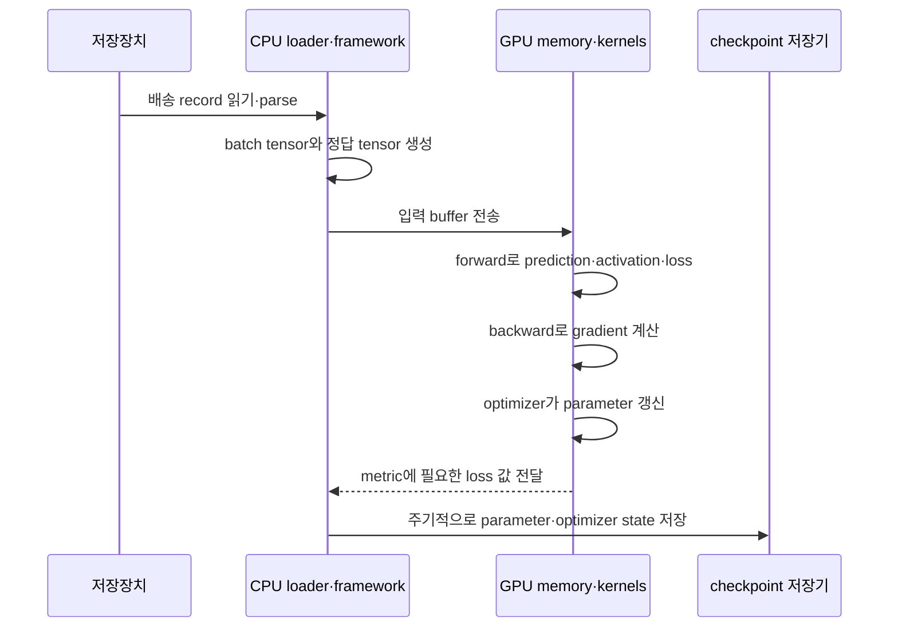
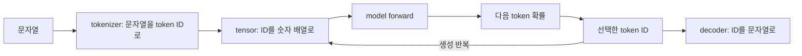

# 00. AI 워크로드와 모델: 무엇을 계산하고 무엇을 운영하는가

[AI 인프라 교재 홈](README.md) · [다음: 텐서·자동미분·Transformer](01-tensors-autograd-and-transformers.md) · [통합 학습 안내](../../../learning/README.md) · [하드웨어 GPU 장](../../../hardware/learning/server-hardware/05-gpu-npu-execution.md)

이 장은 AI를 처음 배우는 독자가 “모델을 돌린다”는 말을 더 작게 나누어 볼 수 있게 한다.
모델은 파일 하나이기도 하고, 함수이기도 하고, 서비스의 일부이기도 하다.
훈련은 모델의 값을 바꾸는 작업이고, 추론은 이미 정한 값을 사용해 답을 계산하는 작업이다.
둘 다 전기 신호, 메모리, 커널, 네트워크, 파일 저장 위에서 실행된다.

여기서 **워크로드(workload, 작업 부하)**는 컴퓨터가 처리해야 하는 입력과 계산의 묶음이다. **모델(model, 계산 규칙과 학습된 숫자의 묶음)**은 입력을 출력으로 바꾸는 함수이며, **파라미터(parameter, 매개변수)**는 훈련이 바꾸는 모델 내부 숫자다. **훈련(training, 학습)**은 예시 데이터의 오차를 이용해 파라미터를 고치는 과정이고, **추론(inference)**은 고정된 파라미터로 새 입력의 답을 계산하는 과정이다.

이 교재의 관심사는 “AI가 똑똑한가”보다 “AI 작업이 컴퓨터에서 어떤 자원을 요구하는가”다.
정확도, 비용, 지연, 처리량, 재현성, 보안은 모두 인프라 선택에 영향을 준다.
그래서 모델 이름만 보지 않고 입력의 모양, 파라미터 수, 데이터 흐름, 실패 조건을 함께 본다.

## 모델을 “파일”이 아니라 살아 있는 객체로 보기

**모델(model)**은 입력 숫자를 출력 숫자로 바꾸는 계산 규칙과, 그 규칙이 사용하는 학습된 값의 묶음이다. 디스크에서는 checkpoint나 여러 shard 파일로 저장될 수 있고, 실행할 때는 CPU RAM 또는 GPU 메모리에 읽혀 tensor가 된다. 모델이라는 말이 파일, 수학 함수, 서비스 전체를 문맥에 따라 가리키므로 “모델이 느리다” 대신 파일 로드가 느린지, 계산이 느린지, 요청 queue가 긴지 구분해야 한다.

**Tensor(텐서)**는 같은 표현 방식의 숫자를 여러 축으로 배열한 실행 객체다. 배송 요청 4건에서 거리와 무게 두 특징을 읽으면 shape `(4, 2)`인 tensor로 표현할 수 있다. **Shape(형상)**는 각 축의 길이이고, 여기서는 첫 축 4가 요청 수, 둘째 축 2가 특징 수다. **Dtype(data type, 자료형)**은 원소 하나를 어떤 비트 규칙으로 저장하고 계산하는지 나타낸다. FP32는 보통 32 bit 부동소수점, FP16은 16 bit 부동소수점 표현이다. 같은 shape라도 dtype이 다르면 payload 크기와 표현 가능한 값, 하드웨어 실행 경로가 달라진다.

**파라미터(parameter)**는 훈련이 고치는 모델 내부 tensor다. 선형 모델의 weight와 bias가 예다. 디스크 checkpoint에 보존되고 실행 중 장치 메모리에 올라가며, optimizer step을 거치며 값이 바뀐다. **Activation(활성값)**은 입력과 파라미터로 순전파를 할 때 layer 사이에 잠시 생기는 중간 tensor다. 파라미터가 많은 요청에 재사용되는 장기 상태라면, activation은 보통 현재 batch의 forward부터 backward 또는 응답 완료까지 사는 단기 상태다.

**Loss(손실)**는 현재 예측이 목표에서 얼마나 벗어났는지 학습이 다룰 수 있는 숫자로 만든 함수다. 값이 작다고 모든 제품 품질이 자동으로 좋다는 뜻은 아니다. 어떤 정답, 데이터 분포, loss 정의를 썼는지가 함께 필요하다. **Gradient(기울기)**는 특정 파라미터를 조금 움직였을 때 loss가 어느 방향으로 얼마나 변하는지 나타내는 값이다. **Autograd(자동미분)**는 forward에서 만든 연산 관계를 기록하고 chain rule을 적용해 gradient를 계산하는 소프트웨어 기작이다. Autograd가 파라미터를 직접 개선하는 것은 아니다. optimizer가 gradient를 읽고 학습률 같은 규칙을 적용해 파라미터를 갱신한다.

언어 모델의 **token(토큰)**은 tokenizer가 문자열을 나눈 단위에 부여한 정수 ID다. token은 언제나 단어 하나와 같지 않다. 단어 일부, 문장 부호, 공백 표현이 하나의 token이 될 수 있고 tokenizer마다 분할 결과가 다르다. 정수 ID는 embedding 표에서 벡터를 찾는 색인으로 사용된다. 원래 문자열, token ID, embedding vector는 서로 다른 객체다.

**GPU(Graphics Processing Unit)**는 많은 계산 실행 단위를 두고 같은 형태의 숫자 연산을 병렬로 처리하도록 설계된 가속기다. GPU는 “모델을 이해하는 상자”가 아니다. CPU 프로그램이 메모리를 준비하고 장치 명령을 제출하면 **GPU kernel(많은 GPU thread가 서로 다른 데이터에 실행하는 작은 계산 함수)**이 행렬곱 같은 일을 수행한다. 모델 파일, CPU의 Python 객체, GPU 메모리의 parameter buffer, 현재 요청의 activation buffer를 하나로 부르면 메모리 문제를 추적할 수 없다.

### 객체의 위치와 수명

| 객체 | 예시 | 주된 위치 | 언제 생기고 사라지는가 |
|---|---|---|---|
| 원본 데이터 | 배송 기록 파일 | object storage·SSD | 데이터 보존 정책 동안 |
| batch tensor | 요청 32건의 특징 | CPU RAM, 이후 GPU memory | loader가 만든 뒤 step 종료까지 |
| parameter | 거리 weight, bias | checkpoint, 실행 중 GPU memory | 모델 생성부터 종료까지 |
| activation | layer의 중간 출력 | 주로 GPU memory | 해당 forward부터 필요한 backward까지 |
| gradient | 각 parameter의 변화 방향 | parameter와 연관된 buffer | backward에서 채우고 다음 step 전 비우거나 누적 |
| optimizer state | momentum·분산 추정값 | GPU 또는 CPU memory, checkpoint | 여러 step에 걸쳐 유지 |
| token ID | tokenizer가 만든 정수 | CPU RAM, 이후 장치 buffer | 요청 전처리부터 생성 완료까지 |
| KV cache | 과거 token의 key/value | 주로 GPU memory | LLM 요청 시작부터 종료·중단까지 |

“8 GB 모델”이라는 말은 이 표 중 parameter 파일만 센 것일 수 있다. 훈련 peak에는 parameter, gradient, optimizer state, saved activation, 임시 workspace가 함께 존재한다. 추론도 동시 요청의 KV cache와 임시 buffer가 커지면 parameter 크기보다 훨씬 많은 메모리를 요구할 수 있다.

## 작은 배송 예측으로 forward부터 update까지

배송 거리를 하나의 입력으로 쓰는 아주 작은 모델을 만든다. 실제 배송 시간은 교통, 날씨, 출발 시각 등 더 많은 특징이 필요하지만, 여기서는 객체와 상태 변화를 보려고 변수 하나만 둔다.

```text
입력 x = 2
정답 y = 9
초기 weight w = 3
초기 bias b = 1
모델 y_hat = w*x + b
loss = 0.5*(y_hat-y)^2
학습률 lr = 0.1
```

**Forward(순전파)**는 현재 입력과 파라미터로 예측과 loss를 만드는 방향이다.

```text
y_hat = 3*2 + 1 = 7
error = y_hat-y = 7-9 = -2
loss = 0.5*(-2)^2 = 2
```

실행 중에는 `x`, `w`, `b`, `y_hat`, `error`, `loss`가 scalar 또는 작은 tensor로 존재한다. 실제 framework는 backward에 필요한 `x=2`와 연산 관계를 autograd graph에 연결할 수 있다. 이 graph는 데이터 샘플 파일이 아니라 현재 forward의 계산 이력이다.

**Backward(역전파)**는 loss에서 시작해 각 파라미터 방향으로 chain rule을 적용한다.

```text
d loss/d y_hat = y_hat-y = -2
d y_hat/d w = x = 2
d y_hat/d b = 1
d loss/d w = -2*2 = -4
d loss/d b = -2
```

Gradient descent optimizer는 gradient의 반대 방향으로 값을 움직인다.

```text
new_w = 3 - 0.1*(-4) = 3.4
new_b = 1 - 0.1*(-2) = 1.2
```

같은 입력으로 다시 forward하면 `3.4*2+1.2=8.0`, 새 loss는 `0.5*(8-9)^2=0.5`다. 이 한 step에서는 loss가 2에서 0.5로 줄었다. 모든 step에서 반드시 줄어드는 것은 아니다. 학습률이 너무 크거나 batch가 달라지거나 loss surface가 복잡하면 오를 수 있다.

이 추적에서 주체도 구별해야 한다. Framework는 tensor와 autograd graph를 만들고, GPU runtime은 연산을 장치에 제출하며, GPU kernel은 곱셈과 덧셈을 실행한다. Autograd가 gradient를 계산하고 optimizer가 parameter storage를 고친다. Checkpoint 저장기는 갱신된 값과 필요한 재개 상태를 파일로 직렬화한다.

## 학습 step을 시스템 시간선으로 펼치기



저장장치가 느리면 GPU가 다음 batch를 기다린다. GPU 계산이 빨라도 checkpoint를 동기식으로 오래 쓰면 step이 멈춘다. 반대로 input loader를 무한히 늘리면 CPU와 RAM을 더 쓰고 storage에 무작위 I/O 압력을 만들 수 있다. 따라서 병목은 “GPU 사용률이 낮다”에서 끝나지 않고, 어느 queue가 비었고 어느 단계가 다음 객체를 만들지 못했는지 추적한다.

## 훈련과 추론에서 같은 말이 달라지는 지점

훈련의 batch는 gradient 한 번을 만들기 위해 묶은 예제 집합이다. Batch를 크게 하면 행렬곱이 커져 GPU 사용 효율이 좋아질 수 있지만 activation과 gradient 관련 메모리도 커진다. 추론의 batch는 동시에 실행할 요청을 묶은 것이다. 더 많이 묶으면 throughput이 늘 수 있지만 앞 요청이 batch 형성을 기다려 latency가 나빠질 수 있다.

**Latency(지연 시간)**는 한 요청이 도착해 결과를 받을 때까지의 시간이고, **throughput(처리량)**은 단위 시간에 완료한 요청이나 token 수다. 둘은 서로 바꿔 얻는 경우가 많다. 요청 네 개를 5 ms 모은 뒤 15 ms에 함께 처리하면 계산 throughput은 좋을 수 있지만 첫 요청은 최소 20 ms를 기다린다. 평균만 보면 드문 긴 대기를 놓치므로 p50, p95, p99와 입력 길이 분포를 함께 본다.

LLM 추론의 prefill은 prompt token들을 병렬성이 큰 모양으로 처리한다. Decode는 각 요청마다 새 token 하나를 만들고 그 결과를 다시 입력하는 반복이다. Decode 때는 과거 token의 K와 V를 KV cache에서 읽는다. 요청 길이가 서로 다르면 어떤 요청은 먼저 끝나고 어떤 요청은 계속 자라므로 batch shape와 메모리 점유가 동적으로 바뀐다. 이 때문에 단순한 “모델 FLOPS” 하나로 serving 비용을 설명할 수 없다.


## 처음 보는 사람을 위한 전체 지도

한 문장을 입력했다고 하자. 문자열은 그대로 GPU에 들어가지 않는다. tokenizer가 문자열을 정수 ID로 바꾸고, ID가 tensor가 되어 모델을 지나며, 마지막에는 정수 ID를 다시 문자열로 바꾼다. **Tokenizer**는 단어 사전과 분할 규칙을 함께 가진 변환기다. 같은 문장도 tokenizer가 다르면 token 수와 ID가 달라져 메모리·지연·과금량까지 달라질 수 있다.



예를 들어 입력 120 token, 출력 30 token인 요청 20개를 처리하면 단순 합계는 `(120 + 30) × 20 = 3,000 token`이다. 이 계산은 모든 token의 GPU 비용이 같다는 뜻이 아니다. prompt를 한꺼번에 처리하는 prefill과 한 token씩 반복하는 decode는 연산 모양이 다르다.

## 먼저 구별할 단어

AI는 사람이 지능적이라고 부르는 행동을 컴퓨터가 하게 만드는 넓은 분야다.
머신러닝은 규칙을 사람이 모두 쓰지 않고 데이터에서 패턴을 배우게 하는 방법이다.
딥러닝은 여러 층의 신경망을 사용해 표현을 배우는 머신러닝의 한 갈래다.
LLM은 대규모 언어 모델이며, 텍스트 토큰의 다음 분포를 예측하는 방식으로 많이 훈련된다.

모델은 입력을 출력으로 바꾸는 계산 규칙과 그 안의 숫자 묶음이다.
파라미터는 훈련으로 바뀌는 숫자다.
가중치와 bias가 대표적이다.
하이퍼파라미터는 사람이 정하거나 탐색하는 설정이다.
학습률, batch size, layer 수, context 길이가 예다.

데이터셋은 훈련·검증·평가에 쓰는 예제 모음이다.
task는 풀려는 문제다.
분류, 번역, 요약, 검색, 다음 토큰 예측, 이미지 생성, 추천이 서로 다른 task가 될 수 있다.
metric은 품질을 숫자로 보는 규칙이다.
정답률, loss, BLEU, ROUGE, latency, cost per request처럼 목적에 따라 달라진다.

워크로드는 컴퓨터가 실제로 처리하는 일의 모양이다.
AI 워크로드는 모델 계산만 뜻하지 않는다.
데이터 읽기, 전처리, 토큰화, batch 만들기, GPU 전송, checkpoint 저장, 로그 수집, 네트워크 통신도 포함한다.

## 왜 이 구분이 인프라에서 중요한가

파라미터가 많으면 보통 저장 용량과 메모리 요구가 커진다.
하지만 파라미터 수만으로 속도와 비용을 말할 수는 없다.
입력 길이, batch 크기, 정밀도, 커널 구현, 캐시 재사용, 통신 방식이 함께 작동한다.

훈련은 forward 계산 뒤 backward 계산으로 gradient를 만들고 optimizer가 파라미터를 갱신한다.
그래서 가중치뿐 아니라 gradient, optimizer 상태, activation 저장 공간이 필요하다.
[03장](03-memory-precision-and-capacity.md)에서 이 메모리를 따로 계산한다.

추론은 보통 파라미터를 바꾸지 않는다.
하지만 LLM 추론은 prompt와 생성 토큰의 KV cache를 계속 저장한다.
그래서 “훈련보다 추론이 무조건 가볍다”는 말은 조건부다.
짧은 batch의 단일 요청과 긴 context의 대량 serving은 전혀 다른 워크로드다.

품질도 인프라와 분리되지 않는다.
너무 작은 batch는 GPU를 놀릴 수 있고, 너무 큰 batch는 지연이나 메모리 부족을 만든다.
낮은 정밀도는 메모리를 줄일 수 있지만 모델·연산·하드웨어 지원에 따라 품질과 속도 영향이 달라진다.
모든 수치는 버전과 설정을 함께 기록해야 한다.

## 한 요청을 끝까지 따라가기

사용자가 “서울에서 부산까지 KTX 시간 알려줘”라고 묻는 LLM 서비스를 상상하자.
이 예시는 제품 기본값이나 성능 주장이 아니다.
경로를 보기 위한 작은 지도다.

1. 클라이언트가 문자열을 보낸다.
2. 서버가 요청을 인증하고 queue에 넣는다.
3. tokenizer가 문자열을 token id 배열로 바꾼다.
4. runtime이 같은 모델·비슷한 길이의 요청을 batch로 묶을 수 있다.
5. CPU 메모리의 token id와 metadata가 GPU가 읽을 수 있는 버퍼로 준비된다.
6. GPU에서 embedding lookup, attention, MLP 같은 연산이 실행된다.
7. 다음 token의 확률 분포에서 하나 이상의 token이 선택된다.
8. 생성이 끝날 때까지 4-7단계가 반복된다.
9. token id가 다시 문자열로 바뀌고 응답이 전송된다.

여기서 모델 파일만 빠르면 충분하지 않다.
tokenizer가 CPU에서 병목이 될 수 있다.
batch queue가 너무 오래 기다리면 p99 지연이 커진다.
KV cache가 부족하면 요청을 거절하거나 더 작은 batch로 낮춰야 한다.
네트워크 응답이 streaming이면 사용자 체감 시간은 첫 token 시간과 전체 완료 시간이 모두 중요하다.

## 작은 계산: 요청 하나가 쓰는 token 처리량

가정한다.
입력 prompt가 800 tokens이고 출력이 200 tokens이다.
한 요청은 총 1,000 tokens를 모델 경로에 태운다.
서버가 초당 20 requests를 처리한다면 단순 token 처리량은 다음과 같다.

```text
총 token/s = 20 requests/s × 1,000 tokens/request
           = 20,000 tokens/s
```

이 값은 전체 시스템 처리량 모델의 한 조각이다.
prefill은 prompt 800 tokens를 한 번에 처리하는 성격이 강하고, decode는 새 token을 하나씩 생성한다.
따라서 같은 1,000 tokens라도 연산 모양이 같지 않다.
LLM serving에서는 prefill 처리량과 decode 지연을 따로 본다.

이번에는 비용을 단순 계산한다.
GPU 서버 1대 비용을 시간당 4달러라고 가정한다.
이 서버가 안정적으로 20 requests/s를 처리하고 하루 24시간 동작하면 하루 요청 수는 다음과 같다.

```text
20 requests/s × 86,400 s/day = 1,728,000 requests/day
4 dollar/hour × 24 hour/day = 96 dollar/day
96 dollar/day ÷ 1,728,000 requests/day ≈ 0.0000556 dollar/request
```

이 계산은 전기료, idle 시간, 장애 여유, CPU 서버, 네트워크, 저장, 운영 인건비, 품질 재시도 비용을 제외했다.
따라서 가격표가 아니라 산술 모델이다.
모델을 세울 때 무엇을 뺐는지 적어야 한다.

## 훈련 파이프라인의 큰 단계

훈련 데이터는 원본 그대로 들어가지 않는다.
대개 수집, 정제, 중복 제거, 필터링, 샘플링, 토큰화, shard 작성, 로딩 단계를 거친다.
각 단계는 파일 포맷, 압축, 네트워크, CPU, 저장장치의 영향을 받는다.

훈련 실행은 반복 구조다.
batch를 읽고, forward를 계산하고, loss를 만들고, backward로 gradient를 계산한다.
optimizer가 파라미터를 갱신하고, 주기적으로 checkpoint를 저장한다.
분산 훈련이면 GPU 사이의 gradient나 activation 통신이 추가된다.
[05장](05-distributed-training-and-collectives.md)에서 all-reduce 같은 collective를 다룬다.

checkpoint는 “모델 파일”보다 넓을 수 있다.
가중치만 저장하면 추론에는 충분할 수 있다.
훈련을 같은 상태에서 재개하려면 optimizer 상태, scheduler 상태, random seed, dataloader 위치가 필요할 수 있다.
어디까지 저장했는지 모르면 재현성을 주장하기 어렵다.

## 추론 파이프라인의 큰 단계

추론은 모델 로드, warmup, 요청 수신, 전처리, 스케줄링, 실행, 후처리, 응답으로 나뉜다.
서빙 시스템은 단일 함수 호출이 아니라 queue와 resource manager다.
같은 GPU에 여러 요청을 섞어 throughput을 올리려 하지만, 기다리는 시간이 늘면 지연 목표를 놓칠 수 있다.

LLM 추론에서는 prefill과 decode를 구분한다.
prefill은 prompt 전체를 읽어 내부 상태를 만든다.
decode는 방금 만든 token을 다시 넣어 다음 token을 만든다.
decode 중에는 과거 token의 key/value를 KV cache로 보관해 재계산을 줄인다.
KV cache 크기는 [03장](03-memory-precision-and-capacity.md)과 [06장](06-llm-inference-and-kv-cache.md)에서 계산한다.

## 역사: 왜 지금의 AI 인프라가 이런 모양인가

신경망은 오래된 아이디어지만, 현재의 인프라 문제는 데이터·연산·소프트웨어 생태계가 함께 커지며 생겼다.
1986년 Rumelhart, Hinton, Williams의 back-propagation 논문은 다층 표현 학습을 널리 설명한 고전이다.
2012년 AlexNet은 ImageNet 분류에서 GPU 기반 convolutional network가 큰 효과를 낼 수 있음을 보였다.
2017년 Transformer 논문은 recurrence나 convolution 없이 attention 중심 구조로 기계 번역 성능을 보였다.

이 흐름을 “GPU가 있으니 AI가 됐다”로 줄이면 놓치는 것이 많다.
데이터셋, 손실함수, optimizer, 병렬화, 자동미분, 라이브러리, 분산 파일 시스템, checkpoint 운영이 함께 필요했다.
하드웨어는 가능성을 열고, 소프트웨어와 데이터 파이프라인은 그것을 반복 가능한 작업으로 만든다.

## 인프라 관점의 품질 질문

정확한 답을 내는가?
일관되게 같은 입력을 처리하는가?
느린 요청의 꼬리는 어느 정도인가?
장애 뒤 checkpoint에서 재개할 수 있는가?
비용이 예산 안에 들어오는가?
데이터와 모델 버전을 추적할 수 있는가?

AI 서비스에서 “성공”은 HTTP 200만이 아니다.
답의 품질, 생성 중단 여부, 안전 정책 적용, 지연 목표, 로그 기록, 비용 예산이 모두 계약이 될 수 있다.
어떤 계약을 확인했는지 명시해야 나중에 같은 결과를 비교할 수 있다.

## 연구를 읽는 법: PagedAttention이 바꾼 것은 모델 수식보다 메모리 배치다

LLM decode 요청마다 KV cache 길이는 새 token이 생길 때마다 자란다. 요청의 최종 길이를 미리 정확히 모르는데 최대 길이만큼 연속 메모리를 예약하면 쓰지 않는 공간이 커지고, 서로 다른 크기의 빈 공간이 남아 새 요청을 넣기 어려워질 수 있다. **PagedAttention**은 운영체제의 paging에서 아이디어를 가져와 한 요청의 논리적인 연속 KV cache를 고정 크기 block들에 나누고, 물리적으로 떨어진 block을 매핑해 attention kernel이 읽도록 만들었다. 요청 사이 prefix나 여러 sampling 결과가 block을 공유할 여지도 생긴다.

이 변화는 attention의 수학식 `softmax(QK^T)V`를 새로운 모델로 바꾼 것이 아니다. Serving engine의 block allocator, 요청 scheduler, KV-cache-aware attention kernel을 함께 바꿔 동적 요청에서 낭비를 줄인 시스템 설계다. SOSP 2023 논문이 보고한 처리량 향상은 그 논문의 모델, GPU, 요청 분포, 비교 대상과 latency 조건에서 나온 결과다. 모든 GPU와 모든 길이에서 같은 배속이라고 일반화하면 안 된다. 짧고 동시성이 낮은 요청에서는 관리 overhead의 비중이 달라질 수 있다.


## 흔한 오개념

- “AI 모델 = LLM”은 아니다. 이미지, 음성, 추천, 표 데이터 모델도 AI 모델이다.
- “파라미터 수가 크면 항상 더 좋다”는 아니다. 데이터, task, 평가 기준, 배포 제약이 함께 결정한다.
- “훈련은 GPU만 빠르면 된다”는 아니다. 입력 파이프라인과 checkpoint 저장이 전체 시간을 제한할 수 있다.
- “추론은 훈련보다 메모리가 항상 작다”는 아니다. 긴 context와 많은 동시 요청의 KV cache가 커질 수 있다.
- “benchmark 수치 하나면 충분하다”는 아니다. batch, sequence length, precision, hardware, software version이 있어야 해석된다.

## 연습 문제와 해설

문제 1.
모델 A는 7B parameters이고 모델 B는 13B parameters다.
두 모델 중 어느 쪽 serving 비용이 항상 높은가?

해설.
항상 말할 수 없다.
파라미터 메모리는 B가 더 클 가능성이 높지만, 지연과 비용은 정밀도, batch, context 길이, 커널, KV cache, 목표 품질, GPU 활용률에 따라 달라진다.
비교하려면 같은 task, 같은 품질 기준, 같은 입력 분포, 같은 하드웨어·소프트웨어 조건을 적어야 한다.

문제 2.
prompt 2,000 tokens, output 500 tokens인 요청이 초당 8개 들어온다.
단순 token 처리량은 얼마인가?

해설.
요청당 총 token은 2,500 tokens다.
`8 × 2,500 = 20,000 tokens/s`다.
단, prefill 16,000 tokens/s와 decode 4,000 tokens/s는 실행 성격이 다르므로 하나의 평균만으로 GPU 병목을 판단하지 않는다.

문제 3.
checkpoint에 가중치만 저장했다.
훈련을 정확히 같은 상태에서 이어갈 수 있다고 말해도 되는가?

해설.
보통 충분하지 않다.
optimizer 상태, 학습률 스케줄러, random seed, 데이터 순서, 누적 step, 분산 sharding 정보가 필요할 수 있다.
“추론용 모델을 저장했다”와 “훈련 재개 상태를 저장했다”를 구별해야 한다.

문제 4.
AI 서비스에서 p50 latency는 목표 안에 있지만 p99가 크게 튄다.
가능한 원인 두 가지와 확인 방법을 말하라.

해설.
첫째, batch queue에서 일부 요청이 오래 기다릴 수 있다.
queue wait 시간을 별도 metric으로 본다.
둘째, 긴 prompt나 큰 output 요청이 섞여 GPU 실행 시간을 늘릴 수 있다.
요청별 input/output token 수와 실행 시간을 함께 기록한다.

문제 5.
배송 예측 모형에서 `x=2`, `y=9`, `w=3`, `b=1`, `loss=0.5*(y_hat-y)^2`, 학습률 `0.1`이다. 한 step 뒤 `w`, `b`, 새 loss를 구하라.

해설.
Forward에서 `y_hat=3*2+1=7`, error는 `-2`, loss는 `2`다. `dL/dw=(7-9)*2=-4`, `dL/db=-2`다. Update 뒤 `w=3.4`, `b=1.2`다. 다시 계산하면 `y_hat=8`, 새 loss는 `0.5`다. 숫자가 줄었다는 것은 이 샘플의 이 한 step 결과이며 전체 데이터 일반화 성능을 증명하지 않는다.

문제 6.
Parameter payload가 8 GiB인 모델이 12 GiB GPU에 들어간다. 그러므로 batch 1 훈련이 반드시 가능하다고 결론 내릴 수 있는가?

해설.
결론 낼 수 없다. 훈련에는 parameter 외에도 gradient, optimizer state, saved activation, 임시 workspace와 allocator 여유가 필요하다. 일부 상태를 CPU에 두거나 sharding·checkpointing을 쓰면 경계가 달라진다. 먼저 dtype, optimizer, activation shape, framework allocator, 다른 프로세스 사용량을 적어 peak를 계산해야 한다.


## 공식 자료와 원전

- PyTorch autograd 개요: https://docs.pytorch.org/tutorials/beginner/basics/autograd_tutorial.html
- PyTorch CUDA memory semantics: https://docs.pytorch.org/docs/stable/notes/cuda.html
- NVIDIA CUDA Programming Guide, asynchronous execution: https://docs.nvidia.com/cuda/cuda-c-programming-guide/02-basics/asynchronous-execution.html
- Rumelhart, Hinton, Williams, 1986, back-propagation: https://www.nature.com/articles/323533a0
- Krizhevsky, Sutskever, Hinton, ImageNet classification with deep convolutional neural networks: https://proceedings.neurips.cc/paper/2012/hash/c399862d3b9d6b76c8436e924a68c45b-Abstract.html
- Vaswani et al., Attention Is All You Need: https://arxiv.org/abs/1706.03762
- Kwon et al., Efficient Memory Management for Large Language Model Serving with PagedAttention, SOSP 2023: https://arxiv.org/abs/2309.06180

공식 문서와 논문은 개념의 기준점이다.
제품 기본값, 특정 라이브러리 최적화, GPU 세대별 성능은 시간이 지나며 바뀐다.
이 장의 계산은 구조를 이해하기 위한 모델이며 benchmark 증거가 아니다.
