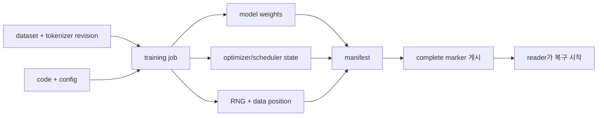

# 08. 데이터, 모델, 체크포인트

[AI 인프라 학습 목차](README.md) · 이전: [07. 서빙, 스케줄링, SLO](07-serving-scheduling-and-slo.md) · 다음: [09. GPU 클러스터와 배치](09-gpu-clusters-and-placement.md)

AI 인프라에서 데이터는 학습용 파일만 뜻하지 않는다.
dataset, tokenizer, model weight, adapter, config, 학습 코드, optimizer 상태, checkpoint manifest, serving bundle이 모두 운영 대상이다.
이 장은 “파일이 있다”와 “재현 가능하고 재시작 가능한 상태다”를 구별한다.

**Dataset(데이터셋)**은 학습·평가 샘플의 모음이고, **revision(리비전)**은 그 데이터나 모델의 식별 가능한 버전이다. **Checkpoint(체크포인트)**는 학습 중간 상태를 다시 읽을 수 있게 저장한 묶음이며, **manifest(명세 파일)**는 어떤 shard와 상태가 그 묶음에 속하는지 적는다. **Serving bundle(서빙 묶음)**은 추론에 필요한 weight, tokenizer, config와 관련 파일을 함께 배포하는 단위다.

목표는 두 가지다.
첫째, 많은 작은 파일과 큰 객체 저장소가 왜 병목을 만드는지 계산한다.
둘째, 체크포인트가 모델 weight 하나가 아니라 학습을 이어가기 위한 상태 묶음임을 이해한다.

## 파일이 존재하는 것과 복구 가능한 것은 다르다



8개 rank가 각각 5GiB shard를 쓰고 각 rank의 유효 쓰기 속도가 1GiB/s라면 완전히 병렬인 하한은 5초다. 저장소 총 대역폭이 4GiB/s로 제한되면 전체 40GiB를 쓰는 하한은 `40 ÷ 4 = 10초`다. 실제 시간에는 metadata 요청, 작은 파일, 동기화, checksum, commit marker 비용이 붙는다. 따라서 “rank당 파일 크기 ÷ 로컬 속도”와 “전체 크기 ÷ 공유 병목 대역폭” 중 큰 값을 출발점으로 삼는다.

## 핵심 용어

- **dataset:** 학습이나 평가에 쓰는 입력/정답 자료의 모음이다.
- **sample:** 학습 loop가 한 번 읽는 한 예시다.
- **shard:** 큰 dataset이나 checkpoint를 여러 파일로 나눈 조각이다.
- **object storage:** S3 같은 key-value 형태의 원격 객체 저장소다.
- **POSIX filesystem:** `open`, `read`, `write`, `rename` 같은 파일 API와 계층적 경로를 제공하는 파일시스템이다.
- **cache:** 느린 저장소에서 읽은 데이터를 가까운 곳에 임시로 보관하는 계층이다.
- **model artifact:** serving이나 fine-tuning에 필요한 weight, tokenizer, config, code, adapter, template 묶음이다.
- **revision:** artifact의 정확한 버전 식별자다. branch 이름보다 불변 commit/hash가 더 강하다.
- **checkpoint:** 학습 중 특정 시점에서 재시작하기 위한 저장 상태다.
- **manifest:** 여러 shard와 metadata가 모두 무엇인지 적은 목록이다.
- **durable:** 성공 응답 뒤 장애가 나도 저장 내용이 남는다고 기대할 수 있는 상태다.
- **activation checkpointing:** forward 중간 activation을 덜 저장하고 backward 때 다시 계산하는 메모리 절약 기법이다.
- **training checkpoint save:** 학습 재시작을 위해 weight와 optimizer 등 상태를 저장하는 일이다.

## Dataset 읽기 경로

학습 worker가 sample 하나를 읽을 때 실제 경로는 다음처럼 길 수 있다.

1. sampler가 이번 step에서 읽을 sample ID를 고른다.
2. dataset index가 sample ID를 shard와 offset으로 바꾼다.
3. local cache에 shard나 range가 있는지 본다.
4. 없으면 object storage 또는 분산 파일시스템에서 읽는다.
5. 압축을 풀고 record를 decode한다.
6. tokenizer나 image transform을 적용한다.
7. batch로 묶고 device 전송을 준비한다.
8. GPU가 기다리지 않도록 prefetch queue에 넣는다.

GPU가 비어 있는데 storage와 CPU decode가 느리면 expensive accelerator가 대기한다.
반대로 data loader worker를 무작정 늘리면 object store 요청 수, metadata lookup, local disk cache 경합이 터질 수 있다.

## 많은 작은 파일 문제

작은 파일 1,000,000개와 큰 shard 1,000개는 총 바이트 수가 같아도 운영 비용이 다르다.
작은 파일은 파일마다 open, metadata lookup, 권한 확인, 네트워크 round trip, TLS 연결 재사용, object key lookup 같은 고정 비용을 낸다.

예를 들어 파일 하나를 여는 고정 비용이 평균 2 ms이고 파일 데이터 전송은 작아서 무시한다고 하자.

```python
files = 1_000_000
open_ms = 2
total_seconds = files * open_ms / 1000
print(total_seconds, total_seconds / 3600)
```

결과는 2,000초, 약 0.56시간이다.
이 계산은 “열기”만 센 것이다.
실제에는 LIST, retry, decode, small read amplification이 더 붙는다.
그래서 AI dataset은 tar shard, parquet, webdataset, recordio 같은 묶음 형식을 쓰기도 한다.
형식 선택은 학습 프레임워크와 재현성 요구에 맞춰야 한다.

## Object storage와 POSIX 의미 차이

POSIX 파일시스템에서는 같은 디렉터리 안 `rename`을 원자적 publish에 자주 사용한다.
임시 파일을 쓰고 fsync한 뒤 최종 이름으로 바꾸면 독자는 이전 파일 또는 새 파일 중 하나를 본다.
정확한 내구성은 파일시스템과 mount 옵션, 디렉터리 동기화에 의존한다.

object storage는 보통 `PUT object`, `GET object`, `LIST prefix` 같은 API를 제공한다.
S3는 현재 일반 목적 bucket에서 성공한 PUT/DELETE 이후 GET/LIST에 강한 일관성을 제공한다고 문서화한다.
그래도 POSIX rename과 같은 “디렉터리 안에서 여러 파일을 한 번에 교체” 의미가 자동으로 생기지는 않는다.
여러 shard를 올리는 중 독자가 일부 shard만 보는 문제는 manifest publish 규칙으로 막아야 한다.

안전한 publish 패턴은 다음과 같다.

1. shard를 임시 prefix에 업로드한다.
2. 각 shard의 크기와 checksum을 확인한다.
3. manifest에 shard 목록, 크기, checksum, revision, 생성 시각을 쓴다.
4. manifest를 마지막에 최종 위치에 올린다.
5. 독자는 manifest가 가리키는 shard만 읽는다.

manifest가 마지막 commit record가 된다.
shard가 먼저 보이는 것은 괜찮지만, manifest가 없는 shard는 published dataset으로 취급하지 않는다.

## Model artifact의 구성

serving 가능한 모델은 weight 파일 하나보다 크다.
최소한 다음을 묶어야 한다.

- weight shard와 dtype.
- tokenizer vocabulary와 tokenizer config.
- model config.
- generation config 또는 chat template.
- adapter와 base model revision.
- custom code가 있다면 코드 revision과 실행 신뢰 정책.
- license와 사용 제한.
- 변환 도구와 quantization 설정.

Hugging Face Transformers의 `save_pretrained`/`from_pretrained` 흐름은 model과 tokenizer를 디렉터리 또는 model ID로 저장/로드하는 관용 경로를 제공한다.
운영에서는 branch 이름보다 불변 revision을 기록해야 한다.
`main`이 오늘과 내일 다른 파일을 가리키면 재현이 깨진다.

## 학습 체크포인트에 들어갈 상태

재시작 가능한 training checkpoint에는 보통 다음이 들어간다.

- model parameters.
- optimizer state.
- learning-rate scheduler state.
- gradient scaler state, mixed precision을 쓴다면.
- random number generator state.
- epoch, global step, micro step.
- sampler state 또는 다음 data position.
- distributed rank/world size 관련 저장 형식 정보.
- 코드와 config revision.

PyTorch의 일반 checkpoint 예시는 model state와 optimizer state, epoch, loss 등을 함께 저장하는 패턴을 보여준다.
실제 대규모 학습에서는 ZeRO/FSDP/tensor parallel 때문에 optimizer와 parameter가 rank별 shard로 나뉠 수 있다.
그래서 “rank 3의 파일 하나가 없다”는 전체 checkpoint 불능으로 이어질 수 있다.

## Activation checkpointing과 save checkpoint는 다르다

이름이 비슷해서 자주 헷갈린다.

activation checkpointing은 GPU 메모리를 아끼려고 forward 중간값 저장을 줄이는 기법이다.
대신 backward 때 일부 계산을 다시 한다.
이것은 학습 중 메모리/시간 tradeoff다.

training checkpoint save는 장애나 중단 뒤 학습을 이어가기 위해 저장소에 상태를 쓰는 일이다.
이것은 복구와 재현성 문제다.

둘 다 checkpoint라는 단어를 쓰지만 하나는 메모리 절약, 다른 하나는 내구성 저장이다.
운영 문서에는 “activation checkpointing enabled”와 “checkpoint saved every N steps”를 분리해서 적는다.

## Sharded checkpoint publish

8개 rank가 각각 checkpoint shard를 쓴다고 하자.
rank 0이 manifest를 먼저 올리고 rank 7이 나중에 실패하면 독자는 깨진 checkpoint를 볼 수 있다.
올바른 순서는 모든 shard가 durable해진 뒤 manifest를 publish하는 것이다.

간단한 상태 기계는 다음과 같다.

1. `checkpoint-123.tmp/rank-*.bin` 작성 시작.
2. 각 rank가 파일 크기와 checksum을 기록한다.
3. coordinator가 모든 rank 완료를 확인한다.
4. manifest를 작성한다.
5. manifest를 최종 이름으로 publish한다.
6. old checkpoint cleanup은 새 checkpoint 검증 뒤 별도로 한다.

cleanup을 publish와 묶지 않는다.
새 checkpoint가 깨졌는데 old checkpoint까지 지우면 재시작 지점이 사라진다.

## Epoch, step, cursor와 RNG 상태

**Epoch(에포크)**은 정해 둔 학습 데이터 전체를 한 번 순회한 단위다. **Global step**은 보통 optimizer가 파라미터를 갱신한 횟수이고, **micro step**은 gradient accumulation 안에서 작은 batch를 처리한 횟수다. 같은 epoch 2라도 어느 sample까지 읽었고 accumulation의 몇 번째 microbatch였는지에 따라 다음 계산이 달라진다.

**Cursor(커서)**는 다음에 읽을 데이터 위치를 나타내는 복구 상태다. 파일 byte offset일 수도 있고 `(shard ID, record index)`, sampler permutation의 index일 수도 있다. 커서는 dataset 파일 안에 자동으로 저장되는 값이 아니라 dataloader·sampler 또는 training coordinator가 관리하며 checkpoint와 같은 step에서 기록해야 한다. Dataset revision이 바뀌면 같은 숫자 cursor가 다른 sample을 가리킬 수 있으므로 revision과 함께 해석한다.

**RNG(Random Number Generator, 난수 생성기) 상태**는 다음 난수를 만들기 위한 내부 상태다. CPU, 각 GPU, dataloader worker, dropout과 augmentation이 서로 다른 난수 상태를 가질 수 있다. Seed는 시작점을 정하는 입력이고 RNG state는 실행 도중 현재 위치다. Seed만 다시 넣으면 checkpoint 이전까지 소비한 난수 개수를 정확히 재현하지 못해 dropout mask와 sample 순서가 달라질 수 있다.

다음은 dataset 1,000개, batch 10, accumulation 2의 단순 예다. Optimizer step 하나는 sample 20개를 소비한다.

```text
checkpoint 이름: step-30
dataset revision: sha256:D
epoch: 0
global step: 30
micro step: 0
next sample cursor: 600
sampler permutation revision: P
CPU RNG state: Rcpu
GPU rank별 RNG state: Rgpu[0..3]
```

복구기는 revision D와 permutation P를 확인하고 sample 600부터 읽는다. Model·optimizer·scheduler는 step 30 상태를 읽는다. Cursor만 580으로 돌아가면 sample 580..599를 중복 학습하고, 620이면 600..619를 건너뛴다. “정확한 재현”이 필요한 작업에서는 이 차이가 허용되지 않는다.

Checkpoint가 accumulation 중간, 예를 들어 micro step 1에서 저장된다면 아직 optimizer에 적용하지 않은 gradient buffer까지 저장하거나 그 microbatch를 다시 계산한다는 명시적 정책이 필요하다. Global step만 저장하고 gradient를 버리면 재개 직후 갱신이 달라진다. 많은 시스템은 일관성을 단순하게 만들기 위해 optimizer step 경계에서만 durable checkpoint를 게시한다.

## 원자적 게시와 reader 계약

**Atomic publish(원자적 게시)**는 독자가 미완성 묶음과 완성 묶음의 중간 상태를 보지 않게 게시 지점을 하나로 만드는 규칙이다. 여러 shard를 물리적으로 한 번에 쓰는 마법이 아니다. 작성자는 임시 이름으로 모든 객체를 저장하고 검증한 뒤, 작은 manifest나 complete marker를 마지막에 게시한다. Reader는 디렉터리 목록에서 최신 파일을 추측하지 않고 그 게시 객체가 가리키는 shard만 읽는다.

8 rank의 `step-120` 게시를 상태로 펼치면 다음과 같다.

| 시각 | 저장소 상태 | coordinator 판단 | reader가 볼 수 있는 복구점 |
|---:|---|---|---|
| t0 | `step-100/manifest` 존재 | 기존 안전점 유지 | step 100 |
| t1 | `step-120.tmp/rank0..3` 업로드 | 미완성 | step 100 |
| t2 | rank4..7 업로드, rank6 checksum 불일치 | 게시 금지 | step 100 |
| t3 | rank6 재업로드, 8개 checksum 통과 | manifest 생성 가능 | step 100 |
| t4 | `step-120/manifest` 최종 게시 | 새 안전점 | step 120 |
| t5 | 별도 보존 정책이 step 80 삭제 | publish와 독립 | step 120, rollback용 100 |

POSIX 파일시스템에서는 같은 파일시스템 안 임시 manifest를 쓰고 파일·필요한 디렉터리를 동기화한 뒤 rename하는 패턴을 쓸 수 있다. Object storage에서는 불변 shard key를 먼저 PUT하고 최종 manifest key를 마지막에 PUT한다. 어느 경우든 API의 성공 응답과 실제 durability 계약을 해당 저장소 문서로 확인한다.

Manifest는 최소한 checkpoint ID, training step, shard key, 바이트 크기, checksum, format version, world size, model·dataset·code revision을 가진다. **Checksum(검사합)**은 파일 내용을 계산해 얻는 짧은 값으로 전송·저장 중 변경을 찾는 데 쓴다. 같은 checksum이 악의적 변조까지 모두 막는다는 뜻은 아니며 신뢰 경계에는 서명과 접근 제어가 추가될 수 있다.

## 장애 복구와 rollback 전체 추적

**Rollback(롤백)**은 최신 시도보다 이전의 검증된 상태로 되돌아가는 일이다. Step 120 manifest는 있지만 shard 하나가 사라졌거나 format reader가 지원하지 않으면 loader는 그 checkpoint를 부분적으로 읽어 학습을 시작하지 않는다. Step 100을 선택하고 어떤 checkpoint가 왜 거부되었는지 기록한다.

복구 순서는 다음과 같다.

1. 저장소에서 complete manifest 후보를 읽고 step과 생성 시각으로 정렬한다.
2. Reader가 지원하는 format version인지 확인한다.
3. 모든 shard의 존재, 크기와 checksum을 검증한다.
4. Model, optimizer, scheduler, gradient scaler와 rank mapping을 복원한다.
5. Dataset revision과 tokenizer·transform revision을 고정한다.
6. Epoch, cursor, sampler와 RNG 상태를 복원한다.
7. 작은 validation batch로 loss가 유한한지, step 번호가 맞는지 확인한다.
8. 새 run ID 아래 학습을 재개하고 원래 checkpoint ID를 부모로 기록한다.

Rank 3 process가 step 137에서 죽었고 마지막 완성 checkpoint가 step 120이라고 하자. 모든 rank는 step 120으로 돌아가 17 step을 다시 계산한다. 살아 있던 rank만 137에서 계속하면 모델·optimizer 복제본과 collective 호출 순서가 어긋난다. Elastic 방식은 다른 계약을 가질 수 있지만, 어떤 상태를 보존하고 world size 변경을 어떻게 처리하는지 별도 지원 조건이 필요하다.

## Retention은 삭제 순서를 정하는 복구 정책이다

**Retention(보존 정책)**은 checkpoint를 얼마 동안 몇 개 남길지 정하는 규칙이다. 저장 비용만 보고 최신 하나만 남기면 최신 파일 손상, 조용한 데이터 오류, 뒤늦게 발견한 학습 발산에서 돌아갈 곳이 없다.

예시 정책은 “최근 3개, 최근 24시간의 시간별 1개, 최근 7일의 일별 1개, 검증 통과한 release checkpoint”를 남길 수 있다. 삭제기는 새 checkpoint가 게시됐다는 사실만 보지 않고 검증 완료와 최소 rollback 수를 확인한다. 업로드 중인 tmp 객체는 생성 시각과 active writer lease를 보고 별도 정리한다. Manifest가 참조하는 shard를 삭제하지 않도록 reference를 계산한다.

Checkpoint 하나가 2 TiB이고 10개를 보존하면 순수 payload는 20 TiB다. 압축·중복 제거·객체 버전 비용은 저장소에 따라 달라진다. 비용을 줄이기 위해 보존 수를 바꿀 때 복구 지점 목표, 탐지까지 걸리는 시간, 규제 보존 요구를 함께 결정한다.


## Worked calculation: bandwidth

checkpoint 크기가 2 TiB이고 저장 경로의 실제 지속 쓰기 처리량이 4 GiB/s라고 하자.

```python
tib = 2
gib_per_s = 4
seconds = tib * 1024 / gib_per_s
print(seconds, seconds / 60)
```

쓰기만 512초, 약 8.53분이다.
동시에 학습이 계속 달리면 storage bandwidth와 CPU, network가 학습 step과 경쟁할 수 있다.
checkpoint interval을 10분으로 잡으면 대부분의 시간이 checkpoint I/O와 겹칠 수 있다.

## Worked calculation: lost work

학습 step이 3초이고 checkpoint를 1,000 step마다 저장한다고 하자.
장애가 checkpoint 직전에 나면 최대 잃는 작업은 거의 3,000초다.
평균적으로는 interval의 절반을 잃는다고 단순 가정할 수 있다.

```python
step_seconds = 3
interval_steps = 1000
max_lost_minutes = step_seconds * interval_steps / 60
expected_lost_minutes = max_lost_minutes / 2
print(max_lost_minutes, expected_lost_minutes)
```

최대 50분, 평균 25분이다.
하지만 checkpoint를 너무 자주 저장하면 I/O 때문에 학습 자체가 느려진다.
복구 시간 목표와 저장 비용을 같이 계산해야 한다.

## 데이터 위치와 cache 정책

cache는 성능 도구이면서 재현성 위험이다.
cache hit이면 빠르고 miss이면 느리다.
old revision이 cache에 남아 있으면 잘못된 데이터를 읽을 수도 있다.

cache key에는 dataset revision, transform version, tokenizer version, compression format, shard checksum을 포함한다.
“경로가 같으니 같은 데이터”라고 가정하지 않는다.
object storage key가 overwrite될 수 있는 정책이라면 immutable prefix를 쓰거나 manifest hash로 고정한다.

local NVMe cache를 쓰는 경우 eviction도 실험 조건이다.
첫 실행 cold cache와 두 번째 실행 warm cache의 처리량은 다르다.
benchmark에는 cache 상태를 반드시 적는다.

## 오개념 바로잡기

- “모델 파일만 있으면 재현된다”: tokenizer, config, code, adapter revision이 빠지면 달라질 수 있다.
- “S3는 파일시스템이다”: object API와 POSIX rename/lock 의미는 다르다.
- “checkpoint는 weight 저장이다”: optimizer, scheduler, RNG, sampler 위치가 없으면 이어달리기가 달라질 수 있다.
- “manifest는 친절한 목록이다”: sharded publish에서는 commit record 역할을 한다.
- “작은 파일은 총량이 작으니 괜찮다”: metadata와 요청 고정 비용이 병목이 될 수 있다.
- “activation checkpointing을 켰으니 장애 복구가 된다”: 전혀 다른 의미다.

## 공식 자료

- PyTorch는 일반 checkpoint에서 model과 optimizer state 등을 함께 저장하는 예시를 제공한다: <https://docs.pytorch.org/tutorials/beginner/saving_loading_models.html>
- Hugging Face Transformers는 model/tokenizer의 `save_pretrained`와 local directory load 경로를 문서화한다: <https://huggingface.co/docs/transformers/main_classes/model>
- Amazon S3의 현재 consistency model은 성공한 PUT 뒤 GET/LIST 동작을 설명한다: <https://docs.aws.amazon.com/AmazonS3/latest/userguide/Welcome.html#ConsistencyModel>
- Linux·파일시스템 동기화 기초는 이 교재의 데이터 시스템 장을 다시 본다: <../../../kubernetes/storage/data-systems-foundations/01-linux-read-write.md>

## 연습문제와 완전 해설

### 문제 1. 쓰기 하한

500 GiB checkpoint를 실제 2 GiB/s 경로로 저장한다. 순수 쓰기 하한은?

**해설.** `500÷2=250초`, 약 4.17분이다. Shard metadata, checksum, flush, 공유 대역폭 경쟁과 manifest publish가 빠진 하한이다. Rank별 속도와 저장소 전체 상한 중 더 느린 병목을 함께 계산한다.

### 문제 2. 미완성 shard

Rank 0..7 중 rank 6 업로드가 실패했지만 나머지 파일은 있다. Manifest를 게시해도 되는가?

**해설.** 안 된다. Manifest는 완성 묶음의 commit record다. Rank 6을 재시도해 크기와 checksum까지 통과한 뒤 게시한다. 실패한 tmp shard는 reader가 보지 않으며 나중의 안전한 cleanup이 회수한다.

### 문제 3. 복구 상태

Weight 외에 학습을 같은 위치에서 이어가기 위한 상태를 네 가지 설명하라.

**해설.** Optimizer moment는 다음 갱신값, scheduler는 다음 학습률, RNG state는 dropout·augmentation 난수 위치, sampler cursor는 다음 sample을 정한다. Gradient scaler와 accumulation 중간 gradient도 정책에 따라 필요하다. 하나가 빠지면 파일은 읽혀도 이어진 계산은 달라진다.

### 문제 4. Cursor 불일치

Step 30 checkpoint가 다음 sample 600을 기록해야 하는데 580을 기록했다. Batch 10, accumulation 2라면 무슨 일이 생기는가?

**해설.** Sample 580..599의 20개를 다시 읽어 optimizer step 하나분 데이터를 중복 학습한다. Model은 step 30 상태인데 data 위치가 step 29에 가까워져 상태 쌍이 일치하지 않는다. Cursor를 model·optimizer와 같은 publish 단위에 넣어야 한다.

### 문제 5. 장애 뒤 손실 작업

Step당 3초, checkpoint 간격 1,000 step이고 장애가 다음 저장 직전에 발생했다. 최대와 단순 평균 손실 작업은?

**해설.** 최대는 `3×1000=3000초=50분`이다. 장애 시점이 구간에 균등하다는 단순 가정의 평균은 25분이다. 저장을 더 자주 하면 손실은 줄지만 I/O와 pause가 늘므로 총 완료 시간으로 비교한다.

### 문제 6. Rollback 선택

최신 step 200은 manifest가 있지만 shard checksum 하나가 틀리고 step 180은 모두 검증됐다. Loader는 무엇을 해야 하는가?

**해설.** Step 200을 부분 로드하지 않고 거부 이유를 기록한 뒤 step 180으로 rollback한다. Code와 format이 step 180을 지원하고 dataset·tokenizer revision도 복원 가능한지 확인한다. 재개 run은 parent checkpoint 180을 기록한다.

### 문제 7. Cold cache와 warm cache

같은 dataset scan의 cold run은 120분, warm run은 40분이다. 둘을 평균해 80분이라고 보고하면 왜 잘못인가?

**해설.** Cache 상태라는 서로 다른 실험 조건을 섞었다. 첫 배포나 cache eviction 뒤 동작을 묻는다면 cold가 중요하고, 반복 epoch의 정상 상태를 묻는다면 warm이 중요하다. Cache revision과 hit rate를 기록해 각각 보고한다.
