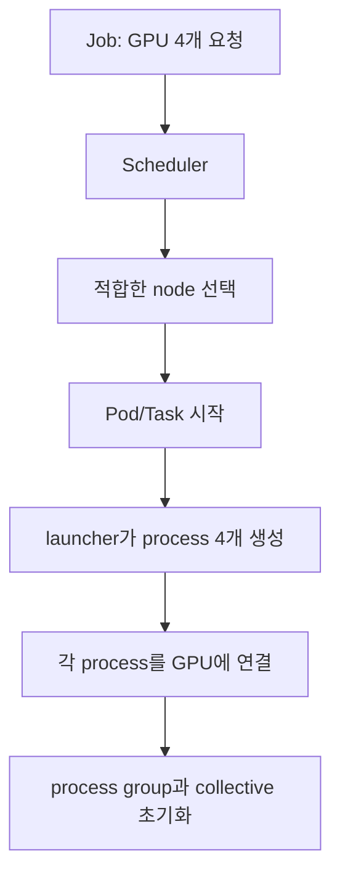

# 09. GPU 클러스터와 배치

[AI 인프라 학습 목차](README.md) · 이전: [08. 데이터, 모델, 체크포인트](08-data-models-and-checkpoints.md) · 다음: [10. 관측, 벤치마크, 비용](10-observation-benchmarking-and-cost.md)

이 장은 GPU가 여러 대 있는 환경에서 “어디에 어떤 작업을 놓을 것인가”를 다룬다.
Kubernetes나 Slurm을 실제로 배포하지 않는다.
대신 node, Pod, process, rank, GPU, NIC, NUMA, PCIe, RDMA, NCCL 같은 단어가 서로 어떻게 연결되는지 배운다.

**Node(노드)**는 cluster가 작업을 배치하는 서버 한 대이고, **Pod(파드)**는 Kubernetes가 함께 실행·격리하는 container 묶음이다. **Process(프로세스)**는 실행 중인 프로그램 한 개다. **NIC(Network Interface Card, 네트워크 인터페이스 카드)**는 서버를 네트워크에 연결하고, **NUMA**는 CPU와 메모리 거리에 따라 접근 비용이 달라지는 구조다. **PCIe**는 CPU·GPU·NIC 같은 장치를 잇는 버스이며, **RDMA**는 원격 CPU의 복사를 줄여 다른 서버 메모리와 직접 데이터를 옮기는 방식이다. **NCCL**은 GPU 사이 collective를 구현하는 통신 라이브러리다.

AI 클러스터 문제는 단순히 GPU 개수 세기가 아니다.
같은 8 GPU라도 한 노드 안 NVLink로 묶인 8 GPU와, 네트워크를 건너는 8 GPU는 통신 비용이 다르다.
또한 GPU memory가 충분해도 CPU memory, local disk, network, image pull, checkpoint I/O 때문에 pending이나 straggler가 생길 수 있다.

## 스케줄러가 고르는 것과 프로그램이 만드는 것



스케줄러는 보통 “GPU 자원이 있는 어느 node에서 workload를 시작할지”를 결정한다. `rank 0..3`은 스케줄러가 GPU에 붙인 영구 번호가 아니라 launcher와 분산 runtime이 process group을 만들며 정하는 실행 번호다. node의 GPU index, Kubernetes가 노출한 device, process의 local rank, global rank를 별도 열로 기록해야 장애 로그를 실제 하드웨어에 연결할 수 있다.

이 저장소의 `TwinX`는 표준 GPU 기능이나 제품군 이름이 아니라 **특정 연구실 GPU node를 가리키는 로컬 별칭**이다. `A7` 같은 이름도 다른 운영 문서에서 장비·랙·호스트 별칭으로 쓰였다면 같은 원칙을 적용한다. 별칭을 처음 쓸 때 위치, GPU 모델과 수, NIC, NUMA/PCIe 연결, 확인 날짜를 함께 적지 않으면 초심자는 일반 기술 용어로 오해한다.

## 핵심 용어

- **node:** Kubernetes나 Slurm이 작업을 올리는 물리/가상 서버다.
- **Pod:** Kubernetes에서 함께 배치되는 하나 이상의 container 묶음이다.
- **process:** OS가 실행하는 프로그램 인스턴스다.
- **rank:** 분산 학습에서 각 process에 붙는 번호다. 보통 rank마다 GPU 하나를 담당한다.
- **world size:** 전체 rank 수다.
- **device plugin:** Kubernetes kubelet에 장치 자원을 알려주는 플러그인 방식이다.
- **DRA:** Dynamic Resource Allocation. Kubernetes에서 장치 요청과 할당을 더 구조화하는 API 경로다.
- **MIG:** NVIDIA Multi-Instance GPU. 지원 GPU를 하드웨어 격리된 여러 인스턴스로 나누는 기능이다.
- **MPS:** NVIDIA Multi-Process Service. 여러 CUDA process가 GPU를 더 잘 공유하도록 돕는 기능이다.
- **time-slicing:** 여러 workload가 시간적으로 GPU를 나누어 쓰는 방식이다.
- **NUMA:** CPU socket과 memory 가까움이 균일하지 않은 구조다.
- **PCIe topology:** GPU, NIC, NVMe가 어떤 root complex와 switch를 공유하는지 나타내는 연결 구조다.
- **RDMA:** CPU 개입을 줄이고 NIC가 원격 memory와 직접 데이터 교환을 돕는 기술 범주다.
- **NCCL:** NVIDIA GPU collective communication library다.
- **placement:** 작업을 어느 node, GPU, topology에 둘지 정하는 일이다.
- **straggler:** 같은 job 안에서 다른 rank보다 늦어 전체를 기다리게 만드는 rank다.

## Device plugin과 DRA

Kubernetes의 전통적인 GPU 사용은 device plugin이 kubelet에 `nvidia.com/gpu` 같은 확장 자원을 알리는 방식이다.
Pod는 resource limit에 GPU 개수를 요청하고, scheduler는 해당 개수를 가진 node를 찾는다.
이 모델은 단순하고 널리 쓰인다.
하지만 장치의 세부 속성, 동적 준비, 복잡한 topology 요구를 표현하기에는 제한이 있다.

DRA는 장치 요청을 ResourceClaim 같은 구조로 표현해 더 풍부한 할당을 가능하게 하려는 경로다.
공식 Kubernetes 문서는 DRA가 device allocation을 구조화한다고 설명한다.
NVIDIA DRA driver 문서는 multi-node NVLink fabric 같은 더 복잡한 할당을 다루는 사례를 제시한다.

초보자는 둘을 “신구 기술”로만 외우면 안 된다.
운영 환경에서는 device plugin 기반 경로가 여전히 존재하고, DRA는 cluster version, driver, plugin, scheduler 통합 상태를 확인해야 한다.
이 장에서는 배포 절차를 제공하지 않고 개념만 다룬다.

## Node, Pod, process, rank

분산 학습 job이 2 node × 4 GPU로 돈다고 하자.
가능한 구조는 다음과 같다.

- node는 2대다.
- 각 node에는 GPU 4개가 있다.
- 각 node에 Pod 1개를 올릴 수 있다.
- 각 Pod 안에서 process 4개를 실행할 수 있다.
- 전체 rank는 8개다.
- 보통 rank 0-3은 node A, rank 4-7은 node B에 놓는다.

rank는 Kubernetes object가 아니다.
rank는 training launcher와 framework가 process에 부여하는 논리 번호다.
Pod가 Running이어도 rank 초기화가 실패할 수 있고, rank가 떠도 NCCL 연결이 실패할 수 있다.
그래서 진단할 때 scheduler 상태와 process 로그를 둘 다 봐야 한다.

## Whole GPU, MIG, MPS, time-slicing

whole GPU는 GPU 하나를 한 workload에 통째로 준다.
격리와 예측 가능성이 가장 단순하다.
대신 작은 추론 workload에는 낭비가 생길 수 있다.

MIG는 지원 GPU에서 GPU를 여러 인스턴스로 나누어 각 인스턴스에 계산/메모리 자원을 격리한다.
MIG profile은 제품과 설정에 의존한다.
MIG를 쓰면 “GPU 한 장”이라는 말보다 “어떤 profile의 몇 인스턴스”가 더 정확하다.

MPS는 여러 process가 같은 GPU에서 CUDA 작업을 공유하도록 돕는다. NVIDIA device plugin의 MPS sharing 경로는 control daemon을 통해 client별 memory와 compute 몫을 제한할 수 있다.
이 자원 제한을 MIG의 하드웨어 자원 분할·격리와 같은 계약으로 보지는 않는다. 확인한 [device plugin 문서](https://github.com/NVIDIA/k8s-device-plugin#with-cuda-mps)는 MPS sharing을 experimental로 설명하고 MIG가 켜진 장치에서는 지원하지 않는다고 명시한다. 지원 조합과 제한 방식은 설치한 plugin·CUDA 버전에서 다시 확인한다.

time-slicing은 여러 Pod나 workload가 GPU를 번갈아 쓰게 한다.
시간을 나누는 것이지 GPU memory를 자동으로 안전하게 fractional guarantee로 나누는 뜻이 아니다.
NVIDIA device plugin 문서는 sharing 전략으로 time-slicing과 MPS를 설명하지만, 운영자는 isolation과 fault boundary를 별도로 이해해야 한다.

## 배치가 성능을 바꾸는 이유

GPU 계산 자체보다 GPU 사이 통신이 느리면 전체 job이 느려진다.
분산 학습의 all-reduce는 모든 rank가 gradient를 교환해야 다음 step으로 간다.
rank 하나가 느리면 나머지도 기다린다.

placement에서 보는 항목은 다음과 같다.

- 같은 node 안 GPU끼리 빠른 링크가 있는가.
- GPU와 NIC가 같은 PCIe switch 또는 NUMA node에 가까운가.
- NIC가 RDMA를 지원하고 설정이 맞는가.
- local NVMe cache와 CPU memory가 충분한가.
- 같은 node에 noisy workload가 있는가.
- scheduler가 topology 정보를 알고 있는가.

NCCL은 topology와 network 선택에 민감하다.
NCCL 환경 변수 문서는 network interface, topology file, debug 같은 설정을 제공한다.
하지만 환경 변수를 임의로 넣는 것은 치료가 아니라 실험이다.
변경 전후의 topology, log, 성능을 함께 남겨야 한다.

## Slurm, Kubernetes, Kueue의 관점

Slurm은 HPC에서 오래 쓰인 cluster workload manager다.
공식 문서는 resource allocation, job queue, scheduling, job launch를 핵심 기능으로 설명한다.
사용자는 `sbatch` 같은 방식으로 job을 제출하고, scheduler는 partition, priority, resource 조건을 보고 실행한다.

Kubernetes는 container orchestration 시스템이다.
Pod, node, resource request/limit, scheduler, controller를 중심으로 움직인다.
long-running service와 batch job을 모두 다룰 수 있지만, AI batch queue 정책은 기본 scheduler만으로 충분하지 않을 수 있다.

Kueue는 Kubernetes-native job queueing을 제공한다.
Kueue 문서는 Workload, ClusterQueue, LocalQueue, admission 같은 개념을 사용한다.
admission은 job을 시작해도 되는지 quota 기준으로 결정하는 단계다.

세 시스템을 “무엇이 더 좋다”로 외우지 않는다.
질문을 나눈다.
누가 quota를 정하는가.
누가 queue 순서를 정하는가.
누가 Pod/process를 실제로 띄우는가.
누가 GPU topology를 알고 있는가.
누가 실패한 rank를 재시작하는가.

## Quota, queue, gang이 배치 전에 만드는 상태

**Quota(할당 한도)**는 사용자·팀·queue가 일정 기간 또는 동시에 사용할 수 있는 자원 상한이다. GPU가 물리적으로 비어 있어도 팀의 quota가 모두 사용 중이면 새 job은 입장하지 못한다. Quota 객체는 Kubernetes의 ResourceQuota나 Kueue ClusterQueue, Slurm account 정책처럼 control plane 저장소에 있고 관리자가 정책으로 갱신한다. Job보다 오래 살며 여러 job 사이 공정성과 비용 경계를 만든다.

**Gang scheduling(묶음 스케줄링)**은 분산 job에 필요한 task를 일부만 시작하지 않고 함께 실행할 수 있을 때 입장시키는 정책이다. 8-rank job에 GPU 8개가 필요한데 4개만 먼저 시작하면 rank 0..3은 나머지 rank와 rendezvous·collective를 기다리며 GPU를 점유할 수 있다. Gang admission은 “8개 모두를 배치할 수 있는가”를 먼저 확인해 이 교착 같은 낭비를 줄인다.

다음 상태를 보자.

```text
team-A quota: GPU 8개
이미 실행 중: job-X가 GPU 6개 사용
새 job-Y: worker 4개, worker당 GPU 1개, 모두 함께 시작 필요
cluster free: 서로 다른 node에 GPU 10개
```

Cluster 전체에는 10개가 비어 있지만 team-A의 남은 quota는 2개라 job-Y는 admission을 통과하지 못한다. Worker 2개만 먼저 띄우지 않고 queue에 둔다. Job-X가 끝나 6개가 반환되면 team-A 사용량이 0이 되고 Y의 4개를 함께 예약한 뒤 Pod를 만든다. “Pending인데 GPU 10개가 보인다”는 관찰만으로 scheduler 고장이라고 결론 내리면 안 된다.

## Fragmentation: 총 GPU 수와 가능한 묶음은 다르다

**자원 단편화(fragmentation)**는 빈 자원의 총합은 충분하지만 한 job이 요구하는 모양으로 모여 있지 않은 상태다. 메모리 단편화와 비슷한 단어지만 여기서는 node·GPU topology의 빈칸을 말한다.

| Node | GPU 총수 | 사용 중 | 빈 GPU | 빠른 4-GPU island |
|---|---:|---:|---:|---|
| A | 8 | 6 | 2 | 없음 |
| B | 8 | 5 | 3 | 없음 |
| C | 8 | 7 | 1 | 없음 |

빈 GPU는 총 6개지만 “한 node의 같은 NVLink island에서 4개”를 요구하는 job은 배치할 수 없다. 제약을 풀어 node 두 대에 2+2로 놓으면 실행은 가능할 수 있으나 node 간 통신 때문에 step 시간이 늘어난다. 스케줄러가 기존 작은 job을 임의 이동시키지 못하면 기다리거나, checkpoint 후 재배치하거나, topology 조건을 완화하는 선택이 필요하다.

Bin packing은 빈칸을 줄이려 job을 조밀하게 모으고, spread는 장애와 간섭을 줄이려 흩는다. 어느 쪽도 항상 옳지 않다. 분산 훈련은 통신 locality를 위해 모으고, 동일 서비스 replica는 장애 도메인을 나누기 위해 흩을 수 있다.

## NUMA와 링크를 포함한 실제 배치 결정

**NUMA node**는 CPU core와 가까운 memory·I/O 장치의 묶음이다. GPU process가 NUMA 0에 가까운 GPU를 쓰는데 dataloader thread와 pinned buffer가 NUMA 1에 놓이면 CPU memory에서 GPU로 가는 경로가 socket 사이 link를 건널 수 있다. 운영체제와 런타임이 placement를 관리하지만 application의 CPU affinity와 memory allocation 시점도 결과에 영향을 준다.

두 socket 서버를 단순화하자.

```text
NUMA 0: CPU0, RAM0, GPU0-3, NIC0
NUMA 1: CPU1, RAM1, GPU4-7, NIC1
GPU0-3와 GPU4-7 사이는 더 느린 경로
```

4-rank single-node job은 GPU0-3, CPU worker는 NUMA0, node 밖 통신은 NIC0으로 맞추는 후보가 있다. 8-rank job은 두 NUMA 영역을 모두 쓰므로 rank 0-3과 4-7을 각각 가까운 CPU·NIC에 묶고, node 밖 collective가 어떤 NIC를 쓰는지 확인한다. 단순히 `CUDA_VISIBLE_DEVICES=0,4,1,5`처럼 섞으면 local rank 이웃이 물리적으로 멀 수 있다.

**Link(링크)**는 데이터를 옮기는 실제 연결이다. NVLink, PCIe, socket interconnect, Ethernet·InfiniBand가 있으며 대역폭과 지연이 다르다. NCCL은 topology를 보고 경로와 collective 알고리즘을 선택할 수 있지만, container에 노출된 topology 정보와 driver·network plugin 지원이 맞아야 한다. Scheduler가 GPU 개수만 보고 고른 node가 통신에는 나쁜 모양일 수 있다.

## Sharing의 자원 계약을 분리한다

Whole GPU, MIG, MPS, time-slicing은 “한 장을 나눈다”는 문장 아래 같은 것으로 묶으면 안 된다.

| 방식 | 스케줄러가 보는 단위 | 메모리·계산 격리 | 수명과 관리자 |
|---|---|---|---|
| Whole GPU | GPU 장치 하나 | 한 workload가 전용 사용 | Pod/job allocation 동안 device manager가 연결 |
| MIG | 지원 GPU의 profile 인스턴스 | 하드웨어 분할 범위의 격리 | 관리자가 profile 구성, scheduler가 인스턴스 할당 |
| MPS | 여러 CUDA process의 공유 | 설정된 compute·memory 제한, 지원 조건 확인 | MPS daemon과 client process 수명 |
| Time-slicing | 논리적으로 복제 노출된 GPU 자원 | 시간 공유이며 memory 보장과 동일하지 않음 | plugin 정책과 Pod 수명 |

한 Pod의 잘못된 kernel이나 장치 reset이 다른 공유 사용자에게 미치는 **fault isolation(장애 격리)**도 방식마다 다르다. 같은 GPU에서 서로 다른 tenant를 공유할 때는 성능 간섭뿐 아니라 데이터 격리와 장애 반경을 확인한다.

## Failure domain과 재시작 범위

**Failure domain(장애 도메인)**은 한 고장이 함께 영향을 줄 수 있는 자원 범위다. GPU 하나, node 하나, top-of-rack switch, storage zone, 전원 rack이 각각 장애 도메인이 될 수 있다. Replica를 서로 다른 node에 놓아도 같은 전원이나 switch를 공유하면 더 큰 장애에는 함께 멈출 수 있다.

2 node×4 GPU의 8-rank 동기 학습에서 node B가 꺼지면 rank 4..7만 사라지지만 rank 0..3도 collective를 끝낼 수 없다. 일반적인 고정 world-size 계약에서는 전체 job을 마지막 완성 checkpoint로 재시작한다. Elastic training이 일부 node 교체와 world-size 변경을 지원하려면 optimizer·sampler·collective 재구성 의미가 명시되어야 한다.

반면 추론 replica 4개를 두 node에 2개씩 두었다면 node 하나 실패 뒤 남은 두 replica가 계속 응답할 수 있다. 그러나 load balancer가 실패 endpoint를 제거하고 남은 replica의 admission을 낮추지 않으면 과부하가 연쇄될 수 있다. 학습 rank와 서비스 replica는 같은 Pod라도 실패 처리 계약이 다르다.

## 배치와 실패를 잇는 세 가지 trace

**Trace A: Pending.** Job object는 생성됐지만 queue quota가 없어 admission 전이다. Pod가 아직 없으므로 container log와 GPU OOM을 찾을 단계가 아니다. Queue 상태와 quota 사용자를 확인한다.

**Trace B: Running 뒤 rendezvous timeout.** Pod 8개는 Running이고 device도 보이지만 rank 6이 잘못된 network interface를 골라 process group에 합류하지 못했다. Scheduler는 일을 끝냈다. Rank별 주소·world size·NIC와 firewall, 최초 collective log를 비교한다.

**Trace C: Step 40의 straggler.** 모든 rank가 시작했지만 rank 5의 dataloader queue가 비고 GPU가 200 ms 쉰다. 나머지는 all-reduce에서 기다린다. NCCL 시간이 길어 보여도 원인은 rank 5의 local NVMe miss일 수 있다. Rank별 forward 시작 시각, input queue, collective 진입 시각을 연결해야 한다.


## Pending, OOM, straggler 진단 행렬

| 증상 | 먼저 볼 곳 | 가능한 원인 | 다음 질문 |
| --- | --- | --- | --- |
| Pod Pending | scheduler event, quota | GPU 부족, node selector, taint, queue admission 대기 | 자원이 정말 없나, 정책 때문에 막혔나 |
| Pod Running but no GPU | container env, device files | device plugin/CDI/runtime 문제 | container 안에 장치가 보이나 |
| CUDA OOM | process log, memory metric | model/KV/batch가 큼, fragmentation, 다른 process | 누가 GPU memory를 잡고 있나 |
| CPU OOM | kubelet event, cgroup | dataloader, tokenizer, cache, mmap | GPU 문제가 아니라 host memory인가 |
| Slow all-reduce | NCCL log, NIC counter | topology, network, rank imbalance | 특정 rank만 느린가 |
| Low GPU use | dataloader, queue, CPU | input pipeline, small batch, sync wait | GPU가 기다리는 대상은 무엇인가 |
| Random retry storm | job controller, logs | rank failure, checkpoint restore 실패 | 같은 원인이 반복되나 |

이 표는 명령 목록이 아니라 사고 순서다.
실제 명령은 운영 권한과 환경별 runbook을 따라야 한다.

## 읽기 전용 예시 명령

아래 명령은 운영 cluster에서 읽기 전용으로 상태를 보는 예시다.
이 문서는 실행을 요구하지 않는다.
권한, context, namespace를 확인하지 않고 붙여넣지 않는다.

```bash
kubectl get nodes
kubectl describe pod "$POD_NAME" -n "$NAMESPACE"
kubectl get events -n "$NAMESPACE" --sort-by=.lastTimestamp
kubectl logs "$POD_NAME" -n "$NAMESPACE"
```

GPU node 내부에서는 다음 정보가 topology 추정에 쓰일 수 있다.
역시 읽기 예시일 뿐이다.

```bash
nvidia-smi topo -m
nvidia-smi
lspci -tv
numactl --hardware
```

## Worked calculation: rank 배치

8 GPU job이 두 가지 배치 후보를 가진다고 하자.

- 후보 A: 8 GPU가 한 node 안에 있다.
- 후보 B: 4 GPU node 두 대에 걸쳐 있다.

학습 step에서 node 안 통신은 80 ms, node 간 통신은 220 ms라고 단순 가정한다.
계산 시간은 500 ms다.

```python
compute_ms = 500
intra_ms = 80
inter_ms = 220
step_a = compute_ms + intra_ms
step_b = compute_ms + inter_ms
print(step_a, step_b, round(step_b / step_a, 2))
```

후보 A는 580 ms, 후보 B는 720 ms다.
후보 B는 이 단순 모델에서 1.24배 느리다.
현실에서는 통신과 계산이 일부 overlap될 수 있지만, placement가 step time을 바꾸는 이유는 이 계산으로 볼 수 있다.

## 기존 runbook 연결

이 저장소에는 실제 GPU 운영 기록이 있다.
초보자는 먼저 이 장의 개념을 읽고, 그 다음 실제 runbook에서 어떤 문제가 어떤 증거로 기록되었는지 본다.

- Kubernetes GPU 운영 색인: <../../../kubernetes/gpu/README.md>
- NVIDIA AI Infrastructure와 DSX 학습 메모: <../../../kubernetes/gpu/nvidia-ai-infrastructure-dsx-notes-2026-08.md>
- TwinX GPU node onboarding 기록: <../../../kubernetes/gpu/twinx-kiss-gpu-node-onboarding-2026-08-24.md>

실제 runbook은 특정 장비와 날짜의 기록이다.
거기에 나온 명령이나 설정을 일반 처방으로 복사하지 않는다.
개념, 증거, 실패 복구 흐름을 배운다.

## 오개념 바로잡기

- “GPU 8개면 어디 있든 8배다”: topology와 통신 때문에 아니다.
- “MIG/MPS/time-slicing은 모두 같은 GPU 쪼개기다”: 격리와 보장 범위가 다르다.
- “time-slicing이면 memory도 공평히 나뉜다”: 시간 공유와 memory quota는 다른 문제다.
- “Pod Running이면 학습이 정상이다”: rank 초기화, NCCL, data path가 실패할 수 있다.
- “NCCL env 하나면 통신 문제가 해결된다”: topology와 network 증거 없이 넣는 설정은 새 문제를 만들 수 있다.
- “Kubernetes가 topology를 알아서 최적으로 잡는다”: plugin, scheduler, policy가 제공하는 정보에 의존한다.

## 공식 자료

- Kubernetes GPU scheduling: <https://kubernetes.io/docs/tasks/manage-gpus/scheduling-gpus/>
- Kubernetes Dynamic Resource Allocation: <https://kubernetes.io/docs/concepts/resource-management/dynamic-resource-allocation/>
- NVIDIA Kubernetes device plugin sharing 문서: <https://github.com/NVIDIA/k8s-device-plugin/blob/main/README.md>
- NVIDIA DRA driver for GPUs: <https://dra-driver-nvidia-gpu.sigs.k8s.io/>
- Kueue concepts: <https://kueue.sigs.k8s.io/docs/concepts/>
- Slurm overview: <https://slurm.schedmd.com/overview.html>
- NCCL environment variables: <https://docs.nvidia.com/deeplearning/nccl/user-guide/docs/env.html>

## 연습문제와 완전 해설

### 문제 1. Pending의 단계

Pod가 Pending이고 GPU node에는 빈 장치가 보인다. GPU memory 부족이라고 결론 내릴 수 있는가?

**해설.** 없다. Pending은 container가 장치 메모리를 할당하기 전 scheduler·queue 단계다. Quota, gang admission, node selector, taint/toleration, 요청한 GPU profile과 topology를 먼저 본다. Event에서 어느 조건이 거부했는지 확인한다.

### 문제 2. Gang과 quota

팀 quota 8개 중 6개를 사용 중이고 새 4-rank job이 모두 함께 시작해야 한다. Cluster에는 GPU 10개가 비어 있다. 새 job 상태는?

**해설.** 팀의 남은 quota는 2개라 4개 요청을 입장시킬 수 없다. Gang 정책은 worker 2개만 먼저 띄우지 않고 전체를 queue에 둔다. 기존 6개가 반환되거나 quota가 바뀌어야 admission이 가능하다.

### 문제 3. Topology 단편화

세 node의 빈 GPU가 각각 2, 3, 1개다. 같은 node에서 GPU 4개가 필요한 job을 배치할 수 있는가?

**해설.** 총 6개가 비어도 어느 node에도 4개가 없어 불가능하다. 요구 조건을 node 간 2+2로 완화하면 가능할 수 있지만 통신 비용과 지원 방식을 다시 평가한다. 총량과 가능한 묶음을 구분한다.

### 문제 4. Time-slicing의 보장

GPU 하나를 네 Pod가 time-slicing으로 공유한다. 각 Pod가 메모리 1/4과 지연 1/4을 보장받는가?

**해설.** 일반화할 수 없다. Time-slicing은 실행 시간을 번갈아 제공하는 정책이고 memory quota·fault isolation과 같은 계약이 아니다. Plugin 설정, workload memory peak와 동시 context 비용을 확인한다.

### 문제 5. NUMA 배치

GPU0과 NIC0은 NUMA0, CPU worker와 pinned buffer는 NUMA1에 있다. 어떤 비용이 생길 수 있는가?

**해설.** Host memory에서 GPU·NIC로 가는 데이터가 socket 사이 link를 건너 추가 대역폭 경쟁과 지연을 만들 수 있다. CPU affinity, memory allocation 위치, GPU/NIC topology를 함께 맞추고 변경 전후 H2D·network 시간을 측정한다.

### 문제 6. Straggler

16-rank job에서 rank 12만 매 step 200 ms 늦고 다른 rank의 all-reduce 대기가 길다. 무엇을 비교하는가?

**해설.** Rank별 input queue, forward·backward 종료와 collective 진입 시각을 먼저 맞춘다. Rank 12의 GPU clock·오류, CPU·NVMe cache, NIC 경로와 noisy neighbor를 본다. Collective에서 기다린 시간이 길다고 network가 원인이라고 단정하지 않는다.

### 문제 7. Node 장애

2 node×4 GPU 동기 학습에서 한 node가 사라졌다. 남은 네 rank만 계속 step을 진행해도 되는가?

**해설.** 고정 world-size collective에서는 안 된다. 상대 rank가 없어 collective가 완료되지 않고 model·optimizer 복제본도 일치하지 않는다. 전체를 마지막 검증 checkpoint로 재시작한다. Elastic 재구성을 쓰려면 framework가 world-size 변경과 sampler·optimizer 의미를 지원하는지 별도 확인한다.
