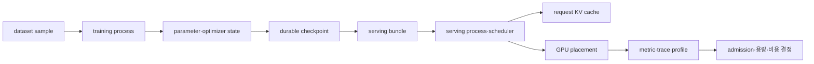

# 12. AI 인프라 종합 개념과 완전 풀이

[학습 안내](README.md) · 이전: [로컬 실습과 연구](11-local-labs-and-research.md)

이 장은 영어 용어를 한 줄씩 외우는 사전이 아니다. 하나의 모델이 학습되고, 장애에 대비해 저장되고, 요청을 받아 추론하며, GPU 클러스터에 배치되고, 지표로 관측되는 전체 흐름을 따라간다. 각 개념을 만날 때 실제 대상이 무엇인지, 어디에 저장되는지, 누가 만들고 지우는지, 얼마나 오래 사는지 확인한다.



## 1. 학습 전: 데이터와 모델 객체

**Dataset(데이터셋)**은 학습이나 평가에 사용할 sample의 모음이다. Sample은 문장 하나, 이미지 하나, 대화 한 묶음처럼 학습 loop가 읽는 한 사례다. Dataset은 object storage, 분산 파일시스템이나 로컬 NVMe의 파일·객체로 존재한다. Dataset 관리자는 사람이 정한 revision, shard 목록, checksum과 schema를 manifest에 기록한다. 학습 job보다 오래 살며 여러 run이 같은 불변 revision을 읽을 수 있어야 비교가 가능하다.

**Tokenizer(토크나이저)**는 문자열을 모델이 처리하는 정수 token ID 배열로 바꾸는 코드와 vocabulary다. Token은 글자나 단어와 항상 일대일이 아니다. 같은 문자열도 tokenizer revision이 다르면 ID와 길이가 달라질 수 있다. Tokenizer 파일은 model artifact에 저장되고 CPU process가 요청 또는 sample을 처리할 때 메모리에 올린다.

**Model(모델)**은 입력을 출력으로 바꾸는 계산 구조와 학습한 상태를 합친 말이다. **Parameter 또는 weight(파라미터·가중치)**는 학습으로 조정되는 숫자 tensor다. Tensor는 여러 축을 가진 숫자 배열이며 shape는 각 축 길이, dtype은 각 숫자의 저장 형식이다. Weight는 checkpoint 파일, CPU RAM, GPU device memory에 복사본 또는 shard로 존재할 수 있다. 학습 중에는 optimizer가 갱신하고 추론 중에는 주로 읽는다.

**Activation(활성값)**은 입력과 weight로 forward 계산을 하며 layer 사이에 생기는 중간 tensor다. GPU 메모리에 있고 현재 batch와 step 동안만 산다. 학습에서는 backward가 필요로 하므로 일부를 보관한다. **Gradient(기울기)**는 parameter가 조금 변할 때 loss가 어떻게 변하는지 나타내는 같은 shape의 값이다. Backward 중 만들어져 optimizer step에 소비된다.

**Loss(손실)**는 모델 출력과 목표 차이를 학습 가능한 수로 만든 것이다. Loss가 작아졌다는 사실은 서비스의 정확성·안전성·지연이 모두 좋아졌다는 뜻이 아니다. 어떤 sample과 token을 어떤 분모로 평균했는지 정의해야 한다.

## 2. 한 학습 step의 객체 수명

**Batch(배치)**는 한 번의 계산에 묶은 sample 집합이고 **microbatch(마이크로배치)**는 메모리에 맞게 더 작게 나눈 묶음이다. **Gradient accumulation(기울기 누적)**은 여러 microbatch의 backward 결과를 gradient buffer에 모은 뒤 optimizer를 한 번 실행하는 방식이다.

두 microbatch를 누적하는 한 step을 추적하자.

```text
step 시작
  persistent: weight W, optimizer state M, scheduler state L
microbatch 0 forward
  input X0 → activation A0 → loss L0
microbatch 0 backward
  A0 소비 → gradient buffer G=G0
microbatch 1 forward/backward
  G=G0+G1
분산 동기화
  같은 parameter 복제본을 가진 rank 사이 G 축약
optimizer step
  W와 M 갱신, global step +1
정리
  activation과 임시 workspace 회수, G zero 또는 재사용
```

**Optimizer(최적화기)**는 gradient와 자신의 내부 상태를 사용해 weight를 갱신하는 규칙이다. Adam의 moment나 momentum은 GPU·CPU 메모리에 tensor로 존재하고 여러 step을 가로질러 산다. Weight만 복원하고 optimizer state를 버리면 같은 다음 gradient를 받아도 갱신이 달라질 수 있다.

**Learning-rate scheduler**는 global step 등에 따라 학습률을 바꾸는 상태 기계다. 여기서 scheduler는 요청 스케줄러가 아니라 학습률 관리자다. 같은 단어를 문맥 없이 쓰면 안 된다.

**Autograd(자동 미분)**는 forward 연산 관계를 기록해 chain rule로 gradient 계산을 구성하는 기능이다. 일반적인 자동 미분이 weight를 하나씩 흔드는 유한 차분이라는 뜻은 아니다. 기록 객체는 forward부터 backward가 해당 경로를 소비할 때까지 존재한다.

## 3. 여러 GPU가 한 step을 나누는 방식

**Process rank(프로세스 랭크)**는 분산 통신 group 안 process의 논리 번호이고 **world size**는 참여 process 수다. Rank는 GPU 제품 등급, node 번호, DIMM rank가 아니다. Launcher가 process를 만들고 runtime이 communicator를 구성하는 동안 정하며 run 종료와 함께 사라진다.

**Data Parallelism(DP, 데이터 병렬)**은 모델 복제본마다 다른 입력을 처리한 뒤 gradient를 동기화한다. PyTorch의 **DDP**는 이런 replica와 gradient collective를 제공하는 방식이다. DP 크기만 서로 다른 sample 수를 늘린다.

**Tensor Parallelism(TP)**은 한 layer tensor 계산을 여러 rank로 나누고, **Pipeline Parallelism(PP)**은 layer 구간을 stage로 나누며, **Expert Parallelism(EP)**은 Mixture-of-Experts의 expert를 나눈다. 이 rank들은 같은 sample의 모델 계산을 나누므로 effective batch 식에 global world size를 무조건 곱하지 않는다.

**Collective(집합 통신)**는 group의 모든 rank가 같은 순서와 호환되는 shape·dtype로 참여하는 통신이다. All-reduce는 값을 합쳐 모두에게 주고, all-gather는 shard를 모으며, reduce-scatter는 합친 결과를 shard로 나눈다. **NCCL**은 NVIDIA GPU collective를 구현하는 라이브러리이며 NIC나 network 그 자체가 아니다.

네 rank의 gradient가 `[2,2,6,10]`이면 sum all-reduce 결과는 각 rank에서 20이다. 평균 gradient가 필요하면 학습 계약에 따라 4로 나누어 5를 사용한다. Framework가 이미 loss를 나눴는지 확인하지 않고 다시 나누면 갱신이 너무 작아진다.

## 4. 메모리 용량과 정밀도

FP32 값은 보통 4바이트, FP16과 BF16은 2바이트다. **Mixed precision(혼합 정밀도)**은 weight 저장, activation, gradient, 누산과 optimizer state에 서로 다른 dtype을 쓰는 방식이다. 가장 작은 dtype 하나가 모든 상태에 적용되는 것은 아니다.

7B parameter의 FP16 weight payload는 `7,000,000,000×2=14,000,000,000 bytes≈13.04 GiB`다. 실행에는 activation, workspace, allocator, KV cache가 더 필요하므로 16 GiB GPU에서 실행된다는 보장이 아니다.

**Allocated memory**는 살아 있는 tensor가 사용하는 양이고 **reserved memory**는 allocator가 process를 위해 확보해 재사용하는 양이다. Tensor가 해제돼 allocated가 줄어도 reserved는 남을 수 있다. **Fragmentation(단편화)**은 빈 byte 총합은 충분하지만 필요한 큰 block 모양으로 사용할 수 없는 상태다.

**OOM(Out Of Memory)**은 새 할당을 만족하지 못한 실패다. GPU capacity, 순간 workspace peak, 단편화, 다른 process, CPU RAM·container limit 실패를 구분한다.

## 5. 체크포인트와 복구

**Training checkpoint(학습 체크포인트)**는 중단 뒤 이어갈 상태 묶음이다. Weight, optimizer, learning-rate scheduler, gradient scaler, RNG, epoch, global·micro step, sampler cursor, dataset·code revision을 포함할 수 있다. 파일 한 개가 아니라 rank별 shard와 manifest 묶음일 수 있다.

**RNG state**는 다음 난수를 만들 내부 상태다. Seed는 시작 위치만 정한다. 중간 재개에서 seed만 다시 넣으면 dropout·augmentation이 소비한 난수 위치가 달라질 수 있다. **Cursor**는 다음 sample 위치이며 dataset revision과 함께 해석한다.

작성자는 shard를 임시 prefix에 쓰고 크기·checksum을 검증한 뒤 manifest를 마지막에 게시한다. **Atomic publish**는 독자가 이전 완성 checkpoint 또는 새 완성 checkpoint만 선택하게 하는 reader 계약이다. 여러 GiB를 한 순간에 물리적으로 쓰는 뜻이 아니다.

Rank 0..7 중 rank 6 shard가 실패하면 manifest를 게시하지 않는다. 최신 step 120이 깨지고 step 100이 검증됐다면 모든 rank가 step 100으로 rollback한다. **Retention(보존 정책)**은 최근·시간별·release checkpoint를 얼마나 남길지 정한다. 새 파일이 생기자마자 이전 안전점 전부를 지우면 늦게 발견한 손상에서 복구할 수 없다.

**Activation checkpointing**은 forward activation을 덜 저장하고 backward에서 재계산하는 GPU 메모리 기법이다. 장애 복구용 training checkpoint와 다른 객체다.

## 6. 체크포인트에서 서빙 bundle로

**Serving bundle(서빙 묶음)**은 추론 process가 읽을 weight, tokenizer, model config, generation template, adapter, quantization metadata와 revision을 묶는다. Optimizer state는 일반 추론에 필요하지 않다. Loader는 저장장치에서 CPU RAM으로 읽고 지원되는 형식으로 GPU memory에 올린다.

**Quantization(양자화)**은 제한된 bit 표현으로 weight 등을 근사한다. 4-bit weight의 순수 payload가 FP16의 1/4이어도 scale, zero point, packing, 실행 중 dequantization buffer가 붙는다. 품질과 kernel 지원도 따로 검증한다.

**Readiness(준비 상태)**는 process가 살아 있다는 신호보다 강하다. Bundle checksum 확인, GPU weight load, tokenizer 호환, workspace·cache 준비와 warmup 성공 뒤 traffic을 받아야 한다.

## 7. 요청, queue와 KV cache

서빙 process가 문자열 요청을 받으면 인증과 tokenization 뒤 **queue(대기열)**에 request record를 넣는다. **Admission control(입장 제어)**은 prompt·최대 출력 token, 남은 KV block, tenant quota와 deadline을 보고 받을지 결정한다. 무한 queue는 이미 SLO를 놓친 일을 계속 쌓는다.

**Prefill**은 prompt 전체를 처리해 각 layer의 K와 V를 만들고 첫 token 후보를 계산한다. **Decode**는 새 token 하나씩 생성한다. **KV cache**는 과거 token의 attention key·value tensor이며 요청 수명 동안 GPU memory block에 남는다. 완성 응답 text cache와 다르다.

**Continuous batching**은 decode iteration마다 끝난 요청을 빼고 새 요청을 넣는다. **Chunked prefill**은 긴 prompt 계산을 조각으로 나눈다. 기존 decode 사이에 끼우면 새 요청 TTFT는 좋아질 수 있지만 기존 요청 ITL이 나빠질 수 있다.

Layer 32, KV head 8, head dimension 128, FP16이면 token 하나의 KV payload는 `2×32×8×128×2=131,072 bytes=128 KiB`다. 4,096 token은 512 MiB다. Block이 16 token 단위라 길이 33은 3 block, 48 slot을 잡아 15 slot이 빈다.

## 8. 사용자가 보는 시간과 SLO

**TTFT(Time To First Token)**는 요청 시작부터 첫 token까지, **ITL(Inter-Token Latency)**은 연속 token 사이 간격, **E2E latency**는 응답 종료까지 시간이다. Engine enqueue부터 잰 TTFT와 gateway 도착부터 잰 TTFT는 시작점이 다르다.

**SLI(Service Level Indicator)**는 측정 지표이고 **SLO(Service Level Objective)**는 그 지표의 목표다. **Goodput(유효 처리량)**은 오류 없이 품질·지연 SLO를 만족한 처리량이다. GPU가 바쁘게 실패 요청을 처리해 throughput이 높아도 goodput은 낮을 수 있다.

**Backpressure**는 GPU·queue가 포화됐음을 앞단에 알려 덜 받게 하는 제어다. **Load shedding**은 감당하기 어려운 일부 요청을 명시적으로 거절해 이미 받은 유효 작업을 보호한다. 즉시 재시도만 하면 retry storm이 생기므로 지수 backoff와 jitter가 필요하다.

## 9. GPU 클러스터의 배치 객체

**Node(노드)**는 cluster의 서버 한 대이고 **Pod(파드)**는 Kubernetes가 함께 배치·격리하는 container 묶음이다. Scheduler는 Pod의 resource request, quota, selector와 node의 가용 자원을 보고 node를 고른다. Pod가 시작된 뒤 launcher가 process와 rank를 만든다.

**Device plugin**은 kubelet에 GPU 같은 장치를 자원으로 알리는 구성이고 **DRA(Dynamic Resource Allocation)**는 더 구조적인 장치 요청·할당 API 경로다. 지원되는 Kubernetes·driver·plugin 조합을 확인해야 한다.

**MIG**는 지원 GPU를 hardware profile 인스턴스로 분할한다. **MPS**는 여러 CUDA process의 실행 공유를 돕고, **time-slicing**은 workload가 시간을 나눠 쓰게 한다. 세 방식의 memory·fault isolation과 지원 조건은 같지 않다.

**NUMA**는 CPU·RAM·I/O 거리에 따라 접근 비용이 달라지는 구조다. **Topology**는 GPU, PCIe switch, NVLink, NIC와 NUMA의 물리 연결이다. **RDMA**는 NIC가 원격 memory 전송에서 CPU 복사를 줄이는 방식이며 GPU 경로가 자동으로 구성됐다는 뜻은 아니다.

**Gang scheduling**은 8-rank job에 필요한 8개 task를 함께 시작할 수 있을 때 입장시킨다. GPU 8개가 cluster 전체에 비어도 한 node의 빠른 4-GPU island 요구를 만족하지 못하면 topology fragmentation 때문에 Pending일 수 있다.

## 10. 관측 객체가 의사결정으로 돌아오는 과정

**Counter**는 완료 요청처럼 증가하는 누적값, **gauge**는 queue 길이처럼 오르내리는 현재값, **histogram**은 지연을 bucket별로 세는 분포다. Application이나 exporter가 만들고 monitoring backend가 저장한다. Label에 prompt 원문이나 사용자 ID 같은 고카디널리티·민감 정보를 넣지 않는다.

**Trace**는 request ID를 따라 gateway, queue, GPU 구간을 연결한 사건 기록이다. **Profiler**는 짧은 구간의 kernel·memory transfer와 hardware counter를 자세히 모은다. Profiler overhead가 있으므로 일반 benchmark timing과 구분한다.

**Warmup**은 context 생성, weight page 준비, JIT와 cache fill 같은 초기 비용을 측정 밖으로 분리하는 준비 실행이다. Cold start, warm model, warm prefix cache를 섞지 않는다. **p99**는 약 99% 표본이 그 이하인 경계이며 timeout 표본을 버리면 꼬리가 사라진다.

비용은 사용 시간만이 아니라 유효 결과로 나눈다. 시간당 8달러에 540,000 SLO 통과 token/hour이면 `8/0.54≈14.81달러/백만 good token`이다. Raw 720,000 token으로 나눈 11.11달러는 지연 초과를 숨긴다.

## 11. 한 객체의 전체 생애

Dataset revision D에서 sample을 읽어 rank별 microbatch를 만든다. GPU는 activation과 gradient를 만들고 optimizer가 persistent weight를 갱신한다. Step 경계에서 weight·optimizer·RNG·cursor shard를 저장하고 manifest M을 마지막에 게시한다. 검증된 M에서 serving bundle B를 만들고 Pod가 B를 CPU RAM과 GPU memory에 적재한다.

요청 R이 도착하면 scheduler record와 KV block이 생긴다. Pod가 배치된 GPU·NIC topology가 prefill과 decode 시간을 바꾼다. 첫 token과 후속 token timestamp가 histogram과 trace에 들어간다. R이 끝나거나 취소되면 KV와 scheduler record를 회수한다. Pod 종료 때 weight allocation과 process metric 상태가 사라지지만 durable bundle·checkpoint와 monitoring backend의 기록은 남는다.

이 흐름에서 같은 `cache`라는 말도 다르다. Dataset local cache는 job 사이 파일을, GPU KV cache는 한 요청의 attention 상태를, prefix cache는 호환 요청 사이 KV를, CPU page cache는 파일 page를 보관한다. 위치·key·소유자·회수 조건을 붙여 말한다.

## 12. 종합 문제와 완전 해설

### 문제 1. Weight 용량

7B FP16 weight의 payload는 몇 GiB이며 16 GiB GPU 실행을 보장하는가?

**해설.** `7e9×2=14e9 bytes≈13.04 GiB`다. Activation, KV, workspace와 allocator가 남으므로 실행 보장은 아니다. 같은 model·runtime에서 peak를 측정한다.

### 문제 2. 누적 batch

Microbatch 2, accumulation 8, DP 4, TP 2이면 effective sample batch는?

**해설.** 서로 다른 입력을 받는 DP만 곱해 `2×8×4=64`다. TP 2는 같은 sample 계산을 나누므로 곱하지 않는다. 가변 길이는 token 수를 별도 기록한다.

### 문제 3. Rank 평균

두 rank의 gradient 합과 sample 수가 각각 `(6,2)`, `(12,6)`이다. 전체 sample 평균은?

**해설.** `(6+12)/(2+6)=18/8=2.25`다. Local mean 3과 2를 단순 평균한 2.5는 rank에 같은 무게를 주어 다른 목적이 된다.

### 문제 4. 체크포인트 누락

Weight와 global step만 저장하고 optimizer·RNG·cursor를 잃었다. 같은 학습이 이어지는가?

**해설.** 보장되지 않는다. Momentum과 학습률 위치, dropout 난수, 다음 sample이 달라질 수 있다. 파일 로드는 성공해도 이어달리기 상태는 불완전하다.

### 문제 5. Atomic publish

8 shard 중 7개만 durable한데 manifest를 게시해도 되는가?

**해설.** 안 된다. Reader가 manifest를 완성 commit으로 믿기 때문이다. 모든 shard의 크기와 checksum을 확인한 뒤 마지막에 게시한다.

### 문제 6. 손실 작업

Step 3초, checkpoint 간격 1,000 step이면 직전 장애의 최대 손실은?

**해설.** `3,000초=50분`이다. 균등 장애 시점의 단순 평균은 25분이다. 더 잦은 저장의 I/O 비용과 함께 비교한다.

### 문제 7. KV cache

32 layer, KV head 8, head dimension 128, FP16, context 4096의 요청 하나 KV payload는?

**해설.** `32×4096×8×128×2×2=536,870,912 bytes=512 MiB`다. Block 빈칸과 metadata, 복제·shard 정책은 별도다.

### 문제 8. Block 반올림

16-token block에서 길이 17과 31 두 요청은 총 몇 slot을 잡고 몇 개가 비는가?

**해설.** 둘 다 2 block, 32 slot씩이므로 총 64다. 실제 token은 48이라 16 slot이 빈다.

### 문제 9. TTFT와 E2E

인증 5, tokenization 8, queue 40, prefill 60 ms이고 출력 20 token의 후속 간격이 15 ms면?

**해설.** TTFT는 113 ms다. 첫 token 뒤 간격은 19개라 285 ms를 더해 단순 E2E는 398 ms다.

### 문제 10. Goodput

60초에 성공 1,050개, SLO 통과 900개라면 성공 throughput과 goodput은?

**해설.** `1050/60=17.5 req/s`, `900/60=15 req/s`다. 성공했지만 늦은 요청은 goodput에서 빠진다.

### 문제 11. Time-slicing

한 GPU를 네 Pod가 time-slicing하면 memory 1/4이 보장되는가?

**해설.** 아니다. 시간 공유와 memory quota·fault isolation은 다른 계약이다. Plugin 설정과 각 process peak를 확인한다.

### 문제 12. Gang admission

팀 quota가 8이고 6을 사용 중이다. 새 4-rank gang job은 cluster에 GPU가 많아도 시작하는가?

**해설.** 남은 quota가 2라 시작하지 못한다. 일부 rank만 띄우지 않고 queue에서 4개를 함께 예약할 조건을 기다린다.

### 문제 13. 비동기 타이밍

CUDA launch 호출 앞뒤 CPU 시간이 0.1 ms이고 event 장치 구간은 5 ms다. Kernel 시간은?

**해설.** 장치 실행 질문에는 5 ms가 해당한다. 0.1 ms는 enqueue 비용일 수 있다. 제출부터 결과 사용 가능 시간은 별도 완료 시각으로 잰다.

### 문제 14. p99 censoring

1,000건 중 100건이 30초 timeout이다. 성공만으로 p99를 내면 무엇이 잘못되는가?

**해설.** 가장 느린 표본이 제외되어 tail이 좋아 보인다. Timeout 수와 censored 경계를 보고하고 SLO goodput에서는 실패로 센다.

### 문제 15. 비용

시간당 12달러 replica 두 개를 30분 사용해 SLO 통과 token 9백만 개를 만들었다. Compute 기준 비용은?

**해설.** 총 compute는 `12×2×0.5=12달러`이고 `12/9≈1.333달러/백만 good token`이다. Storage·egress·idle 비용을 넣으면 더 커진다.

## 공식 근거

- [PyTorch Autograd Mechanics](https://docs.pytorch.org/docs/stable/notes/autograd.html)
- [PyTorch Saving and Loading Models](https://docs.pytorch.org/tutorials/beginner/saving_loading_models.html)
- [CUDA Programming Guide](https://docs.nvidia.com/cuda/cuda-programming-guide/)
- [NCCL User Guide](https://docs.nvidia.com/deeplearning/nccl/user-guide/docs/)
- [Kubernetes GPU Scheduling](https://kubernetes.io/docs/tasks/manage-gpus/scheduling-gpus/)
- [Kubernetes Dynamic Resource Allocation](https://kubernetes.io/docs/concepts/resource-management/dynamic-resource-allocation/)
- [vLLM Metrics](https://docs.vllm.ai/en/latest/design/metrics/)

공식 자료는 구현 계약과 지원 버전을 확인하는 근거다. 이 장의 객체 위치·수명·숫자 추적을 생략하고 링크만 읽으라는 뜻이 아니다.
