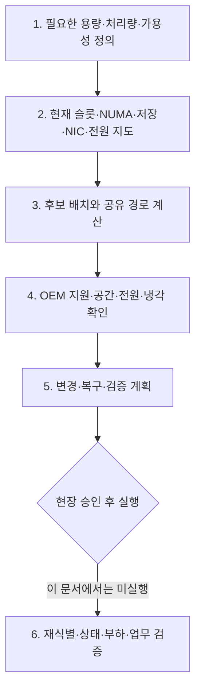

# 10. 서버 배치 설계 종합 — A7 사례로 증설안을 검토하기

[학습 안내](README.md) · 이전: [읽기 전용 실습](09-readonly-labs.md) · 다음: [용어 사전](11-glossary.md)

`A7`은 GPU·NPU·서버 제품명이 아니라 **랩 내부 서버 한 대의 고유 식별명**이다. 이 장은 앞 장의 일반 개념을 그 서버에 적용하는 종합 연습이다. 실제 관측은 **2026-09-21**의 [A7 증설·RAID 작업일지](../../npu/a7-expansion-plan-2026-09-21.md)와 [NPU 슬롯·binning 기록](../../npu/a7-rngd-slot-numa-binning-2026-09-21.md)을 사용한다. 아래 배치안은 아직 실행하거나 성능 검증한 결과가 아니다.



종합 문제는 후보안을 만드는 데서 끝나지 않는다. 관측 사실, 계산 가정, 제조사 지원, 아직 필요한 검증을 분리해 기록해야 실제 변경 계획으로 넘어갈 수 있다.

## 1. 현재 장비를 짧게 설명해 보기

| 영역 | 확인한 구성 | 해석할 때의 제한 |
|---|---|---|
| 서버 | xFusion G6550 V8 6U | 같은 모델명의 모든 옵션이 실장된 것은 아님 |
| CPU | EPYC 9355 × 2, 총 64코어·128 논리 CPU | 현재 NUMA는 2개 |
| RAM | 64GB DIMM × 2, 총 128GB | CPU별 채널 하나, 24자리 중 2개 장착 |
| GPU | RTX PRO 6000 Blackwell Server Edition × 2 | 최종 4장 가정은 구매 확정 전 |
| NPU | RNGD × 4 | 카드당 8PE, SDK의 병렬화 지원은 별도 |
| PCIe | 4개 상위 스위치 그룹, 각각 Gen5 x16 uplink | 스위치 보드 네 장이라는 뜻이 아님 |
| OS 저장 | SLOT2의 9520-2M2, 960GB SSD × 2 RAID1 | `/dev/sda2`에 Ubuntu, 실제 RAID1/Optimal 확인 |
| 데이터 저장 | 별도 7.68TB NVMe | `/data`용, OS RAID1에 포함되지 않음 |
| 고속 NIC | SLOT1 ConnectX-6 VPI 200G 지원 | 조회 당시 InfiniBand DOWN/Disabled |
| 관리 NIC | OCP1 BCM57416 dual 10GbE | 사용 중인 관리 링크는 1Gb/s |
| 전원 | PSU 8개 Presence/OK | 정격·회로·중복 용량과 최대 부하 검증은 별도 |

이 표는 부품을 확인한 결과다. 처리량이 목표를 만족한다거나, 새 카드를 장착해도 된다는 판정표가 아니다.

## 2. 현재 데이터 연결 지도

```text
CPU0 / NUMA0, 로컬 RAM 약 64GB, 사용 메모리 채널 1개
 ├─ CPU 루트 직접: SLOT1 ConnectX-6 VPI
 ├─ 스위치 A: CPU 방향 Gen5 x16
 │    ├─ SLOT4: Blackwell GPU
 │    ├─ SLOT6: Blackwell GPU
 │    └─ SLOT2: 9520-2M2 + 카드 위 M.2 SSD 두 개
 │                         └─ RAID1 → /dev/sda → Ubuntu
 └─ 스위치 B: CPU 방향 Gen5 x16
      ├─ SLOT3: 빈 NIC 후보
      ├─ SLOT8: 빈 가속기 자리
      ├─ SLOT10: npu0 / CARD-A
      └─ NVME9: 7.68TB NVMe → /data

                  CPU 소켓 간 연결

CPU1 / NUMA1, 로컬 RAM 약 64GB, 사용 메모리 채널 1개
 ├─ 스위치 C: CPU 방향 Gen5 x16
 │    ├─ SLOT12: npu2 / CARD-C
 │    ├─ SLOT14: npu1 / CARD-B
 │    └─ SLOT20: 빈 NIC 후보
 └─ 스위치 D: CPU 방향 Gen5 x16
      ├─ SLOT16: npu3 / CARD-D
      ├─ SLOT18: 빈 가속기 자리
      └─ SLOT21: 빈 NIC 후보

OCP1 관리 NIC: NUMA0. BMC 포트는 별도 관리 경로.
```

공개 문서의 CARD-A/B/C/D는 카드 별칭이다. 실제 장치 이동에서는 내부 시리얼과 대조한다. `npu0` 번호와 PCI BDF는 이동 후 바뀔 수 있어 같은 카드를 계속 가리킨다고 가정하지 않는다.

## 3. 물리 슬롯의 개수를 정확히 세기

후면을 정면에서 본 도면 기준으로 큰 가속기용 두 슬롯 폭 자리는 SLOT4/5부터 SLOT18/19까지 8개를 매핑했다. SLOT1/2/3/20/21 같은 별도 위치와 OCP도 있어 “큰 카드 자리 8개 = 모든 PCIe 자리 8개”가 아니다.

현재 도면의 첫 Blackwell 자리부터 빈 자리까지 포함해 세면:

| 설명용 자리 | 실제 SLOT | 현재 | GPU 최종 4장일 때의 조건부 계획 |
|---|---|---|---|
| 1 | SLOT4 | GPU | 유지 |
| 2 | SLOT6 | GPU | 유지 |
| 3 | SLOT8 | 비어 있음 | 추가 GPU |
| 4 | SLOT10 | CARD-A | CARD-A 이전 후 추가 GPU |
| 5 | SLOT12 | CARD-C | 유지 |
| 6 | SLOT14 | CARD-B | 유지, binning·전력 제한 원인 별도 확인 |
| 7 | SLOT16 | CARD-D | 유지 |
| 8 | SLOT18 | 비어 있음 | CARD-A 이전 후보지 |

2025년 공식 백서는 8-GPU 배치를, 현행 제품 페이지는 10-GPU 구성을 설명한다. 그 차이를 우리 섀시에 임의로 적용하지 않는다. **현재 매핑한 자리**와 **다른 BOM의 최대 확장**은 별개다. [기존 배치도와 OEM 확인 항목](../../npu/a7-expansion-plan-2026-09-21.md).

## 4. 왜 CARD-A를 SLOT10에서 SLOT18로 검토하는가?

현재 NPU는 NUMA0에 한 장, NUMA1에 세 장이다. 네 장이 통신하는 작업에서는 다른 소켓 쪽 카드와 통신하는 경로가 생길 수 있다. CARD-A를 SLOT18에 놓으면 네 장 모두 NUMA1에 모이고 스위치 C에 두 장, D에 두 장이 된다.

장점으로 기대하는 것은 **NPU 배치에서 소켓 간 경로를 줄이고 두 상위 링크에 분산**하는 것이다. 동시에 NUMA0의 SLOT10을 GPU용으로 사용할 여지도 생긴다.

하지만 이것은 성능 측정 결과가 아닌 연결 구조에 근거한 설계안이다. 다음 한계를 같이 적는다.

- NPU 네 장 전체가 같은 PCIe 스위치 아래로 모이는 것은 아니다. C와 D 사이의 경로는 남는다.
- ACS 리다이렉션이 켜진 현재 조건에서는 같은 스위치도 직접 P2P 경로·속도를 보장하지 않는다.
- CPU/메모리 버퍼가 다른 NUMA에 있으면 데이터 준비에서 리모트 접근이 생길 수 있다.
- CARD-B의 binning·225W 제한은 별도의 카드 상태 문제다. CARD-A 이전으로 그 원인이 해결된다고 판단하지 않는다.
- SLOT18의 공간·라이저·보조전원·냉각과 RNGD의 OEM 지원은 현장에서 확인해야 한다.

## 5. GPU·NIC를 더 넣는다면 어떤 질문을 하는가?

GPU 최종 4장이라는 가정에서는 SLOT4/6을 유지하고 SLOT8/10에 두 장을 추가하는 안이다. **RTX PRO 6000 Blackwell Server Edition은 NVLink 미지원**이므로 통신 설계를 NVLink 1.8TB/s 기준으로 하면 안 된다. [공식 지원표](https://docs.nvidia.com/vgpu/sizing/virtual-workstation/latest/gpus-vws.html).

추가 NIC가 GPU용이면 NUMA0의 SLOT3가 후보이고, NPU용이면 NUMA1의 SLOT20 또는 SLOT21이 후보다. 단, NIC의 정확한 모델과 목적부터 정해야 한다.

| 질문 | 판단에 미치는 영향 |
|---|---|
| 외부 사용자 요청용인가, 분산 모델 통신용인가? | 트래픽 크기·지연 요구가 달라짐 |
| 주 대상이 GPU인가 NPU인가? | 가까운 NUMA·스위치를 선택할 근거 |
| 단일 100G인가, 2×100G 동시 처리인가? | 포트·PCIe Gen/폭의 요구가 달라짐 |
| 기존 200G NIC는 왜 DOWN인가? | 새 카드가 필요한지부터 다시 판단 |
| Ethernet인가 InfiniBand인가? | 스위치·케이블·트랜시버·운영 방식이 달라짐 |
| 실제 카드 크기와 OEM 지원은? | 후보 슬롯에 물리·전기적으로 장착 가능한지 결정 |

SLOT1은 비어 있지 않고 기존 NIC가 있으며, SLOT2는 OS RAID1을 제공한다. “GPU에 자리를 주려고 다른 카드를 빼자”는 계획에서 그 카드가 담당하는 서비스와 부팅 의존성을 빠뜨리면 안 된다.


## 6. 결정을 내리기 전에 객체와 단위를 고정하기

**슬롯(slot)**은 카드가 꽂히는 물리 위치다. 섀시 뒤쪽의 라벨과 메인보드의 커넥터, 라이저의 배선이 함께 한 슬롯의 실제 능력을 정한다. 슬롯 번호는 장치의 영구 이름이 아니다. CARD-A를 SLOT10에서 SLOT18로 옮기면 카드 시리얼은 유지되지만 BDF와 \`npu0\` 같은 OS 열거 번호는 바뀔 수 있다. 그래서 변경 계획은 “npu0 이동”보다 “시리얼로 확인한 CARD-A를 SLOT10에서 SLOT18로 이동”처럼 써야 한다.

**lane**은 PCIe 링크를 이루는 한 쌍의 송수신 신호 경로다. x16은 lane 16개를 묶었다는 뜻이고, 링크 양방향은 동시에 전송할 수 있다. Gen5 x16의 한 방향 이론 payload 근사 상한을 약 63GB/s로 쓰는 이유는 32GT/s에 128b/130b 부호화와 byte 변환을 적용하기 때문이다. 이 수치는 카드 한 장의 실제 처리량이 아니다. endpoint, switch와 CPU root port 중 가장 좁은 링크, 패킷 오버헤드, 요청 크기와 소프트웨어가 실제 값을 제한한다.

**대역폭(bandwidth)**은 단위 시간에 옮길 수 있는 데이터 양이다. 63GB/s는 초당 약 63기가바이트를 한 방향으로 옮기는 이론 상한이고, NIC의 200Gb/s는 초당 200기가비트라는 링크 속도이므로 단위를 맞추면 25GB/s보다 작다. 실제 payload는 더 낮다. 같은 PCIe 스위치 아래 카드들이 동시에 CPU 메모리로 DMA하면 각 endpoint 링크가 넓어도 CPU 방향 uplink를 공유한다. DMA는 장치가 CPU 코어로 매 byte를 복사시키지 않고 메모리와 직접 데이터를 주고받는 방식이다.

**전력(power)**은 한 순간에 에너지를 쓰는 속도이며 단위는 W다. 카드 네 장의 상한을 더한 값은 PSU에서 읽은 순간 전력과 다른 종류의 숫자다. PSU는 교류 입력을 서버 부품이 쓰는 직류로 바꾸는 장치다. 8개가 \`Presence/OK\`여도 각 정격, 입력 전압, 전원 회로, 부하 분담과 고장 후 정책을 모르면 허용 부하를 확정할 수 없다.

**냉각(cooling)**은 장치에서 생긴 열을 공기 흐름으로 섀시 밖에 내보내는 과정이다. 600W 카드 한 장은 최악 조건에서 최대 600W 가까운 열원이 될 수 있다. 팬 개수만 세는 것으로는 충분하지 않다. 카드가 공기 통로를 막는지, 흡기 온도가 얼마인지, 팬 곡선이 부하에 따라 어떻게 바뀌는지, 뒤쪽 배기 열이 다른 장치 흡기로 되돌아오는지를 본다. 유휴 온도가 정상이어도 연속 부하에서 열 제한으로 주파수가 내려갈 수 있다.

**장애 영역(failure domain)**은 하나의 고장이 함께 영향을 주는 자원 묶음이다. 같은 PCIe switch 아래 장치는 switch나 uplink 문제가 나면 함께 영향을 받을 수 있고, 같은 CPU socket에 기대는 장치는 socket이나 로컬 메모리 문제가 공통 원인이 될 수 있다. RAID1의 두 SSD는 한 장 고장에는 견딜 수 있어도 같은 컨트롤러, 전원, 섀시에 있으므로 모든 장애가 분리된 것은 아니다. 성능을 위해 가까이 모으는 배치와 장애를 분산하는 배치는 목표가 다를 수 있다.

### 한 요청을 따라 현재 경로와 후보 경로 비교하기

NPU 작업의 입력 16GB가 NUMA1 메모리에 있고 CARD-A만 NUMA0의 SLOT10, 나머지 세 카드가 NUMA1에 있다고 가정한다. CARD-A가 입력을 읽을 때 CPU 소켓 간 연결을 지나갈 가능성이 있고, 나머지 카드들은 로컬 NUMA 경로를 쓸 수 있다. 네 카드가 부분 결과를 교환하면 CARD-A와 NUMA1 카드 사이에는 소켓 간 경로도 후보가 된다. 이것은 실제 런타임이 어떤 전송 방식을 택하는지 측정한 결과가 아니라 물리 경로에서 생길 수 있는 비용을 찾는 단계다.

CARD-A를 NUMA1의 SLOT18로 옮기면 네 NPU 모두 NUMA1에 놓인다. 스위치 C에는 SLOT12·14, 스위치 D에는 SLOT16·18이 있어 2장씩 나뉜다. NUMA1 메모리에서 네 카드로 가는 경로는 소켓 간 이동을 피할 가능성이 커지지만, C와 D의 카드가 서로 통신하면 두 switch 사이의 경로가 남는다. ACS가 트래픽을 root 방향으로 돌리거나 런타임이 P2P를 지원하지 않으면 같은 switch 카드도 기대한 직접 경로를 쓰지 못할 수 있다.

GPU 후보는 NUMA0의 SLOT4·6·8·10이다. SLOT10을 비우려면 CARD-A 이동이 선행 조건이다. GPU 두 장이 이미 스위치 A 아래 있고 SLOT8·10은 스위치 B 아래이므로 네 장을 두 uplink에 2장씩 나누는 구상이다. 그러나 SLOT2의 OS RAID와 NVME9의 데이터 SSD도 각각 경로를 공유한다. 학습 체크포인트를 NVMe에서 읽으면서 네 GPU로 동시에 복사하면 저장장치 트래픽과 GPU DMA가 같은 상위 링크를 쓰는지 방향별로 다시 계산해야 한다.

### 설계표에서 값의 상태를 구분하기

| 값 | 이 장에서의 상태 | 결정에 쓰는 방식 |
|---|---|---|
| SLOT4/6 GPU, SLOT10 CARD-A | 2026-09-21 관측 | 이동 전 다시 시리얼과 BDF 확인 |
| Gen5 x16 uplink 네 그룹 | 연결 지도에 근거한 구조 | 공유 요구량의 이론 상한 계산 |
| GPU 600W, NPU 300W | 문제 풀이용 전력 예산 | 구매 P/N과 지원 전력으로 교체 필요 |
| DCMI 798W | 기존 구성의 한 시점 관측 | 증설 최대 전력으로 사용 금지 |
| NIC 200G 지원, IB DOWN | 사양과 당시 상태 | 케이블·상대 포트·프로토콜 확인 전 처리량 가정 금지 |
| CARD-B 225W·1.7GHz | 함께 관측된 제한 상태 | 공급자 해석 전 원인 단정 금지 |
| GPU 4장 최종 구성 | 조건부 설계 가정 | 구매·OEM 지원·전원·냉각 승인 필요 |


## 7. 종합 문제 A — 같은 스위치의 공유 링크

**가정한 부하 예제:** 스위치 B 아래 GPU 두 장이 각각 25GB/s로 **호스트 메모리 방향**으로 데이터를 보낸다. 같은 방향으로 NIC 수신 DMA가 12.5GB/s, NVMe 읽기가 6GB/s를 요구한다. 네 트래픽은 모두 CPU 방향 상위 링크를 사용한다고 가정한다. 이 값들은 A7에서 측정한 값이 아니다.

1. 요구 합계는 얼마인가?
2. Gen5 x16 상위 링크의 약 63GB/s 이론 상한과 비교하면 어떤 결론을 낼 수 있는가?
3. 실제로 링크를 지나는 트래픽이 반대 방향이거나 스위치 내부 P2P라면 계산은 같은가?

<details>
<summary>해설</summary>

합계는 `25+25+12.5+6 = 68.5GB/s`다. 인코딩만 반영한 약 63GB/s를 넘으므로 이 가정의 요구를 동시에 모두 만족할 수 없다. 실제 payload 상한은 패킷 오버헤드 등을 더 반영해야 한다.

전이중 링크의 반대 방향은 별도로 계산한다. 스위치 내부에서 지원되는 P2P로 끝나는 전송은 해당 상위 링크를 같은 방식으로 사용하지 않을 수 있다. 그래서 모든 장치의 광고 속도를 무조건 더하기 전에 **데이터의 방향과 실제 경로**를 그려야 한다.

</details>

## 8. 종합 문제 B — RAM을 어디까지 계산할 수 있는가?

현재 CPU당 DDR5-6400의 64비트 데이터 채널 하나가 사용된다. 가상의 메모리 검토안으로 **CPU마다 64GB DIMM 네 개를 각각 다른 지원 채널에 장착**한다고 하자. OEM의 장착 순서·지원 속도와 호환성이 확인됐다고 가정한다.

1. 전체 DIMM 개수와 용량은?
2. CPU당 이론 데이터 대역폭 합계는?
3. 원래보다 실제 추론 속도가 반드시 네 배가 되는가?

<details>
<summary>해설</summary>

DIMM은 8개, 전체 명목 용량은 512GB다. DDR5-6400 한 채널의 51.2GB/s를 네 개에 적용하면 CPU당 204.8GB/s의 이론 합계다. 이는 설계 계산이며 실제 DIMM 구매·장착 권고가 아니다.

추론이 CPU RAM 대역폭에 제한되지 않았거나 NPU HBM·통신·연산이 병목이면 효과가 작을 수 있다. NUMA 배치와 DIMM 조합의 실제 동작 속도도 확인해야 한다. 대역폭 확대와 애플리케이션 향상 비율을 동일시하지 않는다.

</details>

## 9. 종합 문제 C — 메모리와 RAID 용량

1. 현재 부팅용 960GB SSD 두 개를 RAID1으로 묶었는데 왜 약 1.92TB가 보이지 않는가?
2. 별도 `/data` SSD가 고장 나면 부팅용 RAID1의 다른 SSD가 `/data`까지 복구해 주는가?
3. GPU 4×96GB와 NPU 4×48GB, 호스트 RAM 128GB를 더해 704GB짜리 하나의 모델 메모리로 볼 수 있는가?

<details>
<summary>해설</summary>

1. RAID1은 같은 데이터를 복제하므로 사용 가능한 논리 용량은 대략 한 장 분량이다. 실제 메타데이터와 표시 단위 차이는 별도로 존재한다.
2. 아니다. `/data`는 별도 단일 NVMe이며 해당 RAID1의 멤버가 아니다. 백업과 복구 설계는 별도로 확인한다.
3. 아니다. 704GB는 서로 다른 물리 메모리의 산술 합일 뿐이다. GPU와 NPU는 런타임·실행 방식이 다르고, 호스트 RAM은 별도 전송 경로다. 모델을 어떤 장치에 어떻게 나누는지가 먼저다.

</details>

## 10. 종합 문제 D — 전원과 장애 시 여유

가상의 전력 설계에서 GPU 네 장의 설정 상한을 각각 600W, NPU 네 장의 계산용 예산을 각각 300W로 잡는다. CPU·RAM·SSD·NIC·팬·전력 변환 손실 등은 아직 계산하지 않았다.

1. 가속기만의 합계는?
2. 현재 DCMI 순간값 798W가 이 설계를 검증하는가?
3. PSU 개수와 합산 정격만 있으면 N+N 상태의 허용 부하를 확정할 수 있는가?

<details>
<summary>해설</summary>

가속기 예산 합계는 `4×600 + 4×300 = 3600W`다. NPU 300W는 여기서 정한 계산용 값으로 제품 마케팅 TDP나 현재 네 장의 실제 소비전력을 뜻하지 않는다. A7의 CARD-B에는 225W 제한이 관측됐고 임의로 올리지 않는다.

798W는 기존 구성의 한 시점 값이므로 추가 카드의 부하를 검증하지 못한다. PSU 정격·입력 조건·이중화 정책·전원 feed와 PDU 회로가 함께 필요하다. 나머지 부품 소비와 전원 손실·여유도 별도다.

</details>

## 16. 실제 계획으로 넘기기 위한 근거표

| 결정 | 이미 있는 근거 | 다음에 필요한 근거 |
|---|---|---|
| GPU 네 장 배치 | 현재 SLOT4/6 GPU, SLOT8 빈 자리, SLOT10 이전 후보 | 최종 수량·정확한 P/N, OEM GPU 키트·전원·냉각 |
| NPU NUMA1 집약 | SLOT12/14/16, 빈 SLOT18의 연결 | 물리 장착 확인, 이동 후 재식별·통신·서빙 검증 |
| NIC 추가 | 후보 SLOT3/20/21, 기존200G 카드 상태 | 용도·프로토콜·포트 수·스위치와 미디어·기존 DOWN 원인 |
| RAM 증설 | CPU별 한 채널, 총128GB | 실제 필요 용량·메모리 트래픽·OEM DIMM 장착표 |
| CARD-B 판단 | 다른 binning·225W·1.7GHz 동시 관측 | 공급자 해석과 지원 조치 |
| 최신 링크 채택 | 기술·규격의 공식 문서 | 해당 endpoint·보드·스위치·SW의 지원과 납품 근거 |


## 11. 추가 종합 문제 E — 슬롯 수와 링크 수를 분리하기

A7의 큰 가속기용 자리는 SLOT4/6/8/10/12/14/16/18의 8개다. 상위 PCIe switch 그룹은 A/B/C/D 네 개이며 각 CPU 방향 uplink는 Gen5 x16이다. “가속기 자리 8개이므로 가속기마다 CPU까지 전용 x16 링크가 8개다”라고 말할 수 있는가?

<details>
<summary>해설</summary>

말할 수 없다. 슬롯의 endpoint 링크와 switch의 CPU 방향 uplink는 다른 객체다. 예를 들어 스위치 B 아래 SLOT8, SLOT10, SLOT3과 NVME9가 동시에 CPU 메모리 방향으로 전송하면 각 장치가 자기 x16을 협상했어도 합계는 B의 Gen5 x16 uplink를 통과할 수 있다. 반대로 두 장치가 switch 내부 P2P로 전송하고 그 경로가 실제 지원되면 그 트래픽은 CPU uplink를 같은 방식으로 쓰지 않을 수 있다.

따라서 표에는 “물리적으로 꽂을 자리”, “endpoint가 협상한 링크”, “부모 switch와 공유 uplink”를 따로 쓴다. 장치 수만 세어서 대역폭을 판정하지 않는다.

</details>

## 12. 추가 종합 문제 F — NIC 대역폭과 PCIe 대역폭

200Gb/s NIC 한 장이 실제로 링크를 맺었고, 호스트 메모리로 한 방향 수신한다고 가정한다. 200Gb/s를 GB/s로 바꾸고 Gen4 x8의 약 15.75GB/s PCIe 경로와 비교하라. A7의 기존 NIC 상태를 이 계산으로 “정상 200G”라고 바꿀 수 있는가?

<details>
<summary>해설</summary>

8bit가 1byte이므로 \`200Gb/s ÷ 8 = 25GB/s\`다. 네트워크와 PCIe 오버헤드를 무시해도 Gen4 x8의 약 15.75GB/s가 더 작으므로 이 가정에서는 호스트 방향 PCIe가 전체 200Gb/s payload를 담지 못한다. 실제로는 양쪽 프로토콜 오버헤드와 메모리 처리도 고려한다.

이 계산은 조건부 설계 예제다. A7에서 관측한 기존 ConnectX-6 포트는 InfiniBand DOWN/Disabled였으므로 현재 200Gb/s를 내고 있다는 증거가 되지 않는다. 먼저 링크 모드, 케이블, 상대 switch 포트, 협상 상태와 실제 BDF의 \`LnkSta\`를 확인해야 한다.

</details>

## 13. 추가 종합 문제 G — NUMA 집약의 이익과 장애 영역

CARD-A를 SLOT18로 옮겨 NPU 네 장을 NUMA1에 모으면 무조건 가장 좋은 설계인가? 성능과 장애 관점에서 각각 설명하라.

<details>
<summary>해설</summary>

입력 버퍼와 제어 thread도 NUMA1에 배치되고 런타임이 예상 경로를 쓴다면, CARD-A가 NUMA0에 있을 때 생기던 소켓 간 접근을 줄일 가능성이 있다. 네 장이 switch C와 D에 2장씩 나뉘므로 하나의 uplink에 네 장이 모두 매달리지는 않는다. 이것이 후보안의 성능 근거다.

그러나 결과는 workload에 따라 달라진다. 입력을 NUMA0에서 만들면 네 카드 모두 원격 접근할 수 있고, C와 D 사이 통신이나 ACS 우회도 남는다. 장애 관점에서는 네 카드가 CPU1, NUMA1과 그쪽 전원·냉각 조건에 더 강하게 의존한다. 한 socket이나 NUMA1 메모리 문제가 네 NPU 업무에 공통 영향을 줄 수 있다. 성능 집약과 장애 분산 중 어느 목표를 우선하는지 정하고, 같은 입력으로 이동 전후 지연·대역폭·오류를 비교해야 한다.

</details>

## 14. 추가 종합 문제 H — 전력과 냉각의 보수적 예산

문제 D의 가속기 예산 3600W에 CPU·RAM·스토리지·NIC·팬과 변환 손실을 합쳐 1400W로 가정한다. 총 입력 예산은 얼마인가? 정상 상태에서 PSU 전체가 6000W를 제공하지만 전원 한 묶음 고장 뒤 4800W만 허용된다고 가정하면 설계가 통과하는가? 이 계산으로 실제 장착 승인을 낼 수 있는가?

<details>
<summary>해설</summary>

총 예산은 \`3600+1400=5000W\`다. 정상 6000W에는 1000W가 남지만, 고장 뒤 허용치 4800W보다 200W 크므로 제시한 중복 조건은 통과하지 못한다. 정상 상태에서 켜진다는 것과 한쪽 전원 경로가 고장 난 뒤에도 업무를 유지한다는 것은 다른 요구다.

실제 장착 승인은 낼 수 없다. GPU 600W와 NPU 300W, 기타 1400W는 문제용 가정이다. 실제 P/N별 설정 상한, CARD-B의 225W 제한, PSU 정격의 입력 전압 조건, PDU 회로, 순간 피크와 팬의 최악 소비를 제조사 자료와 현장 측정으로 바꿔야 한다. 냉각도 5000W 전력 합계만으로 판정하지 않는다. 슬롯별 공기 흐름, 흡기 온도, 팬 장애 뒤 열 제거 능력과 장시간 부하 온도를 확인한다.

</details>

## 15. 변경 전후의 완전한 검증 순서

설계안을 실행한다면 먼저 전원을 끄기 전 카드 시리얼, BDF, 슬롯, RAID와 네트워크 상태를 보관한다. 현장 승인과 제조사 절차에 따라 CARD-A를 이동하고 GPU를 장착한 뒤 전원을 켠다. 그 다음에는 예전 \`npu0\` 번호를 믿지 않고 모든 장치를 다시 열거한다. 새 BDF를 물리 시리얼과 슬롯에 대응시키고 각 endpoint와 부모 포트의 링크 세대·폭, NUMA 노드, 드라이버 결합을 확인한다.

상태 조회가 통과하면 같은 입력, 같은 소프트웨어 버전, 같은 전력 설정으로 이동 전후를 비교한다. 단일 카드, 같은 switch 두 카드, switch C와 D를 가로지르는 두 카드, 네 카드 전체 순서로 범위를 넓힌다. 처리량만 보지 않고 p50·p99 지연, 오류와 재시도, CPU·NUMA 메모리 트래픽, PCIe 카운터, 온도, 전력과 주파수 제한을 함께 기록한다. p50은 측정값 절반이 그 이하인 중앙값이고 p99는 99%가 그 이하인 꼬리 지연 지표다.

복구 조건도 미리 적는다. 장치가 열거되지 않거나 RAID 부팅 경로가 달라지거나 온도·전력·오류가 허용 범위를 넘으면 업무 투입을 멈춘다. 원래 슬롯, 케이블과 카드 대응표가 있어야 되돌릴 수 있다. 이 장은 설계와 계산 연습이며 실제 A7 이동·장착·부하 시험을 수행했다는 기록이 아니다.


## 최종 과제 — 두 문장으로 설계와 한계를 설명하기

예시 답안:

> GPU 최종 4장이라는 가정 아래 GPU를 NUMA0의 SLOT4/6/8/10, RNGD를 NUMA1의 SLOT12/14/16/18에 배치하는 안을 검토한다. NIC는 주 통신 대상과 공유 링크를 기준으로 후보 슬롯을 선택하고, RAM 채널·전원·냉각·실제 제품 지원을 함께 확인한다.
>
> 이 안은 연결 구조에 근거하며 성능 최적을 실측한 결과는 아니다. 실제 이전·장착 후 장치 재식별, 링크·NUMA 확인과 같은 조건의 통신·모델 성능 비교를 거쳐야 한다.

이 두 문장을 자신의 말로 설명하고, 각 조건을 어떤 명령·문서·측정으로 확인할지 적을 수 있다면 교재의 핵심을 이해한 것이다.

[학습 안내](README.md) · 다음: [11. 용어 사전·오해 정리](11-glossary.md)
