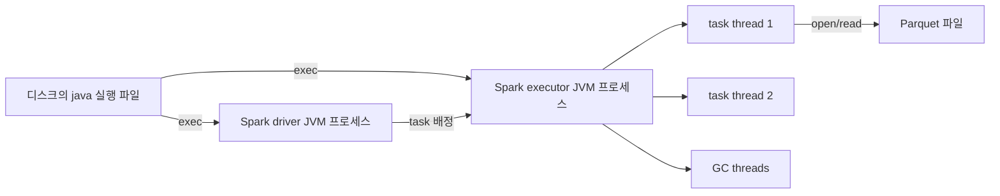
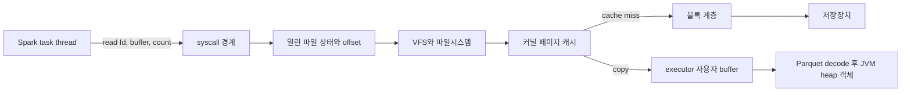
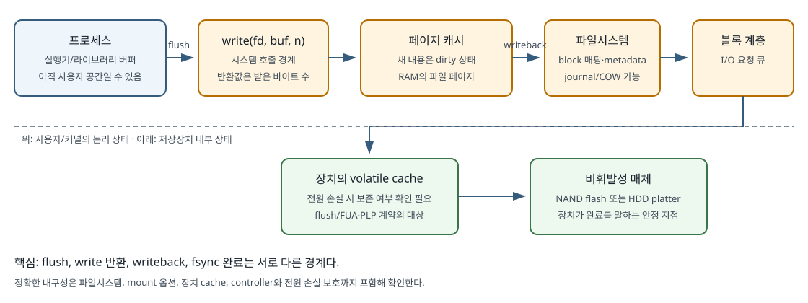

# 00b. 프로그램·프로세스·메모리: 파일 I/O를 배우기 위한 운영체제 입문

[학습 목차](README.md) · 이전: [바이트·페이로드·패킷](00a-bytes-payload-and-packets.md) · 다음: [Linux 관측](00c-linux-observation-and-troubleshooting.md) · 심화: [Linux·커널 독립 교재](../../../linux/learning/linux-kernel/README.md)

Spark 작업이 Parquet 파일을 읽다가 느려졌다고 하자. “Spark가 메모리를 많이 쓴다”만으로는 실제로 무엇이 어디에 있고 누가 회수하는지 알 수 없다. 디스크의 실행 파일, 실행 중인 프로세스와 스레드, 각 프로세스의 주소 공간, Linux의 페이지 캐시, 컨테이너 cgroup 한도, 저장장치 I/O를 구별해야 한다. 이 장은 Spark driver와 executor가 생겨 파일을 읽고, 메모리 압박을 받고, 일부 데이터를 디스크에 쓰는 과정을 따라가며 그 경계를 처음부터 설명한다.

## 실행 파일에서 Spark 프로세스가 생긴다

디스크에 저장된 **실행 파일(executable file)**은 CPU가 실행할 명령과 시작에 필요한 정보를 담은 파일이다. Java를 실행한다면 실제 실행 파일은 보통 JVM을 시작하는 java이고 Spark의 class와 JAR는 JVM이 읽어 실행할 코드와 데이터다. 실행 파일은 저장장치나 파일시스템에 있고, 실행 전에는 PID나 스택을 가진 주체가 아니다. 파일이 삭제되거나 교체될 때까지 존재하며 같은 파일을 여러 번 실행할 수 있다.

실행 중인 프로그램의 자원 단위를 **프로세스(process)**라고 한다. 프로세스는 PID, 가상 주소 공간, 열린 파일 표, 사용자·그룹 자격 정보 등을 가진다. **PID(Process ID)**는 커널이 현재 프로세스를 구별하려고 붙인 정수다. 프로세스가 끝나면 나중에 같은 번호가 재사용될 수 있으므로 영구 ID가 아니다.

Spark의 **driver**는 작업 계획을 만들고 stage와 task를 executor에 배정하는 역할이고, **executor**는 할당받은 task를 실행하며 입력을 읽고 중간 결과를 만든다. 클러스터 배치 방식에 따라 driver와 executor는 서로 다른 호스트나 컨테이너의 별도 JVM 프로세스로 실행된다. “Spark 애플리케이션 하나”라는 논리적 이름이 Linux 프로세스 하나를 뜻하지 않는다.

프로세스 안에서 명령을 실행하는 흐름을 **스레드(thread)**라고 한다. 한 executor JVM에는 task 스레드, garbage collection 스레드, 네트워크와 I/O 관련 스레드 등 여러 스레드가 있을 수 있다. 같은 프로세스의 스레드는 주소 공간과 열린 파일을 대체로 공유하지만, 각자 CPU 실행 상태와 스택을 가진다. 스레드는 프로세스가 끝나면 함께 사라지고, 작업에 따라 생성·종료될 수 있다.

**컨텍스트 스위치(context switch)**는 CPU가 실행하던 스레드의 레지스터와 실행 위치를 보관하고 다른 스레드의 상태를 복원해 실행 대상을 바꾸는 일이다. 여러 작업이 한 CPU를 나누는 데 필요하지만 너무 자주 일어나면 실제 계산보다 전환 비용과 캐시 손실이 커질 수 있다. 컨텍스트 스위치 수 하나만으로 문제를 확정할 수는 없다. 실행 가능한 스레드 수, CPU 시간, 대기 원인을 같이 봐야 한다.



### 문제 1: 프로그램 하나와 프로세스 여럿 구분하기

같은 /usr/bin/java 실행 파일로 driver 한 개와 executor 세 개가 실행됐고, 각 executor에 task 스레드 네 개가 있다고 하자. 실행 파일, 프로세스, task 스레드는 각각 몇 개인가? executor 하나가 종료되면 무엇이 남는가?

경로 기준 실행 파일은 하나다. driver 한 개와 executor 세 개이므로 JVM 프로세스는 네 개다. task 스레드는 executor마다 네 개이므로 열두 개지만, driver와 JVM 내부의 다른 스레드는 이 숫자에 포함하지 않았다. executor 하나가 끝나면 그 PID, 주소 공간, 스레드, 열린 fd는 사라지고 커널이 자원을 정리한다. 디스크의 java 실행 파일과 다른 세 프로세스는 남는다. 조건을 바꾸어 컨테이너 하나에 executor가 하나씩 있어도 컨테이너와 프로세스를 같은 말로 보면 안 된다. 컨테이너는 cgroup·namespace 같은 격리 설정이며 그 안에 여러 프로세스가 있을 수 있다.

## exec와 주소 공간이 실행 이미지를 만든다

셸이나 컨테이너 런타임은 새 프로세스를 준비하고 exec 계열 **시스템 호출(system call)**로 java 실행 파일을 적재한다. exec는 현재 프로세스의 실행 이미지를 새 프로그램으로 바꾸며 성공하면 같은 PID가 이어질 수 있다. **시스템 호출(syscall)**은 사용자 프로그램이 파일, 메모리, 프로세스처럼 보호된 커널 기능을 요청하는 공식 경계다. CPU는 사용자 모드에서 커널 모드로 들어가 요청을 검사하고 결과나 오류를 돌려준다.

프로세스가 사용할 수 있다고 보는 가상 주소들의 범위를 **가상 주소 공간(address space)**이라고 한다. 포인터가 담는 값은 보통 이 공간의 **가상 주소**다. 커널과 CPU의 메모리 관리 장치가 가상 주소를 RAM의 물리 프레임에 연결한다. 같은 0x4000이라는 주소도 다른 프로세스에서는 보통 다른 RAM을 가리킨다. 격리 덕분에 executor 하나의 잘못된 포인터가 다른 executor 메모리를 바로 읽지 못한다.

주소 공간은 목적에 따라 여러 영역을 가진다.

- **코드(code 또는 text)**는 CPU가 실행할 기계 명령이 매핑된 영역이다. 실행 파일에서 오며 보통 쓰기 금지이고 프로세스 수명 동안 필요에 따라 RAM에 올라온다.
- **힙(heap)**은 실행 중 크기가 달라지는 객체와 버퍼를 위해 메모리 할당기가 관리하는 영역이다. JVM의 Java heap에는 Spark 객체가 놓일 수 있고, JVM 밖 native 또는 direct buffer는 별도 매핑에 놓일 수 있다. 객체 수명과 프로세스 RSS 변화가 항상 즉시 일치하지는 않는다.
- **스택(stack)**은 함수 호출의 복귀 위치, 일부 지역 변수와 실행 문맥을 담는 스레드별 영역이다. 호출하면 사용량이 늘고 반환하면 해당 프레임을 다시 쓸 수 있다. 한 프로세스의 스레드가 많으면 스택용 가상 주소 예약도 늘어난다.
- **매핑(mapping)**은 공유 라이브러리, 파일, 익명 메모리를 주소 공간에 연결한 영역이다. mmap()한 파일은 접근할 때 페이지 단위로 실제 RAM과 연결될 수 있다.

주소 공간을 고정 크기 조각으로 다루는 기본 단위를 **가상 메모리 페이지(page)**라고 한다. RAM 쪽 대응 단위는 물리 페이지 프레임이다. 실제 기본 페이지 크기는 환경에서 확인해야 하며 흔한 4 KiB를 불변 법칙으로 가정하지 않는다. Parquet의 page, SSD의 NAND page, 데이터베이스 page는 이름만 같을 뿐 크기와 관리 주체가 다르다.

### 문제 2: heap와 thread stack의 소유자 찾기

executor JVM 하나에 task 스레드 8개가 있고 각 스레드 스택에 최대 1 MiB의 가상 주소가 예약됐다고 하자. Java heap 4 GiB와 스택 예약 8 MiB는 같은가? 실제 RAM 사용을 바로 4 GiB+8 MiB로 계산할 수 있는가?

Java heap은 프로세스가 공유하는 JVM 관리 영역이고 스택은 스레드마다 하나씩 있는 실행 영역이다. 예약 기준 스택 합은 \(8×1=8\) MiB다. 그러나 가상 주소 예약이 모두 현재 RAM에 상주한다는 뜻은 아니다. Java heap의 최대 크기 4 GiB도 실제로 접근해 물리 페이지가 붙은 양과 다를 수 있다. 조건을 바꾸어 모든 heap 페이지와 스택 페이지를 실제로 쓰면 RSS가 증가할 수 있지만 공유 라이브러리, direct buffer, 페이지 캐시의 cgroup 비용까지 단순 합 하나로 설명할 수 없다. 주소 공간 크기와 상주 메모리를 분리해야 한다.

## 페이지 폴트가 가상 주소를 실제 페이지에 연결한다

CPU가 접근한 가상 페이지에 현재 필요한 연결이 없으면 **페이지 폴트(page fault)**가 발생한다. “fault”라는 이름과 달리 지연 할당에서 정상적으로 생긴다. 처음 쓰는 heap 페이지라면 커널이 빈 물리 프레임을 붙일 수 있다. 이미 RAM에 있는 파일 페이지의 매핑만 만들 수도 있다. 파일 내용이 RAM에 없으면 저장장치 읽기가 필요할 수 있다. 접근 권한이 없는 주소라면 프로세스에 SIGSEGV 신호가 전달될 수 있다.

물리 메모리가 부족해지면 커널은 다시 쓸 수 있는 페이지를 찾는 **회수(reclaim)**를 한다. 깨끗한 파일 캐시 페이지는 버리고 나중에 파일에서 다시 읽을 수 있다. 수정된 파일 페이지는 쓰기가 끝나야 버릴 수 있다. 익명 메모리는 swap이 설정돼 있으면 swap으로 내보낼 수 있으며, 그렇지 않으면 회수 선택이 제한된다. 회수 중 CPU와 작업이 소비하는 시간은 애플리케이션 지연으로 보일 수 있다.

반복해서 필요한 페이지를 버리고 곧 다시 읽는 상태를 **thrashing**이라고 한다. executor가 Parquet 데이터를 읽어 페이지 캐시를 채우는 동시에 큰 heap와 direct buffer를 유지하면 같은 RAM과 cgroup 한도 안에서 경쟁할 수 있다. “캐시는 공짜 메모리”도 “heap만 줄이면 항상 해결”도 아니다.

## Parquet 읽기는 fd와 페이지 캐시를 지난다

executor의 task 스레드가 Parquet 경로를 열면 커널은 권한과 경로를 확인하고 **파일 디스크립터(file descriptor, fd)**를 반환한다. fd는 파일 자체가 아니라 현재 프로세스의 열린 파일 표에 있는 작은 정수 인덱스다. 다른 프로세스의 fd 3은 전혀 다른 파일일 수 있다. 열린 파일 상태에는 현재 **오프셋(offset)**, 즉 파일 시작에서 몇 바이트 떨어진 위치인지와 접근 상태가 있다.

read(fd, buffer, count)는 fd가 가리키는 열린 파일에서 최대 count 바이트를 읽어 프로세스 주소 공간의 buffer로 복사해 달라는 시스템 호출이다. 요청보다 적은 바이트가 반환될 수 있으며 0은 일반 파일에서 EOF를 뜻할 수 있다. Parquet 라이브러리는 footer와 column chunk 위치를 읽고 필요한 범위를 선택한다. 논리적 컬럼 읽기, Linux read 호출, 파일시스템 I/O, 장치 요청의 크기와 횟수는 서로 같지 않을 수 있다.

파일 내용을 RAM에 보관해 다음 접근을 빠르게 하는 커널 캐시를 **페이지 캐시(page cache)**라고 한다. **캐시(cache)**는 원본을 다시 얻는 비용을 줄이기 위한 복사본이다. 프로그램의 **버퍼(buffer)**는 생산자와 소비자의 속도나 호출 크기 차이를 완충하려고 임시로 모으는 영역이다. executor의 사용자 버퍼와 커널 페이지 캐시는 모두 RAM을 쓰지만 위치, 소유자, 수명이 다르다.



### 문제 3: 12 KiB Parquet 범위 읽기의 층별 크기

교육용으로 OS 페이지 크기가 4 KiB이고 executor가 파일 오프셋 0부터 12 KiB를 요청한다고 하자. 요청 바이트, 겹치는 파일 페이지 수, 장치 읽기 횟수를 설명하라.

12 KiB는 \(12×1024=12,288\) bytes다. 4 KiB 페이지라면 바이트 0–4095, 4096–8191, 8192–12287의 세 파일 페이지와 겹친다. 세 페이지가 페이지 캐시에 있으면 장치 읽기 없이 사용자 버퍼로 복사될 수 있다. 두 페이지가 없다고 해서 장치 읽기가 정확히 두 번이라고 단정할 수는 없다. 파일시스템과 장치의 미리 읽기, 요청 병합, 블록 크기가 실제 I/O를 바꾼다. 조건을 바꾸어 Parquet이 필요한 열만 논리적으로 선택해도 해당 열 chunk가 압축돼 있으면 압축 블록 전체를 읽고 풀 수 있다. 논리적 값 수와 물리 바이트를 구분한다.

### 문제 4: 같은 파일을 두 executor가 읽을 때 캐시 소유를 해석하기

같은 노드의 executor A가 파일 페이지 100 MiB를 먼저 읽고, executor B가 곧 같은 범위를 읽었다. B의 장치 읽기가 적었다면 B의 heap가 그 100 MiB를 공유한 것인가?

그렇지 않다. 노드의 커널 페이지 캐시에 파일 내용이 남아 B가 재사용했을 가능성이 있다. A와 B의 사용자 공간 heap 객체는 별도 프로세스 주소 공간에 있다. 페이지 캐시는 커널이 관리하며 파일 페이지를 여러 프로세스가 이용할 수 있다. 조건을 바꾸어 두 executor가 서로 다른 노드에 있다면 로컬 페이지 캐시는 공유되지 않는다. 원격 저장소나 별도 캐시 계층이 있을 수 있으므로 장치 읽기 감소의 원인은 시간축과 노드 범위를 확인해야 한다.

## RSS, PSS와 cgroup 사용량은 서로 다른 질문에 답한다

프로세스 주소 공간 중 현재 RAM에 상주한 페이지 규모를 **RSS(Resident Set Size, 상주 집합 크기)**라고 한다. heap뿐 아니라 스택, 라이브러리, 파일 매핑 등 상주 페이지가 포함될 수 있다. 공유 페이지를 각 프로세스 RSS에 전부 세면 여러 프로세스 값을 합할 때 중복이 생긴다.

**PSS(Proportional Set Size, 비례 상주 집합 크기)**는 공유 페이지 크기를 그 페이지를 공유하는 프로세스 수로 나누어 각 프로세스에 배분한 값이다. 예를 들어 40 MiB 공유 라이브러리를 두 프로세스가 함께 쓰면 각 PSS에는 약 20 MiB씩 배분한다. PSS는 합산에 도움을 주지만 측정 순간의 공유 상태에 따라 달라지고 모든 환경에서 값이나 비용을 쉽게 얻을 수 있는 것은 아니다.

**cgroup(control group)**은 프로세스 묶음의 CPU, 메모리, I/O 같은 자원 사용을 계정하고 제한하는 Linux 커널 기능이다. Kubernetes 컨테이너의 메모리 한도는 보통 cgroup 계층을 통해 적용된다. executor 프로세스 RSS만 보고 cgroup 메모리를 설명할 수 없는 이유는 페이지 캐시와 같은 커널 계정, 다른 프로세스, 공유 페이지 처리 등이 포함될 수 있기 때문이다. JVM heap 최대값을 컨테이너 한도와 똑같이 잡으면 native 메모리, thread stack, 코드, page cache와 실행 여유가 사라질 수 있다.

**PSI(Pressure Stall Information, 압력 정지 정보)**는 CPU, 메모리, I/O 자원이 부족해 작업이 진행하지 못하고 멈춘 시간의 비율을 Linux가 집계한 정보다. 단순 사용량이 아니라 자원 부족 때문에 실제 작업이 지연됐는지를 묻는다. some은 적어도 일부 작업이 멈춘 시간, full은 관련 작업들이 모두 멈춘 시간을 나타내며 자원 종류와 cgroup·시스템 범위를 함께 봐야 한다. 높은 PSI는 압박 증거지만 어떤 코드나 파일이 원인인지를 단독으로 알려 주지 않는다.

### 문제 5: RSS 합과 PSS 합이 다른 공유 페이지 예제

executor A와 B가 각각 전용 300 MiB 페이지를 쓰고, 둘이 200 MiB의 파일 매핑 페이지를 공유한다고 하자. 단순화해 다른 메모리는 없다고 할 때 각 RSS, 각 PSS, 두 값을 합한 결과를 구하라.

각 프로세스 RSS는 전용 300+공유 200=500 MiB다. RSS 합은 1,000 MiB지만 공유 200 MiB를 두 번 셌다. PSS는 공유 200을 두 프로세스에 100씩 배분하므로 각 400 MiB, 합은 800 MiB다. 실제 고유 물리 페이지도 전용 600+공유 200=800 MiB다. 조건을 바꾸어 B가 공유 페이지를 더 이상 매핑하지 않으면 A의 PSS 배분은 200 MiB 전체로 바뀔 수 있다. PSS는 프로세스의 고정 속성이 아니라 측정 시점의 공유 상태를 반영한다.

## 메모리 압박에서 reclaim과 파일 I/O가 연결된다

executor가 Parquet을 읽으면 파일 페이지가 페이지 캐시에 들어오고, 압축을 푼 값과 Spark 객체가 heap 또는 off-heap 버퍼에 생긴다. 여러 task가 동시에 읽으면 이 양이 빠르게 늘 수 있다. cgroup 한도에 가까워지면 커널은 회수를 시도한다. 파일 캐시를 버리면 당장 한도 안으로 들어오지만 다음 scan에서 다시 장치나 원격 저장소로 읽어야 할 수 있다. dirty 페이지나 swap이 어려운 익명 페이지가 많으면 회수 지연이 커질 수 있다.

메모리를 충분히 회수하지 못하면 할당이 실패하거나 cgroup OOM 처리가 프로세스를 종료할 수 있다. OOM은 Out Of Memory의 약자로, 필요한 메모리를 제공할 수 없는 상태다. 종료 직전 RSS 하나만으로 원인을 단정하지 않는다. cgroup 한도·현재값, heap·native·캐시 구성, reclaim, PSI, OOM 기록을 같은 시간대에 본다.

### 문제 6: heap 6 GiB인 executor가 8 GiB cgroup에서 종료된 이유

executor의 JVM heap 최대값이 6 GiB이고 cgroup 메모리 한도가 8 GiB다. 관측 시 heap 사용 5.5 GiB, native/direct와 thread stack 1 GiB, cgroup에 계정된 파일 캐시 2 GiB라고 하자. 단순 합과 가능한 진행을 설명하라.

단순 합은 \(5.5+1+2=8.5\) GiB로 한도 8 GiB를 넘는다. 커널은 회수 가능한 파일 캐시를 줄이려 할 수 있고, 동시에 task가 계속 할당하면 reclaim 대기와 I/O 재읽기가 늘 수 있다. 충분히 낮추지 못하면 cgroup OOM으로 executor가 종료될 수 있다. “heap가 6 GiB보다 작으니 메모리 여유가 있다”는 결론은 틀리다. 조건을 바꾸어 파일 캐시 2 GiB가 모두 즉시 회수 가능하면 종료를 피할 수 있지만 다음 읽기 지연이 늘 수 있다. 실제 결정은 계정 방식, dirty 상태, 동시 할당과 커널 정책에 달려 있다.

## 쓰기와 spill은 여러 버퍼 경계를 지난다

메모리가 부족하거나 shuffle 중간 결과가 커지면 Spark는 일부 데이터를 파일로 **spill**, 즉 메모리에서 로컬 저장장치로 내보낼 수 있다. 프로그램은 사용자 공간 버퍼의 주소와 fd를 write()에 넘긴다. 커널은 보통 데이터를 페이지 캐시의 파일 페이지에 반영하고 호출을 반환할 수 있다. 파일보다 새 내용이 RAM에만 있는 페이지를 **더티(dirty) 페이지**라고 한다. 커널이 이를 저장장치로 보내는 과정이 **라이트백(writeback)**이다.

프로그램의 flush()는 대개 언어 실행기나 라이브러리 버퍼를 다음 계층으로 밀어낸다. fsync()는 파일의 변경 내용을 저장장치의 내구성 경계로 보내고 완료를 기다리도록 요청하는 시스템 호출이다. 구체적 보장은 파일시스템과 장치 계약을 확인해야 한다. write()가 요청 바이트 수를 반환했다는 사실만으로 정전 뒤 보존을 단정할 수 없다.



*그림 00b-1. executor의 사용자 버퍼, 커널 페이지 캐시, 저장장치로 이어지는 전형적 경로를 단순화했다.*

### 문제 7: write 성공과 Spark task 완료의 경계

spill 파일에 write(fd, buf, 4096)가 4096을 반환했다. 사용자 버퍼, 페이지 캐시, 저장장치 관점에서 확인된 사실과 확인되지 않은 사실을 나누어라.

현재 호출의 계약 안에서는 사용자 버퍼에서 4096바이트가 처리됐고 파일 오프셋이 진행됐다고 볼 수 있다. 보통 커널 페이지 캐시에 반영됐을 수 있지만 실제 경로는 파일 종류와 플래그에 따라 다르다. 장치가 안정 저장을 끝냈는지, 이후 executor나 노드 장애 뒤 파일이 남는지는 이 반환값만으로 확인되지 않는다. 조건을 바꾸어 fsync()가 성공했더라도 디렉터리 항목 rename의 내구성, 원격 파일시스템 의미, 장치 오류 처리는 별도 계약이 있다. Spark task 완료와 파일 한 번의 write 성공도 같은 경계가 아니다.

## 셸, fork, exec와 fd 상속을 소유 관계로 본다

터미널은 문자 입출력을 제공하고, 셸은 java 같은 명령을 해석한다. 셸은 필요하면 fork()로 자식 프로세스를 만들고 exec()로 실행 이미지를 java로 바꾼다. fork() 직후 메모리는 보통 **쓰기 시 복사(copy-on-write)**로 시작하며, 부모와 자식의 fd가 같은 열린 파일 상태를 참조하면 파일 오프셋을 공유할 수 있다. exec() 뒤에도 close-on-exec로 표시되지 않은 fd는 이어질 수 있다.

파이프 producer | consumer에서 세로 막대는 셸이 해석한다. 셸은 커널 내부 바이트 통로인 pipe를 만들고 두 프로세스의 표준 출력과 표준 입력 fd에 연결한다. 프로그램이 직접 문자열 |를 받는다고 생각하면 실행 경계를 잘못 찾는다.

### 문제 8: 같은 fd 번호와 같은 열린 파일을 구분하기

driver와 executor가 각각 fd 3을 가지고 있다. driver의 fd 3은 로그 파일, executor의 fd 3은 Parquet 파일을 가리킨다. 번호가 같은 이유로 오프셋이나 파일을 공유하는가? dup()한 fd 7은 무엇이 다른가?

fd 번호는 각 프로세스 열린 파일 표의 인덱스이므로 두 프로세스의 fd 3은 관계가 없다. 경로와 열린 파일 상태를 따로 확인해야 한다. 한 프로세스 안에서 dup(3)으로 fd 7을 만들면 두 번호가 같은 열린 파일 기술을 가리켜 오프셋을 공유할 수 있다. 조건을 바꾸어 같은 경로를 open() 두 번 해 fd 3과 7을 얻으면 보통 열린 파일 상태가 둘이라 오프셋은 독립적이다. 파일 경로, fd 번호, 열린 파일 상태를 세 층으로 나눠야 한다.

## 읽기 전용으로 현재 경계를 확인한다

다음 명령은 값을 바꾸지 않고 현재 셸과 커널이 노출한 정보를 읽는다.

```bash
printf 'shell PID=%s\n' "$$"
getconf PAGESIZE
ulimit -n
ls -l /proc/self/fd 2>/dev/null || true
```

printf의 %s 자리에 $$, 즉 현재 셸 PID를 넣는다. getconf PAGESIZE는 이 환경의 기본 페이지 크기를 바이트로 출력한다. ulimit -n은 현재 셸과 자식에게 적용되는 열린 파일 수 제한의 한 부분을 보인다. ls -l /proc/self/fd는 그 명령 프로세스의 fd 링크를 나열한다. 2>/dev/null은 표준 오류 fd 2를 버리고, || true는 /proc가 없거나 권한이 없어도 전체 예제 흐름을 실패로 끝내지 않게 한다. 출력값은 실행 환경마다 달라지며 고정된 교재 숫자가 아니다.

Spark executor가 느릴 때 한 숫자에서 결론 내리지 않는다. PID와 cgroup 범위를 먼저 고정하고, thread 상태와 CPU 실행, heap·native·RSS·PSS, cgroup 메모리, reclaim과 PSI, 파일 read와 블록 I/O를 같은 시간축에 놓는다. 주소 공간 예약, RAM 상주, cgroup 계정, 저장장치 I/O는 서로 다른 질문이다. 다음 장에서는 이 경계를 읽기 전용 관측으로 확인한다.

## 근거와 더 읽을 자료

- [Linux man-pages: proc_pid_fd(5)](https://man7.org/linux/man-pages/man5/proc_pid_fd.5.html)
- [Linux man-pages: open(2)](https://man7.org/linux/man-pages/man2/open.2.html)
- [Linux man-pages: fork(2)](https://man7.org/linux/man-pages/man2/fork.2.html)
- [Linux man-pages: execve(2)](https://man7.org/linux/man-pages/man2/execve.2.html)
- [Linux kernel documentation: Page Cache](https://docs.kernel.org/mm/page_cache.html)

[학습 목차](README.md) · 이전: [바이트·페이로드·패킷](00a-bytes-payload-and-packets.md) · 다음: [Linux 관측](00c-linux-observation-and-troubleshooting.md)
