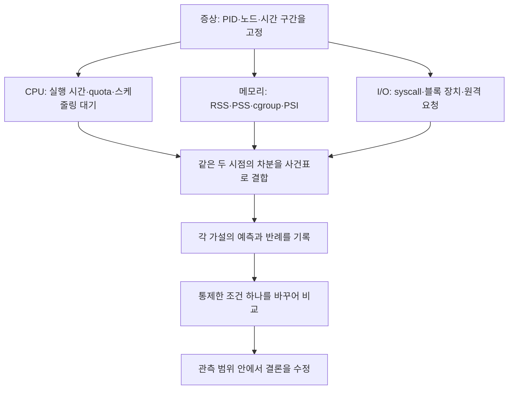

# 00c. Linux 관측과 문제 해결: 숫자를 원인으로 오해하지 않는 법

[학습 목차](README.md) · 이전: [프로세스·메모리](00b-linux-processes-and-memory.md) · 다음: [Linux 읽기·쓰기](01-linux-read-write.md) · 심화: [Linux·커널 독립 교재](../../../linux/learning/linux-kernel/README.md)

Spark executor가 Parquet을 읽는 동안 느려졌다는 신고를 받았다고 하자. 관측의 목표는 많은 명령을 실행하는 것이 아니라 “어느 작업이, 언제, 무엇을 기다렸는가”를 구별하는 것이다. 이 장의 명령은 상태를 바꾸지 않고 읽는 용도로 고른다. 제시하는 출력은 형식을 배우기 위한 **정적 교육용 예시**이며 이 서버나 사용자의 환경에서 실제로 측정한 결과가 아니다. Linux 배포판, 커널, cgroup 버전과 도구 버전에 따라 파일과 열이 다르거나 권한상 보이지 않을 수 있다.

## 먼저 관측 대상을 한 문장으로 고정한다

“서버가 느리다”에는 시간, 대상, 비교 기준이 없다. 다음처럼 쓴다.

> 14:00–14:10에 worker-2의 Spark executor PID 4312가 Parquet을 읽을 때 task wall time이 정상 구간 20초에서 75초로 늘었다. 같은 stage의 입력 바이트는 비슷했고 executor 한 개에서 반복됐다.

이 문장은 아직 원인을 말하지 않는다. 디스크, CPU, 메모리라는 단어를 증상 문장에 넣으면 관측 전에 결론을 고정하기 쉽다. 후보 원인은 CPU 계산 증가, runnable thread 경합, garbage collection, 메모리 reclaim, page cache miss 뒤 block I/O, 원격 저장 대기, 잠금 등으로 따로 적는다.

디스크에 있는 **실행 파일(executable file)**은 명령을 담은 파일이고, **프로세스(process)**는 그것을 실행하며 PID와 자원을 가진 현재의 실행 단위다. **스레드(thread)**는 한 프로세스 안의 실행 흐름으로 주소 공간과 fd를 공유하지만 각자 stack과 CPU 상태를 가진다. Spark executor라는 논리적 역할은 보통 JVM 프로세스 하나로 나타나고 그 안에 여러 task thread가 있다.

프로세스의 **주소 공간(address space)**은 그 프로세스가 사용할 수 있다고 보는 가상 주소 범위다. **heap**은 실행 중 동적 객체가 놓이는 할당 영역이고 프로세스의 여러 스레드가 공유한다. **stack**은 함수 호출과 일부 지역 상태가 놓이는 스레드별 영역이다. 주소 공간은 일정 크기의 **page** 단위로 RAM과 연결된다. 파일 내용을 RAM에 보관해 재읽기를 줄이는 커널 영역은 **page cache**다. JVM heap, thread stack, page cache는 모두 RAM 압박에 관여할 수 있지만 소유와 계정 위치가 다르다.

프로그램이 파일 읽기처럼 보호된 커널 기능을 요청하는 경계가 **시스템 호출(system call, syscall)**이다. CPU가 한 스레드 실행 상태를 저장하고 다른 스레드를 실행하는 전환이 **컨텍스트 스위치(context switch)**다. 컨텍스트 스위치는 동시 실행에 필요하며 높은 수치만으로 병목이라고 할 수 없다.

## PID와 실행 시간을 먼저 식별한다

~~~bash
ps -eo pid,ppid,stat,etime,time,comm,args --sort=pid
~~~

ps는 프로세스 정보를 보여 준다. `-e`는 현재 볼 수 있는 모든 프로세스를 대상으로 하고, `-o` 뒤 목록은 출력할 열과 순서를 직접 지정한다. `--sort=pid`는 PID 오름차순으로 정렬한다.

다음은 **교육용 정적 출력**이다.

~~~text
  PID  PPID STAT     ELAPSED     TIME COMMAND         COMMAND
 4210     1 Sl      01:20:15 00:03:40 java            java ... Driver
 4312  4210 Sl      00:42:10 00:18:30 java            java ... CoarseGrainedExecutorBackend
~~~

PID는 프로세스 번호, PPID는 부모 PID다. STAT의 첫 글자 S는 interruptible sleep 상태의 순간 표본이고, `l` 같은 추가 문자는 다중 스레드 등 부가 속성을 나타낼 수 있다. 상태 코드는 도구와 플랫폼 설명을 확인하며 한 순간 S였다고 42분 내내 잤다고 말하지 않는다. ELAPSED는 시작 후 실제 시계로 흐른 **wall time**, 즉 벽시계 경과 시간이다. TIME은 프로세스가 CPU에서 실제 실행된 user와 system CPU time의 누적이다. COMMAND는 짧은 실행 이름, 마지막 COMMAND 열은 `args` 요청으로 나온 전체 인자다.

wall time 42분과 CPU time 18분 30초의 차이는 남은 시간을 모두 디스크에서 기다렸다는 뜻이 아니다. 실행 대기열, sleep, network, lock, 자식 작업, 표본 범위가 섞인다. PID는 재사용되므로 관측을 연결할 때 시작 시각과 command line, 필요하면 namespace와 cgroup도 확인한다.

### 문제 1: CPU time과 wall time을 비율로 읽기

교육용으로 단일 프로세스의 ELAPSED가 10분, TIME이 5분이라고 하자. 평균 CPU 사용을 대략 얼마로 볼 수 있으며 무엇을 알 수 없는가?

한 CPU 기준 누적 CPU time을 wall time으로 나누면 \(5/10=0.5\), 약 한 코어의 50%에 해당한다. 다중 스레드 프로세스는 같은 10분 동안 여러 코어에서 동시에 실행해 TIME이 10분보다 클 수도 있다. 이 비율은 평균이라 30초 CPU 포화와 긴 idle을 숨긴다. 남은 5분이 I/O인지 잠금인지도 알려 주지 않는다. 조건을 바꾸어 TIME이 20분이면 10분 wall time 동안 평균 두 코어만큼 실행됐다는 뜻에 가깝지만 어느 thread가 사용했는지는 thread별 관측이 필요하다.

## /proc는 커널이 만드는 현재 상태 창이다

`/proc`는 일반 디스크 파일 모음처럼 보이지만 커널이 프로세스와 시스템 상태를 읽을 수 있게 노출하는 가상 파일시스템이다. 대상 PID를 셸 변수에 넣고 필요한 범위만 읽는다.

~~~bash
pid=$$
sed -n '1,40p' "/proc/$pid/status"
sed -n '1,20p' "/proc/$pid/limits"
ls -l "/proc/$pid/fd"
~~~

`pid=$$`는 현재 셸 PID를 변수 pid에 저장한다. sed의 `-n`은 모든 줄 자동 출력을 끄고, 작은따옴표 안 `1,40p`는 1번부터 40번 줄만 출력한다. limits 명령도 같은 방식으로 처음 20줄을 읽는다. ls의 `-l`은 fd 번호, 권한과 링크 대상을 긴 형식으로 보여 준다. 관측하려는 executor PID를 확인했다면 `$$` 대신 그 PID를 넣는다.

다음은 status 일부를 단순화한 **교육용 정적 출력**이다.

~~~text
Name:   java
State:  S (sleeping)
Pid:    4312
PPid:   4210
Threads:        64
VmSize: 12582912 kB
VmRSS:   6291456 kB
voluntary_ctxt_switches:        820000
nonvoluntary_ctxt_switches:      15000
~~~

VmSize는 예약·매핑된 전체 가상 주소 규모로 실제 RAM과 같지 않다. **RSS(Resident Set Size, 상주 집합 크기)**인 VmRSS는 현재 RAM에 상주한 프로세스 페이지 규모의 근사다. heap만이 아니라 stack, code, library, file mapping이 포함될 수 있고 공유 페이지를 각 프로세스에서 중복 계산할 수 있다. Threads는 현재 스레드 수다. voluntary context switches는 스레드가 기다리거나 양보해 일어난 자발적 전환 누적, nonvoluntary는 scheduler가 실행권을 빼앗는 등 비자발적 전환 누적이다. 시작 이후 누적값이므로 두 시점의 차이를 시간 간격으로 나눠야 변화율을 얻는다.

### 문제 2: 누적 context switch를 순간 원인으로 오해하지 않기

14:00에 voluntary 값이 820,000이고 14:01에 826,000이었다. nonvoluntary는 15,000에서 15,300이 됐다. 분당 증가량을 구하고 어떤 가설을 세울 수 있는가?

1분 동안 voluntary는 6,000, 초당 평균 100회 증가했다. nonvoluntary는 300, 초당 평균 5회다. 기다리거나 동기화하는 전환이 있었다는 단서지만 파일 I/O 때문인지 condition variable, sleep, network 때문인지는 모른다. 조건을 바꾸어 정상 구간도 같은 비율이면 느린 구간의 특이 증거가 약해진다. thread 수가 동시에 크게 늘었다면 scheduler 경합 가설도 검토하지만 context switch만으로 확정하지 않는다.

## RSS와 PSS, cgroup 메모리를 같은 값으로 보지 않는다

공유 페이지를 실제 공유 수에 비례해 나눈 상주 크기가 **PSS(Proportional Set Size, 비례 상주 집합 크기)**다. 지원되는 환경에서는 다음을 읽을 수 있다.

~~~bash
sed -n '1,30p' "/proc/$pid/smaps_rollup"
free -h
sed -n '1,30p' /proc/meminfo
~~~

smaps_rollup은 매핑별 정보를 합친 프로세스 메모리 요약이다. `Rss:`는 상주 페이지 합, `Pss:`는 공유 페이지를 비례 배분한 값, `Private_Clean`과 `Private_Dirty`는 그 프로세스에 전용인 깨끗한 페이지와 수정된 페이지 규모다. 제공 여부와 비용은 커널 설정에 따라 다르다.

free의 `-h`는 바이트를 KiB·MiB·GiB처럼 읽기 쉬운 단위로 표시한다. 다음은 **교육용 정적 출력**이다.

~~~text
               total   used   free  shared  buff/cache  available
Mem:            16Gi   11Gi  500Mi    1Gi       4.5Gi       3.2Gi
Swap:            0Bi    0Bi    0Bi
~~~

total은 관리되는 전체 메모리 규모, used는 도구 계산식에 따른 사용량, free는 완전히 비어 있는 양, shared는 주로 tmpfs 등 공유 메모리 관련 값, buff/cache는 커널 buffer와 page cache 관련 사용량, available은 swap 없이 새 작업에 쓸 수 있을 것으로 커널이 추정한 양이다. free 500 MiB만 보고 누수를 선언하면 회수 가능한 캐시와 available 3.2 GiB를 놓친다.

**cgroup(control group)**은 프로세스 묶음의 CPU·memory·I/O 사용을 계정하고 제한하는 커널 기능이다. Kubernetes container의 한도는 흔히 cgroup으로 적용된다. host 전체 free가 충분해도 해당 cgroup이 한도에 닿으면 executor는 reclaim이나 OOM을 겪을 수 있다. cgroup v2의 예는 다음과 같지만 실제 경로와 접근 권한을 먼저 확인한다.

~~~bash
sed -n '1,20p' /sys/fs/cgroup/memory.current
sed -n '1,20p' /sys/fs/cgroup/memory.max
sed -n '1,30p' /sys/fs/cgroup/memory.events
~~~

memory.current는 해당 cgroup의 현재 계정 사용량, memory.max는 hard limit 또는 `max`, memory.events는 high·max·oom·oom_kill 같은 사건 누적값을 제공할 수 있다. 현재 셸의 cgroup과 대상 executor의 cgroup이 같다는 전제 없이 이 경로를 읽으면 엉뚱한 범위를 본다.

메모리가 부족할 때 커널이 버리거나 내보낼 페이지를 찾는 일이 **회수(reclaim)**다. file cache를 버리거나 swap 가능한 익명 페이지를 내보낼 수 있다. 지속적인 회수는 CPU time과 I/O를 쓰고 task를 멈추게 할 수 있다.

### 문제 3: host available과 cgroup limit가 다른 결론을 주는 경우

host available이 20 GiB인데 executor cgroup의 memory.current가 7.9 GiB, memory.max가 8 GiB라고 하자. executor가 300 MiB를 더 할당하려 하면 host 여유만 보고 안전하다고 할 수 있는가?

아니다. 해당 cgroup에는 약 0.1 GiB 차이만 보이며 새 300 MiB 할당은 한도를 압박한다. 커널은 cgroup 안의 회수 가능한 page cache를 줄이거나 memory.max 사건을 기록하고, 회수하지 못하면 OOM kill이 일어날 수 있다. 조건을 바꾸어 memory.current에 즉시 회수 가능한 깨끗한 file cache 2 GiB가 포함돼 있다면 할당이 성공할 수도 있다. 그렇더라도 재읽기 I/O와 pressure가 늘 수 있으므로 memory.events와 PSI, I/O를 함께 본다.

## PSI는 사용량보다 멈춘 시간을 묻는다

**PSI(Pressure Stall Information, 압력 정지 정보)**는 CPU, memory, I/O 자원 부족 때문에 작업이 진행하지 못한 시간을 집계한다.

~~~bash
sed -n '1,10p' /proc/pressure/cpu
sed -n '1,10p' /proc/pressure/memory
sed -n '1,10p' /proc/pressure/io
~~~

다음은 memory PSI의 **교육용 정적 출력**이다.

~~~text
some avg10=12.50 avg60=6.20 avg300=2.10 total=987654321
full avg10=3.00 avg60=1.10 avg300=0.40 total=123456789
~~~

some은 관측 범위의 일부 작업이 memory 자원 때문에 멈춘 시간, full은 관련 작업들이 모두 동시에 진행하지 못한 시간을 나타낸다. avg10·avg60·avg300은 최근 10·60·300초 창의 stall 비율을 백분율로 나타내고, total은 부팅 또는 cgroup 생성 뒤 누적 stall 시간을 마이크로초로 표현한다. 예시의 some avg10 12.50은 최근 10초 동안 일부 작업이 막힌 시간이 합산 관점에서 12.5% 수준이었다는 뜻이다. 정확한 집계 의미는 자원 종류에 따라 다르다.

system-wide `/proc/pressure`와 특정 cgroup의 pressure 파일은 범위가 다르다. memory PSI 상승은 reclaim·compaction·thrashing 가설을 지지하지만 어떤 executor 객체가 원인인지 직접 알려 주지 않는다.

### 문제 4: memory PSI와 RSS가 함께 움직이지 않는 반례

executor RSS가 6 GiB로 안정적인데 memory PSI some avg10이 0%에서 20%로 올랐다. “RSS가 늘지 않았으니 메모리 문제는 아니다”라고 할 수 있는가?

그럴 수 없다. cgroup 한도 안에서 page cache를 반복 회수하거나 다른 프로세스가 메모리를 늘려 executor가 할당 때 멈출 수 있다. RSS의 같은 총량 안에서도 hot page 구성이 바뀔 수 있다. memory.current, memory.events, major fault, swap, cache, task latency를 같은 시간에 비교한다. 조건을 바꾸어 PSI는 host 전체에서만 높고 executor cgroup PSI는 낮다면 다른 workload가 만든 system pressure의 간접 영향인지 확인해야 한다. 범위가 다른 지표를 섞지 않는다.

## CPU 실행과 대기를 시간축으로 분리한다

높은 user CPU는 Parquet decode, 압축 해제, 직렬화, garbage collection 같은 사용자 공간 계산 후보를 지지한다. 높은 system CPU는 syscall, page fault 처리, kernel networking 같은 커널 작업 후보를 지지한다. 낮은 CPU와 긴 wall time은 I/O·lock·network 대기 가능성을 높이지만 짧은 CPU burst가 평균에 숨거나 한 thread만 포화될 수 있다.

`/proc/PID/stat`에는 user CPU tick과 system CPU tick 등이 있지만 공백을 포함할 수 있는 프로세스 이름 때문에 단순 열 분리 스크립트는 주의해야 한다. ps의 TIME은 편한 누적 요약이고, 정밀한 구간 분석은 두 시점 차이와 시스템 clock tick 단위를 사용한다. 시스템 전체 load average는 CPU 사용률이 아니라 runnable task와 일부 uninterruptible wait를 포함하는 부하 지표다. 코어 수와 task state를 함께 본다.

### 문제 5: CPU 25%라는 값의 두 가능한 모습

4코어 host에서 executor CPU가 25%로 보였다. 이것이 한 thread가 한 코어를 계속 쓰는 상황과 네 thread가 각각 간헐적으로 쓰는 상황을 구분하는가?

프로세스 총 CPU% 하나만으로 구분하지 못한다. 도구의 100% 기준도 한 코어인지 전체 host인지 확인해야 한다. thread별 CPU와 runnable 상태, 표본 간격을 본다. 한 직렬 task thread가 한 코어를 포화하면 전체 4코어 기준 25%처럼 보이면서 stage 병목이 될 수 있다. 조건을 바꾸어 네 task가 모두 I/O를 기다리며 순간 CPU burst만 만든 경우에도 장기 평균 25%가 나올 수 있다. CPU time과 wall time, thread 상태, I/O 증거를 연결한다.

## syscall은 사용자 코드와 커널 경계를 보여 준다

개발 환경에서 새로 시작하는 작은 명령을 관찰할 때 원문의 명령을 사용한다.

~~~bash
strace -f -tt -T -e trace=openat,read,write,fsync,fdatasync,rename \
  python3 kubernetes/storage/data-systems-foundations/examples/io_durability_demo.py
~~~

strace는 대상이 수행한 syscall과 반환을 기록한다. `-f`는 생성된 child process와 thread를 따라가고, `-tt`는 마이크로초 수준의 wall-clock 시각을 붙이며, `-T`는 각 syscall 안에서 경과한 시간을 붙인다. `-e trace=...`는 openat, read, write, fsync, fdatasync, rename만 선택해 출력량을 줄인다. 역슬래시는 셸에서 명령이 다음 줄로 계속됨을 뜻한다.

교육용 출력 한 줄은 다음과 같다.

~~~text
14:02:02.123456 read(3, "PAR1...", 4096) = 4096 <0.008200>
~~~

14:02:02.123456은 호출 시각, read는 syscall 이름, 3은 현재 프로세스의 fd, 문자열은 사용자 buffer 내용 일부, 4096은 요청 최대 바이트다. 등호 뒤 4096은 실제 반환 바이트, 꺾쇠의 0.008200은 호출 안에서 약 8.2 ms 경과했다는 뜻이다. 반환 `-1` 뒤 errno 이름이 있으면 API가 보고한 오류 분류다.

strace 자체가 syscall마다 기록 비용을 더해 실행을 바꿀 수 있다. 한 read 8.2 ms가 Spark task 75초를 모두 설명하지 않는다. 운영 executor attach는 권한·부하·정보 노출 검토가 필요하므로 이 교재 명령은 새 로컬 데모를 대상으로 한다.

### 문제 6: syscall 100 ms와 요청 900 ms의 차이

한 요청 thread에서 fsync 한 번이 100 ms였고 전체 요청 wall time은 900 ms였다. “지연의 100%가 fsync다”라고 할 수 있는가?

관측된 fsync 구간은 요청의 약 \(100/900=11.1\%\)다. 나머지 800 ms에는 사용자 계산, queue, lock, 다른 syscall, 원격 대기가 있을 수 있다. fsync가 다른 요청을 간접 차단했을 가능성도 별도다. 조건을 바꾸어 같은 thread의 추적에서 100 ms fsync가 아홉 번 직렬로 있었고 다른 구간이 미미하다면 직접 기여 설명이 강해진다. 그래도 strace 관측 부하와 요청 ID 연결을 확인해야 한다.

## fd, 삭제 파일과 파일시스템 용량을 연결한다

~~~bash
ls -l /proc/<PID>/fd
df -h
df -i
~~~

`<PID>`는 실제 대상 번호로 바꾸는 자리표시자다. fd 링크 대상에 `(deleted)`가 보이면 경로명은 삭제됐지만 열린 handle 때문에 inode와 block이 남았을 가능성이 있다. df는 mount된 파일시스템 사용을 본다. `-h`는 바이트 용량을 읽기 쉬운 단위로, `-i`는 바이트 대신 inode 개수로 표시한다.

교육용 `df -h`의 Filesystem, Size, Used, Avail, Use%, Mounted on은 각각 장치·논리 파일시스템 이름, 전체 크기, 사용량, 일반적으로 사용 가능한 양, 사용 비율, 연결된 경로다. `df -i`의 Inodes, IUsed, IFree, IUse%는 전체 inode, 사용 inode, 남은 inode, 사용 비율이다. 작은 파일을 매우 많이 만들면 Avail 바이트가 남아도 IFree가 0에 가까워 새 파일 생성이 실패할 수 있다.

### 문제 7: df -h는 여유인데 ENOSPC가 난 경우

파일시스템에 100 GiB 중 40 GiB가 남았지만 inode 1,000,000개 중 999,999개를 사용했다고 하자. 새 작은 파일 두 개 생성이 실패할 수 있는 이유와 다음 관측을 설명하라.

바이트는 충분하지만 새 파일마다 필요한 inode가 거의 남지 않았다. 첫 파일이 마지막 inode를 쓰면 둘째가 ENOSPC를 받을 수 있다. `df -i`로 inode 고갈을 확인하고 어느 디렉터리에 작은 파일이 몰렸는지 읽기 전용으로 조사한다. 조건을 바꾸어 inode도 충분하면 quota, thin pool, 권한, 다른 mount를 확인한다. ENOSPC라는 errno는 공간 계열 오류의 시작점이지 “디스크 바이트 100%”라는 완전한 원인이 아니다.

## block I/O 열은 장치 계층의 평균이다

~~~bash
iostat -x
~~~

iostat의 `-x`는 장치별 확장 통계를 요청한다. sysstat 버전에 따라 열 이름과 단위가 달라지므로 실제 header를 그대로 보존한다. 다음은 **교육용 정적 출력**이다.

~~~text
Device   r/s   rkB/s  r_await  aqu-sz  %util
nvme0n1  800  102400     4.50    3.60   72.0
~~~

Device는 관측한 block device, r/s는 초당 완료 read 요청, rkB/s는 초당 읽은 KiB, r_await는 read 요청의 평균 대기·서비스 시간을 포함한 ms 값, aqu-sz는 평균 queue 길이, %util은 장치가 I/O를 처리 중이던 시간 비율 계열이다. 병렬 NVMe와 가상 장치에서 %util 100의 의미를 단순한 “더 처리 불가”로 읽지 않는다. 평균 r_await는 꼬리 지연을 숨긴다.

page cache hit인 read는 block device 요청을 만들지 않을 수 있다. device mapper, RAID, network block storage에서는 어느 계층의 device를 보고 있는지 확인한다. 애플리케이션 request와 block I/O를 같은 PID에 직접 귀속하지 못하는 도구도 있다.

### 문제 8: 높은 장치 사용률이 executor 원인인지 검증하기

executor 지연 시 nvme0n1 %util이 95%였지만 같은 host에 backup process도 있었다. 어떤 사실이 더 필요하며 %util만으로 무슨 결론을 피해야 하는가?

같은 시간 executor가 해당 mount의 파일을 읽었는지, process I/O byte가 늘었는지, read syscall과 page fault가 증가했는지, backup의 I/O가 얼마인지 확인해야 한다. block device queue와 executor task 시간의 동시 변화도 본다. %util 95%는 장치가 바빴다는 상관관계이지 executor가 원인을 만들었거나 executor 지연의 유일한 원인이라는 증거가 아니다. 조건을 바꾸어 executor를 중지했을 때 장치 부하와 다른 서비스 지연이 함께 사라지는 통제 실험이 있다면 인과 가설은 강해지지만, 운영 변경의 다른 효과도 검토한다.

## 프로세스 block I/O와 원격 대기를 구분한다

지원되는 환경에서 `/proc/PID/io`는 프로세스의 read_bytes, write_bytes, rchar, wchar 같은 누적값을 제공한다. rchar는 read 계열 syscall로 반환된 바이트라 page cache hit도 포함할 수 있고, read_bytes는 저장 계층에서 실제 가져온 바이트에 가까운 계정이지만 파일시스템과 커널 동작에 주의한다. 두 시점 차이를 같은 시간 간격으로 비교한다. 자식 프로세스나 다른 executor의 I/O는 자동으로 합쳐지지 않을 수 있다.

원격 객체 저장소나 HDFS를 읽을 때 지연에는 DNS, 연결, TLS, 원격 queue, 서버 storage, network 전송이 섞인다.

~~~bash
ss -tpn 2>/dev/null || true
~~~

ss의 `-t`는 TCP socket, `-p`는 관련 process 정보, `-n`은 이름 변환 없이 숫자 주소와 port를 표시한다. `2>/dev/null`은 권한 등 표준 오류를 버리고 `|| true`는 명령 실패로 전체 예제를 중단하지 않는다. State는 TCP 상태, Recv-Q와 Send-Q는 socket queue의 바이트 또는 구현이 정의한 대기량, Local Address:Port와 Peer Address:Port는 양 끝, Process는 보이는 경우 PID와 fd 단서다. socket queue만으로 원격 disk가 느리다고 결론 내릴 수 없다.

## 사건표에서 사실과 가설을 분리한다

그림은 서로 다른 도구의 값을 같은 사건에 연결하는 순서다. 메모리 사용량이 높다는 사실만으로 파일 읽기 지연을 설명할 수는 없다. 같은 구간의 reclaim·PSI 증가, 읽기 호출의 대기, 애플리케이션의 처리 시각을 맞춰야 그 가설이 예상하는 경로가 관측됐는지 판단할 수 있다. 조건을 바꾼 뒤 지연이 줄어도 동시에 입력 크기나 캐시 상태가 달라졌다면 원인이 확정된 것은 아니다.

| 시각 | 범위 | 관측 사실 | 지지하는 가설 | 아직 모르는 것 |
|---|---|---|---|---|
| 14:02:00 | executor PID 4312 | task wall 75초, CPU 평균 낮음 | 대기 포함 | 어느 대기인지 |
| 14:02:01 | executor cgroup | memory PSI some avg10 20% | memory stall | heap·cache 원인 |
| 14:02:02 | PID io | read_bytes 증가 | storage read 발생 | local·remote 층 |
| 14:02:03 | nvme0n1 | r_await와 queue 증가 | local block 경합 | executor 귀속 |
| 14:02:04 | host | backup PID write 증가 | 경쟁 workload | 제거 시 효과 |

한 증거가 새로 나오면 경쟁 가설을 갱신한다. memory PSI와 block I/O가 함께 오르면 reclaim이 cache를 버려 재읽기를 만든 경로를 의심할 수 있지만, backup이 독립적으로 I/O를 만든 가능성도 남는다. 가장 싼 다음 관측은 executor cgroup 범위, PID I/O 변화량, backup 시간축을 맞추는 일이다.

읽기 전용 문제 해결은 다음 순서를 지킨다. 증상을 시간·대상·지표로 쓰고 정상 구간과 비교한다. 가능한 원인을 둘 이상 적고, 두 원인을 구별할 최소 관측을 고른다. 명령, 시각, PID 시작 정보, cgroup, 출력 원문을 보존한다. 사실과 해석을 다른 열에 쓰며 새 증거와 충돌한 가설은 버린다. RSS, PSS, PSI, CPU time, wall time, block I/O는 각각 다른 경계를 재므로 한 숫자를 전체 원인으로 승격하지 않는다.

## 근거와 더 읽을 자료

- [proc(5)](https://man7.org/linux/man-pages/man5/proc.5.html)
- [proc_pid_status(5)](https://man7.org/linux/man-pages/man5/proc_pid_status.5.html)
- [strace manual](https://man7.org/linux/man-pages/man1/strace.1.html)
- [Linux PSI documentation](https://docs.kernel.org/accounting/psi.html)

[학습 목차](README.md) · 이전: [프로세스·메모리](00b-linux-processes-and-memory.md) · 다음: [Linux 읽기·쓰기](01-linux-read-write.md)
