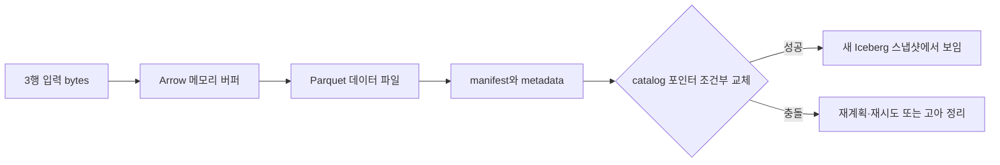
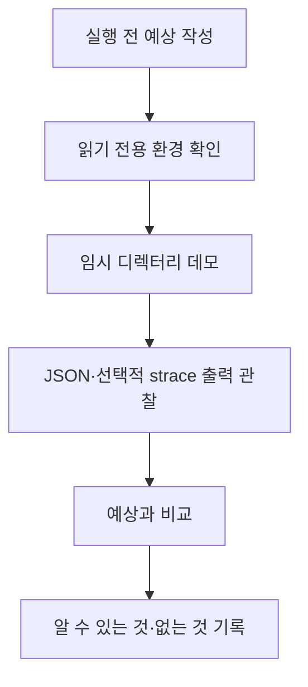

# 08. 운영 장비를 건드리지 않는 로컬 실습

이 장의 실습은 저장 장치의 전원을 끄거나 운영 클러스터에 장애를 넣는 실험이 아니다. 표준 라이브러리로 만든 작은 교육 모델과 읽기 전용 진단 결과를 이용해, 프로그램이 만든 **바이트**가 어느 객체를 거쳐 파일이 되는지 추적한다. 바이트(byte)는 컴퓨터가 저장하는 작은 정수 단위이며 보통 8개의 비트(bit)로 이루어진다. 비트는 0 또는 1 한 값을 담는다. 예를 들어 UTF-8로 인코딩한 `A`는 값 65인 한 바이트지만, 한글 한 글자는 보통 여러 바이트가 필요하다. 따라서 “문자 10개”와 “10바이트”는 같은 뜻이 아니다.

## 실습에서 추적할 한 건의 입력

교육 모델의 입력은 기본값 1 MiB인 일정한 바이트열이다. MiB는 \(2^{20}\)바이트이므로 1 MiB는 1,048,576바이트다. 모델이 같은 규칙으로 내용을 만들면 실행 전후의 SHA-256 값도 같아야 한다. SHA-256은 임의 길이의 바이트열을 32바이트의 요약값으로 바꾸는 계산이다. 서로 다른 내용이 우연히 같은 요약값을 만들 가능성은 매우 작으므로 전송 중 내용이 달라졌는지 확인하는 데 쓴다. 다만 해시가 같다는 사실은 “갑작스러운 전원 차단 뒤에도 남는다”는 뜻이 아니다. 해시는 내용의 동일성을 검사하고, `fsync` 같은 동기화 연산은 저장 지속성의 경계를 요청한다.

다음은 이 장에서 끝까지 따라갈 교육용 객체다.

| 시점 | 실제 객체와 위치 | 관리 주체 | 예상 수명 | 지금 필요한 이유 |
|---|---|---|---|---|
| 입력 생성 | Python 프로세스의 메모리에 있는 `bytes` 객체 | Python 런타임과 프로세스 | 프로세스가 종료되거나 객체가 해제될 때까지 | 쓸 내용과 정확한 길이를 정한다 |
| `write` 호출 뒤 | 커널 메모리의 페이지 캐시(page cache)에 있는 더티 페이지 | Linux 커널 | 메모리 압박, 쓰기 회수, 재부팅 전까지 | 느린 장치를 기다리지 않고 쓰기를 받아들이며 작은 쓰기를 모은다 |
| 파일 시스템 처리 뒤 | inode, 디렉터리 항목, 블록 배치 정보 | 파일 시스템 | 디스크에 기록되고 삭제될 때까지 | 이름과 내용 위치를 연결한다 |
| 블록 요청 뒤 | 장치 대기열과 장치 내부 캐시의 쓰기 명령 | 블록 계층·장치 펌웨어 | 완료 또는 전원 손실까지 | 논리 블록 주소를 실제 매체 기록으로 보낸다 |
| 읽기 검증 뒤 | 다시 읽은 `bytes`와 SHA-256 | Python 모델 | 검증 종료까지 | 기록한 내용과 읽은 내용이 같은지 확인한다 |

**페이지(page)**는 커널이 메모리를 관리하는 고정 크기 조각이다. 많은 시스템에서 4 KiB지만 실습에서는 `getconf PAGESIZE`의 실제 결과를 기록한다. **페이지 캐시**는 파일 내용을 메모리에 보관하는 커널 영역이다. 프로그램이 `write`에 성공했을 때 바이트는 흔히 이 캐시에만 있고 아직 비휘발성 매체에 도달하지 않았을 수 있다. 내용이 바뀌어 장치에 아직 반영되지 않은 페이지를 **더티 페이지(dirty page)**라고 한다.

**파일 시스템(file system)**은 이름, 디렉터리, 권한, 길이와 내용이 놓인 위치를 관리하는 커널 구성 요소다. 파일 이름 자체가 내용을 담는 것은 아니다. 디렉터리 항목은 이름을 inode에 연결하고, **inode**는 파일의 길이·권한·시간 정보와 데이터 블록을 찾을 정보를 담는다. 파일을 연 프로세스가 받는 작은 정수인 **파일 디스크립터(file descriptor)**는 그 열린 파일을 가리키는 프로세스별 손잡이다. 이름을 바꿔도 이미 열린 파일 디스크립터가 즉시 다른 파일로 바뀌지는 않는다.

**블록 장치(block device)**는 저장 공간을 번호가 붙은 고정 크기 논리 블록처럼 제공하는 장치다. SSD, HDD 또는 그 위의 가상 장치가 여기에 해당한다. 파일 시스템은 “파일의 4096번째 바이트”를 장치 명령으로 직접 표현하지 않는다. 파일 오프셋을 파일 시스템 블록에 대응시키고, 블록 계층이 이를 장치의 논리 블록 주소와 요청 대기열로 바꾼다. 장치가 완료를 보고하는 정확한 의미는 장치 캐시, 쓰기 장벽, 파일 시스템과 마운트 설정에 영향을 받는다. 이 실습은 장치 전원 차단을 하지 않으므로 그 마지막 경계를 실측했다고 주장하지 않는다.

## 한 번의 쓰기를 시간순으로 해부하기

아래 수치는 기본 1 MiB 입력과 교육 모델의 단계 순서를 설명하기 위한 예다. 경과 시간은 기계 성능에 따라 달라지므로 보장값이나 성능 비교값이 아니다.

| 모형 시각 | 주체 | 입력 | 중간 상태 | 결과와 아직 모르는 것 |
|---:|---|---|---|---|
| 0 ms | Python | 크기 1 MiB | 메모리에 1,048,576바이트 생성 | 아직 파일이 없다 |
| 1 ms | Python | 바이트열 | SHA-256 계산 상태 | 기대 해시 32바이트를 얻는다 |
| 2 ms | `open`/파일 시스템 | 임시 경로 | 디렉터리 항목과 inode 준비 | 파일 이름이 생기지만 내용은 비어 있다 |
| 3 ms | `write`/커널 | 1,048,576바이트 | 페이지 캐시의 더티 페이지 | 반환값이 전체 길이면 커널이 입력을 받았다는 뜻이다 |
| 4 ms | Python `flush` | 언어 수준 출력 버퍼 | 남은 바이트를 커널로 전달 | 장치 지속성은 아직 보장하지 않는다 |
| 6 ms | `fsync(file)` | 파일 디스크립터 | 파일 데이터와 필요한 메타데이터 쓰기 요청 | 성공하면 OS가 그 파일의 동기화를 완료했다고 보고한다 |
| 7 ms | `replace` | 임시 이름·최종 이름 | 같은 파일 시스템 안에서 이름 연결 교체 | 새 이름을 조회하면 새 inode가 보이지만 디렉터리 갱신 지속성은 별도다 |
| 8 ms | `fsync(directory)` | 부모 디렉터리 FD | 디렉터리 항목 갱신 동기화 | 이름 교체의 지속성 경계를 요청한다 |
| 9 ms | `read` | 최종 경로 | 페이지 캐시 또는 장치에서 바이트 획득 | 길이와 해시가 같으면 현재 읽기 내용은 같다 |

`flush`라는 단어는 여러 층에서 다르게 쓰여 혼동하기 쉽다. Python 파일 객체의 `flush()`는 Python이 사용자 공간에 모아 둔 출력을 커널에 넘긴다. 커널의 `fsync()`는 해당 파일의 변경을 지속성 경계까지 밀어 달라고 파일 시스템에 요청하고 완료를 기다린다. SSD 내부에도 별도의 캐시와 flush 명령이 있을 수 있다. 한 층의 flush를 다른 층의 완료와 같다고 읽으면 안 된다.

1 MiB 입력을 페이지 크기 4096바이트인 환경에서 나눈다고 가정하면

\[
1{,}048{,}576 \div 4096 = 256
\]

이므로 내용은 정확히 256개의 페이지 크기에 해당한다. 그러나 이것이 반드시 256개의 장치 쓰기 명령을 만든다는 뜻은 아니다. 커널은 인접 페이지를 한 요청으로 합칠 수 있고, 파일 시스템은 메타데이터와 저널 쓰기를 추가할 수 있으며, 장치는 다시 내부 단위로 나눌 수 있다. 반대로 4097바이트 파일은 내용 길이만 보면 4 KiB 한 장보다 1바이트 크지만, 파일 시스템 할당 단위 때문에 두 블록 분량을 차지할 수 있다. 희소 파일, 압축 파일 시스템, 작은 파일 인라인 저장에서는 결과가 달라진다. 그래서 `st_size`는 논리적 파일 길이, `st_blocks`는 할당된 공간을 나타내며 둘은 같다고 가정하지 않는다.

## 이름 교체가 필요한 이유와 실패 창

완성된 최종 파일을 그 자리에서 덮어쓰면 중간 실패 때 앞부분만 새롭고 뒷부분은 오래된 혼합 상태가 보일 수 있다. 교육 모델은 별도 임시 파일을 완성하고 동기화한 뒤 `replace`로 이름을 교체한다. 같은 파일 시스템 안의 이름 교체는 관찰자에게 이전 이름 연결 또는 새 이름 연결을 보이게 하는 원자적 연산으로 사용할 수 있다. **원자적(atomic)**이라는 말은 중간 상태를 외부에서 부분적으로 보지 않는다는 뜻이지, 전원 손실 뒤 새 이름이 반드시 남는다는 뜻은 아니다. 그래서 부모 디렉터리도 연 뒤 `fsync`한다.

| 실패 시점 | 재시작 뒤 가능한 관찰 | 이유 | 모델이 확인할 수 있는 범위 |
|---|---|---|---|
| `write` 반환 직후, 파일 `fsync` 전 | 임시 파일 내용이 없거나 일부만 지속될 수 있음 | 반환은 대개 페이지 캐시 수락을 뜻함 | 정상 실행 중 반환 바이트 수만 확인 |
| 파일 `fsync` 성공 뒤, `replace` 전 | 완성된 임시 파일과 이전 최종 파일 | 내용은 동기화했지만 이름을 아직 교체하지 않음 | 임시 파일의 해시 확인 가능 |
| `replace` 뒤, 디렉터리 `fsync` 전 | 새 이름 또는 이전 디렉터리 상태 | 이름 변경의 지속성 경계가 남음 | 정상 실행에서 새 이름 조회 가능 |
| 디렉터리 `fsync` 성공 뒤 | 새 파일이 기대되지만 하드웨어 계약에 영향 받음 | 모든 층의 전원 손실 보장은 이 모델 밖임 | 실제 전원 차단 내구성은 검증하지 않음 |
| 읽기와 해시 확인 뒤 | 현재 실행에서 내용 동일 | 읽기 경로가 기대 바이트를 반환함 | 미래 재부팅 뒤의 지속성은 별도 문제 |

같은 `hash_match=true`라도 원인은 여러 가지다. 실제로 장치에서 다시 읽었을 수도 있고, 방금 쓴 내용이 페이지 캐시에 남아 캐시에서 읽혔을 수도 있다. 둘 다 내용 비교에는 성공하지만 장치 기록을 증명하는 강도는 다르다. 캐시를 강제로 비우거나 전원을 끄는 실험은 안전 범위를 벗어나므로, 결과에는 “정상 실행 중 논리적 내용 검증”이라고 적는다.

## 같은 객체를 분산 저장으로 보내면

로컬 파일 실습은 분산 저장의 축소 모형이다. 다만 네트워크 ACK가 로컬 `fsync`와 같다고 가정할 수 없다. **ACK(acknowledgement)**는 상대가 어떤 단계를 받았거나 마쳤다고 알려 주는 응답이다. 어느 단계까지 마쳤다는 뜻인지는 각 시스템의 프로토콜과 설정이 정한다.

### HDFS: 이름과 큰 블록을 다른 주체가 관리한다

**HDFS(Hadoop Distributed File System)**는 큰 파일을 여러 서버에 나누어 저장하는 분산 파일 시스템이다. 파일 이름, 디렉터리, 권한과 각 블록이 어느 서버에 있는지는 **NameNode**가 관리한다. 실제 파일 바이트의 블록 복제본은 **DataNode**의 로컬 저장소에 놓인다. NameNode의 메모리·영속 메타데이터와 DataNode의 블록 파일은 서로 다른 객체이며 수명과 복구 절차도 다르다.

1 MiB 교육 입력을 HDFS 클라이언트에 쓴다고 생각해 보자. 실제 HDFS 블록 크기가 입력보다 크다고 가정하면 데이터 블록 하나면 충분하다. 클라이언트는 NameNode에 파일 생성을 요청해 대상 DataNode 파이프라인을 받고, 바이트를 패킷으로 나누어 첫 DataNode에 보낸다. 첫 DataNode는 다음 DataNode로 전달하고 각 노드가 체크섬과 저장 상태를 관리한다. 역방향 ACK가 클라이언트에 도달하면 해당 패킷의 파이프라인 처리가 진행되었음을 안다. 하지만 복제 계수, 동기화 호출, DataNode 저장 장치 설정이 다르면 ACK가 뜻하는 내구성 경계도 달라질 수 있다. 이 장은 HDFS를 실행하지 않으므로 “1 MiB면 블록 하나”라는 객체 배치 모형만 사용하며 실제 장애 내구성을 측정하지 않는다.

### Ceph: 객체 배치와 서비스 인터페이스를 구분한다

**Ceph**는 데이터를 내부 객체로 나누어 여러 저장 서버에 배치하는 분산 저장 시스템이다. 핵심 객체 저장 계층인 **RADOS**에서 실제 객체 복제본이나 소거 부호 조각은 **OSD(Object Storage Daemon)**가 관리한다. OSD는 저장 장치와 그 위의 데이터를 맡는 프로세스다. 배치 계산은 객체를 placement group에 대응시키고, 클러스터 지도를 이용해 담당 OSD 집합을 고른다.

CephFS는 파일과 디렉터리처럼 보이는 인터페이스, RBD는 블록 장치처럼 보이는 인터페이스, RGW는 S3와 비슷한 객체 API를 제공한다. 같은 1 MiB 입력도 CephFS에서는 파일 오프셋과 메타데이터, RBD에서는 가상 블록 주소, RGW에서는 객체 키로 들어온다. 결국 내부 RADOS 객체가 되더라도 앞단의 이름·동시성·완료 의미가 다르다. 풀의 복제 또는 소거 부호 설정과 쓰기 확인 정책을 모른 채 “응답을 받았으니 세 복제본이 디스크에 영구 저장됐다”고 단정하면 안 된다.

### S3: 경로처럼 보이는 키는 로컬 파일 이름과 다르다

**S3 객체 저장**은 버킷(bucket) 안의 키(key)로 바이트 객체를 넣고 가져오는 API 모델이다. 버킷은 객체 이름 공간이고, 키는 객체를 찾는 문자열이다. `logs/2026/a.parquet`에 슬래시가 있어도 일반적인 파일 시스템의 디렉터리 inode와 같은 구조라고 가정할 수 없다. 객체의 메타데이터와 버전, 업로드 완료 상태는 서비스가 관리한다.

클라이언트가 1 MiB를 PUT하고 성공 응답을 받으면 그 API가 약속한 완료 조건을 만족했다는 뜻이다. 클라이언트의 로컬 파일 `fsync`, HTTP 요청 전송 성공, 서버의 객체 가시성은 서로 다른 사건이다. 멀티파트 업로드에서는 각 부분을 올린 것과 최종 완료 요청을 성공시킨 것도 다르다. 교육 모델은 네트워크 서비스에 접근하지 않으므로 S3의 성능이나 내구성을 측정하지 않고 객체·키·응답의 경계만 비교한다.

## 데이터베이스의 WAL에서 같은 바이트 보기

**데이터베이스(database)**는 레코드를 조회하고 갱신하며 동시 실행과 장애 복구 규칙을 제공하는 프로그램이다. 데이터베이스 파일의 데이터 페이지를 곧바로 덮어쓰다가 중간에 실패하면 어느 변경이 커밋됐는지 판별하기 어렵다. 그래서 많은 데이터베이스는 실제 데이터 페이지보다 먼저 변경 의도를 순서대로 적는 **미리 쓰기 로그(WAL, write-ahead log)**를 사용한다.

예를 들어 계좌 잔액을 100에서 90으로 바꾸는 작은 트랜잭션을 생각하자. 트랜잭션은 함께 성공하거나 함께 취소되어야 하는 작업 묶음이다.

| 순서 | 객체 | 기록 내용 | 장애 뒤 의미 |
|---:|---|---|---|
| 1 | 메모리의 트랜잭션 상태 | `balance: 100 → 90` | 프로세스가 죽으면 사라질 수 있다 |
| 2 | WAL 버퍼와 WAL 파일 | 트랜잭션 ID, 이전/새 값 또는 재실행 정보 | 아직 지속성 경계 전이면 사라질 수 있다 |
| 3 | WAL 동기화 | 커밋에 필요한 로그를 `fsync` 계열 경계로 보냄 | 성공한 커밋을 재시작 때 재실행할 근거가 된다 |
| 4 | 클라이언트 커밋 응답 | 업무 성공을 알림 | 응답 유실이면 서버는 커밋했지만 클라이언트는 모를 수 있다 |
| 5 | 데이터 페이지 반영 | 메모리 페이지와 데이터 파일을 갱신 | 늦게 써도 WAL로 복구할 수 있다 |

WAL은 모든 데이터베이스에서 같은 바이트 형식이나 같은 `fsync` 정책을 쓰는 표준 파일이 아니다. 제품과 설정에 따라 그룹 커밋, 복제 확인, 비동기 커밋이 다르다. 핵심 원리는 데이터 페이지보다 복구에 필요한 로그가 먼저 지속 가능해야 한다는 순서다. 로컬 파일 모델의 “임시 파일 동기화 뒤 이름 교체”와 목적은 다르지만, 관찰 가능한 완료 전에 복구 근거를 준비한다는 공통점이 있다.

## Parquet, Arrow, Iceberg에서 객체의 모양이 바뀌는 과정

세 용어는 같은 종류가 아니다. **Arrow**는 실행 중 메모리에서 열 데이터를 다루기 위한 배열과 버퍼 형식이다. **Parquet**은 저장소에 놓는 열 지향 파일 형식이다. **Iceberg**는 여러 데이터 파일을 하나의 테이블 스냅샷으로 묶고 어떤 파일들이 현재 테이블을 구성하는지 관리하는 테이블 형식이다.

세 행의 센서 입력을 생각하자.

| 행 | `sensor_id` | `ts` | `value` |
|---:|---|---:|---:|
| 0 | `A` | 1000 | 20.5 |
| 1 | `A` | 1010 | 20.7 |
| 2 | `B` | 1020 | 19.8 |

Arrow 배열에서는 `sensor_id`, `ts`, `value`가 각각 연속된 버퍼로 표현된다. 값이 없는 행을 표시하는 유효성 비트맵과 문자열의 시작 위치를 나타내는 오프셋 버퍼가 추가될 수 있다. 이 객체는 보통 프로세스 메모리에 살며 프로세스와 배열의 수명에 묶인다. Arrow 배열을 만들었다고 파일이 지속된 것은 아니다.

Parquet 작성기는 여러 행을 **행 그룹(row group)**으로 묶고, 각 열을 **열 청크(column chunk)**로 저장한다. 열 청크 안에는 인코딩·압축된 **페이지(page)**가 있다. 여기서 Parquet 페이지는 운영체제의 4 KiB 메모리 페이지와 같은 객체가 아니다. 파일 끝의 footer에는 열 위치와 통계 같은 메타데이터가 있어 읽는 쪽이 필요한 열과 행 그룹을 고를 수 있다. 세 행 예시는 교육상 행 그룹 하나로 그리지만 실제 크기와 압축 결과는 작성기 설정에 따라 달라진다.

Iceberg 쓰기는 새 Parquet 파일을 저장소에 올리는 것만으로 끝나지 않는다. 새 데이터 파일을 가리키는 manifest, manifest 목록과 테이블 metadata를 만들고, 마지막에 catalog가 가리키는 현재 metadata 포인터를 조건부로 바꾼다. **catalog**는 테이블 이름과 현재 메타데이터 위치를 관리하는 서비스 또는 저장 계층이다. 두 작성자가 동시에 갱신하면 “내가 읽었던 이전 포인터가 아직 현재인가”를 검사하는 비교 후 교체가 필요하다. 데이터 파일 업로드에 성공했지만 포인터 교체에 실패하면 그 파일은 저장소에 존재해도 현재 스냅샷에서는 보이지 않는 고아 후보가 된다.

이 전체 흐름에서 “쓴 데이터가 있다”는 말은 층마다 다르다. Arrow 버퍼에 있다는 것은 프로세스가 계산할 수 있다는 뜻이고, Parquet 파일 업로드는 바이트 객체가 저장소에 있다는 뜻이며, Iceberg 커밋은 독자가 새 스냅샷을 선택할 수 있다는 뜻이다. 한 단계의 성공을 다음 단계의 가시성이나 원자성으로 확대하면 안 된다.

## 실습 결과를 읽는 다섯 가지 연습

### 문제 1: 페이지 수와 파일 할당을 구분하라

페이지 크기가 4096바이트이고 입력이 1 MiB다. 내용은 몇 페이지 크기인가? `st_blocks * 512`가 반드시 1 MiB인가?

**풀이:** \(1{,}048{,}576 / 4096 = 256\)이므로 내용 길이는 256페이지 크기다. 그러나 `st_blocks`는 파일 시스템이 보고한 할당 블록 수를 512바이트 단위로 나타낸다. 메타데이터, 희소 영역, 압축, 미리 할당, 파일 시스템 할당 단위에 따라 논리 길이와 다를 수 있다. 따라서 첫 계산은 메모리 페이지 크기 기준 분할이고 두 번째 값은 저장 공간 할당 관찰이며 서로 다른 질문이다.

### 문제 2: `flush()` 뒤 성공 응답을 보내도 되는가

프로그램이 Python `flush()`까지만 실행하고 “전원 장애 뒤에도 파일이 남는다”고 응답했다. 어떤 추론이 빠졌는가?

**풀이:** Python 버퍼의 바이트가 커널로 전달됐다는 사실과 파일 시스템·장치의 지속성 경계가 완료됐다는 사실을 혼동했다. 파일 내용에는 파일 `fsync`, 새 이름의 지속성에는 상황에 따라 디렉터리 동기화가 필요하다. 그 뒤에도 장치와 가상화 계층의 계약을 확인해야 한다. 그러므로 `flush()`만으로 전원 장애 내구성을 선언할 수 없다.

### 문제 3: 해시가 같으면 장치 기록도 증명되는가

쓰기 직후 같은 경로를 읽어 SHA-256이 같았다. 이것으로 SSD 매체 기록을 증명할 수 있는가?

**풀이:** 증명할 수 없다. 읽기가 페이지 캐시에서 충족됐을 수 있다. 확인된 사실은 현재 읽기 경로가 기대 바이트를 반환했다는 것이다. 장치 캐시 flush와 전원 차단 뒤 복구는 별도 실험과 장치 계약이 필요하며 이 안전 실습의 범위를 벗어난다.

### 문제 4: Parquet 업로드 성공과 Iceberg 커밋

새 Parquet 파일은 S3 객체로 보이지만 catalog 포인터 교체가 충돌로 실패했다. 새 행을 일반 독자가 읽는가?

**풀이:** 현재 Iceberg metadata가 그 파일을 가리키지 않으므로 일반적인 스냅샷 독자는 새 행을 읽지 않는다. 작성자는 최신 metadata를 다시 읽고 충돌을 해결해 새 커밋을 만들거나 실패한 파일을 고아 정리 대상으로 기록해야 한다. 객체 존재와 테이블 가시성이 분리된 반례다.

### 문제 5: HDFS와 Ceph의 ACK를 같은 뜻으로 써도 되는가

두 시스템 모두 쓰기 뒤 ACK를 돌려줬다. “같은 복제 수와 같은 디스크 지속성을 보장했다”고 결론 내릴 수 있는가?

**풀이:** ACK가 적용되는 객체와 완료 조건부터 다르므로 결론 내릴 수 없다. HDFS는 파일 블록 파이프라인과 NameNode 메타데이터 상태를, Ceph는 RADOS 객체와 풀 배치·확인 정책을 확인해야 한다. 복제 계수, 소거 부호, 동기화 호출, 장치 설정도 필요하다. 공통점은 클라이언트가 다음 단계로 갈 수 있는 프로토콜 응답이라는 것뿐이다.

[학습 목차](README.md) · [실습 프로그램 설명](examples/README.md) · 다음: [학습 경로](09-study-roadmap-and-questions.md)

실습의 목표는 빠른 수치를 얻는 것이 아니라 **예상과 관찰을 비교하는 습관**을 만드는 것이다. 출력의 `elapsed_ns`는 해당 실행의 구간 시간이며 장치 성능 보증이나 벤치마크 결과가 아니다. `hash_match`는 읽어 온 바이트가 데모가 계산한 SHA-256 해시와 맞는다는 뜻이지 전원 장애 내구성을 검증했다는 뜻은 아니다.

## 1. 안전 규칙과 검증 범위

이 장은 **Linux 읽기 전용 진단과 최대 16 MiB의 임시 파일 실습**이다. 기본 **페이로드(payload), 즉 데모가 쓰고 다시 확인할 실제 내용**은 1 MiB다. 실제 HDFS·Ceph·S3·DB 클러스터에 요청을 보내지 않으며, 전원 차단이나 디스크 부하 시험도 하지 않는다.

하지 않는 것:

- raw block device에 쓰기, 포맷·partition·LVM 변경
- 전역 page cache 제거와 kernel tuning
- 다른 사람의 파일·프로세스·Pod 삭제
- 운영 서비스 중단·장애 주입
- 비밀번호·토큰·실제 endpoint를 Git에 기록

명령은 **런북 저장소 루트에서 실행**한다. Python 예제는 표준 라이브러리만 사용한다. 선택 도구가 없거나 ptrace가 금지된 환경이면 해당 단계는 건너뛰고 미실행으로 기록한다. 설치나 권한 변경을 자동으로 수행하지 않는다.

## 2. 먼저 예측해 보기

실행 전 답을 적는다.

1. Python write가 돌아오면 파일이 물리 장치에 보존됐는가?
2. flush와 fsync 중 무엇이 먼저여야 하는가?
3. 최종 파일명을 바꾼 뒤 왜 디렉터리를 동기화하는가?
4. 읽어서 checksum이 같으면 정전에도 안전함을 증명했는가?
5. 이 실습 결과를 NVMe의 최대 성능으로 써도 되는가?

실행 후 답을 수정하되, 측정하지 않은 것은 “모른다”로 남긴다.

예측 문제의 짧은 답

1. 아니다. Python 버퍼나 커널 페이지 캐시에만 반영됐을 수 있다.
2. 이 데모에서는 Python `flush()`가 먼저여야 그 버퍼의 바이트가 커널로 전달되고, 그 다음 파일 `fsync()`가 의미를 갖는다.
3. 파일 내용 동기화와 디렉터리의 이름 연결 동기화는 다른 상태이기 때문이다.
4. 아니다. 현재 실행에서 다시 읽은 바이트가 같다는 증거이며 crash나 전원 손실을 주입하지 않았다.
5. 아니다. 작은 교육용 실행의 단계별 관찰일 뿐 workload·반복·cache 조건을 통제한 장치 benchmark가 아니다.

## 3. 읽기 전용으로 내 실행 환경 알아보기

~~~bash
getconf PAGESIZE
stat -f -c 'filesystem=%T filesystem_block_size=%S' .
findmnt -T . -o TARGET,FSTYPE,OPTIONS
~~~

- 첫 명령은 이 프로세스 환경의 기본 메모리 page 크기를 확인한다.
- 두 번째는 현재 경로의 파일시스템 관련 정보를 보여준다. 출력의 계열 이름은 실제 mount의 FSTYPE과 함께 해석한다.
- 세 번째는 현재 경로가 어느 mount에 놓이는지 확인한다. 컨테이너에서는 보이는 mount와 실제 물리 저장장치가 다를 수 있다.

결과가 둘 다 4096이라고 메모리 page와 파일시스템 block이 같은 객체가 되는 것은 아니다.

~~~bash
lsblk -o NAME,TYPE,SIZE,LOG-SEC,PHY-SEC,MOUNTPOINTS
vmstat 1 2
iostat -xz -y 1 2
~~~

이는 시스템 전체를 짧게 조회하는 명령이다. 컨테이너 권한에 따라 장치가 안 보이거나 제한될 수 있다. 확인한 값은 현재 환경 설명이지 스토리지 성능 인증이 아니다. vmstat 첫 보고와 iostat의 -y 의미를 구분해 boot 이후 누적 값과 구간 값을 혼동하지 않는다.

## 4. Buffered write부터 디렉터리 동기화까지

~~~bash
PYTHONDONTWRITEBYTECODE=1 python3 kubernetes/storage/data-systems-foundations/examples/io_durability_demo.py --size-mib 1
~~~

프로그램은 다음 작업을 수행한다.

1. 자신의 임시 하위 디렉터리를 생성한다.
2. 결정적인 작은 payload를 임시 파일에 쓴다.
3. Python buffer를 flush한다.
4. 파일 descriptor를 fsync한다.
5. 같은 디렉터리에서 최종 이름으로 replace한다.
6. 디렉터리 fsync를 시도한다.
7. 다시 읽어 bytes와 SHA-256을 확인한다.
8. 자신이 만든 임시 디렉터리만 정리한다.

큰 쓰기는 buffer가 자동으로 하위 syscall에 전달될 수 있다. 따라서 write 단계 시간이 순수한 메모리 복사 시간이라고 가정하지 않는다. flush의 추가 비용이 작아도 flush가 불필요하다는 뜻이 아니다.

결과 JSON에서 확인할 필드:

| 필드 | 의미 |
| --- | --- |
| educational_only | 교육용 실행이며 실험 성능 주장용이 아님 |
| actual_bytes | 실제 읽어 확인한 bytes |
| hash_match | 현재 readback이 기대 내용과 일치하는지 |
| phases | write·flush·fsync·replace·directory fsync·검증 단계 시간 |
| directory_fsync | 해당 호출의 성공 또는 지원 불확실성 |
| temporary_child_removed | 예제가 생성한 임시 하위 디렉터리 정리 여부 |

시간은 환경에 따라 달라지므로 이 문서에 빠른 예시 숫자를 미리 넣지 않는다. 결정적인 payload는 압축하기 쉬운 반복 데이터이며, 이를 실제 자율주행 데이터의 압축·처리 특성으로 일반화하지 않는다.

## 5. Syscall 순서 관찰하기 — 선택 도구

strace가 있는 Linux 환경에서 **새로 실행하는 예제 프로세스만** 추적한다. 다른 프로세스에 attach하지 않는다.

~~~bash
strace -e trace=write,fsync,rename,renameat,renameat2   python3 kubernetes/storage/data-systems-foundations/examples/io_durability_demo.py --size-mib 1   >/dev/null
~~~

확인할 것은 파일 쓰기, 파일 fsync, rename 계열, 디렉터리 fsync 순서다. 플랫폼·라이브러리에 따라 실제 syscall 이름은 달라질 수 있다. write에는 JSON 출력 같은 다른 목적의 호출도 있으므로 모두 payload 기록으로 세지 않는다.

Python flush는 user-space 메서드라 strace에 “flush”라는 syscall로 나타나지 않는다. 이미 buffer가 전달됐다면 추가 write가 없을 수도 있다. strace 자체가 실행을 교란하므로 이 상태의 시간은 benchmark 결과로 사용하지 않는다.

## 6. 파일 길이와 할당량을 구분하기

아래 Python 블록은 자신이 만든 임시 디렉터리에서 1, 511, 4097 bytes 파일만 생성한다.

~~~bash
python3 - <<'PY'
from pathlib import Path
from tempfile import TemporaryDirectory

with TemporaryDirectory(prefix="file-allocation-study-") as name:
    for size in (1, 511, 4097):
        path = Path(name) / f"sample-{size}.bin"
        path.write_bytes(b"x" * size)
        info = path.stat()
        print("logical_bytes=", info.st_size,
              "allocated_512byte_units=", info.st_blocks)
PY
~~~

Linux에서 st_blocks는 512-byte 단위의 할당량을 보고하지만, 출력이 모든 파일시스템에서 동일할 것이라고 예측하지 않는다. 지연 할당·압축·inline data 등 구현에 따라 다를 수 있다. 파일시스템 전체 journal/metadata 비용을 이 값으로 모두 계산할 수도 없다.

## 7. 테스트 실행

~~~bash
PYTHONDONTWRITEBYTECODE=1 python3 -m unittest discover   -s kubernetes/storage/data-systems-foundations/examples   -p 'test_*.py'
~~~

테스트는 다음 종류의 동작을 검사한다.

- flush → file fsync → replace → directory fsync 순서
- 잘못된 크기·입력 처리와 부분 쓰기
- 내용 검증과 임시 디렉터리 정리
- 기존 파일 보존
- 동기화 오류를 성공으로 보고하지 않는지
- 미지원 directory fsync를 확인된 내구성으로 오해하지 않는지

mock 기반 순서 검증과 실제 작은 파일 읽기·쓰기 검증을 구분한다. 둘 모두 전원 차단 시험은 아니다.

## 8. 이번 실습으로 알 수 없는 것

- 전원 손실 후 파일·디렉터리가 실제로 복구되는지
- SSD 내부 write amplification이나 최대 처리량
- HDFS packet ACK·hsync, Ceph 복제·EC의 실제 장애 내성
- S3 원격 서비스의 일관성이나 객체 보존 상태
- Iceberg 다중 writer 충돌·WAP, 또는 이 저장소의 연구 사례 이름인 Trident의 Ready 상태

해당 주제의 원리는 다른 장에서 설명하지만, 실제 클러스터 검증은 별도 실행 명세·격리 환경·자원 예산이 필요하다.

## 9. 실습 기록 양식

~~~text
날짜:
운영체제 / Python:
실행한 명령:
파일시스템과 확인 가능한 설정:
입력 크기:
확인한 호출 순서:
bytes / hash 일치:
동기화의 성공·미지원·오류:
실행하지 않은 항목과 이유:
이 결과로 주장할 수 없는 것:
~~~

최종 질문: **“파일을 썼다” 대신 어느 계층의 어떤 완료 조건까지 확인했는지 설명할 수 있는가?**
