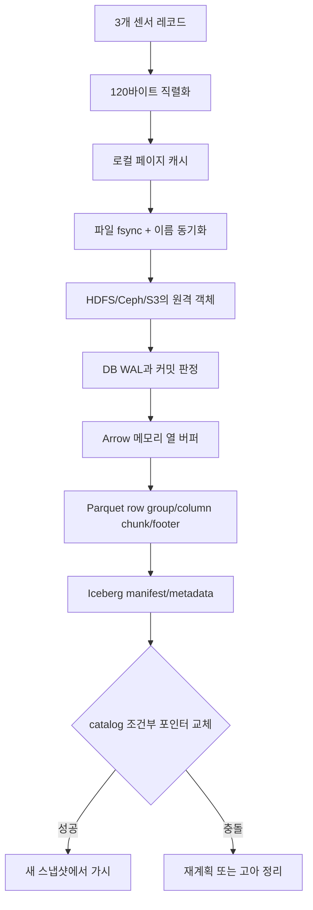
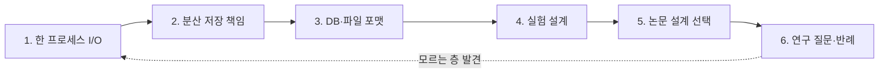

# 09. 연구를 위한 학습 경로와 구술 질문

이 장은 읽을 자료의 목록만 나열하지 않는다. 연구자가 작은 데이터 요청 한 건을 받았을 때, 그 요청이 메모리·파일·분산 저장·데이터베이스·분석 파일·테이블 메타데이터를 지나며 어떤 보장을 얻고 잃는지 끝까지 추적한다. 같은 “저장 성공”이라는 문장도 어느 층의 어떤 객체가 얼마나 오래 살아남는다는 뜻인지 밝혀야 연구 질문이 된다.

## 연구 질문을 객체와 사건으로 바꾸는 법

먼저 모호한 문장을 관찰 가능한 사건으로 바꾼다. “데이터를 안전하게 저장한다” 대신 다음 다섯 항목을 쓴다.

1. **입력 객체:** 정확히 어떤 바이트나 레코드를 받았는가.
2. **담당 주체:** 프로세스, 커널, 저장 서버, 데이터베이스, catalog 중 누가 상태를 바꾸는가.
3. **중간 상태:** 메모리 버퍼, 페이지 캐시, WAL, 데이터 파일, metadata 포인터 중 어디에 있는가.
4. **완료 사건:** `write` 반환, `fsync` 성공, 원격 ACK, 트랜잭션 커밋, catalog 비교 후 교체 중 무엇인가.
5. **실패 뒤 판정:** 재시작한 독자가 어떤 값을 볼 수 있어야 성공인가.

**보장(guarantee)**은 어떤 전제 아래 시스템이 지켜야 하는 성질이다. 예를 들어 “파일 `fsync`가 성공했고 저장 계층이 그 계약을 올바르게 구현한다면 재시작 뒤 해당 파일 내용을 복구할 수 있다”처럼 조건과 관찰 결과를 함께 쓴다. **실패 모형(failure model)**은 어떤 고장을 고려하는지 정한 약속이다. 프로세스 종료만 고려하는 실험과 호스트 전원 차단, 네트워크 분할, 여러 디스크 동시 손실까지 고려하는 실험은 같은 결론을 낼 수 없다.

## 한 데이터 요청의 출발점

다음 세 레코드를 수집 API가 받았다고 하자. 레코드는 한 대상에 관한 필드 묶음이며 여기서는 센서 식별자, 측정 시각, 값을 담는다.

| 순번 | `sensor_id` | `ts_ms` | `value` |
|---:|---|---:|---:|
| 0 | `A` | 1000 | 20.5 |
| 1 | `A` | 1010 | 20.7 |
| 2 | `B` | 1020 | 19.8 |

이 표는 사람이 읽는 논리적 값이다. 네트워크와 저장 장치는 표 자체를 운반하지 않고 바이트를 운반한다. **직렬화(serialization)**는 논리적 값과 구조를 정해진 바이트 표현으로 바꾸는 일이다. JSON, Protocol Buffers, Arrow IPC 등 형식에 따라 실제 바이트 수와 필드 표현이 달라진다. 아래 계산은 설명을 위한 단순 모형으로, 각 레코드가 고정 길이 24바이트라고 가정한다.

\[
3\ \text{records} \times 24\ \text{bytes/record} = 72\ \text{bytes}
\]

여기에 교육용 머리말 16바이트와 SHA-256 32바이트를 붙이면 전송 객체는 \(72+16+32=120\)바이트다. 실제 JSON이나 Parquet 크기라고 주장하는 수치가 아니다. 연구 기록에는 “고정 길이 교육 인코딩”이라는 가정을 반드시 남긴다.

## 120바이트가 로컬 파일이 되는 전체 흐름

**프로세스 메모리**는 실행 중인 프로그램이 사용하는 휘발성 공간이다. API 프로세스가 120바이트 `bytes` 객체를 만들면 CPU가 바로 읽고 계산할 수 있지만 프로세스 종료나 호스트 재부팅 뒤에는 남는다고 기대할 수 없다. 객체의 주체는 프로그램과 언어 런타임이고 수명은 참조가 유지되는 동안이다.

프로그램이 파일을 열면 커널은 **파일 디스크립터**라는 작은 정수 손잡이를 돌려준다. 이 손잡이는 프로세스 안에서 열린 파일 상태를 가리키며 디스크에 저장되는 파일 이름과 다르다. `write(fd, data)`는 파일의 현재 오프셋에 바이트를 쓰도록 커널에 요청한다. 성공 반환은 보통 커널이 바이트를 받아 **페이지 캐시**, 즉 파일 내용을 임시로 보관하는 커널 메모리에 넣었다는 뜻이다. 아직 저장 장치에 기록되지 않은 변경 페이지를 더티 페이지라고 부른다.

**파일 시스템**은 파일 이름과 inode, 파일 오프셋을 저장 블록에 연결한다. inode는 파일의 길이, 권한, 시간과 데이터 위치 정보를 가진 메타데이터 객체다. 파일 이름은 디렉터리 항목이 inode에 붙이는 이름이다. 따라서 내용 동기화와 이름 변경 동기화는 서로 다른 상태 변경일 수 있다. `fsync(fd)`는 파일 변경을 지속성 경계까지 보내고 완료를 기다리는 시스템 호출이다. 장치와 가상화 계층이 계약을 어기지 않는다는 전제까지 있어야 전원 장애 뒤 결과를 논할 수 있다.

| 모형 시각 | 주체 | 상태 변화 | 여기까지의 보장 | 바로 뒤 실패의 반례 |
|---:|---|---|---|---|
| 0 ms | API 프로세스 | 세 레코드를 120바이트로 직렬화 | 메모리에서 해시 계산 가능 | 프로세스 종료로 전부 사라짐 |
| 1 ms | 커널 | `write`로 페이지 캐시 갱신 | 같은 호스트의 후속 읽기 가능 | 전원 손실로 더티 페이지 유실 가능 |
| 3 ms | 파일 시스템 | 파일 `fsync` 완료 | 파일 내용 동기화 완료를 보고 | 새 이름의 디렉터리 항목은 별도일 수 있음 |
| 4 ms | 파일 시스템 | 임시 이름을 최종 이름으로 교체 | 정상 실행 독자는 완성본만 관찰 | 디렉터리 동기화 전 전원 손실 |
| 5 ms | 파일 시스템 | 부모 디렉터리 `fsync` 완료 | 이름 변경도 동기화 경계 통과 | 장치 계약 밖의 고장은 별도 |
| 6 ms | API | 성공 응답 | 클라이언트가 결과를 알 수 있음 | 응답 유실이면 서버와 클라이언트 판단이 갈림 |

마지막 행이 연구에서 자주 빠진다. 서버가 파일을 지속시킨 뒤 성공 응답 패킷이 유실되면 서버 상태는 성공이지만 클라이언트는 타임아웃을 본다. 타임아웃은 실패 판정이 아니라 결과를 모른다는 관찰이다. 재시도 시 같은 요청 식별자를 사용하고 결과를 기억하는 멱등성·중복 제거 설계가 없다면 같은 데이터가 두 번 들어갈 수 있다.

## 분산 파일과 객체 저장으로 경계를 넓히기

로컬 파일을 다른 서버로 복제하면 새 주체와 새 중간 상태가 생긴다. 네트워크 송신 성공은 원격 저장 성공이 아니다. 원격 서버의 ACK도 “패킷을 받음”, “메모리에 기록함”, “로컬 장치에 동기화함”, “필요 복제본이 확인됨” 중 무엇인지 프로토콜에 따라 다르다.

**HDFS**는 파일을 큰 블록으로 나누어 DataNode에 저장하고, 파일 이름과 블록 위치는 NameNode가 관리하는 분산 파일 시스템이다. NameNode는 namespace, 즉 디렉터리와 파일 이름의 구조를 맡는다. DataNode는 실제 블록 바이트와 체크섬을 맡는다. 120바이트 입력은 일반적인 HDFS 블록보다 매우 작으므로 교육 모형에서는 블록 하나에 들어간다. 하지만 실제 저장 공간 소비에는 체크섬·메타데이터·복제본이 추가된다.

| 단계 | 요청과 주체 | 중간 객체 | 완료를 해석할 때 확인할 조건 |
|---:|---|---|---|
| 1 | 클라이언트가 NameNode에 파일 생성 요청 | namespace의 열린 파일 상태 | 이름 충돌, 권한, lease |
| 2 | NameNode가 DataNode 파이프라인 선정 | 블록 ID와 대상 목록 | 복제 계수와 노드 가용성 |
| 3 | 클라이언트가 패킷 전송 | 각 DataNode의 블록·체크섬 | 파이프라인 ACK의 정확한 의미 |
| 4 | 파일 닫기 | 완성된 블록과 namespace | 닫기 전 독자 가시성 |
| 5 | 장애 복구 | 남은 복제본과 메타데이터 | 장애 수가 복제 정책을 넘는지 |

**Ceph**는 내부 객체를 OSD 프로세스들에 배치하는 분산 저장 시스템이다. RADOS는 그 객체 계층이고, CephFS·RBD·RGW는 각각 파일, 블록, 객체 API 모양을 제공한다. 같은 120바이트라도 CephFS 파일 오프셋, RBD 가상 블록, RGW 객체의 본문으로 들어갈 수 있다. 배치는 클러스터 지도와 placement group을 거쳐 담당 OSD로 연결된다. 성공 응답의 내구성은 풀의 복제 또는 소거 부호 설정, OSD 쓰기 경로와 클라이언트 호출 조건에 달려 있다.

**S3 객체 저장**에서는 버킷 안의 키가 바이트 객체를 식별한다. 키의 슬래시는 파일 시스템 디렉터리 inode라고 가정하지 않는다. PUT 성공은 그 객체 API의 완료 조건을 만족했다는 뜻이며, 클라이언트 로컬 파일의 `fsync`나 이후 테이블 커밋까지 뜻하지 않는다. 여러 부분으로 나누어 올리는 멀티파트 업로드에서는 부분 업로드 완료와 전체 객체 완료가 별도 사건이다.

다음 두 실행은 최종적으로 같은 객체 바이트를 읽을 수 있지만 원인이 다르다.

- 실행 A: 원격 복제본들이 요구 조건을 충족한 뒤 ACK가 왔다.
- 실행 B: 클라이언트가 로컬 캐시에서 방금 쓴 값을 읽었지만 원격 완료는 아직 확인하지 않았다.

읽은 값만 비교하면 둘을 구분하지 못한다. 연구 실험은 서버 로그, 요청 ID, ACK 시점, 장애 주입 시점과 복구 뒤 독자 결과를 함께 기록해야 한다.

## 데이터베이스: 레코드 성공과 파일 쓰기를 연결하기

데이터베이스는 레코드 조회, 동시 갱신, 트랜잭션과 복구 규칙을 제공한다. **트랜잭션**은 함께 성공하거나 함께 취소되어야 하는 작업 묶음이다. 세 센서 행을 한 트랜잭션에 넣는다고 하자. 데이터 페이지를 먼저 바꾸고 나중에 로그를 쓰면 중간 장애 뒤 커밋 여부를 복원하기 어렵다. **WAL(write-ahead log)**은 데이터 페이지보다 먼저 복구에 필요한 변경 기록을 남기는 로그다.

| 순서 | 담당 주체 | 객체 | 상태 |
|---:|---|---|---|
| 1 | DB 실행 엔진 | 트랜잭션 ID와 세 행 | 진행 중, 다른 세션 가시성은 격리 수준에 따름 |
| 2 | WAL 관리자 | WAL 버퍼·WAL 파일 | 세 삽입을 재실행/취소할 근거 생성 |
| 3 | 저장 관리자 | WAL 동기화 | 설정이 요구한 지속성 경계 완료 |
| 4 | 트랜잭션 관리자 | 커밋 상태 | 커밋된 행으로 판정 |
| 5 | 서버 | 클라이언트 응답 | 응답이 전달되면 호출자도 성공을 앎 |
| 6 | 백그라운드 기록기 | 데이터 페이지 | 나중에 데이터 파일로 내보낼 수 있음 |

3단계 뒤 서버가 죽고 5단계 응답 전에 멈추면, 복구된 데이터베이스에는 커밋이 있을 수 있지만 클라이언트는 타임아웃만 본다. 따라서 “응답을 못 받았으니 롤백됐다”는 추론은 틀릴 수 있다. 반대로 비동기 커밋 설정에서는 응답과 로컬 WAL의 지속성 순서가 달라질 수 있다. 제품 이름만으로 결론 내리지 말고 해당 설정과 복제 확인 정책을 실험 조건에 기록한다.

## Arrow와 Parquet: 메모리 모양과 파일 모양

**Arrow**는 분석 프로그램들이 메모리에서 열 단위 데이터를 교환하기 위한 배열·버퍼 표현이다. 세 행을 Arrow로 만들면 `sensor_id`, `ts_ms`, `value` 열마다 값 버퍼가 생기고 문자열에는 오프셋, null이 가능하면 유효성 비트맵이 추가될 수 있다. 이 객체의 기본 위치는 프로세스 메모리다. Arrow 객체 생성 성공은 파일이나 원격 저장의 지속성을 뜻하지 않는다.

**Parquet**은 열 단위로 저장하는 파일 형식이다. 여러 행을 row group으로 묶고 각 열을 column chunk로 저장한다. column chunk는 인코딩·압축된 Parquet page들로 나뉠 수 있으며 파일 끝 footer가 위치와 통계를 설명한다. 여기서 page는 운영체제 페이지 캐시의 page와 다른 형식 내부 단위다.

세 행 전체를 한 row group에 넣는 교육 예를 보자.

| 파일 내부 객체 | 포함 내용 | 독자가 얻는 이점 | 실패 시 고려점 |
|---|---|---|---|
| `sensor_id` column chunk | `A, A, B`의 인코딩 | 필요한 열만 읽을 수 있음 | 인코딩·사전 메타데이터 필요 |
| `ts_ms` column chunk | `1000,1010,1020` | 범위 통계로 건너뛰기 가능 | 통계가 없거나 부정확하면 최적화 감소 |
| `value` column chunk | `20.5,20.7,19.8` | 압축과 벡터 연산 가능 | 타입과 null 표현 확인 |
| footer | 스키마, 위치, 통계 | 파일 탐색 계획 수립 | footer 미완성이면 정상 파일로 읽기 어려움 |

열 지향 형식은 일부 열만 읽는 분석에 유리하지만 단일 행을 자주 갱신하는 업무에 항상 유리한 것은 아니다. Parquet 파일 하나를 완성하는 과정과 데이터베이스 행 커밋은 다른 원자성 경계를 가진다.

## Iceberg: 파일 존재와 테이블 가시성 사이

**Iceberg**는 Parquet 같은 데이터 파일들의 집합을 테이블 스냅샷으로 관리하는 테이블 형식이다. 스냅샷은 특정 시점의 테이블을 구성하는 파일 목록과 메타데이터를 가리킨다. 데이터 파일을 저장소에 올린 뒤 manifest와 metadata를 만들고, 마지막에 catalog의 현재 metadata 포인터를 조건부로 바꿔야 새 스냅샷이 보인다.

두 작성자 W1과 W2가 같은 기준 스냅샷 S0를 읽었다고 하자.

| 모형 시각 | W1 | W2 | catalog의 현재 포인터 |
|---:|---|---|---|
| 0 ms | S0 읽음 | S0 읽음 | S0 |
| 10 ms | 데이터 파일 F1 업로드 | 데이터 파일 F2 업로드 | S0 |
| 15 ms | metadata S1 작성 | metadata S2 작성 | S0 |
| 20 ms | “현재가 S0이면 S1로” 성공 | 아직 시도 전 | S1 |
| 21 ms | 완료 | “현재가 S0이면 S2로” 실패 | S1 |
| 30 ms | 독자가 F1을 봄 | W2는 S1 기준으로 재계획 | S1 |

W2의 F2는 저장소에 있지만 현재 테이블에서는 보이지 않는다. 이 상태는 바이트 업로드 실패가 아니라 메타데이터 커밋 충돌이다. W2는 최신 스냅샷과 충돌 관계를 검사해 재시도하거나 F2를 고아 정리 대상으로 남긴다. 단순히 catalog 포인터를 덮어쓰면 W1의 성공한 변경을 잃을 수 있다.

이 그림의 화살표는 모든 시스템이 반드시 한 실행에서 이 순서로 연결된다는 뜻이 아니다. 하나의 입력을 서로 다른 저장 추상화에 대응시켜 보장 경계를 비교하는 연구 모형이다. 실제 시스템은 데이터베이스가 객체 저장에 바로 파일을 쓰거나, Arrow 없이 Parquet을 만들거나, WAL과 분석 파일 파이프라인이 분리될 수 있다.

## 실패를 넣을 때 기록해야 할 실제 역사

**역사(history)**는 여러 주체가 호출한 연산의 시작, 응답, 읽은 값과 실패 사건을 시간순으로 적은 기록이다. 평균 처리량 하나만 있으면 응답 유실, 중복 처리, 오래된 읽기와 커밋 충돌을 구분할 수 없다.

| 필드 | 예시 | 필요한 이유 |
|---|---|---|
| 요청 ID | `req-17` | 재시도와 원래 요청을 연결 |
| 입력 해시 | SHA-256 32바이트 | 같은 ID에 다른 payload가 왔는지 판별 |
| 호출/응답 시각 | monotonic 기준 0 ms/6 ms | 한 프로세스 안의 경과 시간 계산 |
| 완료 단계 | file-fsync, remote-ack, db-commit, catalog-CAS | “성공”의 층을 구분 |
| 장애 사건 | 응답 전 서버 종료 | 결과 미상 창을 재현 |
| 복구 읽기 | 파일 해시, DB 행, snapshot ID | 안전성 판정 |
| 설정 | 복제 수, sync 정책, 파일 형식 옵션 | 결과가 성립한 조건 보존 |

벽시계 시각은 여러 서버 로그를 사람에게 보여 주기 좋지만 시계 보정으로 앞뒤가 바뀔 수 있다. 한 프로세스 안의 경과 시간에는 뒤로 가지 않도록 설계된 monotonic clock을 쓴다. 여러 서버 사건의 인과 순서는 요청 ID, 로그 위치와 프로토콜 메시지를 함께 사용해 판정한다.

## 종합 문제와 완전한 풀이

### 문제 1: 문자 수와 바이트 수

입력 레코드의 `sensor_id`가 한글 두 글자다. “두 글자이므로 2바이트”라고 저장 크기를 계산했다. 무엇이 잘못됐고 무엇을 기록해야 하는가?

**풀이:** 문자는 추상적인 글자이고 바이트는 인코딩 결과의 저장 단위다. UTF-8에서 한글 글자는 보통 글자당 여러 바이트다. 문자열을 어떤 인코딩과 길이 머리말로 직렬화했는지 먼저 정한 뒤 실제 바이트열 길이를 계산해야 한다. 연구 기록에는 문자 값, 인코딩 이름, 직렬화 형식과 최종 바이트 길이를 남긴다.

### 문제 2: `write`가 120을 반환한 의미

`write(fd, payload)`가 120을 반환했다. 전원 손실 뒤 파일이 반드시 남는다고 결론 내릴 수 있는가?

**풀이:** 반환값 120은 이 호출에서 커널이 120바이트를 받아들였다는 뜻이다. 흔히 바이트는 페이지 캐시에 있고 더티 상태일 수 있다. 파일 `fsync`, 이름 변경과 디렉터리 동기화, 아래 저장 장치 계약을 확인하지 않았으므로 전원 손실 내구성은 결론 낼 수 없다.

### 문제 3: 성공 응답 유실과 재시도

서버는 DB WAL을 동기화하고 커밋했지만 성공 응답이 유실됐다. 클라이언트가 같은 구매 요청을 새 ID로 재전송하면 어떤 문제가 생기며 어떻게 경계를 정해야 하는가?

**풀이:** 서버는 첫 요청을 커밋했으므로 새 ID는 새 업무로 처리되어 중복 구매가 생길 수 있다. 클라이언트는 동일한 안정적 요청 ID를 재사용해야 하고, 서버는 ID와 payload 해시, 최종 결과를 업무 변경과 같은 원자적·지속적 경계에 저장해야 한다. ID 기록만 먼저 저장하고 업무가 실패하면 영원히 성공으로 오판할 수 있고, 업무만 커밋하고 ID를 늦게 쓰면 중복을 막지 못한다.

### 문제 4: HDFS 블록 하나면 복제본도 하나인가

120바이트 입력이 HDFS 블록 하나에 들어갔다. 그래서 장애 허용을 위한 사본도 하나뿐이라고 주장했다. 맞는가?

**풀이:** 블록 개수와 블록의 복제본 개수는 다른 축이다. 파일 길이가 블록 크기보다 작아 논리 블록 하나여도 복제 정책에 따라 여러 DataNode에 복제본이 있을 수 있다. 실제 내구성을 판단하려면 복제 계수, 파이프라인 ACK, 블록 보고와 장애 당시 살아남은 노드를 확인해야 한다.

### 문제 5: CephFS 파일과 RGW 객체의 이름

둘 다 Ceph 위에 있으므로 파일 이름 바꾸기와 RGW 객체 키 교체가 같은 원자성을 갖는다고 가정했다. 왜 위험한가?

**풀이:** CephFS는 파일·디렉터리 메타데이터 의미를 제공하고 RGW는 객체 API 의미를 제공한다. 내부 RADOS를 함께 사용해도 앞단 프로토콜, 이름 공간, 조건부 갱신과 완료 규칙은 다르다. 각 인터페이스의 연산 계약과 설정을 별도로 확인해야 한다.

### 문제 6: Arrow 배열 생성 뒤 재시작

프로세스가 세 행의 Arrow 배열을 성공적으로 만들었고 곧바로 종료됐다. 재시작한 프로세스가 같은 배열을 자동으로 읽을 수 있는가?

**풀이:** 일반적인 Arrow 배열은 프로세스 메모리의 버퍼다. 별도 IPC 스트림, 파일 또는 다른 지속 저장소에 직렬화하지 않았다면 종료와 함께 사라진다. Arrow의 메모리 표현 성공과 Parquet 파일 또는 데이터베이스 커밋을 구분해야 한다.

### 문제 7: Parquet footer가 없는 부분 파일

열 데이터 일부는 저장됐지만 작성기가 footer를 완성하기 전에 죽었다. 파일 크기가 10 MiB이므로 정상 Parquet 파일이라고 판정해도 되는가?

**풀이:** 크기만으로는 충분하지 않다. 독자는 footer의 스키마, column chunk 위치와 메타데이터를 이용해 파일을 해석한다. 일부 구현이 복구 도구를 제공할 수 있어도 정상 완료된 파일과 같다고 가정할 수 없다. 작성기는 임시 이름에 완성한 뒤 검증하고 원자적으로 게시하는 절차를 사용할 수 있다.

### 문제 8: Iceberg 데이터 파일 존재와 테이블 가시성

W2의 Parquet 파일 F2가 객체 저장소에 있고 해시도 맞지만 catalog 비교 후 교체가 실패했다. 현재 테이블 독자는 F2를 읽어야 하는가?

**풀이:** 현재 metadata와 manifest가 F2를 가리키지 않으므로 읽지 않아야 한다. F2의 바이트 존재와 테이블 스냅샷 가시성은 별도 보장이다. W2는 최신 metadata에 대해 충돌을 검사한 뒤 다시 커밋하거나, 안전한 보존 기간 뒤 고아 파일 정리를 해야 한다.

### 문제 9: 동일한 읽기 결과의 다른 원인

쓰기 직후 120바이트를 읽어 해시가 일치했다. 원격 복제 완료와 로컬 캐시 적중 중 어느 쪽인지 알 수 있는가?

**풀이:** 읽기 결과만으로는 알 수 없다. 캐시 계층과 읽기 경로를 통제하거나 관측해야 한다. 원격 요청 ID와 ACK, 서버별 저장 상태, 장애 뒤 복구 읽기를 함께 기록해야 한다. 같은 관찰값이 여러 내부 원인에서 나오는 식별 불가능성을 연구 설계에 반영해야 한다.

### 문제 10: 평균 5 ms의 함정

100회 쓰기의 평균 지연이 5 ms이고 한 번은 200 ms였다. 평균만 보고 모든 요청이 10 ms 안에 끝난다고 결론 냈다. 계산과 판정이 왜 틀렸는가?

**풀이:** 평균은 합계를 표본 수로 나눈 값이라 꼬리 지연을 숨긴다. 한 번의 200 ms가 있어도 나머지가 충분히 짧으면 평균 5 ms가 가능하다. 최소·중앙값·상위 백분위수·최대값과 원자료를 함께 제시해야 한다. “모든 요청 10 ms 이내”는 최대값이 10 ms 이하인지 검사하는 별도 성질이며 평균으로 증명할 수 없다.

## 연구자가 마지막에 답해야 할 문장

실험을 마치면 다음 문장을 빈칸 없이 쓴다.

> 입력 ___바이트를 주체 ___가 객체 ___로 바꾸었고, 완료 사건 ___ 뒤 실패 ___를 넣었다. 복구한 독자 ___가 관찰한 값은 ___였다. 이 결과는 설정 ___와 실패 모형 ___에서 보장 ___를 지지하지만, 경계 밖의 ___는 검증하지 않았다.

이 문장을 작성할 수 없다면 관측 항목이나 실패 모형이 아직 부족하다. 특히 “저장됐다”, “일관된다”, “빠르다” 같은 단어만 있고 객체·완료 사건·독자·조건이 없으면 재현 가능한 연구 결론이 아니다.

## 이 경로를 시작하기 전

데이터 시스템을 관측하려면 실행 중인 프로그램과 저장·전송 경로를 구별해야 한다. **프로세스**는 실행 중인 프로그램이며 자신이 쓸 주소 공간과 열린 파일을 가진다. **커널**은 CPU 실행과 메모리, 장치 접근을 관리하는 운영체제의 핵심이다. 프로그램이 파일을 읽으면 커널에 읽기를 요청하고, 커널이 메모리에 보관한 파일 내용인 **페이지 캐시**에서 찾거나 저장 장치로 요청을 내려보낸다. 캐시에 있던 바이트를 반환하는 경우와 장치에서 바이트를 가져오는 경우는 같은 read 요청이어도 지연의 원인이 다르다.

다른 서버의 파일을 읽는다면 네트워크 경로도 끼어든다. **소켓(socket)**은 프로그램이 통신을 요청하는 운영체제의 인터페이스다. 전송할 바이트는 프로토콜 헤더와 함께 **패킷(packet)**으로 운반되며, 네트워크 장치와 중간 장비를 지나 상대 서버가 처리한다. 따라서 Spark 작업이 느릴 때는 어느 프로세스가 CPU를 썼는지, 읽을 바이트가 캐시에 있었는지, 장치와 네트워크에서 얼마나 기다렸는지를 각각 물어야 한다.

**가상 메모리**는 프로그램의 주소와 실제 메모리 위치를 연결하는 체계다. 프로그램이 확보한 주소 크기와 실제 RAM에 존재하는 바이트는 같지 않을 수 있다. **eBPF**는 제한된 프로그램을 커널이 허용한 지점에서 실행하여 사건을 관측하거나 처리하는 기능이다. 이를 사용해 읽기·패킷·스케줄링 사건을 셀 수 있지만, 관측한 횟수만으로 원인을 확정하지 않는다. 먼저 “입력 바이트→실행 주체→대기 위치→결과”의 경로를 적고, 가설을 구분할 수 있는 관측을 선택한다. 아래 연구 단계는 이 실제 경로와 측정의 범위를 연결한다.

각 단계의 완료 기준은 페이지 수가 아니다. **설명 → 손계산/추적 → 실습 → 반례 → 근거와 한계**를 자신의 기록으로 남긴다. 해설을 읽은 직후의 이해와 다음날 빈 종이에서 다시 설명할 수 있는 능력을 구별한다.

[학습 목차](README.md) · 이전: [로컬 실습](08-guided-labs.md)

많은 기술 이름을 아는 것보다, **메커니즘을 설명하고 반례를 만들며 측정으로 확인할 수 있는 것**이 중요하다. 아래는 자기 속도로 진행하는 학습 단계다. 일정이나 학위 수준을 보장하는 과정은 아니다.

각 단계에서 영어 제품명보다 “누가 어떤 상태를 소유하고, 어떤 요청 뒤 무엇을 보장하는가”를 먼저 말한다. 다음 단계로 넘어가는 기준은 읽은 페이지 수가 아니라 답을 보지 않고 예제·반례·측정 한계를 설명할 수 있는지다.

## 1단계. 한 프로세스의 I/O 설명하기

읽기: 00–02장, 08장.

완료 과제:

- 파일 이름 → 열린 핸들 → page cache → block 장치 경로를 그린다.
- write, flush, fsync, close를 서로 구분해 설명한다.
- 디렉터리 변경과 파일 내용 변경을 구분한다.
- 작은 파일 실습에서 관측한 사실과 추론을 나눈다.

한 문장 시험: “다른 프로세스에서 파일을 읽었다”는 사실만으로 정전 내성을 주장할 수 없는 이유를 설명한다.

보충 교재는 저자가 공개한 [Operating Systems: Three Easy Pieces](https://pages.cs.wisc.edu/~remzi/OSTEP/)다. Persistence의 파일·파일시스템·journaling·SSD 부분부터 읽고, 모르는 메모리 개념은 Virtualization의 paging·TLB로 돌아간다. 원문을 저장소에 복제하지 않고 저자 제공 자료로 연결한다.

## 2단계. 분산 저장소의 책임과 장애 영역 설명하기

읽기: 03–04장.

완료 과제:

- HDFS의 NameNode 요청과 DataNode payload 경로를 분리해 그린다.
- Ceph의 RBD·CephFS·RGW를 클라이언트 인터페이스 관점에서 비교한다.
- 객체/복제본/OSD/물리 장치/랙을 서로 다른 단위로 설명한다.
- ACK를 받기 전·후의 장애, 요청 timeout 후 재시도를 구분한다.

후속 질문: 클라이언트가 timeout을 받았을 때 서버가 이미 완료했을 가능성이 있다면, 재시도는 어떤 중복을 만들 수 있는가? “오류면 다시 보내면 된다”는 설명만으로는 부족하다.

## 3단계. DB와 파일 포맷의 읽기·쓰기 경로 설명하기

읽기: 05–06장.

완료 과제:

- DB WAL과 데이터 페이지 flush의 관계를 그린다.
- B+tree와 LSM에서 같은 key 갱신이 어떤 일을 만드는지 설명한다.
- Parquet의 footer·row group·column chunk·page를 구분한다.
- 파일 업로드 완료와 Iceberg catalog commit을 분리한다.
- Iceberg 내부 메타데이터와 Trident 설명·공유 메타데이터를 구분한다.

여기서 목표는 엔진별 모든 코드를 외우는 것이 아니라, 특정 요청의 비용이 어느 구조에서 생기는지 질문할 수 있게 되는 것이다.

## 4단계. 메커니즘에서 실험 설계로 넘어가기

읽기: 07장과 [기존 Iceberg 연구 검토](../lakehouse/02-paper-reviews.md).

완료 과제:

- 같은 입력·출력·자원 예산의 기준군과 비교군을 만든다.
- 핵심 지표 하나와 정확성 조건을 먼저 정한다.
- 효과가 없거나 오히려 느려질 조건을 미리 적는다.
- 작은 pilot에서 병목을 확인한 뒤 필요한 규모로 확장한다.
- 숫자뿐 아니라 raw evidence → 집계 코드 → 해석을 연결한다.

“모든 경우에 GPU가 빠르다”가 아니라, 어떤 전송·연산 비율과 메모리 조건에서 이득이 있는지 묻는다.

## 5단계. 원전 논문을 설계 선택으로 읽기

| 읽을 자료 | 읽을 때 집중할 질문 |
| --- | --- |
| [The Google File System](https://research.google/pubs/the-google-file-system/) | 어떤 workload와 장애 가정 때문에 큰 분할·metadata/data 분리가 필요했는가? |
| [Bigtable](https://research.google/pubs/bigtable-a-distributed-storage-system-for-structured-data/) | 구조화 데이터의 key·정렬·저장·복구 책임을 어떻게 나눴는가? |
| [Raft 원전](https://www.usenix.org/conference/atc14/technical-sessions/presentation/ongaro) | 복제된 로그의 합의와 로컬 디스크 동기화는 어떤 점에서 다른 문제인가? |
| [Iceberg·OTF 논문별 해설](../lakehouse/README.md) | 포맷·엔진·유지관리·운영 정책 가운데 정확히 무엇이 기여인가? |

이 표는 전체 논문의 상세 리뷰를 대신하지 않는다. 논문의 오래된 환경을 그대로 최신 시스템의 성능 수치로 가져오지 않고, 가정·메커니즘·tradeoff를 읽는다.

논문당 한 페이지에 다음을 남긴다.

1. 저자가 해결하려는 문제와 기존 방식의 병목.
2. 바꾸는 계층과 그대로 가정하는 하위 계층.
3. 정확성·장애 모델과 보장하지 않는 것.
4. 핵심 자료구조·제어 규칙·복구 순서.
5. 실험의 측정 경계와 기준군의 공정성.
6. 내가 다시 확인하고 싶은 반례 한 가지.

## 6단계. Trident 연구 질문으로 연결하기

여기서 **Trident**는 이 저장소가 다루는 특정 연구 사례의 이름이다. Linux·Iceberg·Ceph의 일반 구성 요소나 업계 표준 이름이 아니다. 아래 단계는 앞 장의 일반 원리를 이 로컬 사례의 연구 질문으로 옮기는 예다.

고정된 nuScenes·KITTI·Argoverse 2 코퍼스를 사용할 때도 다음 계층을 구분한다.

~~~text
원본 자산의 bytes·객체 수
  ≠ Iceberg의 레지스트리·메타데이터 테이블 크기
  ≠ 선택한 query가 읽은 bytes
  ≠ GPU가 처리한 정형 rows
  ≠ 최종 입력으로 staging한 bytes
~~~

학습한 원리에서 만들 수 있는 연구 질문:

- 파일 개수가 늘 때 latency 증가는 data bytes 때문인가, 요청·metadata 비용 때문인가?
- MOR의 빠른 갱신이 반복 읽기와 유지관리까지 포함해도 이득인가?
- snapshot 고정 입력을 보존하면서 유지관리와 동시 실행을 허용할 수 있는가?
- 준비 작업을 더 시작하는 것이 처리량을 높이는가, 공유 저장소의 queue만 늘리는가?
- 오래된 메트릭으로 제어했을 때 어떤 잘못된 결정을 할 수 있는가?

이 질문은 연구 제안이며 해당 실험의 결과가 아니다. 실제 정책을 만들기 전에 관측 가능한 신호와 독립적으로 바꿀 수 있는 변수를 확인한다.

## 구술 질문: 답을 가리고 설명하기

| 질문 | 답의 핵심 |
| --- | --- |
| 1. SSD page와 OS page는 왜 다른가? | 저장 매체의 프로그램 단위와 가상 메모리 관리 단위이기 때문 |
| 2. write가 성공했는데 나중에 ENOSPC/EIO가 왜 나타날 수 있는가? | buffer·지연 할당·writeback과 오류 보고의 시점이 다르기 때문 |
| 3. fsync가 있으면 파일 이름 게시도 자동으로 안전한가? | 파일과 디렉터리 변경의 동기화가 구분됨 |
| 4. 파일시스템 journal이 DB 트랜잭션을 대신하는가? | 보호하는 구조와 논리적 복구 단위가 다름 |
| 5. HDFS 블록을 크게 하면 항상 좋은가? | metadata 부담과 병렬성·workload 형태 사이의 tradeoff가 있음 |
| 6. 복제본 3개면 물리 장애 영역도 3개인가? | 실제 장치·호스트·랙 배치를 확인해야 함 |
| 7. S3 호환이면 모든 일관성·확장 기능도 같은가? | API 호환 범위와 구현·배포의 보장을 확인해야 함 |
| 8. WAL이 안정 저장됐는데 데이터 페이지는 안 써졌을 수 있는가? | 복구 로그와 page write를 분리하는 설계가 가능함 |
| 9. LSM compaction과 Iceberg compaction은 같은가? | 처리하는 데이터 구조와 가시성·복구 책임이 다름 |
| 10. column을 적게 읽으면 왜 실제 bytes가 줄지 않을 수도 있는가? | 포맷·reader·압축 단위·추가 필터·prefetch 등 확인 필요 |
| 11. row group을 건너뛰면 모든 파일 open도 사라지는가? | 파일 선택과 파일 내부 pruning은 별개 |
| 12. metadata 파일을 읽으면 데이터의 의미도 알 수 있는가? | 구조적 통계와 도메인 의미는 다른 정보 |
| 13. catalog commit 실패 후 새 data file이 남을 수 있는가? | 객체 저장과 테이블 게시가 별도 단계이기 때문 |
| 14. snapshot이 고정돼도 원본 URI 내용이 바뀌면 어떤가? | 외부 원본의 불변성은 별도 보장 필요 |
| 15. compaction 이득에 어떤 비용을 포함해야 하는가? | 재작성·임시 공간·후속 조회·다른 작업 간섭 |
| 16. cache를 껐다고 모든 계층이 cold인가? | 원격·장치·catalog·application cache가 별도로 존재 |
| 17. latency를 줄이면 throughput도 항상 늘어나는가? | workload·동시성·자원 비용에 따라 다름 |
| 18. 1,000개의 요청은 언제 독립 표본이 아닌가? | 동일 요청 변형·공유 state·시간 상관 등이 있는 경우 |
| 19. Ready와 첫 읽기는 왜 구분해야 하는가? | 준비 계약과 실제 소비가 다른 완료 사건 |
| 20. 실패한 실험을 왜 남겨야 하는가? | 지원 범위·반례·실행 조건을 재현하고 주장 한계를 정하기 위해 |

각 답은 출발점이다. 실제 시스템의 설정과 반례까지 설명할 수 있는지 확인한다.

## 다음으로 깊게 공부할 주제

기초를 이해한 뒤 필요에 따라 한 가지씩 확장한다.

- 가상 메모리·TLB·page fault·NUMA와 대규모 DataFrame.
- DMA·IOMMU·PCIe·GPU host/device 전송과 pinning.
- TCP·흐름 제어·혼잡 제어와 원격 스토리지 요청.
- 합의·leader 전환·fencing·idempotency와 분산 commit.
- 격리 수준·linearizability·serializability와 장애 검증.
- admission control·queueing·cache 정책의 실험적 평가.

이들을 모두 한 번에 석사논문 기능으로 구현하라는 뜻은 아니다. 논문에서 주장하려는 메커니즘의 아래 계층을 하나씩 이해하는 것이 우선이다.

## 마지막 자기 점검

새로운 시스템을 볼 때 다음 문장을 완성한다.

> 이 시스템은 ___ 계층의 ___ 비용을 줄이기 위해 ___ 구조/정책을 사용한다. 성공 응답은 ___를 뜻하고, ___ 장애까지 가정한다. 성능 비교에서는 ___를 동일하게 맞춰야 하며, ___ 조건에서는 이득이 사라질 수 있다.

제품 이름 없이 이 문장을 설명할 수 있다면 다음 논문을 더 깊게 읽을 준비가 된 것이다.
