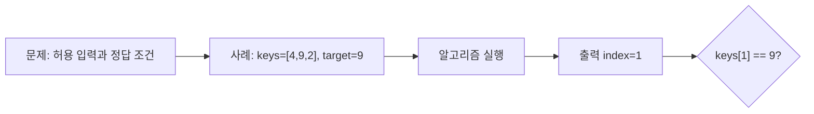

# 00. 문제·입력·정답부터 구분한다

[목차](README.md) · [다음](01-correctness-and-complexity.md)

알고리즘은 코드 조각이 아니라, 허용되는 모든 입력을 정답 조건을 만족하는 출력으로 바꾸는 절차다. 먼저 한 사례와 일반 문제를 분리한다.



## 1. 한 사례는 문제가 아니다

`[4, 9, 2]`에서 9의 위치는 1이다. 이것은 한 입력 사례와 그 답이다. 일반 검색 문제는 다음처럼 쓴다.

- 입력: 길이 `n≥0`인 수열 `keys`와 값 `target`.
- 출력: `keys[i]=target`인 위치 `i`, 없으면 `None`.
- 여러 위치가 가능하면: 첫 위치를 반환한다고 추가로 정한다.

정답 조건이 빠지면 `keys=[9,9]`에서 0과 1 중 무엇이 맞는지 결정할 수 없다.

## 2. 입력 크기를 정한다

비용을 말하려면 크기 척도가 필요하다. 배열 검색에서는 보통 `n=len(keys)`다. 그래프는 정점 수 `V`와 간선 수 `E`가 둘 다 필요하다.

| 문제 | 입력 크기 |
| --- | --- |
| 배열에서 찾기 | 원소 수 `n` |
| 두 정수 곱하기 | bit 수 |
| 그래프 순회 | `V+E` |
| 행렬 곱 | 행·열 크기 |

숫자 1과 `10^1000`을 둘 다 “정수 한 개”라고만 세면 실제 입력 표현 차이를 숨긴다.

## 3. 정답은 하나가 아닐 수 있다

정렬 문제의 출력은 입력과 같은 원소들을 오름차순으로 배열한 수열이다. 같은 key를 가진 record의 순서는 정답 조건에 포함할 수도, 포함하지 않을 수도 있다.

```text
입력: [(2,"A"), (1,"B"), (2,"C")]
key만 정렬: [(1,"B"), (2,"A"), (2,"C")] 또는 [(1,"B"), (2,"C"), (2,"A")]
stable 조건 포함: 첫 번째만 허용
```

## 4. 검증자는 후보 답을 검사한다

검색 결과 `i`를 검증하려면 범위와 값을 본다.

```python
def valid_search_answer(keys, target, i):
    if i is None:
        return target not in keys
    return 0 <= i < len(keys) and keys[i] == target
```

첫 줄은 함수 이름과 입력을 정한다. `None`이면 target이 정말 없는지 확인한다. 위치가 있으면 범위 안이고 해당 값이 target인지 확인한다.

이 검증 코드는 알고리즘보다 느릴 수 있다. 검증 가능하다는 것과 빠르게 풀 수 있다는 것은 다른 질문이다.

## 5. 선조건과 후조건

선조건은 실행 전에 필요한 약속이다. Binary search의 선조건은 배열이 정렬되어 있다는 것이다. 후조건은 반환 뒤 보장할 사실이다.

| 구분 | Binary search |
| --- | --- |
| 선조건 | `keys`가 비내림차순 |
| 후조건 | 반환 위치의 값이 target, 없으면 target 부재 |

정렬되지 않은 `[8,1,5]`에 binary search를 호출해 실패한 것은 알고리즘의 후조건 위반이라기보다 호출자가 선조건을 깨뜨린 것이다.

## 6. 결정·검색·최적화 문제

- 결정: 경로가 존재하는가? 출력은 예/아니오다.
- 검색: 실제 경로 하나를 반환하라.
- 최적화: 가장 짧은 경로를 반환하라.

세 문제는 관련 있지만 같다 하지 않는다. 복잡도 이론의 P·NP는 먼저 결정 문제 언어로 정의한다.

## 7. 실제 시스템 연결은 모형이다

Kubernetes scheduling을 “pod를 node에 배치하는 최적화 문제”로 볼 수 있다. 그러나 실제 scheduler는 affinity, taint, resource, 확장점, 정책을 가진다. 교재의 단순 bin packing 모형이 실제 구현 전체라는 뜻은 아니다.

Spark DAG를 graph로 모델링할 수 있지만 stage 경계와 retry는 Spark 구현 규칙을 따른다. Iceberg metadata 탐색을 graph traversal처럼 설명할 수 있지만 실제 파일 형식·catalog 계약을 지워서는 안 된다.

### 같은 입력에서 정답 조건만 바꿔 보기

입력 `values=[4,1,4,2]`, `target=4`를 세 문제에 사용해 보자.

| 문제 | 허용 출력 | 실제 답 |
| --- | --- | --- |
| 아무 위치 찾기 | 값이 4인 index 하나 | 0 또는 2 |
| 첫 위치 찾기 | 값이 4인 최소 index | 0 |
| 등장 횟수 세기 | 4와 같은 원소 수 | 2 |

입력 바이트가 같아도 정답 조건이 바뀌면 알고리즘의 후조건이 달라진다. 아무 위치 검색이 2를 반환하면 첫 문제에는 맞지만 두 번째에는 틀리다. 등장 횟수 문제에 index 0을 반환하면 출력 타입부터 맞지 않는다.

첫 위치 linear search의 상태를 손으로 적으면 다음과 같다.

```text
i=0, values[0]=4 → target과 같음 → 즉시 0 반환
```

반면 횟수 세기는 첫 일치에서 멈추면 안 된다.

```text
count=0
4를 봄 → 1
1을 봄 → 1
4를 봄 → 2
2를 봄 → 2
종료 → 2
```

정확성 이유도 다르다. 첫 위치 검색은 index 순서로 검사하고 첫 일치 전에 일치가 없다는 invariant가 필요하다. 횟수 세기는 처리한 prefix 안의 target 개수가 `count`라는 invariant가 필요하다.

**실패 조건.** “4를 찾는다”처럼 동작만 짧게 말하면 첫 위치, 아무 위치, 개수 중 무엇을 요구하는지 알 수 없다. 구현 전에 이 차이를 출력 명세에 고정한다.

### 입력 표현도 명세의 일부다

Graph edge를 `(u,v)` 쌍으로 받는지 adjacency list로 받는지에 따라 validation과 입력 크기 계산이 달라진다. Directed edge `(A,B)`를 undirected로 해석하면 존재하지 않는 B→A 경로를 만들 수 있다.

빈 입력, 중복 값, 자기 자신으로 가는 edge, 연결되지 않은 정점처럼 작은 경계 사례를 허용할지 금지할지도 선조건에 적는다. 금지한다면 알고리즘이 조용히 임의 답을 내기보다 입력 오류를 드러내는 계약이 필요하다.

## 8. 손으로 문제 명세 쓰기

입력 `[3,1,3,2]`에서 첫 3의 위치를 찾는 문제:

1. 허용 입력은 임의 길이 정수 수열이다.
2. 출력은 첫 target 위치 또는 `None`이다.
3. 답 0은 범위 안이다.
4. `keys[0]=3`이다.
5. 0보다 앞선 위치는 없으므로 첫 위치 조건도 맞다.

## 9. 반례로 모호함 찾기

“가장 큰 수를 반환”이라는 설명에 빈 배열을 넣으면 답이 없다. 빈 입력을 금지하거나 별도 출력을 정해야 한다.

“경로를 반환”에 시작점과 끝점이 같은 경우를 넣으면 빈 간선 경로를 허용하는지 정해야 한다.

반례는 구현을 공격하려는 것이 아니라 명세의 빈틈을 찾는 작은 입력이다.

## 10. 확인 문제와 해설

**문제 1.** 정렬된 배열 `[1,4,4,9]`에서 4를 찾는 문제의 출력은 하나인가?

**해설.** 아무 위치나 허용하면 1과 2가 모두 정답이다. 첫 위치 조건을 넣으면 1만 정답이다.

**문제 2.** “NCCL 통신 순서를 최소화한다”는 문장이 충분한 명세인가?

**해설.** 아니다. 입력 topology, 허용 연산, 비용 단위, correctness 조건이 필요하다. 실제 NCCL 구현과 교육용 graph 모형도 구분한다.

**문제 3.** 프로그램이 샘플 세 개에서 맞으면 알고리즘이 문제를 푼 것인가?

**해설.** 모든 허용 입력에서 정답 조건을 만족한다는 증명이 없으므로 충분하지 않다.

## 11. 처음부터 끝까지 명세를 만드는 예: 배송 경로

이제 앞의 단어를 하나의 문제 안에서 연결한다. **객체(object)**는 알고리즘이 다루는 대상이다. 여기서는 창고와 배송지가 객체다. 객체를 점으로 그리고, 한 장소에서 다른 장소로 이동할 수 있음을 화살표로 그리면 **유향 그래프(directed graph)**가 된다. 그래프는 점인 **정점(vertex)**과 점을 잇는 **간선(edge)**의 모음이다. 유향이라는 말은 간선에 방향이 있다는 뜻이다. `A→B`가 있어도 `B→A`가 자동으로 생기지 않는다.

다음 배송망을 생각하자.

```text
S ─2→ A ─5→ T
│      │
4      1
↓      ↓
B ─1→ C ─2→ T
```

화살표 옆 숫자는 이동 시간이다. 문제를 정확히 쓰면 다음과 같다.

1. 입력 객체는 정점 집합 `{S,A,B,C,T}`와 가중치가 있는 유향 간선이다. **가중치(weight)**는 간선 하나를 사용하는 비용을 숫자로 적은 것이다.
2. 출발 정점은 `S`, 도착 정점은 `T`다.
3. 모든 가중치는 0 이상의 정수라는 선조건을 둔다.
4. 출력은 `S`에서 `T`로 이어지는 정점 목록과 그 간선 가중치의 합이다.
5. 정답 조건은 가능한 경로 중 합이 최소인 경로를 반환하는 것이다. 경로가 없으면 `None`을 반환한다.

`[S,A,T]`는 비용 `2+5=7`인 유효한 출력이지만 최적화 문제의 정답은 아니다. `[S,A,C,T]`의 비용이 `2+1+2=5`이기 때문이다. `[S,B,C,T]`도 `4+1+2=7`이다. 여기서 **유효하다**와 **최적이다**를 구별해야 한다. 유효성은 출력이 형식과 기본 제약을 만족한다는 뜻이고, 최적성은 모든 유효한 후보보다 비용이 작거나 같다는 뜻이다.

검증자도 두 층으로 나뉜다. 경로의 인접한 정점마다 실제 간선이 있는지 확인하고 비용 합을 다시 계산하면 유효성은 확인할 수 있다. 하지만 후보가 정말 최소인지 확인하려면 더 짧은 경로가 없음을 알아야 한다. 모든 후보 경로를 나열하면 확인할 수 있지만, 큰 그래프에서는 후보 수가 폭발할 수 있다. 그래서 “답을 받은 뒤 금방 검사할 수 있다”와 “최적임을 금방 검사할 수 있다”도 같은 말이 아니다.

### 실행 상태를 한 줄도 건너뛰지 않고 추적하기

간단한 최단 거리 알고리즘이 각 정점까지 지금까지 발견한 가장 작은 비용 `dist`를 저장한다고 하자. `∞`는 무한대라는 뜻이 아니라 “아직 도달 방법을 발견하지 못했다”는 표기다.

| 단계 | 이번에 처리한 정점 | 확인한 간선 | 변경 전 후보 | 변경 뒤 `dist` |
| ---: | --- | --- | --- | --- |
| 0 | 없음 | 없음 | 없음 | `S=0, A=∞, B=∞, C=∞, T=∞` |
| 1 | S | S→A(2) | `0+2=2 < ∞` | `A=2` |
| 2 | S | S→B(4) | `0+4=4 < ∞` | `B=4` |
| 3 | A | A→T(5) | `2+5=7 < ∞` | `T=7` |
| 4 | A | A→C(1) | `2+1=3 < ∞` | `C=3` |
| 5 | C | C→T(2) | `3+2=5 < 7` | `T=5` |
| 6 | B | B→C(1) | `4+1=5 < 3`은 거짓 | 변화 없음 |

이 표에서 비교하는 연산을 **완화(relaxation)**라고 부른다. 갑자기 특별한 마법이 등장한 것이 아니다. `u`까지 가는 현재 비용 `dist[u]`에 `u→v` 비용을 더한 값이 기존 `dist[v]`보다 작으면 더 좋은 경로를 발견한 것이므로 교체하는 단순한 동작이다. 어떤 정점을 어떤 순서로 확정할 수 있는지는 알고리즘과 선조건에 따라 달라진다. 음수 가중치가 있으면 “현재 가장 작은 정점을 먼저 확정한다”는 규칙이 깨질 수 있기 때문에 앞에서 가중치를 0 이상이라고 명시했다.

## 12. 알고리즘은 실제로 무엇인가

**알고리즘(algorithm)**은 입력 하나에 대한 답을 외운 표가 아니다. 허용된 모든 입력을 받아 유한한 단계 뒤에 정답 조건을 만족하는 출력을 만드는 명확한 절차다. 이 정의에는 네 가지 요구가 들어 있다.

- **명확성**: 각 단계가 무엇을 읽고 무엇을 바꾸는지 해석이 하나여야 한다.
- **유한성**: 허용 입력에서 언젠가 끝나야 한다.
- **일반성**: 예시 한 개가 아니라 명세가 허용한 입력 전체를 다뤄야 한다.
- **정확성**: 끝났을 때 출력이 후조건을 만족해야 한다.

예를 들어 “목록을 적당히 살펴보고 큰 값을 고른다”는 알고리즘이 아니다. 적당히가 몇 번인지, 같은 값이 있을 때 무엇을 하는지, 빈 목록에서 무엇을 반환하는지가 정해지지 않았다. 반대로 다음 절차는 명확하다.

```python
def first_index(values, target):
    for i in range(len(values)):
        if values[i] == target:
            return i
    return None
```

`values`는 값이 순서대로 놓인 수열이고, `i`는 현재 보고 있는 위치 번호다. `range(len(values))`는 `0`부터 `len(values)-1`까지 위치를 한 번씩 만든다. 일치하면 즉시 반환하므로 먼저 만난 위치가 최소 위치다. 끝까지 일치가 없을 때만 `None`을 반환한다.

입력 `[8,3,8,1]`, target `8`의 상태는 `i=0`, `values[0]=8`, 즉시 `0` 반환이다. target `1`이면 `i=0`에서 8≠1, `i=1`에서 3≠1, `i=2`에서 8≠1, `i=3`에서 1=1이므로 3을 반환한다. target `5`이면 네 위치를 모두 확인한 뒤 `None`이다. “없다”는 결론도 아무것도 하지 않아 얻는 것이 아니라 모든 후보 위치를 배제해서 얻는다.

## 13. 입력은 추상값과 표현으로 나뉜다

**추상값(abstract value)**은 문제에서 의미를 가지는 대상이고, **표현(representation)**은 그 값을 컴퓨터가 저장하거나 전달하는 구체적인 모양이다. 정수 300이라는 추상값은 문자열 `"300"`, 10진 JSON 숫자, 2진 바이트 등으로 표현할 수 있다. 표현이 다르면 파싱 비용과 허용 범위도 달라진다.

예를 들어 서버 로그에서 가장 오래 걸린 요청을 찾는다고 하자.

```text
2026-10-11T10:00:00Z,/login,120
2026-10-11T10:00:01Z,/search,95
2026-10-11T10:00:02Z,/pay,120
```

한 줄을 `(시간, 경로, 밀리초)` record로 해석해야 한다. **파싱(parsing)**은 바이트나 문자열을 문제에서 사용할 구조화된 값으로 바꾸는 과정이다. 세 번째 필드를 숫자로 바꾸지 않고 문자열로 비교하면 `"95"`가 `"120"`보다 크다고 잘못 판단할 수 있다. 최대 지연이 두 건일 때 첫 건만 반환할지 두 건 모두 반환할지도 정답 조건이다. 잘못된 줄을 무시할지 오류로 중단할지도 선조건이나 오류 계약에 적어야 한다.

입력 크기 `n`도 추상적으로 정수 하나가 아니라 표현 길이와 연결된다. `2`와 `10^1000`은 수학에서는 각각 정수 하나지만, 후자는 10진수로 1001자리다. 큰 정수의 덧셈은 기계 한 번의 상수 시간 연산으로 끝나지 않는다. 숫자 값의 크기와 그 값을 표현하는 bit 수를 구별해야 비용 설명이 정직해진다.

## 14. 선조건은 책임 회피가 아니라 문제의 경계다

**선조건(precondition)**은 호출 전에 참이어야 하는 조건이다. 선조건을 선언하면 알고리즘이 무엇을 가정해도 되는지가 분명해진다. 그러나 불편한 입력을 몰래 제외하는 문장이 되어서는 안 된다. 왜 필요한지와 위반했을 때의 동작을 함께 쓴다.

Binary search는 가운데 값을 보고 목표가 어느 절반에 있을지 결정한다. 배열이 오름차순이라는 선조건이 필요한 이유가 여기에 있다. `[1,4,7,9]`에서 target 7을 찾으면 가운데 부근을 비교하고 왼쪽 또는 오른쪽 절반을 버려도 된다. 하지만 `[8,1,5]`에서 가운데 값 1보다 5가 크다는 이유로 왼쪽의 8을 버리는 추론은 정당하지 않다.

선조건 위반을 다루는 방식은 여러 가지다.

1. 호출자가 보장하고 함수는 검사하지 않는다. 빠르지만 잘못된 호출의 결과가 무의미할 수 있다.
2. 함수가 먼저 검사하고 위반이면 오류를 반환한다. 안전하지만 정렬 여부 검사에 이미 O(n)이 들 수 있다.
3. 정렬되지 않은 입력도 처리하는 다른 알고리즘을 선택한다. Linear search는 느리지만 정렬 선조건이 없다.

어느 방식이 절대적으로 옳은 것이 아니라 API 계약과 비용 요구가 결정한다. 중요한 것은 독자가 숨은 가정을 추측하게 하지 않는 것이다.

## 15. 후조건을 논리식과 말로 함께 쓰기

**후조건(postcondition)**은 정상 종료 뒤 반드시 참이어야 하는 조건이다. 첫 위치 검색의 반환값을 `r`이라고 하면 다음처럼 쓸 수 있다.

```text
r가 정수이면:
  0 ≤ r < len(values)
  values[r] = target
  모든 j < r에 대해 values[j] ≠ target

r가 None이면:
  모든 유효한 위치 j에 대해 values[j] ≠ target
```

기호를 읽는 방법도 알아두자. `≤`는 작거나 같다는 뜻이고, “모든 j에 대해”는 후보 하나만 확인하는 것이 아니라 범위에 속한 j 전체에서 문장이 참이어야 한다는 뜻이다. 이 논리식 덕분에 반환 위치가 범위를 벗어나는 오류, 값은 맞지만 첫 위치가 아닌 오류, 실제로 값이 있는데 `None`을 반환하는 오류를 서로 구분할 수 있다.

## 16. 결정·검색·최적화·계수 문제를 숫자로 비교한다

동일한 그래프에서 `S`에서 `T`로 가는 경로를 다뤄도 질문은 달라진다.

| 종류 | 질문 | 예시 출력 | 출력이 뜻하는 것 |
| --- | --- | --- | --- |
| 결정 | 경로가 있는가 | `True` | 적어도 하나 존재 |
| 검색 | 경로 하나를 제시하라 | `[S,A,T]` | 유효한 증거 하나 |
| 최적화 | 가장 싼 경로를 제시하라 | `[S,A,C,T], 5` | 모든 후보 중 최소 |
| 계수 | 경로가 몇 개인가 | `3` | 조건을 만족하는 후보 수 |

검색 결과가 있으면 결정 문제에는 “예”라고 답할 수 있다. 그러나 존재 여부만 안다고 실제 경로를 자동으로 얻는 것은 아니다. 최적 경로를 얻으면 유효 경로도 얻지만, 임의의 유효 경로는 최적 답이 아닐 수 있다. 이 관계를 무시하면 서로 다른 문제의 실행 시간을 직접 비교하는 오류가 생긴다.

## 17. 모형은 현실을 줄여 놓은 지도다

**모형(model)**은 현실에서 질문과 관련된 요소만 남긴 표현이다. 지도가 건물의 모든 벽돌을 담지 않듯, scheduling 모형도 Kubernetes 전체를 담지 않는다. 하지만 무엇을 지웠는지 써야 한다.

GPU 작업 배치를 단순화해 보자. GPU 두 장의 용량이 각각 10이고 작업 요구량이 `[6,4,4]`라고 하면, 용량만 보면 GPU0에 6+4, GPU1에 4를 배치할 수 있다. 이 모형의 객체는 GPU, 작업, 용량이며 제약은 각 GPU 요구량 합이 10 이하여야 한다는 것이다. 실제 시스템에서는 GPU 종류, NUMA 위치, 네트워크, 이미 실행 중인 작업, 장애, 드라이버 호환성도 중요하다. 단순 모형에서 가능한 배치가 실제 Kubernetes cluster에서 곧바로 가능한 배치라는 뜻은 아니다.

좋은 시스템 알고리즘 설명은 세 문장을 구분한다.

- 모형 안에서 수학적으로 보장되는 것
- 구현이 추가로 수행하는 정책과 최적화
- 실험 환경에서 관측한 성능

이 셋을 섞으면 특정 benchmark의 속도 향상을 모든 입력에 대한 정리처럼 오해하게 된다.

## 18. 최신 연구를 읽는 법: SSSP의 sorting barrier

**SSSP(single-source shortest paths)**는 하나의 출발점에서 그래프의 모든 정점까지 최단 거리를 구하는 문제다. single-source는 출발점 하나라는 뜻이고, shortest paths는 각 목적지까지 가중치 합이 가장 작은 경로를 뜻한다. 2025년 STOC에 발표된 Duan 등의 연구는 방향이 있고 간선 가중치가 음수가 아닌 그래프에서 결정론적 SSSP 알고리즘을 제시한다. 여기서 **결정론적(deterministic)**이라는 말은 같은 입력에 대해 난수 선택에 의존하지 않는다는 뜻이다.

연구의 핵심 결과를 읽을 때는 수식의 각 글자가 무엇인지 먼저 고정한다. `n`은 정점 수, `m`은 간선 수다. 논문은 비교와 덧셈을 기본 연산으로 보는 이론적 계산 모형에서 `O(m log^(2/3) n)` 시간 경계를 보인다. `log^(2/3) n`은 `log n` 전체가 아니라 그 값의 2/3 제곱이다. 이 결과는 오랫동안 연결되어 있던 “우선순위 순서를 정렬하듯 처리해야 한다”는 장벽을 이론적으로 낮췄다는 의미가 있다.

그러나 이 문장을 “이제 모든 최단 경로 프로그램이 더 빨라졌다”로 바꾸면 틀린다. 논문의 조건은 방향 그래프, 음이 아닌 실수 가중치, 특정 비교-덧셈 모형이다. 구현 상수, cache locality, 병렬 처리, 작은 그래프의 overhead는 점근식만으로 결정되지 않는다. 음수 간선, 동적 그래프, 분산 저장 그래프는 별도 문제다. 연구 결과는 문제 명세와 계산 모형 안에서 읽어야 하며, 실제 제품 선택에는 구현과 workload 측정이 더 필요하다.

이 연결이 중요한 이유는 최신 연구도 결국 이 장의 다섯 질문으로 해석되기 때문이다.

1. 정확히 어떤 입력을 허용하는가?
2. 출력과 정답 조건은 무엇인가?
3. 어떤 기본 연산을 비용 1로 세는가?
4. 무엇을 증명했고 무엇을 실험으로 관측했는가?
5. 결과가 적용되지 않는 입력은 무엇인가?

## 19. 자세한 연습 문제와 풀이

**문제 1.** 빈 배열에서 최댓값을 반환하라는 명세를 완성하라.

**풀이.** 선택지는 적어도 두 가지다. 선조건을 `len(values)≥1`로 두고 빈 배열 호출을 오류로 만들 수 있다. 또는 반환 타입에 `None`을 포함하고 빈 배열이면 `None`이라는 후조건을 둘 수 있다. 어느 쪽이든 구현 전에 정해야 한다. 0을 반환하면 음수만 있는 배열과 구별되지 않으므로 임의의 기본값은 좋은 명세가 아니다.

**문제 2.** `[5,2,5,5]`에서 target 5를 찾는 문제의 가능한 명세 세 개와 답을 써라.

**풀이.** 아무 위치는 0,2,3 중 하나다. 첫 위치는 0이다. 모든 위치는 `[0,2,3]`이다. 입력은 같지만 출력 타입과 후조건이 다르므로 서로 다른 문제다.

**문제 3.** 배송 그래프에서 `[S,A,T]`와 `[S,A,C,T]`를 검증하라.

**풀이.** 첫 경로에는 S→A와 A→T가 모두 있으므로 유효하고 비용은 2+5=7이다. 둘째도 세 간선이 모두 있고 비용은 2+1+2=5다. 따라서 첫 경로는 유효하지만 최소가 아니고, 둘째는 현재 나열된 후보 중 더 작다. 완전한 최적성은 다른 모든 경로가 5 미만이 아님도 보여야 한다.

**문제 4.** 정렬되지 않은 배열에 binary search를 실행해 우연히 target을 찾았다. 알고리즘이 정확하다고 할 수 있는가?

**풀이.** 아니다. 정확성은 일부 사례의 성공이 아니라 모든 선조건 만족 입력에 대한 보장이다. 정렬 선조건을 위반한 실행의 우연한 성공은 증거가 아니다. 정렬되지 않은 배열까지 허용하려면 명세와 알고리즘을 바꿔야 한다.

**문제 5.** `10^1000`과 `2`를 더하는 비용을 O(1)이라고 해도 되는가?

**풀이.** 고정 폭 machine word 하나에 들어간 정수만 다루는 모형이라면 덧셈 하나를 O(1)로 셀 수 있다. 임의 정밀도 정수라면 자릿수 또는 bit 수만큼 데이터를 읽고 결과를 써야 한다. 먼저 표현과 비용 모형을 밝혀야 한다.

**문제 6.** GPU 용량 모형에서 `[7,7,6]`을 용량 10인 GPU 두 장에 모두 배치할 수 있는가?

**풀이.** 총 요구량은 20이고 총 용량도 20이지만, 7과 다른 양수 작업을 한 GPU에 함께 넣을 수 없다. 두 개의 7이 각각 GPU를 차지하면 6을 둘 곳이 없다. 총합 조건은 필요하지만 충분하지 않다. 이 작은 입력은 “총량만 맞으면 배치 가능하다”는 잘못된 주장에 대한 반례다.

**문제 7.** SSSP 연구의 점근적 개선이 모든 네트워크 routing 제품의 지연 감소를 보장하지 않는 이유를 설명하라.

**풀이.** 이론 결과는 특정 입력 조건과 기본 연산 모형의 상한이다. 제품에는 그래프 생성, 메모리 배치, 업데이트, 병렬화, 통신과 상수가 포함된다. 작은 입력에서는 overhead가 지배할 수 있고, 동적·음수 가중치 문제는 명세 자체가 다를 수 있다. 따라서 조건을 맞춘 구현 benchmark가 별도로 필요하다.

## 핵심 문장

코드를 쓰기 전에 입력, 출력, 정답 조건, 선조건, 입력 크기를 적는다. 좋은 알고리즘 설명은 한 사례의 답을 넘어 모든 허용 입력을 다룬다.

## 참고

[MIT 6.006 Lecture 1](https://ocw.mit.edu/courses/6-006-introduction-to-algorithms-spring-2020/resources/lecture-1-algorithms-and-computation/index.html)의 문제·알고리즘 구분을 참고했다.

최신 SSSP 연구의 조건과 결과는 [Duan et al., *Breaking the Sorting Barrier for Directed Single-Source Shortest Paths*](https://arxiv.org/abs/2504.17033)에서 확인할 수 있다.
