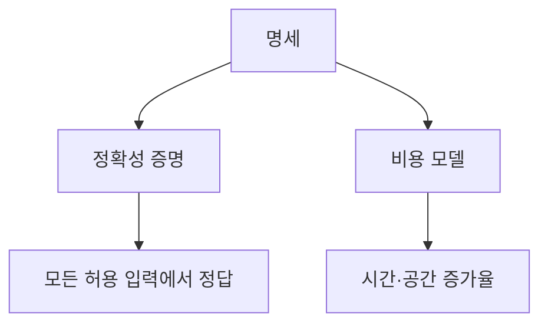

# 01. 정확성과 복잡도

[이전](00-problems-inputs-and-answers.md) · [목차](README.md) · [다음](02-arrays-lists-and-hashing.md)

정확성은 답이 맞는 이유이고 복잡도는 그 답을 만드는 자원 증가율이다. 빠른 오답과 느린 정답을 한 축으로 평가하지 않는다.



## 1. Loop invariant

배열 최댓값을 왼쪽부터 찾는다.

```python
def maximum(values):
    best = values[0]
    for x in values[1:]:
        if x > best:
            best = x
    return best
```

Invariant는 “반복이 특정 지점에 올 때 항상 참인 문장”이다. 여기서는 `best`가 지금까지 본 값의 최댓값이다.

- 초기: 첫 값만 보았으므로 `best`는 본 값의 최댓값이다.
- 유지: 새 값 `x`가 더 크면 바꾸고, 아니면 유지하므로 여전히 최댓값이다.
- 종료: 모든 값을 보았으므로 전체 최댓값이다.

## 2. 숫자로 추적한다

입력 `[3,1,5,2]`:

| 본 값 | 비교 전 best | 비교 결과 | 비교 후 best |
| ---: | ---: | --- | ---: |
| 시작 3 | 없음 | 초기화 | 3 |
| 1 | 3 | 1>3 거짓 | 3 |
| 5 | 3 | 5>3 참 | 5 |
| 2 | 5 | 2>5 거짓 | 5 |

결과가 5인 이유는 마지막에 우연히 5가 남아서가 아니라 invariant와 종료 조건 때문이다.

## 3. 종료도 증명한다

정확성은 답이 맞다는 partial correctness와 실제로 끝난다는 termination을 합친다. 위 loop는 길이 `n-1`인 slice를 한 번씩 보므로 끝난다.

Recursion은 입력 크기가 줄고 base case에 도달함을 보여야 한다.

## 4. 비용 모델

비교 한 번, 배열 접근 한 번을 상수 비용으로 센다고 하자. Maximum은 `n-1`번 비교하므로 `T(n)=an+b`, 즉 `O(n)`이다.

Big-O는 실제 1초를 뜻하지 않는다. Python interpreter, cache, 데이터 표현은 상수와 실제 시간을 바꾼다.

## 5. 상한·하한·tight bound

- `O(g(n))`: 충분히 큰 n에서 상한.
- `Ω(g(n))`: 하한.
- `Θ(g(n))`: 같은 차수의 상한과 하한.

Maximum은 모든 값을 보지 않으면 보지 않은 값이 더 클 수 있다. 비교 기반 일반 입력에서 `Ω(n)`이 필요하고 알고리즘이 `O(n)`이므로 `Θ(n)`이다.

## 6. Worst, average, expected

Linear search에서 target이 첫 위치면 1번, 없으면 n번 비교한다.

| 관점 | 질문 |
| --- | --- |
| Best case | 가장 쉬운 입력은? |
| Worst case | 가장 어려운 허용 입력은? |
| Average case | 입력 분포를 무엇으로 가정했나? |
| Expected | 알고리즘의 난수나 hash 가정에 대한 기댓값은? |

“평균 O(1)”에는 평균을 만드는 확률 모형이 필요하다.

## 7. 공간 복잡도

Input 배열 외에 변수 `best`, `x`만 쓰면 auxiliary space는 `O(1)`이다. 입력 자체를 포함하면 총 공간은 `O(n)`이다. 어느 기준인지 쓴다.

Merge sort는 합칠 임시 배열 때문에 보통 `O(n)` 추가 공간을 사용한다. 호출 stack도 공간이다.

## 8. Amortized cost

Dynamic array가 가득 찰 때 용량을 두 배로 만든다고 하자. 용량 1에서 8개를 append하면 resize 때 복사 수는 `1+2+4=7`이다.

| append 번호 | resize 전 용량 | 복사 수 |
| ---: | ---: | ---: |
| 1 | 1 준비 | 0 |
| 2 | 1 | 1 |
| 3 | 2 | 2 |
| 4 | 4 | 0 |
| 5 | 4 | 4 |
| 6~8 | 8 | 0 |

한 append는 `O(n)`일 수 있지만 n번 전체는 `O(n)`이므로 append당 amortized `O(1)`이다. 이것은 각 호출이 항상 O(1)이라는 뜻이 아니다.

## 9. Invariant와 비용을 섞지 않는다

Binary search의 invariant는 target이 있다면 현재 `[lo,hi]` 안에 있다는 문장이다. 비용은 구간 길이가 매번 절반이 되어 `O(log n)`이라는 별도 계산이다.

정확성 증명에 “빠르다”를 쓰거나 비용 분석에 “답이 맞다”를 쓰면 논점이 바뀐다.

## 10. 재귀 비용

Merge sort는 두 절반을 정렬하고 O(n)에 합친다.

```text
T(n) = 2T(n/2) + cn
level 0 work: cn
level 1 work: 2*c(n/2) = cn
levels: log₂ n
total: Θ(n log n)
```

## 11. 반례

두 nested loop가 있다고 무조건 O(n²)은 아니다.

```text
for i in 0..n-1:
    j = 1
    while j < n:
        j *= 2
```

안쪽은 `log n`번이므로 전체는 O(n log n)이다.

## 12. 작은 검증과 증명

Assert는 실수를 잡는다.

```python
assert maximum([3, 1, 5, 2]) == 5
assert maximum([-4, -2]) == -2
```

하지만 유한한 test가 모든 정수 배열을 덮지 않는다. Test와 proof는 서로 보완한다.

## 13. 시스템 모형

Spark task 수를 n이라 두고 O(n)이라고 말해도 실제 실행 시간은 skew, shuffle, 병렬성에 좌우된다. Cost model이 무엇을 세고 무엇을 숨기는지 적어야 한다.

## 14. 정확성이라는 말을 세 부분으로 나눈다

프로그램이 샘플에서 맞았다는 사실과 알고리즘이 정확하다는 주장은 다르다. **정확성(correctness)**은 명세가 허용한 모든 입력에 대해, 알고리즘이 끝나고, 그 결과가 후조건을 만족한다는 주장이다. 이 문장에는 세 요소가 있다.

1. **부분 정확성(partial correctness)**: 알고리즘이 종료했다면 결과가 맞다.
2. **종료성(termination)**: 알고리즘이 허용 입력에서 실제로 끝난다.
3. **전체 정확성(total correctness)**: 부분 정확성과 종료성을 모두 만족한다.

“끝나기만 하면 맞다”는 말은 무한 반복하는 프로그램에도 공허하게 참일 수 있다. 반대로 항상 끝나더라도 틀린 답을 반환하면 정확하지 않다. 그래서 두 증명을 분리한 뒤 합친다.

배열 `[4,1,7,3]`에서 최댓값을 찾는 loop를 상태로 보자. **상태(state)**는 한 순간에 변수와 아직 처리하지 않은 입력이 가진 값의 묶음이다. 첫 값을 읽은 직후 상태는 `best=4`, 처리한 prefix는 `[4]`, 남은 suffix는 `[1,7,3]`이다. **prefix**는 배열의 처음부터 어느 위치까지 연속된 부분이고, **suffix**는 나머지 끝부분이다.

| 반복 직전 | 처리한 prefix | `best` | 새 값 | 반복 직후 `best` |
| ---: | --- | ---: | ---: | ---: |
| 1 | `[4]` | 4 | 1 | 4 |
| 2 | `[4,1]` | 4 | 7 | 7 |
| 3 | `[4,1,7]` | 7 | 3 | 7 |
| 종료 | `[4,1,7,3]` | 7 | 없음 | 7 반환 |

표의 각 줄에서 “`best`는 처리한 prefix의 최댓값이다”가 참이다. 이처럼 실행 중 계속 참으로 유지하려는 문장이 loop invariant다. invariant는 코드가 저절로 만들어 주는 성질이 아니다. 증명하려는 후조건과 loop가 실제로 바꾸는 상태를 보고 우리가 선택하는 문장이다.

## 15. Invariant 증명을 왜 초기·유지·종료로 나누는가

도미노가 모두 쓰러진다고 주장하려면 첫 도미노가 쓰러지고, 하나가 쓰러지면 다음도 쓰러진다는 두 사실이 필요하다. Loop invariant도 비슷하다.

- **초기화(initialization)**는 첫 반복 전에 invariant가 참임을 보인다.
- **유지(maintenance)**는 반복 전에 참이라면 몸체 실행 뒤에도 참임을 보인다.
- **종료(termination 활용)**는 loop가 끝났다는 조건과 invariant를 합쳐 후조건을 얻는다.

최댓값 알고리즘에서 배열이 비어 있지 않다는 선조건을 둔다. 첫 원소로 `best`를 정했으므로 초기에는 처리한 원소가 하나뿐이고 invariant가 참이다. 다음 값 `x`가 `best`보다 크면 `best=x`로 바꾸고, 아니면 그대로 둔다. 두 경우 모두 새 prefix의 최댓값이 남으므로 유지된다. 반복 종료 때 prefix가 전체 배열이므로 `best`는 전체 최댓값이다.

잘못된 invariant도 있다. “`best`는 전체 배열의 최댓값이다”는 종료 시에는 원하는 말이지만 초기에는 아직 보지 않은 7 때문에 거짓이다. “`best`는 지금까지 본 값 중 하나다”는 참이지만 너무 약해서 최댓값이라는 후조건을 끌어내지 못한다. 좋은 invariant는 초기부터 참이고, 코드가 유지할 수 있으며, 종료 조건과 합치면 원하는 결론이 나와야 한다.

## 16. 첫 위치 검색을 완전하게 증명한다

다음 코드를 생각하자.

```python
def first_index(values, target):
    i = 0
    while i < len(values):
        if values[i] == target:
            return i
        i += 1
    return None
```

Invariant는 “위치 0부터 i-1까지에는 target이 없다”이다. `i=0`일 때 검사한 위치가 하나도 없으므로 참이다. 이것을 **공허하게 참(vacuously true)**이라고 한다. 대상 집합이 비었기 때문에 반례가 없다는 뜻이지, 대충 참으로 넘긴다는 뜻이 아니다.

`values[i]`가 target이 아니어서 `i`를 1 늘리면, 새롭게 배제한 위치까지 target이 없으므로 invariant가 유지된다. 같으면 즉시 i를 반환한다. invariant에 의해 i보다 작은 위치에는 target이 없고 현재 위치에는 있으므로 i가 첫 위치다. Loop 조건이 거짓이 되어 `i=len(values)`이면 모든 유효 위치를 배제했으므로 `None`이 맞다.

입력 `[6,2,6]`, target 6은 첫 비교에서 0을 반환한다. 입력 `[6,2,6]`, target 5는 다음처럼 진행된다.

```text
i=0: 검사 전 배제 구간은 빈 구간, 6≠5, i=1
i=1: 위치 0에는 5 없음, 2≠5, i=2
i=2: 위치 0..1에는 5 없음, 6≠5, i=3
i=3: 3 < 3이 거짓, 위치 0..2 전체에 5 없음, None
```

종료성은 `len(values)-i`를 보면 된다. 이것은 아직 검사하지 않은 원소 수이고, 반복할 때마다 정확히 1 줄어든다. 0보다 작아질 수 없는 정수이므로 유한 번 뒤 0이 된다. 이런 감소량을 **순위 함수(ranking function)** 또는 **변량(variant)**이라고 한다. Loop invariant의 invariant와 이름이 비슷하지만, 하나는 계속 참인 문장이고 다른 하나는 종료를 위해 계속 감소하는 값이다.

## 17. 재귀의 종료를 손으로 추적한다

**재귀(recursion)**는 함수가 더 작은 문제를 풀기 위해 자기 자신을 호출하는 방식이다. 끝나는 직접 답을 **기저 사례(base case)**라고 하고, 문제를 줄여 다시 부르는 부분을 재귀 사례라고 한다.

```python
def factorial(n):
    if n == 0:
        return 1
    return n * factorial(n - 1)
```

선조건은 `n`이 0 이상의 정수라는 것이다. `factorial(4)`의 호출과 반환은 다음과 같다.

```text
factorial(4) = 4 * factorial(3)
             = 4 * 3 * factorial(2)
             = 4 * 3 * 2 * factorial(1)
             = 4 * 3 * 2 * 1 * factorial(0)
             = 4 * 3 * 2 * 1 * 1
             = 24
```

매 호출에서 n이 1 줄고 음수가 되기 전에 0에 도달하므로 끝난다. 선조건 없이 `n=-1`을 넣으면 -2, -3으로 계속 작아져 `n==0`에 도달하지 않는다. “입력이 줄어든다”만으로 충분하지 않고, 잘 정렬된 범위의 바닥을 향해 줄어들어야 한다.

## 18. 시간 복잡도는 초가 아니라 연산 수의 함수다

**시간 복잡도(time complexity)**는 입력 크기 n이 커질 때 선택한 기본 연산 횟수가 어떻게 증가하는지 나타낸다. 벽시계 시간은 CPU, 언어, cache, 다른 process의 간섭에 따라 달라진다. 이론 분석은 먼저 비교, 대입, 배열 접근 같은 연산을 일정 비용으로 세는 **비용 모형(cost model)**을 정한다.

다음 합계 알고리즘은 원소를 n개 읽고 더한다.

```python
def total(values):
    s = 0
    for x in values:
        s += x
    return s
```

대입을 1, loop 원소 읽기를 1, 덧셈을 1로 세면 대략 `T(n)=2n+2`처럼 쓸 수 있다. 계수 2와 상수 2는 실제 구현에서 달라질 수 있지만 n에 비례해 증가한다는 구조는 유지된다. 그래서 충분히 큰 n에서 `cn`으로 위에서 묶을 수 있어 O(n)이라고 쓴다.

## 19. O, Ω, Θ를 부등식으로 읽는다

Big-O를 “정확한 실행 시간” 또는 “최악의 경우”와 같은 말로 외우면 혼동이 생긴다. O는 함수의 점근적 상한 관계다.

- `T(n)=O(g(n))`은 어떤 양의 상수 c와 시작점 n₀가 존재해 모든 `n≥n₀`에서 `T(n)≤c·g(n)`이라는 뜻이다.
- `T(n)=Ω(g(n))`은 충분히 큰 n에서 `T(n)≥c·g(n)`이 되는 양의 c가 있다는 뜻이다.
- `T(n)=Θ(g(n))`은 위 두 관계가 모두 성립해 같은 증가 차수로 위아래에서 묶인다는 뜻이다.

`T(n)=3n+10`을 보자. n≥10이면 `3n+10≤4n`이므로 O(n)이다. 또한 모든 n≥1에서 `3n+10≥3n`이므로 Ω(n)이다. 따라서 Θ(n)이다. 동시에 O(n²)도 맞다. n≥1에서 `3n+10≤13n²`로 묶을 수 있기 때문이다. 하지만 Θ(n²)은 아니다. Tight bound인 Θ(n)이 더 많은 정보를 준다.

O 표기는 입력 종류를 자동으로 결정하지 않는다. Linear search의 best case는 Θ(1), worst case는 Θ(n)이다. “linear search가 O(n)”은 보통 worst-case 상한을 말하는 관례일 뿐, O 자체가 worst라는 뜻은 아니다.

## 20. 로그는 반복해서 나눈 횟수다

**로그(logarithm)**는 거듭제곱의 역연산이다. `log₂ n = k`는 `2^k=n`이라는 뜻이다. 알고리즘에서는 크기를 반복해서 2로 나눌 때 몇 번 만에 1이 되는지를 나타낸다.

`n=32`라면 `32→16→8→4→2→1`, 다섯 번 나눈다. `log₂32=5`다. Binary search가 매 비교 후 후보 구간의 절반을 버리므로 최대 비교 횟수가 로그로 나타난다.

정렬된 `[2,5,8,12,16,23,38,56]`에서 23을 찾자.

| 단계 | 후보 index | 가운데 | 비교 | 다음 후보 |
| ---: | --- | ---: | --- | --- |
| 1 | 0..7 | 3, 값12 | 23>12 | 4..7 |
| 2 | 4..7 | 5, 값23 | 같음 | 종료 |

target 55라면 후보가 0..7→4..7→6..7→7..7→빈 구간으로 줄어든다. n이 두 배가 되어도 필요한 단계는 대략 하나만 늘어난다. 이것이 로그 증가의 의미다.

밑이 2인지 10인지가 Big-O에서는 상수 배 차이인 이유는 `log₂n = log₁₀n / log₁₀2`이기 때문이다. 그러나 실제 단계 수를 계산하거나 bit 알고리즘을 설명할 때 밑은 의미가 있으므로 필요한 곳에는 적는다.

## 21. 중첩 loop를 모양으로만 판단하지 않는다

다음 loop는 바깥이 n번, 안쪽도 매번 n번 실행되어 비교가 n²번이다.

```text
for i = 0 .. n-1:
    for j = 0 .. n-1:
        visit(i, j)
```

하지만 삼각형 loop는 `i`번째에 i번 실행한다. 전체는 `0+1+...+(n-1)=n(n-1)/2`, 따라서 Θ(n²)다. 계수 1/2은 버리지만 어떤 합에서 나왔는지 이해해야 한다.

반면 포인터 j가 전체 실행 동안 뒤로 돌아가지 않는다면 겉으로 중첩되어도 선형일 수 있다.

```text
j = 0
for i = 0 .. n-1:
    while j < n and condition(i, j):
        j += 1
```

바깥 loop가 n번이어도 j는 0에서 n까지 전체 합쳐 최대 n번 증가한다. 조건 평가의 세부를 포함해도 보통 O(n)이다. 각 loop의 범위가 서로 독립인지, 상태를 공유하는지 세야 한다.

## 22. 점화식은 재귀 호출의 비용 장부다

**점화식(recurrence)**은 크기 n 문제의 비용을 더 작은 크기 문제의 비용으로 표현한 식이다. Merge sort는 배열을 절반 둘로 나누고, 각 절반을 정렬하고, 두 정렬 결과를 선형 시간에 합친다.

```text
T(n) = 2T(n/2) + cn
```

`2T(n/2)`는 절반 크기 호출 두 개, `cn`은 merge할 때 n개 원소를 다루는 비용이다. n=8일 때 level별 입력 크기를 펼치면 다음과 같다.

| 깊이 | 부분 문제 수 | 각 크기 | 그 깊이 merge 총량 |
| ---: | ---: | ---: | ---: |
| 0 | 1 | 8 | 8c |
| 1 | 2 | 4 | 8c |
| 2 | 4 | 2 | 8c |
| 3 | 8 | 1 | 기저 사례 |

절반으로 나누는 깊이는 log₂n이고 각 깊이의 총 merge 일이 cn이므로 Θ(n log n)이다. 이 계산은 n이 2의 거듭제곱이라고 두면 깔끔하지만, 다른 n에서도 천장·바닥 함수가 상수 차수만 바꿔 같은 점근 경계가 된다.

## 23. 공간을 입력·보조·호출 stack으로 나눈다

**공간 복잡도(space complexity)**는 동시에 필요한 저장 공간이 입력 크기에 따라 얼마나 늘어나는지 나타낸다. 입력 배열 자체를 포함하는 총 공간과, 입력 외에 추가로 쓰는 **보조 공간(auxiliary space)**을 구별한다.

반복형 최댓값 찾기는 입력 n칸 외에 `best`와 loop 변수만 있어 보조 공간 Θ(1)이다. 재귀형 factorial은 별도 배열을 만들지 않지만 반환 전 호출 상태를 보관하는 **호출 stack(call stack)**이 깊이 n만큼 쌓여 Θ(n) 보조 공간이 든다. Stack frame은 한 번의 함수 호출에 필요한 매개변수, 지역 변수, 돌아갈 위치를 저장하는 영역이다.

공간 사용량도 최고 동시량을 센다. 반복 중 매번 크기 n 임시 배열을 만들고 즉시 버리는 경우 총 할당량은 클 수 있지만 peak space는 재사용 여부에 따라 다르다. 무엇을 측정하는지 명시해야 한다.

## 24. Amortized와 expected를 혼동하지 않는다

**상각 분석(amortized analysis)**은 확률을 쓰지 않고 연산 시퀀스 전체 비용을 평균내어 각 연산에 비용을 배분한다. Dynamic array의 doubling이 대표적이다. 용량 1에서 16개를 append하면 resize 복사는 1+2+4+8=15번이다. 원소를 새로 쓰는 16번까지 합쳐 31번 정도의 핵심 작업이므로 16회 전체가 O(16), 일반적으로 n회가 O(n)이다.

**기대 비용(expected cost)**은 입력 분포 또는 알고리즘 난수에 대한 확률 평균이다. Hash table의 expected O(1)은 key가 bucket에 적절히 분산된다는 가정과 연결된다. Amortized O(1)은 어떤 한 append가 싸다는 뜻이 아니고, expected O(1)은 모든 입력에서 O(1)이라는 뜻이 아니다.

## 25. 하한을 반례 쌍으로 증명한다

비교 기반 최댓값 찾기가 왜 Ω(n)인지 생각하자. 어떤 알고리즘이 위치 k를 읽지 않았다고 가정한다. 읽은 위치 값이 모두 10인 두 입력을 만들 수 있다.

```text
입력 A: 읽지 않은 k도 10
입력 B: 읽지 않은 k만 999
```

알고리즘이 본 내용은 두 입력에서 완전히 같으므로 같은 답을 내야 한다. 하지만 A의 최댓값은 10이고 B의 최댓값은 999다. 따라서 항상 정확하려면 모든 위치를 확인해야 하고 최소 n개의 원소 접근이 필요하다. 이런 식으로 알고리즘이 구별해야 하는 두 입력을 만드는 방법을 **적대적 논증(adversary argument)**이라고 한다.

하한은 특정 코드가 느리다는 말이 아니라 정한 문제와 계산 모형에서 어떤 알고리즘도 피할 수 없는 비용이다. 입력이 이미 정렬되어 있다는 추가 선조건이 생기면 마지막 원소만 읽어 최댓값을 알 수 있으므로 문제의 하한도 달라진다.

## 26. 실제 실행 시간과 점근 분석을 함께 쓴다

Θ(n) 알고리즘 A가 연산당 비용이 크고 Θ(n log n) 알고리즘 B가 cache 친화적이면 실용 범위에서 B가 빠를 수 있다. **Cache locality**는 가까운 메모리 위치를 연속해서 사용해 CPU cache에 이미 들어온 데이터를 재사용하는 성질이다. Linked list처럼 주소가 흩어진 구조는 같은 n번 접근이어도 array 순회보다 느릴 수 있다.

그래서 성능 주장은 다음 층으로 기록한다.

1. 문제와 입력 크기 정의
2. 이론 비용 모형에서의 상한·하한
3. 구현 언어와 자료 표현
4. CPU, memory, dataset 분포를 적은 benchmark
5. 평균뿐 아니라 p95, p99 같은 지연 분포와 변동성

점근 분석은 benchmark를 대신하지 않고, benchmark도 모든 n에 대한 증명을 대신하지 않는다.

## 27. 연구 결과의 복잡도 식을 읽는 예

2025년 directed SSSP 연구의 `O(m log^(2/3)n)`을 예로 보자. n은 정점 수, m은 방향 간선 수다. SSSP는 하나의 출발점에서 모든 정점까지 최소 가중치 합을 구하는 문제다. 논문은 음수가 아닌 실수 가중치와 비교-덧셈 계산 모형이라는 조건에서 결정론적 시간 상한을 제시한다.

`m`이 이미 n²에 가까운 조밀 그래프라면 m 항이 비용을 크게 지배한다. m이 n 정도인 희소 그래프에서는 로그 인자의 개선이 이론적으로 더 눈에 띈다. 하지만 Big-O는 상수와 구현 비용을 숨긴다. 논문의 결과만으로 기존 production Dijkstra 구현보다 모든 크기에서 빠르다고 결론 낼 수 없다. 이론적 장벽을 깬 결과와 실제 시스템 benchmark는 서로 다른 증거다.

## 28. 확인 문제와 자세한 해설

**문제 1.** `T(n)=1000n+10`과 `U(n)=n²` 중 어느 것이 항상 빠른가?

**해설.** 항상이라는 답은 없다. 작은 n에서는 n²이 작을 수 있고 충분히 큰 n에서는 선형 함수가 작아진다. 실제 시간은 연산 단가도 필요하다. 점근식은 증가율을 비교하며 교차 지점과 상수는 별도 측정 대상이다.

**문제 2.** `for i in range(n): for j in range(i):`의 몸체 실행 횟수를 구하라.

**해설.** i=0일 때 0, i=1일 때 1, …, i=n-1일 때 n-1이다. 합은 `n(n-1)/2`이고 Θ(n²)이다. 단순히 loop 두 개라서가 아니라 합을 계산해서 얻은 결과다.

**문제 3.** Binary search의 후보 크기가 100일 때 최악에 몇 번 절반으로 줄이면 1 이하가 되는가?

**해설.** 100→50→25→13→7→4→2→1로 일곱 번이다. `ceil(log₂100)=7`과 같다. 반올림 방식에 따라 실제 비교 횟수는 한 번 차이 날 수 있지만 Θ(log n)이다.

**문제 4.** 최댓값 loop의 invariant를 “best는 배열 원소다”로 두면 왜 부족한가?

**해설.** 초기와 유지에는 참일 수 있지만 종료 시 전체 최댓값이라는 후조건이 나오지 않는다. 3을 반환해도 배열 원소라는 약한 조건은 만족하기 때문이다. 증명 문장은 참인 것만으로 부족하고 목표를 끌어낼 만큼 강해야 한다.

**문제 5.** `factorial(-2)`가 끝나지 않는 이유를 종료성 언어로 설명하라.

**해설.** 기저 사례는 n=0인데 재귀 호출은 -2,-3,-4로 진행한다. 0에 가까워지는 음이 아닌 순위 함수가 없다. 따라서 0 이상의 정수라는 선조건이 필요하거나 음수 입력을 즉시 거부해야 한다.

**문제 6.** Dynamic array append가 상각 O(1)이면 실시간 제어 loop의 각 append가 일정 시간 안에 끝남을 보장하는가?

**해설.** 아니다. Resize가 걸린 한 호출은 기존 n개를 복사해 O(n)이 될 수 있다. 총합 평균과 개별 최악 지연은 다른 보장이다. 엄격한 latency 한도가 있으면 미리 reserve하거나 다른 구조를 선택해야 한다.

**문제 7.** 모든 key가 같은 bucket으로 가는 chaining hash table의 lookup 비용은?

**해설.** Bucket 안에 n개가 연결되므로 없는 key 또는 끝 key를 찾는 데 n번 비교해 Θ(n)이다. Expected O(1) 주장은 분포 가정 없이 worst case 보장이 아니다.

**문제 8.** 테스트 100만 개를 통과하면 증명이 필요 없는가?

**해설.** 테스트는 선택한 사례에서 구현 오류를 찾는 강한 도구지만 무한하거나 매우 큰 입력 공간 전체를 덮지는 못한다. 증명은 명세와 논리의 오류를 드러내고, 테스트는 증명에서 빠뜨린 구현·환경 오류를 찾는다. 둘은 대체 관계가 아니다.

## 확인 문제

**문제.** Hash lookup expected O(1)은 worst-case O(1)인가?

**해설.** 아니다. Collision과 공격적 key 분포에서는 한 bucket에 n개가 모여 O(n)일 수 있다.

**문제.** O(n) 공간 알고리즘은 언제나 O(1) 공간보다 나쁜가?

**해설.** 시간, 구현 단순성, 입력 크기, 메모리 한도를 함께 본다. Merge sort의 안정성과 시간 보장을 위해 공간을 쓸 수 있다.

## 참고

[MIT 6.006](https://ocw.mit.edu/courses/6-006-introduction-to-algorithms-spring-2020/)와 [MIT 6.046J](https://ocw.mit.edu/courses/6-046j-design-and-analysis-of-algorithms-spring-2015/)의 분석 범위를 참고했다.

SSSP 복잡도 예시는 [Duan et al., *Breaking the Sorting Barrier for Directed Single-Source Shortest Paths*](https://arxiv.org/abs/2504.17033)의 문제 조건과 이론 모형을 기준으로 설명했다.
