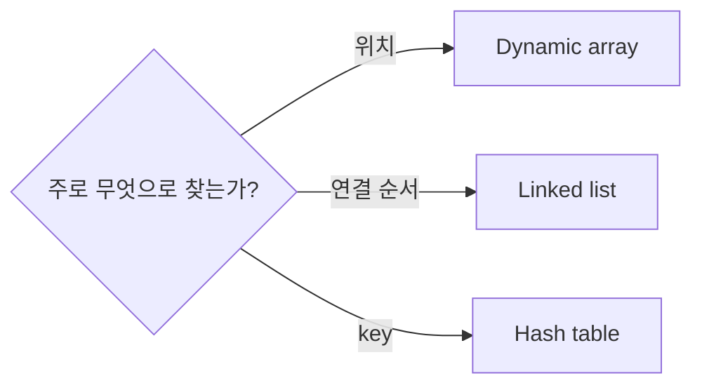

# 02. 배열·연결 목록·Hashing

[이전](01-correctness-and-complexity.md) · [목차](README.md) · [다음](03-stacks-queues-and-recursion.md)

자료구조는 값뿐 아니라 지원할 연산과 그 비용을 정한다.



## 1. 배열의 위치

배열 `[7,4,9,2]`에서 index 2는 9다. 연속된 위치 모델 덕분에 임의 index 접근은 O(1)이다.

중간 index 1에 5를 넣으면 뒤 값을 민다.

```text
전: [7,4,9,2]
4 이동: [7,4,9,2,_]
9 이동: [7,4,9,9,2]
삽입: [7,5,4,9,2]
```

실제 이동은 오른쪽에서 왼쪽 순서여야 덮어쓰지 않는다.

## 2. Dynamic array

용량과 길이를 구분한다. 길이 4, 용량 4에서 append하면 더 큰 저장소를 만들고 네 값을 복사한 뒤 새 값을 넣는다.

Doubling이면 append amortized O(1), 임의 삽입 worst O(n)이다.

## 3. 연결 목록

Node는 값과 다음 node 참조를 가진다.

```text
head → (7,next) → (4,next) → (9,None)
```

4 뒤에 5를 넣을 때 4 node를 이미 알고 있다면 pointer 두 개만 바꾼다.

```text
new.next = node4.next
node4.next = new
```

그러나 “값 4를 먼저 찾기”에는 O(n)이 든다. O(1) 삽입은 위치 node를 이미 가진다는 조건이 있다.

## 4. 배열과 목록 비교

| 연산 | Dynamic array | Singly linked list |
| --- | --- | --- |
| index 접근 | O(1) | O(n) |
| 앞 삽입 | O(n) | O(1) |
| 끝 append | amortized O(1) | tail 있으면 O(1) |
| 메모리 | 값과 여유 용량 | 값마다 pointer |

실제 CPU cache locality는 배열에 유리할 수 있다. Big-O가 같은 traversal도 실제 시간은 다르다.

## 5. Hash function과 bucket

Table 크기 5, `h(k)=k mod 5`라 하자.

| key | hash bucket |
| ---: | ---: |
| 12 | 2 |
| 7 | 2 |
| 18 | 3 |

12와 7이 bucket 2에서 충돌한다. Collision은 오류가 아니라 서로 다른 key가 같은 bucket을 얻는 상황이다.

## 6. Chaining 손 추적

```text
bucket 0: []
bucket 1: []
bucket 2: [(12,A),(7,B)]
bucket 3: [(18,C)]
bucket 4: []
```

7을 찾을 때 bucket 2를 계산하고 12와 비교한 뒤 7을 찾는다. 이 예에서는 두 key 비교다.

## 7. Load factor

`α = 저장 key 수 / bucket 수`다. 3개 key와 5 bucket이면 0.6이다. Load factor가 커지면 평균 chain이 길어질 수 있어 resize와 rehash를 한다.

Rehash는 bucket array만 복사하는 것이 아니라 새 크기의 hash로 각 key 위치를 다시 계산한다.

## 8. Expected와 worst case

Hash 분포가 고르게 되는 가정 아래 lookup expected O(1)이다. 그러나 모든 key가 한 bucket에 모이면 chain 길이가 n이어서 worst O(n)이다.

“Hash table은 O(1)”이라고만 쓰면 확률 가정과 worst case를 숨긴다.

## 9. Open addressing

Chaining 대신 table 내부의 다음 빈 칸을 찾을 수 있다. Linear probing으로 12→2, 7도 2이므로 3, 18→3이지만 차서 4에 둔다.

삭제할 때 단순 빈 칸으로 바꾸면 search chain을 끊을 수 있어 tombstone 같은 상태가 필요하다.

## 10. Set과 map

Set은 key 존재를, map은 key→value를 저장한다. Python `set`과 `dict`는 hashing 기반이지만 내부 구현 세부와 최악 보장은 언어 버전·key에 따라 구분한다.

```python
counts = {}
for key in ["A", "B", "A"]:
    counts[key] = counts.get(key, 0) + 1
```

첫 줄은 빈 map이다. Loop는 key를 하나씩 본다. `get`은 없으면 0을 주고 1을 더한다. 결과는 `{"A":2,"B":1}`이다.

## 11. Invariant

k개 항목을 처리한 뒤 `counts[x]`는 앞 k개에서 x가 나온 횟수다. 다음 key 하나의 count만 1 증가하므로 invariant가 유지된다. 종료하면 전체 빈도다.

## 12. 실제 시스템 연결

Iceberg manifest 통계로 파일을 거르는 일을 hash lookup과 같다고 부를 수는 없다. Metadata 탐색에는 partition summary, range 통계, 파일 I/O가 있다. Hash map은 일부 구현에 쓰일 수 있는 자료구조일 뿐 전체 알고리즘이 아니다.

Kubernetes가 node 이름을 map으로 찾는 것과 scheduler가 제약을 만족하는 node를 선택하는 것도 다르다.

## 13. 반례

정렬된 key의 range query를 hash table로 하면 key 순서가 없어 불편하다. Tree가 더 적합할 수 있다.

Linked list가 삽입 O(1)이라는 말만 보고 중간 값 검색까지 빠르다고 결론 내리면 안 된다.

## 확인 문제

**문제 1.** Bucket 10개에 key 20개면 load factor는?

**해설.** 2.0이다. Chaining이면 가능하지만 평균 chain 증가를 검토한다.

**문제 2.** Hash collision이 생기면 두 key가 같다는 뜻인가?

**해설.** 아니다. Hash 값 또는 bucket이 같아도 원래 key 비교로 구별한다.

**문제 3.** 배열 끝 append는 항상 worst O(1)인가?

**해설.** Dynamic array resize가 일어난 한 호출은 O(n)일 수 있다. Amortized O(1)이다.

## 14. 자료구조는 값의 보관법과 연산 계약을 함께 정한다

**자료구조(data structure)**는 데이터를 메모리에 놓는 구체적인 방식과, 그 데이터에 허용하는 연산의 묶음이다. “숫자 7, 4, 9를 저장한다”만으로는 자료구조를 정하지 못한다. 위치 번호로 자주 읽을지, 중간 삽입을 자주 할지, key로 찾을지에 따라 적절한 구조가 달라진다.

먼저 용어를 실제 객체와 연결하자.

- **원소(element)**는 구조가 저장하는 개별 값이다.
- **위치(index)**는 순서가 있는 구조에서 몇 번째 칸인지 나타내는 정수다. 보통 0부터 시작한다.
- **참조(reference)** 또는 pointer는 다른 객체가 있는 메모리 위치를 가리키는 값이다.
- **key**는 record를 찾거나 구별하는 데 쓰는 값이고, **value**는 그 key와 연결해 보관할 내용이다.
- **연산(operation)**은 조회, 삽입, 삭제, 갱신처럼 구조에 요구하는 행동이다.

같은 주문 record라도 배열에서는 “37번째 주문”, linked list에서는 “이 node 다음 주문”, hash map에서는 “order_id가 920인 주문”으로 접근한다. 어느 표현이 업무상 동일성을 정하는 것은 아니다. order_id가 중복되면 안 된다는 규칙은 자료구조보다 먼저 정한 문제 명세다.

## 15. 배열의 O(1) 위치 접근은 주소 계산에서 나온다

**배열(array)**은 같은 크기의 원소를 논리적으로 연속된 위치에 둔다. 시작 주소를 `base`, 원소 한 칸 크기를 `w`, 위치를 `i`라고 하면 i번째 원소 주소는 다음처럼 계산한다.

```text
address(i) = base + i × w
```

예를 들어 시작 주소가 1000이고 4byte 정수 배열 `[7,4,9,2]`가 있다면 주소는 다음과 같다.

| index | 값 | 주소 계산 | 주소 |
| ---: | ---: | --- | ---: |
| 0 | 7 | 1000+0×4 | 1000 |
| 1 | 4 | 1000+1×4 | 1004 |
| 2 | 9 | 1000+2×4 | 1008 |
| 3 | 2 | 1000+3×4 | 1012 |

index 2에 가려고 앞의 두 값을 따라갈 필요가 없다. 곱셈과 덧셈 몇 번으로 주소를 얻는 RAM 비용 모형에서 O(1)이다. **RAM 모형**은 일정 크기의 machine word 연산과 메모리 한 칸 접근을 상수 비용으로 보는 이론 모형이다. 실제로는 cache miss나 page fault 때문에 접근 시간이 완전히 같지는 않지만, n에 비례해 앞에서부터 걸어갈 필요가 없다는 구조적 차이는 남는다.

배열의 **연속성(contiguity)**은 가까운 주소의 원소를 연속해서 읽게 해 cache locality에도 유리하다. CPU는 흔히 요청한 byte 하나만 가져오지 않고 주변 묶음인 cache line을 가져온다. 따라서 순차 순회는 다음 원소가 이미 cache에 있을 가능성이 높다. 이것은 Big-O에는 안 보이지만 실제 성능에서 중요하다.

## 16. 배열 중간 삽입을 완전하게 추적한다

길이 4, 용량 6인 배열 `[7,4,9,2,_,_]`의 index 1에 5를 넣자. **길이(length)**는 현재 유효 원소 수이고, **용량(capacity)**은 재할당 없이 저장할 수 있는 칸 수다. 빈 칸 `_`은 용량에는 포함되지만 원소가 아니다.

오른쪽 이동은 마지막 원소부터 해야 한다.

```text
초기:          [7,4,9,2,_,_]  length=4
index 3→4:    [7,4,9,2,2,_]
index 2→3:    [7,4,9,9,2,_]
index 1→2:    [7,4,4,9,2,_]
index 1에 5:  [7,5,4,9,2,_]  length=5
```

왼쪽에서 오른쪽으로 복사하면 첫 이동에서 4를 9 위에 쓴 뒤 원래 9를 잃을 수 있다. 이동 순서는 correctness의 일부다. 삽입 위치 뒤에 원소가 k개 있으면 k개를 옮겨야 하므로 앞쪽 삽입은 Θ(n), 맨 끝에 빈 용량이 있으면 이동 없이 Θ(1)이다.

삭제도 비슷하다. `[7,5,4,9,2]`에서 index 1의 5를 삭제하면 index 2의 4를 1로, 9를 2로, 2를 3으로 옮기고 length를 4로 줄인다. 마지막 칸의 오래된 bit를 지우는지는 언어나 객체 수명 규칙에 달렸지만, 논리적으로는 index 4가 더 이상 유효하지 않다.

## 17. Dynamic array의 재할당은 무엇을 하는가

**Dynamic array**는 길이가 실행 중 변할 수 있도록 더 큰 backing storage로 옮길 수 있는 배열이다. backing storage는 실제 원소 칸을 제공하는 메모리 블록이다. 용량 4가 가득 찬 `[10,20,30,40]`에 50을 append하고 두 배 성장 정책을 쓴다면 다음 작업이 필요하다.

1. 용량 8인 새 블록을 할당한다.
2. 10, 20, 30, 40을 새 블록의 index 0..3에 복사하거나 이동한다.
3. index 4에 50을 쓴다.
4. 구조가 가리키는 backing storage를 새 블록으로 바꾼다.
5. 더 이상 쓰지 않는 옛 블록을 메모리 관리 규칙에 따라 해제한다.

이 한 번의 append는 기존 n개를 옮기므로 Θ(n)이다. 그러나 용량을 1,2,4,8,16으로 늘리는 동안 16개 append의 복사 횟수는 `1+2+4+8=15`다. 새 원소 쓰기 16번과 합쳐도 선형이므로 append당 상각 Θ(1)이다.

성장 배수를 1씩만 늘리면 복사가 `1+2+...+(n-1)=Θ(n²)`가 되어 append당 상각 Θ(n)이 된다. “Dynamic array라서 빠르다”가 아니라 기하급수적으로 용량을 키우는 정책 때문에 상각 상수가 나온다.

재할당은 기존 원소 주소를 바꿀 수 있다. 어떤 언어에서 배열 내부 원소의 주소나 iterator를 보관했다면 resize 뒤 더 이상 유효하지 않을 수 있다. **Iterator**는 자료구조 원소를 차례로 방문하기 위한 상태 객체다. 성능뿐 아니라 참조 수명 규칙도 API 계약에 포함된다.

## 18. 연결 목록은 node를 따라간다

**Singly linked list**는 각 node가 값과 다음 node의 참조를 가진 구조다. Node는 값과 연결 정보를 묶은 작은 객체다.

```text
head
 ↓
[주소 500: value=7, next=900]
                         ↓
              [주소 900: value=4, next=620]
                                       ↓
                            [주소 620: value=9, next=None]
```

주소가 연속일 필요가 없다. index 2 값을 읽으려면 head에서 시작해 next를 두 번 따라가야 한다. 일반 index i 접근은 Θ(i), 최악 Θ(n)이다. `None`은 다음 node가 없어 목록이 끝났다는 표지다.

4 node 뒤에 새 값 5를 삽입한다고 하자. `node4`의 주소를 이미 알고 있다는 조건에서 다음 두 대입을 한다.

```python
new.next = node4.next
node4.next = new
```

첫 대입은 새 node가 원래 9 node를 가리키게 한다. 두 번째 대입은 4 node가 새 node를 가리키게 한다. 순서를 뒤집어 `node4.next=new`부터 하고 원래 다음 참조를 별도로 저장하지 않으면 9 node로 가는 연결을 잃는다. O(1)이라는 말은 pointer 대입 수가 n과 무관하다는 뜻이며, 4라는 값을 찾는 시간은 포함하지 않는다.

## 19. 삭제에서 참조와 객체 수명을 함께 본다

Singly linked list에서 현재 node 다음 node를 삭제하려면 `current.next = current.next.next`로 연결을 건너뛸 수 있다. 하지만 삭제할 node의 이전 node를 모르면 해당 node 자체를 일반적으로 제거하기 어렵다. Doubly linked list는 각 node가 `prev`와 `next`를 모두 가져 이전 node도 바로 찾을 수 있지만, node마다 참조 하나를 더 저장하고 갱신해야 할 연결도 늘어난다.

언어에 garbage collector가 있으면 더 이상 도달할 수 없는 node를 나중에 회수할 수 있다. 수동 메모리 관리 언어에서는 삭제 node를 해제해야 한다. 이미 해제한 node의 주소를 다시 사용하면 **use-after-free**라는 잘못된 메모리 접근이 된다. 자료구조 그림에서 화살표 하나를 바꾸는 설명과 실제 객체 수명 관리는 구분해야 한다.

## 20. 배열과 목록을 실제 비용으로 비교한다

둘 다 n개를 순회하면 점근적으로 Θ(n)이지만 실제 동작은 다르다. 배열은 원소가 가까워 cache line을 잘 활용하고, CPU가 다음 주소를 예측해 미리 가져오기 쉽다. Linked list는 매 node에서 다음 주소를 읽어야 다음 memory access를 알 수 있고 주소가 흩어질 수 있다.

반대로 이미 node 참조를 가진 상태에서 연결을 자주 바꾸면 linked list가 이동 복사를 피할 수 있다. 하지만 현대 시스템에서는 pointer overhead, allocator 비용, cache miss가 커서 “삽입이 O(1)”만으로 목록을 선택하면 예상보다 느릴 수 있다. 연산 빈도, 원소 크기, 참조 안정성, 실제 benchmark를 함께 본다.

## 21. Hash function은 key를 bucket 후보로 바꾼다

**Hash function**은 임의 길이 key를 정해진 범위의 정수 hash 값으로 바꾸는 함수다. Hash table은 그 값을 bucket index로 줄여 저장 위치 후보를 고른다. **Bucket**은 같은 index로 배정된 entry를 담는 논리적 칸이다. Entry는 보통 `(key,value)` 쌍이다.

Table 크기가 5이고 교육용 함수가 `h(k)=k mod 5`라고 하자. mod는 나눗셈의 나머지다.

```text
12 mod 5 = 2
 7 mod 5 = 2
18 mod 5 = 3
```

12와 7은 서로 다른 key인데 같은 bucket 2를 얻는다. 이것이 **충돌(collision)**이다. 유한한 bucket에 더 많은 가능한 key를 넣으므로 충돌은 피할 수 없는 정상 상황이다. Hash table은 충돌을 탐지하고 원래 key equality 비교로 구별해야 한다. Hash 값이 같다는 사실은 key가 같다는 뜻이 아니다.

좋은 일반 목적 hash는 예상 workload의 key를 bucket에 고르게 분산시키고 빠르게 계산되어야 한다. 보안용 cryptographic hash와 hash table용 hash는 목적이 다르다. 전자는 역상·충돌 공격 저항 같은 성질을 중시하고, 후자는 빠른 분산과 공격 입력 방어 정책을 절충한다.

## 22. Chaining의 삽입과 조회를 전부 추적한다

각 bucket에 entry 목록을 두는 방식을 **separate chaining**이라고 한다. 순서대로 `(12,A)`, `(7,B)`, `(18,C)`, `(22,D)`를 넣자.

| 삽입 | 계산 | 확인 | 삽입 뒤 bucket |
| --- | --- | --- | --- |
| 12 | 12 mod 5=2 | bucket 2 비었음 | 2: `(12,A)` |
| 7 | 7 mod 5=2 | key 12≠7 | 2: `(12,A)→(7,B)` |
| 18 | 18 mod 5=3 | bucket 3 비었음 | 3: `(18,C)` |
| 22 | 22 mod 5=2 | 12≠22, 7≠22 | 2: `(12,A)→(7,B)→(22,D)` |

key 7 조회는 bucket 2를 계산한 뒤 12와 한 번, 7과 한 번 비교해 B를 반환한다. key 17도 bucket 2지만 세 entry 모두 원래 key가 달라 실패한다. Hash 계산만 하고 key 비교를 생략하면 존재하지 않는 17을 12나 7로 오인할 수 있다.

**Load factor** α는 entry 수 n을 bucket 수 m으로 나눈 `α=n/m`이다. 위 표는 n=4, m=5이므로 α=0.8이다. 고른 분포를 가정한 chaining에서 한 bucket의 기대 길이는 α와 연결된다. 모든 key가 같은 bucket이면 α가 작아도 그 bucket 조회는 Θ(n)이 될 수 있으므로 α만으로 최악을 막지는 못한다.

## 23. Rehash는 왜 모든 key를 다시 계산하는가

Bucket 수를 5에서 10으로 늘리면 `mod 5`와 `mod 10` 결과가 달라진다. 예를 들어 7은 이전 table에서 `7 mod 5=2`라서 bucket 2에 있었지만, 새 table에서는 `7 mod 10=7`이라서 bucket 7로 가야 한다. 기존 bucket 배열의 index를 그대로 복사하면 조회가 새 hash 규칙과 맞지 않는다.

```text
key 12: mod 5=2, mod 10=2
key  7: mod 5=2, mod 10=7
key 18: mod 5=3, mod 10=8
key 22: mod 5=2, mod 10=2
```

따라서 resize 때 모든 entry를 순회해 새 bucket index를 계산하고 다시 넣어야 한다. 이 한 번은 Θ(n)이지만 크기를 기하급수적으로 키우면 많은 삽입에 분산되어 보통 상각 O(1)을 얻는다.

## 24. Open addressing과 tombstone을 상태로 이해한다

**Open addressing**은 entry를 별도 목록이 아니라 bucket array 자체에 두고, 충돌하면 정한 **probe sequence**를 따라 다른 칸을 찾는 방식이다. Linear probing은 다음 index를 차례로 본다.

크기 7, `h(k)=k mod 7`에서 10,17,24를 넣자. 셋 다 시작 bucket은 3이다.

```text
초기:  [_,_,_,_,_,_,_]
10:    [_,_,_,10,_,_,_]
17:    [_,_,_,10,17,_,_]
24:    [_,_,_,10,17,24,_]
```

24를 찾을 때 index 3의 10, 4의 17, 5의 24를 비교한다. 여기서 17을 삭제하고 index 4를 완전한 EMPTY로 만들면 24 조회가 4에서 “이 probe chain에는 더 없다”고 잘못 멈출 수 있다. 그래서 `DELETED` 또는 tombstone이라는 세 번째 상태를 둔다.

```text
[_,_,_,10,DELETED,24,_]
```

조회는 DELETED를 지나가고, 삽입은 필요하면 그 칸을 재사용한다. EMPTY와 DELETED는 값이 없다는 점은 같지만 검색을 계속할지 결정하는 의미가 다르다.

## 25. Equality와 hash의 계약

Map이 두 key를 같다고 판단하는 규칙을 **equality relation**이라고 한다. 일반적으로 `a == b`이면 `hash(a) == hash(b)`여야 한다. 같다고 보는 두 key가 다른 bucket으로 가면 조회가 저장된 entry를 찾지 못할 수 있다. 반대 방향은 필요 없다. Hash가 같아도 key는 다를 수 있으며 collision 처리에서 equality를 확인한다.

Key를 map에 넣은 뒤 equality나 hash에 쓰이는 필드를 변경하면 위험하다. 예를 들어 사용자 객체의 email을 hash key로 썼는데 저장 뒤 email을 바꾸면 객체가 실제로 놓인 bucket과 새 hash가 가리키는 bucket이 달라질 수 있다. 그래서 immutable key를 쓰거나, 변경되지 않는 ID를 key로 삼는다. **Immutable**은 만들어진 뒤 관찰 가능한 값이 변하지 않는다는 뜻이다.

## 26. 빈도 계산의 invariant와 전체 trace

입력 `['A','B','A','C','A']`의 빈도를 map으로 세자.

```python
def frequencies(items):
    counts = {}
    for key in items:
        counts[key] = counts.get(key, 0) + 1
    return counts
```

`get(key,0)`은 key가 있으면 기존 값을, 없으면 0을 돌려준다. 상태는 다음과 변한다.

| 처리 단계 | key | 읽은 이전 값 | 저장한 값 | counts |
| ---: | --- | ---: | ---: | --- |
| 0 | 없음 | 없음 | 없음 | `{}` |
| 1 | A | 0 | 1 | `{A:1}` |
| 2 | B | 0 | 1 | `{A:1,B:1}` |
| 3 | A | 1 | 2 | `{A:2,B:1}` |
| 4 | C | 0 | 1 | `{A:2,B:1,C:1}` |
| 5 | A | 2 | 3 | `{A:3,B:1,C:1}` |

Invariant는 k개를 처리한 뒤 각 key x에 대해 `counts[x]`가 앞 k개 중 x의 등장 횟수라는 것이다. 다음 key 하나만 1 증가시키면 새 prefix에서도 성립한다. 종료하면 전체 빈도다.

멀티스레드에서 같은 map을 동시에 갱신하면 이 코드 한 줄이 원자적이라는 보장은 없다. 두 thread가 모두 A의 값 1을 읽고 각각 2를 쓰면 한 증가를 잃는다. 자료구조의 순차 알고리즘 정확성과 동시성 제어는 별도 계약이다.

## 27. 자료구조 선택을 workload 문장으로 바꾼다

**Workload**는 시스템이 실제로 수행하는 연산의 종류, 빈도, 입력 분포다. “가장 빠른 자료구조”는 workload 없이 정할 수 없다.

| 요구 | 먼저 고려할 구조 | 이유 | 확인할 조건 |
| --- | --- | --- | --- |
| index로 반복 순회 | dynamic array | O(1) 위치 접근, locality | 중간 삽입 빈도 |
| 이미 아는 위치 주변 연결 변경 | linked list | node 이동 없이 참조 변경 | 탐색 비용, cache |
| 정확한 key 조회 | hash map | 적절한 분포에서 expected O(1) | collision, 메모리, 공격 입력 |
| key 순서·범위 질의 | balanced tree | 정렬 순서를 유지 | O(log n) 상수 |
| 가장 작은 값 반복 제거 | heap | 최소/최대 원소 관리 | 임의 key 검색은 빠르지 않음 |

예를 들어 최근 event 100만 건을 시간 순서로 순회하고 가끔 끝에 추가한다면 array가 자연스럽다. 사용자 ID로 point lookup을 반복하면 hash map이 자연스럽다. “10시부터 11시 사이 key” 같은 range query가 핵심이면 순서가 없는 hash보다 tree나 정렬 구조가 낫다.

## 28. 시스템 연결에서 같은 이름의 다른 문제를 구별한다

Database index는 단순히 프로그래밍 언어 map과 같지 않다. Disk page, 동시 transaction, crash recovery, range scan을 다룬다. Kubernetes scheduler가 node 객체를 이름으로 찾는 map을 사용할 수 있어도, 어느 node에 Pod를 놓을지는 제약과 점수 계산 문제다. Iceberg manifest의 min/max 통계로 파일을 거르는 동작은 equality hash lookup이 아니라 범위 기반 pruning이다.

자료구조는 시스템의 한 부품이다. 시스템 전체를 “hash라서 O(1)”이라고 부르면 network I/O, serialization, lock contention, storage access를 지운다. 비용 경계를 정확히 적어야 한다.

## 29. 최신 최단 경로 연구와 자료구조의 관계

전통적인 최단 경로 설명에서는 우선순위 queue가 가장 작은 tentative distance를 반복해서 꺼낸다고 배운다. **Tentative distance**는 현재까지 발견한 경로 중 가장 작은 비용이며, 아직 최종 확정 전일 수 있는 값이다. Priority queue는 우선순위가 가장 높은 원소를 꺼내는 추상 자료형이고 heap으로 구현할 수 있다.

2025년 directed SSSP 연구는 음수가 아닌 가중치의 방향 그래프에서 기존의 정렬 같은 처리 장벽을 낮춘 이론적 알고리즘을 제시한다. 이 결과는 “heap을 더 좋은 hash table로 바꾸면 된다”는 단순한 교체가 아니다. 문제 분해와 frontier 처리 방식에 대한 알고리즘 연구다. `O(m log^(2/3)n)`이라는 경계는 비교-덧셈 모형의 조건부 이론 결과이며, 일반 map 구현이나 모든 production graph workload가 자동으로 빨라진다는 뜻이 아니다.

이 사례는 자료구조와 알고리즘을 구별하는 데 도움이 된다. 자료구조는 상태와 연산을 제공하고, 알고리즘은 그 연산을 어떤 순서와 invariant로 조합해 문제를 푸는 절차다. 좋은 자료구조 하나가 잘못된 알고리즘의 정확성을 만들어 주지 않는다.

## 30. 확인 문제와 자세한 풀이

**문제 1.** 시작 주소 2000, 원소 크기 8byte인 배열의 index 6 주소는?

**풀이.** `2000+6×8=2048`이다. 앞의 여섯 원소를 읽지 않고 산술로 위치를 계산한다.

**문제 2.** 길이 5인 배열의 index 1에 삽입하면 몇 원소를 이동하는가?

**풀이.** 기존 index 1,2,3,4의 네 원소를 한 칸 오른쪽으로 옮긴다. 일반적으로 길이 n, 삽입 index i라면 n-i개를 이동한다. 앞쪽일수록 Θ(n)이다.

**문제 3.** Linked list에서 값 90 뒤에 새 node를 넣는 연산은 항상 O(1)인가?

**풀이.** 90 node 참조를 이미 가지고 있으면 pointer 변경은 O(1)이다. Head부터 값 90을 찾아야 하면 최악 O(n)이 추가된다. 비용 주장의 선조건을 함께 써야 한다.

**문제 4.** 크기 5 table에서 key `[2,7,12,17]`에 `k mod 5`를 쓰면 chaining 상태는?

**풀이.** 네 key 모두 나머지가 2이므로 bucket 2에 네 entry가 연결된다. 마지막 key 조회는 네 번 비교할 수 있다. 전체 load factor는 4/5=0.8이지만 특정 bucket 편향 때문에 조회가 길다.

**문제 5.** Open addressing에서 삭제 칸을 EMPTY로 바꾸면 안 되는 예를 설명하라.

**풀이.** 10,17,24가 모두 시작 index 3이고 3,4,5에 놓였다고 하자. 17을 삭제해 4를 EMPTY로 만들면 24 조회가 3의 10을 본 뒤 4에서 멈춰 24가 없다고 오판한다. DELETED 상태로 두면 5까지 계속 본다.

**문제 6.** Dynamic array append가 상각 O(1)인데 한 번의 append가 Θ(n)일 수 있는 이유는?

**풀이.** 용량이 찬 순간 더 큰 블록을 만들고 기존 n개를 옮겨야 한다. 이런 비싼 호출은 용량이 두 배가 될 때만 드물게 나타나므로 n회 전체 복사는 O(n)이다. 개별 최악과 시퀀스 평균을 구별한다.

**문제 7.** 사용자 이름을 key로 한 map이 있는데 이름 변경이 가능하다. 어떤 문제가 생기며 어떻게 고칠 수 있는가?

**풀이.** Key 객체 자체가 바뀌어 hash가 달라지면 저장 bucket과 조회 bucket이 어긋날 수 있다. 변경되지 않는 user ID를 key로 쓰거나, 이름 변경 때 old entry를 삭제하고 new key로 재삽입하며, key equality와 hash 계약을 지킨다.

**문제 8.** 정렬된 key에 대해 `[100,200]` 범위의 모든 record를 자주 찾는다. Hash table만으로 충분한가?

**풀이.** Hash는 exact key 후보를 찾는 데 유리하지만 key 순서를 보존하지 않는다. 범위 안의 key를 모두 알려면 많은 bucket을 보게 될 수 있다. 정렬 array의 binary search와 연속 scan, 또는 balanced search tree 같은 순서 구조가 더 적합할 수 있다.

**문제 9.** `counts[key] += 1`이 순차 실행에서는 맞는데 두 thread에서 틀릴 수 있는 이유는?

**풀이.** 읽기, 덧셈, 쓰기가 분리될 수 있다. 둘 다 이전 값 1을 읽고 2를 쓰면 기대한 3 대신 2가 된다. Hash table 선택과 별개로 atomic 연산, lock, thread-local 집계 후 merge 같은 동기화 설계가 필요하다.

## 참고

[MIT 6.006](https://ocw.mit.edu/courses/6-006-introduction-to-algorithms-spring-2020/) 자료구조 범위와 [Princeton Algorithms](https://algs4.cs.princeton.edu/home/)의 기본 자료구조 구성을 참고했다.

최단 경로 연구와 자료구조의 관계는 [Duan et al., *Breaking the Sorting Barrier for Directed Single-Source Shortest Paths*](https://arxiv.org/abs/2504.17033)의 문제 조건을 참고했다.

## 같은 값과 같은 위치를 구별하기

배열 `[7,7]`의 두 원소는 값이 같지만 index는 0과 1로 다르다. Key를 7로 잡아 set에 넣으면 두 번째 삽입 뒤에도 원소 수는 1이다. 두 건을 모두 보존해야 한다면 record ID를 별도 key로 쓰거나, key 7에 여러 record의 목록을 연결해야 한다.

1. 먼저 입력 record가 두 건이라는 사실을 적는다.
2. 무엇을 같다고 취급할지 equality 규칙을 정한다.
3. 그 규칙에 맞게 배열 위치, record ID, 값 key 중 하나를 고른다.
4. 조회 결과가 한 건이어야 하는지 여러 건이어야 하는지 확인한다.

자료구조의 빠른 조회는 문제의 의미를 대신 정하지 않는다. 값만 같다고 서로 다른 주문 두 건을 하나로 합치면, hash table이 올바르게 동작해도 업무 결과는 틀릴 수 있다.
