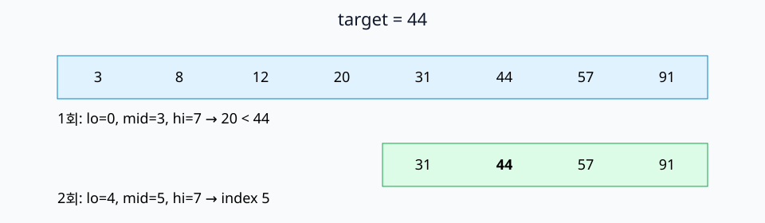

# 04. 검색

[이전](03-stacks-queues-and-recursion.md) · [목차](README.md) · [다음](05-sorting.md)

검색은 여러 값 중에서 원하는 조건을 만족하는 값이나 위치를 찾는 일이다. 전화번호 목록에서 이름을 찾고, 상품 번호가 등록됐는지 확인하고, 점수 80 이상이 처음 나타나는 위치를 구하는 일이 모두 검색이다. 같은 데이터라도 정렬 여부, 검색 횟수, 원하는 답의 종류에 따라 알맞은 방법이 달라진다.

~~~mermaid
flowchart LR
    I["입력: 값들의 모음과 찾을 조건"] --> U{"값들이 순서대로 정렬됐는가?"}
    U -->|아니오| L["선형 검색: 앞부터 확인"]
    U -->|예| R{"중간 위치를 즉시 읽을 수 있는가?"}
    R -->|예| B["이진 검색: 후보를 절반씩 제거"]
    R -->|아니오| L
    L --> O["출력: 위치 또는 없음"]
    B --> O
~~~

## 1. 검색 전에 알아야 할 객체와 말

**배열(array)**은 값을 번호가 붙은 칸에 차례로 저장한 구조다. 파이썬에서는 이 장의 모형을 리스트로 구현한다. **인덱스(index)**는 칸의 번호다. 길이가 n인 배열의 인덱스는 0부터 n-1까지다. 첫 칸이 0인 이유로 마지막 칸 번호는 값의 개수보다 하나 작다.

**정렬(sorted)**은 값들이 정한 비교 순서에 맞게 놓인 상태다. 이 장에서 오름차순 정렬은 왼쪽 값이 오른쪽 값보다 크지 않은 상태를 뜻한다. 같은 값이 여러 번 있어도 오름차순일 수 있다. 예를 들어 [2, 2, 5]는 정렬됐지만 [2, 5, 2]는 정렬되지 않았다.

**반복(loop)**은 같은 코드 블록을 조건이 맞는 동안 다시 실행하는 기작이다. 검색은 후보를 하나씩 보거나 후보 범위를 계속 줄이므로 반복이 필요하다. **불변식(invariant)**은 반복을 시작할 때마다 반드시 참이어야 하는 문장이다. 불변식은 코드가 왜 정답을 잃지 않는지를 설명하는 약속이다.

이 장에서 검색 함수의 입력은 배열 keys와 찾으려는 값 target이다. 기본 검색의 출력은 target과 같은 값이 있는 인덱스이며, 없으면 파이썬의 None을 반환한다. None은 0과 다르다. 0은 첫 칸에서 찾았다는 정상 답이고, None은 답이 없다는 표시다.

검색에서 **키(key)**는 비교에 사용하는 값이고 target은 찾으려는 키다. 레코드 전체를 저장한 배열이라면 이름이나 상품 번호처럼 그 레코드를 식별·정렬하는 일부 필드가 키가 될 수 있다. 이때 함수가 인덱스를 돌려주는지 레코드 자체를 돌려주는지 먼저 정해야 한다. 이 장의 함수는 인덱스를 돌려주므로 호출자는 keys[index]가 target인지 확인할 수 있다.

| 질문 | 가능한 출력 | 중복일 때 의미 |
| --- | --- | --- |
| target이 있는가 | True 또는 False | 하나라도 있으면 True |
| target은 어디 있는가 | 인덱스 또는 None | “아무 위치”인지 명시 필요 |
| 첫 target은 어디인가 | 첫 인덱스 또는 삽입 위치 | 가장 작은 일치 인덱스 |
| target은 몇 개인가 | 0 이상의 개수 | 두 경계의 차이로 계산 가능 |

출력 계약이 다르면 같은 입력에도 정답이 달라진다. [4, 4, 4]에서 “아무 위치”는 0, 1, 2가 모두 맞지만 “첫 위치”는 0만 맞다.

## 2. 선형 검색: 앞에서부터 하나씩 확인하기

**선형 검색(linear search)**은 0번 칸부터 오른쪽으로 한 칸씩 이동하며 target과 같은지 비교한다. “선형”은 확인한 칸 수가 배열 길이에 비례해 늘어난다는 뜻이다. 정렬되지 않은 데이터에서도 쓸 수 있고, 중간 칸으로 즉시 이동할 수 없는 자료구조에서도 자연스럽게 동작한다.

정렬되지 않은 배열 [31, 8, 44, 3, 20]에서 3을 찾는 과정을 보자.

| 반복 | 검사 인덱스 | 값 | 3과 같은가 | 다음 동작 |
| ---: | ---: | ---: | --- | --- |
| 1 | 0 | 31 | 아니오 | 인덱스 1로 이동 |
| 2 | 1 | 8 | 아니오 | 인덱스 2로 이동 |
| 3 | 2 | 44 | 아니오 | 인덱스 3으로 이동 |
| 4 | 3 | 3 | 예 | 3 반환 후 종료 |

~~~python
def linear_search(keys, target):
    for index, value in enumerate(keys):
        if value == target:
            return index
    return None
~~~

첫 줄은 keys와 target을 받는 함수를 만든다. enumerate는 각 값과 그 인덱스를 왼쪽부터 한 쌍씩 준다. if는 현재 값이 target인지 검사한다. 같으면 그 인덱스를 즉시 반환하므로 뒤 칸은 보지 않는다. 반복이 끝났다는 것은 모든 칸이 달랐다는 뜻이므로 None을 반환한다.

반복 시작 시의 불변식은 “target은 인덱스 0부터 index-1까지에는 없다”이다. 처음 index가 0일 때 앞 구간은 비어 있으므로 참이다. 현재 값이 다르면 그 칸도 답에서 제외되어 다음 반복에서도 참이다. 같은 값을 만나면 그 위치가 답이다. 끝까지 못 찾으면 불변식의 범위가 배열 전체가 되어 target이 없음을 알 수 있다.

**시간 복잡도(time complexity)**는 입력 크기 n이 커질 때 실행 단계가 얼마나 빠르게 늘어나는지를 나타낸다. **O(1)**은 n과 무관한 일정한 단계, **O(n)**은 n에 비례하는 증가, **O(log n)**은 후보를 일정 비율로 줄일 때의 증가를 뜻한다. **추가 공간 복잡도(auxiliary space complexity)**는 입력 배열을 제외하고 더 사용하는 메모리의 증가량이다.

길이를 n이라 하자. 첫 칸이 답이면 비교 한 번이라 최선 시간은 O(1)이다. 답이 마지막 칸에 있거나 없으면 n개를 모두 비교하므로 최악 시간은 O(n)이다. index와 value 같은 일정한 수의 변수만 추가로 쓰므로 추가 공간은 O(1)이다. 같은 값이 여러 개면 이 구현은 가장 먼저 만난, 즉 가장 작은 인덱스를 반환한다.

## 3. 이진 검색이 가능한 조건

**이진 검색(binary search)**은 정렬된 후보 구간의 가운데 값을 보고 답이 있을 수 없는 절반을 버리는 검색이다. “이진”은 매번 후보를 두 부분으로 나눈다는 뜻이다. 빠른 이유는 모든 값을 보지 않기 때문이지만, 버려도 안전하다는 근거가 먼저 필요하다.

첫 번째 전제는 배열이 비교 기준에 따라 정렬되어 있다는 것이다. 가운데 값이 target보다 작다면 가운데 왼쪽 값들도 target보다 크지 않으므로 모두 버릴 수 있다. 정렬되지 않았다면 이 추론은 성립하지 않는다.

두 번째 전제는 원하는 인덱스의 값을 거의 일정한 시간에 읽을 수 있다는 것이다. 배열은 중간 칸을 인덱스로 바로 읽는다. 반면 각 원소가 다음 원소의 위치만 가진 연결 리스트에서는 중간까지 노드를 따라가야 한다. 후보를 절반으로 나눠도 중간에 도달하는 비용이 커서 배열과 같은 이득을 얻기 어렵다.

세 번째는 비교가 일관된 순서를 만들어야 한다는 것이다. 문자열을 대소문자 구분 없이 정렬했다면 검색도 같은 비교 규칙을 써야 한다. 정렬은 원래 문자열 기준인데 검색만 소문자로 바꾸면 “왼쪽은 작고 오른쪽은 크다”는 전제가 깨질 수 있다.

## 4. 반열린 구간과 세 경계 변수

경계 오류를 줄이기 위해 후보 구간을 **반열린 구간(half-open interval)** [lo, hi)로 나타내자. 왼쪽 lo는 포함하고 오른쪽 hi는 포함하지 않는다. 따라서 후보 인덱스는 lo, lo+1, …, hi-1이고 후보 개수는 hi-lo다.

lo는 후보의 첫 인덱스, hi는 후보 바로 다음 인덱스다. 길이 n인 배열 전체는 [0, n)이다. 빈 배열도 [0, 0)으로 자연스럽게 표현된다. **mid**는 가운데 후보 인덱스이며 (lo + hi) // 2로 계산한다. //는 나눈 몫의 소수 부분을 버리는 정수 나눗셈이다. lo < hi일 때 mid는 반드시 lo 이상 hi 미만이라 안전한 배열 인덱스다.

예를 들어 [2, 6)은 인덱스 2, 3, 4, 5를 포함하고 길이는 4다. [4, 4)는 포함하는 인덱스가 없고 길이가 0이다. hi를 마지막 인덱스로 해석하는 포함 구간 [lo, hi] 구현도 가능하지만, 두 규칙을 한 함수 안에서 섞으면 한 칸 차이 오류가 생긴다.

**오프바이원(off-by-one)**은 경계를 하나 크게 또는 하나 작게 계산하는 오류다. 길이 n인 배열에서 hi를 n으로 두고도 hi가 포함된다고 생각해 keys[n]을 읽거나, 정답 후보인 mid를 실수로 버리지 못해 반복이 멈추지 않는 문제가 대표적이다.

## 5. 같은 값 하나를 찾는 반열린 구간 구현

~~~python
def binary_search(keys, target):
    lo = 0
    hi = len(keys)

    while lo < hi:
        mid = (lo + hi) // 2
        value = keys[mid]

        if value == target:
            return mid
        if value < target:
            lo = mid + 1
        else:
            hi = mid

    return None
~~~

lo와 hi는 처음에 배열 전체 [0, len(keys))를 가리킨다. while 조건 lo < hi는 후보가 한 개 이상이라는 뜻이다. mid는 항상 유효한 후보 인덱스이고 value는 그 칸의 실제 값이다. 같으면 mid가 답이다.

value가 target보다 작으면 정렬성 때문에 lo부터 mid까지 모두 작다. mid도 이미 비교했으므로 새 lo를 mid+1로 둔다. value가 더 크면 mid부터 hi-1까지는 target보다 작을 수 없다. mid를 포함한 오른쪽을 버리기 위해 hi를 mid로 둔다. 반복이 끝나 lo == hi이면 후보 개수 hi-lo가 0이므로 None이다.

불변식은 “target이 배열에 있다면 반복 시작 시 target의 어떤 위치가 [lo, hi) 안에 있다”이다.

- 초기에는 [0, n)이 배열 전체이므로 참이다.
- value < target이면 정렬된 배열에서 mid 이하에 같은 값이 없다. [mid+1, hi)로 바꿔도 답을 잃지 않는다.
- value > target이면 mid 이상에 같은 값이 없다. [lo, mid)로 바꿔도 답을 잃지 않는다.
- value == target이면 올바른 위치를 반환한다.
- 일치 없이 lo == hi가 되면 불변식이 말하는 후보가 비었으므로 배열에 target이 없다.

종료도 증명할 수 있다. 반복 시작 때 길이 hi-lo는 양수다. value가 작으면 lo가 mid+1로 증가하고, 크면 hi가 mid로 감소한다. mid가 [lo, hi) 안에 있으므로 어느 경우든 후보 길이가 최소 1 줄어든다. 음수가 될 수 없는 정수 길이가 매번 줄기 때문에 유한 번 안에 0이 된다.

## 6. 13개 배열에서 찾은 값의 전체 추적

다음 정렬 배열을 이 장의 공통 예제로 사용한다. 같은 값 20이 세 번 있어도 오름차순 조건을 만족한다.

~~~text
인덱스:  0  1   2   3   4   5   6   7   8   9  10  11  12
값:      3  8  12  20  20  20  31  44  57  63  71  84  91
~~~

target 63을 찾자. 표의 “후보 값”은 [lo, hi)에 실제로 남은 값들이다.

| 반복 | lo | hi | mid | keys[mid] | 판단 | 다음 후보 구간 |
| ---: | ---: | ---: | ---: | ---: | --- | --- |
| 1 | 0 | 13 | 6 | 31 | 31 < 63 | [7, 13) |
| 2 | 7 | 13 | 10 | 71 | 71 > 63 | [7, 10) |
| 3 | 7 | 10 | 8 | 57 | 57 < 63 | [9, 10) |
| 4 | 9 | 10 | 9 | 63 | 같음 | 인덱스 9 반환 |

처음 13개 후보에서 31 이하인 7개를 버린다. 두 번째에는 71 이상인 세 칸 10, 11, 12를 버린다. 세 번째에는 57이 있는 8번까지 버린다. 마지막 한 칸이 63이므로 9를 반환한다. 배열을 바꾸지 않고 경계 정수만 이동했다.

## 7. 13개 배열에서 없는 값의 전체 추적

같은 배열에서 없는 값 62를 찾자.

| 반복 | lo | hi | mid | keys[mid] | 판단 | 다음 후보 구간 |
| ---: | ---: | ---: | ---: | ---: | --- | --- |
| 1 | 0 | 13 | 6 | 31 | 31 < 62 | [7, 13) |
| 2 | 7 | 13 | 10 | 71 | 71 > 62 | [7, 10) |
| 3 | 7 | 10 | 8 | 57 | 57 < 62 | [9, 10) |
| 4 | 9 | 10 | 9 | 63 | 63 > 62 | [9, 9) |
| 종료 | 9 | 9 | 없음 | 없음 | 후보 길이 0 | None 반환 |

57은 작고 그다음 값 63은 크다. 정렬 배열에서 그 사이에 다른 칸이 없으므로 62가 들어 있을 수 없다. 마지막에 lo와 hi가 모두 9인 것은 “62가 있다면 들어갈 위치”가 9라는 정보도 준다. 일반 binary_search는 없다는 None만 반환하지만, 다음 절의 lower bound는 이 삽입 위치를 직접 반환한다.

## 8. 중복값과 “아무 위치”의 한계

같은 값이 여러 번 나타나는 것을 **중복(duplicate)**이라고 한다. target 20은 인덱스 3, 4, 5에 있다. 앞의 binary_search는 가운데에서 우연히 만난 일치 위치를 즉시 반환하므로 셋 중 하나를 돌려준다. “20이 존재하는가?” 또는 “아무 20의 위치”가 요구사항이면 맞다. 그러나 첫 20, 마지막 20, 20의 개수가 필요하면 답의 정의가 다르다.

첫 위치와 끝 다음 위치를 찾는 두 경계 검색을 정의하자.

- **lower bound**는 target 이상인 값이 처음 나타나는 인덱스다. target이 있으면 첫 target이고, 없으면 target을 넣어도 정렬이 유지되는 첫 위치다.
- **upper bound**는 target보다 큰 값이 처음 나타나는 인덱스다. target이 있으면 마지막 target 바로 다음이고, 없으면 lower bound와 같은 위치가 될 수 있다.

두 결과를 반열린 구간 [lower, upper)로 보면 그 안의 값은 모두 target이다. 개수는 upper-lower다.

## 9. lower bound 코드와 중복 20의 전체 추적

~~~python
def lower_bound(keys, target):
    lo = 0
    hi = len(keys)

    while lo < hi:
        mid = (lo + hi) // 2
        if keys[mid] < target:
            lo = mid + 1
        else:
            hi = mid

    return lo
~~~

일반 이진 검색과 다른 핵심은 값이 target과 같아도 반환하지 않는다는 점이다. keys[mid]가 target 이상이면 mid가 첫 위치일 가능성이 있으므로 mid를 포함한 왼쪽 [lo, mid) 쪽을 계속 찾는다. hi = mid로 두면 mid 자체를 결과 경계로 남긴다. 종료 시 lo는 target 미만인 값들의 바로 다음 위치다.

불변식은 두 부분이다. lo보다 왼쪽의 모든 값은 target보다 작고, hi 이상 오른쪽의 모든 값은 target 이상이다. 아직 분류하지 않은 [lo, hi)가 반복마다 줄어든다.

13개 배열에서 target 20을 추적하자.

| 반복 | lo | hi | mid | 값 | 판단 | 다음 구간 |
| ---: | ---: | ---: | ---: | ---: | --- | --- |
| 1 | 0 | 13 | 6 | 31 | 31 ≥ 20, hi = 6 | [0, 6) |
| 2 | 0 | 6 | 3 | 20 | 20 ≥ 20, hi = 3 | [0, 3) |
| 3 | 0 | 3 | 1 | 8 | 8 < 20, lo = 2 | [2, 3) |
| 4 | 2 | 3 | 2 | 12 | 12 < 20, lo = 3 | [3, 3) |
| 종료 | 3 | 3 | 없음 | 없음 | 첫 20의 위치 | 3 반환 |

일치한 3번에서 바로 멈추지 않고 왼쪽을 검사했기 때문에 첫 위치임을 보장한다.

## 10. upper bound 코드와 중복 20의 전체 추적

~~~python
def upper_bound(keys, target):
    lo = 0
    hi = len(keys)

    while lo < hi:
        mid = (lo + hi) // 2
        if keys[mid] <= target:
            lo = mid + 1
        else:
            hi = mid

    return lo
~~~

lower bound와 비교하면 조건 하나만 달라 보이지만 의미는 분명하다. target과 같은 값도 왼쪽 그룹에 포함해 건너뛴다. 종료 시 lo 왼쪽은 모두 target 이하이고, lo부터는 target보다 크다.

| 반복 | lo | hi | mid | 값 | 판단 | 다음 구간 |
| ---: | ---: | ---: | ---: | ---: | --- | --- |
| 1 | 0 | 13 | 6 | 31 | 31 > 20, hi = 6 | [0, 6) |
| 2 | 0 | 6 | 3 | 20 | 20 ≤ 20, lo = 4 | [4, 6) |
| 3 | 4 | 6 | 5 | 20 | 20 ≤ 20, lo = 6 | [6, 6) |
| 종료 | 6 | 6 | 없음 | 없음 | 20보다 큰 첫 위치 | 6 반환 |

따라서 20의 범위는 [3, 6), 실제 인덱스는 3, 4, 5이고 개수는 6-3 = 3이다. target 62처럼 없는 값에 lower_bound와 upper_bound를 적용하면 둘 다 9다. 범위 [9, 9)는 비어 있고 개수도 0이다.

~~~python
def equal_range(keys, target):
    first = lower_bound(keys, target)
    after_last = upper_bound(keys, target)
    return first, after_last
~~~

첫 줄은 첫 target 후보를 찾고, 둘째 줄은 마지막 target 다음을 찾는다. 반환한 두 경계의 차이가 개수다. 두 번의 이진 검색을 하므로 O(log n) + O(log n)이고, 상수 2를 생략하면 O(log n)이다.

lower bound의 정확성은 배열을 세 구역으로 나누어 보면 더 분명하다. 반복 중 lo 왼쪽은 이미 target보다 작다고 판정한 구역이고, hi 오른쪽은 target 이상이라고 판정한 구역이다. [lo, hi)는 아직 판정하지 않은 구역이다. 가운데 값이 작으면 mid까지를 왼쪽 구역에 붙이고, 그렇지 않으면 mid부터를 오른쪽 구역에 붙인다. 미판정 구역이 비면 두 구역의 경계 lo가 바로 “target 이상인 첫 위치”다.

upper bound도 같은 구조지만 분류 기준이 target 이하와 target 초과다. 같은 값을 왼쪽의 “지나간 구역”에 넣기 때문에 마지막 중복값 다음에서 멈춘다. 이 관점은 코드의 비교 연산자가 lower bound에서는 <이고 upper bound에서는 <=인 이유를 설명한다. 기호 하나를 기계적으로 바꾼 것이 아니라 경계 양쪽의 의미가 바뀐 것이다.

없는 target 62의 lower bound도 전부 추적해 보자.

| 반복 | lo | hi | mid | 값 | 분류와 갱신 |
| ---: | ---: | ---: | ---: | ---: | --- |
| 1 | 0 | 13 | 6 | 31 | 62보다 작음, lo = 7 |
| 2 | 7 | 13 | 10 | 71 | 62 이상, hi = 10 |
| 3 | 7 | 10 | 8 | 57 | 62보다 작음, lo = 9 |
| 4 | 9 | 10 | 9 | 63 | 62 이상, hi = 9 |
| 종료 | 9 | 9 | 없음 | 없음 | 경계 9 반환 |

인덱스 9 왼쪽 마지막 값은 57이고 9번 값은 63이다. 따라서 62를 9번에 삽입하면 정렬이 유지된다. “없음”을 반환하는 정확 일치 검색과 달리 lower bound는 없는 값에서도 유용한 경계를 준다.

**범위 질의(range query)**는 한 값이 아니라 정한 구간에 속하는 모든 값의 위치를 묻는 검색이다. 공통 배열에서 20 이상 64 미만인 값을 찾자. 시작은 lower_bound(keys, 20)인 3이고, 끝은 lower_bound(keys, 64)인 10이다. [3,10)에는 20, 20, 20, 31, 44, 57, 63의 일곱 값이 있고 개수는 10-3 = 7이다. 상한 63도 포함하려면 끝을 upper_bound(keys, 63)으로 구한다. 두 경계를 얻으면 값을 처음부터 다시 셀 필요가 없다.

## 11. 왜 O(log n)인가

후보가 n개일 때 가운데를 한 번 비교하면 다음 후보는 많아도 대략 절반이다. 13개는 6개 또는 7개, 그다음은 3개, 1개, 0개처럼 줄어든다. k번 줄인 뒤 후보 수는 대략 n / 2^k 이하가 된다. 후보가 1개 이하가 되려면 2^k가 n 이상이어야 한다. 이때 필요한 k가 밑이 2인 로그 log₂ n 규모다.

n이 1,024이면 선형 검색은 최악에 1,024개를 비교하지만 이진 검색은 후보를 1,024 → 512 → 256 → 128 → 64 → 32 → 16 → 8 → 4 → 2 → 1로 줄이는 약 10단계가 필요하다. 각 단계는 인덱스 계산과 값 비교처럼 일정한 수의 연산만 하므로 시간은 O(log n)이다. lo, hi, mid, value만 유지해 추가 공간은 O(1)이다.

하지만 정렬되지 않은 n개를 한 번 검색하려고 먼저 정렬하면 보통 O(n log n)의 정렬 비용이 든다. 그 뒤 검색 O(log n)을 더해도 선형 검색 O(n)보다 유리하지 않다. 같은 데이터를 여러 번 검색하거나 원래부터 정렬되어 있을 때 정렬 비용을 나눌 수 있다. 값이 자주 삽입되어 정렬 배열의 중간을 계속 밀어야 한다면 갱신 비용도 선택에 포함해야 한다.

## 12. 실패하는 구현과 반례

다음 코드는 반열린 구간을 쓴다고 말하면서 hi를 마지막 인덱스처럼 줄여 규칙을 섞는다.

~~~python
def broken_search(keys, target):
    lo = 0
    hi = len(keys)

    while lo < hi:
        mid = (lo + hi) // 2
        if keys[mid] < target:
            lo = mid
        else:
            hi = mid

    return lo
~~~

[3, 8]에서 target 8이면 처음 lo = 0, hi = 2, mid = 1이고 값 8이라 hi = 1이 된다. 다음에는 lo = 0, hi = 1, mid = 0이고 값 3이 작다. lo = mid는 다시 0이어서 상태가 변하지 않는다. 같은 반복이 영원히 이어진다. mid를 이미 검사해 작다는 사실을 알았으므로 lo = mid + 1이어야 한다.

다른 흔한 오류는 while lo <= hi를 쓰면서 hi를 len(keys)로 시작하는 것이다. 이 조건은 hi를 포함하는 구간에 맞지만 len(keys)는 유효한 마지막 인덱스가 아니다. 어떤 입력에서는 keys[len(keys)]를 읽어 범위 오류가 난다. 반열린 규칙이라면 hi = len(keys), 조건은 lo < hi, 오른쪽 갱신은 hi = mid로 함께 유지한다.

정렬 전제의 반례도 중요하다. [3, 91, 8, 12]에서 91을 찾을 때 가운데 값 91을 우연히 볼 수도 있지만, 중간 선택 방식이나 배열 길이가 달라지면 91이 있는 절반을 잘못 버릴 수 있다. 몇 사례에서 성공했다는 사실은 알고리즘이 올바르다는 증명이 아니다. 모든 인접 쌍이 정렬 조건을 만족한다는 전제가 있어야 절반 제거가 안전하다.

경계 규칙을 점검할 때는 다음 네 항목을 한 세트로 본다.

| 구간 규칙 | 전체 배열 | 후보 있음 조건 | 큰 쪽 제거 |
| --- | --- | --- | --- |
| 반열린 [lo, hi) | lo = 0, hi = n | lo < hi | hi = mid |
| 양끝 포함 [lo, hi] | lo = 0, hi = n-1 | lo <= hi | hi = mid-1 |

두 방식 모두 올바르게 만들 수 있다. 문제는 첫 행의 초기값에 둘째 행의 반복 조건을 붙이는 식으로 섞는 것이다. 빈 배열에서 반열린 방식은 [0,0), 포함 방식은 lo = 0과 hi = -1로 시작한다. 둘 다 반복 조건이 처음부터 거짓이어야 안전하다.

## 13. 검색 방법을 선택하는 기준

정렬되지 않은 데이터를 한두 번 찾으면 선형 검색이 단순하고 정렬 비용도 없다. 정렬 배열에서 같은 비교를 쓰며 중간 칸을 즉시 읽을 수 있으면 이진 검색이 맞다. 정확히 같은 키를 매우 자주 찾고 순서나 범위 질의가 필요 없다면 **해시 기반 구조**도 후보다. 해시는 키를 정수 모양의 위치 정보로 바꾸어 저장 칸을 찾는 기법이며, 좋은 분포와 충돌 처리라는 가정 아래 평균 O(1) 조회를 줄 수 있다. 그러나 정렬된 순서와 “80 이상 첫 위치” 같은 경계는 직접 제공하지 않는다.

정답 명세를 먼저 적어야 한다. 존재 여부, 아무 일치 위치, 첫 위치, 마지막 위치, target 이상 첫 위치는 서로 다른 출력이다. 특히 중복이 있으면 일반 이진 검색의 결과를 첫 위치라고 가정하면 안 된다. 범위 질의에서는 lower bound와 upper bound를 함께 써 [시작, 끝)으로 표현하면 빈 결과와 중복 개수를 같은 방식으로 처리할 수 있다.

실수형의 NaN처럼 보통의 크기 비교가 일관된 전체 순서를 만들지 않는 값, 대소문자나 로케일 규칙이 다른 문자열, 검색 중 다른 실행 흐름이 배열을 수정하는 상황에서는 비교와 동시성 계약을 먼저 정해야 한다. 이진 검색 코드는 정렬 상태를 스스로 복구하지 않는다.

## 14. 확인 문제와 자세한 풀이

### 문제 1. 선형 검색의 비교 횟수

배열 [7, 2, 9, 2, 5]에서 linear_search로 2와 6을 각각 찾을 때 비교 횟수와 결과를 구하라. “마지막 2”를 찾도록 조건을 바꾸면 무엇이 달라지는가?

**풀이.** target 2는 인덱스 0의 7과 한 번 비교해 실패하고 인덱스 1에서 두 번째 비교로 성공하므로 결과는 1이다. target 6은 다섯 칸을 모두 비교해도 없으므로 결과는 None이고 비교는 5번이다. 마지막 2가 필요하면 첫 일치에서 반환하면 안 된다. 끝까지 훑으며 일치할 때마다 answer를 갱신하면 인덱스 3을 얻지만, 답이 앞에 있어도 전체를 봐야 하므로 최선 시간도 O(n)이 된다.

### 문제 2. 반열린 구간 읽기

길이 13인 배열에서 [4, 9)는 어떤 인덱스를 포함하고 후보 수는 몇 개인가? [9, 9)는 무엇을 뜻하는가? 포함 구간 [4, 9]로 조건을 바꾸면 답은 어떻게 바뀌는가?

**풀이.** 반열린 [4, 9)는 왼쪽 4를 포함하고 오른쪽 9를 제외하므로 4, 5, 6, 7, 8의 다섯 칸이다. 개수는 9-4 = 5다. [9, 9)는 시작과 끝이 같아 아무 칸도 없는 빈 후보이고, 검색 반복의 종료 상태로 쓸 수 있다. 포함 구간 [4, 9]는 양끝을 모두 포함해 4부터 9까지 여섯 칸이다. 같은 숫자를 적어도 구간 규칙이 다르면 후보가 달라진다.

### 문제 3. 찾은 값 추적

13개 공통 배열에서 target 84를 binary_search로 찾는 lo, hi, mid 흐름과 결과를 구하라.

**풀이.** 처음 [0,13)에서 mid 6의 값 31은 작으므로 [7,13)이다. mid 10의 값 71도 작아 [11,13)이 된다. mid는 12이고 값 91이 크므로 [11,12)로 줄인다. 마지막 mid 11의 값 84가 같아 인덱스 11을 반환한다. 갱신을 lo = mid로 했다면 71을 검사한 뒤 경계가 충분히 전진하지 않는 경우가 생긴다. 이미 작은 mid는 후보에서 제외한 mid+1이어야 한다.

### 문제 4. 없는 값과 삽입 위치

공통 배열에서 1과 100의 lower bound를 각각 구하고, 실제 삽입 시 주의할 비용을 설명하라.

**풀이.** 1은 첫 값 3보다 작으므로 target 이상인 첫 위치는 0이다. 100은 마지막 값 91보다 크므로 그런 기존 값이 없고 반환 위치는 배열 끝인 13이다. 두 위치에 삽입하면 정렬 순서는 유지된다. 다만 lower bound가 위치를 O(log n)에 찾는 것과 배열 삽입 비용은 별개다. 0번에 넣으면 기존 13개를 오른쪽으로 밀어야 해 O(n)이고, 끝에 충분한 용량이 있으면 13번 삽입은 평균적으로 더 싸다. 검색이 빠르다고 전체 갱신도 O(log n)인 것은 아니다.

### 문제 5. 중복 범위

배열 [1, 2, 2, 2, 2, 7]에서 target 2의 lower bound, upper bound, 개수를 구하라. target을 5로 바꾸면 어떻게 되는가?

**풀이.** 2보다 작은 값은 인덱스 0의 1뿐이므로 lower bound는 1이다. 2보다 큰 첫 값 7은 인덱스 5이므로 upper bound는 5다. 범위 [1,5)는 인덱스 1,2,3,4를 포함하고 개수는 5-1 = 4다. target 5는 없으며 2들과 7 사이인 인덱스 5가 두 경계의 결과다. [5,5)는 비어 있어 개수가 0이다. 없는 값을 오류로 보지 않고 빈 범위로 표현할 수 있다.

### 문제 6. 불변식과 종료

binary_search에서 값이 target보다 클 때 hi = mid - 1로 바꾸면 반열린 구현에서 왜 틀릴 수 있는가? [3, 5]에서 target 3으로 확인하라.

**풀이.** 시작은 [0,2), mid 1, 값 5다. 반열린 규칙에서 5와 그 오른쪽을 버리면 남아야 할 후보는 [0,1)이다. 올바른 갱신 hi = mid는 hi를 1로 만든다. hi = mid-1로 바꾸면 hi가 0이 되어 [0,0)이 되고, 아직 검사하지 않은 인덱스 0의 정답 3까지 버린다. mid-1은 hi를 포함하는 구간 구현에서 쓰는 식이다. 경계 표현, 반복 조건, 갱신식을 한 묶음으로 유지해야 한다.

### 문제 7. 방법 선택과 총비용

정렬되지 않은 값 n개에 검색을 한 번 하는 경우와, 같은 값들을 미리 정렬한 뒤 q번 검색하는 경우의 비용을 비교하라. q가 커지면 판단이 왜 달라지는가?

**풀이.** 한 번만 찾으면 선형 검색은 O(n)이다. 비교 정렬을 먼저 하면 O(n log n), 이진 검색 한 번은 O(log n)이므로 합은 O(n log n)이고 더 큰 준비 비용을 낸다. q번 선형 검색은 O(qn)이다. 한 번 정렬하고 q번 이진 검색하면 O(n log n + q log n)이다. q가 충분히 크고 배열 갱신이 드물면 정렬 비용을 많은 검색에 나눠 후자가 유리해질 수 있다. 반대로 검색 사이마다 값 삽입과 삭제가 많으면 정렬 유지 비용까지 포함해야 하며, 키의 정확 일치만 필요하면 해시 구조도 후보가 된다.

## 15. 구현 점검표

검색 코드를 검토할 때는 먼저 출력이 “아무 위치”인지 “첫 위치”인지 적는다. 그다음 정렬 기준과 검색 비교 기준이 같은지 확인한다. 후보 구간이 [lo, hi)인지 [lo, hi]인지 하나를 골라 초기값, 반복 조건, 갱신식을 같은 규칙으로 쓴다. 매 반복에서 답 후보를 버리지 않는다는 불변식과 후보 길이가 반드시 줄어든다는 종료 근거를 확인한다. 마지막으로 빈 배열, 한 원소, 없는 값, 양끝 값, 모든 값이 같은 배열을 손으로 추적하면 대부분의 오프바이원 오류를 드러낼 수 있다.

## 참고

이 장의 선형 검색, 배열 이진 검색, lower bound와 upper bound는 비교가 일관된 오름차순을 만든다는 조건에서 설명했다. 코드와 표는 모두 파이썬의 0 기반 인덱스와 반열린 구간 규칙을 사용한다.
