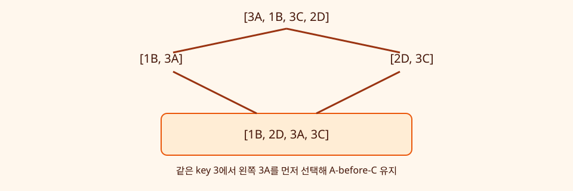

# 05. 정렬

[이전](04-searching.md) · [목차](README.md) · [다음](06-trees-and-heaps.md)

정렬은 여러 기록을 정한 기준에 따라 순서대로 다시 배치하는 일이다. 숫자를 작은 값부터 놓는 것뿐 아니라 학생 기록을 점수순으로, 같은 점수에서는 접수순으로 놓는 일도 정렬이다. 출력이 보기 좋다는 데서 끝나지 않는다. 정렬된 데이터는 이진 검색, 중복 묶기, 두 목록 합치기 같은 다음 작업을 빠르고 명확하게 만든다.

~~~mermaid
flowchart TD
    A["[3A,1B,3C,2D]"] --> L["[3A,1B]"]
    A --> R["[3C,2D]"]
    L --> LS["[1B,3A]"]
    R --> RS["[2D,3C]"]
    LS --> M["[1B,2D,3A,3C]"]
    RS --> M
~~~

## 1. 무엇을 정렬하며 무엇이 정답인가

**레코드(record)**는 함께 다루는 여러 필드의 묶음이다. 학생 레코드에는 이름, 점수, 접수 번호가 있을 수 있다. **키(key)**는 순서를 판단할 때 꺼내 비교하는 필드다. 점수를 키로 정렬해도 이름과 접수 번호는 같은 레코드에 붙어 이동해야 한다.

**비교(comparison)**는 두 키 중 어느 것이 앞에 와야 하는지 판단하는 연산이다. 숫자 오름차순에서는 작은 값이 앞선다. **교환(swap)**은 메모리의 두 위치에 있는 레코드를 서로 바꾸는 연산이다. 임시 변수 하나를 써서 A 위치 값을 보관한 뒤 B를 A로, 보관값을 B로 옮긴다.

오름차순 정렬의 출력은 인접한 모든 쌍에서 왼쪽 키가 오른쪽 키보다 크지 않아야 한다. 이 상태를 **비내림차순**이라고 한다. 같은 키가 이어질 수 있으므로 “항상 증가”가 아니다. 또 출력은 입력 레코드를 정확히 같은 횟수만큼 가져야 한다. 값 하나를 잃거나 복제했다면 순서가 맞아 보여도 정렬이 아니다.

**안정성(stability)**은 키가 같은 레코드들의 입력 상대 순서를 출력에서도 보존하는 성질이다. [3A, 1B, 3C]를 키 숫자로 안정 정렬하면 [1B, 3A, 3C]다. A가 C보다 먼저 들어왔기 때문이다. [1B, 3C, 3A]도 키 순서는 맞지만 안정 정렬 결과는 아니다. 데이터베이스 결과를 먼저 접수 시간순, 다음에 점수순으로 안정 정렬하면 같은 점수 안의 접수 시간순을 보존할 수 있어 안정성이 필요하다.

**제자리(in-place)** 정렬은 입력 크기가 커져도 입력 배열 외에 쓰는 추가 저장 공간이 일정하거나 매우 작은 정렬을 말한다. 배열 안의 값을 교환하는 선택 정렬은 제자리로 만들기 쉽다. 별도 배열에 결과를 쓰는 전형적 병합 정렬은 O(n) 추가 공간을 쓴다. 재귀 호출 프레임을 제자리 공간 계산에 포함하는지에 따라 표현이 달라질 수 있으므로 여기서는 추가 배열과 호출 스택을 모두 추가 공간으로 센다.

## 2. 삽입 정렬: 정렬된 앞부분에 한 값을 끼우기

**삽입 정렬(insertion sort)**은 배열의 왼쪽 앞부분이 이미 정렬되어 있다고 보고, 다음 값을 알맞은 위치까지 왼쪽으로 이동시킨다. 카드 한 장을 뽑아 손에 든 정렬된 카드 사이에 끼우는 모습과 같다.

~~~python
def insertion_sort(values):
    for index in range(1, len(values)):
        current = values[index]
        position = index

        while position > 0 and values[position - 1] > current:
            values[position] = values[position - 1]
            position -= 1

        values[position] = current

    return values
~~~

바깥 반복은 1번 칸부터 시작한다. 0번 한 칸은 이미 정렬됐다고 볼 수 있다. current는 삽입할 레코드를 임시 저장한다. while은 왼쪽 값이 current보다 클 때 그 값을 한 칸 오른쪽으로 민다. 비어 있는 position에 current를 놓으면 정렬된 앞부분이 한 칸 늘어난다.

불변식은 “바깥 반복이 index에서 시작할 때 [0, index) 구간은 정렬되어 있고 원래 그 구간의 레코드를 모두 가진다”이다. current를 보관하고 큰 값만 오른쪽으로 옮긴 뒤 current를 빈 칸에 넣으므로 레코드를 잃지 않는다. 비교 조건이 >이므로 같은 키는 이동시키지 않아 안정성이 보존된다. >=로 바꾸면 뒤에서 온 같은 키가 앞 레코드를 넘어가 불안정해진다.

8개 배열 [7, 3, 5, 3, 8, 1, 6, 2]의 바깥 반복이 끝날 때마다 전체 상태를 보자.

| 삽입할 원래 인덱스 | current | 이동한 값 | 반복 뒤 배열 |
| ---: | ---: | --- | --- |
| 시작 | 없음 | 없음 | [7, 3, 5, 3, 8, 1, 6, 2] |
| 1 | 3 | 7 | [3, 7, 5, 3, 8, 1, 6, 2] |
| 2 | 5 | 7 | [3, 5, 7, 3, 8, 1, 6, 2] |
| 3 | 3 | 7, 5 | [3, 3, 5, 7, 8, 1, 6, 2] |
| 4 | 8 | 없음 | [3, 3, 5, 7, 8, 1, 6, 2] |
| 5 | 1 | 8, 7, 5, 3, 3 | [1, 3, 3, 5, 7, 8, 6, 2] |
| 6 | 6 | 8, 7 | [1, 3, 3, 5, 6, 7, 8, 2] |
| 7 | 2 | 8, 7, 6, 5, 3, 3 | [1, 2, 3, 3, 5, 6, 7, 8] |

역순 배열에서는 첫 삽입이 1개, 다음이 2개, 마지막이 n-1개를 이동한다. 합은 1+2+…+(n-1) = n(n-1)/2라 시간은 O(n²)이다. 이미 정렬된 배열은 각 current를 한 번 비교하고 이동하지 않아 O(n)이다. 추가 변수 몇 개만 써 O(1) 공간이며 제자리다.

## 3. 선택 정렬과 안정성 반례

**선택 정렬(selection sort)**은 아직 정렬하지 않은 구간에서 최솟값 위치를 모두 비교해 찾고, 그 값을 구간의 첫 값과 교환한다.

~~~python
def selection_sort(values):
    n = len(values)
    for start in range(n):
        minimum = start
        for index in range(start + 1, n):
            if values[index] < values[minimum]:
                minimum = index
        values[start], values[minimum] = values[minimum], values[start]
    return values
~~~

start 왼쪽은 확정된 정렬 구간이다. 안쪽 반복은 남은 모든 값을 보고 minimum을 갱신한다. 마지막 교환으로 남은 구간의 최솟값을 start에 놓는다. 입력 순서와 관계없이 비교 횟수는 (n-1)+(n-2)+…+1 = n(n-1)/2이므로 O(n²)이다. 교환은 최대 n번이고 추가 공간은 O(1)이다.

단순 교환 때문에 보통 안정적이지 않다. [2A, 2B, 1C]에서 최솟값 1C와 첫 2A를 교환하면 [1C, 2B, 2A]가 된다. 같은 키 2의 A, B 순서가 뒤집혔다. 최솟값을 꺼낸 뒤 중간 레코드를 한 칸씩 밀어 넣으면 안정적으로 바꿀 수 있지만, 더 많은 이동이 필요하다.

## 4. 병합 정렬: 나누고 정렬해 합치기

**병합(merge)**은 이미 정렬된 두 배열의 맨 앞 값을 비교하면서 더 작은 레코드를 새 출력 뒤에 붙이는 작업이다. 각 입력 안의 순서는 이미 맞으므로 맨 앞이 아닌 값을 먼저 볼 필요가 없다.

**병합 정렬(merge sort)**은 입력을 절반으로 나누고, 각 절반을 같은 방식으로 정렬한 뒤 병합한다. 길이 0이나 1인 배열은 이미 정렬됐다는 기저 조건에서 나누기를 멈춘다.

~~~python
def merge(left, right):
    result = []
    left_index = 0
    right_index = 0

    while left_index < len(left) and right_index < len(right):
        if left[left_index] <= right[right_index]:
            result.append(left[left_index])
            left_index += 1
        else:
            result.append(right[right_index])
            right_index += 1

    result.extend(left[left_index:])
    result.extend(right[right_index:])
    return result

def merge_sort(values):
    if len(values) <= 1:
        return values[:]

    middle = len(values) // 2
    left = merge_sort(values[:middle])
    right = merge_sort(values[middle:])
    return merge(left, right)
~~~

merge의 두 인덱스는 각 입력에서 아직 출력하지 않은 첫 위치다. 둘 다 남아 있으면 작은 값을 result에 붙인다. 같을 때 <= 조건으로 왼쪽을 먼저 뽑아 안정성을 지킨다. 한쪽이 끝나면 다른 쪽의 남은 부분은 이미 정렬됐으므로 그대로 붙인다. merge_sort는 복사된 절반을 재귀적으로 정렬하고 마지막에 병합한다.

## 5. 8개 배열 병합 정렬의 모든 단계

공통 배열 [7, 3, 5, 3, 8, 1, 6, 2]를 끝까지 나누고 합쳐 보자.

| 단계 | 작업 | 결과 |
| ---: | --- | --- |
| 1 | 전체를 절반으로 나눔 | [7,3,5,3] / [8,1,6,2] |
| 2 | 왼쪽을 나눔 | [7,3] / [5,3] |
| 3 | [7,3]을 한 칸씩 나눔 | [7] / [3] |
| 4 | 두 한 칸을 병합 | [3,7] |
| 5 | [5,3]을 한 칸씩 나눠 병합 | [3,5] |
| 6 | [3,7]과 [3,5] 병합 | [3,3,5,7] |
| 7 | 오른쪽을 나눔 | [8,1] / [6,2] |
| 8 | [8]과 [1] 병합 | [1,8] |
| 9 | [6]과 [2] 병합 | [2,6] |
| 10 | [1,8]과 [2,6] 병합 | [1,2,6,8] |
| 11 | 두 길이 4 배열 병합 | [1,2,3,3,5,6,7,8] |

마지막 병합을 비교 단위로 더 세밀하게 추적한다.

| 비교 | 왼쪽 첫 값 | 오른쪽 첫 값 | 선택 | 누적 출력 |
| ---: | ---: | ---: | ---: | --- |
| 1 | 3 | 1 | 1 | [1] |
| 2 | 3 | 2 | 2 | [1,2] |
| 3 | 3 | 6 | 왼쪽 3 | [1,2,3] |
| 4 | 3 | 6 | 왼쪽 3 | [1,2,3,3] |
| 5 | 5 | 6 | 5 | [1,2,3,3,5] |
| 6 | 7 | 6 | 6 | [1,2,3,3,5,6] |
| 잔여 | 7 | 오른쪽 8 | 왼쪽 7 뒤 오른쪽 8 | [1,2,3,3,5,6,7,8] |

병합 불변식은 “result는 지금까지 소비한 레코드를 정렬 순서로 모두 가지며, result의 마지막 값은 두 입력의 아직 남은 첫 값보다 크지 않다”이다. 작은 첫 값을 붙이면 이 조건이 유지된다. 각 분할 깊이에서 전체 n개를 한 번 병합하고 깊이는 log₂n 수준이므로 시간은 O(n log n)이다. 전형적 구현은 결과와 조각을 위해 O(n) 추가 공간을 쓴다.

중복 레코드 [3A, 1B, 3C, 2D]를 나누면 3A는 왼쪽 절반, 3C는 오른쪽 절반에 있다. 최종 병합에서 키 3이 같을 때 왼쪽 3A를 먼저 고르면 A, C 순서가 보존된다. <만 써서 같은 경우 오른쪽을 먼저 고르면 3C, 3A가 되어 안정성을 잃는다.

## 6. 퀵 정렬과 분할

**퀵 정렬(quicksort)**은 기준값 하나를 고르고, 입력을 기준보다 작은 값, 같은 값, 큰 값으로 분류한 뒤 작은 쪽과 큰 쪽을 각각 정렬한다. 기준값을 **피벗(pivot)**이라 하고, 이 분류 작업을 **분할(partition)**이라 한다.

설명을 분명히 하기 위해 세 개의 새 목록을 쓰는 구현을 보자.

~~~python
def quick_sort(values):
    if len(values) <= 1:
        return values[:]

    pivot = values[len(values) // 2]
    smaller = []
    equal = []
    larger = []

    for value in values:
        if value < pivot:
            smaller.append(value)
        elif value > pivot:
            larger.append(value)
        else:
            equal.append(value)

    return quick_sort(smaller) + equal + quick_sort(larger)
~~~

기저 조건은 길이 0 또는 1이다. 가운데 위치 값을 피벗으로 고르지만 “가운데 값”이 중간 크기라는 보장은 없다. 반복은 모든 값을 세 목록 중 정확히 하나에 넣는다. equal을 따로 두므로 중복 피벗을 잃지 않고 같은 값만 있는 입력도 한 단계에서 끝난다.

배열 [4, 1, 5, 2, 3, 3, 7, 0], 피벗 3의 분할 전체를 추적하자.

| 읽은 값 | smaller | equal | larger |
| ---: | --- | --- | --- |
| 시작 | [] | [] | [] |
| 4 | [] | [] | [4] |
| 1 | [1] | [] | [4] |
| 5 | [1] | [] | [4,5] |
| 2 | [1,2] | [] | [4,5] |
| 3 | [1,2] | [3] | [4,5] |
| 3 | [1,2] | [3,3] | [4,5] |
| 7 | [1,2] | [3,3] | [4,5,7] |
| 0 | [1,2,0] | [3,3] | [4,5,7] |

smaller를 정렬하면 [0,1,2], larger를 정렬하면 [4,5,7]이고, 결합 결과는 [0,1,2,3,3,4,5,7]이다. 분할 불변식은 “읽은 모든 레코드는 세 목록 중 정확히 하나에 있고, 각 목록은 피벗과의 관계를 만족한다”이다.

분할이 매번 비슷한 크기의 두 부분을 만들면 깊이는 O(log n), 각 깊이에서 총 n개를 분류하므로 평균적인 시간은 O(n log n)이다. 그러나 이미 정렬된 배열에서 매번 첫 값을 피벗으로 고르면 크기 0과 n-1로 갈라질 수 있다. 작업량 n+(n-1)+…+1이 되어 최악 O(n²)이다. 무작위 피벗은 특정 입력이 계속 나쁜 분할을 만들 가능성을 낮추지만 최악의 가능성 자체를 없애지는 않는다.

세 목록 구현은 O(n) 추가 공간과 재귀 공간을 쓰며, 같은 목록에 도착 순서대로 append하므로 안정적으로 구성할 수 있다. 배열 안에서 교환하는 제자리 분할은 공간을 줄일 수 있지만 보통 안정적이지 않다.

## 7. 힙 정렬

**힙(heap)**은 부모와 자식 사이의 순서만 보장하는 완전 이진 트리 모양의 구조다. 최대 힙은 부모 키가 자식 키보다 크거나 같다. **힙 정렬(heap sort)**은 배열을 최대 힙으로 만든 뒤 루트의 최댓값을 배열 끝과 교환하고, 남은 앞 구간에서 힙 조건을 복구하는 일을 반복한다.

최댓값을 하나씩 끝에 확정하므로 결과가 오름차순이 된다. 힙 만들기는 O(n), 최댓값 제거와 복구를 n번 하는 비용은 O(n log n)이다. 배열 안에서 구현하면 추가 공간 O(1)인 제자리 정렬이 가능하지만, 멀리 떨어진 레코드를 교환하므로 일반적으로 안정적이지 않다. 최악 시간도 O(n log n)이라는 점은 퀵 정렬의 O(n²) 최악을 피해야 할 때 의미가 있다.

## 8. 비교하지 않고 정렬하는 방법

**계수 정렬(counting sort)**은 키를 서로 비교하는 대신 각 정수 키가 몇 번 나왔는지 세는 배열을 만든다. 키가 0부터 k까지이고 입력이 n개라면 세기 O(n), 개수 배열 읽기 O(k)로 O(n+k) 시간과 O(k) 추가 공간을 쓴다.

[2, 0, 2, 1, 0]이면 count[0]=2, count[1]=1, count[2]=2다. 이를 순서대로 펼치면 [0,0,1,2,2]다. 키 범위가 0부터 10억인데 값은 열 개뿐이라면 10억 칸 배열이 낭비되므로 부적절하다. 음수나 레코드 안정성을 다루려면 오프셋과 누적 개수를 포함한 구현이 필요하다.

**기수 정렬(radix sort)**은 숫자나 문자열의 자릿값을 한 자리씩 기준으로 정렬한다. 170, 45, 75를 1의 자리, 10의 자리, 100의 자리 순으로 처리하는 방식이 한 예다. 낮은 자리부터 처리할 때 각 자리 정렬이 안정적이어야 앞서 만든 낮은 자리 순서가 같은 높은 자리 안에서 보존된다. 자릿수 d, 한 자리 범위 k라면 계수 정렬을 자리마다 쓸 때 O(d(n+k))가 가능하다. 키 표현과 자릿수 수가 제한된다는 전제가 필요하다.

비교 정렬은 두 키의 대소 비교만으로 순서를 알아낸다. 서로 다른 n개 입력 순서는 n!가지이고, 한 비교의 결과는 두 갈래다. 모든 가능성을 구별하려면 최악에 Ω(n log n) 비교가 필요하다. 계수·기수 정렬은 키 범위와 표현을 직접 사용하므로 이 비교 모델 밖에서 더 빠른 증가율을 얻는다.

## 9. 현실에서 알고리즘을 고르는 기준

| 조건 | 알맞은 후보 | 이유와 비용 |
| --- | --- | --- |
| 작거나 거의 정렬됨 | 삽입 정렬 | 이동이 적으면 O(n)에 가까움 |
| 안정성과 예측 가능한 시간 | 병합 정렬 | O(n log n), 대신 O(n) 공간 |
| 평균 속도와 좋은 메모리 접근 | 퀵 계열 | 평균 O(n log n), 최악 조건 관리 필요 |
| 제자리와 최악 O(n log n) | 힙 정렬 | 안정성은 보통 없음 |
| 작고 촘촘한 정수 범위 | 계수 정렬 | O(n+k), k 공간 필요 |
| 고정 자릿수 키 | 기수 정렬 | 자리 정렬 안정성과 키 표현 필요 |

언어의 표준 정렬은 직접 만든 한 알고리즘보다 다양한 입력을 처리하는 혼합 전략과 최적화를 쓸 수 있다. 파이썬 sorted와 list.sort는 안정 정렬이라는 계약을 제공한다. 실제 선택에서는 키 계산 비용, 메모리 한도, 데이터가 메모리에 들어오는지, 병렬·외부 저장장치 사용까지 고려한다. 이 장의 배열 모형을 분산 시스템 전체 구현으로 그대로 확대하면 안 된다.

## 10. 결과를 검증하는 반례

정렬 결과는 세 조건으로 검사한다.

1. 인접 키가 비내림차순인가?
2. 입력의 각 레코드가 출력에 같은 횟수만큼 있는가?
3. 안정성이 요구되면 같은 키 레코드의 상대 순서가 보존됐는가?

[2A, 1B, 2C]에서 [1B, 2A]는 순서는 맞지만 2C를 잃었다. [1B, 2C, 2A]는 레코드 수와 키 순서는 맞지만 안정성이 틀렸다. 집합만 비교해도 중복 횟수를 잃는다. [1,1,2]와 [1,2,2]의 집합은 둘 다 {1,2}지만 같은 다중 집합이 아니다.

안정 정렬이 항상 더 빠르다는 뜻은 아니다. 안정성은 실행 시간 등급이 아니라 같은 키의 의미를 보존하는 출력 계약이다. 제자리라는 말도 입력 배열을 전혀 수정하지 않는다는 뜻이 아니다. 오히려 입력 배열 안에서 값을 이동해 큰 보조 배열을 피한다는 뜻이다.

## 11. 확인 문제와 자세한 풀이

### 문제 1. 삽입 정렬의 한 단계

상태 [1, 4, 6, 3, 8]에서 앞 세 칸이 정렬됐고 current가 3일 때 이동과 최종 상태를 구하라. 비교를 >=로 바꾸면 같은 키에 어떤 영향이 있는가?

**풀이.** 3과 왼쪽 6을 비교해 6을 한 칸 오른쪽으로 옮긴다. 다시 4가 3보다 크므로 4도 오른쪽으로 옮긴다. 1은 3보다 크지 않으므로 멈추고 빈 1번 칸에 3을 넣는다. 결과는 [1,3,4,6,8]이다. 조건이 >이면 같은 키는 넘지 않아 안정적이다. >=이면 뒤의 같은 키가 앞의 같은 키보다 왼쪽으로 이동할 수 있어 안정성을 잃는다.

### 문제 2. 선택 정렬의 비교 수

길이 8인 선택 정렬은 입력이 이미 정렬돼도 몇 번 비교하는가? 거의 정렬된 입력에서 삽입 정렬과 차이가 나는 이유는 무엇인가?

**풀이.** 첫 단계 7번, 다음 6번부터 마지막 1번까지 비교하므로 7+6+5+4+3+2+1 = 28번이다. 최솟값을 확인하려면 남은 구간 전체를 보므로 입력 상태가 비교 수를 줄이지 않는다. 삽입 정렬은 왼쪽 값이 current보다 크지 않으면 즉시 멈추므로 이미 정렬된 길이 8에서는 바깥 단계마다 한 번 정도만 비교해 선형에 가깝다.

### 문제 3. 안정 병합

왼쪽 [2A, 4B], 오른쪽 [2C, 3D]를 안정적으로 병합한 결과와 선택 순서를 구하라.

**풀이.** 첫 비교 2A와 2C는 키가 같다. 왼쪽을 먼저 고르는 규칙으로 2A를 출력한다. 다음 4B와 2C에서는 2C, 이어 4B와 3D에서는 3D를 고른다. 오른쪽이 끝나 4B를 붙인다. 결과는 [2A,2C,3D,4B]다. 같은 키에서 오른쪽을 먼저 골랐다면 C가 A를 앞질러 불안정해진다.

### 문제 4. 병합 정렬 비용

n=8일 때 분할 깊이와 각 깊이의 병합량을 이용해 O(n log n)을 설명하라. 입력이 이미 정렬됐으면 등급이 바뀌는가?

**풀이.** 8→4→2→1로 세 번 나누므로 병합 깊이는 log₂8=3이다. 각 깊이에서 길이 1 조각 여덟 개든 길이 4 조각 두 개든 전체 여덟 레코드를 병합한다. 대략 8×3 규모의 작업이므로 n log₂n이다. 이미 정렬돼도 이 구현은 같은 분할을 만들고 각 레벨에서 병합하므로 O(n log n) 등급이 유지된다. 정렬 여부를 먼저 감지하는 별도 최적화를 넣으면 실제 비교 수는 달라질 수 있다.

### 문제 5. 퀵 정렬의 악조건

첫 값을 피벗으로 쓰는 퀵 정렬에 [1,2,3,4,5]를 넣으면 각 분할 크기와 총 증가율은 어떻게 되는가? 피벗을 무작위로 바꾸면 무엇이 달라지는가?

**풀이.** 피벗 1은 작은 쪽 0개, 큰 쪽 4개를 만든다. 다음은 0과 3, 이어 0과 2, 0과 1이다. 각 단계에서 5,4,3,2,1 규모를 훑어 합이 n(n+1)/2 수준이므로 O(n²)이다. 무작위 피벗은 이 특정 배열이 매번 극단 분할을 만들 확률을 낮춰 기대 O(n log n)을 얻지만, 운 나쁘게 극단 피벗이 이어질 가능성은 남는다.

### 문제 6. 계수 정렬의 전제

n=1,000개 정수의 키 범위가 0부터 50일 때와 0부터 10억일 때 계수 정렬의 시간·공간을 비교하라.

**풀이.** 첫 경우 k가 51이라 시간 O(1000+51), 개수 배열 51칸이면 충분해 적합하다. 둘째는 실제 값이 1,000개뿐이어도 최대 약 10억 칸의 개수 배열이 필요하고 O(n+k)에서 k가 지배한다. 매우 큰 메모리와 초기화 시간이 들어 부적합하다. 범위가 넓고 값이 드문 조건으로 바뀌면 비교 정렬이나 다른 키 구조를 검토해야 한다.

### 문제 7. 요구사항으로 선택하기

백만 건 레코드를 점수순으로 정렬하되 같은 점수에서는 기존 접수순을 반드시 유지해야 한다. 메모리에 보조 배열을 둘 수 있을 때와 거의 둘 수 없을 때 후보를 비교하라.

**풀이.** 보조 배열을 허용하면 안정 병합 정렬이나 안정성을 계약하는 표준 정렬이 직접 맞는다. O(n log n) 시간과 O(n) 수준 공간을 감수한다. 메모리가 매우 제한되면 제자리 힙 정렬은 공간과 최악 시간은 좋지만 안정성이 없어 요구를 바로 만족하지 않는다. 키에 접수 순번을 두 번째 비교 기준으로 포함하면 결과 의미를 보존할 수 있지만, 이는 “점수 키만의 안정 정렬”을 복합 키 정렬로 바꾸는 설계다. 외부 저장장치가 필요할 정도로 크면 정렬된 조각을 만들고 안정적으로 병합하는 외부 정렬을 고려해야 한다.

## 12. 구현 점검표

비교 규칙이 모든 레코드에 일관되게 적용되는지, 출력이 입력과 같은 레코드 개수를 갖는지, 중복 키의 상대 순서가 요구사항인지 먼저 확인한다. 반복마다 정렬된 구간이나 분할 구역이 어떻게 늘어나는지 불변식을 적는다. 빈 배열, 한 값, 이미 정렬, 역순, 모든 키 동일, 중복 ID가 섞인 입력을 추적한다. 시간 복잡도에는 평균인지 최악인지, 공간에는 보조 배열과 재귀 깊이를 포함했는지 명시한다.

## 참고

이 장의 코드는 메모리 안 파이썬 리스트를 대상으로 하며, 비교가 일관된 오름차순을 만든다는 전제를 둔다. 각 알고리즘의 비용은 그 전제와 제시한 구현 방식에서 계산했다.
