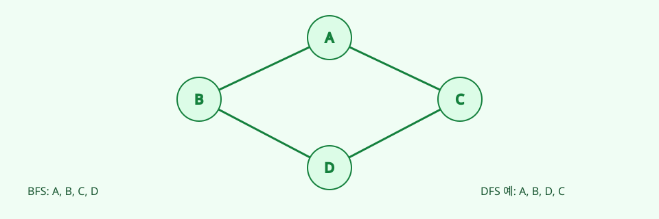

# 07. 그래프와 순회

[이전](06-trees-and-heaps.md) · [목차](README.md) · [다음](08-shortest-paths.md)

그래프는 도로, 친구 관계, 작업 의존성처럼 “어떤 대상이 어떤 대상과 연결되는가”를 표현한다. 순회는 한 시작점에서 연결을 따라가며 도달할 수 있는 대상을 빠짐없이 처리하는 절차다. 같은 그래프라도 큐를 쓰면 가까운 곳부터, 스택을 쓰면 한 경로를 깊게 방문한다.

~~~mermaid
flowchart LR
    A --> B
    A --> C
    B --> D
    C --> D
    C --> F
    D --> E
    E --> F
~~~

## 1. 그래프를 이루는 대상과 연결

**정점(vertex)**은 그래프가 표현하는 대상 하나다. 위 그림에서는 A부터 F까지 여섯 정점이 메모리에서 문자열, 번호, 또는 객체로 저장된다. **간선(edge)**은 두 정점의 연결이다. 코드에서는 두 정점 번호의 쌍이나 한 정점의 이웃 목록 항목으로 저장된다.

**방향 그래프(directed graph)**는 간선에 출발과 도착 방향이 있는 그래프다. A→B는 A에서 B로 갈 수 있다는 뜻이며 B→A를 자동으로 뜻하지 않는다. 작업 A가 끝나야 B를 시작할 수 있다는 의존성에 맞다. **무방향 그래프(undirected graph)**는 연결을 양쪽으로 사용할 수 있다. A—B를 인접 목록에 저장할 때 A 목록에 B, B 목록에 A를 모두 넣어야 한다.

**가중 그래프(weighted graph)**는 간선마다 거리, 시간, 비용 같은 숫자인 **가중치(weight)**가 붙은 그래프다. 가중치가 없는 그래프는 모든 간선 비용이 같다고 보는 문제에 적합하다. 간선 수가 적은 경로와 가중치 합이 작은 경로는 다를 수 있으므로 문제의 “가까움”이 무엇인지 먼저 정해야 한다.

한 정점과 간선 하나로 직접 연결된 정점을 **인접 정점(neighbor)**이라 하고, 이 관계를 **인접성(adjacency)**이라고 한다. 무방향 그래프에서 정점의 **차수(degree)**는 연결된 간선 수다. 방향 그래프에서는 들어오는 간선 수를 진입 차수, 나가는 간선 수를 진출 차수라 구분한다.

간선을 따라 시작 정점에서 끝 정점까지 이어진 정점 순서를 **경로(path)**라고 한다. 시작과 끝이 같은 비어 있지 않은 경로를 **사이클(cycle)**이라고 한다. A→B→A가 한 예다. 사이클은 친구 관계에서는 자연스럽지만 “먼저 해야 할 작업” 관계에서는 모든 작업이 서로를 기다리게 해 문제가 된다.

무방향 그래프에서 서로 경로로 오갈 수 있는 최대 정점 묶음을 **연결 요소(component)**라고 한다. 다른 요소 사이에는 간선 경로가 없다. 방향 그래프에서는 방향을 무시한 약한 연결과 양방향으로 도달 가능한 강한 연결을 구분해야 한다. 이 장에서 “모든 요소를 순회한다”는 말은 주로 무방향 그래프를 뜻한다.

## 2. 그래프를 메모리에 저장하는 두 방법

**인접 목록(adjacency list)**은 각 정점마다 바로 나가는 이웃들의 목록을 저장한다. 위 방향 그래프는 다음과 같다.

~~~text
A: B, C
B: D
C: D, F
D: E
E: F
F: 없음
~~~

파이썬에서는 정점에서 이웃 리스트로 가는 사전으로 표현할 수 있다.

~~~python
graph = {
    "A": ["B", "C"],
    "B": ["D"],
    "C": ["D", "F"],
    "D": ["E"],
    "E": ["F"],
    "F": [],
}
~~~

정점 수를 V, 간선 수를 E라 하면 정점별 목록 머리와 각 간선 항목을 저장해 공간은 O(V+E)다. 한 정점의 모든 이웃을 방문하는 비용은 그 정점의 진출 차수에 비례한다.

**인접 행렬(adjacency matrix)**은 행을 출발 정점, 열을 도착 정점으로 두고 간선이 있으면 1, 없으면 0을 저장하는 V×V 표다. 특정 A→F 간선 존재 여부를 인덱스 두 개로 O(1)에 확인하지만, 실제 간선이 적어도 V²칸을 쓴다. 한 정점의 이웃을 찾으려면 행 전체 V칸을 본다. 조밀한 그래프나 간선 존재 질의가 많은 경우에 의미가 있고, 희소 그래프 순회에는 인접 목록이 보통 알맞다.

공통 그래프를 A,B,C,D,E,F 순서의 인접 행렬로 쓰면 다음과 같다. 행 A의 B열과 C열이 1인 것은 A→B, A→C가 있다는 뜻이다.

| 출발＼도착 | A | B | C | D | E | F |
| --- | ---: | ---: | ---: | ---: | ---: | ---: |
| A | 0 | 1 | 1 | 0 | 0 | 0 |
| B | 0 | 0 | 0 | 1 | 0 | 0 |
| C | 0 | 0 | 0 | 1 | 0 | 1 |
| D | 0 | 0 | 0 | 0 | 1 | 0 |
| E | 0 | 0 | 0 | 0 | 0 | 1 |
| F | 0 | 0 | 0 | 0 | 0 | 0 |

행의 1 개수는 진출 차수이고 열의 1 개수는 진입 차수다. C행에는 1이 두 개라 C의 진출 차수는 2, D열에는 B와 C에서 온 1이 두 개라 D의 진입 차수는 2다. 무방향 그래프의 행렬은 A—B가 A행 B열과 B행 A열에 함께 기록되어 주대각선을 기준으로 대칭이 된다.

## 3. 너비 우선 탐색의 객체와 코드

**너비 우선 탐색(BFS, Breadth-First Search)**은 시작점에서 간선 수가 가까운 정점부터 층별로 방문하는 순회다. 먼저 발견한 정점을 먼저 처리해야 하므로 **큐(queue)**를 쓴다. 큐는 뒤에 넣고 앞에서 꺼내는 선입선출 저장 구조다.

**방문 집합(visited)**은 이미 발견한 정점을 저장하는 집합이다. 정점을 큐에 넣는 순간 방문 표시해야 두 부모가 같은 정점을 중복으로 넣지 않는다. **부모 기록(parent)**은 한 정점을 처음 발견하게 한 이전 정점을 저장한다. 시작점에서 실제 경로를 복원할 때 필요하다.

~~~python
from collections import deque

def bfs(graph, start):
    queue = deque([start])
    visited = {start}
    parent = {start: None}
    order = []

    while queue:
        node = queue.popleft()
        order.append(node)

        for neighbor in graph[node]:
            if neighbor not in visited:
                visited.add(neighbor)
                parent[neighbor] = node
                queue.append(neighbor)

    return order, parent
~~~

초기 큐와 visited에 시작점을 넣는다. 반복은 큐가 빌 때까지 앞 정점을 꺼내 order에 기록한다. 이웃을 목록 순서대로 검사하고 미방문 이웃은 즉시 visited, parent, 큐에 추가한다. 반환값은 처리 순서와 경로 복원 정보다.

## 4. 6개 정점 BFS의 모든 큐와 방문 상태

A에서 시작하고 이웃을 적힌 순서로 본다.

| 단계 | 앞에서 꺼냄 | 검사 결과와 새로 넣은 정점 | 큐 앞 → 뒤 | visited | parent 변화 |
| ---: | --- | --- | --- | --- | --- |
| 0 | 없음 | 시작 A 넣음 | [A] | {A} | A: 없음 |
| 1 | A | B, C 새 발견 | [B,C] | {A,B,C} | B:A, C:A |
| 2 | B | D 새 발견 | [C,D] | {A,B,C,D} | D:B |
| 3 | C | D는 방문, F 새 발견 | [D,F] | {A,B,C,D,F} | F:C |
| 4 | D | E 새 발견 | [F,E] | {A,B,C,D,E,F} | E:D |
| 5 | F | 이웃 없음 | [E] | {A,B,C,D,E,F} | 없음 |
| 6 | E | F는 방문 | [] | {A,B,C,D,E,F} | 없음 |

처리 순서는 A, B, C, D, F, E다. F가 E보다 뒤의 의존성처럼 보이더라도 BFS는 위상 정렬이 아니라 간선 수 거리로 처리한다. A→C→F는 두 간선이고 A→B→D→E는 세 간선이므로 F가 먼저 처리된다.

큐 불변식은 “큐에는 발견했지만 아직 처리하지 않은 정점이 발견 순서대로 있고, 앞 정점의 시작점 거리는 뒤 정점보다 크지 않다”이다. 방문 표시를 꺼낼 때까지 늦추면 D가 B와 C 양쪽에서 큐에 두 번 들어갈 수 있다.

부모를 따라 E←D←B←A로 간 뒤 순서를 뒤집으면 경로 A→B→D→E를 얻는다. 가중치가 없는 그래프에서 BFS가 처음 발견한 경로는 간선 수가 최소다. 가중치가 다르면 A→B 한 간선 비용 100보다 A→C→B 두 간선 비용 2가 작을 수 있어 비용 최단을 보장하지 않는다.

## 5. 깊이 우선 탐색의 객체와 코드

**깊이 우선 탐색(DFS, Depth-First Search)**은 선택한 이웃의 경로를 가능한 한 깊게 따라간 뒤 더 갈 곳이 없으면 이전 갈림길로 돌아온다. 다음에 처리할 정점을 마지막에 넣은 것부터 꺼내는 **스택(stack)**을 쓴다. 스택은 한쪽 끝에 넣고 같은 끝에서 꺼내는 후입선출 구조다.

~~~python
def dfs(graph, start):
    stack = [start]
    visited = set()
    order = []

    while stack:
        node = stack.pop()
        if node in visited:
            continue

        visited.add(node)
        order.append(node)

        for neighbor in reversed(graph[node]):
            if neighbor not in visited:
                stack.append(neighbor)

    return order
~~~

스택 끝이 다음에 꺼낼 위치다. 노드를 꺼낸 뒤 이미 방문했으면 중복 항목을 건너뛴다. 새 정점이면 방문·출력한다. 이웃 목록의 첫 값부터 깊게 가기 위해 이웃을 역순으로 넣는다. A의 C를 먼저 넣고 B를 나중에 넣으면 B가 스택 끝에서 먼저 나온다.

## 6. 6개 정점 DFS의 모든 스택과 방문 상태

표에서 스택 오른쪽이 맨 위다.

| 단계 | 꺼낸 정점 | 역순으로 새로 넣음 | 스택 아래 → 위 | visited | order |
| ---: | --- | --- | --- | --- | --- |
| 0 | 없음 | A | [A] | {} | [] |
| 1 | A | C, B | [C,B] | {A} | [A] |
| 2 | B | D | [C,D] | {A,B} | [A,B] |
| 3 | D | E | [C,E] | {A,B,D} | [A,B,D] |
| 4 | E | F | [C,F] | {A,B,D,E} | [A,B,D,E] |
| 5 | F | 없음 | [C] | {A,B,D,E,F} | [A,B,D,E,F] |
| 6 | C | D와 F 이미 방문 | [] | {A,B,C,D,E,F} | [A,B,D,E,F,C] |

순서는 이웃을 넣는 규칙에 따라 달라진다. C를 먼저 깊게 선택하면 다른 올바른 DFS 순서가 나온다. DFS의 정답은 고정 문자열이 아니라 “각 도달 가능 정점을 빠짐없이 한 번 처리하고 깊이 우선 규칙을 지킨다”는 조건이다.

방문 집합이 없으면 사이클 A→B→A에서 A, B를 계속 넣어 끝나지 않는다. visited는 효율 보조만이 아니라 종료와 중복 방지를 위한 상태다.

## 7. DFS의 발견 중과 완료 상태

방향 그래프에서 사이클을 분류하려면 boolean 방문 여부보다 세 상태가 유용하다.

- 흰색은 아직 발견하지 않은 정점이다.
- 회색은 발견했지만 모든 나가는 간선을 아직 처리하지 않은 정점이다.
- 검은색은 모든 나가는 간선을 처리한 정점이다.

DFS 중 회색 정점으로 향하는 간선은 현재 진행 중인 경로의 조상으로 되돌아가는 간선이므로 방향 사이클을 보여 준다. 검은색 정점으로 가는 간선은 이미 완료된 부분으로 가므로 그 사실만으로 사이클이라고 할 수 없다. 재귀 DFS에서는 함수에 들어갈 때 회색, 모든 이웃 처리가 끝날 때 검은색으로 바꾼다.

세 색을 쓰는 재귀 검사는 현재 함수 호출 경로를 실제 객체로 보존한다.

~~~python
def has_directed_cycle(graph):
    color = {node: "white" for node in graph}

    def visit(node):
        color[node] = "gray"
        for neighbor in graph[node]:
            if color[neighbor] == "gray":
                return True
            if color[neighbor] == "white" and visit(neighbor):
                return True
        color[node] = "black"
        return False

    for node in graph:
        if color[node] == "white" and visit(node):
            return True
    return False
~~~

모든 정점을 흰색으로 시작한다. visit에 들어가면 회색으로 바꿔 현재 호출 경로에 포함됐음을 표시한다. 회색 이웃은 아직 끝나지 않은 조상이라 사이클이다. 흰색 이웃은 재귀 방문하고, 모든 이웃이 끝나면 검은색이 된다. 바깥 반복은 연결되지 않은 방향 그래프의 다른 부분도 검사한다. 각 정점과 간선을 일정 횟수만 보므로 O(V+E) 시간, 색 사전과 재귀 스택은 O(V) 공간이다.

## 8. 연결되지 않은 그래프 전체 순회

한 시작점 BFS나 DFS는 그 정점에서 도달 가능한 부분만 본다. 무방향 그래프에 {A,B,C}와 {D,E}, 고립 정점 F가 있다면 A에서 시작해 D, E, F를 볼 수 없다.

모든 연결 요소를 찾으려면 전체 정점 목록을 반복하면서 아직 방문하지 않은 정점마다 새 BFS나 DFS를 시작한다. 첫 순회가 {A,B,C}, 둘째가 {D,E}, 셋째가 {F}를 만들고 요소 수는 3이다. 각 정점은 한 번 발견되고 각 무방향 간선은 양쪽 목록에서 두 번 검사되므로 전체 시간은 여전히 O(V+E)다. 상수 2는 증가율 표기에서 생략한다.

## 9. 순회 시간과 표현의 전제

인접 목록에서 BFS와 DFS는 각 정점을 한 번 처리하고 각 나가는 간선을 한 번 검사해 O(V+E) 시간이다. queue, stack, visited, parent가 최악에 정점 수만큼 저장해 O(V) 추가 공간을 쓴다.

인접 행렬이면 각 정점을 처리할 때 이웃을 찾으려고 V개 열을 검사한다. 간선이 적어도 시간은 O(V²)다. 따라서 “BFS가 O(V+E)”라는 비용에는 인접 목록 또는 그와 같은 이웃 열거 기능을 쓴다는 전제가 있다. E가 V²에 가까운 조밀 그래프에서는 O(V+E) 자체가 O(V²)와 같은 규모다.

## 10. 위상 정렬: 의존성을 지키는 순서

**위상 정렬(topological sort)**은 방향 간선 u→v마다 u가 v보다 먼저 나오도록 모든 정점을 한 줄로 배치하는 일이다. 방향 사이클이 없는 그래프인 **DAG(Directed Acyclic Graph)**에서만 가능하다. A가 B보다 먼저, B가 다시 A보다 먼저여야 하는 사이클은 어떤 줄 순서도 만족시킬 수 없다.

Kahn 알고리즘은 진입 차수가 0인 정점을 큐에 넣는다. 진입 차수 0은 아직 남은 선행 작업이 없다는 뜻이다. 정점을 출력하고 그 정점의 나가는 간선을 제거한 효과로 이웃의 진입 차수를 1 줄인다. 새로 0이 된 이웃을 큐에 넣는다.

공통 6노드 DAG의 초기 진입 차수는 A:0, B:1, C:1, D:2, E:1, F:2다.

| 단계 | 큐 앞 → 뒤 | 꺼낸 정점 | 감소 결과 | 출력 순서 |
| ---: | --- | --- | --- | --- |
| 0 | [A] | 없음 | 초기화 | [] |
| 1 | [B,C] | A | B:0, C:0 | [A] |
| 2 | [C] | B | D:1 | [A,B] |
| 3 | [D] | C | D:0, F:1 | [A,B,C] |
| 4 | [E] | D | E:0 | [A,B,C,D] |
| 5 | [F] | E | F:0 | [A,B,C,D,E] |
| 6 | [] | F | 없음 | [A,B,C,D,E,F] |

B와 C 사이에는 직접 또는 간접 선후 조건이 없어서 큐에서 C를 먼저 고르면 A,C,B,D,E,F도 올바르다. 위상 순서는 여러 개일 수 있다.

출력 정점 수가 V보다 적은데 진입 차수 0 큐가 비면 남은 정점들에 방향 사이클이 있다. A→B→C→A는 세 정점의 진입 차수가 모두 1이라 처음부터 큐가 비고 위상 순서를 만들 수 없다.

Kahn 알고리즘을 코드로 옮기면 다음과 같다.

~~~python
from collections import deque

def topological_sort(graph):
    indegree = {node: 0 for node in graph}
    for node in graph:
        for neighbor in graph[node]:
            indegree[neighbor] += 1

    queue = deque(
        node for node in graph if indegree[node] == 0
    )
    order = []

    while queue:
        node = queue.popleft()
        order.append(node)

        for neighbor in graph[node]:
            indegree[neighbor] -= 1
            if indegree[neighbor] == 0:
                queue.append(neighbor)

    if len(order) != len(graph):
        raise ValueError("graph has a directed cycle")
    return order
~~~

첫 두 반복은 실제 간선 항목마다 도착 정점의 진입 차수를 센다. 그다음 0인 정점을 큐에 모은다. 한 정점을 출력하면 그 정점과 나가는 간선을 제거했다고 보고 이웃의 차수를 줄인다. 정확히 0이 되는 순간에만 큐에 넣으므로 각 정점은 한 번 출력된다. 끝에 출력 수가 전체보다 작다면 남은 정점은 어느 것도 진입 차수 0이 되지 못했고 사이클에 묶여 있다. 진입 차수 계산과 간선 제거가 각각 O(V+E), 저장 공간은 O(V)다.

## 11. 표현과 알고리즘을 섞을 때 생기는 오류

무방향 간선을 인접 목록 한쪽에만 넣으면 반대쪽 시작점에서 연결을 찾지 못한다. 방향 의존성을 무방향으로 바꾸면 A→B가 B→A도 된 것처럼 보여 위상 정렬 의미가 사라진다.

BFS의 visited와 DFS의 완료 상태도 같은 말이 아니다. BFS에서 visited는 보통 “큐에 들어가 발견됨”을 뜻한다. DFS 사이클 검사에서는 발견 중인 회색과 처리 완료인 검은색을 구분한다. 상태 이름이 같아도 알고리즘이 필요로 하는 의미를 명시해야 한다.

그래프를 순회하는 동안 다른 코드가 이웃 목록을 바꾸면 아직 보지 않은 간선이 사라지거나 새 정점이 중복될 수 있다. 이 장의 알고리즘은 순회 중 그래프 구조가 바뀌지 않는다는 전제를 둔다.

## 12. 확인 문제와 자세한 풀이

### 문제 1. 방향과 무방향 저장

무방향 간선 A—B와 B—C를 인접 목록으로 저장하고 A에서 BFS한 순서를 구하라. B 목록에 A를 빼면 어떤 문제가 생기는가?

**풀이.** 올바른 목록은 A:[B], B:[A,C], C:[B]다. A를 큐에 넣고 꺼내 B, B를 꺼내 C, C를 꺼내 종료하므로 A,B,C다. B 목록에서 A를 빼도 A 시작 순서는 우연히 같지만 C에서 시작하면 C→B까지만 목록을 따라가고 B에서 A를 발견하지 못한다. 무방향이라는 입력 의미와 저장 표현이 달라져 시작점에 따라 결과가 틀어진다.

### 문제 2. BFS 중복 삽입

공통 그래프에서 visited를 큐에 넣을 때가 아니라 꺼낼 때 표시하면 D에 무슨 일이 생기는가?

**풀이.** B를 처리할 때 D는 미방문이라 큐에 들어간다. 다음 C를 처리할 때 D는 아직 꺼내지지 않아 여전히 미방문으로 보이고 다시 들어간다. 큐에 D가 두 개 생긴다. 더 많은 부모가 합쳐지는 그래프에서는 중복이 크게 늘 수 있다. enqueue와 visited 추가를 같은 발견 동작으로 묶으면 첫 부모 B만 D를 넣는다.

### 문제 3. BFS 경로 복원

공통 그래프의 BFS parent 표에서 A부터 E까지 경로를 복원하고 간선 수를 구하라. C의 이웃 순서를 바꾸면 반드시 같은 parent가 나오는가?

**풀이.** parent[E]=D, parent[D]=B, parent[B]=A다. E에서 뒤로 E←D←B←A를 얻고 뒤집어 A→B→D→E, 간선 3개다. 동일한 최소 간선 경로가 여러 개면 이웃과 큐 동률 처리 순서에 따라 parent가 달라질 수 있다. 그러나 처음 발견 거리 층은 같아 복원된 경로의 간선 수는 최소다.

### 문제 4. DFS 스택 순서

A의 이웃 [B,C]를 그대로 B, C 순서로 스택에 append하면 어느 정점이 먼저 나오며 왜 표의 순서와 달라지는가?

**풀이.** append 뒤 스택은 [B,C]이고 pop은 끝 C를 먼저 꺼낸다. 첫 목록 원소 B부터 방문하려면 역순 C, B로 넣어 B를 맨 위에 둬야 한다. 두 방식 모두 각 정점을 빠짐없이 방문하면 올바른 DFS지만 출력 순서는 다르다. 테스트가 특정 순서를 요구하면 이웃 정렬과 push 규칙을 명세해야 한다.

### 문제 5. 연결 요소와 시작점

무방향 그래프 A—B, C—D, 고립 E, F에서 A 한 번의 DFS로 몇 정점을 보고, 전체 요소 수는 얼마인가?

**풀이.** A에서 도달 가능한 것은 A와 B뿐이라 두 정점을 본다. 전체 정점 반복에서 다음 미방문 C로 시작해 {C,D}, 다음 E로 {E}, F로 {F}를 얻는다. 연결 요소는 네 개다. 한 시작점 결과를 전체 그래프 결과라고 생각하면 연결되지 않은 세 요소를 빠뜨린다.

### 문제 6. 위상 순서 검증

공통 DAG에서 A,C,B,D,E,F와 A,B,D,C,E,F 중 어느 것이 올바른가?

**풀이.** 첫 순서는 모든 간선 A→B, A→C, B→D, C→D, C→F, D→E, E→F에서 출발 정점이 도착보다 앞서므로 올바르다. 둘째는 B→D는 지키지만 C→D에서 D가 C보다 먼저라 틀리다. 정점이 모두 한 번씩 나온 것만으로 충분하지 않고 모든 간선의 선후 관계를 검사해야 한다.

### 문제 7. 표현에 따른 비용

정점 V=1,000, 실제 간선 E=2,000인 그래프에서 인접 목록 BFS와 인접 행렬 BFS가 검사하는 저장 위치 규모를 비교하라.

**풀이.** 인접 목록은 정점 머리 1,000개와 간선 항목 약 2,000개를 따라 O(V+E), 대략 수천 규모를 검사한다. 인접 행렬은 각 처리 정점의 열 1,000개를 보므로 1,000×1,000, 백만 칸 규모다. 간선 존재를 임의의 두 정점에 대해 매우 자주 묻는 조건이면 행렬의 O(1) 조회가 이점일 수 있지만, 희소 그래프 한 번의 전체 순회에는 목록이 공간과 시간 모두 적합하다.

## 13. 구현 점검표

그래프가 방향인지 무방향인지, 간선에 가중치가 있는지, 시작점 하나의 도달 영역만 볼지 전체 요소를 볼지 먼저 적는다. 인접 목록의 이웃 순서가 출력 순서에 영향을 준다는 점을 테스트에 반영한다. BFS는 enqueue 시 방문 처리하고, DFS 사이클 검사는 발견 중과 완료를 구분한다. 위상 정렬은 모든 정점 출력 여부로 사이클을 판정하며 DAG 전제를 확인한다.

## 참고

이 장의 비용은 순회 중 바뀌지 않는 인접 목록 그래프를 전제로 한다. BFS와 DFS는 같은 도달 가능 정점을 볼 수 있지만 처리 순서와 그 순서가 제공하는 정보는 다르다.
