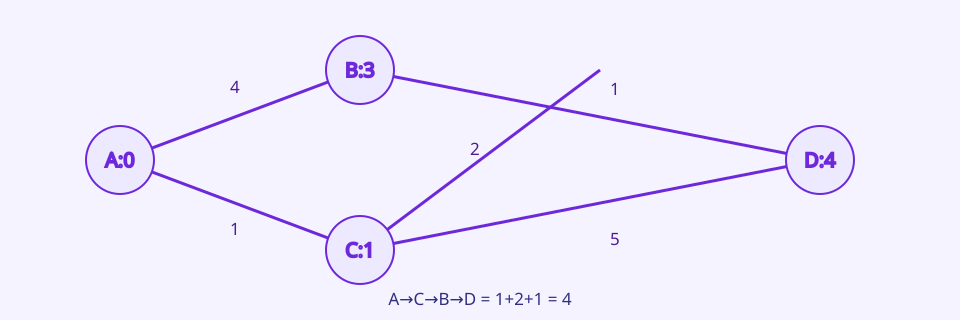

# 08. 최단 경로

[이전](07-graphs-and-traversal.md) · [목차](README.md) · [다음](09-greedy-and-mst.md)

최단 경로 문제는 출발점에서 다른 정점까지 가는 여러 방법 중 비용 합이 가장 작은 방법을 찾는다. 도로 거리, 전송 지연, 요금처럼 간선마다 비용이 다르면 간선 수만 세어서는 답을 구할 수 없다. 이 장은 같은 6노드 그래프를 BFS, 다익스트라, 벨만–포드로 계산해 각 알고리즘이 쓰는 전제와 상태의 차이를 드러낸다.

~~~mermaid
flowchart LR
    A -->|4| B
    A -->|1| C
    C -->|2| B
    B -->|1| D
    C -->|5| D
    B -->|7| E
    D -->|3| E
    C -->|12| F
    D -->|5| F
    E -->|2| F
~~~

## 1. 경로, 거리, 도달 가능성

**경로(path)**는 방향을 지키며 이어지는 정점과 간선의 순서다. A→C→B는 A→C와 C→B 두 간선을 잇는다. **경로 비용**은 그 경로에 포함된 간선 가중치의 합이다. 위 경로 비용은 1+2=3이다.

**출발 정점(source)**은 거리를 계산하기 시작하는 정점이다. **거리(distance)**는 source에서 한 정점까지 갈 수 있는 모든 경로 비용 중 최솟값이다. 자기 자신 A까지는 빈 경로를 쓰므로 거리 0이다. 방향을 지킨 어떤 경로도 없으면 그 정점은 **도달 불가능(unreachable)**하고 거리를 무한대 ∞로 표시한다. ∞는 매우 큰 실제 정수가 아니라 “아직 유한 경로를 모른다”는 별도 상태다.

**부모(parent)**는 현재 최선 경로에서 해당 정점 바로 전에 오는 정점이다. dist[D]=4이고 parent[D]=B라면 현재 경로가 B를 거쳐 D에 도착한다는 뜻이다. D부터 parent를 거슬러 source까지 간 뒤 순서를 뒤집으면 실제 경로를 복원한다.

이 장의 공통 그래프는 방향 그래프이고 모든 가중치가 0 이상이다. 인접 목록은 다음과 같다.

~~~python
graph = {
    "A": [("B", 4), ("C", 1)],
    "B": [("D", 1), ("E", 7)],
    "C": [("B", 2), ("D", 5), ("F", 12)],
    "D": [("E", 3), ("F", 5)],
    "E": [("F", 2)],
    "F": [],
}
~~~

각 튜플은 도착 정점과 가중치를 담는다. 정점 수 V는 6, 방향 간선 수 E는 10이다.

## 2. 완화: 더 짧은 경로 후보를 반영하기

**완화(relaxation)**는 이미 아는 u까지의 경로 뒤에 간선 u→v를 붙였을 때 v의 현재 거리보다 싸면 dist와 parent를 갱신하는 동작이다.

~~~text
새 후보 = dist[u] + weight(u, v)
새 후보 < dist[v] 이면:
    dist[v] = 새 후보
    parent[v] = u
~~~

예를 들어 dist[C]=1이고 C→B 가중치가 2면 B의 새 후보는 3이다. 기존 dist[B]=4보다 작으므로 dist[B]를 3, parent[B]를 C로 바꾼다. 같다면 이 구현은 바꾸지 않는다. 같은 비용의 다른 경로를 모두 보존하려면 부모 하나 대신 부모 집합 같은 추가 상태가 필요하다.

완화는 한 번으로 최단 거리를 증명하지 않는다. 현재까지 발견한 경로 중 더 좋은 후보를 기록할 뿐이다. 어떤 간선을 어떤 순서로 몇 번 완화하고, 언제 후보가 최종 답이라고 확정되는지가 알고리즘마다 다르다.

## 3. 가중치를 무시한 BFS: 첫 번째 전체 계산

모든 간선을 같은 비용 1로 볼 때 BFS는 최소 간선 수를 구한다. 큐는 먼저 발견한 정점을 먼저 꺼내며, 정점을 넣는 순간 방문 처리한다.

| 단계 | 꺼낸 정점 | 새 발견과 parent | 큐 앞 → 뒤 | 간선 수 거리 A,B,C,D,E,F |
| ---: | --- | --- | --- | --- |
| 0 | 없음 | A:없음 | [A] | 0,∞,∞,∞,∞,∞ |
| 1 | A | B:A, C:A | [B,C] | 0,1,1,∞,∞,∞ |
| 2 | B | D:B, E:B | [C,D,E] | 0,1,1,2,2,∞ |
| 3 | C | B·D 방문, F:C | [D,E,F] | 0,1,1,2,2,2 |
| 4 | D | E·F 방문 | [E,F] | 변화 없음 |
| 5 | E | F 방문 | [F] | 변화 없음 |
| 6 | F | 이웃 없음 | [] | 0,1,1,2,2,2 |

BFS 부모로 F 경로를 복원하면 A→C→F이며 간선 두 개다. 하지만 실제 비용은 1+12=13이다. A→C→B→D→F는 네 간선이지만 비용 1+2+1+5=9라 더 싸다. BFS는 모든 간선 가중치가 같을 때만 비용 최단 경로 알고리즘이 된다.

BFS 시간은 인접 목록에서 O(V+E), 추가 공간은 O(V)다. 공통 그래프에서는 6개 정점과 10개 간선을 일정 횟수 처리한다.

## 4. 우선순위 큐와 확정 상태

**우선순위 큐(priority queue)**는 들어온 순서가 아니라 우선순위가 가장 작은 항목을 먼저 꺼내는 저장 구조다. 다익스트라는 (거리 후보, 정점)을 넣어 아직 처리하지 않은 가장 싼 거리 후보를 고른다. 최소 힙으로 구현하면 넣기와 꺼내기가 O(log V)다.

**확정된 정점(settled vertex)**은 최소 후보로 꺼냈고, 알고리즘의 전제 아래 그 거리가 더 줄지 않는다고 증명된 정점이다. 비음수 가중치에서는 아직 이어 보지 않은 간선을 추가해 경로 비용이 작아질 수 없기 때문에 최소 후보 확정이 안전하다.

파이썬 heapq에는 기존 항목의 우선순위를 제자리에서 줄이는 연산을 직접 쓰기보다 새 후보를 추가할 수 있다. 그러면 같은 정점의 오래된 큰 후보가 힙에 남는다. 현재 dist와 다른 오래된 항목을 **낡은 항목(stale entry)**이라고 하며 꺼냈을 때 건너뛴다.

## 5. 다익스트라 알고리즘과 코드

**다익스트라 알고리즘(Dijkstra’s algorithm)**은 모든 사용 가능한 간선 가중치가 0 이상일 때 한 source에서 모든 정점까지 최단 거리를 구한다. 가장 작은 거리 후보를 우선순위 큐에서 꺼내 확정하고, 그 정점의 나가는 간선을 완화한다.

~~~python
from heapq import heappop, heappush
from math import inf

def dijkstra(graph, source):
    dist = {node: inf for node in graph}
    parent = {node: None for node in graph}
    dist[source] = 0
    heap = [(0, source)]

    while heap:
        candidate, node = heappop(heap)
        if candidate != dist[node]:
            continue

        for neighbor, weight in graph[node]:
            new_distance = candidate + weight
            if new_distance < dist[neighbor]:
                dist[neighbor] = new_distance
                parent[neighbor] = node
                heappush(heap, (new_distance, neighbor))

    return dist, parent
~~~

처음 모든 거리는 ∞, source만 0이며 힙에는 (0, source)가 있다. 최소 후보를 꺼내 현재 dist와 다르면 stale이므로 넘긴다. 같으면 그 후보를 기준으로 모든 나가는 간선을 완화한다. 값이 줄어든 정점은 새 (거리, 정점)을 힙에 넣는다. 마지막에 거리 표와 부모 표를 함께 돌려준다.

## 6. 6개 정점 다익스트라의 거리·부모·힙 전체 추적

힙 표기는 거리:정점이고 왼쪽부터 다음 최소 후보 순서로 적는다. 실제 힙 배열의 내부 배치는 다를 수 있지만 꺼내기 우선순위는 같다.

| 단계 | 꺼낸 항목 | 완화와 parent 변화 | dist A,B,C,D,E,F | 남은 우선순위 큐 |
| ---: | --- | --- | --- | --- |
| 0 | 없음 | A:없음 | 0,∞,∞,∞,∞,∞ | [0:A] |
| 1 | 0:A | B=4(A), C=1(A) | 0,4,1,∞,∞,∞ | [1:C,4:B] |
| 2 | 1:C | B=3(C), D=6(C), F=13(C) | 0,3,1,6,∞,13 | [3:B,4:B,6:D,13:F] |
| 3 | 3:B | D=4(B), E=10(B) | 0,3,1,4,10,13 | [4:B,4:D,6:D,10:E,13:F] |
| 4 | 4:B | stale, 현재 B는 3 | 변화 없음 | [4:D,6:D,10:E,13:F] |
| 5 | 4:D | E=7(D), F=9(D) | 0,3,1,4,7,9 | [6:D,7:E,9:F,10:E,13:F] |
| 6 | 6:D | stale, 현재 D는 4 | 변화 없음 | [7:E,9:F,10:E,13:F] |
| 7 | 7:E | F 후보 9는 현재와 같아 유지 | 0,3,1,4,7,9 | [9:F,10:E,13:F] |
| 8 | 9:F | 나가는 간선 없음 | 변화 없음 | [10:E,13:F] |
| 9 | 10:E | stale, 현재 E는 7 | 변화 없음 | [13:F] |
| 10 | 13:F | stale, 현재 F는 9 | 변화 없음 | [] |

최종 부모는 A:없음, B:C, C:A, D:B, E:D, F:D다. F에서 뒤로 F←D←B←C←A를 따라가 뒤집으면 A→C→B→D→F, 비용 1+2+1+5=9다. E를 거친 A→C→B→D→E→F도 비용 1+2+1+3+2=9지만 같은 후보에서는 parent를 바꾸지 않았으므로 하나만 보존된다.

정확성의 핵심은 최소 후보 u보다 싼 미발견 u 경로가 있다고 가정했을 때 생기는 모순이다. 그 경로에서 확정 영역을 처음 벗어나는 간선 직전까지의 거리는 u보다 크지 않다. 가중치가 음수가 아니므로 그 경계 정점의 후보가 u보다 먼저 큐에서 나왔어야 한다. 따라서 최소 후보를 꺼낼 때 그 거리는 최단이다.

이진 힙과 인접 목록에서 각 완화 성공이 힙 항목을 추가하므로 보통 O((V+E) log V) 시간으로 설명한다. 연결 그래프에서는 E가 V-1 이상이라 O(E log V)로 줄여 쓰기도 한다. dist, parent, heap, 인접 목록 외 작업 상태는 O(V+E) 범위다. decrease-key를 제공하는 힙인지 stale 항목을 넣는 구현인지에 따라 더 정밀한 식이 달라진다.

## 7. 음수 간선이 다익스트라를 깨는 이유

**음수 간선(negative edge)**은 가중치가 0보다 작은 간선이다. 할인이나 이익을 음의 비용으로 모델링할 수 있지만 실제 거리처럼 음수가 불가능한 문제도 있다.

~~~text
A→B 비용 2
A→C 비용 5
C→B 비용 -10
~~~

다익스트라가 A 다음 최소 후보 B=2를 확정하면, 나중 C를 거쳐 B에 도착하는 비용 5-10=-5를 놓친다. 확정 뒤 간선을 더 이어도 비용이 줄지 않는다는 증명 전제가 음수 간선 하나로 무너진다. 구현이 우연히 이미 확정한 B를 다시 처리해 답을 고칠 수도 있지만 그것은 표준 다익스트라의 확정 논리와 복잡도 보장이 아니다.

**음수 사이클(negative cycle)**은 한 바퀴 가중치 합이 음수인 사이클이다. source에서 그 사이클에 도달하고, 사이클에서 목표로 갈 수 있다면 사이클을 돌 때마다 비용을 계속 줄일 수 있다. 일반 경로가 같은 정점을 반복할 수 있는 정의에서는 유한한 최단 거리가 존재하지 않는다.

## 8. 벨만–포드 알고리즘과 코드

**벨만–포드 알고리즘(Bellman–Ford algorithm)**은 모든 간선을 한 차례씩 완화하는 패스를 최대 V-1번 반복한다. 음수 간선을 허용하며 source에서 도달 가능한 음수 사이클도 검출한다.

사이클을 제거한 단순 경로는 정점 V개에서 간선을 최대 V-1개 쓴다. 한 패스마다 올바른 거리 정보가 경로의 간선 하나 이상 앞으로 전파되므로 V-1패스면 음수 사이클이 없는 최단 경로를 얻는다. 그 뒤 한 번 더 완화가 성공하면 V-1개보다 긴 걸음으로도 비용이 줄어든다는 뜻이고, 도달 가능한 음수 사이클이 있다.

~~~python
from math import inf

def bellman_ford(nodes, edges, source):
    dist = {node: inf for node in nodes}
    parent = {node: None for node in nodes}
    dist[source] = 0

    for _ in range(len(nodes) - 1):
        changed = False
        for start, end, weight in edges:
            if dist[start] == inf:
                continue
            candidate = dist[start] + weight
            if candidate < dist[end]:
                dist[end] = candidate
                parent[end] = start
                changed = True
        if not changed:
            break

    for start, end, weight in edges:
        if dist[start] != inf and dist[start] + weight < dist[end]:
            raise ValueError("reachable negative cycle")

    return dist, parent
~~~

도달 불가능한 start의 ∞에는 가중치를 더하지 않는다. 한 패스에서 아무 값도 변하지 않으면 이후도 변하지 않아 일찍 끝낼 수 있다. 마지막 검사는 source에서 유한 거리를 가진 start의 간선만 보므로 다른 연결 요소의 음수 사이클을 잘못 보고하지 않는다.

## 9. 6개 정점 벨만–포드의 모든 패스

전파 과정을 보이기 위해 간선을 다음 역방향에 가까운 순서로 검사한다.

~~~text
E→F, D→F, C→F, D→E, B→E,
C→D, B→D, C→B, A→C, A→B
~~~

| 패스 | 성공한 완화와 parent | dist A,B,C,D,E,F | parent B,C,D,E,F |
| ---: | --- | --- | --- |
| 초기 | A만 0 | 0,∞,∞,∞,∞,∞ | 없음,없음,없음,없음,없음 |
| 1 | C=1(A), B=4(A) | 0,4,1,∞,∞,∞ | A,A,없음,없음,없음 |
| 2 | F=13(C), E=11(B), D=6(C)→5(B), B=3(C) | 0,3,1,5,11,13 | C,A,B,B,C |
| 3 | F=10(D), E=8(D), D=4(B) | 0,3,1,4,8,10 | C,A,B,D,D |
| 4 | F=9(D), E=7(D) | 0,3,1,4,7,9 | C,A,B,D,D |
| 5 | 변화 없음, 조기 종료 | 0,3,1,4,7,9 | C,A,B,D,D |

한 패스 안에서도 앞에서 검사한 간선의 새 값은 뒤 간선이 바로 사용할 수 있다. 그래서 “정확히 한 간선씩만” 전파된다고 단정하면 안 되며, V-1패스는 간선 순서와 무관한 안전한 상한이다. 시간은 최대 (V-1)×E 완화와 추가 E 검사로 O(VE), dist와 parent는 O(V) 공간이다.

## 10. 음수 사이클과 비연결 정점을 구분하기

그래프 A→B=1, B→C=1, C→B=-3을 보자. B→C→B 한 바퀴 비용은 -2다. A에서 B에 닿으므로 패스마다 B와 C 거리가 계속 줄어든다.

| 패스 | dist[B] | dist[C] | 의미 |
| ---: | ---: | ---: | --- |
| 초기 | ∞ | ∞ | 아직 경로 없음 |
| 1 | -1 | 2 | 한 번 사이클 효과 |
| 2 | -3 | 0 | 다시 2 감소 |
| 3 | -5 | -2 | 계속 감소 |

반면 정점 F가 A와 어떤 방향 경로로도 연결되지 않아 dist[F]=∞로 남는다면 유한 경로가 없다는 정상 결과다. 값이 계속 감소하는 음수 사이클 영향과 값이 한 번도 생기지 않는 비도달 상태는 다르다.

다른 연결 요소에 X→Y=-2, Y→X=1의 음수 사이클이 있어도 A에서 X에 도달할 수 없다면 A source 최단 거리에는 영향을 주지 않는다. 벨만–포드의 마지막 검사가 dist[start] != ∞인 간선만 보는 이유다.

음수 사이클의 영향을 받는 정점은 parent를 따라가면 사이클을 돌 수 있으므로 정상 경로를 복원하면 안 된다. 도달 불가능 정점도 parent가 None이다. parent가 None이라는 사실만으로 source인지, 비도달인지, 계산 불능인지 구분하지 말고 거리 상태와 사이클 검출 결과를 함께 본다.

## 11. 세 알고리즘의 전제와 선택

| 알고리즘 | 허용 가중치 | 핵심 저장 구조 | 시간 | 결과 |
| --- | --- | --- | --- | --- |
| BFS | 모든 간선 비용이 같음 | FIFO 큐 | O(V+E) | 최소 간선 수 |
| 다익스트라 | 모든 관련 가중치가 0 이상 | 최소 우선순위 큐 | O((V+E) log V) | 비용 최단 거리 |
| 벨만–포드 | 음수 간선 허용 | 간선 목록 반복 | O(VE) | 거리와 도달 가능 음수 사이클 |

가중치가 0 또는 1뿐이면 덱의 앞과 뒤를 쓰는 0-1 BFS로 O(V+E)에 풀 수 있다. DAG라면 위상 순서로 간선을 한 번씩 완화해 음수 간선이 있어도 O(V+E)가 가능하다. 입력 제약을 알면 더 단순하고 빠른 알고리즘을 선택할 수 있다.

## 12. Duan 등 2025 결과를 읽는 정확한 범위

Duan, Mao, Mao, Shu, Yin의 2025년 논문은 방향 그래프의 단일 출발점 최단 경로에 대해 결정적 O(m log^(2/3) n) 시간 알고리즘을 제시했다. 여기서 n은 정점 수, m은 간선 수다. 논문의 입력은 실수형 **비음수** 간선 가중치이며, 가중치에 대한 비교와 덧셈을 단위 비용으로 세는 **비교-덧셈 모델**이다. 희소 방향 그래프에서 다익스트라 계열의 O(m+n log n) 장벽을 이론적으로 깼다는 의미가 있다.

이 결과의 범위를 넓혀 해석하면 안 된다. 음수 간선이나 음수 사이클을 처리하는 벨만–포드의 대체 결과가 아니다. 정수 가중치와 워드 단위 연산을 허용하는 다른 계산 모델의 모든 결과를 포괄하지도 않는다. 논문의 점근적 상한은 n과 m이 커질 때 연산 수 증가율을 증명한 이론 보장이다. 구현 상수, 메모리 접근, 캐시, 그래프 크기와 분포까지 포함해 모든 실제 입력에서 기존 다익스트라보다 빠르다는 실측 보장이 아니다. 교재 구현에서는 단순하고 검증된 다익스트라가 여전히 중요한 기준이다.

논문: [Breaking the Sorting Barrier for Directed Single-Source Shortest Paths](https://arxiv.org/abs/2504.17033)

## 13. 경로 복원과 실패 조건

공통 그래프에서 parent[F]=D, parent[D]=B, parent[B]=C, parent[C]=A다. F←D←B←C←A를 뒤집어 A→C→B→D→F를 얻는다. 각 간선이 실제 그래프에 있고 가중치 합 9가 dist[F]와 같은지 검증할 수 있다.

~~~python
def restore_path(parent, source, target):
    path = []
    current = target

    while current is not None:
        path.append(current)
        if current == source:
            path.reverse()
            return path
        current = parent[current]

    return None
~~~

target에서 시작해 parent를 따라 저장한다. source에 도달하면 뒤집어 반환한다. None을 먼저 만나면 source에서 target으로 가는 기록이 없으므로 None이다. 음수 사이클 영향권에서는 이 함수 전에 복원 가능 여부를 확인해야 한다. 방어적으로 정점 수보다 많이 parent를 따라가면 오류를 내도록 만들 수도 있다.

∞를 큰 정수 하나로 흉내 내면 실제 경로가 그보다 클 수 있고 고정 폭 정수 덧셈에서 넘침이 생길 수 있다. 언어가 제공하는 infinity나 명시적 비도달 상태를 쓰고, ∞에서 나가는 간선은 완화하지 않는다.

## 14. 확인 문제와 자세한 풀이

### 문제 1. BFS와 비용 최단의 차이

공통 그래프에서 BFS가 찾는 A→F 경로와 다익스트라 경로의 간선 수·비용을 비교하라.

**풀이.** BFS는 A에서 C를 발견하고 C에서 F를 처음 발견해 A→C→F를 만든다. 간선 2개, 비용 1+12=13이다. 다익스트라는 A→C→B→D→F를 선택해 간선 4개지만 비용 1+2+1+5=9다. 질문이 최소 환승 수라면 BFS 결과가 맞고, 가중치 합 최소라면 다익스트라가 맞다. “최단”의 측정 단위를 먼저 정해야 한다.

### 문제 2. 완화와 부모 갱신

dist[C]=1, dist[B]=4, C→B=2일 때 완화 결과를 구하라. 새 후보가 기존 거리와 같다면 이 장의 구현은 무엇을 하는가?

**풀이.** 새 후보는 1+2=3이고 4보다 작아 dist[B]=3, parent[B]=C로 바뀐다. 같다면 < 조건이 거짓이라 거리와 부모를 유지한다. 따라서 같은 비용 경로가 여러 개여도 먼저 기록된 하나만 남는다. 모든 최단 경로가 필요하면 같은 경우에도 추가 부모를 기록하는 다른 출력 계약이 필요하다.

### 문제 3. stale 항목

다익스트라 표에서 4:B가 왜 stale이며, 이를 건너뛰지 않으면 어떤 비용이 생기는가?

**풀이.** A를 처리할 때 B 후보 4를 넣었지만 C를 처리하며 더 좋은 3:B를 넣어 dist[B]=3이 됐다. 4:B를 꺼낼 때 후보 4와 현재 dist 3이 다르므로 오래된 항목이다. 그 간선을 다시 완화해도 비음수 표준 구현에서 더 좋은 답을 만들지 못하지만 불필요한 이웃 검사가 늘고 “꺼낸 값이 확정 거리”라는 설명이 흐려진다. candidate != dist[node] 검사로 건너뛴다.

### 문제 4. 음수 간선 반례

A→B=2, A→C=5, C→B=-10에서 실제 B 거리와 다익스트라 확정 오류를 단계별로 설명하라.

**풀이.** A에서 직접 B 후보 2와 C 후보 5가 생긴다. 최소 후보 B=2를 먼저 확정하면 표준 다익스트라는 B가 끝났다고 본다. 그러나 C=5를 나중에 처리하면 C→B를 붙인 비용은 -5다. 실제 최단 경로 A→C→B가 직접 경로보다 7 작다. 음수 간선 때문에 나중 경로를 이어 비용이 감소했고 확정 증명이 깨졌다. 벨만–포드는 모든 간선을 반복 완화해 -5를 반영한다.

### 문제 5. 벨만–포드 패스 수

정점 6개에서 왜 최대 5패스를 하는가? 한 패스에서 변화가 없으면 왜 멈춰도 되는가?

**풀이.** 음수 사이클이 없는 최단 경로는 같은 정점을 반복할 필요가 없는 단순 경로로 잡을 수 있고, 정점 6개의 단순 경로는 간선을 최대 5개 쓴다. 간선 순서가 나빠도 패스마다 경로 정보가 최소 한 단계 전파되어 5패스면 충분하다. 한 전체 패스에서 어떤 dist도 줄지 않았다면 현재 값으로 모든 간선 부등식 dist[v] ≤ dist[u]+w가 만족된다. 같은 값으로 다시 같은 완화를 해도 변화가 없어 조기 종료할 수 있다.

### 문제 6. 비도달과 음수 사이클

A에서 F가 비도달이라 dist[F]=∞인 경우와, B-C 음수 사이클 때문에 거리가 계속 감소하는 경우를 어떻게 구분하는가?

**풀이.** 비도달 F는 어떤 유한 dist를 가진 정점의 간선으로도 완화되지 않아 처음부터 끝까지 ∞다. 음수 사이클의 B와 C는 먼저 유한 경로를 얻은 뒤 추가 패스마다 더 작은 유한 값으로 바뀐다. V-1패스 후에도 도달 가능한 간선 완화가 성공하면 음수 사이클을 보고한다. 다른 연결 요소의 사이클은 start 거리가 ∞라 A 기준 검사에서 제외된다.

### 문제 7. 알고리즘 선택

방향 그래프의 가중치가 모두 1인 경우, 0 이상 실수인 경우, 음수를 포함하지만 도달 가능한 음수 사이클은 없는 경우에 각각 무엇을 선택하는가?

**풀이.** 모두 1이면 BFS가 O(V+E)로 가장 단순하며 최소 간선 수가 곧 최소 비용이다. 0 이상 실수면 다익스트라와 최소 우선순위 큐가 교재 수준의 일반 선택이고 O((V+E) log V)다. 음수 간선이 있으면 다익스트라의 확정 근거가 없으므로 벨만–포드 O(VE)를 사용해 거리와 음수 사이클 여부를 함께 확인한다. 그래프가 DAG라는 추가 조건이 있으면 위상 순서 완화 O(V+E)도 가능하므로 모든 입력 제약을 함께 본다.

## 15. 구현 점검표

거리의 단위, 방향, 가중치 허용 범위, source와 필요한 출력이 거리만인지 실제 경로인지 먼저 정한다. 다익스트라는 관련 간선의 비음수 전제를 검사하고 stale 항목을 구분한다. 벨만–포드는 ∞에서 나가는 간선을 완화하지 않고 V-1패스 뒤 도달 가능한 음수 사이클을 검사한다. 빈 그래프, source만 있는 그래프, 같은 비용 경로, 비연결 정점, 0 가중치, 음수 간선과 음수 사이클을 따로 시험한다.

## 참고

고전 알고리즘 설명은 인접 목록 그래프를 기준으로 했다. Duan 등의 2025 결과는 논문이 명시한 방향 그래프, 실수 비음수 가중치, 비교-덧셈 모델의 이론 상한으로만 해석했다.
