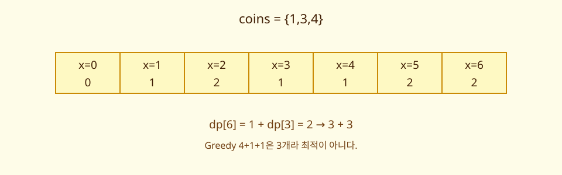

# 10. 동적 계획법

[이전](09-greedy-and-mst.md) · [목차](README.md) · [다음](11-divide-and-conquer.md)

동적 계획법은 큰 문제를 작은 문제들로 나누되, 같은 작은 문제가 반복될 때 답을 한 번만 계산해 저장한다. 핵심은 표를 만드는 기술이 아니라 “앞으로의 결정을 위해 과거에서 무엇만 기억하면 되는가”를 정확히 정하는 일이다.

~~~mermaid
flowchart LR
    D0["dp[0]=0"] --> D1["dp[1]=1"]
    D1 --> D2["dp[2]=2"]
    D0 --> D3["dp[3]=1"]
    D0 --> D4["dp[4]=1"]
    D4 --> D5["dp[5]=2"]
    D3 --> D6["dp[6]=2"]
~~~

## 1. 작은 문제를 저장하기 위한 용어

**부분 문제(subproblem)**는 원래 문제보다 입력이 작고, 답을 조합해 원래 답을 만드는 문제다. 금액 6의 최소 동전 수를 구할 때 금액 5, 3, 2의 답이 부분 문제다.

**상태(state)**는 부분 문제 하나를 구별하기 위해 메모리에 저장하는 최소 정보다. 동전 문제에서 dp[x]는 “금액 x를 만드는 최소 동전 수”라는 상태값이다. x가 다르면 다른 부분 문제다. 상태 정의에는 인덱스가 무엇을 뜻하고 값이 무엇을 뜻하는지 모두 들어가야 한다.

**점화식(recurrence)**은 현재 상태의 답을 더 작은 상태의 답으로 계산하는 식이다. **기저 조건(base case)**은 더 작은 상태를 보지 않고 직접 알 수 있는 시작 답이다. dp[0]=0은 금액 0에 동전이 필요 없다는 기저 조건이다. 기저 조건이 없거나 틀리면 다른 모든 상태가 시작할 근거를 잃는다.

**겹치는 부분 문제(overlapping subproblems)**는 서로 다른 계산 경로가 같은 상태를 다시 요구하는 성질이다. 금액 6에서 3을 빼도 금액 3을 보고, 금액 4에서 1을 빼는 경로도 결국 금액 3을 본다. 저장하지 않는 단순 재귀는 dp[3]을 여러 번 계산한다.

**최적 부분 구조(optimal substructure)**는 전체 최적해 안에 포함된 관련 부분 해도 최적이어야 한다는 성질이다. 금액 6의 최적 동전 조합에서 마지막 동전 3을 빼고 남은 금액 3의 조합이 최적이 아니라면, 더 좋은 금액 3 조합으로 바꿔 전체 6도 개선할 수 있어 원래가 최적이라는 가정과 모순이다.

## 2. 메모이제이션과 표 채우기

**메모이제이션(memoization)**은 위에서 아래로 재귀 호출하며 처음 계산한 상태 답을 사전이나 배열에 저장하고, 같은 상태가 다시 필요하면 저장값을 돌려주는 방식이다. 실제로 요청된 상태만 계산하지만 재귀 호출 스택을 쓴다.

**표 채우기(tabulation)**는 기저 상태부터 시작해 필요한 작은 상태가 먼저 준비되도록 반복문으로 표를 채우는 아래에서 위 방식이다. 모든 상태를 계산하는 경우가 많지만 호출 스택이 없고 계산 순서를 눈으로 확인하기 쉽다.

두 방식은 다른 알고리즘 원리가 아니라 같은 상태와 점화식을 다른 순서로 평가하는 방법이다. 필요한 이전 상태가 준비되기 전에 읽지 않는다는 조건이 중요하다.

## 3. 동전 {1,3,4}, 금액 6의 상태와 점화식

동전은 각 종류를 원하는 횟수만큼 쓸 수 있고, 목표는 동전 개수 최소화라고 정한다. 상태 dp[x]는 금액 x를 만드는 최소 동전 수다. 마지막으로 동전 c를 썼다면 그 전에는 금액 x-c를 최적으로 만들었어야 한다.

~~~text
dp[0] = 0
dp[x] = 1 + min(dp[x-c])  단, c는 1,3,4 중 c ≤ x
~~~

모든 가능한 마지막 동전을 비교하므로 최적 선택을 빠뜨리지 않는다. 동전 1이 있어 0부터 6까지 모든 금액을 만들 수 있다.

| x | c=1 후보 | c=3 후보 | c=4 후보 | dp[x] | choice[x] |
| ---: | ---: | ---: | ---: | ---: | ---: |
| 0 | 없음 | 없음 | 없음 | 0 | 없음 |
| 1 | 1+dp[0]=1 | 사용 불가 | 사용 불가 | 1 | 1 |
| 2 | 1+dp[1]=2 | 사용 불가 | 사용 불가 | 2 | 1 |
| 3 | 1+dp[2]=3 | 1+dp[0]=1 | 사용 불가 | 1 | 3 |
| 4 | 1+dp[3]=2 | 1+dp[1]=2 | 1+dp[0]=1 | 1 | 4 |
| 5 | 1+dp[4]=2 | 1+dp[2]=3 | 1+dp[1]=2 | 2 | 1 |
| 6 | 1+dp[5]=3 | 1+dp[3]=2 | 1+dp[2]=3 | 2 | 3 |

금액 6에서 choice[6]=3을 빼면 3, choice[3]=3을 빼면 0이다. 따라서 복원한 조합은 [3,3]이고 동전 두 개다. 큰 동전부터 고르는 그리디는 [4,1,1] 세 개라 최적이 아니다.

## 4. 동전 코드와 줄별 상태 변화

~~~python
def min_coins(amount, coins):
    impossible = amount + 1
    dp = [0] + [impossible] * amount
    choice = [None] * (amount + 1)

    for value in range(1, amount + 1):
        for coin in coins:
            if coin <= value:
                candidate = 1 + dp[value - coin]
                if candidate < dp[value]:
                    dp[value] = candidate
                    choice[value] = coin

    if dp[amount] == impossible:
        return None, []

    used = []
    value = amount
    while value > 0:
        coin = choice[value]
        used.append(coin)
        value -= coin

    return dp[amount], used
~~~

impossible은 만들 수 있는 어떤 정상 답보다 큰 표식이다. 동전 1개가 최소 단위라 정상 답은 amount개를 넘지 않는다. dp[0]만 0이고 나머지는 불가능으로 시작한다. 바깥 반복은 작은 금액부터 올라가므로 dp[value-coin]이 이미 계산돼 있다.

candidate가 더 작을 때 dp와 choice를 같은 if 안에서 함께 바꾼다. 숫자만 바꾸고 choice를 놓치면 최솟값과 복원 경로가 서로 다른 계산을 가리킬 수 있다. 마지막 while은 선택 동전을 빼며 반드시 더 작은 비음수 금액으로 가고 0에서 끝난다.

동전 종류 수를 k라 하면 amount개 상태에서 k개 후보를 보아 O(amount×k) 시간, dp와 choice에 O(amount) 공간을 쓴다. amount 값에 비례하므로 입력 정수의 비트 길이에 대해서는 의사 다항 시간이다. 예를 들어 10억은 짧은 이진 문자열로 표현되지만 표 10억 칸은 매우 크다.

동전 {3,4}로 금액 5를 만들 수 없는 경우에는 dp[1], dp[2], dp[5]가 impossible로 남는다. public 결과에서 이를 “6개 동전”으로 오해하지 않고 None으로 바꿔야 한다.

## 5. 그리디와 동적 계획법의 차이

그리디는 현재 선택 하나를 확정하고 되돌리지 않는다. 동적 계획법은 상태마다 가능한 이전 선택들을 비교하고 최선값을 저장한다. 동전 6에서 그리디는 첫 4를 확정하지만 DP는 마지막 동전 1, 3, 4 후보를 모두 비교한다.

DP도 표가 나왔다고 자동으로 정확한 것은 아니다. 상태가 미래 결정에 필요한 정보를 충분히 담는지, 점화식이 가능한 모든 마지막 선택을 포함하는지, 기저 조건이 맞는지 증명해야 한다. 정확성은 보통 기저 상태가 맞고, 더 작은 상태가 최적이라고 가정할 때 점화식이 현재 최적을 만든다는 귀납으로 보인다.

## 6. 0/1 배낭 문제의 상태

**0/1 배낭 문제(0/1 knapsack)**는 각 물건을 넣지 않거나 한 번만 넣어 무게 합이 용량을 넘지 않으면서 가치 합을 최대화한다. “0/1”은 각 물건 선택 횟수가 0 또는 1이라는 뜻이다.

물건은 (무게, 가치)로 (2,3), (3,4), (4,5)이고 용량은 6이라고 하자. 2차원 상태 dp[i][w]는 앞 i개 물건만 고려해 용량 w에서 얻는 최대 가치다.

i번째 물건의 무게를 weight, 가치를 value라 하면 두 선택을 비교한다.

~~~text
물건을 넣지 않음: dp[i-1][w]
넣음: value + dp[i-1][w-weight]  단, weight ≤ w
dp[i][w] = 두 후보의 최댓값
~~~

두 후보 모두 이전 행 i-1을 읽으므로 현재 물건을 두 번 쓰지 않는다. 기저 행 dp[0][w]는 물건이 없어 모두 0이고, 용량 0 열도 0이다.

## 7. 0/1 배낭의 전체 2차원 표

| 고려한 물건＼용량 | 0 | 1 | 2 | 3 | 4 | 5 | 6 |
| --- | ---: | ---: | ---: | ---: | ---: | ---: | ---: |
| 없음 | 0 | 0 | 0 | 0 | 0 | 0 | 0 |
| (2,3) | 0 | 0 | 3 | 3 | 3 | 3 | 3 |
| (3,4) | 0 | 0 | 3 | 4 | 4 | 7 | 7 |
| (4,5) | 0 | 0 | 3 | 4 | 5 | 7 | 8 |

마지막 값 8은 무게 4 물건 가치 5와 남은 용량 2에서 이전 행 값 3을 더한 결과다. 선택 물건은 (4,5)와 (2,3), 총무게 6, 총가치 8이다. (2,3)+(3,4)는 무게 5, 가치 7이고 세 물건은 무게 9라 불가능하다.

시간은 물건 n개와 용량 W의 모든 칸을 계산해 O(nW), 공간은 표 전체 O(nW)다. W 숫자 자체에 비례하므로 역시 의사 다항이다.

## 8. 1차원 공간 최적화와 역방향 갱신

현재 행은 이전 행만 참조하므로 용량 배열 하나로 줄일 수 있다. 그러나 같은 배열을 덮어쓰므로 큰 용량에서 작은 용량 방향으로 갱신해야 한다.

~~~python
def knapsack_01(items, capacity):
    dp = [0] * (capacity + 1)

    for weight, value in items:
        for current in range(capacity, weight - 1, -1):
            dp[current] = max(
                dp[current],
                value + dp[current - weight],
            )

    return dp[capacity]
~~~

각 물건을 시작할 때 dp는 이전 물건들만 사용한 답이다. current를 큰 쪽부터 내려가면 current-weight는 아직 이번 물건으로 갱신되지 않은 이전 행 값이다.

| 단계 | 갱신 방향 | dp[0..6] |
| --- | --- | --- |
| 초기 | 없음 | [0,0,0,0,0,0,0] |
| (2,3) | 6→2 | [0,0,3,3,3,3,3] |
| (3,4) | 6→3 | [0,0,3,4,4,7,7] |
| (4,5) | 6→4 | [0,0,3,4,5,7,8] |

첫 물건 (2,3)을 작은 용량 2→6으로 갱신하면 dp[2]=3을 만든 뒤 current=4에서 방금 값 dp[2]를 읽어 dp[4]=6을 만든다. 같은 물건을 두 번 쓴 셈이다. 이는 물건을 무한히 쓸 수 있는 무제한 배낭의 전이가 되며 0/1 조건을 깨뜨린다.

1차원 최적화는 최댓값만 필요할 때 공간을 O(W)로 줄인다. 선택한 물건을 복원하려면 어떤 상태에서 어떤 결정을 했는지 추가 기록이 필요하다. 단순히 마지막 dp 배열만 보고는 덮어쓰기 전 행을 잃어 여러 최적 경로를 정확히 되살리기 어렵다. 공간 최적화는 출력 정보와 맞바꾸는 선택이다.

## 9. 최장 공통 부분 수열의 상태

**부분 수열(subsequence)**은 원래 순서를 유지하면서 일부 문자를 지운 결과다. 문자가 연속할 필요는 없다. ABC에서 AC는 부분 수열이고 CA는 순서를 바꿔서 아니다.

**최장 공통 부분 수열(LCS, Longest Common Subsequence)**은 두 문자열에 모두 부분 수열로 나타나는 것 중 길이가 가장 긴 것이다. 문자열 X=ABC, Y=BAC를 보자. 상태 dp[i][j]는 X의 앞 i글자와 Y의 앞 j글자의 LCS 길이다.

기저 조건은 한쪽 길이가 0이면 공통 부분 수열도 빈 문자열이므로 0이다. 마지막 문자가 같으면 그 문자를 공통 답에 붙여 dp[i-1][j-1]+1이다. 다르면 X 마지막을 버린 dp[i-1][j]와 Y 마지막을 버린 dp[i][j-1] 중 큰 값을 쓴다.

~~~text
X[i-1] == Y[j-1]:
    dp[i][j] = dp[i-1][j-1] + 1
다름:
    dp[i][j] = max(dp[i-1][j], dp[i][j-1])
~~~

## 10. LCS 전체 작은 표와 복원

| X＼Y | 빈 문자열 | B | A | C |
| --- | ---: | ---: | ---: | ---: |
| 빈 문자열 | 0 | 0 | 0 | 0 |
| A | 0 | 0 | 1 | 1 |
| B | 0 | 1 | 1 | 1 |
| C | 0 | 1 | 1 | 2 |

오른쪽 아래 2가 LCS 길이다. C와 C가 같으므로 대각선 dp[2][2]로 가며 C를 기록한다. B와 A는 다르고 위와 왼쪽 값이 모두 1이라 어느 쪽을 택해도 된다. 위로 가서 A와 A를 만나면 A를 기록해 역순 C,A를 뒤집어 AC를 얻는다. 왼쪽으로 가면 B와 B를 만나 BC를 얻는다. 두 문자열에는 길이 2인 LCS가 여러 개 있다.

~~~python
def lcs_length(first, second):
    rows = len(first) + 1
    cols = len(second) + 1
    dp = [[0] * cols for _ in range(rows)]

    for i in range(1, rows):
        for j in range(1, cols):
            if first[i - 1] == second[j - 1]:
                dp[i][j] = dp[i - 1][j - 1] + 1
            else:
                dp[i][j] = max(dp[i - 1][j], dp[i][j - 1])

    return dp
~~~

길이 n과 m의 문자열에서 모든 칸을 한 번 계산해 O(nm) 시간과 O(nm) 공간이다. 길이만 필요하면 이전 행과 현재 행 두 개, 더 나아가 한 행으로 O(min(n,m)) 공간까지 줄일 수 있다. 그러나 실제 수열을 표준 방식으로 복원하려면 이동 경로나 전체 표가 필요하다. 공간을 줄인 채 복원하려면 추가 재계산이나 더 복잡한 분할 기법이 필요하므로 “항상 한 행이면 충분하다”고 말할 수 없다.

## 11. 메모이제이션 예와 겹침

동전 문제를 재귀로 쓰면 solve(6)이 solve(5), solve(3), solve(2)를 부르고, solve(5)가 다시 solve(4), solve(2), solve(1)을 부른다. solve(2)가 반복된다. 메모 사전에서 2의 답을 한 번 저장하면 두 번째 호출은 재귀를 펼치지 않는다.

~~~python
def min_coins_memo(amount, coins, memo=None):
    if memo is None:
        memo = {0: 0}
    if amount in memo:
        return memo[amount]

    best = float("inf")
    for coin in coins:
        if coin <= amount:
            best = min(
                best,
                1 + min_coins_memo(amount - coin, coins, memo),
            )

    memo[amount] = best
    return best
~~~

재귀 깊이는 동전 1이 있을 때 최대 amount까지 갈 수 있어 큰 입력에서 호출 한도와 스택 공간 문제가 생긴다. tabulation은 같은 상태 수와 후보 수를 반복문으로 계산한다. 반대로 목표 상태와 연결되지 않은 상태가 많다면 메모이제이션은 필요한 상태만 방문할 수 있다.

부분 문제가 겹치지 않는 병합 정렬에 메모를 붙여도 같은 조각을 반복 호출하지 않으므로 큰 이득이 없다. 모든 재귀가 DP인 것은 아니다.

메모이제이션에서 실제 객체는 memo 사전이다. 금액 6을 처음 호출하면 키 6이 없으므로 자식 상태를 계산하고, 계산이 끝난 뒤 memo[6]에 답을 넣는다. 한 가능한 호출 흐름의 중요한 사건은 다음과 같다.

| 요청 상태 | 처음인가 | 동작 | 저장 또는 재사용 |
| ---: | --- | --- | --- |
| 6 | 예 | 5,3,2를 요청 | 나중 2 저장 |
| 5 | 예 | 4,2,1을 요청 | 나중 2 저장 |
| 4 | 예 | 3,1,0을 요청 | 나중 1 저장 |
| 3 | 예 | 2,0을 요청 | 나중 1 저장 |
| 2 | 예 | 1을 요청 | 나중 2 저장 |
| 1 | 예 | 0을 요청 | 1 저장 |
| 0 | 아니오 | 기저값 조회 | 0 재사용 |
| 이후 2,3 | 아니오 | 재귀 확장 안 함 | 저장된 2,1 재사용 |

정확한 호출 순서는 coins 순서에 따라 달라도 각 금액 0부터 6은 최대 한 번만 완전히 계산된다. 캐시 조회 없이 재귀만 쓰면 같은 2, 3 상태 아래의 호출 트리가 여러 번 반복된다. memo를 함수 기본 인자로 빈 사전 하나로 직접 두면 파이썬에서 서로 다른 최상위 호출이 같은 사전을 공유할 수 있으므로 코드처럼 None에서 새 사전을 만든다.

LCS의 점화식도 최적 부분 구조를 사용한다. 마지막 문자가 같으면 그 문자를 제외한 두 접두사의 공통 부분 수열 뒤에 문자를 붙일 수 있다. 다르면 어떤 공통 부분 수열도 두 서로 다른 마지막 문자를 동시에 마지막으로 쓸 수 없으므로 적어도 한쪽 마지막 문자를 버린 두 부분 문제 중 큰 답을 택한다. 이 두 경우가 가능한 답을 모두 덮는다.

## 12. 상태 설계와 증명 순서

DP를 설계할 때 다음 순서로 검토한다.

1. 상태 인덱스와 값의 뜻을 한 문장으로 정의한다.
2. 최적해의 마지막 선택을 제거했을 때 어떤 더 작은 상태가 남는지 찾는다.
3. 가능한 마지막 선택을 모두 열거해 점화식을 만든다.
4. 가장 작은 입력의 기저 조건을 정한다.
5. 점화식이 읽는 상태가 먼저 계산되도록 순서를 정한다.
6. 값만 필요한지 실제 선택 복원도 필요한지 정해 parent나 choice를 저장한다.

정확성은 최적해의 마지막 선택을 기준으로 증명할 수 있다. 최적해가 고른 마지막 선택 c를 제거한 나머지가 부분 문제의 최적해가 아니면 더 좋은 답으로 교체해 전체도 개선되므로 모순이다. 반대로 점화식은 모든 가능한 c를 보므로 실제 최적 선택도 후보에 포함한다.

상태를 너무 작게 잡으면 다른 과거를 잘못 같은 상태로 합친다. 예를 들어 배낭에서 남은 용량만 있고 어떤 물건까지 처리했는지 구분하지 않으면 0/1 제약을 잃을 수 있다. 너무 크게 잡아 선택 목록 전체를 상태로 두면 경우 수가 지수적으로 늘어 저장 이점을 잃는다.

## 13. 확인 문제와 자세한 풀이

### 문제 1. 동전 표 한 칸

동전 {1,3,4}에서 dp[5]의 모든 후보와 choice를 구하라. 후보 동전 순서를 바꾸면 답이 달라지는가?

**풀이.** 마지막 1이면 1+dp[4]=2, 마지막 3이면 1+dp[2]=3, 마지막 4이면 1+dp[1]=2다. 최소는 2이고 구현이 <만 사용하며 동전 순서 [1,3,4]라면 먼저 만난 1을 choice[5]로 둔다. 순서를 [4,3,1]로 바꾸면 choice는 4가 될 수 있지만 최소 개수 2는 같다. 여러 최적 조합 중 어느 것을 복원할지 동률 규칙에 따라 달라진다.

### 문제 2. 기저 조건 실패

dp[0]을 0 대신 ∞로 두면 동전 하나로 정확히 만들 수 있는 금액에서 무엇이 일어나는가?

**풀이.** 금액 3에서 동전 3 후보는 1+dp[0]이다. dp[0]=∞이면 후보도 ∞라 첫 유한 답이 만들어지지 않는다. 모든 상태가 이전 ∞만 읽어 끝까지 불가능으로 남는다. 금액 0을 만드는 데 필요한 동전 수가 0이라는 실제 의미에서 기저값을 정해야 한다.

### 문제 3. 0/1 역방향 갱신

물건 하나 (2,3), 용량 6에서 작은 쪽부터 갱신했을 때 생기는 잘못된 dp를 추적하라.

**풀이.** current=2에서 dp[2]=3이 된다. current=3도 3이다. current=4에서는 방금 현재 물건으로 만든 dp[2]=3에 가치 3을 더해 6, current=6에서는 dp[4]=6을 다시 읽어 9가 된다. 물건 하나를 세 번 쓴 답이다. 6→2 역방향이면 읽는 dp[current-2]가 이번 물건 처리 전 값이라 모든 용량에서 한 번만 사용한다.

### 문제 4. 배낭 최종 선택

공통 물건 (2,3), (3,4), (4,5)와 용량 6에서 왜 가치 8이 최적인지 점화식으로 설명하라.

**풀이.** 마지막 물건 (4,5)을 넣지 않으면 앞 두 물건으로 용량 6의 최대는 7이다. 넣으면 남은 용량 2에서 앞 두 물건의 최대 3에 5를 더해 8이다. 둘 중 8을 고른다. 이는 (4,5)+(2,3)이고 무게 6이다. 세 물건은 무게 9라 불가능하고, 다른 두 조합 가치는 7 또는 9지만 가치 9 조합 (3,4)+(4,5)은 무게 7로 용량을 넘는다.

### 문제 5. LCS 동률과 복원

ABC와 BAC의 LCS 길이가 2인데 답 문자열이 하나로 고정되지 않는 이유를 설명하라.

**풀이.** 표의 마지막 C는 같아 반드시 한 C를 붙일 수 있다. 그 앞 dp[2][2]에서 B와 A가 다르고 위·왼쪽 값이 모두 1이다. 위로 가면 A-A를 만나 AC, 왼쪽으로 가면 B-B를 만나 BC를 복원한다. 둘 다 원래 순서를 지키는 길이 2 공통 부분 수열이다. 길이 표만으로 동률 선택 하나가 강제되지 않으며 모든 LCS를 원하면 분기 정보를 더 저장해야 한다.

### 문제 6. 공간 최적화의 한계

LCS 길이만 구할 때 한두 행으로 줄일 수 있지만 실제 LCS를 원할 때 왜 문제가 되는가?

**풀이.** 각 길이 칸은 위, 왼쪽, 대각선 중 어디에서 왔는지 알려 줘야 복원할 수 있다. 한 행으로 덮어쓰면 과거 행과 이동 경로가 사라진다. 길이 숫자는 맞아도 문자를 거꾸로 따라갈 정보가 없다. 전체 표를 보존하거나, 결정 포인터를 따로 저장하거나, 일부를 재계산하는 알고리즘이 필요하다. 필요한 출력에 따라 공간 목표가 달라진다.

### 문제 7. 그리디와 DP 선택

동전 {1,3,4}의 금액 6과 활동 선택 문제에서 그리디의 지위가 다른 이유를 증명 관점에서 설명하라.

**풀이.** 동전에서 첫 4를 고른 최적해로 모든 최적해를 교환할 수 없다. 실제 최적 [3,3]에서 3 하나를 4로 바꾸면 남은 금액 2에 동전 두 개가 필요해 개수가 늘어난다. 활동 선택에서는 최적해의 첫 활동을 가장 일찍 끝나는 활동으로 바꿔도 뒤 활동의 가능성을 잃지 않아 활동 수가 유지된다. 전자는 DP로 모든 마지막 동전을 비교해야 하고, 후자는 교환 논증이 성립해 그리디가 최적이다.

## 14. 구현 점검표

상태의 인덱스와 값, 기저 조건, 점화식 후보, 계산 순서를 코드 전에 적는다. 불가능 상태를 정상 숫자와 구분한다. 0/1 배낭의 1차원 갱신은 큰 용량부터 하고, 복원이 필요하면 선택 정보를 보존한다. 빈 입력, 용량 0, 만들 수 없는 금액, 동률 최적해, 모든 문자가 다른 LCS를 시험한다. 시간은 상태 수×상태당 전이 수로, 공간은 저장 상태와 복원 정보를 함께 계산한다.

## 참고

이 장의 세 예제는 각각 최소화, 최대화, 두 문자열 비교 상태를 보여 준다. 동적 계획법의 공통 핵심은 상태가 미래에 필요한 정보를 정확히 담고 점화식이 가능한 선택을 빠짐없이 비교한다는 데 있다.
