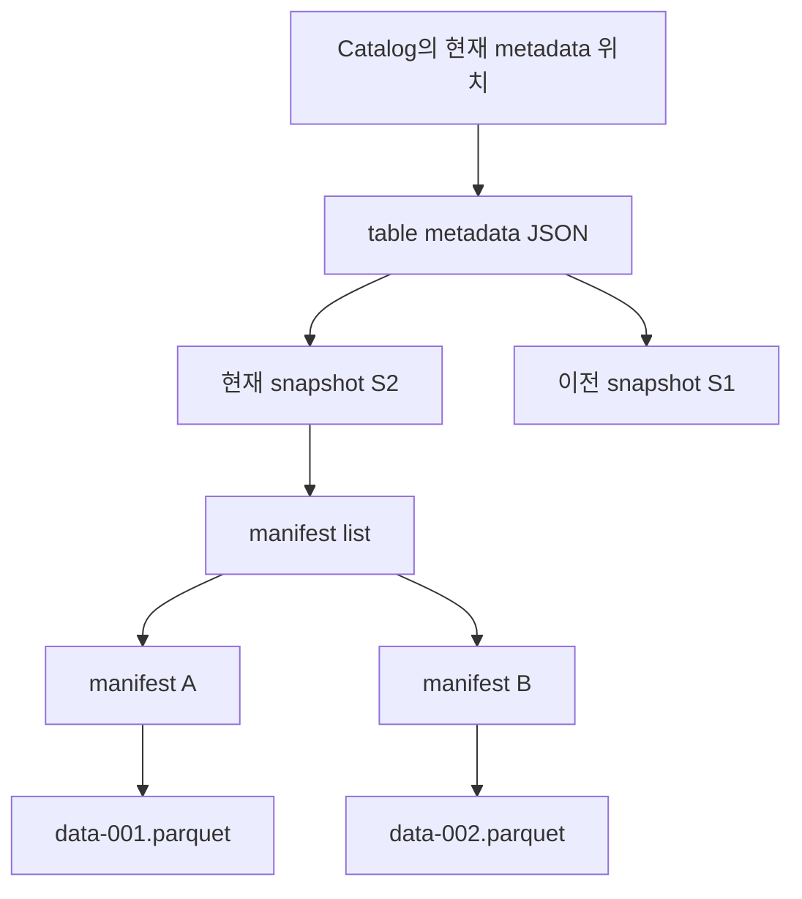
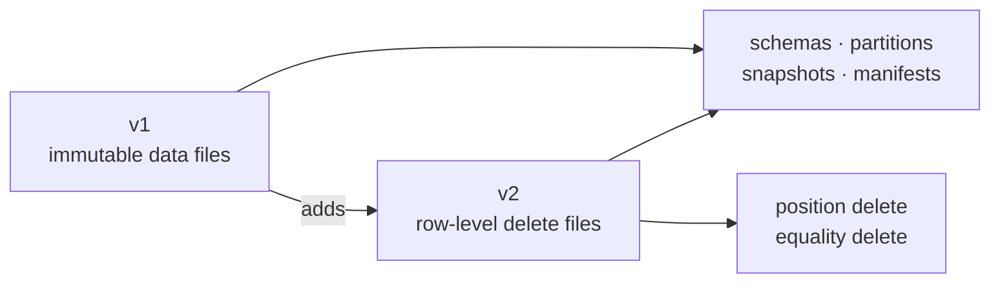
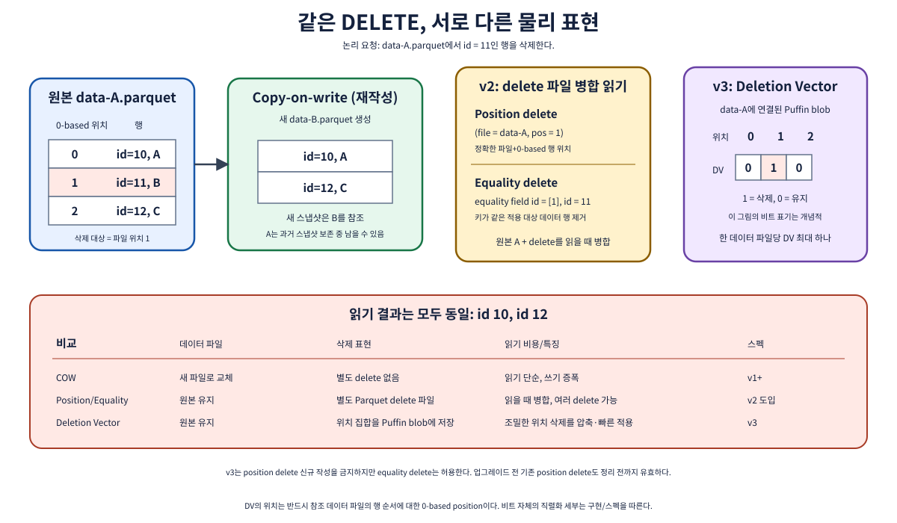
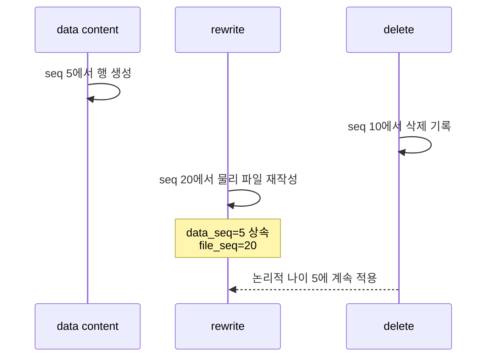
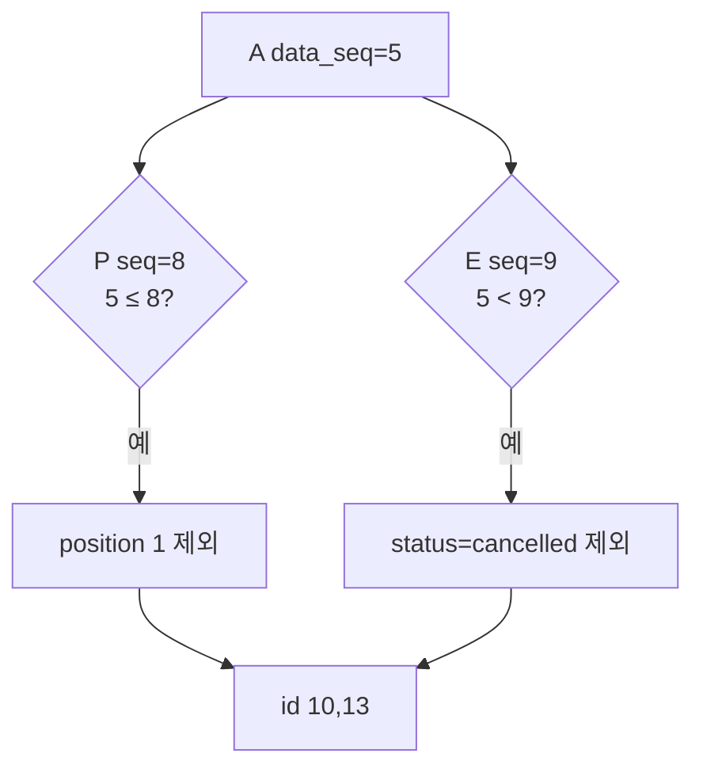
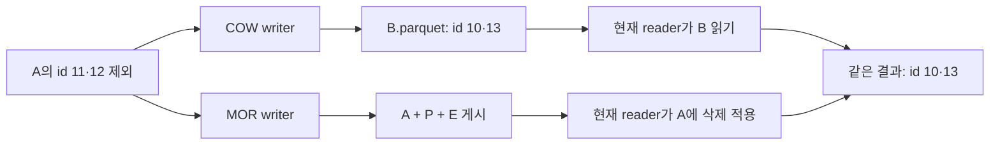

# 05. 포맷 v1과 v2: 스냅샷 테이블에서 행 단위 삭제까지

[← 이 책 목차](README.md)

작성·문헌 확인 및 읽기 흐름 개정: **2026-10-11**

테이블에 주문 다섯 건을 담은 파일이 있고 그중 두 건을 삭제하려 한다. 파일을 새로 써서 두 행을 빼는 방법과, 원본을 두고 “읽을 때 이 두 행을 제외하라”는 기록을 추가하는 방법이 있다. 이 장은 두 방법이 어떤 파일과 메타데이터를 만들고, 읽는 프로그램이 어떻게 같은 결과를 얻는지 설명한다.

**데이터 파일(data file)**은 실제 행 값을 담는 파일이다. **삭제 파일(delete file)**은 테이블을 읽을 때 제외할 행을 표현하는 별도 파일이다. **읽는 프로그램(reader)**은 현재 테이블에 속한 데이터와 삭제 기록을 조합해 결과를 만들고, **쓰는 프로그램(writer)**은 변경을 나타내는 새 파일과 테이블 상태를 게시한다. 여기서 “삭제”는 현재 조회 결과에서 행이 빠진다는 뜻이며, 원본 파일의 바이트를 즉시 지운다는 뜻은 아니다.

v1은 이미 스키마·파티션 진화와 과거 테이블 상태 조회를 지원한다. v2는 행 단위 삭제 파일과 그 적용 순서를 판단하는 번호를 추가한다. 먼저 파일 형식과 테이블 포맷의 차이를 잡고, 삭제 대상을 표현하는 두 방법, 적용 순서, 파일 재작성, 파일 수명으로 이어 간다. 예제의 파일 이름과 시각·번호는 원리를 분리한 교육용 값이며 실제 엔진 명령을 실행한 결과가 아니다.

공식 기준은 [Iceberg Table Spec의 format versioning](https://iceberg.apache.org/spec/#format-versioning), [manifest](https://iceberg.apache.org/spec/#manifests), [scan planning](https://iceberg.apache.org/spec/#scan-planning)이다.

## 1. 파일 형식과 테이블 포맷은 서로 다른 규칙이다

**파일 형식(file format)**은 행과 열을 한 파일 안에 어떻게 기록할지 정한다. Parquet, Avro, ORC가 이 층에 있다. **테이블 포맷(table format)**은 여러 파일 중 어떤 파일이 현재 테이블에 속하는지와 어떤 스키마·파티션 규칙을 적용할지 정한다. Iceberg는 이 층의 규칙이다. 따라서 `format-version=2`는 “Parquet v2로 저장한다”는 뜻이 아니다.

**스냅샷(snapshot)**은 한 번 게시한 테이블 상태다. 그 상태에서 읽을 파일 목록과 변경 관계를 메타데이터로 추적한다. **메타데이터(metadata)**는 행 값 자체가 아닌 스키마·파일 목록·스냅샷 관계 등의 설명 정보다. **커밋(commit)**은 준비한 새 상태가 테이블의 변경으로 받아들여져 독자가 찾을 수 있게 되는 경계다. 새 Parquet 파일이 저장소에 존재하는 순간과 커밋 성공 순간은 다르다.

| 층 | 묻는 질문 | 예 |
| --- | --- | --- |
| 데이터 파일 형식 | 한 파일 안의 값은 어떻게 배치되는가? | Parquet, Avro, ORC |
| Iceberg table format | 어떤 파일이 어느 스냅샷에 속하는가? | metadata JSON, manifest list, manifest |
| Iceberg format version | metadata와 행 변경을 어떤 규칙으로 표현하는가? | v1, v2, v3 |
| 쿼리 엔진 | 어떤 SQL과 기능을 실제로 실행하는가? | Spark, Flink, Trino 등 |

테이블의 format version이 같아도 엔진별 `UPDATE`, `DELETE`, `MERGE INTO` 지원은 다를 수 있다. 반대로 SQL 문장이 실행된다고 해서 그 엔진이 모든 v2 최적화와 maintenance 기능을 지원한다는 뜻도 아니다.

## 2. v1도 이미 완전한 스냅샷 테이블이다

v1은 immutable Parquet·Avro·ORC 파일을 추적하는 분석 테이블 포맷이다. “immutable”은 객체를 절대 삭제할 수 없다는 뜻이 아니라, 이미 게시된 데이터 파일의 바이트를 제자리에서 수정해 새 행 상태를 만들지 않는다는 뜻이다. 변경은 새 파일과 새 metadata를 쓴 뒤 새 스냅샷을 게시한다.



v1의 중요한 기능은 다음과 같다.

| 기능 | v1에서 가능한가? | 핵심 아이디어 |
| --- | --- | --- |
| 원자적 commit | 예 | 새 metadata를 만들고 catalog pointer를 교체한다 |
| snapshot과 time travel | 예 | 과거 snapshot의 manifest tree를 따라간다 |
| schema evolution | 예 | 이름 대신 안정적인 field ID로 열을 식별한다 |
| partition evolution | 예 | 파일마다 partition spec ID를 기록한다 |
| hidden partitioning | 예 | 사용자는 물리 파티션 열을 직접 관리하지 않아도 된다 |
| 통계로 읽을 범위 축소(pruning) | 예 | 값의 범위를 보고 조건을 만족할 수 없는 파일을 미리 제외한다 |
| delete file로 행 삭제 | 아니요 | 이것이 v2의 대표적 추가 기능이다 |

### 2.1 v1에서 행을 고치는 방법

v1에서 한 행만 바꾸려 해도 그 행이 들어 있는 파일을 새 파일로 교체할 수 있다. **Copy-on-write(COW, 쓰기 시점의 복사·재작성)**는 변경할 파일을 읽어 새 행 상태를 담은 파일을 만들고, 새 스냅샷에서는 그 새 파일을 선택하는 방식이다. “copy”는 파일을 똑같이 복제한다는 뜻이 아니라, 기존 파일을 바탕으로 변경 결과를 새 파일에 쓴다는 뜻이다.

```text
의사 절차 — 특정 고객의 등급을 silver에서 gold로 변경

1. 해당 행이 들어 있는 data-A.parquet을 읽는다.
2. 변경 결과를 data-B.parquet으로 쓴다.
3. 새 snapshot에서 data-A를 제거하고 data-B를 추가한다.
4. commit이 성공한 뒤 새 reader는 data-B를 본다.
5. 과거 snapshot reader는 보존 기간 동안 data-A를 볼 수 있다.
```

한 행 때문에 큰 파일을 다시 쓰면 **쓰기 증폭(write amplification)**이 생긴다. 논리적으로 바꾼 데이터에 비해 실제로 다시 쓰는 바이트가 많아지는 현상이다. 그러나 읽을 때 별도 delete를 합칠 필요가 없고 결과 파일이 정리되어 있다는 장점도 있다.

## 3. v2는 두 종류의 delete file을 추가한다

v2에서는 데이터 파일을 유지하면서 삭제 파일을 스냅샷에 추가할 수 있다. Reader는 적용 대상 삭제를 함께 계획해 삭제된 행을 결과에서 제외한다. 다음 두 방식의 차이는 “무엇으로 행을 식별하는가”다. **Position delete(위치 기반 삭제)**는 파일 경로와 그 파일 안의 행 번호를 저장한다. **Equality delete(값 일치 기반 삭제)**는 지정한 열의 값으로 대상을 찾는다.

삭제 기록에는 적용 범위도 있다. **파티션(partition)**은 날짜 같은 규칙으로 파일을 나눈 논리적 범위이고, **순서 번호(sequence number)**는 테이블 변경의 상대적인 순서를 나타내는 수다. 같은 값의 행이어도 삭제 기록보다 뒤에 추가했거나 범위가 다르면 그 삭제의 대상이 아닐 수 있다. [v2 spec changes](https://iceberg.apache.org/spec/#version-2-row-level-deletes)는 position delete와 equality delete를 정의한다.

| 종류 | 저장하는 것 | 잘 맞는 상황 | 주의점 |
| --- | --- | --- | --- |
| position delete | data file 경로 + 0부터 시작하는 row position | 삭제할 실제 파일과 위치를 안다 | 파일 rewrite 뒤 위치가 바뀌면 새 관계로 정리해야 한다 |
| equality delete | 값을 비교할 열의 ID들과 삭제할 값 | 키 조건으로 많은 파일의 행을 논리 삭제한다 | 파티션·순서 번호·허용되는 값 비교 규칙을 지켜야 한다 |

### 3.1 position delete 숫자 예제

`data-A.parquet`에 다음 다섯 행이 있다고 하자.

| position | order_id | amount |
| ---: | ---: | ---: |
| 0 | 101 | 10 |
| 1 | 102 | 20 |
| 2 | 103 | 30 |
| 3 | 104 | 40 |
| 4 | 105 | 50 |

위치 기반 삭제 파일에 아래 두 레코드가 있으면 position 1과 4를 제외한다. 이 예제는 행 위치의 의미를 보기 위해 적용 파티션과 순서 번호가 맞는다고 가정한다.

**레코드(record)**는 파일에 담은 한 항목이다. 이 삭제 파일의 논리 스키마는 다음과 같다. **스키마(schema)**는 열의 이름·형식·필수 여부를 정하는 구조이고, **필드 ID(field ID)**는 이름을 바꾸어도 같은 열을 식별하는 번호다.

| 열과 고정 필드 ID | 형식 | 담는 값 |
| --- | --- | --- |
| `file_path`, ID `2147483546` | 문자열 `string` | 대상 데이터 파일의 전체 URI |
| `pos`, ID `2147483545` | 64비트 정수 `long` | 대상 파일에서 0부터 시작하는 행 위치 |
| `row`, ID `2147483544` | 행 구조 `struct` | 삭제 행의 값을 함께 저장할 때 쓰는 열 |

`row` 열은 파일 전체에서 생략할 수 있다. 넣는 경우에는 모든 삭제 항목에 행 값이 있어야 하며, 행 안의 열 ID는 테이블 열의 ID와 맞아야 한다. 아래 예제는 `row`를 생략했다. **URI(Uniform Resource Identifier, 자원 식별 문자열)**는 `s3://warehouse/orders/data-A.parquet`처럼 저장소와 경로를 함께 표현한다. 실제 `file_path`는 manifest에 기록한 데이터 파일 경로와 일치해야 한다. 여기서는 긴 경로를 `data-A.parquet`으로 줄여 적었다.

```text
위 스키마에서 file_path와 pos를 담은 두 항목

(file_path="data-A.parquet", pos=1)
(file_path="data-A.parquet", pos=4)
```

reader가 돌려주는 `order_id`는 `101, 103, 104`다. `order_id=102`를 기억해서 삭제한 것이 아니라, **그 파일의 두 번째 물리 행**을 가리켰다. 다른 파일의 position 1에는 적용되지 않는다.

### 3.2 equality delete 숫자 예제

**Equality field**는 삭제 여부를 판단할 때 값을 비교하는 테이블 열이다. `customer_id`의 필드 ID가 3이고 삭제 파일이 그 열에 값 7을 담으면, 적용 대상 데이터 파일에서 `customer_id=7`인 행을 모두 제외한다. 이 파일은 “A의 두 번째 행”을 기록하지 않는다. 비교할 열의 ID와 값이 판단 기준이다.

이번 예제는 앞의 `order_id` 예제와 별개인 고객별 삭제다. A와 B는 같은 파티션에 있지만 A의 데이터 순서 번호는 5, B는 12이고 삭제 기록은 9에 게시했다고 하자. 아래에서 `5 < 9`인 A는 적용 대상이고 `12 < 9`가 거짓인 B는 적용 대상이 아니다.

| file | position | customer_id | item | 결과 |
| --- | ---: | ---: | --- | --- |
| data-A | 0 | 7 | book | 삭제 |
| data-A | 1 | 8 | pen | 유지 |
| data-B | 0 | 7 | cup | 유지: 삭제 기록보다 새 데이터 |

A의 행은 두 번째 항목이라서 삭제된 것이 아니다. 파티션·순서 조건을 만족한 행 중 필드 ID 3의 값이 7이어서 삭제된다. B의 첫 행은 값이 같아도 삭제보다 새 데이터여서 남는다. B의 순서 번호를 4로 바꾸면 그 행도 삭제 대상이 된다. 이렇게 **위치**와 **업무 값**을 구분해야 두 삭제 방식이 언제 같은 결과를 내고 언제 다른 결과를 내는지 알 수 있다.

삭제 파일의 비교 대상 열 ID들은 manifest의 `equality_ids`에 기록한다. `customer_id`를 `buyer_id`로 바꾸어도 ID 3을 유지하면 이전 삭제 기록의 의미는 이어진다. 같은 이름으로 다른 ID의 열을 새로 만든 경우에는 별도 열이므로 이전 삭제를 임의로 적용하지 않는다.





*그림 05-1. 두 delete 방식은 모두 원본 데이터 파일을 곧바로 고치지 않는다. position delete는 파일과 행 위치를, equality delete는 열 ID와 값의 일치를 사용한다.*

## 4. 데이터의 나이와 파일 추가 시점을 구분한다

v2는 스냅샷에 변경 순서를 나타내는 번호를 추가한다. **스냅샷 ID**는 상태를 식별하는 값이고, **순서 번호**는 변경의 상대적인 순서를 비교하는 값이다. 스냅샷 ID가 더 큰 상태가 더 나중이라는 가정은 하지 않는다.

**Manifest**는 데이터 또는 삭제 파일의 경로와 파티션·통계 등을 기록한 파일 목록이다. 목록의 한 항목인 **manifest entry**에는 두 종류의 순서 번호가 들어간다. 본문에서 `data_seq`라고 부르는 **data sequence number(데이터 순서 번호)**의 실제 entry 필드 이름은 `sequence_number`다. `file_seq`라고 부르는 **file sequence number(파일 순서 번호)**는 `file_sequence_number`에 있다. 이름이 비슷하지만 삭제 적용에서 서로 바꾸어 쓰면 결과가 틀릴 수 있다. [manifest spec](https://iceberg.apache.org/spec/#manifests)은 delete pruning에 file sequence가 아니라 data sequence를 사용하라고 명시한다.

| 번호 | 나타내는 것 | rewrite 때 가능한 동작 | delete 적용 판단 |
| --- | --- | --- | --- |
| data sequence number | 파일 내용의 논리적 나이 | 내용이 그대로면 상속할 수 있다 | 사용한다 |
| file sequence number | 그 물리 파일이 table에 추가된 시점 | 새 파일이므로 증가할 수 있다 | 사용하면 안 된다 |

**Compaction(파일 정리·병합)**은 여러 파일의 데이터를 새 파일로 다시 배치하는 작업이다. 새 물리 파일을 만들었다고 행의 논리적 나이까지 항상 새 번호로 바꿔야 하는 것은 아니다. 예를 들어 순서 20에서 파일을 재작성하면서 순서 5의 데이터를 논리적으로 그대로 옮기고 그 나이를 명시적으로 보존했다고 하자. 아래 삭제는 새 경로에서도 값으로 대상을 찾을 수 있는 **equality delete**다.

```text
원본 파일: data_seq=5,  file_seq=5
rewrite 파일: data_seq=5, file_seq=20
equality delete 파일: data_seq=10
```

이 equality delete가 순서 5의 행에 적용되어야 하는데 `file_seq=20`을 보고 “삭제보다 새 파일”이라 제외하면 삭제된 행이 조회 결과에 다시 나타날 수 있다. 적용 판단에는 `data_seq=5`를 사용한다. 반면 위치 기반 삭제가 옛 A 경로를 가리켰다면 번호가 같다는 이유만으로 새 B 경로에 적용하지 않는다. 파일 재작성 과정에서 삭제 결과를 새 파일에 반영하거나 새로운 위치 관계를 올바르게 만들어야 한다.

일반적인 정리 작업은 읽을 때 기존 삭제를 적용해 살아 있는 행만 새 파일에 쓸 수도 있다. 위 예제는 파일의 생성 시점과 내용의 나이가 다를 수 있음을 분리해 보인 것이다. 모든 정리 작업이 삭제된 행을 그대로 복사한다는 뜻은 아니다. 또한 새 파일을 추가할 때 데이터 나이를 지정하지 않으면 커밋 순서 번호를 상속하는 경로가 있으며, v1 목록을 v2 규칙으로 읽을 때 누락된 순서 번호의 기본값은 0이다.



## 5. 한 파일에 두 삭제를 적용하고 재삽입을 구분한다

### 5.1 파티션과 순서 조건을 먼저 검사한다

A.parquet가 partition `day=2026-10-10`, `data_seq=5`이고 다음 네 행을 가진다고 하자.

| position | id | status |
| ---: | ---: | --- |
| 0 | 10 | new |
| 1 | 11 | new |
| 2 | 12 | cancelled |
| 3 | 13 | new |

Sequence 8에서 position delete P가 `(A.parquet, position=1)`을 기록한다. 같은 partition이고 A의 data sequence 5가 `5 ≤ 8`이므로 id 11을 지운다. Sequence 9에서 equality delete E가 field ID 기준 `status='cancelled'`를 기록한다. `5 < 9`이고 partition 조건도 맞으므로 id 12를 지운다. 현재 결과는 id 10과 13이다.

```text
A: positions 0,1,2,3
P(seq 8): remove A position 1
E(seq 9): remove rows where status(field-id)=cancelled
result: positions 0,3 → id 10,13
```

| 판단 순서 | Position delete P | Equality delete E |
| --- | --- | --- |
| 파티션 범위 | A와 같은 정의 ID·파티션 값인지 | 같은 정의 ID·파티션 값인지 |
| Sequence | `A.data_seq ≤ P.data_seq` | `A.data_seq < E.data_seq` |
| 대상 식별 | A path와 row position | equality field IDs와 값 |
| 제외 행 | position 1 | status=cancelled인 position 2 |



Equality delete가 컬럼 이름이 아니라 field ID 집합을 기록한다는 점도 중요하다. `status`를 `order_state`로 rename해도 같은 field ID라면 옛 equality delete의 의미가 이어진다. 컬럼을 삭제한 뒤 같은 이름으로 새 field ID를 만들었다면 옛 delete를 새 컬럼에 임의로 적용하면 안 된다.

**Partition 반례.** 다른 day partition에 id 11이 있어도 partitioned position delete P는 그 행을 지우지 않는다. Path와 position이 우연히 같은 숫자라는 이유만으로 다른 파일에 적용하지 않는다.

[scan planning 규칙](https://iceberg.apache.org/spec/#scan-planning)을 초보자 관점으로 정리하면 다음과 같다.

| delete 종류 | data sequence 조건 | 추가 범위 조건 |
| --- | --- | --- |
| position delete | target data sequence ≤ delete data sequence | 같은 파티션 정의 ID·값이며 참조 데이터 파일이 일치 |
| equality delete | target data sequence < delete data sequence | 같은 partition spec과 partition; unpartitioned equality delete는 전역 적용 가능 |

부등호 하나가 핵심이다. position delete는 `≤`이고 equality delete는 `<`다.

### 5.2 같은 커밋에서 기존 키를 지우고 새 상태를 넣는다

sequence 30의 한 commit이 다음 두 작업을 함께 게시한다고 하자.

```text
개념 작업

equality delete: customer_id=7, data_seq=30
new data row:    customer_id=7, data_seq=30, status="active"
```

equality delete 적용 조건은 `target data_seq < delete data_seq`다. 새 행은 `30 < 30`을 만족하지 않으므로 삭제되지 않는다. 오래된 sequence 12의 `customer_id=7` 행은 `12 < 30`이므로 삭제된다. 이 규칙 덕분에 “기존 키를 지우고 새 상태를 삽입”하는 **upsert(있으면 갱신하고 없으면 삽입)** 형태를 한 커밋에 표현할 수 있다. 삭제보다 새로 들어온 행을 무조건 같은 삭제에 다시 지우면 갱신 결과가 사라지므로 두 연산의 적용 순서를 번호로 구분하는 것이다.

반면 position delete는 `target data_seq ≤ delete data_seq`이므로 동일 sequence의 대상 data file에도 적용될 수 있다. 실제 write 계획은 엔진 구현과 validation을 함께 확인한다.

### 5.3 파티션 규칙이 달라지면 값 일치만으로 적용하지 않는다

**Partition spec(파티션 정의)**은 어느 열에 어떤 변환을 적용해 파일을 나눌지 정하는 규칙이며 각 정의에는 ID가 있다. 예를 들어 같은 날짜처럼 보이는 값이 있어도 “하루별 분할”과 “월별 분할”은 서로 다른 정의다. 파티션을 가진 equality delete는 대상 파일과 파티션 정의 ID 및 값이 맞아야 한다. 값 7이 같다는 사실만으로 다른 정의의 모든 파일에 적용하지 않는다.

**Unpartitioned(파티션을 나누지 않은)** 정의의 equality delete는 전역 삭제로 적용할 수 있다. 그래도 데이터 나이와 비교할 열 ID·값의 조건은 남는다. 파일의 파티션 정의와 순서 번호를 모두 검토하는 이유는 스키마·파티션 진화 뒤에도 삭제가 과하거나 부족하게 적용되지 않도록 하기 위해서다.

## 6. 같은 변경을 COW와 MOR로 표현한다

이제 5절의 **삭제 전** A.parquet 네 행으로 돌아가자. 비교할 작업은 id 11과 cancelled 상태인 id 12를 제외해 **id 10과 13만 남기는 것**이다. 앞의 위치/값 삭제가 어떤 의미인지 알았으므로 이번에는 두 writer가 같은 논리 결과를 어떻게 다르게 저장하는지 본다.

### 6.1 COW는 읽을 결과를 새 데이터 파일에 쓴다

COW writer는 A를 읽어 삭제 조건을 적용하고, 남은 id 10과 13을 B.parquet에 쓴다. 새 스냅샷의 데이터 파일 목록에서 A를 제거하고 B를 추가한다. 현재 reader는 B를 읽어 두 행을 얻는다. A의 바이트를 제자리에서 고치지 않으므로 A를 참조하는 과거 스냅샷도 계속 읽을 수 있다.

### 6.2 MOR는 원본과 삭제 표현을 함께 게시한다

**Merge-on-read(MOR, 읽기 시점의 병합)**는 원본 데이터 파일과 별도의 삭제 표현을 유지하고 reader가 두 정보를 조합하도록 하는 방식이다. Writer는 5절처럼 A를 남기고 position delete P와 equality delete E를 추가할 수 있다. Reader는 A에 적용할 P와 E를 골라 id 11과 12를 제외해 id 10과 13을 반환한다. “merge”는 두 행 집합을 그대로 붙인다는 뜻이 아니라 삭제 규칙까지 반영해 현재 보이는 결과를 만든다는 뜻이다.

| 단계 | COW | MOR |
| --- | --- | --- |
| 변경 전 | A: id 10, 11, 12, 13 | A: id 10, 11, 12, 13 |
| 새로 쓰는 것 | B: id 10, 13 | A의 삭제 위치·비교 값을 표현한 P와 E |
| 현재 스냅샷 | A 제외, B 추가 | A 유지, P와 E 추가 |
| Reader의 일 | B의 행 읽기 | A를 읽고 적용 대상 P·E로 제외 |
| 현재 결과 | id 10, 13 | id 10, 13 |
| 과거 상태의 A | 보존 정책과 참조에 따라 남음 | 현재도 데이터 입력이므로 남음 |



COW는 쓰기 때 변경 결과를 새 파일에 반영하는 비용을 지고, MOR는 읽기와 후속 정리 때 삭제를 합치는 비용을 진다. **Materialize(결과를 실제 저장 형태로 확정)**한다는 말은 여기서 삭제를 반영한 살아 있는 행을 B에 써서, 그 삭제를 결과 생성 때 다시 계산하지 않아도 되게 만드는 일을 뜻한다. MOR 뒤에 파일을 정리할 때도 삭제된 id 11·12가 새 데이터 파일에 다시 들어가지 않도록 적용 결과를 반영해야 한다.

### 6.3 선택 주체와 읽기 비용을 구분한다

v2는 가능한 저장 표현을 정의한다. COW/MOR 선택은 해당 작업을 실행하는 엔진 writer의 지원과 작업별 설정·계획에 달려 있다. 테이블 포맷이 파일 크기를 보고 모든 엔진의 선택을 자동으로 대신 결정하는 규칙은 아니다. UPDATE·DELETE·MERGE가 같은 선택을 공유하는지도 엔진의 설정 계약에 달려 있다.

| 기준 | COW에서 지는 비용 | MOR에서 지는 비용 |
| --- | --- | --- |
| 한 행의 변경 | 영향받은 큰 파일을 다시 쓸 수 있음 | 작은 삭제 표현을 쓰지만 읽기 때 적용 필요 |
| 반복 변경 | 변경 때마다 재작성 가능 | 삭제 파일 수와 적용 비용이 누적될 수 있음 |
| 읽기 | 새로 정리된 데이터 파일을 읽음 | 데이터와 적용 삭제의 계획·읽기·대조가 필요 |
| 유지 관리 | 변경 때 정리된 결과를 게시 | 후속 정리 작업의 비용과 복구를 운영 |
| 엔진 호환 | 해당 데이터·메타데이터 읽기 지원 필요 | 실제 사용한 삭제 유형의 읽기·쓰기 지원 필요 |

1 GiB 파일의 한 행을 바꿀 때 매번 거의 1 GiB를 쓰면 COW의 쓰기 증폭이 클 수 있다. 반대로 MOR로 수천 개 삭제 파일을 누적하면 reader가 파일을 고르는 **계획(planning)**과 삭제 조건 대조에 더 많은 시간과 메모리를 쓸 수 있다. **지연(latency)**은 한 작업의 시작부터 끝까지 걸린 시간이고, **commit latency**는 변경이 게시될 때까지 걸린 시간이다. 쓰기 지연만 줄었다고 전체 비용이 줄었다고 결론 내리지 않는다.

현재 스냅샷에 COW로 만든 B와 MOR 입력인 C·삭제 D가 함께 있어도 reader는 같은 규칙을 사용한다. 목록에 들어 있는 각 데이터 파일을 계획하고, 각 파일에 적용되는 삭제만 골라 결과를 만든다. COW/MOR라는 테이블 전체의 표지 하나를 보고 둘 중 한 읽기 알고리즘만 강제로 선택하는 모델이 아니다. 파일 경로, 파티션, 순서 번호와 열 ID가 올바르게 기록돼 있어야 혼합된 결과도 정확하게 읽힌다.

비교 실험에서는 변경 게시 시간, 쿼리 계획 시간, 적용한 삭제 파일 수, 데이터·삭제 바이트, 후속 정리 시간, 장애 뒤 결과를 함께 기록한다. 읽기 중심 분석과 빈번한 변경 적재는 비용 분포가 달라질 수 있으므로 “항상 MOR가 빠르다” 같은 결론을 조건 없이 쓰지 않는다.

## 7. 현재 조회에서 빠진 파일과 물리 삭제는 다른 시점이다

5절의 현재 스냅샷 S9는 A와 P·E로 id 10과 13을 보여 준다. 이를 정리한 S20이 B만 읽도록 바뀌어도, 과거 S5가 A를 참조한다면 A는 과거 조회의 입력이다. 현재 목록에서 A를 뺐다는 사실만으로 A를 저장소에서 지우면 S5를 읽는 독자가 실패한다.

**Snapshot expiration(스냅샷 만료)**은 보존 정책에 따라 옛 테이블 상태를 더 이상 유지하지 않도록 정리하는 과정이다. **Reference(참조)**는 스냅샷이나 브랜치 같은 상태가 어떤 파일을 필요로 하는 관계다. **Garbage collection(GC, 불필요한 객체 회수)**는 필요한 참조가 더 이상 없는 파일을 물리 삭제 후보로 정리하는 과정이다. 이미 옛 상태를 선택한 진행 중 reader와 안전 보존 기간도 고려해야 한다.

| 상태 | A가 필요한 이유 | 즉시 물리 삭제할 수 있는가? |
| --- | --- | --- |
| MOR 변경 뒤 | 현재 reader가 A와 P·E를 읽음 | 아니오 |
| B로 정리한 뒤 | 현재는 B지만 S5가 A를 참조 | 아니오 |
| 보존 상태의 참조가 정리된 뒤 | 진행 reader·안전 기간 등 나머지 조건 확인 | 정책의 안전 조건을 만족한 파일만 후보 |

커밋하지 못한 writer가 남긴 파일은 **orphan file(어떤 게시된 상태에도 연결되지 않은 파일)**이 될 수 있다. 하지만 “목록에서 지금 안 보인다”만으로 오래된 파일과 진행 중 writer의 준비 파일을 구분할 수는 없다. 파일 참조와 안전 기간을 확인하지 않는 정리는 논리적 행 삭제를 저장소 장애로 바꿀 수 있다.

## 8. 포맷 지원과 실제 엔진 기능을 나누어 확인한다

테이블을 v2로 올리면 v2 metadata를 이해하지 못하는 reader가 읽지 못할 수 있다. 업그레이드 전에 모든 writer, batch reader, streaming job, maintenance job, catalog integration의 지원 범위를 확인한다. “엔진 문서에 Iceberg 지원”이라는 한 줄보다 다음 행렬이 유용하다.

| 구성 요소 | v2 read | position delete read | equality delete read | v2 write | maintenance |
| --- | --- | --- | --- | --- | --- |
| Engine A 버전 X | 확인 | 확인 | 확인 | 확인 | 확인 |
| Engine B 버전 Y | 확인 | 확인 | 확인 | 확인 | 확인 |

업그레이드 자체는 스키마 변경이 아니며 기존 파일을 자동으로 모두 다시 쓰는 작업도 아니다. 하지만 format version을 올린 뒤에는 이전 reader와의 호환성이 달라질 수 있으므로 되돌리기 쉬운 설정 변경으로 생각하면 안 된다.

## 9. 확인 문제와 단계별 풀이

### 문제 1. v1은 스냅샷과 과거 상태 조회를 지원하지 않는가?

지원한다. 스냅샷과 파일 목록은 v1부터 테이블 상태를 표현한다. v2의 대표적 추가 기능은 별도 행 삭제 파일이며, 그 적용을 판단할 데이터·파일 순서 번호도 추가한다. “행 삭제 파일 없음”을 “스냅샷 없음”으로 바꾸어 기억하면 v1에서도 가능한 COW 변경과 과거 조회를 설명할 수 없다.

### 문제 2. 데이터 순서 8, 파일 순서 40, equality delete 순서 12이면 적용되는가?

먼저 논리 나이를 비교한다. Equality delete의 조건은 `8 < 12`이므로 순서 조건은 맞는다. 파일 추가 시점인 40은 이 비교에 사용하지 않는다. 다음으로 파티션 정의·값의 범위를 확인하고, 마지막으로 지정한 열 ID의 값이 일치하는 행을 제외한다. 순서 조건을 통과했다는 사실만으로 파일의 모든 행이 삭제되는 것은 아니다.

### 문제 3. 같은 커밋 50에서 id 9를 equality delete하고 새 id 9를 넣으면?

새 행의 데이터 순서도 50이라면 `50 < 50`은 거짓이므로 새 행은 그 삭제에 적용되지 않는다. 데이터 순서 12의 기존 id 9는 `12 < 50`이라 범위와 값 조건을 만족할 때 삭제된다. 기존 상태는 지우고 새 상태를 남기는 갱신을 같은 커밋에 표현한 결과다. 이 부등호를 `≤`로 잘못 바꾸면 새 상태까지 지워 버린다.

### 문제 4. Position delete 순서 8은 데이터 순서 8에도 적용되는가?

위치 기반 삭제의 순서 조건은 `target data_seq ≤ delete data_seq`이므로 `8 ≤ 8`은 참이다. 같은 커밋의 파일도 지정한 경로·위치와 파티션 범위를 만족하면 삭제할 수 있다. Equality delete의 `<`와 구분해야 한다. 데이터 순서가 9라면 `9 ≤ 8`이 거짓이어서 같은 위치 숫자를 갖고 있어도 그 삭제가 적용되지 않는다.

### 문제 5. A의 position 1 삭제가 재작성한 B의 position 1도 지우는가?

아니다. 위치 기반 삭제의 식별은 행 번호 하나가 아니라 `(파일 경로, 행 번호)`다. A의 position 1과 B의 position 1은 다른 대상이며, 재작성하면서 정렬하거나 앞 행을 제외하면 번호에 대응하는 행도 달라질 수 있다. Writer가 기존 삭제를 적용한 살아 있는 행을 B에 쓰거나 새로운 파일의 위치 관계를 올바르게 기록해야 한다. 오래된 A 삭제를 이름만 바꾸어 B에 적용하면 다른 행을 지울 수 있다.

### 문제 6. 삭제한 행 200바이트에 비해 COW가 1 GiB를 다시 썼다. 어떤 비용을 비교할까?

이 교육용 조건의 데이터 재작성 비율은 `1,073,741,824 / 200 ≈ 5,368,709`다. 압축과 메타데이터 등의 비용을 제외해도 논리 변경에 비해 큰 재작성이 생겼다. MOR는 원본 재작성을 피할 수 있지만 삭제 파일 작성과 reader의 계획·적용 비용을 낸다. 따라서 변경 게시 지연만 비교하지 말고 반복 조회 비용과 이후 정리 비용까지 같은 실험 구간에 포함한다.

### 문제 7. 현재 스냅샷에서 A가 빠졌으면 바로 파일을 지워도 되는가?

현재 조회가 B만 쓰더라도 과거 스냅샷·브랜치가 A를 참조하거나 진행 중 reader가 A를 읽을 수 있다. 필요한 참조와 보존 정책을 확인한 뒤 나머지 안전 조건을 만족하는 파일만 물리 정리 후보로 다룬다. “id 11이 현재 결과에서 없다”, “현재 목록에서 A가 없다”, “A를 저장소에서 지워도 된다”는 각각 논리 결과·현재 상태·전체 파일 수명의 다른 주장이다.

### 문제 8. MOR를 실행하기 전에 무엇을 확인해야 하는가?

Reader와 writer가 실제 사용할 position/equality delete 유형을 지원하는지 먼저 확인한다. 이어서 파일 누적에 따른 계획·읽기 비용과 정리 작업, 동시 변경 충돌과 장애 복구를 다룰 수 있는지 본다. SQL의 `DELETE` 문법만 실행된다는 사실로 이 모두가 지원된다고 판단할 수 없다. 같은 스냅샷에 COW 결과와 MOR 입력이 섞인 경우도 파일별 적용 조건에 따라 같은 논리 결과를 읽는지 확인한다.

## 10. 공식 출처

- [Iceberg Table Spec: format versioning](https://iceberg.apache.org/spec/#format-versioning)
- [Iceberg Table Spec: version 2 row-level deletes](https://iceberg.apache.org/spec/#version-2-row-level-deletes)
- [Iceberg Table Spec: manifests와 sequence 상속](https://iceberg.apache.org/spec/#manifests)
- [Iceberg Table Spec: scan planning과 delete 적용 조건](https://iceberg.apache.org/spec/#scan-planning)

[← 이전: 스냅샷과 히스토리](04-snapshots-and-history.md) · [다음: 포맷 v3 →](06-format-v3.md)
