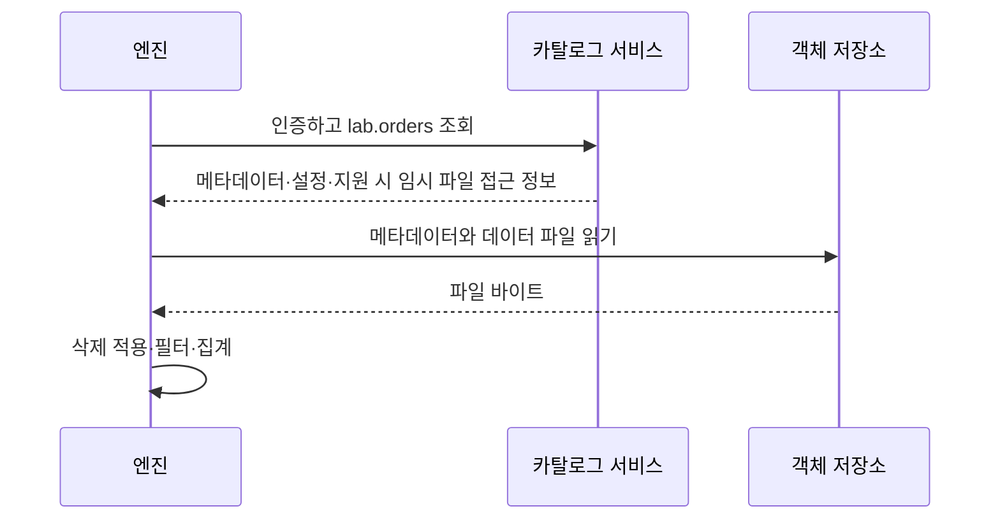

# 08. 카탈로그와 여러 엔진

[이 책의 목차](README.md) · [이전 장](07-latest-and-compatibility.md)

카탈로그를 설치한다고 데이터 처리 엔진이나 객체 저장소가 함께 생기는 것은 아니다. 이 장에서는 이름 조회, 커밋, 파일 읽기, 권한을 실제 연결 관계로 나눈다.

**UUID**는 이름 변경과 구별하여 테이블 자체를 식별하는 값이다. **warehouse**는 파일을 둘 기본 저장 위치다. **REST 카탈로그**는 HTTP라는 요청·응답 통신 규칙을 통해 테이블 조회와 관리를 제공하는 계약이다. 같은 파일 경로와 같은 테이블의 현재 상태는 서로 다른 질문이다.

## 1. 같은 테이블을 찾는 데 필요한 정보

엔진에 `prod.lab.orders`를 질의하면 먼저 `prod`라는 등록된 카탈로그를 사용한다. 그 카탈로그가 `lab.orders`를 찾는다. 다른 엔진의 카탈로그 이름이 `iceberg`여도 같은 서비스의 같은 테이블을 가리킬 수 있다.

```text
Spark 안의 이름: prod.lab.orders
Trino 안의 이름: iceberg.lab.orders

두 이름이 같은 REST catalog의 같은 table UUID를 찾는지 확인해야 한다.
문자열이 같다는 사실이나 warehouse prefix가 같다는 사실만으로 판정하지 않는다.
```

**Namespace**는 테이블 이름을 묶는 이름 공간이다. DB의 schema와 비슷한 역할로 쓰이지만 카탈로그마다 계층 구조·지원 제한이 다르다. 엔진의 database라는 말과 동일하게 동작한다고 가정하지 않는다.

## 2. 카탈로그와 파일 I/O는 다른 연결이다

**File I/O**는 엔진이 저장소의 파일을 읽고 쓰는 구성요소다. 예를 들어 REST 카탈로그 조회가 성공해도 S3 파일을 읽는 자격증명이 없으면 쿼리는 실패한다.



일반적인 클라이언트 계획 경로다. 리모트 계획 기능이 있으면 서비스가 파일 작업 목록을 제공하는 등 호출 흐름이 달라진다. 데이터 파일을 엔진이 직접 읽는 구성과 카탈로그가 데이터를 전부 중계하는 구성을 혼동하지 않는다.

| 관찰 | 성공한 계층 | 아직 실패할 수 있는 계층 |
| --- | --- | --- |
| 카탈로그에 테이블 이름이 보임 | 이름 조회 | 파일 인증·네트워크·타입 reader |
| JSON을 읽을 수 있음 | 메타데이터 파일 접근 | manifest·Parquet·삭제 파일 접근 |
| SELECT가 성공 | 현재 읽기 경로 | 새 파일 쓰기·커밋·유지보수 권한 |
| INSERT 성공 | 이번 쓰기 경로 | 다른 엔진의 읽기 호환성·복구 경로 |

## 3. 카탈로그 종류를 저장 방식과 사용 조건으로 비교한다

아래는 제품 추천 순위가 아니다. 역할과 전제조건을 비교하는 지도다. 지원 버전과 구현의 세부 설정은 공식 문서로 확인한다.

| 종류 | 이름·상태를 관리하는 방식 | 사용할 때 확인할 점 |
| --- | --- | --- |
| HadoopCatalog | 파일시스템의 warehouse 구조와 원자적 파일 연산 | 원자적 rename을 제공하는 파일시스템 필요 |
| HiveCatalog | Hive Metastore를 이용한 이름·메타데이터 관리 | HMS 연결·잠금·인증·카탈로그 호환 |
| RESTCatalog | 표준 REST API를 제공하는 서비스와 통신 | 서비스 구현·인증·commit·credential 기능 |
| GlueCatalog | AWS Glue Data Catalog를 이용 | AWS 권한·버전 기반 동시성·파일 I/O 설정 |
| JdbcCatalog | JDBC로 접근하는 관계형 DB에 카탈로그 상태 저장 | DB 트랜잭션·서비스 가용성·연결 관리 |
| Nessie 연동 | 버전 관리 카탈로그 서비스 사용 | 카탈로그 branch와 table snapshot branch의 차이 |

**REST(Representational State Transfer)**는 HTTP API 설계 방식의 이름이다. RESTCatalog는 클라이언트 구현이고, 실제 요청을 받는 카탈로그 서버는 별도로 선택·운영한다. `type=rest` 한 줄이 서버를 자동 시작하지 않는다.

**JDBC(Java Database Connectivity)**는 Java 프로그램이 관계형 DB에 연결하는 API다. JdbcCatalog에 PostgreSQL을 쓸 수 있어도 주문 행을 PostgreSQL에 전부 넣는 뜻은 아니다. 테이블 카탈로그 상태와 파일 데이터를 구별한다.

## 4. 로컬 HadoopCatalog 예제를 S3에 그대로 옮기지 않는다

09장은 로컬 파일시스템에서 **한 프로세스로 실행하는** 작은 HadoopCatalog 실습이다. HadoopCatalog는 원자적 rename 같은 파일시스템 성질에 의존한다. 공식 문서는 로컬 파일시스템과 S3에서 이 카탈로그의 동시 쓰기가 안전하지 않다고 경고한다. 따라서 로컬 실습 성공을 여러 writer의 커밋 안전성 증거로 사용하지 않는다. 객체 저장소에서는 일반 디렉터리 rename과 동일한 의미를 가정할 수 없다.

```text
로컬 실습에서 성공한 설정
  type=hadoop
  warehouse=file:///.../warehouse

그대로 바꾸면 충분하다고 가정하면 안 되는 설정
  type=hadoop
  warehouse=s3://.../warehouse

객체 저장소에 맞는 catalog commit 경로와 FileIO를 따로 선택·검증한다.
```

MinIO나 Ceph RGW를 쓰는 경우에는 endpoint, TLS, path-style access, region, 자격증명, 멀티파트 업로드, 클라이언트 호환성을 확인한다. 네트워크 접근과 파일 읽기만 시험해서 동시 커밋의 안전성이 증명되지는 않는다.

## 5. REST catalog의 credential vending

**Credential, 자격증명**은 인증·접근에 사용하는 토큰이나 키다. **Credential vending**은 카탈로그가 권한 검사를 거쳐 클라이언트에게 제한된 파일 접근 자격증명을 제공하는 방식이다.

이 기능을 지원하는 서비스에서는 모든 엔진에 광범위한 장기 S3 키를 배포하는 대신 테이블 범위·수명 등을 제한하는 구성을 만들 수 있다. 다만 표준에 기능이 있다고 사용하는 서버가 모두 구현하거나 자동 활성화하는 것은 아니다.


쿼리가 오래 걸리면 토큰 갱신이 필요할 수 있다. catalog token과 storage token의 수명·갱신 경로도 다르다. 토큰을 notebook 출력·SQL history·로그에 기록하지 않도록 설정한다.

## 6. 한 테이블을 여러 엔진에서 사용할 때

같은 snapshot을 읽는 두 엔진의 결과를 비교한다. 최소한 행 수, key별 중복 수, 금액 합계, null, 시간 precision, 삭제 반영을 확인한다. 문자열 collation·timezone·decimal 계산·타입 매핑이 다르면 단순 행 수만 같고 실제 값은 달라질 수 있다.

| 기능 | 시험 데이터 | 통과 기준 |
| --- | --- | --- |
| 컬럼 evolution | rename 뒤 같은 이름의 새 컬럼 | 원래 field ID의 값이 유지 |
| 파티션 evolution | 월·일 spec 혼합 | 정확한 필터 결과 |
| v2 deletes | equality와 position 혼합 | 삭제 행이 결과에 안 보임 |
| v3 DV | 기존 v2 position과 DV 전환 | 삭제 행 부활 없음 |
| Defaults | 필드 추가 전후 파일 | 초기·쓰기 default 의미 보존 |
| ns timestamp | 마이크로초 아래 자리 포함 | 지원 여부 명확·허용 시 값 보존 |
| Maintenance | rewrite 전후 같은 snapshot 의미 | 행 값·lineage·삭제 의미 보존 |

**엔진 캐시** 때문에 카탈로그의 최신 상태를 즉시 새로 읽지 않는 경우가 있다. “한 엔진에서는 보이고 다른 엔진에서는 안 보임”이 곧 저장소 손상이라는 뜻은 아니다. 같은 catalog·table UUID·snapshot·branch를 보는지와 메타데이터 cache 정책부터 확인한다.

## 7. 카탈로그 이전은 데이터 폴더 복사와 다르다

같은 이름으로 다른 카탈로그에 새 테이블을 만들면 원래 테이블과 별개의 UUID가 될 수 있다. 메타데이터 파일에는 절대 파일 경로가 들어갈 수 있어 버킷 복사만으로 주소가 바뀌지 않는다.

이전 계획에는 다음이 필요하다.

1. 모든 reader·writer와 유지보수 작업을 목록화한다.
2. 테이블 UUID·현재 metadata·snapshot·branch/tag·파일 경로를 기록한다.
3. 지원되는 register/migrate/import 경로와 그 제한을 확인한다.
4. 쓰기를 하나의 권위 있는 커밋 경로로 모을 전환 시점을 정한다.
5. 이전 전후 행 값과 과거 스냅샷 접근을 검증한다.
6. 구 카탈로그의 정리 작업이 공유 파일을 삭제하지 않도록 한다.

두 카탈로그가 독립적으로 같은 파일을 관리하고 서로를 모르면서 쓰고 정리하는 상태는 위험하다. “하나의 파일을 여러 엔진이 읽음”과 “독립된 두 테이블 수명주기가 같은 파일을 관리함”을 구별한다.

## 조회와 확정은 서로 다른 API 작업이다

**API(Application Programming Interface)**는 두 프로그램 사이의 입력·출력·오류 계약이다. **HTTP**는 요청과 응답을 교환하는 통신 규칙이고, **REST Catalog**는 HTTP를 통해 이름 조회와 테이블 관리·확정 기능을 제공하는 Iceberg의 카탈로그 계약이다. REST는 그 서버의 내부 저장소가 무엇인지까지 하나로 정하는 제품명이 아니다.

**UUID**는 테이블의 정체성을 구별하는 식별자다. 표시 이름을 바꿔도 같은 테이블을 추적하는 데 사용한다. **namespace**는 lab처럼 테이블 이름들을 묶는 이름 공간이다. **warehouse**는 데이터와 메타데이터를 둘 기본 저장 위치를 뜻하는 설정으로 사용된다. 같은 warehouse 경로를 썼다는 사실만으로 두 카탈로그가 같은 현재 상태를 관리한다고 볼 수 없다.

### 테이블 이름 하나가 읽기로 이어지는 전체 요청

아래 이름·상태 번호는 개념 추적용이며 REST 요청 본문의 정확한 스키마 전체를 표현한 것이 아니다. **인증(authentication)**은 호출자의 신원을 확인하고, **인가(authorization)**는 그 호출자가 이 테이블의 특정 작업을 해도 되는지 판단한다.

| 순서 | 요청 주체와 대상 | 전달하는 정보 | 결과의 의미 |
| --- | --- | --- | --- |
| 1 | Spark 설정→카탈로그 클라이언트 | prod 이름과 서버 주소 | prod를 어느 서비스로 해석할지 결정 |
| 2 | 클라이언트→카탈로그 | 호출자 자격 증명, lab.orders | 이름과 권한 검사 |
| 3 | 카탈로그→클라이언트 | 테이블 UUID, metadata V10 | 이번에 읽을 상태와 설정 |
| 4 | FileIO→저장소 | V10 위치, 저장소 자격 증명 | 메타데이터 바이트 |
| 5 | reader→저장소 | snapshot 50의 목록과 파일 경로 | 이번 상태의 읽기 작업 |
| 6 | 엔진 계산 | 행 필터와 삭제 적용, 집계 | 사용자 쿼리 결과 |

**FileIO**는 저장소에서 파일의 바이트를 읽고 쓰는 인터페이스다. 카탈로그 클라이언트는 테이블을 찾고 확정 요청을 보내며, FileIO는 데이터·메타데이터 파일을 전송한다. S3는 여기서 파일과 비슷한 객체를 키로 보관하는 객체 저장소의 예다. 카탈로그의 HTTP 인증이 성공해도 S3 자격 증명에 읽기 권한이 없으면 단계 4나 5가 실패한다. 반대로 저장소 파일을 쓸 수 있어도 테이블 변경 권한이 없으면 확정할 수 없다.

**credential vending**은 지원하는 카탈로그가 이번 작업 범위에 맞는 저장소 접근 자격 증명을 발급하는 기능이다. 임시 자격 증명의 만료 시각과 허용 경로, 읽기·쓰기 권한은 호출자의 테이블 권한과 연결해야 한다. 모든 REST 카탈로그가 같은 발급 방식이나 기능을 제공한다고 가정하지 않는다. 발급 기능이 없다면 클라이언트의 저장소 자격 증명을 별도로 구성해야 한다.

### 두 writer의 충돌을 객체별로 구분한다

W1과 W2가 모두 V10, main snapshot 50을 읽었다고 하자. **동시성 제어**는 이처럼 겹친 변경이 현재 상태를 잃어버리지 않도록 확정 순서를 검사하는 규칙이다. **낙관적 제어(OCC)**는 먼저 작업을 준비하고, 게시 시점에 기준 상태와 충돌 여부를 검사한다.

| 시점 | W1 | W2 | 카탈로그의 현재 상태 |
| --- | --- | --- | --- |
| t0 | V10 조회 | V10 조회 | V10 / snapshot 50 |
| t1 | 새 파일 B와 후보 상태 51 준비 | 새 파일 C와 후보 상태 52 준비 | V10 / 50 |
| t2 | 기준 50에 대해 51 확정 요청 | 아직 준비 중 | 요청의 요구 조건 검사 |
| t3 | 확정 성공 | 기준 50에 대해 52 확정 요청 | 새 metadata / 51 |
| t4 | 완료 | 요구 조건 불일치로 충돌 | W1의 변경 유지 |
| t5 | 없음 | 새 상태 조회, C 재사용 가능성 및 변경 검증 | 새 기준 51 |
| t6 | 없음 | 적합하면 새 후보로 다시 확정 | B와 C를 포함한 이후 상태 |

REST 확정 계약은 테이블 UUID나 브랜치의 현재 스냅샷 같은 **요구 조건(requirements)**과 수행할 **변경(updates)**을 전달한다. 조건이 맞지 않으면 준비된 파일이 이미 존재해도 이전 기준의 결과를 무조건 덮어쓰면 안 된다. 어떤 비교를 하고 어떤 변경을 원자적으로 확정할지는 카탈로그 계약에 따른다. 모든 구현에서 expected_metadata라는 동일한 필드를 보내는 것으로 단순화하면 실제 API와 어긋날 수 있다.

W2가 재시도할 때 C의 바이트를 다시 업로드해야 하는지는 작업 종류에 달려 있다. 독립적인 추가라면 파일을 재사용할 수 있지만, W1이 바꾼 행·파일을 W2도 수정했다면 다시 읽고 새 결과를 만들어야 할 수 있다. **refresh**는 최신 테이블 메타데이터를 다시 불러오는 동작이지 충돌을 무시하는 허가가 아니다. 확정의 응답만 유실된 경우에는 현재 상태를 확인해 중복 변경을 막는 규칙도 필요하다.

### reader 호환성도 상태별로 검사한다

한 엔진은 파일을 읽고 다른 엔진은 오류를 내는 경우가 있다. 테이블 포맷 버전, 열 타입, 삭제 표현, 파일 형식, 카탈로그 인증을 각각 이해해야 하기 때문이다. **삭제 벡터(DV)**는 특정 데이터 파일의 제외할 물리 행 위치를 나타내며, 이를 읽지 않는 reader는 삭제 전 행을 반환하거나 지원 오류를 낼 수 있다. DV를 담는 Puffin이라는 보조 형식과 행을 담는 Parquet의 역할도 구별한다.

공정한 비교는 두 엔진이 같은 UUID와 같은 스냅샷을 읽는지부터 시작한다. 그 다음 같은 SQL 의미, NULL 처리, 시각·소수 타입, 필터와 삭제 적용을 비교한다. 이름이 같거나 조회 행 수가 우연히 같다는 사실은 충분한 근거가 아니다.

### 이전과 장애 복구에서 권위 있는 상태를 하나로 유지한다

카탈로그 이전은 주소록 복사만이 아니다. 테이블의 UUID·현재 메타데이터·브랜치·태그·파일 경로를 옮기는 동안 누가 변경을 확정할 수 있는지를 통제해야 한다. 옛 서비스와 새 서비스가 독립적으로 writer를 받아 서로 다른 현재 상태를 만들면 같은 파일 경로를 공유하면서도 서로 다른 테이블 역사를 갖게 된다.

이를 **분리된 권위(split authority)** 문제라고 볼 수 있다. 한쪽 유지보수가 자신의 메타데이터에서 보이지 않는 파일을 삭제하면 다른 쪽이 읽어야 할 파일을 지울 수 있다. 쓰기를 통제한 전환 지점, 단일 확정 권위, 참조 이력, 필요한 저장소 자격 증명, reader 전환 순서를 함께 계획해야 한다. 카탈로그 캐시도 새 상태를 재조회하는 시점을 바꾸므로 전환 직후 오래된 상태를 읽는지 관측한다.

이 책의 로컬 파일 기반 예제는 단일 작성자의 개념 학습용이다. 로컬 파일 이름 변경 실험을 여러 writer가 쓰는 객체 저장소의 원자적 확정 보장으로 확대하지 않는다. 저장소의 파일 연산과 카탈로그의 확정 계약은 각각 확인해야 하는 조건이다.

## 이름·파일·commit의 세 경로

catalog는 table 이름을 metadata 위치와 UUID에 연결하고 commit 충돌을 중재한다. FileIO는 metadata·manifest·Parquet·Puffin 바이트를 저장소에서 읽고 쓴다. catalog 인증 성공과 S3 권한 성공은 다르다.

Spark가 prod.lab.orders를 요청하면 catalog가 metadata v10을 준다. engine은 v10→snapshot50→manifest list→manifest→A.parquet와 DV를 읽는다. Trino가 다른 local 이름을 써도 같은 service·UUID·snapshot50을 고정해야 결과를 비교할 수 있다.

W1과 W2가 v10을 읽고 W1이 v11을 게시하면 W2 expected-v10 commit은 실패한다. W2 data file upload는 이미 끝났을 수 있어 refresh·conflict check 뒤 재사용하거나 orphan으로 관리한다.

RESTCatalog는 HTTP client/server 계약이고 설정 한 줄이 server를 시작하지 않는다. credential vending은 제한된 storage credential을 발급하는 선택 기능이다. catalog migration은 폴더 복사가 아니며 UUID·snapshot·branch·경로와 단일 권위 writer를 보존한다. 두 catalog가 독립 GC하면 상대가 참조한 파일을 지울 수 있다.

### 추가 문제 5개
1. list 성공 뒤 S3 403 가능? **해설:** 권한 경로가 다르다.
2. W2 실패 이유? **해설:** pointer가 v11로 변했다.
3. REST 설정이 server 설치? **해설:** 아니다.
4. warehouse 같으면 같은 table? **해설:** UUID를 본다.
5. 독립 GC 위험? **해설:** 공유 파일 오판 삭제.

## 8. 확인 질문과 해설

**질문.** RESTCatalog 설정을 넣었는데 연결 거절이 난다. 무엇이 빠졌을 수 있는가?

**해설.** 실제 REST 서비스, 주소·포트, 인증, TLS, 네트워크 경로다. 클라이언트 클래스를 선택하는 것과 서버를 운영하는 것은 다르다.

**질문.** 테이블 목록은 보이지만 S3 403이 난다. 왜 가능한가?

**해설.** 카탈로그 권한과 파일 접근 권한은 별개의 경로다. credential 범위·만료·FileIO 설정을 확인한다.

**질문.** Nessie의 branch와 Iceberg의 snapshot branch는 같은 것인가?

**해설.** 서로 다른 계층의 버전 참조다. 서비스 수준의 카탈로그 참조와 테이블 안의 snapshot reference를 구별한다.

## 공식 출처

공식 [Spark configuration](https://iceberg.apache.org/docs/latest/spark-configuration/), [REST catalog specification](https://iceberg.apache.org/rest-catalog-spec/), [AWS integration](https://iceberg.apache.org/docs/latest/aws/), [JDBC catalog](https://iceberg.apache.org/docs/latest/jdbc/), [Nessie integration](https://iceberg.apache.org/docs/latest/nessie/)를 참고한다. HadoopCatalog의 저장소 전제는 [Java API의 catalog 설명](https://iceberg.apache.org/docs/latest/java-api-quickstart/)과 구현 문서를 확인한다.

[다음: 09. 로컬 실습](09-local-lab.md)
