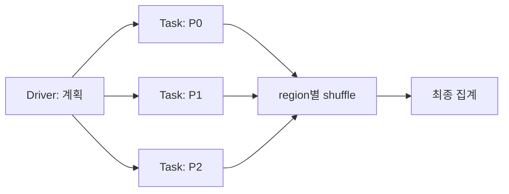

# 00. 데이터에서 Spark까지

**Apache Spark**는 큰 데이터를 여러 프로세스나 서버에 나누어 계산하고 결과를 합치는 분산 처리 엔진이다. Spark에 제출해 드라이버와 실행 프로세스들이 함께 수행하는 한 실행 전체를 **Spark 애플리케이션(application)**이라고 한다. 한 애플리케이션 안에서도 파일 읽기, 합계 계산, 결과 저장처럼 여러 계산 요청을 실행할 수 있다. 먼저 이 엔진이 다루는 데이터와 저장 위치를 구분한 뒤, 계산을 여러 서버로 나누는 이유를 살펴본다.

## 1. 저장된 바이트가 표가 되기까지

**데이터(data)**는 관찰하거나 계산할 사실을 컴퓨터가 다룰 수 있게 표현한 값이다. 주문 번호, 지역, 금액이 예다. 저장장치에는 문자와 숫자의 의미가 아니라 바이트가 놓인다.

**파일(file)**은 이름과 경로로 찾을 수 있는 지속적인 바이트 묶음이다. 서버에 붙은 **로컬 디스크(local disk)**, 여러 서버에 파일을 나누어 저장하는 **HDFS(Hadoop Distributed File System)**, 네트워크 요청으로 이름 붙은 객체를 읽고 쓰는 **객체 저장소(object storage)** 등에 놓일 수 있다. Spark 애플리케이션이 끝나도 원본 파일은 각 저장소의 보존 정책에 따라 남는다. 따라서 계산 프로세스의 메모리를 비우는 일과 원본 데이터를 삭제하는 일은 다른 동작이다.

**행(row)**은 한 사건이나 객체의 필드 묶음이다. 주문 한 건이 한 행이다. **열(column)**은 여러 행에서 같은 의미를 가진 자리다. `region` 열은 지역, `amount` 열은 주문 금액이다.

**schema**는 열 이름, 데이터 타입, 값이 없을 수 있는지 등을 정한 구조다. 문자열 `"100"`과 정수 100은 보이는 내용이 비슷해도 비교와 덧셈 규칙이 다르다.

다음 8행을 사용한다.

| order_id | region | amount |
|---:|---|---:|
| 1 | KR | 10 |
| 2 | US | 20 |
| 3 | KR | 30 |
| 4 | JP | 40 |
| 5 | KR | 50 |
| 6 | US | 60 |
| 7 | KR | 70 |
| 8 | JP | 80 |

원하는 답은 지역별 금액 합계다. 한 process라면 행을 순서대로 읽어 dictionary에 더할 수 있다. 결과는 KR `10+30+50+70=160`, US `20+60=80`, JP `40+80=120`이다.

## 2. CPU, memory, storage, process

**CPU**는 명령을 실행하는 장치다. **memory 또는 RAM**은 실행 중 code와 값을 빠르게 보관하는 휘발성 공간이다. process가 끝나거나 서버가 꺼지면 일반 RAM 상태는 사라진다.

**storage**는 file을 지속 보관한다. disk, object storage, HDFS 등이 있다. memory보다 느릴 수 있지만 application 수명 밖에도 데이터가 남는다.

**program**은 실행할 명령과 데이터 표현이고, **process**는 운영체제에서 실제 실행 중인 program instance다. process에는 memory 주소 공간, thread, 열린 file과 network connection이 있다.

file이 memory보다 크다고 전체를 한 번에 올릴 필요는 없다. 일정 범위의 바이트를 읽고 행으로 해석해 처리한 뒤 다음 범위를 읽을 수 있다. 그러나 groupBy처럼 같은 key의 값을 모아야 하는 계산은 중간 상태와 데이터 이동이 필요하다.

## 3. 왜 여러 서버에 나누는가

**분산 처리(distributed processing)**는 여러 process나 서버가 입력의 일부를 처리하고 결과를 결합하는 방식이다. **cluster**는 이 실행 자원을 제공하는 여러 server의 집합이다.

분산 처리가 필요한 이유는 하나가 아니다.

- 입력이 한 서버의 처리 시간 목표를 넘는다.
- CPU·memory·I/O를 여러 장비에서 병렬로 사용하고 싶다.
- 일부 process가 실패해도 저장된 입력으로 계산을 복구하고 싶다.
- 여러 사용자의 작업을 같은 cluster에서 자원 정책에 따라 실행하고 싶다.

여러 서버를 쓰면 network 이동, scheduling, serialization, 실패 조정이라는 비용이 생긴다. 8행 같은 작은 데이터는 한 process가 더 단순하고 빠를 수 있다. Spark는 모든 크기에서 자동으로 이기는 도구가 아니다.

## 4. 입력 partition과 task

**partition**은 Spark가 하나의 task 입력 단위로 취급하는 데이터 조각이다. source file 자체와 다르다. 큰 file 하나가 여러 partition으로 나뉠 수 있고 작은 file 여러 개가 한 partition에 묶일 수 있다.

**task**는 한 partition에 특정 stage의 계산을 수행하는 실행 단위다. task가 executor process의 thread에서 실행되며 source bytes를 읽어 row로 해석한다.

세 서버에 8행을 다음처럼 나눴다고 하자.

```text
서버 A, P0: (KR,10), (US,20), (KR,30)
서버 B, P1: (JP,40), (KR,50), (US,60)
서버 C, P2: (KR,70), (JP,80)
```

이는 교육용 배치다. 실제 Spark는 file split 크기, source connector, 작은 file 묶기, 설정에 따라 partition을 계획한다. 서버 한 대와 partition 하나도 같은 개념이 아니다. 한 서버가 여러 partition task를 차례로 처리할 수 있고 한 executor가 실패하면 다른 서버가 그 partition을 재실행할 수 있다.

## 5. 세 서버의 부분 집계

각 task가 자기 partition 안에서 지역별 합을 먼저 만든다.

| partition | 입력 | 부분 결과 |
|---|---|---|
| P0 | KR10, US20, KR30 | KR40, US20 |
| P1 | JP40, KR50, US60 | JP40, KR50, US60 |
| P2 | KR70, JP80 | KR70, JP80 |

P0는 KR을 `10+30=40`으로 줄인다. 원본 3행 대신 두 key의 작은 중간 상태를 다음 단계로 보낼 수 있다. 이 작업을 map-side partial aggregation이라고 생각할 수 있다. 실제 적용은 aggregation 함수와 physical plan에 따라 달라진다.

**좁은 의존 관계(narrow dependency)**는 downstream partition 하나가 주로 upstream partition 하나의 데이터만 필요로 하는 관계다. filter나 같은 partition 안의 column 계산은 task pipeline으로 이어질 수 있다.

지역별 최종 합계는 P0·P1·P2의 같은 region을 한곳에 모아야 한다. 여러 upstream partition의 데이터가 섞이므로 **넓은 의존 관계(wide dependency)**다.

## 6. shuffle과 stage 경계

**shuffle**은 같은 key의 데이터를 downstream partition으로 재분배하는 network·disk 과정이다. 각 map task는 key를 기준으로 중간 block을 만들고, reduce task는 자기 담당 key의 block을 여러 executor에서 읽는다.



shuffle 뒤 논리적 모음은 다음과 같다.

```text
KR bucket: 40, 50, 70 -> 160
US bucket: 20, 60     -> 80
JP bucket: 40, 80     -> 120
```

**stage**는 shuffle 같은 경계 사이에서 함께 실행할 수 있는 task 묶음이다. 앞 stage가 부분 결과를 만들고 뒤 stage가 shuffle block을 읽어 최종 합을 만든다. groupBy 하나가 언제나 정확히 두 stage라는 규칙은 아니다. optimizer, exchange reuse, adaptive execution과 앞뒤 연산에 따라 physical plan이 달라진다.

## 7. Spark application의 주체

**application**은 한 번 제출한 Spark program의 수명 경계다. 일반적인 cluster 실행에서는 하나의 driver와 그 application을 위한 여러 executor로 구성된다.

**driver**는 사용자 program 흐름을 실행하고 logical·physical plan, job·stage·task 상태를 관리한다. driver가 원본 모든 행을 대신 읽어 executor에 나눠 주는 것이 아니다.

**executor**는 task를 실행하는 process다. executor가 저장소에서 자기 partition bytes를 읽고 filter·aggregation을 수행하며 shuffle block과 cache를 관리한다.

**cluster manager**는 어느 node에 driver와 executor 자원을 줄지 관리한다. Kubernetes, YARN, Spark standalone 등이 있다. 어떤 join과 aggregation을 쓸지 정하는 optimizer와 어느 server 자원을 배정할지 정하는 cluster manager는 다르다.

| 시점 | 주체 | 실제 객체 |
|---|---|---|
| 계획 | driver | schema, file 목록, logical·physical plan |
| 읽기 | executor task | partition이 가리키는 file bytes |
| 부분 계산 | executor task | key별 sum 같은 memory 상태 |
| 이동 | shuffle writer·reader | partitioned intermediate block |
| 저장 | executor task와 commit protocol | 결과 file·table commit message |
| 상태 관리 | driver | task attempt와 실패·재시도 |

## 8. transformation, action과 lazy evaluation

**transformation**은 기존 DataFrame에서 새 계산 표현을 만드는 연산이다. select, filter, groupBy 뒤 aggregation 등이 있다. 일반적으로 원본 file을 즉시 바꾸지 않는다.

**action**은 결과를 보여 주거나 수를 세거나 저장하는 등 실제 계산을 요구하는 연산이다. count, collect, show, write가 예다.

**lazy evaluation**은 transformation 호출 때 모든 row를 즉시 계산하지 않고 실행 계획을 만들었다가 action에서 필요한 계산을 실행하는 방식이다. 이를 통해 optimizer가 filter와 필요한 column 선택을 source 쪽으로 옮길 수 있다.

lazy라는 말이 action 전 어떤 작업도 없다는 뜻은 아니다. schema 확인, catalog와 file metadata 조회가 앞서 일어날 수 있다. 실제 row 처리와 job 제출 시점을 구분한다.

## 9. 실패와 재실행

P1 task가 부분 결과를 만든 뒤 executor가 종료했다고 하자. 원본 file이 storage에 남고 계산이 결정적이라면 driver scheduler는 P1을 다른 executor에서 다시 실행할 수 있다.

1. driver가 P1 task attempt 실패를 기록한다.
2. cluster manager가 남은 자원 또는 새 executor를 제공한다.
3. scheduler가 P1 partition과 같은 계산을 새 attempt에 보낸다.
4. 새 executor가 source bytes를 다시 읽어 JP40, KR50, US60을 만든다.
5. downstream stage가 새 shuffle block을 읽는다.

**lineage**는 결과가 어떤 입력과 transformation에서 만들어졌는지 나타내는 의존 관계다. Spark는 잃은 partition 결과를 lineage로 다시 계산할 수 있다.

하지만 task 안에서 외부 결제 API를 호출했다면 첫 attempt가 호출 성공 뒤 응답 전에 죽고 두 번째가 다시 호출할 수 있다. Spark의 계산 재시도는 외부 부수 효과를 정확히 한 번으로 만들지 않는다. idempotency key, transaction, sink commit protocol이 별도다.

driver가 죽으면 executor 하나의 재실행과 다르다. executor들이 scheduler 상태를 자동 승계하지 않는다. 배포 시스템이 application을 다시 제출하고 필요한 checkpoint나 외부 상태에서 복구해야 한다.

## 10. collect와 memory 경계

`collect()`는 분산 결과의 모든 row를 driver process로 가져온다. 최종 지역 3행은 작지만 원본 1억 행을 collect하면 위험하다.

행당 serialized payload가 100 bytes라면 1억 행은 단순 payload만 약 10 GB다. driver heap이 4 GB이면 object overhead와 배열·protocol buffer 전에도 담을 수 없다. executor 계산이 성공해도 driver out-of-memory가 날 수 있다.

큰 결과는 file이나 table로 분산 저장하고 driver에는 count, error summary, 일부 sample처럼 작은 결과만 가져온다. `show()`와 `limit()`은 관찰량을 줄이지만 전체 데이터 품질을 증명하지 않는다.

## 11. 저장 기술과 Spark의 역할

| 기술 | 지속 객체 | 담당 역할 |
|---|---|---|
| object storage·HDFS | file bytes | 입력·결과 보관 |
| Parquet | column형 file 구조 | typed column encoding과 statistics |
| Iceberg | table metadata·snapshot·file 목록 | table version과 schema·partition 관리 |
| Spark | plan·task·shuffle 상태 | 분산 계산과 읽기·쓰기 실행 |
| Kubernetes 등 | Pod·resource allocation | process 실행 자원 배정 |

Spark partition은 현재 실행의 task 입력이고, Iceberg partition은 table metadata에서 값을 분류하는 지속적 transform이다. 이름은 같아도 객체와 수명이 다르다.

`repartition`은 실행 partition을 바꾸는 transformation이며 action과 write가 실행되기 전 source file을 바꾸지 않는다.

## 12. 원래 9행 예제도 연결한다

기존 교재의 P0=`(KR10,US20,KR30)`, P1=`(JP40,KR50,US60)`, P2=`(KR70,JP80,US90)`을 계산하면 KR160, US170, JP120이다. 8행 예제와 달리 US90이 추가돼 US가 `20+60+90=170`이다. 입력 한 행의 차이가 어느 partition partial과 최종 bucket을 바꾸는지 추적할 수 있다.

파일 세 개가 항상 task 세 개라는 뜻은 아니다. file 수, split과 partition 수, task 수를 각각 관찰한다.

## 13. batch와 streaming

**batch**는 처리할 입력 범위를 정해 실행하고 종료하는 방식이다. 어제 file 100개를 정제하는 작업이 예다.

**streaming**은 계속 도착하는 입력에 대한 계산을 표현한다. Spark Structured Streaming의 micro-batch 방식은 새 입력을 작은 batch로 반복 처리하고 progress와 sink commit을 관리한다.

```text
batch: 고정 file 집합 -> 처리 -> 결과 commit -> 종료
micro-batch: offset 범위1 -> 처리·commit -> 범위2 -> 처리·commit -> 계속
```

streaming이라는 이름이 event마다 즉시 한 번만 처리됨을 보장하지 않는다. 입력 offset, trigger, state, checkpoint, sink의 중복 처리 계약을 확인한다.

## 14. 최신 optimizer 연구와 경계

Spark의 optimizer는 logical plan을 분석하고 filter pushdown, column pruning, join 선택 같은 결정을 한다. 실행 중 통계로 plan을 조정하는 Adaptive Query Execution도 있다. 기능 지원과 실제 효과는 query, statistics, Spark version과 설정에 따라 달라진다.

CIDR 2025의 QOaaS 연구는 여러 engine에서 query optimizer를 service로 다루는 architecture를 탐구한다. 이는 optimizer의 rule·cost·cardinality 지식을 공유하려는 연구 방향이며 모든 Spark query가 자동으로 빨라졌다는 production 보장이 아니다. prototype의 비교 조건과 현재 Spark planner의 실제 지원을 구분한다.

## 먼저 알아둘 실행 경로: 파일에서 Task까지

기본 실행 단위를 배웠으니 저장소의 파일이 어떻게 Partition과 Task로 이어지는지 전체 경로를 다시 따라가 보자. **파일 목록 조회**는 입력 경로 아래에 어떤 파일이 있는지 확인하는 작업이다. Driver가 파일 이름, 크기, 디렉터리 정보를 읽어 입력 후보를 정한다. 여기서 파일의 실제 데이터 전체를 Driver 메모리로 가져오는 것은 아니다. 보통은 파일을 설명하는 메타데이터만 다룬다.

그다음 Spark의 입력 모듈은 파일의 크기와 형식을 보고 읽기 범위를 만든다. 이 범위를 **split, 스플릿**이라고 부른다. 스플릿은 "이 파일의 이 바이트 범위를 읽어라"라는 논리적 범위다. 다만 모든 파일을 아무 바이트에서나 자를 수 있는 것은 아니다. Parquet 같은 열 지향 파일은 row group이라는 내부 묶음 경계를 이용할 수 있고, 압축 방식에 따라 중간 지점부터 독립적으로 읽지 못할 수도 있다. 그러므로 파일 한 개가 항상 Partition 한 개가 되는 것도 아니고, 파일 세 개가 항상 Partition 세 개가 되는 것도 아니다.

예를 들어 300MB 파일 하나가 있고 읽기 계획이 대략 128MB 단위라면 다음처럼 세 입력 범위가 생길 수 있다.

| 입력 범위 | 담당 바이트의 개념적 범위 | 읽기 Partition |
|---|---:|---|
| split 0 | 0~127MB | P0 |
| split 1 | 128~255MB | P1 |
| split 2 | 256~299MB | P2 |

Driver는 각 Partition마다 Task를 만든다. Executor가 Task를 받으면 저장소에서 자기 범위를 읽고, 바이트를 파일 형식에 맞춰 해석해 행과 열 값으로 복원한다. 이 과정을 **역직렬화**라고 부른다. 직렬화는 메모리의 객체를 전송하거나 저장할 수 있는 바이트열로 바꾸는 일이고, 역직렬화는 그 바이트열을 다시 값으로 복원하는 일이다. 이 비용도 CPU 시간과 메모리를 쓰므로 "디스크 읽기 시간"만으로 전체 실행 시간을 설명할 수 없다.

Task가 많다고 항상 빠른 것도 아니다. Task가 너무 적으면 CPU가 놀고, 한 Task가 담당한 데이터가 너무 커서 실패했을 때 다시 계산할 범위도 커진다. 반대로 몇 KB짜리 작은 파일 수십만 개처럼 Partition이 지나치게 많으면 Driver가 파일과 Task 메타데이터를 관리하는 시간, Task를 Executor에 전달하는 시간, 파일을 여닫는 시간이 실제 계산보다 커질 수 있다. Spark에서 입력 크기와 Partition 수를 함께 보는 이유가 여기에 있다.

## 재실행이 같은 답을 내려면

Spark의 재실행은 이전 Task의 메모리를 되살리는 일이 아니다. Driver가 보관한 계산 관계와 입력 위치를 이용해 새 **attempt, 시도**를 만든다. attempt는 동일한 논리 Task를 실행한 개별 사례다. 첫 실행이 task 7 attempt 0이고 실패 뒤 실행이 task 7 attempt 1이라면, 성공한 시도의 출력만 다음 계산에 사용한다.

이 방식은 같은 입력에 같은 결과를 내는 **결정적 계산**에서 가장 안전하다. amount를 두 배로 만드는 계산은 결정적이다. 현재 시각, 무작위 수, 실행할 때마다 바뀌는 외부 서버 값을 읽는 계산은 재실행 시 값이 달라질 수 있다. Task 안에서 외부 데이터베이스에 "결제 완료"를 기록했다면 첫 시도가 기록 후 실패하고 두 번째 시도가 다시 기록해 중복 부작용을 만들 수도 있다.

외부 쓰기에는 **멱등성**이 필요할 수 있다. 멱등성이란 같은 요청을 한 번 실행하든 여러 번 실행하든 최종 상태가 같아지는 성질이다. 주문 O-17의 상태를 PAID로 설정하면서 이미 PAID인지 확인하는 연산은 중복 실행을 견딜 수 있다. 조건 없이 잔액에서 100원을 차감하는 연산은 두 번 실행하면 결과가 달라진다. Spark 내부 데이터는 lineage로 복원하고, 외부 시스템의 부작용은 고유 요청 ID와 트랜잭션 같은 별도 장치로 보호해야 한다.

## 8행 예제를 네트워크 비용까지 확장하기

8행 예제에서 country별 합계를 내리면 P0, P1, P2에 흩어진 같은 국가 값을 한곳으로 모아야 한다. 각 행을 그대로 보내면 8개 레코드가 네트워크를 지난다. Executor가 먼저 자기 Partition 안에서 부분 합계를 만들면 P0의 3행은 KR=40, US=20 두 레코드로 줄고, P1의 3행은 세 레코드, P2의 2행은 두 레코드가 된다. 네트워크로 이동하는 값은 최대 7개다.

작은 예에서는 8개와 7개의 차이가 작다. 한 Partition에 같은 국가 행이 백만 개 있다면 로컬 부분 합계는 백만 행을 국가 수만큼의 레코드로 줄인다. 이를 **map-side combine, 전송 전 부분 결합**이라고 이해할 수 있다. 평균은 평균값 하나만 보내면 합칠 수 없다. P0의 KR 값 10과 30은 (sum=40, count=2)로 보내고, 다른 Partition의 쌍과 합친 뒤 전체 sum을 전체 count로 나눈다. 중간 표현이 네트워크 양과 정답 가능성을 함께 결정한다.


[이 책의 목차](README.md) · [다음: Driver와 executor](01-driver-executor.md)

데이터 처리는 파일을 여는 일에서 끝나지 않는다. 파일의 바이트를 행과 열로 해석하고, 잘못된 값을 제외하고, 같은 key의 값을 모아 계산하며, 실패하면 같은 계산을 다시 수행하고, 결과를 저장해야 한다. 한 컴퓨터에서 끝낼 수 없는 크기나 시간 요구가 생기면 이 과정을 여러 실행 주체에 나눈다. Spark는 이 분산 계산을 계획하고 조정하는 엔진이다. Spark 자체는 데이터를 영구 보관하는 파일 형식이나 database가 아니다.

이 장은 주문 8행을 세 서버가 합산하는 과정을 처음부터 끝까지 추적한다. 먼저 file·row·column·memory·process를 설명한 뒤 partition·task·shuffle·retry가 왜 필요한지 연결한다.

## 15. 연습 문제와 완전한 풀이

### 문제 1. P0 부분합

P0의 결과는?

**풀이:** KR은 10+30=40, US는 20이다. 세 원본 행을 두 key 상태로 축약한다.

### 문제 2. 8행 최종합

**풀이:** KR 40+50+70=160, US 20+60=80, JP 40+80=120이다.

### 문제 3. partial average

A에 20 한 개, B에 22 세 개가 있다.

**풀이:** 평균의 평균은 21이지만 전체는 `(20+66)/4=21.5`다. sum과 count를 결합한다.

### 문제 4. file 세 개와 task 수

**풀이:** 반드시 같지 않다. 큰 file split, 작은 file combine, source와 설정이 입력 partition을 정한다.

### 문제 5. executor 실패

원본 file도 사라지는가?

**풀이:** executor memory와 local shuffle은 잃을 수 있지만 durable storage의 source는 별도다. lineage로 필요한 task를 재실행한다.

### 문제 6. external API

task retry가 결제를 한 번만 보장하는가?

**풀이:** 아니다. 첫 attempt의 효과 뒤 실패가 생기면 재호출한다. 외부 시스템의 idempotency와 transaction이 필요하다.

### 문제 7. 1억 행 collect

100 bytes씩이면?

**풀이:** payload만 약 10 GB라 4 GB driver에 맞지 않는다. 분산 저장하고 작은 summary만 가져온다.

### 문제 8. Spark와 Parquet

둘은 같은가?

**풀이:** Parquet는 file의 column 저장 형식이고 Spark는 계산 engine이다. Spark는 Parquet를 읽지만 다른 source도 읽는다.

## 공식 근거

- [Spark 4.2.0 Overview](https://spark.apache.org/docs/4.2.0/)
- [Spark SQL and DataFrames](https://spark.apache.org/docs/4.2.0/sql-programming-guide.html)
- [Spark Cluster Mode Overview](https://spark.apache.org/docs/4.2.0/cluster-overview.html)
- [CIDR 2025 QOaaS](https://www.vldb.org/cidrdb/2025/towards-query-optimizer-as-a-service-qoaas-in-a-unified-lakehouse-ecosystem-can-one-qo-rule.html)

---

[이 책의 목차](README.md) · [다음: 01. Driver와 executor](01-driver-executor.md)
