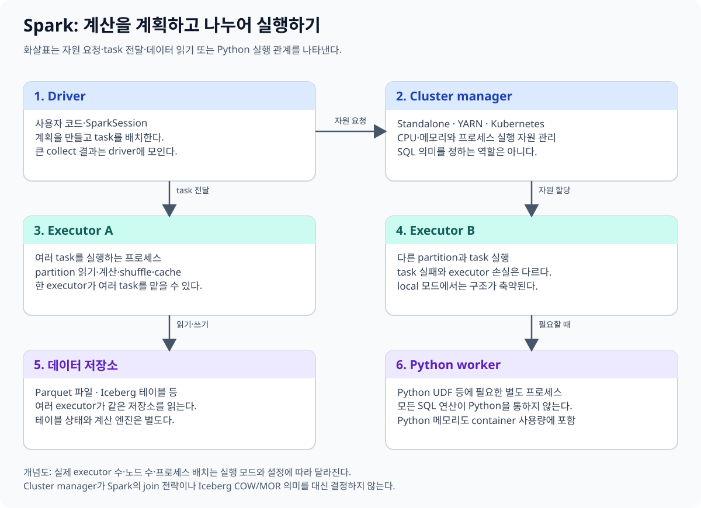
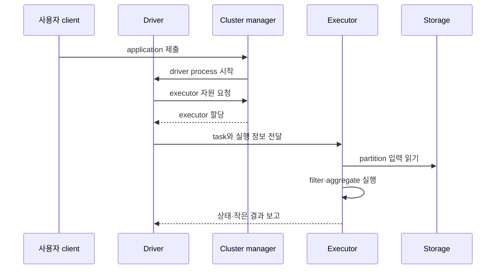
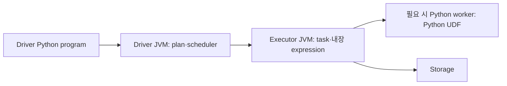

# 01. Driver와 executor

[이 책의 목차](README.md) · [이전 장](00-data-to-spark.md) · [다음: DataFrame과 SQL](02-dataframes-sql.md)

Spark program 한 줄 뒤에는 사용자의 client, 계산을 조정하는 driver, task를 실행하는 executor, process를 배치하는 cluster manager와 file을 보관하는 storage가 있다. 이 객체를 구분해야 driver memory 부족, executor 종료, 느린 task, application 전체 재시작을 서로 다른 문제로 진단할 수 있다.

## 1. process, JVM과 application

**process**는 운영체제에서 실행 중인 program instance다. 고유한 memory 공간, thread, 열린 file과 network connection을 가진다.

**JVM(Java Virtual Machine)**은 Java bytecode를 실행하고 heap memory와 thread, garbage collection을 관리하는 runtime이다. Spark의 핵심 driver와 executor는 일반적으로 JVM process에서 동작한다.

**application**은 한 번 제출된 Spark program의 수명 경계다. driver 하나와 그 driver를 위해 할당된 executor들, application ID, configuration, job 상태가 묶인다. 한 cluster에는 여러 application이 동시에 있을 수 있고, 한 application은 여러 action과 job을 실행할 수 있다.

application이 끝나면 executor process와 memory cache도 끝난다. source와 결과 file은 storage 정책에 따라 남는다.

## 2. driver가 소유하는 상태

**driver**는 사용자 program의 제어 흐름을 실행하고 SparkSession을 소유하며 query plan과 scheduler 상태를 관리하는 process다.

driver는 다음 객체를 가진다.

- DataFrame transformation으로 만든 logical plan
- analyzed·optimized·physical plan
- action에서 생성된 job과 stage graph
- task와 task attempt의 실행·실패 상태
- executor 등록과 heartbeat 정보
- 작은 result와 broadcast metadata

driver가 모든 source row를 먼저 읽어 executor에 배포하는 것은 아니다. executor task가 storage에서 자기 partition을 읽는다. 그러나 `collect()` 결과는 driver memory로 돌아온다.

## 3. executor와 worker node

**executor**는 특정 application에 할당돼 task를 실행하는 JVM process다. partition을 읽고 expression·aggregation·join을 수행하며 cache block과 shuffle output을 관리한다.

**worker node**는 executor process가 놓이는 server 또는 VM이다. executor 네 개가 server 네 대라는 뜻은 아니다. 한 node에 여러 executor가 있을 수 있고 executor 하나가 여러 CPU core를 사용할 수 있다.

**thread**는 process 안의 실행 흐름이다. executor는 여러 task를 thread에서 동시에 실행할 수 있다. task CPU가 1이고 executor core가 4라면 대략 네 task slot을 제공한다.

**slot**은 동시에 task를 실행할 수 있는 자원 용량을 설명하는 실무 표현이다. 독립적인 Spark 저장 객체가 아니라 core와 task CPU 설정으로 계산한 capacity다.

## 4. cluster manager

**cluster manager**는 node의 CPU·memory를 application에 할당하고 driver·executor process를 시작하거나 교체하는 시스템이다. Spark standalone, YARN, Kubernetes가 예다.

cluster manager는 어느 node에 process를 놓을지 정한다. Catalyst optimizer가 join algorithm을 고르는 일과 다르다.

## 5. client deploy mode와 cluster deploy mode

**client**는 Spark application을 제출하는 program 또는 machine이다. **deploy mode**는 driver가 어디에서 실행되는지 정한다.

client mode에서는 driver가 제출 command를 실행한 client 쪽 process에 있다. terminal이나 notebook과 driver의 network·수명이 직접 연결될 수 있다. client가 cluster executor와 통신 가능한 address를 가져야 한다.

cluster mode에서는 cluster manager가 cluster 안에 driver process를 시작한다. 제출 command가 끝나도 driver는 cluster에서 계속 실행할 수 있다. log와 network 접근 경로가 client mode와 다르다.

두 mode 모두 executor는 cluster manager가 배치한다. mode 이름만 보고 성능이 항상 빠르다고 결론 내리지 않는다. driver network, 운영, 장애와 접근 통제가 선택 기준이다.

## 6. PySpark의 Python process와 JVM

classic PySpark에서는 driver 쪽 Python program이 Py4J 연결을 통해 driver JVM에 DataFrame plan 요청을 보낸다. 내장 SQL expression은 executor JVM engine에서 실행된다.

Python UDF가 있으면 executor가 별도 Python worker process에 data batch를 전달할 수 있다.

JVM heap과 Python process memory는 별도다. executor heap만 늘려 Python worker OOM이 자동 해결되지 않는다. 반대로 Python memory가 작아도 JVM aggregation state와 shuffle buffer가 heap을 압박할 수 있다.

Spark Connect에서는 client와 remote Spark server가 protocol로 분리되며 classic driver 내부 접근과 지원 API 경계가 다르다. 현재 실행 방식부터 확인한다.

## 7. plan에서 task까지

사용자가 DataFrame `groupBy` 뒤 `collect()`를 호출한다고 하자.

1. transformation이 unresolved logical plan을 만든다.
2. analyzer가 table·column·type을 catalog와 schema에 결합한다.
3. optimizer가 filter pushdown과 projection 같은 rewrite를 수행한다.
4. physical planner가 scan, partial aggregate, exchange, final aggregate를 고른다.
5. action이 하나 이상의 job 실행을 요구한다.
6. scheduler가 shuffle 경계로 stage를 나눈다.
7. stage의 각 partition에 task를 만든다.
8. task scheduler가 executor의 사용 가능한 slot에 task attempt를 보낸다.
9. executor가 input을 읽고 결과·metric·shuffle block을 만든다.
10. 최종 작은 result가 driver와 client에 반환된다.

**job**은 action을 만족하기 위한 실행 작업 집합이다. **stage**는 shuffle 경계 사이의 task 묶음이다. **task**는 stage 계산을 partition 하나에 적용하는 단위다. **task attempt**는 실패·speculation 때문에 같은 task를 실행한 개별 시도다.

## 8. 숫자로 slot과 wave 계산

executor 3개에 각 4 core, task당 CPU 1이라고 하자. 다른 제한이 없으면 동시 task slot은 약 `3×4=12`다.

stage에 task 120개가 모두 비슷한 시간이면 최소 약 10 wave로 실행한다. wave는 앞 12개가 끝난 뒤 다음 12개가 slot을 쓰는 묶음을 설명하는 표현이다.

실제 시간은 `가장 느린 task`, input locality, I/O, GC, spill, skew, dynamic allocation에 따라 달라진다. task당 CPU를 2로 요구하면 executor당 약 2개, 전체 약 6개가 동시에 실행돼 20 wave가 필요할 수 있다.

executor 수를 늘리면 process별 overhead와 shuffle connection도 늘어난다. executor당 core를 늘리면 같은 heap에서 동시 task memory 경쟁과 GC 범위가 커질 수 있다.

## 9. heartbeat와 executor 수명

**heartbeat**는 executor가 driver에 주기적으로 살아 있음과 metric 상태를 알리는 message다. 일정 시간 heartbeat가 없으면 driver는 executor를 잃었다고 판단할 수 있다.

heartbeat 지연 원인은 process 종료뿐 아니라 긴 GC pause, network partition, node overload일 수 있다. timeout을 크게 늘리면 일시 지연을 견디지만 실제 장애 발견이 늦어진다.

executor가 종료되면 cluster manager는 정책과 resource에 따라 새 executor를 시작할 수 있다. 그러나 죽은 executor memory cache와 local shuffle file은 새 process에 자동 이전되지 않는다.

## 10. lineage와 실패 재실행 trace

앞 장의 P0·P1·P2를 stage 0에서 부분 집계하고 stage 1이 shuffle block을 읽는다고 하자. E1이 P0·P1, E2가 P2를 처리한다.

### P1 task exception

P1 attempt가 code exception으로 실패하면 driver scheduler가 retry limit 안에서 같은 P1 task를 E2 또는 새 executor에 보낼 수 있다. P0와 P2가 유효하면 반드시 다시 할 필요는 없다.

### E2 종료와 P2 block 유실

P2 map output이 E2 local disk에만 있고 E2가 사라지면 downstream reduce가 block을 읽지 못한다. scheduler는 P2를 만드는 이전 stage task를 다른 executor에서 재실행하고 새 block 위치를 사용한다.

**lineage**는 output partition이 어떤 input과 transformation에 의존하는지 나타낸다. durable source와 결정적 transformation이 있으면 잃은 intermediate를 다시 만들 수 있다.

### driver 종료

driver가 죽으면 scheduler state와 application 조정 주체가 사라진다. executor가 새 driver를 선출해 자동 이어받는 일반 구조가 아니다. cluster manager나 제출 시스템이 application 자체를 재시작해야 한다. streaming checkpoint와 외부 commit 상태는 별도 복구 입력이다.

## 11. 외부 부수 효과와 retry

task가 외부 API에 결제 요청을 보내고 응답 전에 executor가 종료되면 API는 이미 성공했을 수 있다. retry task는 같은 요청을 다시 보낸다.

Spark는 계산 partition을 다시 실행할 수 있지만 외부 시스템의 exactly-once 효과를 보장하지 않는다. idempotency key, database unique constraint, transactional sink, commit coordinator가 필요하다.

파일 sink도 task attempt가 임시 file을 만들고 성공한 output만 commit하도록 protocol이 필요하다. object storage와 table format의 commit semantics를 확인한다.

## 12. driver와 executor memory 숫자

결과 1억 행, serialized row당 100 bytes면 payload만 약 10 GB다. driver heap 4 GB에서 `collect()`하면 담을 수 없다. object overhead와 deserialization으로 실제 요구는 더 클 수 있다.

executor hash aggregation state가 500 MB인데 execution memory 여유가 400 MB라면 spill 또는 OOM 가능성을 조사한다. **spill**은 memory에 다 담지 못한 중간 상태를 local disk로 내리는 동작이다. 성공하더라도 disk I/O와 시간이 늘 수 있다.

dimension table을 planner가 8 MB로 추정해 broadcast했는데 실제 serialized size가 800 MB이면 모든 executor가 큰 copy를 받아 memory 압박을 받는다. EXPLAIN의 estimate와 runtime actual metric을 구분한다.

**GC**는 JVM이 사용하지 않는 object memory를 회수하는 과정이다. heap pressure와 object 수가 많으면 긴 pause가 heartbeat와 task latency에 영향을 줄 수 있다.

## 13. local mode의 경계

`local[2]`는 한 computer에서 task 실행 thread 두 개를 사용한다. server 두 대나 executor 장애·network shuffle failure를 재현하지 않는다.

`local[1]`은 한 task thread, `local[*]`는 사용 가능한 core를 바탕으로 thread를 사용한다. local에서 계산 의미와 API를 확인한 뒤 실제 cluster에서 resource·network·failure를 시험한다.

## 14. 전체 수명 trace

1. client가 application jar·Python file과 configuration을 제출한다.
2. cluster manager가 driver를 시작한다.
3. driver가 SparkSession과 application ID를 만들고 executor를 요청한다.
4. executor가 등록하고 heartbeat를 시작한다.
5. user transformation이 plan을 만들고 action이 job을 만든다.
6. job이 stage와 task로 나뉘어 slot에 배정된다.
7. executor가 storage input, shuffle, computation을 수행한다.
8. failure가 나면 driver가 task attempt 또는 lost stage output을 재실행한다.
9. output은 storage commit 또는 작은 driver result가 된다.
10. application 종료 시 executor가 정리되고 durable output은 남는다.

## 실행 상태를 읽는 네 가지 추가 원리

Driver가 Task를 Executor에 보낸다고만 말하면 중요한 질문이 남는다. 어느 Executor를 고르고, 동시에 몇 개를 실행하며, 실패한 시도를 어떻게 구분할까? 이를 설명하려면 **스케줄러**가 필요하다. 스케줄러는 아직 실행하지 않은 Task와 현재 비어 있는 실행 자원을 비교해 배치 순서를 정하는 Driver 내부 구성 요소다. 스케줄러 자체가 데이터를 계산하는 Executor는 아니다. Driver 프로세스 안에서 Application이 끝날 때까지 살아 있으며, Job과 Stage의 의존 관계 및 각 Task의 상태를 관리한다.

### 1. slot과 데이터 위치

**slot, 실행 자리**는 Executor가 동시에 실행할 수 있는 Task 수를 설명하는 편의적 표현이다. Spark 안에 항상 slot이라는 독립 파일이나 프로세스가 존재하는 것은 아니다. 보통 Task 한 개가 CPU 1개를 요구할 때 Executor core 수를 가용 자리 수처럼 센다. executor 3개에 core 4개씩이면 약 12개 Task를 동시에 실행할 수 있다. Task 하나가 CPU 2개를 요구하면 동시 실행 수는 약 6개가 되고, 120개 Task는 최소 20개 물결로 나뉜다. 메모리가 부족하면 CPU가 남아도 실행을 미뤄야 하므로 core 수만으로 실제 동시성을 보장할 수는 없다.

스케줄러는 가능하면 데이터와 가까운 Executor를 고른다. 이를 **data locality, 데이터 지역성**이라고 한다. 어떤 블록이 worker A의 로컬 디스크나 메모리에 있다면 A의 Executor가 읽을 때 네트워크 전송을 줄일 수 있다. 그러나 가까운 Executor가 오래 바쁘면 기다리는 시간보다 다른 노드로 데이터를 보내는 편이 빠를 수 있다. 따라서 지역성은 절대 규칙이 아니라 대기 시간과 전송 비용을 함께 보는 배치 힌트다. S3 같은 원격 객체 저장소를 읽는 경우에는 HDFS의 로컬 블록처럼 특정 worker만 특별히 가까운 구조가 아닐 수도 있다.

### 2. 동적 할당과 Executor의 수명

**동적 할당**은 실행 중인 workload에 맞춰 Executor 수를 늘리거나 줄이는 기능이다. workload는 Application이 처리해야 할 Task와 데이터의 양을 뜻한다. 대기 Task가 늘면 cluster manager에 Executor 추가를 요청하고, 일정 시간 놀고 있는 Executor는 반납할 수 있다. Executor는 Application 전체와 항상 같은 수명을 갖지 않을 수 있다는 뜻이다.

Executor를 줄일 때도 상태를 생각해야 한다. 그 Executor의 메모리에만 cache된 Partition은 사라질 수 있다. cache는 재사용하려는 계산 결과를 Executor 메모리나 디스크에 임시 보관한 사본이다. 원본 입력과 lineage가 남아 있다면 나중에 다시 계산할 수 있지만, 다시 읽고 계산하는 비용이 생긴다. shuffle 출력도 잃을 수 있으므로 Spark는 외부 shuffle 서비스나 shuffle tracking 같은 방식으로 Executor 제거와 shuffle 생존을 조정한다. 어떤 방식이 가능한지는 cluster manager와 설정에 달려 있다.

동적 할당은 항상 싸고 빠르게 자동 조절되는 마법이 아니다. Executor를 새로 시작하는 시간, JVM 준비 시간, 컨테이너 이미지 준비 시간, cache 재구성 비용이 있다. 몇 초짜리 짧은 Job에서는 Executor가 도착하기 전에 Job이 끝날 수도 있고, 반복 학습처럼 cache를 계속 쓰는 작업에서는 잦은 축소가 오히려 느릴 수 있다.

### 3. 동일 Task가 둘 이상 보이는 경우

한 Task가 느리다고 반드시 실패한 것은 아니다. 특정 노드의 디스크나 네트워크만 느리면 같은 Stage의 다른 Task는 끝났는데 하나만 남는다. 이런 느린 Task를 **straggler, 지연 꼬리 작업**이라고 부른다. Spark의 speculative execution을 켜면 Driver는 동일한 논리 Task의 복제 시도를 다른 Executor에 보낼 수 있다. 먼저 성공한 결과를 채택하고 늦은 시도는 필요 없어질 수 있다.

task 9 attempt 0과 task 9 attempt 1은 서로 다른 데이터 Partition을 처리하는 것이 아니다. 같은 Partition과 같은 연산을 실행하는 두 시도다. 따라서 Task 내부에서 외부 API 호출이나 데이터베이스 증가 연산을 직접 수행하면 두 시도가 모두 부작용을 낼 위험이 있다. Spark가 계산 결과 하나를 채택하는 것과 외부 시스템이 중복 요청을 자동 취소하는 것은 별개다.

**heartbeat, 생존 신호**도 결과 메시지와 다르다. Executor가 주기적으로 Driver에 보내는 heartbeat는 프로세스가 살아 있고 어떤 상태인지 알리는 신호다. heartbeat가 늦었다고 데이터가 틀렸다는 의미는 아니며, 네트워크 정체나 긴 정지 때문에 늦을 수 있다. 반대로 heartbeat가 정상이어도 특정 Task가 논리 오류로 실패할 수 있다. Driver는 실패 원인과 재시도 횟수를 보고 Task 재실행, Stage 재실행, 최종 Application 실패 중 하나로 상태를 바꾼다.

### 4. Action 두 개와 cache

DataFrame filtered를 만든 뒤 filtered.count()와 filtered.write.parquet(...)를 차례로 호출하면 Action이 두 개이므로 일반적으로 Job도 두 번 시작된다. 첫 Job의 결과가 자동으로 두 번째 Job 전체에 영구 저장되는 것은 아니다. 두 Action이 공유하는 중간 결과를 cache하고 실제로 물질화했다면 두 번째 Job이 재사용할 수 있다.

**물질화**는 계산 방법만 있던 값을 실제 메모리나 디스크의 바이트로 만들어 두는 일이다. cache() 호출 자체는 가능하면 저장하라는 표시이며 lazy하다. 뒤의 첫 Action이 Partition을 계산하면서 cache가 채워진다. Executor가 잃어버린 cache Partition은 lineage에서 다시 만들 수 있다. 이 차이를 모르면 cache() 한 줄을 넣었는데도 첫 Action이 빨라지지 않았다고 오해하거나, 모든 Executor 실패 뒤에도 cache가 반드시 남는다고 잘못 생각하게 된다.

## 15. 연습 문제와 완전한 풀이

### 문제 1
executor 3×4 core, task CPU1의 slot은? **풀이:** 약 12개다.

### 문제 2
120 task의 단순 wave는? **풀이:** 120/12=10 wave다. skew와 failure는 추가 시간을 만든다.

### 문제 3
E2의 P2 shuffle 유실 뒤? **풀이:** P2 upstream task를 다른 executor에서 재실행해 block을 만든다.

### 문제 4
driver 4 GB에 10 GB collect? **풀이:** payload만으로 초과해 OOM 또는 result-size 보호 오류가 예상된다.

### 문제 5
Python UDF memory는 JVM heap과 같은가? **풀이:** 별도 Python process 사용량이므로 아니다.

### 문제 6
heartbeat 누락은 항상 crash인가? **풀이:** 긴 GC·network 지연도 가능하다. log와 node 상태를 함께 본다.

### 문제 7
client mode terminal 종료 영향은? **풀이:** driver가 client process에 있으면 application 수명에 영향을 줄 수 있다. deploy mode를 확인한다.

### 문제 8
task retry가 DB insert를 한 번만 만드는가? **풀이:** 아니다. sink idempotency·transaction이 필요하다.

## 공식 근거

- [Spark 4.2.0 Cluster Mode Overview](https://spark.apache.org/docs/4.2.0/cluster-overview.html)
- [Submitting Applications](https://spark.apache.org/docs/4.2.0/submitting-applications.html)
- [Spark Connect Overview](https://spark.apache.org/docs/4.2.0/spark-connect-overview.html)

---

[이전: 데이터에서 Spark까지](00-data-to-spark.md) · [목차](README.md) · [다음: DataFrame과 SQL](02-dataframes-sql.md)
