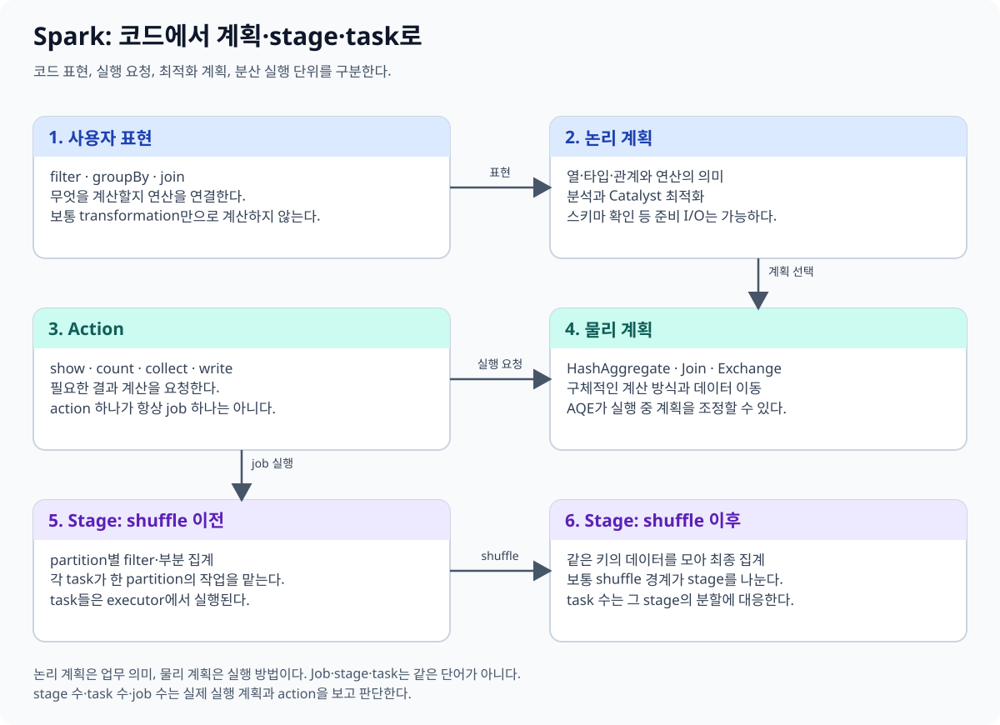

# 03. 지연 실행과 DAG

## 아홉 행이 한 action에서 두 stage와 다섯 task가 되는 과정

[이 책의 목차](README.md) · [이전 장](02-dataframes-sql.md)

Spark 코드를 읽을 때 Python 문장 수와 실제 task 수를 대응시키면 실행을 오해한다. 이 장은 아홉 입력 행이 지연된 계획에 들어가고, action이 job을 만들며, shuffle 경계가 두 stage를 나누고, 3개 map task와 2개 reduce task가 결과를 만드는 전 상태를 추적한다.

## 1. 실행 전에 생기는 객체

**Lazy evaluation**, 지연 실행은 변환을 호출한 즉시 모든 데이터를 계산하지 않고 “무엇을 계산할지”라는 표현을 먼저 만드는 방식이다. Filter나 select, groupBy를 연결하면 Driver JVM 메모리에 plan 객체가 생긴다. 이 객체는 원본 row 전체가 아니라 연산과 열의 관계를 담고, query가 끝나 참조가 사라지면 회수된다. 여러 연산을 함께 본 뒤 불필요한 열과 조건을 정리할 수 있어 필요하다.

**Logical plan**, 논리 계획은 결과의 의미를 나타낸다. Scan 뒤 region과 amount를 선택하고 region별 합계를 구한다는 순서다. **Physical plan**, 물리 계획은 그 의미를 실제 operator로 만드는 방법이다. 어느 scan을 쓰고, partition 안에서 partial hash aggregate를 할지, 어느 지점에 Exchange를 두고 몇 bucket으로 나눌지를 고른다.

**Action**은 실제 결과를 요구하는 호출이다. collect, count, show, write가 대표다. Action이 호출되면 Driver의 scheduler가 실행 작업을 만든다. 다만 action 전에도 schema 추론, file listing, 분석과 같은 I/O나 검증 비용이 생길 수 있으므로 “action 전에는 아무 일도 없다”는 뜻은 아니다.

**Job**은 action 같은 실행 요청으로 만들어지는 병렬 작업 묶음이다. 보통 Driver의 실행 상태와 Spark UI에 식별자가 생기고 성공·실패로 끝난다. Action 하나가 항상 job 하나라는 규칙은 아니다. Broadcast 준비나 source 처리, adaptive query stage 때문에 여러 job처럼 보일 수 있다.

## 2. DAG, lineage, dependency

**DAG**는 Directed Acyclic Graph의 약자로, 방향이 있고 cycle이 없는 그래프다. Node는 계산 또는 데이터 조각이고 edge는 “이 결과가 저 입력을 필요로 한다”는 관계다. Cycle이 없으므로 선행 계산부터 순서대로 실행할 수 있다.

**Lineage**, 계보는 결과 partition을 어떤 원천과 변환으로 다시 만들 수 있는지 기록한 의존 관계다. P1의 중간 block을 잃으면 scheduler가 P1 원천과 변환을 따라 해당 block을 재계산할 근거가 된다. Lineage는 Driver의 실행 계획과 RDD/Dataset 의존 구조에 존재하며 application 수명 동안 복구에 쓰인다. 원천 file 자체를 복사해 보관하는 장치는 아니다.

**Dependency**, 의존 관계는 출력 partition이 어떤 입력 partition을 필요로 하는지 나타낸다. **Narrow dependency**, 좁은 의존은 한 출력 조각이 제한된 입력 조각만 필요로 하는 관계다. P0의 filter와 projection은 P0 task 안에서 이어 할 수 있다. **Wide dependency**, 넓은 의존은 한 출력 조각이 여러 입력 조각의 데이터를 모아야 하는 관계다. Region KR의 최종 합은 P0, P1, P2 모두의 KR 상태가 필요하다.

넓은 의존은 보통 shuffle과 stage 경계를 만든다. 다음 stage의 Q0는 이전 stage의 모든 map task가 자기 Q0 block을 쓸 때까지 완성 입력을 가질 수 없다. 좁은 연산은 같은 task pipeline 안에서 row를 다음 operator로 넘길 수 있다.

## 3. Stage와 task

**Stage**는 shuffle 같은 경계 사이에서 함께 실행 가능한 task들의 집합이다. Stage 객체는 Driver scheduler가 만들고 완료 상태와 attempt를 관리한다. 모든 필요한 task output이 준비되면 stage가 끝난다.

**Task**는 stage의 partition 하나를 처리하는 한 번의 실행 단위다. Driver가 executor에 보내고 executor CPU thread가 실행한다. Task memory에는 scan buffer, partial aggregate map, serializer buffer 같은 상태가 생기고 task가 끝나면 대부분 소멸한다. Shuffle output이나 cache block처럼 다음 계산이 참조하는 것은 로컬 disk나 executor memory에 더 오래 남을 수 있다.

Task 실패 시 같은 논리 partition의 새 attempt가 다른 executor에서 실행될 수 있다. 그러므로 “Stage 0 Task 1”이라는 논리 자리와 실제 attempt 번호, executor 위치를 구분한다.

## 4. 아홉 행과 지연 계획

입력은 세 partition에 놓인 아홉 행이다.

| Input partition | 원본 행 | 행 수 |
|---|---|---:|
| P0 | KR10, US20, KR30 | 3 |
| P1 | JP40, KR50, US60 | 3 |
| P2 | KR70, JP80, US90 | 3 |

다음 표현을 생각한다.

~~~text
summary = source.select(region, amount).groupBy(region).sum(amount)
~~~

이 줄까지는 Driver에 scan→project→aggregate 논리 표현이 생긴다. Input file의 byte가 executor에 모두 읽힌 것은 아니다. summary.collect()가 호출되면 세 결과 row를 Driver에 요구하는 action이 되고 Job 0이 시작된다고 가정한다.

Physical plan은 다음 교육 모형을 선택한다.

~~~text
Scan → Project(region, amount) → Partial HashAggregate
     → Exchange hashpartitioning(region, 2)
     → Final HashAggregate → Collect
~~~

Project는 필요한 두 열만 다음 operator에 전달한다. Partial HashAggregate는 각 input partition 안에서 같은 region을 먼저 합친다. Exchange는 같은 region 상태를 두 shuffle bucket Q0 또는 Q1로 보낸다. Final HashAggregate가 전체 합을 만든다.

## 5. Stage 0: 세 task의 모든 상태

Stage 0에는 P0, P1, P2에 대응하는 task 세 개가 있다.

### Task 0 / P0

1. KR10을 읽어 aggregate map에 KR→10을 만든다.
2. US20을 읽어 US→20을 만든다.
3. KR30을 읽어 기존 KR10에 더해 KR→40으로 바꾼다.
4. Output 상태는 KR40, US20 두 개다.

### Task 1 / P1

1. JP40을 읽어 JP→40.
2. KR50을 읽어 KR→50.
3. US60을 읽어 US→60.
4. Output 상태는 세 개다.

### Task 2 / P2

1. KR70을 읽어 KR→70.
2. JP80을 읽어 JP→80.
3. US90을 읽어 US→90.
4. Output 상태는 세 개다.

| Stage 0 task | 읽은 행 | 부분 상태 | 상태 수 |
|---|---:|---|---:|
| T0/P0 | 3 | KR40, US20 | 2 |
| T1/P1 | 3 | JP40, KR50, US60 | 3 |
| T2/P2 | 3 | KR70, JP80, US90 | 3 |
| 합계 | 9 | - | 8 |

원본 아홉 행이 여덟 상태로 줄었다. P0 안의 KR 두 행이 하나로 합쳐졌기 때문이다. Partial aggregation은 최종 답을 만든 것이 아니다. P1과 P2의 KR을 아직 보지 못했다.

상태 하나의 key와 합계를 합쳐 16 byte라는 교육 모형을 쓰면 T0 shuffle map output은 2×16=32 byte, T1은 48 byte, T2는 48 byte다. 전체는 128 byte다. 실제 serializer, alignment, block header, 압축 byte는 별도다.

## 6. Exchange와 bucket 상태

Partitioner가 KR과 JP를 Q0, US를 Q1로 보낸다고 가정한다.

| Map task | Q0 block | byte | Q1 block | byte |
|---|---|---:|---|---:|
| T0 | KR40 | 16 | US20 | 16 |
| T1 | JP40, KR50 | 32 | US60 | 16 |
| T2 | KR70, JP80 | 32 | US90 | 16 |
| Reduce 합계 | 5 states | 80 | 3 states | 48 |

각 map task가 자기 executor의 local disk 또는 shuffle service 경로에 block을 쓰면 map output tracker가 위치 정보를 Driver 쪽에서 관리한다. Stage 1 task는 필요한 block 위치를 받아 local 또는 network fetch한다. Task object는 끝나도 shuffle block은 downstream stage가 사용할 때까지 남는다.

Exchange가 stage 경계인 이유는 Q0가 T0 한 개만 처리해서는 KR 최종 합을 알 수 없기 때문이다. T0, T1, T2의 Q0 block 모두가 필요하다. 반면 Scan→Project→Partial Aggregate는 각 P 안에서 이어 실행할 수 있다.

## 7. Stage 1: 두 task와 collect

Stage 1에는 Q0와 Q1 두 task가 있다.

| Stage 1 task | Fetch 상태 | 계산 순서 | 최종 row |
|---|---|---|---|
| R0/Q0 | KR40, JP40, KR50, KR70, JP80 | KR 40+50+70, JP 40+80 | KR160, JP120 |
| R1/Q1 | US20, US60, US90 | US 20+60+90 | US170 |

R0는 80 byte, R1은 48 byte를 논리적으로 읽는다. 두 task의 output은 모두 세 row다. collect는 이 세 row만 Driver로 전송한다. 아홉 원본 row 전체를 Driver에 가져오지 않는다.

Job의 전체 단순 상태는 다음과 같다.

| 시점 | Driver | Executor |
|---|---|---|
| Action 직전 | 지연된 plan | 아직 task 없음 |
| Job 제출 | Job 0, Stage 0/1 의존 생성 | task 대기 |
| Stage 0 | task 3개 배정 | 아홉 행→여덟 상태 |
| Shuffle 준비 | block 위치 추적 | 32+48+48 byte 유지 |
| Stage 1 | reduce task 2개 배정 | 80/48 byte fetch·집계 |
| Collect | 세 결과 수신 | task 상태 종료 |
| Job 종료 | 결과 KR160,JP120,US170 | shuffle 임시자료 정리 대상 |

## 8. 정확성을 지키는 부분 집계

합계는 partition별 합을 다시 더해도 전체 합과 같다. 결합 순서가 의미를 바꾸지 않는 연산이므로 partial aggregation이 가능하다. 평균은 평균값 하나만 보내면 안 된다.

예를 들어 P0의 S1 값이 20,22이고 P1에 24가 있으면 P0 평균 21과 P1 평균 24의 단순 평균은 22.5다. 실제 전체 평균은 (20+22+24)/3=22다. Map task가 (sum,count), 즉 (42,2), (24,1)을 보내고 reduce가 (66,3)으로 합쳐야 한다.

Partial state의 정의는 성능 최적화인 동시에 정확성 계약이다. Median이나 임의 사용자 집계처럼 작은 고정 상태로 정확히 결합할 수 없는 연산은 다른 계획과 더 큰 shuffle state가 필요할 수 있다.

## 9. 같은 표현에 action 두 번

summary.count() 뒤 summary.show()를 호출하면 서로 다른 결과 요청이다. Cache가 없으면 두 job이 원천 scan과 두 stage를 각각 실행할 수 있다. DataFrame 변수에 넣었다는 사실은 계산된 row를 저장했다는 뜻이 아니다.

summary.cache()는 저장 요청도 지연될 수 있다. 첫 action이 P0, P1, P2를 계산하며 cache partition block을 executor storage memory에 채운다. 두 번째 action은 남은 cache block을 읽을 수 있다. Memory pressure로 P2 block이 evict되었다면 P0/P1은 재사용하고 P2만 lineage로 다시 계산할 수 있다.

Cache는 첫 계산 비용, memory 점유, eviction과 serialization 비용이 있다. 한 번만 쓰는 거대한 표현에는 손해일 수 있다. 더는 재사용하지 않을 때 unpersist로 수명 종료를 요청한다.

## 10. Lineage 복구 trace

P1 task의 Q0/Q1 block을 보관하던 executor가 Stage 1 fetch 전에 사라졌다고 하자.

1. R0 또는 R1 fetch가 P1 block을 얻지 못한다.
2. Scheduler는 block fetch 재시도 후 map output 유실을 확인한다.
3. Lineage에서 P1 원천 scan→project→partial aggregate→bucket write를 찾는다.
4. Stage 0의 P1 task 새 attempt를 실행한다.
5. JP40, KR50, US60 block을 다시 쓴다.
6. Map output 위치가 갱신된다.
7. 필요한 reduce task가 다시 fetch하고 KR160, JP120, US170을 만든다.

결과가 같으려면 원천 P1이 같은 snapshot으로 다시 읽히고 변환이 결정적이어야 한다. Task 안에서 현재 시각, 난수, 외부 API write를 사용하면 재시도 결과나 side effect가 달라질 수 있다. 원천 file이 삭제되면 lineage는 byte를 되살리지 못한다.

Driver 프로세스가 사라지면 scheduler와 job 상태 자체를 잃으므로 개별 task 재시도와 다르다. Application 재시작과 checkpoint, source snapshot 보존을 따로 설계한다.

## 11. AQE가 Stage 1을 바꾸는 경우

AQE는 실행 중 materialize된 shuffle 통계를 이용해 아직 실행하지 않은 physical plan 일부를 바꾼다. Q0 80 byte와 Q1 48 byte가 매우 작다고 판단하면 지원 조건에서 두 post-shuffle partition을 한 reader task로 합칠 수 있다.

초기 계획은 Stage 1 task 2개였지만 final adaptive plan은 task 1개가 Q0와 Q1 범위를 모두 읽을 수 있다. 결과 세 row와 합계는 같다. Task 배치만 달라진다. Spark UI의 일반 stage, SQL query stage, adaptive plan 표시는 버전에 따라 구분해 읽는다.

AQE가 있다고 초기 shuffle block 수나 논리 dependency가 사라진다고 말하지 않는다. Map output 통계를 얻으려면 Stage 0이 먼저 실행되어야 한다. Coalesce는 작은 partition을 다음 stage에서 함께 읽도록 조정한다.

## 12. 완전 풀이 1: Stage 0 상태 수

**문제.** 아홉 행이 부분 집계 뒤 몇 상태가 되는가?

**풀이.** P0은 KR 두 행이 합쳐져 KR40과 US20 두 상태다. P1과 P2는 key가 모두 달라 각각 세 상태다. 2+3+3=8이다. 원본 행 수 9와 key 종류 수 3 중 어느 것도 곧바로 shuffle 상태 수가 아니다.

**조건 변화.** P1에 KR10을 더하면 P1 원본은 네 행이지만 부분 상태는 여전히 JP,KR,US 세 개다.

## 13. 완전 풀이 2: Byte 계산

**문제.** 상태당 16 byte일 때 task별 write와 총량을 구하라.

**풀이.** T0은 2×16=32, T1과 T2는 각각 3×16=48이다. 총 128 byte다. Q0는 다섯 상태 80, Q1은 세 상태 48이다.

**조건 변화.** 압축률 50%라고 단순 가정하면 payload는 64 byte가 될 수 있지만 header와 index, protocol은 별도다. 실제 metric으로 확인한다.

## 14. 완전 풀이 3: 평균의 평균

**문제.** P0 S1=20,22와 P1 S1=24의 부분 평균을 합쳐라.

**풀이.** 평균값 21과 24만 평균 내지 않는다. P0 (sum,count)=(42,2), P1=(24,1)을 보내 (66,3), 최종 22를 만든다. Count가 다른 partition에 같은 가중치를 주면 틀린다.

**조건 변화.** 모든 partial count가 같을 때는 평균의 평균이 우연히 맞지만 일반 계약은 아니다.

## 15. 완전 풀이 4: filter만 있는 plan

**문제.** Scan→Filter→Select 뒤 count에 항상 두 stage가 필요한가?

**풀이.** 아니다. 각 output partition이 자기 input partition만 필요하면 narrow pipeline 한 stage에서 처리할 수 있다. 이 장의 두 stage는 region별 집계를 위한 Exchange 때문에 생겼다.

**조건 변화.** 전체 orderBy를 추가하면 여러 partition의 값을 범위별로 모으는 새 shuffle 경계가 생길 수 있다.

## 16. 완전 풀이 5: Action 두 번

**문제.** Count와 show를 연속 호출하면 Stage 0 결과가 자동 재사용되는가?

**풀이.** Cache나 reuse 가능한 명시 경로가 없으면 별도 job에서 다시 scan할 수 있다. Logical plan 객체 공유는 materialized row 공유가 아니다. UI의 job과 stage, source read를 확인한다.

**조건 변화.** Cache를 요청하고 첫 action으로 모든 partition을 채웠으며 block이 evict되지 않았다면 두 번째 action은 cache에서 출발할 수 있다.

## 17. 완전 풀이 6: P1 block 유실

**문제.** P1 shuffle block만 잃었을 때 P0과 P2도 다시 계산하는가?

**풀이.** 필요한 block이 남아 있다면 scheduler는 유실된 P1 map output만 재생성할 수 있다. 그 뒤 영향받은 reduce attempt가 다시 fetch한다. 복구 범위는 남아 있는 output과 의존 관계에 따른다.

**조건 변화.** Shuffle service나 executor 유실로 stage 전체 output 위치를 잃으면 더 많은 map task가 다시 실행될 수 있다.

## 18. 완전 풀이 7: Collect 크기

**문제.** 원본 아홉 행을 groupBy한 뒤 collect하면 Driver에 몇 행이 오는가?

**풀이.** Region 결과 KR,JP,US 세 행이다. Collect는 최종 DataFrame의 모든 row를 가져오므로 이 예에서는 세 행이다. GroupBy 없이 원본을 collect하면 아홉 행이다.

**조건 변화.** Key가 수억 개라면 집계 뒤에도 수억 결과가 되어 Driver OOM 위험이 있다. “집계했다”만으로 collect가 안전하지 않다.

## 19. 완전 풀이 8: AQE coalesce

**문제.** Q0와 Q1을 한 task로 합치면 합계가 섞이는가?

**풀이.** Reader task 하나가 두 partition 범위를 처리해도 key별 aggregate 상태는 분리된다. KR,JP,US key와 값은 보존되고 scheduling 단위만 합쳐진다. 결과는 KR160,JP120,US170이다.

**조건 변화.** 잘못된 사용자 함수가 partition ID를 업무 결과에 사용했다면 task 배치 변경이 결과를 바꿀 수 있다. 업무 의미를 물리 partition 번호에 의존시키지 않는다.

## 20-1. 객체의 생성과 소멸을 시간축에 놓기

Plan은 DataFrame 변환을 호출할 때 Driver에 생긴다. Action이 오면 job과 stage, task description이 생성된다. Task가 executor에 배정되면 scan buffer와 aggregate map이 생기고, Stage 0 task 완료 뒤 이 실행 객체는 끝나지만 shuffle block은 Stage 1이 읽을 때까지 남는다. Stage 1 task의 hash aggregate 상태는 결과 row를 내보낸 뒤 사라진다. Collect된 세 row는 Driver의 사용자 코드가 참조하는 동안 남는다. Job 완료와 block cleanup 뒤 중간 파일은 삭제 대상이 된다. 이 수명 차이를 알면 “task가 끝났는데 왜 disk가 남았는가”와 “plan 변수가 있는데 왜 계산을 다시 하는가”를 구분할 수 있다.

## 20-2. Action 하나와 job 수를 고정하지 않는 이유

이 교육 모형은 collect 한 번을 Job 0 하나로 단순화했다. 실제 SQL 실행은 broadcast relation 준비, file listing을 위한 분산 작업, adaptive query stage materialization, sink commit 경로 때문에 UI에서 별도 job을 보일 수 있다. 반대로 optimizer가 상수 결과를 계산하면 scan task가 없을 수도 있다. 따라서 코드에서 action 단어를 세어 job 수를 예측하지 않는다. SQL execution ID 아래의 job·stage 연결과 physical plan을 함께 본다. 다만 각 task가 stage의 partition 하나를 처리하고 wide dependency가 새로운 stage 경계를 요구한다는 핵심 관계는 유지된다.

## 20. 실행 계획 검증표

| 질문 | 확인 대상 |
|---|---|
| 무엇을 계산하는가 | analyzed/optimized logical plan |
| 어떻게 계산하는가 | physical plan의 Scan, Aggregate, Exchange |
| 언제 실행되는가 | action과 생성된 job |
| 왜 stage가 나뉘는가 | wide dependency와 shuffle |
| Task 수는 무엇이 정하는가 | stage의 input/output partition |
| 무엇이 재실행되는가 | lineage와 남은 block |
| 무엇이 재사용되는가 | 실제 materialized cache |
| AQE가 무엇을 바꿨는가 | initial/final adaptive plan |

코드 한 줄, plan operator 하나, stage 하나, task 하나는 서로 다른 층의 객체다. 아홉 행을 끝까지 추적하면 지연 표현이 action에서 job이 되고, narrow pipeline이 세 map task로 실행되며, Exchange 뒤 두 reduce task가 여러 map block을 모으는 이유가 드러난다.

## 공식 자료

[RDD programming guide의 지연 실행](https://spark.apache.org/docs/4.2.0/rdd-programming-guide.html), [SQL performance tuning](https://spark.apache.org/docs/4.2.0/sql-performance-tuning.html), [PySpark DataFrame explain](https://spark.apache.org/docs/4.0.4/api/python/reference/pyspark.sql/api/pyspark.sql.DataFrame.explain.html)을 사용한 장이다.

[다음: 04. Partition과 shuffle](04-partitions-and-shuffle.md)
