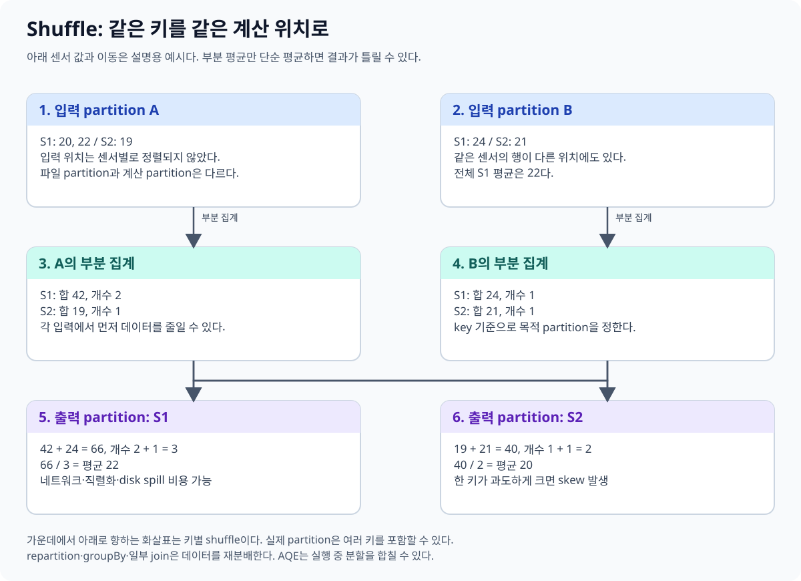

# 04. Partition과 shuffle

## partition ID와 shuffle file을 끝까지 연결한다

[이 책 목차](README.md) · [이전](03-lazy-dag-jobs-stages.md) · [다음](05-joins-and-aqe.md)

분산 처리는 데이터를 여러 조각으로 나누어 동시에 계산한다. 그러나 지역별 합계처럼 같은 key의 값을 다시 모아야 하는 순간도 있다. 이 장은 여덟 레코드가 입력 partition에서 task를 거쳐 shuffle 파일, 네트워크, reduce 쪽 메모리와 디스크로 이동하는 전 과정을 추적한다.

## 1. 이름이 비슷한 객체를 먼저 분리한다

**Partition**은 전체 데이터 중 한 작업 단위가 담당할 논리적 조각이다. 논리적이라는 말은 파일 한 개와 반드시 같지 않다는 뜻이다. Driver는 파일 크기와 source 규칙을 바탕으로 input partition을 계획하고, executor의 task가 그 조각을 읽는다.

**Task**는 stage 안의 partition 하나를 처리하는 한 번의 실행 시도다. Task는 executor 프로세스의 CPU thread에서 돌며, 읽은 레코드와 중간 상태는 executor 메모리에 있다. 실패해 재시도되면 같은 논리 partition에 두 번째 task attempt가 생길 수 있다. 그러므로 partition ID와 task attempt ID는 같은 식별자가 아니다.

**Input partition**은 원천을 읽을 때의 실행 조각이다. 큰 파일 하나가 여러 input partition으로 나뉠 수 있고, 작은 파일 여러 개가 한 input partition에 묶일 수도 있다. **Output partition**은 연산 뒤 만들어진 논리 조각이다. Shuffle 전후에는 partition의 의미와 개수가 달라질 수 있다.

**Map 쪽**은 shuffle 이전 stage를 뜻한다. 여기서 map은 반드시 Python map 함수를 뜻하지 않는다. 각 map task는 자기 input partition을 읽고 목적 bucket별 중간 block을 쓴다. **Reduce 쪽**은 shuffle 이후 stage다. Reduce task는 모든 map task가 쓴 자기 bucket block을 가져와 합친다. reduce라는 이름도 합계 함수 하나만을 뜻하지 않으며 join이나 정렬도 이 경계를 사용할 수 있다.

**Bucket**은 partitioner가 같은 목적지로 보낼 레코드를 담는 번호표다. Hash partitioner라면 key를 정수로 바꾸는 hash와 bucket 수를 사용해 목적 번호를 정한다. 개념 모형은 nonNegativeHash(key) modulo N으로 볼 수 있다. **Modulo**는 나눗셈의 나머지다. N이 2면 결과가 0 또는 1이므로 Q0, Q1 두 목적지가 된다. 실제 Spark의 hash와 null 처리 규칙은 자료형과 물리 연산에 따르므로 임의 언어의 hash 결과를 그대로 대입하지 않는다.

## 2. 여덟 레코드의 입력 배치

각 레코드는 (region, amount)이고 이 교육 모형에서는 한 레코드의 직렬화 크기를 20 byte라고 가정한다. **Byte**는 저장 크기 단위이며 1 byte는 8 bit다. 실제 크기에는 문자열 길이, null 표시, row format, 압축, block header가 추가되므로 이 수치는 이동 계산을 보이기 위한 모형이다.

| 입력 partition | task가 읽는 레코드 | 행 수 | 모형 byte |
|---|---|---:|---:|
| P0 | (KR,40), (US,20) | 2 | 40 |
| P1 | (JP,40), (KR,50), (US,60) | 3 | 60 |
| P2 | (KR,70), (JP,80), (US,90) | 3 | 60 |
| 합계 | 여덟 레코드 | 8 | 160 |

P0, P1, P2는 Driver의 stage 계획에 존재하는 논리 조각이다. Task 0은 P0을 executor 메모리로 읽고, Task 1과 2도 각 조각을 읽는다. Task가 끝나면 원본 row 객체와 지역 변수는 더는 필요하지 않아 회수 대상이 되지만, 성공한 shuffle block은 downstream stage가 fetch할 수 있도록 로컬 디스크나 shuffle service 경로에 남는다.

이 예에서는 KR과 JP의 hash bucket이 Q0, US의 bucket이 Q1이라고 가정한다. 같은 key는 같은 bucket으로 가야 이후 한 reduce task가 그 key의 모든 값을 볼 수 있다.

## 3. Map task가 목적 bucket별 block을 만든다

각 task는 레코드를 읽을 때 목적 bucket을 계산한다.

| map task | 입력 순서 | key | 목적 | bucket 안 값 |
|---|---:|---|---|---|
| T0/P0 | 1 | KR | Q0 | KR40 |
| T0/P0 | 2 | US | Q1 | US20 |
| T1/P1 | 1 | JP | Q0 | JP40 |
| T1/P1 | 2 | KR | Q0 | KR50 |
| T1/P1 | 3 | US | Q1 | US60 |
| T2/P2 | 1 | KR | Q0 | KR70 |
| T2/P2 | 2 | JP | Q0 | JP80 |
| T2/P2 | 3 | US | Q1 | US90 |

따라서 T0은 Q0 block 한 행과 Q1 block 한 행, T1은 Q0 두 행과 Q1 한 행, T2도 Q0 두 행과 Q1 한 행을 만든다. 논리적으로 여섯 block이며 비어 있지 않은 block의 payload를 단순 합하면 160 byte다.

**Shuffle write**는 map task가 shuffle용으로 기록한 byte다. 이 값은 최종 출력 크기가 아니다. 직렬화와 압축 뒤 크기이며, 지표에 따라 기록하는 계층도 확인해야 한다. Index 정보, checksum, 임시 정렬 run 같은 로컬 I/O가 전부 같은 수치에 들어간다고 가정하면 안 된다.

부분 집계가 가능한 합계라면 task 안에서 같은 key를 먼저 더할 수 있다. 이 입력은 각 P 안에 같은 key가 한 번씩뿐이라 여덟 상태가 그대로 이동한다. P0에 KR40, KR10이 함께 있었다면 KR50 한 상태로 줄일 수 있다. 평균은 합계와 개수인 (sum,count)를 보내야 한다. 평균값만 평균 내면 partition별 행 수가 다를 때 틀린다.

## 4. Shuffle 파일과 네트워크 fetch

Sort 기반 shuffle은 map output을 목적 partition 번호로 정렬해 데이터 파일과 각 구간의 위치를 알려 주는 index를 만들 수 있다. 물리 파일 수와 논리 block 수는 구현에 따라 같지 않다. 핵심은 reduce task가 “map T1의 Q0 구간”처럼 필요한 byte 범위를 찾을 수 있다는 점이다.

Q0 reduce task는 다음 다섯 레코드를 fetch한다.

| 원천 block | 레코드 | 모형 payload |
|---|---|---:|
| T0의 Q0 | KR40 | 20 byte |
| T1의 Q0 | JP40, KR50 | 40 byte |
| T2의 Q0 | KR70, JP80 | 40 byte |
| 합계 | KR 세 행, JP 두 행 | 100 byte |

Q1은 T0, T1, T2의 Q1 block에서 US20, US60, US90을 가져와 60 byte를 읽는다. **Shuffle read**는 reduce task가 fetch한 shuffle byte다. 이 예에서 논리 payload는 Q0 100, Q1 60, 전체 160 byte다.

Map block과 reduce task가 같은 executor에 있으면 네트워크 카드 밖으로 나가지 않고 로컬 경로로 읽을 수 있다. 다른 executor에 있으면 shuffle fetch가 네트워크를 지난다. 예를 들어 T0과 Q0가 E0, T1과 Q1이 E1, T2가 E2에서 실행된다고 가정하자.

| fetch | 위치 | 네트워크 payload |
|---|---|---:|
| Q0가 T0/Q0 읽기 | E0 내부 | 0 |
| Q0가 T1/Q0 읽기 | E1→E0 | 40 |
| Q0가 T2/Q0 읽기 | E2→E0 | 40 |
| Q1가 T0/Q1 읽기 | E0→E1 | 20 |
| Q1가 T1/Q1 읽기 | E1 내부 | 0 |
| Q1가 T2/Q1 읽기 | E2→E1 | 20 |
| 합계 | executor 사이 | 120 byte |

이 120 byte도 압축 전 payload 모형이다. 실제 network byte는 protocol header, 압축률, 재시도, block batch, 암호화에 따라 달라진다. Shuffle read 160 byte와 network 120 byte가 다른 것은 40 byte가 로컬로 읽혔기 때문이다.

## 5. Reduce task의 정렬과 집계

Q0는 key별로 정렬하거나 hash 상태를 사용해 KR40, KR50, KR70을 합쳐 KR160, JP40과 JP80을 합쳐 JP120을 만든다. Q1은 US20+60+90=US170을 만든다.

| reduce task | fetch 완료 상태 | key별 계산 | 출력 |
|---|---|---|---|
| Q0 | KR40, JP40, KR50, KR70, JP80 | KR 40+50+70, JP 40+80 | KR160, JP120 |
| Q1 | US20, US60, US90 | US 20+60+90 | US170 |

결과는 세 행이지만 shuffle에서는 여덟 입력 행이 이동했다. 입력 partition 안에서 같은 key 반복이 많으면 map-side 부분 집계가 이동량을 크게 줄인다. 모든 key가 서로 다르면 상태 수가 줄지 않는다.

**Narrow dependency**는 출력 partition 하나가 제한된 입력 partition에서만 만들어지는 의존 관계다. filter나 select는 한 task가 자기 조각 안에서 이어 실행할 수 있다. **Wide dependency**는 출력 하나가 여러 입력 partition의 값을 요구하는 관계다. key별 집계처럼 Q0가 P0, P1, P2 모두에 의존하면 shuffle 경계가 생기고 다음 stage가 된다.

~~~mermaid
flowchart LR
    P0["P0 / map task 0"] --> W["Q0·Q1 shuffle blocks"]
    P1["P1 / map task 1"] --> W
    P2["P2 / map task 2"] --> W
    W --> Q0["reduce Q0: KR160, JP120"]
    W --> Q1["reduce Q1: US170"]
~~~

## 6. Sort, memory, spill

**Sort**는 레코드를 key나 목적 partition 순서로 배치하는 작업이다. 정렬을 위해 task는 executor의 execution memory에 레코드나 pointer, 집계 map을 보관한다. 이 메모리는 JVM heap 또는 Spark의 관리 메모리 영역에 있으며 task가 끝나면 상태가 소멸한다.

**Spill**은 중간 상태가 메모리 안에 맞지 않을 때 일부를 executor 로컬 디스크의 임시 파일로 내리는 동작이다. 예를 들어 Q0가 100 byte 제한인데 정렬 상태가 overhead를 포함해 140 byte라면 앞부분을 run-0으로 쓰고 나머지를 run-1로 쓴 뒤 두 정렬 run을 merge할 수 있다. Spill은 답이 틀렸다는 뜻이 아니다. 같은 정렬 결과를 더 많은 디스크 write/read와 CPU merge로 만든다.

Spark UI의 spill memory와 spill disk는 단순히 같은 byte의 두 복사본이 아니다. 공식 UI 설명에서 memory 쪽은 shuffle 데이터의 역직렬화 형태 크기, disk 쪽은 디스크에 기록된 직렬화 형태 크기를 나타낸다. 압축과 객체 overhead 때문에 서로 다를 수 있다.

한 task만 오래 걸리고 spill이 크다면 평균 partition 크기보다 최대값을 본다. 큰 단일 record, 한 key에 몰린 행, 느린 디스크, GC pause를 구분한다. 모든 task가 비슷하게 spill하면 partition 크기와 executor memory의 전반적 불일치를 의심한다.

## 7. Skew는 평균이 숨기는 치우침이다

**Skew**는 partition별 데이터량이나 계산량이 심하게 다른 상태다. 열 partition 중 아홉 개가 10 MiB이고 하나가 910 MiB라면 평균은 100 MiB지만 마지막 task가 91배 큰 입력을 처리한다. Stage 완료는 가장 늦은 task를 기다리므로 이 task가 straggler가 된다.

같은 key는 같은 bucket으로 가야 집계할 수 있다. 데이터의 90%가 KR이면 repartition(400, region)을 해도 KR hash는 한 bucket에 머문다. bucket 수를 늘리는 것만으로 hot key 하나를 쪼개지 못한다.

Salting은 KR을 (KR,0), (KR,1) 같은 보조 key로 나눠 부분 계산한 뒤 다시 KR로 합치는 방법이다. **생성**은 skew key에 제한된 salt를 붙일 때, **소멸**은 두 번째 집계에서 salt를 제거할 때다. 합계처럼 결합 가능한 연산에는 적용하기 쉽지만, join은 반대쪽 행을 salt 수만큼 복제해야 할 수 있다. 난수를 아무 행에나 붙이면 같은 key 결합 조건을 잃으므로 업무 의미와 최종 결합을 증명해야 한다.

## 8. repartition, coalesce, 초기 bucket 수

repartition(n)은 full shuffle을 통해 새 실행 분포를 만든다. repartition(n,key)는 같은 key를 같은 목적 bucket으로 보낸다. coalesce(n)는 보통 기존 partition 여러 개를 좁게 묶어 수를 줄인다. 큰 감소에서 full shuffle을 피하는 대신 특정 task에 데이터가 몰릴 수 있다.

| 표현 | 생성되는 실행 객체 | 위험 |
|---|---|---|
| repartition(4) | 새 shuffle partition 최대 4개 | 전체 데이터 이동 |
| repartition(4,"region") | region hash 기준 bucket | hot key 유지 |
| coalesce(1) | downstream 한 partition | 병렬성 1, 큰 단일 task |
| spark.sql.shuffle.partitions=200 | join·집계 초기 shuffle 수 | 실제 최종 task 수와 다를 수 있음 |

Spark 4.2 공식 SQL 튜닝 문서에서 spark.sql.shuffle.partitions 기본값은 200이다. 이는 입력 파일 수나 모든 stage task 수가 아니다. AQE가 켜져 있고 post-shuffle coalesce 조건이 맞으면 runtime map output 통계를 보고 연속한 작은 partition을 합쳐 downstream task 수를 줄일 수 있다. 설정 200을 보았다고 실제 reduce task도 반드시 200이라고 쓰지 않는다.

Partition 수가 너무 적으면 task당 byte와 정렬 상태가 커져 spill이나 OOM 위험이 높아진다. 너무 많으면 작은 task의 scheduling, fetch connection, metadata, 작은 출력 파일 비용이 커진다. 평균뿐 아니라 max shuffle read, task 시간 분포, spill, record 수를 함께 보고 조정한다.

## 9. 실패와 재계산의 경계

T2가 쓴 Q0/Q1 block이 executor 유실로 사라졌다고 하자. Reduce fetch가 몇 번 재시도해도 block을 얻지 못하면 scheduler는 T2 map task를 다시 실행해 block을 재생성할 수 있다. 원본 P2가 결정적으로 다시 읽히고 계산이 순수하면 같은 논리 결과를 만든다.

그러나 map task 안에서 외부 API 호출이나 별도 DB insert를 했다면 첫 시도가 성공한 뒤 block만 사라져도 재실행이 side effect를 반복할 수 있다. Spark의 lineage 재계산은 외부 시스템의 exactly-once를 자동 보장하지 않는다. Task attempt ID를 고려한 멱등 쓰기나 data source commit protocol이 필요한 이유다.

성공한 shuffle block은 downstream 소비와 job 수명 동안 필요하다. Job이 끝나고 더는 참조되지 않거나 관련 executor가 정리되면 삭제 대상이 된다. Executor 유실은 block뿐 아니라 메모리 cache도 잃게 하므로 lineage에서 다시 계산할 수 있어야 한다.

## 10. 완전 풀이 1: Q0의 수와 byte

**문제.** 여덟 레코드 모형에서 Q0로 가는 상태 수와 payload는 얼마인가?

**풀이.** KR은 P0, P1, P2에 각 한 행으로 세 개, JP는 P1과 P2에 두 개다. 합계 다섯 상태다. 레코드당 20 byte 가정이므로 5×20=100 byte다. Q0 결과는 두 행이지만 shuffle 입력은 다섯 행이다.

**조건 변화.** P2의 KR70과 KR30이 같은 partition에 추가되면 부분 합계가 적용될 때 두 행이 한 상태로 줄 수 있다. 부분 집계가 불가능한 연산이면 그대로 이동한다.

## 11. 완전 풀이 2: 네트워크와 shuffle read

**문제.** 위 배치에서 총 shuffle read 160 byte인데 네트워크 payload가 120 byte인 이유는?

**풀이.** Q0는 T0의 20 byte를 로컬, T1/T2의 80 byte를 원격으로 읽는다. Q1은 T1의 20 byte를 로컬, T0/T2의 40 byte를 원격으로 읽는다. 전체 read는 160이지만 원격 합은 80+40=120이다.

**조건 변화.** Q0와 Q1 task 위치가 달라지면 로컬 비율도 바뀐다. 재시도가 발생하면 동일 block이 다시 전송되어 실제 network byte가 커질 수 있다.

## 12. 완전 풀이 3: partition 수 400

**문제.** KR이 전체 90%일 때 repartition(400,region)이 KR을 400곳에 나누는가?

**풀이.** 아니다. hash partition의 목적은 같은 key를 같은 bucket에 모으는 것이다. 모든 KR은 같은 hash와 modulo 결과를 가져 한 bucket에 간다. 빈 bucket과 작은 bucket은 늘어도 hot bucket은 남는다.

**조건 변화.** 합계라면 map-side 부분 집계와 제한된 salting을 검토한다. 원본 행을 모두 함께 보아야 하는 연산이면 key 정의나 알고리즘을 바꾸지 않고 임의 분할할 수 없다.

## 13. 완전 풀이 4: spill 해석

**문제.** 한 task의 disk spill만 2 GiB이고 나머지는 0이다. 곧바로 executor memory를 두 배로 늘려야 하는가?

**풀이.** 먼저 그 task의 input/shuffle read, record 수, key 분포, 큰 record, GC 시간을 다른 task와 비교한다. 한 partition만 크면 skew가 원인이어서 memory 증설은 증상을 늦출 뿐 병목을 남길 수 있다. 모든 partition이 비슷한데 하나만 spill이면 executor 경합과 재시도도 본다.

**조건 변화.** 모든 task가 목표보다 큰 정렬 상태로 동일하게 spill한다면 partition 수, task당 크기, memory 설정을 함께 조정할 근거가 생긴다.

## 14. 완전 풀이 5: coalesce(1)

**문제.** 800 GiB 결과에 coalesce(1)을 적용해 파일 하나를 만들면 무엇이 생기는가?

**풀이.** downstream partition이 하나가 되어 한 task가 800 GiB 논리 결과를 처리하고 한 writer 경로가 병목이 된다. 실행 시간이 길어지고 실패 재시도 비용, spill, 저장소 단일 요청 흐름 위험이 커진다. 파일 수 감소와 계산 병렬성 손실을 맞바꾼다.

**조건 변화.** 결과가 수 MiB인 보고서라면 한 partition이 합리적일 수 있다. “파일 하나”가 외부 계약이면 대규모 결과를 단일 파일로 요구하는 계약 자체도 검토한다.

## 15. 완전 풀이 6: 평균 계산의 부분 상태

**문제.** P0에 S1 값 10,30, P1에 S1 값 100 하나가 있다. partition 평균 20과 100을 다시 평균 내면 맞는가?

**풀이.** (20+100)/2=60은 틀리다. 전체 평균은 (10+30+100)/3=140/3이다. 각 map task가 (sum,count), 즉 P0=(40,2), P1=(100,1)을 보내고 reduce가 (140,3)으로 합쳐야 한다.

**조건 변화.** 두 partition의 count가 같을 때만 평균의 평균이 우연히 맞는다. 우연한 데이터 조건을 일반 알고리즘으로 사용하면 안 된다.

## 16. 완전 풀이 7: 실패한 map block

**문제.** T2 block 유실 뒤 T2를 재실행하면 집계 결과가 두 배가 되는가?

**풀이.** Shuffle fetch와 scheduler가 성공 attempt의 block만 논리 입력으로 사용한다면 재생성된 block이 잃어버린 block을 대체하므로 결과는 그대로다. 그러나 task 코드가 외부 DB에 직접 insert했다면 그 side effect는 두 번 일어날 수 있다.

**조건 변화.** 비결정 난수나 현재 시간을 레코드 값으로 넣으면 재실행 block 내용도 달라질 수 있다. 재계산 가능한 변환은 결정적으로 만들고 외부 쓰기는 commit 경계에 둔다.

## 17. 완전 풀이 8: input과 shuffle partition

**문제.** 입력 파일 세 개이고 spark.sql.shuffle.partitions=2이면 모든 stage task 수가 3 또는 2인가?

**풀이.** 아니다. Scan source는 파일 split이나 작은 파일 묶음으로 input partition 수를 정한다. Shuffle 전 stage task 수는 그 input partition 수와 연결된다. Shuffle 뒤 초기 목적 bucket은 설정과 물리 계획의 영향을 받아 2일 수 있지만 AQE가 합칠 수 있고 빈 bucket도 있다.

**조건 변화.** 후속 repartition(8)이 있으면 다시 새 경계와 최대 여덟 목적 partition이 생긴다. 한 쿼리 안에서도 stage마다 partition 수가 달라진다.

## 18. 실행에서 확인할 표

| 관측 | 실제 질문 |
|---|---|
| task별 input records/bytes | 처음부터 조각 크기가 치우쳤는가 |
| shuffle write records/bytes | map-side 축약이 얼마나 되었는가 |
| shuffle read의 median과 max | reduce skew가 있는가 |
| local/remote fetch | network 이동 비율은 얼마인가 |
| spill memory/disk | 정렬·집계 상태가 memory를 넘었는가 |
| task duration과 GC | 계산, I/O, 객체 회수 중 어디가 느린가 |
| task attempt | 실패·speculation으로 중복 실행됐는가 |
| initial/final plan | AQE가 partition을 합쳤는가 |

Shuffle은 피해야 할 오류가 아니라 같은 key를 만나는 데 필요한 데이터 이동일 수 있다. 정확한 진단은 “shuffle이 있다”에서 멈추지 않고 어느 map task가 어느 bucket block을 몇 byte 썼고, 어느 reduce task가 로컬·원격으로 얼마를 읽었으며, 가장 큰 partition이 메모리와 디스크에서 어떤 경로를 밟았는지 연결하는 데서 시작한다.

## 공식 자료

[RDD guide](https://spark.apache.org/docs/4.2.0/rdd-programming-guide.html), [SQL performance tuning](https://spark.apache.org/docs/4.2.0/sql-performance-tuning.html), [Configuration](https://spark.apache.org/docs/4.2.0/configuration.html)을 사용한 장이다.
