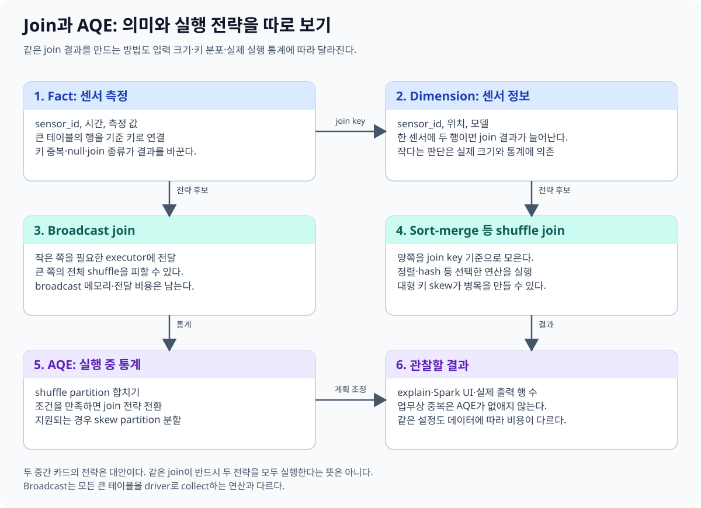

# 05. Join과 AQE

## 중복, NULL, 물리 전략, 실행 중 재계획을 분리한다

[이 책 목차](README.md) · [이전](04-partitions-and-shuffle.md) · [다음](06-memory-and-performance.md)

Join은 두 입력의 행을 조건에 맞게 짝짓는 연산이다. 먼저 어떤 행 조합이 정답인지 정하고, 그다음 broadcast hash join이나 sort-merge join 가운데 그 정답을 싸게 만드는 물리 전략을 고른다. AQE가 실행 중 전략을 바꾸어도 정답 행의 의미는 바뀌면 안 된다.

## 1. 실제 두 입력과 객체의 위치

왼쪽 Events는 측정 사건이고 오른쪽 Devices는 장치 설명이다.

| Events 행 ID | 입력 partition | device_id | amount |
|---|---|---|---:|
| E1 | P0 | S1 | 10 |
| E2 | P0 | S2 | 20 |
| E3 | P0 | S1 | 30 |
| E4 | P1 | S3 | 40 |
| E5 | P1 | S1 | 50 |

| Devices 행 ID | device_id | location |
|---|---|---|
| D1 | S1 | A |
| D2 | S1 | B |
| D3 | S2 | C |

두 표는 저장소의 파일이나 테이블에 지속되어 있다. Scan task가 읽으면 각 행은 executor memory의 내부 row 객체가 된다. Join이 끝나 downstream으로 전달되면 입력 row와 hash table은 task 수명 뒤 회수 대상이 된다. Shuffle을 사용하면 중간 block이 executor 로컬 디스크나 shuffle service에 남아 다음 stage가 읽는다.

**Join key**는 짝을 찾는 열이다. 여기서는 device_id다. **중복 key**는 같은 입력 안에 key 값이 여러 번 나타나는 상태다. Events의 S1은 세 행, Devices의 S1은 두 행이다. Join은 행을 임의로 하나 고르지 않고 조건을 만족하는 모든 행 조합을 만든다.

**NULL**은 빈 문자열이나 0이 아니라 값이 알려지지 않았거나 없음을 나타내는 표지다. SQL의 일반 등호에서 NULL=NULL은 참이 아니라 unknown이므로 일반 equi-join에서 두 NULL은 일치하지 않는다. Null-safe equality를 명시하면 다른 계약이 된다.

## 2. Inner join의 모든 출력

**Inner join**은 양쪽에 일치하는 행 조합만 남긴다. S1은 왼쪽 세 행과 오른쪽 두 행이므로 3×2=6행이다. S2는 1×1=1행이고 S3는 오른쪽 짝이 없어 0행이다.

| 출력 번호 | event | device | device_id | amount | location |
|---:|---|---|---|---:|---|
| 1 | E1 | D1 | S1 | 10 | A |
| 2 | E1 | D2 | S1 | 10 | B |
| 3 | E3 | D1 | S1 | 30 | A |
| 4 | E3 | D2 | S1 | 30 | B |
| 5 | E5 | D1 | S1 | 50 | A |
| 6 | E5 | D2 | S1 | 50 | B |
| 7 | E2 | D3 | S2 | 20 | C |

결과는 일곱 행이다. 물리 출력 순서는 partition과 task scheduling에 따라 다를 수 있으므로 order by가 없으면 표의 나열 순서를 보장하지 않는다. 정확성 검증에는 전체 행 multiset이나 key별 count를 쓴다.

## 3. Outer join의 모든 출력

**Left outer join**은 inner 결과에 더해 오른쪽 짝이 없는 왼쪽 행도 보존한다. E4의 S3는 Devices에 없으므로 device 쪽 열을 NULL로 채운다. 결과는 위 일곱 행과 다음 한 행, 총 여덟 행이다.

| event | device | device_id | amount | location |
|---|---|---|---:|---|
| E4 | NULL | S3 | 40 | NULL |

**Right outer join**은 오른쪽을 모두 보존한다. 현재 Devices의 모든 key S1, S2가 Events에 있으므로 inner 결과와 같은 일곱 행이다.

**Full outer join**은 양쪽 미일치 행을 모두 보존한다. 현재 오른쪽에만 있는 key가 없으므로 left outer와 같은 여덟 행이다. Devices에 (S9,Z)인 D4를 추가하면 full outer에는 event=NULL, device=D4, device_id=S9, amount=NULL, location=Z인 행이 하나 더 생겨 아홉 행이다. Left outer에는 이 오른쪽 전용 행이 없다.

**Left semi join**은 오른쪽에 적어도 한 짝이 있는 왼쪽 행만 왼쪽 열로 한 번씩 반환한다. D1과 D2 두 개가 있어도 E1이 두 번 나오지 않는다. 결과는 E1, E2, E3, E5 네 행이다. **Left anti join**은 오른쪽 짝이 없는 왼쪽 행만 반환하므로 E4 한 행이다. **Cross join**은 조건 없이 5×3=15개 모든 조합을 만든다.

## 4. NULL 행을 추가한 반례

Events에 E6=(NULL,60), Devices에 D4=(NULL,N)를 추가했다고 하자. 일반 조건 e.device_id = d.device_id에서는 E6과 D4가 일치하지 않는다.

- Inner join에는 NULL 조합이 추가되지 않는다.
- Left outer에는 E6와 오른쪽 NULL 열이 있는 미일치 행이 추가된다.
- Full outer에는 E6 미일치 행과 D4 미일치 행이 각각 따로 추가된다.
- Null-safe 조건을 명시하면 E6-D4 한 조합이 된다.

Outer 결과에서 join key를 어느 쪽 열로 표시할지도 중요하다. e.device_id만 select하면 오른쪽 전용 D4의 key는 NULL로 보인다. coalesce(e.device_id,d.device_id)를 쓰면 알려진 쪽 값을 선택할 수 있지만, 이 표현은 데이터 계약에 맞아야 한다.

NULL을 문자열 "UNKNOWN"으로 바꾸어 join하면 모든 미상 행끼리 곱셈 조합이 생길 수 있다. 모르는 장치들이 같은 실제 장치라는 근거가 없으므로 편의를 위한 치환이 결과를 오염시킨다.

## 5. 논리 cardinality와 데이터 오류

**Cardinality**는 입력 또는 출력의 행 수와 key별 대응 수를 뜻한다. 일대일을 의도했다면 Devices의 device_id가 유일해야 한다. 현재 S1이 두 행이라 S1 event 하나마다 두 결과가 생긴다. 물리 전략과 무관한 논리 결과다.

단순 dropDuplicates("device_id")는 D1이나 D2 중 어느 행을 남길지 업무 의미를 말하지 않는다. 장치 상태가 시간에 따라 바뀌었다면 사건 시각보다 늦지 않은 최신 상태를 고르는 as-of 규칙, 유효 시작·종료 구간, 우선순위를 정의한다. 중복이 오류라면 join 전에 key별 count>1을 검출해 실패시키는 편이 임의 선택보다 안전하다.

Join 뒤 합계가 커졌을 때 task 재시도부터 의심하지 않는다. 먼저 다음 식으로 key별 예상값을 계산한다.

output_count(k)=left_count(k)×right_count(k)

S1은 3×2=6, S2는 1×1=1, S3는 inner에서 1×0=0이다. 이 식과 실제 count를 비교하면 데이터 의미와 실행 문제를 분리할 수 있다.

## 6. Broadcast hash join의 실제 객체

**Broadcast**는 작은 입력을 driver가 준비해 각 executor로 전달하는 방식이다. **Hash relation**은 key를 bucket에 넣고 해당 key의 행 목록을 찾도록 만든 메모리 객체다. Broadcast hash join에서는 작은 쪽을 build side, 큰 쪽을 한 행씩 읽는 쪽을 streamed side라고 한다.

Devices 세 행의 직렬화 payload가 300 byte라고 가정한다.

1. Driver 쪽 broadcast 준비 stage가 Devices를 수집하거나 물리 계획이 요구하는 형태로 만든다.
2. 세 행을 직렬화한 broadcast block이 전송 계층에 놓인다.
3. Executor 20개가 각각 300 byte payload를 받으면 단순 payload 복사 합은 6,000 byte다.
4. 각 executor는 S1→[D1,D2], S2→[D3]인 hash relation을 memory에 만든다. 객체 header와 hash bucket overhead는 300 byte에 추가된다.
5. P0 task는 E1에서 두 행, E2에서 한 행, E3에서 두 행을 만들어 5행을 낸다.
6. P1 task는 E4에서 0행, E5에서 두 행을 만들어 2행을 낸다.
7. Inner 결과는 7행이다.

Broadcast 객체는 같은 executor의 관련 task가 재사용할 수 있고 쿼리 실행 수명 뒤 정리 대상이 된다. Executor가 잃어버리면 새 executor가 block을 다시 받을 수 있다.

큰 Events를 join key로 shuffle하지 않는 장점이 있지만 비용이 0은 아니다. Driver의 준비 메모리, network fan-out, 각 executor의 hash relation memory, broadcast wait가 필요하다. 동시에 여러 쿼리가 서로 다른 lookup 표를 broadcast하면 executor memory 사용이 합쳐진다.

Spark 4.2 공식 SQL 튜닝 문서의 spark.sql.autoBroadcastJoinThreshold 기본값은 10 MiB, 즉 10,485,760 byte다. 이는 모든 10 MiB 이하 입력이 반드시 broadcast된다는 약속이 아니다. 통계, join 유형, build 가능한 쪽, 힌트, 설정과 물리 계획을 함께 본다. Broadcast hint도 지원되지 않는 join 전략을 강제하지 못할 수 있다.

## 7. Sort-merge join의 전체 경로

**Sort-merge join**은 양쪽을 join key 기준으로 같은 분포에 모으고 각 partition 안에서 정렬한 뒤 같은 key 구간을 맞춘다.

1. Events map task가 S1, S2, S3의 목적 bucket을 계산해 shuffle block을 쓴다.
2. Devices map task도 S1, S2를 같은 partitioner 규칙으로 쓴다.
3. Reduce task는 양쪽의 자기 bucket block을 network 또는 local fetch로 읽는다.
4. 메모리가 부족하면 정렬 run을 disk에 spill한 뒤 merge한다.
5. S1 구간에서는 왼쪽 세 행과 오른쪽 두 행의 여섯 조합을 만든다.
6. S2 구간은 한 조합, S3은 inner join에서 버린다.
7. 두 입력의 shuffle 임시 상태는 stage가 끝나고 참조가 없어지면 정리 대상이다.

~~~mermaid
flowchart LR
    E["Events 5행"] --> EX["device_id shuffle·sort"]
    D["Devices 3행"] --> DX["device_id shuffle·sort"]
    EX --> J["같은 key 구간 merge"]
    DX --> J
    J --> O["inner 7행"]
~~~

이 전략은 두 입력 이동과 정렬 비용이 있지만 큰 양쪽을 executor마다 복제하지 않는다. 이미 호환되는 partitioning과 정렬이 있거나 V2 source의 저장 분포 최적화 조건이 맞으면 Exchange가 줄 수도 있다. 추측 대신 final physical plan에서 Exchange와 Sort를 확인한다.

## 8. AQE와 runtime statistics의 수명

**AQE**, Adaptive Query Execution은 “실행 중 적응하는 쿼리 실행”이다. Driver가 실행 도중 이미 끝난 query stage의 실제 통계를 사용해 아직 실행하지 않은 물리 계획 일부를 다시 고른다. **Runtime statistics**는 추정치가 아니라 materialize된 stage의 row 수와 byte 크기 같은 실행 관측이다. SQL UI와 adaptive plan에서 isRuntime=true인 통계를 확인할 수 있다.

초기 catalog 통계가 Devices 8 MiB라고 하자. Planner가 두 입력을 shuffle하는 sort-merge join을 골랐다. 그러나 filter가 적용된 query stage 결과가 실제 80 KiB, 즉 81,920 byte로 materialize되었다.

| 시점 | Driver가 아는 크기 | 계획 상태 |
|---|---:|---|
| 초기 최적화 | 추정 8 MiB | sort-merge 후보 |
| 오른쪽 stage 완료 | 실제 80 KiB | runtime 통계 생성 |
| AQE 재검토 | join 유형·threshold·hint 확인 | broadcast 가능 판단 |
| 다음 stage | final adaptive plan | broadcast hash 실행 가능 |

AQE가 sort-merge를 broadcast로 바꾸면 이미 만들어진 shuffle을 모두 없던 일로 만들지는 못한다. 공식 문서는 초기부터 broadcast를 고른 것만큼 효율적이지는 않지만 양쪽 정렬을 피하고 local shuffle reader로 network를 줄일 수 있다고 설명한다.

AQE는 Spark 3.2부터 기본 활성화되어 왔고 4.2 문서의 spark.sql.adaptive.enabled 기본값은 true다. 그러나 세션 설정에서 꺼졌거나 streaming/특정 연산 경계, 지원되지 않는 join 유형, broadcast threshold -1, memory 조건이면 전환되지 않는다. “AQE on”만으로 특정 변화가 보장되지 않는다.

## 9. Post-shuffle coalesce

**Coalesce**는 인접한 작은 post-shuffle partition을 묶어 downstream task 수를 줄이는 AQE 기능이다. 생성 시점은 map output 통계가 모인 뒤이고, 결합된 partition 객체는 adaptive plan의 다음 stage 입력이 된다.

초기 네 partition의 실제 크기가 [2,3,1,58] MiB이고 advisory target을 단순히 64 MiB로 보는 모형이라면 네 구간을 합쳐 64 MiB 하나로 만들 후보가 될 수 있다. 실제 결정은 parallelismFirst, 최소 크기, cluster 기본 병렬성과 설정을 반영하므로 단순 합만으로 확정하지 않는다.

Spark 4.2 문서에서 advisoryPartitionSizeInBytes 기본값은 64 MiB, coalescePartitions.enabled 기본값은 true다. parallelismFirst 기본값도 true라 target 64 MiB를 그대로 따르지 않고 병렬성을 우선 계산할 수 있다. 설정값과 final task 수가 다른 이유를 이 조건까지 포함해 기록한다.

## 10. Skew join 처리

S1이 Events의 90%라면 sort-merge의 S1 partition 하나가 대부분의 row와 결과 조합을 담당해 straggler가 된다. AQE skew join은 큰 shuffle partition을 여러 조각으로 나누고 필요하면 반대쪽 조각을 복제해 병렬 task로 처리할 수 있다.

공식 Spark 4.2 문서의 기본 판정은 partition 크기가 median의 5배보다 크고 동시에 256 MiB보다 큰 두 조건을 만족하는 것이다. skewJoin.enabled도 true가 기본이다. 이 숫자는 버전과 세션 설정에 따라 달라질 수 있으므로 실제 실행 설정을 기록한다.

예를 들어 partition byte가 [20,22,24,26,400] MiB면 median 24의 5배는 120이고 400은 256보다도 크므로 기본 두 문턱을 넘는다. [1,1,1,1,10] MiB는 median의 10배지만 256 MiB 문턱을 넘지 않아 기본 조건에서는 skew로 판정되지 않는다.

Skew split은 결과 cardinality를 고치지 않는다. S1의 오른쪽 중복이 업무 오류라면 3×2 조합은 그대로다. 복잡한 조건 join, 너무 큰 단일 row, skew threshold 미충족, 추가 shuffle 비용 조건에서는 기대한 최적화가 적용되지 않을 수 있다.

## 11. 완전 풀이 1: Inner와 left 결과

**문제.** 위 두 입력의 inner와 left outer 행 수를 구하라.

**풀이.** S1은 3×2=6, S2는 1×1=1, S3은 inner에서 0이므로 inner는 7행이다. Left outer는 E4/S3을 NULL 오른쪽과 한 번 보존해 8행이다.

**조건 변화.** Devices에 S3 행을 추가하면 E4가 그 행과 일치하므로 inner와 left가 모두 8행이 된다.

## 12. 완전 풀이 2: 중복 제거 반례

**문제.** Devices의 S1 두 행에 location A,B가 있을 때 dropDuplicates로 하나를 지워도 되는가?

**풀이.** 어느 행을 남길지 규칙이 없으면 안 된다. 두 행이 오류인지, 유효 시각이 다른 상태인지, 실제 두 장치인지 결정해야 한다. 최신 상태가 목적이면 timestamp와 동률 규칙으로 한 행을 선택하고 그 규칙을 검증한다.

**조건 변화.** key 유일성이 계약이라면 중복을 발견했을 때 job을 실패시키는 것이 임의 정리보다 정확하다.

## 13. 완전 풀이 3: NULL 조합

**문제.** 양쪽에 device_id NULL 행이 하나씩 있을 때 일반 inner join은 한 행을 더 만드는가?

**풀이.** 아니다. SQL 일반 등호에서 NULL=NULL은 true가 아니다. 두 행은 일치하지 않는다. Null-safe 비교를 명시한 경우에만 한 조합이 생긴다.

**조건 변화.** NULL을 같은 미상 그룹으로 취급해야 한다는 업무 계약이 정말 있다면 null-safe 조건을 사용한다. 문자열 치환은 실제 값과 충돌할 수 있다.

## 14. 완전 풀이 4: Broadcast byte

**문제.** 300 byte payload를 executor 20개에 broadcast하면 복사 payload 합은 얼마인가?

**풀이.** 300×20=6,000 byte다. Driver 준비본, protocol, hash relation 객체 overhead는 별도다. “원본이 300 byte”와 “cluster 전체 메모리도 300 byte”는 다르다.

**조건 변화.** Executor가 아니라 task마다 별도 복사한다고 가정하면 과대 계산할 수 있다. 실제 broadcast block 공유와 executor 수를 확인한다.

## 15. 완전 풀이 5: 초기와 final plan

**문제.** 초기 계획이 sort-merge인데 final plan은 broadcast다. 어느 기록이 맞는가?

**풀이.** 둘 다 서로 다른 시점의 사실이다. 초기 plan은 추정 통계로 세운 후보이고 final adaptive plan은 stage runtime 통계를 반영한 실행 계획이다. 성능 원인을 설명하려면 두 계획과 전환 근거 80 KiB를 함께 보존한다.

**조건 변화.** AQE가 꺼져 있거나 join 유형이 지원되지 않으면 실제 80 KiB여도 초기 전략을 유지할 수 있다.

## 16. 완전 풀이 6: Coalesce 계산

**문제.** 초기 200 shuffle partition이 final에서 17 task가 되었다. 데이터가 사라졌는가?

**풀이.** Post-shuffle coalesce가 여러 인접 partition을 한 reader task의 입력으로 묶었을 수 있다. 논리 row와 bucket 범위는 보존되고 task 수만 줄어든다. Final plan과 map output statistics로 확인한다.

**조건 변화.** Filter나 join 유형 때문에 row 수가 달라진 것과 task 수 감소를 혼동하지 않는다. 결과 count와 checksum을 별도로 검증한다.

## 17. 완전 풀이 7: Skew 판정

**문제.** Partition 크기 [20,22,24,26,400] MiB가 기본 AQE skew 조건을 만족하는가?

**풀이.** Median은 24 MiB이고 5배는 120 MiB다. 400은 120보다 크며 256 MiB 절대 문턱보다도 크므로 두 조건을 모두 만족한다. 다른 설정이나 버전이면 다시 계산한다.

**조건 변화.** 마지막이 200 MiB면 5배 조건은 넘지만 256 MiB를 넘지 않아 기본값에서는 판정되지 않는다.

## 18. 완전 풀이 8: 한 reduce만 느림

**문제.** Sort-merge join에서 한 task만 20분, 나머지는 30초다. 무엇부터 보는가?

**풀이.** 해당 task의 양쪽 shuffle read byte와 row 수, key별 빈도, 출력 row 수, spill, GC를 다른 task와 비교한다. 큰 입력 key뿐 아니라 양쪽 중복이 만든 큰 출력 조합도 원인일 수 있다. AQE skew 적용 여부와 final plan도 확인한다.

**조건 변화.** 모든 task가 비슷하게 느리면 전체 I/O, 정렬, executor 자원이나 partition 크기 설정 문제일 가능성이 더 크다.

## 19. 계획과 결과를 함께 기록하는 표

| 검증 층 | 기록 |
|---|---|
| 논리 입력 | key별 left/right count, NULL, 유일성 계약 |
| 논리 출력 | join 유형, key별 예상 곱, checksum |
| 초기 계획 | 추정 size, Exchange, Sort, join operator |
| Broadcast | build side byte, executor 수, timeout |
| Shuffle | 양쪽 read/write, max partition, spill |
| AQE | runtime statistics, initial/final plan 차이 |
| Skew | median, max, factor·absolute threshold |
| 실패 | task attempt, broadcast 재전송, stage 재계산 |

빠른 join은 올바른 join을 전제로 한다. 먼저 두 입력의 중복과 NULL이 만드는 모든 출력 행을 손으로 계산하고, 그 결과를 유지하는 범위에서 broadcast, sort-merge, AQE coalesce와 skew split의 비용을 비교한다. AQE는 실행 통계를 이용하는 최적화 장치이며 데이터 계약을 대신 결정하는 장치가 아니다.

## 20. 지원 조건을 숫자 하나로 줄이지 않는다

10 MiB broadcast 임계값은 계획 입력 중 하나일 뿐이다. Full outer처럼 build-side hash 전략이 제한되는 join, 비동등 조건, 사용할 수 없는 통계, broadcast timeout, driver·executor memory 부족은 작은 byte만으로 해결되지 않는다. Hint도 우선순위를 주는 요청이며 모든 유형에서 강제 명령은 아니다. 따라서 “작으니 broadcast”라고 결론 내리기 전에 join 유형, 조건식, build 가능한 쪽, 초기 통계와 runtime 통계, final operator를 한 줄로 연결한다. 같은 방식으로 skew 기본 문턱을 넘었다고 split 성공을 단정하지 않고 실제 adaptive plan과 task 수를 확인한다.

## 공식 자료

[Join syntax](https://spark.apache.org/docs/4.2.0/sql-ref-syntax-qry-select-join.html), [SQL performance tuning과 AQE](https://spark.apache.org/docs/4.2.0/sql-performance-tuning.html)를 사용했다. [CIDR 2025 QOaaS](https://www.vldb.org/cidrdb/2025/towards-query-optimizer-as-a-service-qoaas-in-a-unified-lakehouse-ecosystem-can-one-qo-rule.html)는 multi-engine prototype 연구이며 Spark 제품 기능의 지원 조건을 대신하지 않는다.
