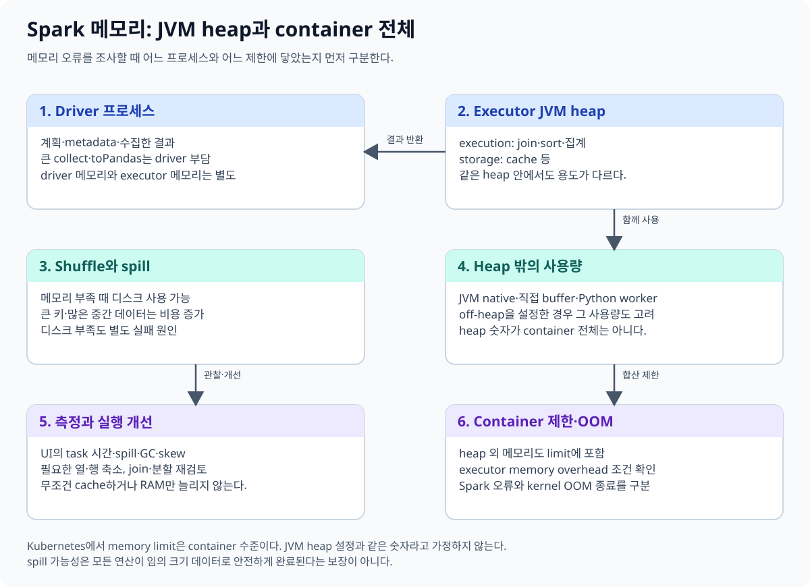

# 06. 메모리와 성능

## 한 executor의 byte 예산이 압박·spill·GC·OOM으로 이어지는 과정

[이 책의 목차](README.md) · [이전 장](05-joins-and-aqe.md)

Spark 성능 문제를 “RAM 부족” 한 문장으로 말하면 고칠 위치를 찾을 수 없다. Driver JVM, executor JVM heap, off-heap, Python worker, native buffer, local disk는 서로 다른 주체가 관리한다. 이 장은 executor 하나의 메모리 예산에 네 task, broadcast, cache, shuffle buffer를 놓고 생성·회수 순서를 추적한다. 수치는 계산용 모형이며 특정 환경 측정값이 아니다.

## 1. 실제 메모리 객체와 위치

**JVM heap**은 Java Virtual Machine이 객체를 할당하고 garbage collector가 회수하는 메모리다. Driver와 각 executor는 별도 JVM 프로세스이므로 heap도 서로 분리된다. Executor heap에는 Spark internal row, hash map, sort pointer, cache block, broadcast hash relation 같은 객체가 생긴다.

**Off-heap**은 JVM heap 밖의 native memory다. Spark가 관리하도록 명시한 off-heap execution/storage 영역, Netty network buffer, direct byte buffer, compression library와 Arrow 같은 native allocation이 관련될 수 있다. Garbage collector가 Java 객체처럼 직접 모두 관리하지 않으며 container 총 사용량에는 포함된다.

**Execution memory**는 task가 sort, hash aggregation, join, shuffle 중간 계산에 사용하는 영역이다. Task가 시작할 때 상태가 생기고 record를 읽으며 커졌다가 task 종료나 spill 뒤 줄어든다. **Storage memory**는 cache block과 broadcast처럼 여러 계산에서 재사용할 데이터를 보관하는 영역이다. Block manager가 위치와 storage level을 관리하며 eviction이나 unpersist까지 task보다 오래 살 수 있다.

Spark의 unified memory model에서 execution과 storage는 heap 안의 공유 영역 M을 사용한다. 공식 Spark 4.2 설정에서 M은 기본적으로 (heap-300 MiB)의 0.6이고, storageFraction 기본 0.5는 M 안에서 execution이 밀어내지 않는 storage 보호 경계 R과 관련된다. Storage는 남는 execution 공간을 사용할 수 있고 execution은 보호 경계 위의 storage를 evict할 수 있다. Storage가 execution을 임의로 밀어내는 대칭 관계로 이해하면 안 된다.

**Cache**는 재사용할 partition 결과를 block으로 저장하는 기능이고, **Persist**는 memory only, memory and disk, serialized 같은 storage level을 고르는 더 일반적인 요청이다. DataFrame 변수에 이름을 붙인 것만으로 cache block이 생기지 않는다. cache 요청 뒤 첫 action이 partition을 계산할 때 block이 생성된다.

## 2. Container 예산과 heap 예산

Kubernetes나 YARN의 executor container는 JVM heap만 담지 않는다. Spark 4.2 configuration은 executor container 최대 메모리 계산에 executor memory, memory overhead, off-heap size, 별도로 설정한 PySpark memory가 합쳐진다고 설명한다.

교육 모형 A:

| 항목 | 설정·사용 |
|---|---:|
| Executor JVM heap | 4 GiB |
| Memory overhead | 2 GiB |
| PySpark 별도 요청 | 0 |
| Spark off-heap 설정 | 0 |
| Container limit 모형 | 6 GiB |

Heap 4 GiB가 모두 unified execution/storage로 쓰이지 않는다. 기본식을 단순 적용하면 M=(4096-300)×0.6≈2,277.6 MiB다. 나머지는 user object, metadata, 추정 오차와 JVM 동작에 필요하다. 실제 단위와 구현 반올림을 포함해 설정값 그대로 hard partition이라고 보지 않는다.

교육 모형 B는 원문의 압박 계산을 보존한다. Executor 하나에 4 core와 JVM heap 4 GiB가 있고 네 task가 동시에 실행된다. 각 task sort 상태가 600 MiB면 2,400 MiB다. Broadcast relation 500 MiB와 cache 900 MiB가 함께 살아 있으면 단순 합은 3,800 MiB다. Heap 4,096 MiB에서 296 MiB만 남지만 Java object header, Spark metadata, serializer buffer, JVM 자체 공간 전 수치다. Unified region M 약 2,278 MiB와 비교하면 execution/storage 관리 영역에서도 이미 강한 경쟁이 생긴다.

## 3. 압박 시간표

| 시점 | 새로 생긴 객체 | 단순 살아 있는 양 | 가능한 반응 |
|---|---|---:|---|
| 0 | Cache block | 900 MiB | Storage가 보관 |
| 1 | Broadcast relation | +500=1,400 MiB | Executor별 hash relation |
| 2 | Task 0 sort state | +600=2,000 MiB | Execution이 공간 요청 |
| 3 | Task 1 state | +600=2,600 MiB | Cache 일부 eviction 가능 |
| 4 | Task 2 state | +600=3,200 MiB | Sort run spill·GC 증가 |
| 5 | Task 3 state | +600=3,800 MiB | 추가 spill 또는 allocation 실패 |
| 6 | Task 완료 | 해당 600 MiB 감소 | 임시 객체 회수 대상 |
| 7 | Unpersist | Cache 900 MiB 해제 요청 | Storage block 제거 |
| 8 | Query 종료 | Broadcast 수명 종료 | relation 회수 대상 |

이 표는 각 상태가 정확히 동시에 peak에 도달한다고 가정한 상한 모형이다. 실제 task는 서로 다른 시점에 grow/spill하고 직렬화 형태와 객체 overhead가 다르다. 하지만 core 수를 늘리면 CPU 병렬성뿐 아니라 task working set 합도 늘어난다는 사실을 보여 준다.

**Working set**은 task가 진행하려고 동시에 필요로 하는 row, hash entry, sort pointer, output buffer의 집합이다. 전체 input 10 TiB를 순차로 읽어도 task별 working set이 작으면 가능하다. 반대로 전체 input 10 GiB라도 한 hot partition이 8 GiB hash table을 만들면 executor 하나가 실패할 수 있다.

## 4. Shuffle buffer와 spill

**Shuffle buffer**는 map output을 목적 partition별로 직렬화하거나 reduce fetch block을 읽는 동안 사용하는 memory buffer다. Serializer가 row 객체를 byte로 바꾸고 compression이 적용될 수 있다. Buffer는 task 또는 network fetch 수명 동안 존재하고 flush 뒤 재사용·회수된다.

**Spill**은 execution 상태가 memory에 맞지 않을 때 일부를 executor local disk의 임시 run으로 내리는 동작이다. Sort task가 600 MiB 상태를 한꺼번에 유지할 수 없으면 예를 들어 250 MiB run 두 개를 disk에 쓰고 나머지와 함께 merge한다. 답은 같지만 다음 비용이 추가된다.

- Memory 객체를 byte로 만드는 serialization CPU
- Local disk write와 후속 read
- 여러 sorted run을 merge하는 비교
- 객체 생성·해제로 인한 GC
- Task 실패 시 임시 file cleanup

Spark RDD guide는 memory에 맞지 않는 shuffle table이 disk로 spill되고 disk I/O와 GC overhead가 늘어난다고 설명한다. Local 임시 저장 위치는 spark.local.dir 계열 설정과 배포 환경의 local storage에 연결된다. Local disk가 느리거나 가득 차면 memory를 피한 대가가 I/O 실패로 바뀐다.

Spill은 OOM을 피한 정상 실행 경로일 수 있다. 그러나 한 task만 spill 20 GiB이고 나머지는 0이면 memory 설정 평균보다 partition skew를 먼저 본다. 모든 task가 비슷하게 spill하면 task당 partition 크기, 동시성, execution memory와 serializer 형태를 본다.

## 5. Cache와 persist의 이익·비용

Cache block은 첫 action 중 계산되어 executor block manager에 등록된다. 두 번째 action은 block이 남아 있으면 원천 scan과 이전 변환을 건너뛴다. Memory pressure로 block이 **evict**, 즉 내보내지면 storage level에 따라 disk copy를 읽거나 lineage에서 다시 계산한다.

한 번만 사용하는 100 GiB 중간 결과를 cache하면 다음 문제가 생긴다.

1. Cache를 채우는 serialization과 memory write 비용을 낸다.
2. 여러 executor storage를 점유한다.
3. Execution memory가 필요할 때 block eviction이 발생한다.
4. 두 번째 사용이 없으므로 저장 비용을 회수하지 못한다.
5. Evicted block을 다시 참조하면 재계산까지 발생한다.

Persist의 MEMORY_AND_DISK 계열은 memory에 못 둔 partition을 disk에 보관해 재계산을 줄일 수 있지만 disk read 비용이 생긴다. Serialized storage는 object 수와 byte를 줄일 수 있지만 사용할 때 deserialize CPU가 든다. Spark tuning guide는 큰 object를 serialized form으로 저장하면 partition당 큰 byte array 형태가 되어 GC object 수를 줄일 수 있다고 설명한다.

unpersist는 더는 필요 없는 cache 수명을 끝내겠다는 요청이다. 즉시 모든 thread의 참조가 0이 된다는 뜻으로 확대하지 않지만, BlockManager가 저장 block을 제거할 수 있게 한다. Query lifecycle에서 마지막 사용 뒤 호출해 storage pressure를 줄인다.

## 6. Serializer는 모양과 경계를 바꾼다

**Serializer**, 직렬화기는 memory 객체를 network나 disk에 쓸 byte 표현으로 바꾸고, 반대로 byte를 객체로 복원한다. Shuffle write, broadcast, serialized cache, task closure 전송에 필요하다.

Java/Scala object는 raw field보다 object header, pointer, boxed value 때문에 훨씬 클 수 있다. 공식 tuning guide는 작은 Java object가 2~5배 공간을 쓸 수 있다고 설명하며, Java serialization은 유연하지만 느리고 큰 경향, Kryo는 보통 더 빠르고 compact하지만 type 지원과 class registration 조건이 있다고 설명한다.

Serializer를 바꾸면 다음 값이 함께 달라질 수 있다.

| 항목 | 영향 |
|---|---|
| Shuffle network byte | Compact하면 감소 가능 |
| Disk spill byte | Serialized run 크기 변화 |
| CPU | Encode/decode 비용 변화 |
| Buffer | 가장 큰 single object를 담을 크기 필요 |
| GC | Object 수와 lifetime 변화 |
| 호환성 | 등록·지원하지 않은 type 실패 가능 |

Kryo buffer를 무조건 크게 잡으면 동시 task마다 여유 buffer가 합쳐져 memory pressure가 될 수 있다. 너무 작으면 큰 object serialization이 실패할 수 있다. 가장 큰 record와 동시성을 측정한다.

## 7. GC는 무엇을 회수하는가

**GC**, garbage collection은 JVM heap에서 더는 참조되지 않는 Java object를 찾아 memory를 재사용하는 과정이다. Task가 hash entry와 temporary row를 빠르게 만들고 버리면 short-lived object churn이 생긴다. Cache와 broadcast는 오래 참조되어 회수되지 않는다.

GC가 실행된다고 off-heap native buffer나 Python object가 즉시 모두 해제되는 것은 아니다. Python worker는 Python runtime의 별도 memory manager를 사용하고 container 관점에서 총합만 보인다.

Spark 4.2 tuning guide는 Spark 4.0부터 기본 JDK 17과 G1GC 기본을 언급한다. Collector 이름보다 먼저 GC time, full/major collection 반복, heap occupancy, object 수, cache와 task working set을 본다. GC가 task 시간 대부분을 차지하면 다음 순서로 원인을 줄인다.

1. 많은 작은 wrapper와 문자열 대신 compact row/primitive 구조를 쓸 수 있는가?
2. Built-in expression으로 Python/JVM 객체 경계를 줄일 수 있는가?
3. Cache storage level을 serialized로 바꿀 이익이 있는가?
4. Hot partition과 동시 task working set을 줄일 수 있는가?
5. 그 뒤에 collector와 heap region 설정을 실측 비교한다.

GC time이 높다는 이유만으로 heap을 늘리면 container의 Python/off-heap 여유를 줄이거나 pause 범위를 키울 수 있다.

## 8. Broadcast memory

Broadcast join의 작은 side는 Driver가 준비해 executor마다 전송하고, 각 executor는 hash relation을 heap 또는 실행 경로가 사용하는 memory에 만든다. 원본 500 MiB를 executor 20개가 보관하면 cluster 전체 payload 복사 합은 단순 10,000 MiB이며 hash overhead가 추가된다.

같은 executor의 네 task가 relation을 공유하는 구현이라면 task당 500 MiB라고 네 번 더하면 과대 계산이다. 반대로 동시에 실행되는 서로 다른 query가 각 500 MiB broadcast를 가지면 executor당 합이 커질 수 있다. Spark UI와 SQL plan에서 broadcast exchange 크기, executor storage와 process memory를 함께 본다.

Broadcast timeout은 전송 대기 실패이고 OOM과 다르다. Driver 수집 단계에서 실패했는지, executor hash build에서 실패했는지, network wait인지 로그 위치를 나눈다.

## 9. Python worker와 Arrow

PySpark UDF는 executor JVM과 별도 Python worker process 사이로 batch를 보낸다. Python list, pandas object, Arrow buffer가 heap 밖 container memory를 쓴다. 같은 executor의 task 네 개가 Python worker에서 각각 700 MiB를 쓰면 Python 합만 2,800 MiB다.

원문 모형처럼 container limit 7 GiB에서 JVM 실제 사용 2 GiB, Python 2.8 GiB, native·Arrow와 overhead가 2.5 GiB면 총 7.3 GiB다. JVM heap chart가 2/4 GiB로 여유 있어도 cgroup이 container를 종료할 수 있다.

Spark 4.2 설정에서 spark.executor.pyspark.memory를 별도로 정하면 executor resource request에 더해질 수 있고, 정하지 않으면 Python memory가 overhead 공간과 경쟁한다. Python resource module 등 platform 지원 조건도 있다. Arrow는 column batch 전송을 개선하지만 batch가 너무 크면 JVM과 Python 양쪽 buffer가 동시에 커질 수 있다.

Built-in SQL expression은 optimizer가 type과 연산을 이해하고 JVM/columnar 경로 안에서 처리할 수 있다. 같은 계산을 Python UDF로 옮기기 전에 지원되는 built-in인지 확인한다.

## 10. OOM 네 종류를 구분한다

**OOM**, Out Of Memory는 필요한 memory allocation을 만족하지 못한 상태다. 사용자에게는 executor lost 하나로 보일 수 있지만 원인이 다르다.

| 위치 | 실제 대상 | 대표 원인 | 근거 |
|---|---|---|---|
| Driver JVM | plan, file list, collect result | 1억 row collect | Driver log, result size |
| Executor JVM | sort/hash/cache/broadcast | hot partition, 동시 task | Executor Java OOM, spill/GC |
| Python worker | Python/pandas object | 큰 batch, UDF 누적 | Worker crash, Python log |
| Container/cgroup | JVM+Python+native 합 | overhead 초과 | OOMKilled/exit reason |

1억 행×100 byte payload는 10,000,000,000 byte, 약 10 GB다. Driver heap 4 GB에 collect하면 object overhead 전부터 맞지 않는다. Executor heap을 늘려도 결과가 Driver 한곳에 모이는 구조는 바뀌지 않는다. 작은 aggregate만 collect하고 큰 결과는 분산 sink에 쓴다.

OOM 직전에 spill이 없었다고 execution memory 문제가 아닌 것은 아니다. Spill할 수 없는 hash object, single record, broadcast, user object는 allocation 실패로 바로 갈 수 있다. 모든 구조가 disk spill 가능한 것은 아니다.

## 11. Hot partition 수치 반례

주문 shuffle에서 교육용 Q0=80 byte, Q1=48 byte는 아무 압박이 없다. 실제 job에서 hot key Q0가 20 GiB이고 다른 399 partition 평균이 205 MiB라고 하자. Cluster 총 memory가 커도 Q0를 처리하는 한 task의 working set과 spill이 한 executor에 몰린다.

Partition 평균은 (20 GiB + 399×205 MiB)/400로 수백 MiB 수준이지만 max 20 GiB를 숨긴다. UI에서 median, p95, max input/shuffle read와 task duration을 본다. Executor 수만 늘리면 작은 partition은 더 빨리 끝나도 Q0 한 개의 병목은 남는다.

해결 후보는 map-side aggregation, skew join 지원 조건, key salting과 최종 결합, partition key 재설계다. 단순 memory 증설은 실패를 늦출 수 있지만 업무상 같은 key를 한 상태에 모아야 하는 알고리즘이면 한계가 남는다.

## 12. 회수 trace

앞의 3,800 MiB 상태가 어떻게 줄어드는지 보자.

1. Sort가 memory threshold에 닿아 run 200 MiB를 local disk에 spill한다. Heap 참조가 사라진 객체는 다음 GC에서 회수 가능하다.
2. Task 0가 merge와 output을 끝내 sort state 600 MiB 수명이 끝난다.
3. Scheduler가 새 task를 같은 core에 넣으면 다시 working set이 생길 수 있다.
4. Query가 broadcast join을 끝내면 broadcast relation 참조가 제거되고 block manager cleanup 대상이 된다.
5. clean.unpersist()를 호출하면 cache 900 MiB 제거가 예약·수행된다.
6. Local spill file은 task/job cleanup 대상이다. Executor 비정상 종료나 디스크 문제에서 잔여 cleanup 정책이 필요할 수 있다.
7. JVM heap object가 회수되어도 OS resident memory가 즉시 같은 수치로 내려가지 않을 수 있다.
8. Python worker reuse가 켜져 있으면 task 종료 뒤 process가 살아 다음 task에 재사용될 수 있어 Python allocator memory가 보이는 방식도 다르다.

“Task 끝=container memory 0”이 아닌 이유는 cache, broadcast, reusable worker와 memory allocator 수명이 task보다 길기 때문이다.

## 13. 완전 풀이 1: 네 task 합

**문제.** 각 sort 상태 600 MiB인 task 네 개의 execution 상태 합은?

**풀이.** 4×600=2,400 MiB다. 이는 row object overhead와 serializer buffer를 제외한 모형이다. Core를 네 개에서 두 개로 줄이면 동시 peak는 1,200 MiB로 줄 수 있지만 stage wave 수는 늘어날 수 있다.

**조건 변화.** Task별 peak 시점이 다르면 실제 동시값은 더 작을 수 있다. Executor process metric으로 검증한다.

## 14. 완전 풀이 2: Broadcast와 cache 합

**문제.** Task 상태 2,400 MiB, broadcast 500 MiB, cache 900 MiB의 합과 위험은?

**풀이.** 3,800 MiB다. Heap 4,096 MiB보다 작다고 안전하지 않다. Unified 영역, Java metadata, user object, network buffer와 GC 여유 전 값이기 때문이다. Execution이 storage cache를 evict하거나 sort가 spill할 수 있고 allocation 실패도 가능하다.

**조건 변화.** Cache를 unpersist하면 900 MiB 압박을 줄일 수 있다. Broadcast가 query에 필수면 join 전략을 다시 비교한다.

## 15. 완전 풀이 3: Container kill

**문제.** JVM 사용 2 GiB인데 7 GiB container가 죽을 수 있는가?

**풀이.** Python 2.8 GiB와 native·Arrow/overhead 2.5 GiB가 함께면 총 7.3 GiB다. JVM heap graph만 보아서는 원인을 못 찾는다. Pod OOMKilled 이유와 process별 memory를 확인한다.

**조건 변화.** PySpark memory를 별도 resource request로 잡으면 limit 계산이 달라질 수 있다. 배포 모드의 공식 계산식을 쓴다.

## 16. 완전 풀이 4: Cache 이익

**문제.** 100 GiB 변환 결과를 한 번만 사용한다. Cache가 빠른가?

**풀이.** 재사용이 없으므로 cache 채우기와 storage 점유 비용을 회수하지 못한다. Execution memory를 밀어 spill과 eviction을 늘릴 수 있다. Cache 없이 pipeline으로 다음 operator에 넘기는 편이 낫다.

**조건 변화.** 비싼 원천 scan을 다섯 action이 반복하고 cache hit가 높다면 이익이 생길 수 있다. 채우기 시간과 후속 총 시간을 비교한다.

## 17. 완전 풀이 5: Spill 해석

**문제.** Disk spill 10 GiB가 기록됐지만 job은 성공했다. 오류인가?

**풀이.** 오류는 아니다. Memory에 맞지 않은 정렬 state를 disk run으로 내리고 merge해 정확한 결과를 만들 수 있다. 다만 disk I/O와 serialization, GC로 느려진다. 어떤 task에 몰렸는지 본다.

**조건 변화.** Local disk 용량이 부족하면 spill 자체가 실패한다. Memory만 늘릴지 partition/skew를 고칠지 원인을 구분한다.

## 18. 완전 풀이 6: Serializer tradeoff

**문제.** Serialized cache가 900 MiB에서 500 MiB로 줄었다. 무조건 빠른가?

**풀이.** Memory와 GC object 수는 줄지만 사용할 때 deserialize CPU가 든다. Network·disk byte 감소가 CPU 증가보다 큰지 같은 결과와 입력에서 측정해야 한다. Unsupported class나 buffer 부족도 검사한다.

**조건 변화.** CPU가 이미 포화이고 memory 여유가 크면 object cache가 빠를 수 있다. Memory pressure가 심하면 serialized 형태의 이익이 커질 수 있다.

## 19. 완전 풀이 7: Driver collect

**문제.** 1억 row×100 byte를 4 GB Driver에 collect할 수 있는가?

**풀이.** Payload만 10 GB이므로 불가능에 가깝고 object overhead가 추가된다. Executor 수와 heap을 늘려도 최종 수집 위치는 Driver다. 분산 sink에 write하거나 작은 aggregate/sample만 가져온다.

**조건 변화.** GroupBy 뒤 key 세 개만 남으면 세 row collect는 작다. 연산 이름보다 최종 cardinality와 serialized result byte를 본다.

## 20. 완전 풀이 8: 서버 두 배

**문제.** 100초 중 직렬 20초, 완전 병렬 80초인 job의 병렬 자원을 두 배로 하면?

**풀이.** 단순 모델은 20+80/2=60초, 배속 100/60≈1.67이다. 직렬 부분이 남아 두 배가 되지 않는다. Shuffle와 scheduling overhead가 늘면 실제는 더 느릴 수 있다.

**조건 변화.** Hot partition 하나가 80초를 차지한다면 서버만 늘려도 그 task는 분할되지 않아 개선이 거의 없다.

## 21. 진단 순서

| 순서 | 질문 | 근거 |
|---:|---|---|
| 1 | 결과·입력 범위가 맞는가 | Count, checksum |
| 2 | 어느 process가 죽거나 느린가 | Driver/executor/Python/container log |
| 3 | 일부 task만 큰가 | Median, max, skew |
| 4 | 무엇이 memory에 사는가 | Execution, cache, broadcast |
| 5 | Spill과 GC가 언제 생기는가 | Task metric, GC log |
| 6 | Heap 밖 사용은 얼마인가 | Container/process metric |
| 7 | 한 변수 변경이 결과를 보존했는가 | 같은 input과 plan 비교 |

Memory tuning은 heap 숫자를 키우는 작업이 아니라 객체의 소유자와 수명을 찾아 peak를 낮추는 작업이다. 네 task working set, cache, broadcast, shuffle buffer, Python worker를 같은 시간축에 놓으면 spill로 끝날 압박과 JVM OOM, container kill을 구분할 수 있다.

## 공식 자료

[Tuning guide](https://spark.apache.org/docs/4.2.0/tuning.html), [SQL performance tuning](https://spark.apache.org/docs/4.2.0/sql-performance-tuning.html), [Monitoring](https://spark.apache.org/docs/4.2.0/monitoring.html), [Configuration](https://spark.apache.org/docs/4.2.0/configuration.html)을 사용한 장이다.

[다음: 07. 읽기와 쓰기](07-reading-and-writing.md)
