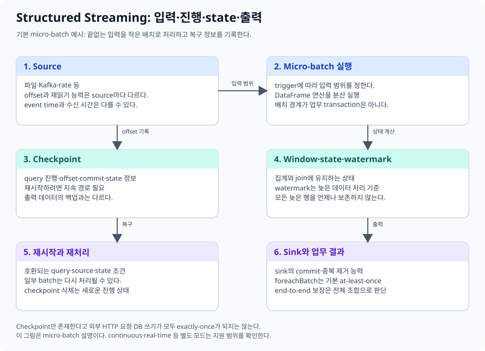

# 08. Structured Streaming

## 두 source partition, 세 micro-batch, 한 sink 실패를 시간표로 읽기

[이 책 목차](README.md) · [이전](07-reading-and-writing.md) · [다음](09-iceberg-integration.md)

Structured Streaming은 계속 늘어나는 입력을 DataFrame과 SQL 계산으로 표현한다. “실시간”이라는 말만으로 실행과 정확성을 알 수 없다. Event time, processing time, source offset, micro-batch, state, watermark, checkpoint, sink commit이 서로 다른 객체와 시각을 가진다. 이 장은 두 source partition에서 들어온 네 사건과 sink 실패를 끝까지 추적한다.

## 1. 먼저 열두 객체의 실제 위치와 수명

**Source**는 입력을 제공하는 시스템이나 인터페이스다. Kafka topic, file directory, table change stream이 예다. Source는 Spark 밖의 broker·storage에 원본 record를 지속하고 Spark query는 어느 범위를 읽을지 요청한다. Source가 과거 범위를 재생할 수 있어야 실패한 batch를 다시 계산할 수 있다.

**Offset**은 source 안의 읽기 위치다. Kafka에서는 topic partition마다 증가하는 번호다. Offset 7은 일곱 번째 업무 사건이라는 뜻이 아니라 그 partition 로그의 위치다. 서로 다른 partition의 offset 7은 다른 record다. Driver의 streaming progress와 checkpoint log가 처리 범위를 관리한다.

**Trigger**는 새 입력을 처리하는 실행을 언제 시작할지 정하는 정책이다. Processing time 10 seconds trigger는 대략 그 주기로 실행을 시도한다는 뜻이며 batch가 30초 걸리면 10초마다 결과가 완료된다는 보장이 아니다. AvailableNow는 현재 이용 가능한 입력을 처리하고 종료하는 방식이며 source 지원 조건이 따른다.

**Micro-batch**는 끝없는 입력 중 이번 실행에서 처리할 유한 offset 범위다. Driver가 batch ID와 시작·끝 offset을 정하고 job을 제출한다. Batch 계산이 끝나면 task memory는 사라지지만 완료 정보와 필요한 state는 checkpoint에 남는다.

**Event time**은 record 안의 사건 발생 시각이다. Sensor가 값을 측정한 시각이나 주문이 생긴 시각이다. **Processing time**은 Spark engine이 그 record를 실제 계산하는 시각이다. Network 지연과 장애 때문에 두 시각은 크게 다를 수 있다.

**Window**는 event time 같은 축을 구간으로 잘라 묶는 key다. 10분 tumbling window는 10:00 이상 10:10 미만처럼 겹치지 않는 구간을 만든다. 끝 10:10은 다음 window에 속한다는 반열린 구간 계약을 사용한다.

**State**는 다음 micro-batch에도 필요한 과거 요약이다. Window별 sum과 count, deduplication key, stream-stream join 대기 row가 예다. Executor의 state store provider가 memory와 local/remote state file로 관리하고, checkpoint와 결합해 실패 뒤 복구한다. State는 stateless task local 변수보다 오래 살며 watermark나 TTL, query 종료 때 제거된다.

**Watermark**는 관측한 event time 진행과 허용 지연으로 만든 정리 경계다. 지원되는 stateful 연산이 오래된 state를 제거하고 늦은 row 처리 경계를 판단하는 데 쓴다. Wall clock에서 10분 지난다는 뜻이 아니다.

**Sink**는 결과를 받는 대상이다. File/table/Kafka sink나 foreachBatch의 DB·REST 호출이 있다. Sink는 Spark 밖의 지속 객체를 만들며 각 sink가 지원하는 output mode와 commit protocol이 다르다.

**Commit**은 batch output이 유효하다고 확정하는 동작이다. File manifest, table snapshot, transaction ID처럼 독자가 어느 결과를 믿을지 정한다. Task가 API 요청 하나를 성공했다는 것과 batch 전체 commit은 다르다.

**Checkpoint**는 query metadata, source progress, commit log, state store 복구 정보 등을 fault-tolerant storage에 지속하는 directory다. Driver와 executor가 잃어버려도 query가 같은 정체성과 state를 복구하는 데 필요하다. 임시 cache와 달리 application process보다 오래 산다.

**Exactly-once**는 범위를 밝히지 않으면 위험한 말이다. Source offset 범위를 중복 없이 계산하는 것, sink에 같은 batch 효과를 한 번만 commit하는 것, 업무 event ID가 유일한 것은 서로 다른 보장이다.

## 2. 두 입력 partition과 사건 네 개

Kafka와 비슷한 source partition K0, K1을 교육 모형으로 사용한다.

| Source partition | Offset | Event ID | Event time | 값 | Processing 도착 순서 |
|---|---:|---|---|---:|---:|
| K0 | 0 | A | 10:03 | 20 | 1 |
| K1 | 0 | B | 10:07 | 22 | 2 |
| K0 | 1 | C | 10:22 | 30 | 3 |
| K1 | 1 | D | 10:05 | 24 | 4 |

D는 event time이 10:05이지만 processing 도착은 가장 늦다. 이것이 **late row**, 늦은 행이다. Offset은 각 partition 안에서만 순서가 있다. K0의 C가 K1의 D보다 먼저 처리되어도 D의 실제 사건 시각은 더 과거다.

10분 tumbling window와 watermark delay 10분을 가정한다. Window W0=[10:00,10:10), W1=[10:20,10:30)다. State 값은 (sum,count)이고 평균은 출력할 때 sum/count로 계산한다.

## 3. B0 전체 상태

Trigger가 K0 offset 0과 K1 offset 0을 B0에 포함한다.

| 항목 | B0 시작 | B0 계산 뒤 |
|---|---|---|
| Source 범위 | K0 [0,1), K1 [0,1) | 두 record 읽음 |
| 관측 max event time | 없음 | max(10:03,10:07)=10:07 |
| 설명용 watermark | 없음 | 10:07-10분=09:57 |
| W0 state | 없음 | sum=42,count=2 |
| W0 평균 | 없음 | 21 |
| Sink batch ID | 없음 | 0 준비 |

A와 B 모두 W0에 속한다. Task는 key W0를 기준으로 20과 22를 state store의 기존 없음에 더해 (42,2)를 만든다. 이 state는 다음 batch에도 late row가 올 수 있어 남는다.

B0 output을 sink에 쓰고 batch 0 commit이 성공했다고 가정한다. Checkpoint에는 source progress K0 next=1, K1 next=1과 state version, batch completion 정보가 지속된다. 내부 log의 정확한 write 순서를 모든 source/sink에 동일하게 고정하지 않는다. 핵심은 재시작 때 완료 batch와 state version을 일관되게 식별하는 protocol이다.

## 4. B1과 watermark 전진

B1은 K0 offset 1의 C, event time 10:22 값 30을 읽는다. K1에는 새 record가 없다고 하자.

| 항목 | B1 전 | C 처리 뒤 |
|---|---|---|
| Source 범위 | K0 next 1 | K0 [1,2) |
| Max event time | 10:07 | 10:22 |
| 설명용 watermark | 09:57 | 10:12 |
| W0 state | (42,2) | 정리 가능 |
| W1 state | 없음 | (30,1) |

Watermark 10:12는 W0 끝 10:10보다 뒤다. 해당 window aggregate와 output mode의 지원 조건에서 Spark는 W0가 더는 안전하게 갱신되지 않을 것으로 보고 state를 제거할 수 있다. “B1 processing time이 11:00이라 10분 지났다”가 아니라 새 record C의 event time 10:22가 진행을 밀었다.

Append mode의 window aggregate라면 결과가 더는 바뀌지 않는다고 판단된 W0 결과를 새 output row로 내보낼 수 있다. Update mode는 이전 batch부터 변경된 state를 낼 수 있다. Complete mode는 결과 table 전체를 매번 낼 수 있지만 state와 sink 지원 비용을 확인한다.

Watermark는 일반적으로 관측 max event time에서 delay를 뺀 개념을 사용하지만 실제 반영은 batch와 연산 조건에 따른다. 여러 input stream이면 Spark는 stream별 watermark를 추적하고 global watermark 정책을 적용한다. Spark 4.2 공식 문서에서 기본 multiple watermark policy는 min이다.

## 5. B2 늦은 행

B2는 K1 offset 1의 D, event time 10:05 값 24를 읽는다. 이 row의 event time은 현재 설명용 watermark 10:12보다 이르다. W0 state가 B1에서 제거되었다면 기존 (42,2)에 더할 상태가 없다.

| B2 단계 | 값 |
|---|---|
| Source record | K1 offset 1, D, 10:05, 24 |
| 속할 window | W0=[10:00,10:10) |
| 현재 watermark | 10:12 |
| W0 state | 이미 제거될 수 있음 |
| 처리 결과 | 연산·output mode 조건에서 집계 반영되지 않을 수 있음 |
| Source progress | K1 next=2로 commit 후보 |

“Watermark보다 늦으면 source에서 record가 삭제된다”는 뜻은 아니다. D는 source log에 존재하고 micro-batch가 읽을 수 있다. Stateful operator가 오래된 state를 유지하지 않도록 처리 경계를 적용한다.

Spark의 watermark 보장은 지연 threshold 이내의 data를 무조건 버리지 않는 방향으로 설명되며, threshold보다 더 늦은 data가 반드시 즉시 모두 버려진다고 일반화하지 않는다. 연산 유형, join, output mode와 version을 함께 확인한다.

## 6. Processing time과 trigger 반례

B0 processing이 10:30, B1이 11:00에 실행되어도 event time 표는 그대로다. C의 10:22가 watermark를 10:12로 움직인다. 반대로 하루 동안 계속 processing해도 들어오는 event time이 10:08 이하라면 watermark가 W0 끝을 넘지 않아 state가 남을 수 있다.

Processing-time trigger 10초에서 각 batch가 3초라면 다음 주기를 기다릴 수 있다. B1이 25초 걸리면 B1 실행 중 B2를 동시에 같은 query batch로 완료시키는 뜻이 아니다. Backlog가 쌓이고 다음 batch가 앞 batch 뒤에 시작될 수 있다. Input rows per second와 processed rows per second, batch duration을 함께 본다.

Processing-time TTL은 state가 engine processing clock 기준으로 얼마나 오래 미사용되었는지를 보는 정책일 수 있다. Event-time watermark와 시간축, 지원 API, 보장이 다르다. TTL을 설정했다고 늦은 event 처리 계약이 자동으로 생기지 않는다.

## 7. Sink 하나와 실패 전후

Sink는 결과를 batch_id를 고유 key로 저장하는 외부 table이라고 가정한다. B0은 성공했다. B1의 W0 최종 결과와 W1 update를 쓰는 도중 장애가 난다.

### 실패 A: Sink commit 전

1. Driver는 B1 source 범위 K0 [1,2)를 정한다.
2. Task가 C를 읽고 state version v1 후보를 계산한다.
3. Sink writer가 임시 output을 준비한다.
4. Commit 전에 executor 또는 Driver가 죽는다.
5. Checkpoint에 B1 완료가 없다.
6. 재시작은 checkpoint의 B0 완료 상태, 즉 K0 next=1, K1 next=1과 W0 (42,2)를 복구한다.
7. K0 offset 1을 다시 읽고 B1을 재계산한다.
8. Sink가 첫 시도의 미커밋 output을 abort/무시하고 두 번째 B1 commit만 공개하면 중복 효과가 없다.

### 실패 B: Sink commit 성공 뒤 응답 유실

1. Sink는 batch 1 output을 commit했다.
2. Driver가 성공 응답을 받기 전에 network가 끊긴다.
3. Checkpoint에는 batch 1 완료가 남지 않았을 수 있다.
4. 재시작은 B1을 다시 계산한다.
5. Sink가 batch_id=1이 이미 commit된 것을 알아보고 같은 결과를 성공으로 처리해야 한다.
6. 단순 append API가 매 호출 새 row를 추가하면 B1 효과가 두 번 생긴다.

두 실패의 겉모습은 모두 “B1 incomplete”지만 sink 상태가 다르다. Exactly-once output에는 commit 결과 조회 또는 idempotent transaction key가 필요하다. Batch ID를 별도 table에 쓰고 output write와 원자적으로 묶지 못하면 “output 성공, ID 기록 실패” 사이의 틈이 남는다.

## 8. Offset과 checkpoint 전체 시간표

| Batch | Source 시작→끝 | 입력 event | State 뒤 | Sink | Checkpoint 뒤 |
|---|---|---|---|---|---|
| B0 | K0 0→1, K1 0→1 | A,B | W0=(42,2) | batch0 commit | next=(1,1), v0 |
| B1 첫 시도 | K0 1→2, K1 1→1 | C | W1=(30,1), W0 정리 후보 | commit 전 실패 | B0 상태 유지 |
| B1 재시도 | 같은 범위 | C 재생 | 같은 후보 | batch1 commit | next=(2,1), v1 |
| B2 | K0 2→2, K1 1→2 | D late | W0에 반영 안 될 수 있음 | batch2 commit | next=(2,2), v2 |

Checkpoint는 “마지막 offset 숫자” 하나가 아니다. 두 source partition의 범위, batch ID, state store version과 commit log가 맞물린다. Stateful query의 checkpoint를 삭제하고 offset만 수동으로 2로 맞추면 W1 sum/count와 watermark 진행을 잃는다.

Checkpoint storage는 executor local disk가 아니라 application 재시작 후에도 접근 가능한 fault-tolerant 경로여야 한다. 같은 checkpoint를 서로 다른 query 두 개가 동시에 쓰면 log와 state를 손상시킬 수 있다. Query마다 독립 위치와 ownership을 둔다.

## 9. Exactly-once를 네 층으로 분해한다

| 층 | 객체 | 필요한 조건 | 이 예의 위험 |
|---|---|---|---|
| Source | K0/K1 offset | 범위 재생 가능 | retention으로 offset 삭제 |
| Engine | Batch ID, checkpoint, state | 완료 범위와 state 일관 복구 | checkpoint 삭제 |
| Sink | Batch commit | 같은 batch 재시도 멱등 | 응답 유실 뒤 duplicate append |
| 업무 | Event ID | 같은 사건 중복 판별 | 같은 ID가 다른 offset으로 재등장 |

Kafka K0 offset 0의 event ID A와 나중 offset 99의 event ID A는 source 관점에서 다른 두 record다. Engine이 각 offset을 정확히 한 번 sink에 commit해도 업무상 사건 A가 두 번 집계될 수 있다. Deduplication key와 허용 지연, state 보존 범위를 별도로 설계한다.

foreachBatch는 각 micro-batch output을 batch DataFrame과 batch ID로 사용자 함수에 넘긴다. 공식 Spark 문서는 기본적으로 at-least-once write 의미를 가지며 batch ID로 deduplicate해 exactly-once에 가까운 효과를 설계할 수 있다고 설명한다. REST 호출 여러 개가 자동 transaction으로 묶이지 않는다.

File/table sink의 공식 commit protocol을 사용하는 경로도 source와 mode별 지원 조건을 확인한다. “Spark Structured Streaming이므로 모든 외부 sink까지 exactly-once”라는 문장은 범위를 지나치게 넓힌다.

## 10. State store의 생성·유지·제거

Stateful task는 batch마다 key별 state를 읽고 새 version을 쓴다. Executor local state store는 빠른 조회를 제공하고 checkpoint용 delta/snapshot과 결합해 다른 executor에서 복구할 수 있다. Provider에 따라 memory, local disk, RocksDB 같은 unmanaged/off-heap 사용이 달라질 수 있다.

W0의 state 수명은 다음과 같다.

1. B0에서 A를 보며 W0 key와 (20,1)이 생성된다.
2. 같은 B0의 B로 (42,2)가 된다.
3. B0 commit 뒤 state version에 포함되어 다음 batch에서 읽힌다.
4. B1 max event time이 전진해 watermark 10:12가 된다.
5. 연산 조건상 W0가 완결되면 output하고 제거 후보가 된다.
6. State store maintenance와 checkpoint version 정리를 거쳐 오래된 file이 나중에 제거될 수 있다.

Logical state가 제거되었다고 checkpoint storage byte가 즉시 0이 되는 것은 아니다. Snapshot/delta retention과 maintenance 주기가 있다. State rows, state memory/disk, dropped late rows와 batch duration을 관찰한다.

## 11. Window와 output mode

**Append mode**는 새로 확정된 result row만 sink에 추가한다. Window aggregate에서는 watermark가 window 완료를 판단하는 데 필요할 수 있다. W0가 10:12 watermark 뒤 확정되면 평균 21을 append한다.

**Update mode**는 이번 batch에서 바뀐 result row를 낸다. B0에서 W0=21, 늦지만 허용된 새 row가 다음 batch에 오면 W0 새 평균을 다시 낼 수 있다. Sink가 같은 window key의 여러 version을 append만 하면 독자가 최신을 고르는 규칙이 필요하다.

**Complete mode**는 result table 전체를 매 trigger 출력한다. State와 output이 크면 비싸고 sink가 지원해야 한다. Streaming output mode의 append와 storage writer의 append/overwrite 용어를 같은 뜻으로 섞지 않는다.

Stream-stream join은 양쪽의 과거 row를 state에 보관하므로 양쪽 event time constraint와 watermark가 state 정리에 중요하다. 한쪽만 watermark를 둔다고 모든 join state가 안전하게 제거되는 것은 아니다.

## 12. Trigger와 source/sink 지원 조건

| Trigger | 의미 | 주의 |
|---|---|---|
| Processing time | 주기적으로 새 batch 시도 | 완료 주기 보장 아님 |
| Once | 한 번 실행하는 이전 방식 | runtime 지원·대체 확인 |
| AvailableNow | 현재 이용 가능한 입력을 여러 batch로 처리 후 종료 | Source 지원 조건 |
| Continuous | 낮은 지연의 별도 실행 방식 | 지원 operator/sink 제한 |

Trigger를 바꾸면 offset batch 경계와 batch ID 수가 달라질 수 있다. 업무 결과가 결합 법칙을 만족하면 최종 합은 같아야 하지만 foreachBatch가 batch 크기에 의존한 외부 side effect를 만들면 결과가 달라질 수 있다.

Source의 max offsets per trigger 같은 rate limit은 backlog를 여러 batch로 나눈다. Watermark 진행도 각 batch에서 관측한 event time에 따라 달라질 수 있으므로 성능 설정이 state 수명과 late row 관측 시점에 영향을 줄 수 있다.

## 13. TransformWithState와 TTL

TransformWithState는 Spark 4.0에 도입된 새 arbitrary stateful operator다. Value/List/Map state, timer, optional TTL 같은 기능을 제공하며 Scala, Java, Python 지원 API가 있다. State encoder는 state object를 저장 byte로 바꾸고 복원한다.

TTL은 설정한 time mode와 API 규칙에 따라 state 변수를 자동 evict하는 기능이다. Watermark와 같은 말이 아니다. Event-time timer는 watermark 진행과 관계될 수 있고 processing-time timer는 engine clock을 사용한다. Timer도 checkpoint되어 재시작 뒤 발화할 수 있다는 공식 조건이 있다.

TTL state가 제거된 뒤 늦은 업무 event가 오면 새 state로 시작할 수 있다. “메모리 절약”과 “업무 세션을 얼마나 오래 이어 볼 것인가”를 함께 결정한다. TTL은 sink commit의 중복 방지나 source exactly-once를 제공하지 않는다.

## 14. Query 변경과 checkpoint 호환성

같은 checkpoint로 재시작한다는 것은 같은 query identity와 state 계약을 이어 간다는 뜻이다. Stateful operator 수, grouping key, state schema, shuffle partition 수, state store provider와 source topology의 일부 변경은 호환되지 않거나 의미를 바꿀 수 있다.

새 checkpoint를 쓰면 새 query다. Starting offsets 옵션은 새 query 시작 위치를 정할 수 있지만 기존 checkpoint가 있는 복구에서는 기록된 progress가 우선되는 경로가 있다. “latest로 바꾸면 기존 state가 최신부터 이어진다”라고 가정하지 않는다.

새 checkpoint로 cutover할 때는 다음을 정한다.

- 과거 offset을 다시 읽을지 최신부터 시작할지
- 기존 sink result와 겹치는 batch/event를 어떻게 막을지
- Window state를 재구성할지 버릴지
- Watermark와 late row 품질 기준을 어떻게 이어 갈지
- 이전 checkpoint와 state file을 언제 안전하게 삭제할지

## 15. 완전 풀이 1: B0 평균

**문제.** B0의 10:03=20, 10:07=22가 만드는 W0 state와 평균은?

**풀이.** 두 event 모두 [10:00,10:10)에 속한다. Sum=42, count=2, 평균=21이다. Max event time은 10:07이고 설명용 watermark는 09:57이다.

**조건 변화.** Window가 5분이면 10:03은 [10:00,10:05), 10:07은 [10:05,10:10)로 갈라져 state 두 개가 된다.

## 16. 완전 풀이 2: B1 watermark

**문제.** C의 event time 10:22를 본 뒤 10분 delay의 watermark는?

**풀이.** 교육 모형에서 max 10:22-10분=10:12다. W0 끝 10:10보다 전진했으므로 지원되는 window 연산에서 W0를 완료·정리할 수 있다.

**조건 변화.** 다른 input stream의 watermark가 10:00이고 global policy가 기본 min이면 global watermark가 10:00에 머물 수 있다.

## 17. 완전 풀이 3: 늦은 D

**문제.** B2의 D=10:05가 왜 processing 시각과 무관하게 늦은가?

**풀이.** 현재 watermark 10:12보다 event time 10:05가 이전이고 속할 W0 state가 이미 제거될 수 있기 때문이다. B2가 벽시계 10:06에 빨리 계산되어도 event-time 상태 경계는 같다.

**조건 변화.** Delay를 30분으로 늘리면 watermark가 09:52여서 W0 state를 더 오래 유지할 수 있지만 state 크기와 checkpoint 비용이 늘어난다.

## 18. 완전 풀이 4: Commit 전 실패

**문제.** B1 sink commit 전에 죽으면 어느 offset을 다시 읽는가?

**풀이.** Checkpoint에는 B0까지만 완료되어 K0 next=1, K1 next=1이다. B1의 K0 [1,2)를 다시 읽고 C를 재처리한다. 첫 시도 output은 미커밋이므로 sink protocol이 공개하지 않아야 한다.

**조건 변화.** Source retention으로 K0 offset 1이 사라졌으면 같은 계산을 복구할 수 없다. Checkpoint만으로 원본 record를 재생성하지 못한다.

## 19. 완전 풀이 5: Commit 후 응답 유실

**문제.** Sink는 batch 1을 commit했지만 Driver가 모른다. 재시도 결과는?

**풀이.** Engine은 B1을 다시 실행할 수 있다. Sink가 batch_id=1을 고유 transaction으로 인식하면 이미 성공으로 처리해 효과가 한 번이다. 단순 append면 같은 row를 다시 넣어 중복된다.

**조건 변화.** Batch ID 기록과 output write가 서로 다른 시스템에 있으면 둘 사이 atomicity가 없다. Transactional outbox나 destination 고유 key를 검토한다.

## 20. 완전 풀이 6: 업무 중복

**문제.** Event ID A가 K0 offset 0과 offset 99에 두 번 들어오면 exactly-once source 처리가 하나만 남기는가?

**풀이.** 아니다. Offset이 다르면 source record 두 개다. Engine은 둘을 각각 한 번 처리한다. 업무상 한 사건이라면 event ID dedup state와 보존 기간을 별도로 둔다.

**조건 변화.** Dedup state를 watermark로 제거한 뒤 매우 늦은 duplicate가 오면 다시 통과할 수 있다. 보존 기간은 업무 최대 지연과 memory 비용의 선택이다.

## 21. 완전 풀이 7: Checkpoint 삭제

**문제.** Checkpoint를 삭제하고 sink data는 남긴 채 query를 다시 시작하면?

**풀이.** 완료 offset, batch ID, window state와 watermark 진행을 잃는다. Source 시작 옵션에 따라 과거를 다시 읽어 duplicate output을 만들거나 최신부터 읽어 기존 W1 state를 복구하지 못한다. 같은 query 복구가 아니라 새 query cutover다.

**조건 변화.** Sink가 event ID로 멱등하고 state를 원천 전체 재생으로 재구성할 수 있다면 통제된 재시작이 가능하지만 비용과 retention을 검증해야 한다.

## 22. 완전 풀이 8: Trigger 지연

**문제.** Processing time trigger 1초인데 batch가 5초 걸린다. 초당 결과가 나오는가?

**풀이.** 아니다. Trigger는 시작 시도 정책이며 이전 batch 계산·sink commit이 끝나지 않으면 완료 주기는 5초 이상이 된다. Backlog와 input/processed rate를 본다.

**조건 변화.** Batch를 작게 나누면 latency가 줄 수 있지만 commit overhead가 늘고 watermark/state 진행 batch 수가 달라진다.

## 23. 실행 검증표

| 층 | 기록할 값 |
|---|---|
| Source | Partition별 start/end offset, retention |
| Time | Max event time, processing time, timezone |
| Batch | Batch ID, input rows, duration, trigger |
| Watermark | Delay, current watermark, dropped late rows |
| State | Row 수, memory/disk byte, version, removed rows |
| Sink | Output mode, transaction/commit ID, retry 결과 |
| Checkpoint | 위치, query ID, last completed batch |
| Failure | Commit 전/후, 응답 unknown, 재생 범위 |
| Business | Event ID, dedup 규칙, 최대 허용 지연 |

Streaming 정확성은 watermark 하나나 checkpoint directory 하나로 완성되지 않는다. Source가 offset 범위를 재생하고, engine이 state와 batch 완료를 복구하며, sink가 같은 commit 재시도를 식별하고, 업무가 event ID 중복을 정의할 때 전체 보장 범위를 말할 수 있다.

## 공식 자료

[Structured Streaming](https://spark.apache.org/docs/4.2.0/streaming/index.html), [DataFrame streaming APIs](https://spark.apache.org/docs/4.2.0/streaming/apis-on-dataframes-and-datasets.html), [TransformWithState](https://spark.apache.org/docs/4.2.0/streaming/structured-streaming-transform-with-state.html), [Iceberg streaming](https://iceberg.apache.org/docs/latest/spark-structured-streaming/)을 사용한 장이다.
