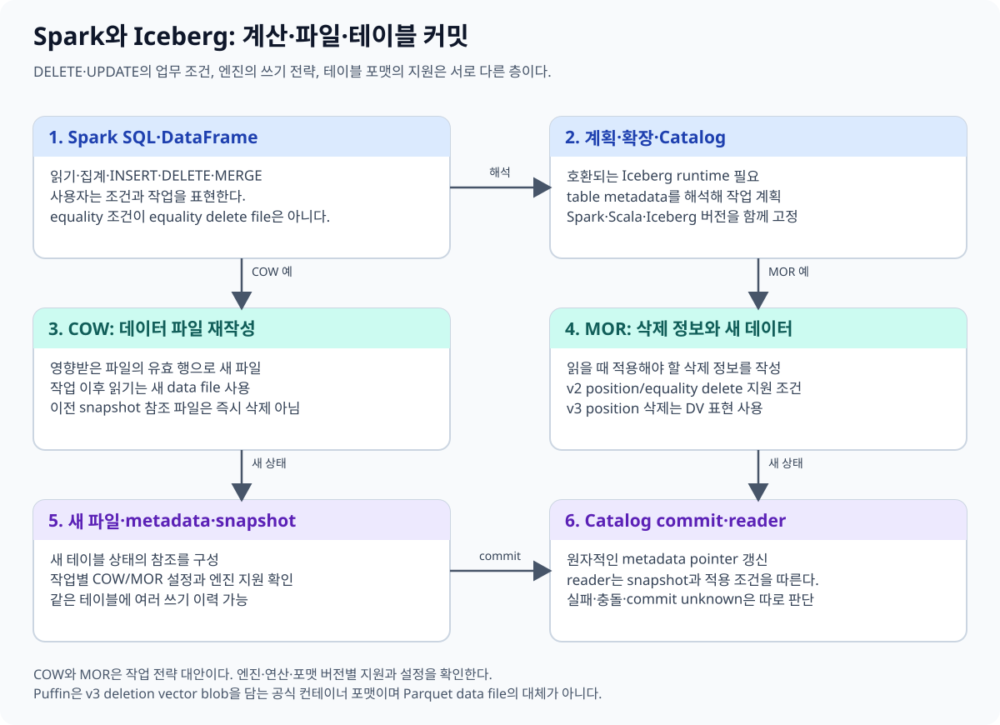

# 09. Spark와 Iceberg: SQL 한 줄이 Snapshot Commit이 되는 전 과정

[이전: Structured Streaming](08-structured-streaming.md) · [목차](README.md) · [다음: 배포와 Spark Connect](10-deployment-and-connect.md)

Spark와 Iceberg는 모두 데이터를 다루지만 같은 종류의 시스템이 아니다. Spark는 SQL을 분석하고 CPU에서 Task를 실행하는 **계산 엔진**이다. Iceberg는 여러 Data File을 하나의 Table 상태로 묶고 Schema, Snapshot, 삭제와 Commit 규칙을 정하는 **테이블 포맷**이다. Parquet은 각 File 내부의 행과 열 Byte를 배치하는 **파일 형식**이다. Catalog는 Table 이름을 현재 Iceberg Metadata 위치에 연결하는 **이름·Commit 경계**다.

이 장은 SELECT와 DELETE가 이 네 계층을 어떻게 통과하는지 파일과 숫자로 끝까지 추적한다. 별도 교재를 보라는 문장으로 핵심 원리를 넘기지 않는다.

## 1. 객체가 존재하는 위치와 수명

| 객체 | 실제 위치 | 관리자 | 수명 |
|---|---|---|---|
| SQL 문자열 | Client 또는 Driver Memory | 사용자 프로그램 | 요청이 분석될 때까지 |
| Logical/Physical Plan | Driver Memory | Spark | Query 실행 동안 |
| Task와 Attempt | Driver 상태·Executor Thread | Spark Scheduler | Partition 계산 동안 |
| Catalog 이름 연결 | Catalog Service 또는 Metadata Store | Catalog 구현 | Table이 존재하는 동안 |
| Table Metadata JSON | Object/File Storage | Iceberg Writer와 Catalog | Retention으로 정리될 때까지 |
| Snapshot | Metadata 안의 Table 상태 참조 | Iceberg | 만료되기 전까지 |
| Manifest List와 Manifest | Storage의 Metadata File | Iceberg | 참조 Snapshot과 보존 정책에 따라 |
| Data File | Storage의 Parquet/Avro/ORC | Writer | Snapshot이 참조하고 정리 전까지 |
| Delete File 또는 DV | Storage | Writer와 Reader | 적용 대상과 Snapshot 보존에 따라 |

**Metadata JSON**은 Table의 Schema, Partition Spec, 속성, Snapshot 목록과 현재 Snapshot 같은 정보를 담는 파일이다. **Manifest List**는 한 Snapshot이 사용하는 Manifest들을 나열한다. **Manifest**는 Data File이나 Delete File 항목, Partition 값과 통계를 담는다. 이 계층 덕분에 Reader는 Storage 전체를 무작정 Listing하지 않고 현재 Snapshot의 File 후보를 찾는다.

Data File이 Storage에 존재한다는 사실만으로 현재 Table 소속은 아니다. 현재 Metadata→Snapshot→Manifest 경로가 그 File을 참조해야 한다. 반대로 과거 File이 남아 있어도 현재 Snapshot이 참조하지 않으면 현재 SELECT 결과에 자동으로 포함되지 않는다.

## 2. 실행 조합은 실제 Runtime Artifact로 고정한다

이 책의 교육용 검증 기준선은 다음 조합이다.

| 축 | 값 |
|---|---|
| PySpark Engine | 4.0.4 |
| Java | 21 |
| Scala Binary ABI | 2.13 |
| Iceberg Product | 1.12.0 |
| Runtime Artifact | iceberg-spark-runtime-4.0_2.13:1.12.0 |

Iceberg 1.12.0은 2026-09-29 발표되었다. 공식 Release Page는 Spark 3.5, 4.0, 4.1용 Runtime을 나열하지만 Spark 4.2용 Artifact는 나열하지 않는다. Spark 4.2 문서에 Iceberg 관련 새 Metric이 보여도 Iceberg 1.12.0의 4.1 JAR를 공식 4.2 Runtime이라고 단정할 수 없다. Engine 기능과 Connector Integration 지원은 별도 축이다.

~~~text
spark-submit \
  --packages org.apache.iceberg:iceberg-spark-runtime-4.0_2.13:1.12.0 \
  app.py
~~~

이 명령은 Dependency Download가 가능한 환경을 전제로 한 예시이며 이 원고 작성 과정에서 실행하지 않았다. 운영에서는 Artifact Hash, Repository, Storage Bundle과 Classpath 중복을 고정한다.

## 3. SQL 이름에서 현재 Snapshot까지

다음 SQL을 실행한다고 하자.

~~~sql
SELECT country, SUM(amount) AS total
FROM prod.sales.orders
WHERE amount >= 20
GROUP BY country
~~~

prod는 SparkSession에 등록된 Catalog 이름, sales는 Namespace, orders는 Table 이름이다. 처리 순서는 다음과 같다.

1. Spark Parser가 SQL을 관계 연산 표현으로 바꾼다.
2. Analyzer가 prod.sales.orders를 Catalog에 조회한다.
3. Iceberg Catalog 구현이 현재 Table Metadata 위치를 돌려준다.
4. Iceberg Integration이 Metadata JSON의 현재 Snapshot을 찾는다.
5. Snapshot이 Manifest List를, Manifest List가 Manifest들을 가리킨다.
6. Manifest의 Partition 값과 Column 통계로 읽지 않아도 되는 File을 제외한다.
7. 남은 Data/Delete File을 Spark Input Partition으로 계획한다.
8. Driver가 Stage와 Task를 만들고 Executor가 File을 읽는다.
9. Reader가 적용 가능한 Delete를 병합한 논리 행에 Filter와 Aggregate를 수행한다.
10. 최종 결과 일부가 Driver 또는 다음 Sink로 전달된다.

~~~mermaid
sequenceDiagram
    participant U as Client
    participant D as Spark Driver
    participant C as Catalog
    participant M as Iceberg Metadata
    participant E as Executors
    U->>D: SQL 제출
    D->>C: prod.sales.orders 조회
    C-->>D: current metadata 위치
    D->>M: snapshot·manifest 읽기
    M-->>D: scan file 후보와 통계
    D->>E: input partition별 task
    E->>M: data/delete file 읽기
    E-->>D: 집계 결과와 상태
    D-->>U: 결과 응답
~~~

Catalog가 Table을 찾았다고 Data File 접근이 보장되는 것은 아니다. Driver는 Metadata를 읽을 수 있지만 Executor Credential이 Data Prefix를 읽지 못하면 Task에서 실패할 수 있다.

## 4. Snapshot 50 읽기를 숫자로 추적한다

Snapshot 50의 현재 Data File이 다음과 같다고 하자.

| File | 물리 행 |
|---|---|
| data-A.parquet | (KR,10), (US,20), (KR,30) |
| data-B.parquet | (JP,40), (KR,50), (US,60) |

Manifest 통계가 다른 18개 File의 amount 최대값이 20 미만임을 보여 줘 제외했다고 하자. 이를 **File Pruning**이라고 한다. A와 B는 amount 범위가 조건과 겹치므로 Reader가 연다.

Filter amount>=20 뒤 A에는 US20, KR30이 남고 B의 세 행은 모두 남는다. Partition별 부분 합은 다음과 같다.

| Task 입력 | 부분 합 |
|---|---|
| A | US=20, KR=30 |
| B | JP=40, KR=50, US=60 |

Shuffle 뒤 최종 합은 KR=80, US=80, JP=40이다. 원문 첫 설명의 KR90은 Filter 이전 KR 10+30+50 합이다. amount>=20 조건이 있는 Query 결과라면 KR10이 제거되어 KR80이다. 조건 없는 집계에서는 KR90이다. 조건과 결과 숫자를 함께 기록해야 한다.

Manifest 통계로 18개 File을 제외해도 A와 B 안에서 조건 평가가 남을 수 있다. File 통계는 "이 File에는 조건을 만족할 행이 절대 없다"를 증명해 제외할 수 있지만, 후보 File의 모든 행이 반드시 조건을 만족한다고 일반화할 수 없다.

## 5. Delete SQL과 물리 삭제 표현

~~~sql
DELETE FROM prod.sales.orders
WHERE amount = 20
~~~

amount=20은 제거할 논리 행 조건이다. 어떤 물리 File이 만들어지는지는 Table Format, 작업별 Write Mode, Engine Integration과 조건 범위에 달려 있다.

| 층 | 결정 내용 |
|---|---|
| SQL 조건 | 어떤 논리 행을 삭제할지 |
| Scan/Validation | 어느 Data File과 Row가 영향받는지 |
| COW/MOR Mode | Data File을 Rewrite할지 Delete 정보를 추가할지 |
| v2/v3 표현 | Position/Equality Delete 또는 DV 등 지원 표현 |
| Commit | 새 상태를 Snapshot으로 공개할지 |

DELETE 조건이 customer_id=7이라는 Equality 조건이어도 Equality Delete File 생성을 보장하지 않는다. Engine은 Position 기반 결과를 만들거나 COW Rewrite를 할 수 있다. 사용자는 Metadata Table과 Manifest Entry를 보고 실제 생성물을 확인해야 한다.

## 6. COW 전체 Trace

**COW, Copy-on-Write**는 영향을 받은 기존 Data File을 읽고 삭제·수정 결과를 반영한 새 Data File을 쓰는 방식이다. 기본 Write Property는 Delete, Update, Merge별로 copy-on-write다.

Snapshot 50에서 data-A의 US20을 삭제한다고 하자.

1. Driver가 A가 영향받는 File임을 계획한다.
2. Executor Task가 A의 세 행을 읽는다.
3. amount=20인 US20을 제거한다.
4. 살아남은 KR10, KR30을 data-C.parquet에 쓴다.
5. Writer가 새 Manifest와 Metadata 후보를 만든다.
6. Commit이 성공하면 Snapshot 51은 C와 B를 현재 File로 참조한다.
7. A는 Storage에 당장 남을 수 있지만 Snapshot 51의 현재 Data File은 아니다.
8. 과거 Snapshot 50을 보존하는 동안 Time Travel이 A를 필요로 할 수 있다.

COW의 읽기는 새 Data File만 읽으면 되어 단순할 수 있다. Write는 A의 삭제되지 않은 행까지 복사하므로 큰 File에서 한 행 삭제도 많은 Byte를 Rewrite할 수 있다. Spark 4.2 이상의 Iceberg Integration 문서에는 삭제 행과 COW에서 복사한 행 수 Summary Metric이 설명되지만, 그 문서 기능과 Iceberg 1.12.0의 공식 Spark 4.2 Runtime 지원 여부를 섞지 않는다.

## 7. MOR, v2 Delete File과 적용 조건

**MOR, Merge-on-Read**는 기존 Data File을 유지하고 삭제 정보를 별도로 Commit한 뒤 Reader가 읽을 때 두 정보를 합치는 방식이다. v2 이상에서 Write Mode를 merge-on-read로 설정할 수 있다.

**Position Delete**는 Data File 경로와 0부터 시작하는 물리 Row Position을 기록한다. A의 두 번째 물리 행 US20은 Position 1이다.

~~~text
(file_path="data-A.parquet", pos=1)
~~~

이 Delete는 data-B의 Position 1에 적용되지 않는다. File 경로와 Position의 쌍이 대상이다. File을 Rewrite해 Row 순서가 바뀌면 이전 Position을 새 File에 그대로 적용하지 않는다.

**Equality Delete**는 Field ID와 값의 조합으로 삭제 후보를 표현한다. customer_id Field ID 4의 값 7이라면 적용 범위와 Sequence 조건을 만족하는 Data File의 해당 값 행을 제거한다. 단순히 열 이름 문자열이 같은지만 보는 것이 아니다. Partition과 Data/Delete Sequence Number가 어떤 Data File에 적용되는지 제한한다.

MOR Reader의 결과는 다음 관계로 생각할 수 있다.

~~~text
논리 행 = 현재 Snapshot의 Data 행
        - 그 Data File에 적용되는 Position/Equality Delete
~~~

Delete File이 작아 보여도 Reader가 많은 Delete를 병합하면 Read Cost가 커질 수 있다. Rewrite Maintenance로 Delete를 Data File에 반영하는 이유다.

## 8. v3 Deletion Vector와 Puffin

Iceberg v3의 **Deletion Vector, DV**는 한 Data File의 삭제된 Row Position을 Bitmap으로 표현한다. Position P의 Bit가 1이면 그 File의 P번째 Row가 삭제되었다는 뜻이다. Position Delete의 의미를 File별 Bitmap으로 압축해 찾을 수 있다.

DV Blob은 **Puffin** 파일에 저장된다. Puffin은 Parquet보다 가벼운 대체 Data File 형식이 아니다. Table Data 행을 Column으로 저장하는 Parquet과 목적이 다르다. Puffin은 Manifest에 직접 넣기 어려운 Index, Statistics, DV 같은 Blob과 그 Blob을 해석할 Metadata를 담는 Container 형식이다.

Puffin 구조는 개념적으로 다음과 같다.

~~~text
Magic | Blob1 | Blob2 | ... | Footer
~~~

Footer는 각 Blob의 Type, Offset, Length와 속성을 설명한다. deletion-vector-v1 Blob의 속성에는 적용 대상 Data File 위치와 Cardinality가 포함된다. 하나의 Puffin File에 여러 DV Blob이 들어갈 수 있고, Manifest Entry는 Puffin File Path뿐 아니라 해당 Blob의 Content Offset과 Size를 가리킨다.

A의 Position 1만 삭제하면 A용 DV Bitmap에서 Bit 1이 켜진다. Reader는 A를 읽을 때 그 DV를 찾아 Position 1을 제외한다. 다른 Data File에는 적용하지 않는다.

v3에서 Position Delete File은 Deprecated다. 그렇다고 v3 Reader가 과거 v2 Position Delete를 무시한다는 뜻은 아니다. Table Upgrade 전부터 있던 Delete를 계속 읽어야 혼재 Table의 결과가 유지된다. 새 Write가 항상 DV를 만드는 것도 아니다. COW, File 전체 Metadata Delete, Integration 지원과 작업 설정에 따라 경로가 달라진다.

## 9. File 전체 조건과 Metadata-only Delete

DELETE 조건이 Partition 전체 또는 Data File 전체를 확실히 포함하면 행을 하나씩 읽고 Rewrite하지 않고 Manifest에서 File 참조를 제거할 수 있다. 이를 **Metadata-only Delete**라고 부른다.

예를 들어 Table이 event_date로 Partition되어 있고 2026-09-01 Partition 전체를 삭제하는 조건이 정확히 일치한다면 해당 Partition File Entry를 새 Snapshot에서 제거할 수 있다. 실제 가능 여부는 Partition Transform과 조건 변환, 통계 신뢰성에 달려 있다.

따라서 DELETE 한 번을 다음처럼 고정 계산하면 틀린다.

- 항상 새 Data File 하나
- 항상 Delete File 하나
- 항상 Puffin 하나
- 항상 기존 File 즉시 삭제

실제 Snapshot Summary, files, entries, manifests Metadata Table을 확인한다.

## 10. Write Task에서 Snapshot Commit까지

Append 또는 Rewrite Write의 전체 흐름은 다음과 같다.

1. Driver가 Table의 기준 Metadata A와 Snapshot ID를 읽는다.
2. Physical Plan이 필요한 Shuffle과 Writer Task를 만든다.
3. Executor가 새 Data/Delete File을 Storage에 Upload한다.
4. Task Commit Message가 File Path, Count, Size, Metric을 Driver에 보낸다.
5. Driver의 Iceberg Writer가 결과를 모아 Manifest와 새 Metadata B를 준비한다.
6. Commit 전에 기준 Snapshot 이후 변경과 작업 조건의 충돌을 검증한다.
7. Catalog에 "현재가 여전히 A이면 B로 교체"하는 원자적 갱신을 요청한다.
8. 성공하면 새 Snapshot이 독자에게 한 번에 보인다.
9. 실패하면 안전한 경우 최신 Metadata에 Rebase해 재검증하고 Commit을 다시 시도한다.
10. 재시도 불가능한 충돌이면 Operation을 Abort한다.

7번은 **Compare-and-Swap, CAS**처럼 Expected Current Pointer와 New Pointer를 비교·교체하는 원리다. Catalog마다 Lock, Version Token, Database Transaction 등 실제 구현은 다르지만 중간 Table 상태가 현재로 노출되지 않게 해야 한다.

Task Upload 성공은 Commit 성공이 아니다. 반대로 Commit은 성공했지만 응답 Network가 끊겨 Driver가 실패로 볼 수도 있다. 이때 같은 Append를 즉시 다시 실행하면 중복될 수 있다.

## 11. 동시 Writer와 검증

Writer W1과 W2가 모두 Metadata A에서 시작했다고 하자.

~~~mermaid
sequenceDiagram
    participant W1 as Writer 1
    participant W2 as Writer 2
    participant C as Catalog
    W1->>C: expected A, publish B
    C-->>W1: success
    W2->>C: expected A, publish C
    C-->>W2: current is B, conflict
    W2->>W2: refresh + validate + retry 또는 abort
~~~

두 Writer가 서로 다른 새 Partition에 Append했다면 W2가 B를 기준으로 자기 새 File을 다시 적용해 안전하게 Commit할 수 있을 수 있다. 이를 **Rebase**라고 한다. W1이 W2가 Rewrite하려던 같은 File을 바꿨다면 W2의 계획은 오래된 입력에 기반하므로 Validation이 실패해야 한다.

**Serializable Isolation**에서는 Operation의 조건과 겹치는 동시 변경을 검증해 마치 어떤 직렬 순서로 실행된 것처럼 결과를 보호한다. Snapshot Isolation은 검증 범위가 다를 수 있다. Property 이름만 바꾸기 전에 삭제·Update의 업무 충돌 의미를 정해야 한다.

## 12. Abort와 고아 File

Commit이 실패하면 Writer는 자기 새 File을 삭제하려고 Abort Cleanup을 수행할 수 있다. 그러나 Executor가 Upload한 뒤 Driver가 죽거나 Network가 끊기면 모든 File을 정확히 추적·삭제하지 못할 수 있다.

**Orphan File, 고아 파일**은 Storage에 존재하지만 어떤 유효 Snapshot Metadata에서도 참조되지 않는 File이다. Table 결과에는 포함되지 않지만 비용을 차지한다. 모든 현재 File을 Orphan으로 오인해 삭제하면 Table을 파괴하므로 Maintenance는 보존 시간과 Catalog 상태를 신중히 사용해야 한다.

Commit Outcome이 불명확하면 먼저 현재 Snapshot과 Operation ID, Summary를 확인한다. 새 Snapshot이 실제로 Commit됐다면 그 File은 고아가 아니다. 즉시 Storage Listing만 비교해 삭제하지 않는다.

## 13. Maintenance가 바꾸는 것

**rewrite_data_files**는 작은 File을 합치거나 MOR Delete를 새 Data File에 반영해 Read Amplification을 줄일 수 있다. 논리 행 결과를 유지해야 하지만 새 Snapshot과 새 File을 만든다.

**expire_snapshots**는 오래된 Snapshot 참조를 제거해 Time Travel과 Rollback 가능 범위를 줄인다. Snapshot이 만료되어야 더 이상 참조되지 않는 옛 File을 정리할 수 있다.

**remove_orphan_files**는 어떤 Metadata에서도 참조되지 않는 오래된 File 후보를 제거한다. 최근 Commit 중이거나 결과 불확실 상태의 File을 지우지 않도록 충분한 보존 간격과 일관된 File Listing이 필요하다.

~~~sql
CALL prod.system.rewrite_data_files(
  table => 'sales.orders',
  options => map('target-file-size-bytes', '536870912')
);

CALL prod.system.expire_snapshots(
  table => 'sales.orders',
  older_than => TIMESTAMP '2026-09-01 00:00:00',
  retain_last => 5
);
~~~

512MiB, 날짜, Snapshot 5개는 교육용 값이다. Workload, Object Storage 비용, 감사와 연구 재현 기간을 측정해 정한다.

## 14. 관찰해야 할 Metadata

~~~sql
SELECT file_path, file_format, record_count, file_size_in_bytes
FROM prod.sales.orders.files;

SELECT committed_at, snapshot_id, operation, summary
FROM prod.sales.orders.snapshots
ORDER BY committed_at DESC;

SELECT content, file_path, record_count, equality_ids
FROM prod.sales.orders.entries;
~~~

Metadata Table Schema는 Version과 Format에 따라 달라질 수 있으므로 먼저 DESCRIBE로 확인한다. 논리 SELECT Row Count와 Data File Record Count를 단순 비교하면 MOR Delete 때문에 차이가 날 수 있다.

EXPLAIN은 Spark의 실행 Plan을 보여 주고 Metadata Table은 Iceberg의 File 상태를 보여 준다. Storage Listing은 물리 Object 존재를 보여 준다. 세 관찰은 서로 다른 층이다.

## 15. 8개 종합 문제와 완전 풀이

### 문제 1
Snapshot 50에서 조건 없는 국가별 합과 amount>=20 합을 각각 구하라.

**풀이:** 조건 없이는 KR=10+30+50=90, US=20+60=80, JP=40이다. Filter가 있으면 KR10이 제거되어 KR=80이고 US80, JP40이다. 같은 File을 읽어도 SQL 조건이 결과를 바꾼다.

### 문제 2
COW로 amount=20을 삭제한 Snapshot 51의 현재 Data File과 행은?

**풀이:** A를 대체한 C=(KR10,KR30)과 기존 B=(JP40,KR50,US60)가 현재다. A는 과거 Snapshot 50 때문에 Storage에 남을 수 있지만 현재 Snapshot File은 아니다.

### 문제 3
MOR에서 data-A Position 1을 삭제하면 data-B Position 1도 지워지는가?

**풀이:** 아니다. Position Delete와 DV는 적용 대상 Data File을 식별한다. data-A의 Position 1인 US20만 삭제된다.

### 문제 4
Puffin은 Parquet보다 가벼운 행 저장 형식인가?

**풀이:** 비교 목적이 다르다. Parquet은 Table 행을 열 단위로 저장하고 Puffin은 DV, Index, Statistics 같은 Blob과 Footer Metadata를 담는다. Puffin 크기만으로 Parquet 대체 여부를 판단하지 않는다.

### 문제 5
v3 Table이면 기존 v2 Position Delete를 무시해도 되는가?

**풀이:** 아니다. Upgrade 뒤에도 기존 Delete가 참조될 수 있다. Reader는 혼재 상태를 처리해야 논리 결과가 유지된다. v3의 새 Position Delete가 Deprecated인 것과 과거 Delete 읽기는 다른 문제다.

### 문제 6
W1 Commit 뒤 W2가 CAS 충돌을 받으면 W2는 항상 실패하는가?

**풀이:** Append처럼 동시 변경과 겹치지 않으면 Refresh, Rebase, Validation 뒤 재시도할 수 있다. 같은 File Rewrite나 Delete 조건과 겹치면 Validation이 실패해 Abort해야 할 수 있다.

### 문제 7
Driver가 Commit 응답을 못 받았다. 같은 Write를 다시 실행해도 되는가?

**풀이:** 먼저 Catalog의 현재 Metadata와 Snapshot Summary를 확인한다. Commit이 성공했는데 응답만 잃었다면 재실행은 중복을 만든다. Outcome 확인과 Operation ID가 필요하다.

### 문제 8
remove_orphan_files를 즉시 실행하면 실패한 Upload를 안전하게 지울 수 있는가?

**풀이:** 최근 진행 중 Commit File이나 Outcome 불명확 File을 잘못 지울 수 있다. Snapshot 참조, 충분한 보존 시간, Storage Listing 일관성, Maintenance 공식 안전 조건을 확인한다.

## 16. 공식 근거와 호환성 경계

Spark SQL Write 경로와 COW/MOR 설정은 [Iceberg Spark Writes](https://iceberg.apache.org/docs/latest/spark-writes/)와 [Configuration](https://iceberg.apache.org/docs/latest/configuration/)을 기준으로 했다. Snapshot·Manifest·v2/v3 Delete와 DV는 [Iceberg Table Spec](https://iceberg.apache.org/spec/), Puffin 구조와 deletion-vector-v1은 [Puffin Spec](https://iceberg.apache.org/puffin-spec/)에 근거한다. 유지보수는 [Maintenance](https://iceberg.apache.org/docs/latest/maintenance/)의 안전 조건을 따른다.

Iceberg 1.12.0의 공식 Spark Runtime 축은 [Releases](https://iceberg.apache.org/releases/)와 [Multi-engine Support](https://iceberg.apache.org/multi-engine-support/)에서 확인한다. Spark 4.2 Engine 문서의 기능을 Iceberg 1.12.0 Spark 4.2 Runtime 지원으로 확대하지 않는다.

[이전: Structured Streaming](08-structured-streaming.md) · [목차](README.md) · [다음: 배포와 Spark Connect](10-deployment-and-connect.md)
