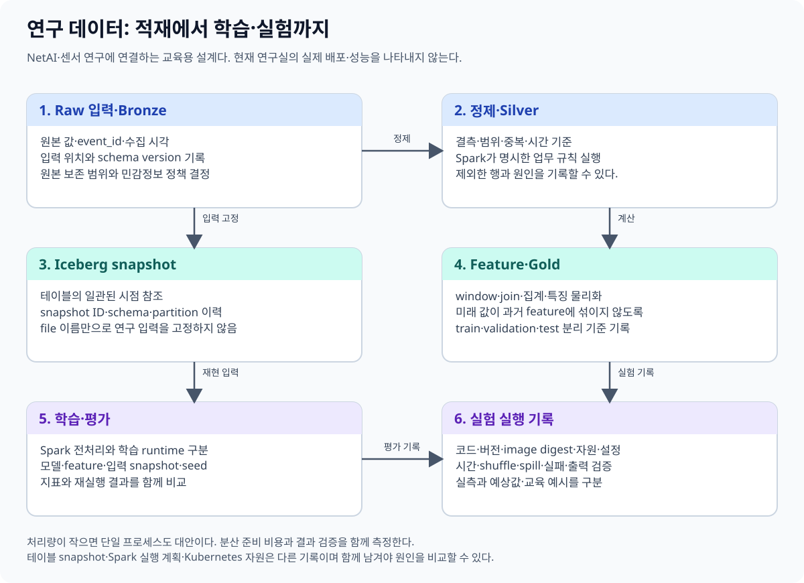

# 12. 연구 워크플로: 한 가설을 원천 행에서 기각 조건까지 추적하기

[이전: 로컬 실습](11-local-labs.md) · [목차](README.md) · [다음: 버전과 마이그레이션](13-versions-and-migration.md)

연구 데이터 처리는 파일을 읽어 평균을 내는 것으로 끝나지 않는다. 어떤 원천 상태를 읽었는지, 어떤 행을 왜 제외했는지, 어떤 엔진과 계획이 계산했는지, 결과 차이가 우연인지까지 설명할 수 있어야 한다. 이 장은 하나의 구체적인 연구 질문을 정하고 원천, Schema, Snapshot, SQL, Driver·Executor 실행, 실험 통제, 지표, 통계, 기각 조건을 한 흐름으로 연결한다.

이 장의 행 수, Snapshot 번호, 실행 횟수와 성능 기준은 설계를 설명하기 위한 **교육용 가정**이다. 실제 측정 결과가 아니다.

## 1. 먼저 연구 질문을 검증 가능한 문장으로 만든다

연구 질문은 다음과 같다.

> 동일한 센서 원천 Snapshot과 동일한 집계 SQL에서, 날짜와 장치 기준으로 파일 배치를 개선하면 결과 값은 바꾸지 않으면서 읽은 바이트와 Query 경과 시간을 줄이는가?

여기서 **가설**은 관찰로 틀렸다고 판단할 수 있는 주장이다. "최적화가 좋다"는 말은 좋음의 기준이 없어 검증하기 어렵다. 이 장의 대립가설 H1은 "개선 배치가 기준 배치보다 Paired Median 경과 시간을 최소 20% 줄인다"이다. 귀무가설 H0는 "20% 이상의 감소를 입증하지 못한다"이다.

**독립 변수**는 연구자가 바꾸는 조건이다. 여기서는 파일 배치 방식 한 가지다. **종속 변수**는 그 영향으로 측정하는 값이며 경과 시간, 읽은 파일 수와 바이트다. **통제 변수**는 두 조건에서 같게 유지하는 요소로 입력 Snapshot, SQL, Spark 설정, Executor 자원, Cache 상태, 동시 부하를 포함한다.

결과 정확성은 성능보다 먼저 확인한다. 두 배치의 행 수, 국가 또는 장치별 집계, NULL 수, Checksum이 다르면 같은 계산의 속도를 비교한 것이 아니다.

## 2. 원천 객체와 식별자를 분리한다

원천은 장치 1,000대가 분당 한 건씩 보내는 센서 사건이라고 하자.

~~~text
하루 사건 수 = 1,000 devices × 60 minutes × 24 hours
             = 1,440,000 events/day

payload가 120 bytes라는 교육용 가정
             = 1,440,000 × 120
             = 172,800,000 bytes
             ≈ 164.8 MiB
~~~

120바이트는 Payload만의 가정이다. 메시지 Envelope, Parquet Metadata, 압축, 복제, Iceberg Metadata와 삭제 파일은 별도다. 하루 평균만으로 Burst와 Device Skew를 판단할 수 없다.

서로 다른 식별자는 다음 객체를 가리킨다.

| 식별자 | 가리키는 객체 | 관리자와 수명 |
|---|---|---|
| event_id | 업무상 센서 사건 | 생산자가 만들고 사건과 함께 장기 보존 |
| source_partition, source_offset | 원천 로그의 물리 위치 | 메시지 시스템이 관리하며 Retention까지 유효 |
| run_id=R17 | 한 연구 실행 기록 | 연구 Pipeline이 만들고 결과와 함께 보존 |
| Spark application ID | 한 Driver 실행 | Spark가 Application 동안 관리 |
| task attempt ID | Partition 계산 한 번 | Driver가 Stage 실행 동안 관리 |
| Iceberg snapshot_id | 커밋된 테이블 상태 | Catalog와 Table Metadata가 Snapshot 만료 전까지 관리 |

같은 event_id가 Offset 두 곳에 있으면 Offset을 각각 정확히 한 번 읽어도 업무 중복은 두 건이다. 반대로 Task Attempt가 두 번 실행되어도 Sink가 멱등하면 최종 사건 행은 한 건일 수 있다. 식별자를 섞으면 Exactly-once라는 말을 잘못 사용하게 된다.

## 3. Bronze Schema는 원문과 해석을 함께 보존한다

**Bronze**는 원천을 다시 해석할 수 있도록 원문과 수신 정보를 보존하는 관례적 계층 이름이다. Spark나 Iceberg의 강제 기능명이 아니다. **Silver**는 자료형, 단위, 중복과 품질 규칙을 적용한 정제 행이고, **Gold**는 연구 질문에 맞춘 집계나 Feature다.

Bronze의 교육용 Schema는 다음과 같다.

| 열 | 자료형 | NULL | 의미 |
|---|---|---|---|
| event_id | string | 아니오 | 업무 사건 ID |
| device_id | string | 아니오 | 장치 ID |
| event_time_text | string | 예 | 장치가 보낸 원문 시각 |
| temperature_text | string | 예 | 원문 온도 |
| unit | string | 예 | C 또는 F |
| source_partition | integer | 아니오 | 원천 Partition |
| source_offset | long | 아니오 | 원천 위치 |
| ingest_time | timestamp | 아니오 | 수신 계층이 기록한 시각 |
| raw_payload | binary 또는 string | 예 | 재해석을 위한 원문 |

원문 열을 즉시 덮어쓰지 않는다. event_time_text를 Timestamp로 변환한 결과와 변환 실패 이유를 별도 열에 둔다. temperature_text도 Double 결과, 표준 섭씨 값, 품질 상태를 분리한다. 그래야 규칙을 바꿀 때 원천부터 재처리할 수 있다.

**Schema Contract**는 열 이름만의 목록이 아니다. 시간대, 온도 단위, 허용 범위, NULL 의미, ID 유일성, 진화 규칙을 포함한다. Driver의 Analyzer는 자료형을 검사할 수 있지만 "99도가 센서 고장인가" 같은 업무 의미는 자동으로 결정하지 않는다.

## 4. Snapshot 50을 입력으로 고정한다

R17은 Bronze Table의 Snapshot 50을 읽는다고 가정한다. **Snapshot**은 특정 Commit 뒤 테이블에서 유효한 Data File과 Metadata 상태를 가리키는 참조점이다. 단순한 현재 파일 목록과 다르다. 연구 Run에 Table UUID와 Snapshot ID를 함께 기록해야 이름이 같은 다른 테이블을 혼동하지 않는다.

Snapshot 50을 고정해도 재현성이 영구 보장되지는 않는다. Snapshot Retention 정책이 과거 Metadata와 File을 만료시키면 다시 읽지 못할 수 있다. 연구 보존 기간이 테이블 정리 정책보다 길다면 Tag, Branch, 별도 보존 사본 같은 관리 방법을 설계해야 한다.

원천 범위도 기록한다.

~~~text
run_id: R17
bronze_table_uuid: 교육용 UUID
bronze_snapshot_id: 50
source_offsets:
  partition 0: 0..359999
  partition 1: 0..359999
  partition 2: 0..359999
  partition 3: 0..359999
expected_raw_rows: 1,440,000
~~~

Offset 범위는 예시다. Snapshot 행과 Offset 범위가 실제로 일치하는지는 Query로 검증해야 한다. 숫자를 Run Metadata에 적었다는 사실만으로 데이터가 그 조건을 만족하지는 않는다.

## 5. Silver 변환의 SQL과 행 분류

Silver 변환은 각 행을 valid, invalid, duplicate 후보로 분류한다. 교육용 SQL의 핵심은 다음과 같다.

~~~sql
WITH parsed AS (
  SELECT
    event_id,
    device_id,
    try_cast(event_time_text AS TIMESTAMP) AS event_time,
    try_cast(temperature_text AS DOUBLE) AS raw_temperature,
    unit,
    source_partition,
    source_offset,
    ingest_time
  FROM bronze VERSION AS OF 50
),
normalized AS (
  SELECT *,
    CASE
      WHEN unit = 'C' THEN raw_temperature
      WHEN unit = 'F' THEN (raw_temperature - 32.0) * 5.0 / 9.0
      ELSE NULL
    END AS temperature_c
  FROM parsed
),
ranked AS (
  SELECT *,
    row_number() OVER (
      PARTITION BY event_id
      ORDER BY ingest_time, source_partition, source_offset
    ) AS event_rank
  FROM normalized
)
SELECT *,
  CASE
    WHEN event_time IS NULL THEN 'invalid_time'
    WHEN temperature_c IS NULL THEN 'invalid_temperature'
    WHEN temperature_c < -40 OR temperature_c > 60 THEN 'out_of_range'
    WHEN event_rank > 1 THEN 'duplicate'
    ELSE 'valid'
  END AS quality_status
FROM ranked
~~~

try_cast는 변환 실패를 NULL로 표현하는 선택이다. 실패를 숨기지 않으려면 quality_status와 원문을 보존해야 한다. row_number의 정렬 기준은 같은 event_id 중 어느 행을 대표로 남길지 결정한다. ingest_time이 같은 경우까지 고려해 source_partition과 source_offset을 Tie-breaker로 사용한다.

이 SQL에서는 invalid 조건을 duplicate보다 먼저 검사한다. 따라서 quality_status 한 열에서는 한 행이 한 범주에만 속한다. 원본의 "invalid 집합과 duplicate 집합이 200행 겹친다"는 분석은 독립 Boolean Flag로 두 조건을 각각 계산할 때 가능하다. 범주 우선순위와 집합 통계를 구분해야 한다.

## 6. 1,440,000행의 수를 정확히 맞춘다

다음은 교육용 관찰값이다.

- Raw 행: 1,440,000
- Invalid 조건을 만족한 행: 14,400
- Duplicate 조건을 만족한 행: 1,000
- 두 집합에 모두 속한 행: 200

Invalid와 Duplicate를 단순히 더하면 겹친 200행을 두 번 센다. 제외할 합집합은 다음과 같다.

~~~text
|invalid ∪ duplicate|
= |invalid| + |duplicate| - |intersection|
= 14,400 + 1,000 - 200
= 15,200

Silver valid rows
= 1,440,000 - 15,200
= 1,424,800
~~~

1,424,600이라고 계산하면 겹친 200행을 두 번 뺀 것이다. Run의 품질 표에는 raw, invalid, duplicate, overlap, excluded_union, silver_rows를 모두 기록해 보존식이 맞는지 확인한다.

~~~text
raw_rows = silver_rows + excluded_union
1,440,000 = 1,424,800 + 15,200
~~~

## 7. Driver와 Executor가 R17을 실행하는 과정

Driver는 SQL을 Parsing하고 Bronze Snapshot 50의 Schema와 파일 Metadata를 읽어 논리 계획을 분석한다. 그다음 Filter, Projection, Window, Aggregate, Write를 물리 연산으로 선택하고 Job과 Stage를 만든다.

입력 파일이 100개의 Input Partition으로 계획되었다고 하자. **Input Partition**은 Task 하나가 읽는 데이터 조각이다. Stage 0에는 개념적으로 100개 Task가 생긴다. 각 Executor는 할당받은 Partition에서 문자열 Parse, 단위 변환, 범위 Flag와 일부 통계를 계산한다.

event_id별 row_number는 같은 ID를 한 Partition으로 모아야 하므로 Shuffle이 필요하다. Device별 일 집계도 device_id와 날짜 기준 재분배가 필요할 수 있다. Shuffle 앞 Task가 Map Output을 만들고, 뒤 Stage Task가 필요한 Key의 블록을 가져와 정렬 또는 집계를 수행한다.

Executor 한 개가 사라지면 그 Executor에만 있던 Shuffle Block과 Cache가 유실될 수 있다. Driver는 Lineage와 남은 입력 파일을 이용해 필요한 Task Attempt를 다시 실행한다. Task 코드가 외부 API에 직접 기록한다면 재시도로 중복 부작용이 생길 수 있다. Table Writer의 Commit Contract와 외부 효과를 분리한다.

## 8. Silver 51과 Gold 52의 Commit

정제 결과가 성공적으로 커밋되어 Silver Snapshot 51이 만들어졌다고 하자. **Commit**은 새 Data File과 Metadata를 테이블의 새 현재 상태로 공개하는 단계다. Task가 파일을 만들었다는 사실과 Snapshot 51이 Catalog에서 성공적으로 참조된다는 사실은 다르다.

Gold는 Silver Snapshot 51에서 장치별 일 평균과 유효 건수를 계산한다.

~~~sql
SELECT
  device_id,
  CAST(event_time AS DATE) AS event_date,
  COUNT(*) AS valid_count,
  AVG(temperature_c) AS avg_temperature_c
FROM silver VERSION AS OF 51
WHERE quality_status = 'valid'
GROUP BY device_id, CAST(event_time AS DATE)
~~~

Gold Commit이 성공해 Snapshot 52가 된다. Silver 51 성공 뒤 Gold가 실패하면 Silver Commit이 자동 취소되는 멀티테이블 원자 트랜잭션이라고 가정해서는 안 된다. Run Table에 R17 상태를 SILVER_COMMITTED 또는 GOLD_FAILED로 남기고 Gold만 같은 Silver 51에서 재시도할 수 있게 한다.

Run Record에는 다음을 저장한다.

| 필드 | 예시 |
|---|---|
| run_id | R17 |
| code_commit | 계산 코드 Git SHA |
| input | Bronze UUID, Snapshot 50 |
| silver_output | Silver UUID, Snapshot 51 |
| gold_output | Gold UUID, Snapshot 52 |
| row_counts | 1,440,000 / 1,424,800 / 품질 범주 |
| Spark 조합 | Engine, Python, JDK, Scala, Connector |
| SQL과 설정 | Timezone, ANSI, Shuffle Partitions |
| 계획 | 초기·최종 Physical Plan Hash와 원문 |
| 상태 | 단계별 성공·실패와 오류 |
| 시간 | 시작, Commit, 종료 시각 |

## 9. 미래 정보 누수를 막는 Join

**Data Leakage, 데이터 누수**는 평가 시점에 알 수 없어야 할 정보를 학습 Feature에 넣어 성능을 부풀리는 오류다. 예를 들어 10월 1일 사건에 10월 5일 정비 후 확정된 고장 상태를 현재 장치 상태 Table에서 Join하면 과거 예측에 미래 정보를 넣는다.

장치 상태 Table에 valid_from과 valid_to가 있다면 사건 시각이 그 유효 구간에 들어가는 행만 연결한다.

~~~sql
SELECT e.*, s.firmware_version, s.device_class
FROM silver_events e
LEFT JOIN device_state s
  ON e.device_id = s.device_id
 AND e.event_time >= s.valid_from
 AND e.event_time <  s.valid_to
~~~

Join이 실행에 성공했다는 사실은 시간 의미가 맞다는 증거가 아니다. 한 사건이 여러 상태 행과 겹치면 행 수가 늘어난다. 상태 구간이 겹치지 않는지, 사건당 Join 결과가 최대 한 행인지 Assertion을 둔다.

Train과 Evaluation Split도 무작위 행 Split만 쓰지 않는다. 같은 Device의 인접 시각 행이 양쪽에 들어가면 거의 같은 패턴이 누수될 수 있다. 질문에 따라 Device Holdout, 시간 순서 Split, Site Holdout을 사용하고 Split Key와 Snapshot을 기록한다.

## 10. 성능 실험을 Paired Design으로 만든다

기준 A는 기존 파일 배치, 처리 B는 날짜와 Device 범위를 고려해 Rewrite한 배치다. 두 조건은 같은 Snapshot의 논리 행과 같은 SQL 결과를 가져야 한다.

**Paired Design, 짝지은 실험**은 같은 반복 번호에서 가능한 한 동일한 외부 조건으로 A와 B를 비교하는 방법이다. 예를 들어 반복 i에서 A와 B의 순서를 무작위로 정하고 같은 클러스터 자원과 입력 Snapshot을 사용한다. 실행 순서를 항상 A 다음 B로 고정하면 Cache와 시간대 부하가 B에 유리할 수 있다.

실험 절차는 다음과 같다.

1. 결과 검증 Run으로 A와 B의 Row Count, 집계 Checksum, NULL Count를 비교한다.
2. 준비 Run 3회를 실행해 JVM과 파일 Metadata Cache의 초기 효과를 따로 기록한다.
3. 측정 Run 20쌍을 계획한다. 각 쌍에서 A/B 순서를 난수 Seed로 정한다.
4. 다른 Workload를 격리하거나 동시 부하를 기록한다.
5. Executor 수, Core, Memory, Dynamic Allocation, AQE, Shuffle Partition을 고정한다.
6. 각 Run의 Event Log와 SQL 실행 지표를 보존한다.
7. 실패 Run을 임의로 삭제하지 않고 실패 이유와 사전 정의한 제외 규칙을 적용한다.

20쌍은 교육용 설계값이다. 실제 필요한 표본 수는 변동성과 탐지하려는 효과 크기로 정한다.

## 11. 지표의 실제 의미

| 지표 | 무엇을 재는가 | 해석할 때 주의할 점 |
|---|---|---|
| elapsed time | Action 시작부터 성공/실패까지 벽시계 시간 | Planning, Queue, I/O 포함 범위 명시 |
| scan files/bytes | Scan이 읽은 파일과 바이트 | 압축 전후와 Metadata Byte 구분 |
| planning time | 파일·Metadata와 Plan 준비 시간 | 작은 파일이 많으면 커질 수 있음 |
| Task duration 분포 | Partition별 실행 시간 | 평균이 Straggler를 숨길 수 있음 |
| Shuffle read/write | Stage 사이 재분배량 | 같은 결과여도 Partition 전략에 따라 변화 |
| Spill bytes | 메모리 부족으로 디스크에 내린 중간 데이터 | 0이 항상 최적이라는 뜻은 아님 |
| Peak execution memory | Task 연산의 최대 메모리 지표 | Container 전체 RSS와 다름 |
| output checksum | 결과 값 동일성 요약 | 충돌 가능성과 정렬·부동소수 정책 명시 |

평균 경과 시간만 기록하지 않는다. Median, 각 쌍의 상대 변화, p90 또는 p95, 실패 수를 함께 본다. Task Duration도 평균과 최대, 상위 분위수를 기록해 Skew를 드러낸다.

## 12. 통계와 기각 조건

각 쌍 i에서 상대 개선률을 다음처럼 정의한다.

~~~text
improvement_i = (elapsed_A_i - elapsed_B_i) / elapsed_A_i
~~~

20쌍의 Improvement Median을 구하고 Bootstrap으로 95% 신뢰구간을 계산한다고 하자. **Bootstrap**은 관측된 쌍을 복원 추출해 통계량의 변동 범위를 근사하는 방법이다. 독립 실행을 실제보다 많이 만든다는 뜻이 아니며, 시간 순서 상관이나 클러스터 상태 변화가 크면 해석이 제한된다.

H1 채택 기준은 사전에 다음처럼 정한다.

- A와 B의 결과 Row Count, NULL Count, Checksum이 모두 일치한다.
- 성공 Run이 사전 최소 수 이상 남는다.
- Median Improvement가 20% 이상이다.
- 95% 신뢰구간 하한이 0보다 크다.
- 실패율과 Spill이 허용 상한을 넘지 않는다.
- Rewrite 비용과 추가 저장량을 포함해 목표 기간 안에 이득을 회수한다.

다음 중 하나면 "배치 개선이 입증되었다"는 주장을 기각하거나 보류한다.

1. 결과 값이 다르다.
2. 입력 Snapshot 또는 SQL이 다르다.
3. 신뢰구간이 0을 포함해 방향이 불확실하다.
4. Median은 빨라도 실패율이 사전 상한을 넘는다.
5. 개선이 특정 한 Run의 Cache 효과에만 의존한다.
6. Rewrite 비용이 절감 시간보다 크고 연구 기간 안에 회수되지 않는다.

통계적 유의성과 실용적 중요성도 다르다. 데이터가 많아 1% 차이가 안정적으로 보여도 연구 운영상 20% 기준을 못 넘으면 H1은 충족하지 않는다.

## 13. 실패와 복구를 연구 결과에 포함한다

R17의 Stage Task가 재시도되면 결과가 같은지 확인한다. Silver Commit 응답이 유실되면 먼저 Snapshot 51 존재와 Run ID를 확인하고 전체 입력을 무조건 다시 쓰지 않는다. Gold 실패는 Silver를 삭제하는 방식으로 숨기지 않고 단계 상태로 기록한다.

Structured Streaming을 쓴다면 Checkpoint가 Source Offset, Query Metadata, State를 지속 경로에 보존한다. **State**는 Window 집계나 중복 제거처럼 다음 입력을 처리하는 데 필요한 누적 값이다. Checkpoint를 지우고 earliest부터 시작하는 것은 같은 Run의 재개가 아니라 새 Query가 과거 입력을 재독하는 경로다.

과거 Snapshot 50이 만료되면 R17은 같은 입력을 다시 읽지 못할 수 있다. 이 실패는 Spark 계산 오류가 아니라 보존 정책과 연구 재현성 계약의 충돌이다.

## 14. 연구 보고서에 구분해 적을 세 문장

1. **설계:** 동일 Snapshot에서 파일 배치 A와 B를 20쌍 비교하도록 계획했다.
2. **관찰:** 실제로 실행해 얻은 Row Count, Plan, 지표와 신뢰구간을 기록한다.
3. **한계:** 다른 데이터 분포, 다른 저장소, 장애 상황으로 일반화하지 못한 범위를 적는다.

QOaaS 같은 최신 연구 Prototype이 Query 최적화 서비스를 제안할 수 있다. Prototype 논문의 실험 결과와 현재 Spark의 안정 API 계약은 다르다. 논문 가설을 재현하려면 사용 Commit, Dataset, Workload와 Baseline을 고정하고 제품 기능으로 이미 배포되었다고 단정하지 않는다.

## 15. 종합 문제와 완전 풀이

### 문제 1
장치 1,000대가 분당 한 건씩 보내면 하루 사건은 몇 건인가?

**풀이:** 1,000×60×24=1,440,000건이다. Payload 120바이트라면 172,800,000바이트지만 저장 파일 크기는 Metadata와 압축 때문에 별도 측정해야 한다.

### 문제 2
Invalid 14,400, Duplicate 1,000, 겹침 200이면 제외 합집합과 Silver 행 수는?

**풀이:** 합집합은 14,400+1,000-200=15,200이다. Silver는 1,440,000-15,200=1,424,800행이다.

### 문제 3
Silver Snapshot 51 뒤 Gold가 실패하면 Silver도 자동 취소되는가?

**풀이:** 별도 Table Commit이라면 자동 취소라고 가정할 수 없다. R17에 Silver 성공과 Gold 실패를 기록하고 같은 Snapshot 51에서 Gold를 재시도한다.

### 문제 4
Snapshot 50만 기록하면 R17을 완전히 재현할 수 있는가?

**풀이:** 아니다. Code Commit, Engine과 Connector 버전, SQL 설정, 자원, Split, Snapshot 보존, 외부 참조 데이터도 필요하다.

### 문제 5
event_id가 같은 두 Offset을 각각 정확히 한 번 읽으면 중복이 제거되는가?

**풀이:** 아니다. Offset 처리 보장과 업무 사건 유일성은 다른 계약이다. event_id와 대표 행 선택 순서로 중복 정책을 적용한다.

### 문제 6
A가 100초, B가 75초인 한 번의 실행으로 25% 개선을 주장할 수 있는가?

**풀이:** 계산상 한 쌍의 개선률은 25%다. 그러나 Warm-up, Cache, 동시 부하와 변동을 분리하지 못했다. 반복 Paired Run과 결과 동일성, 신뢰구간이 필요하다.

### 문제 7
Join 뒤 행 수가 원본 사건 수보다 늘었는데 SQL은 성공했다. 연구 데이터는 올바른가?

**풀이:** 성공 여부만으로는 알 수 없다. Device State 유효 구간이 겹치거나 Key가 중복되면 한 사건이 여러 행과 결합한다. 사건당 Join Cardinality를 검사한다.

### 문제 8
B가 30% 빠르지만 결과 Checksum이 다르면 H1을 채택할 수 있는가?

**풀이:** 없다. 독립 변수는 파일 배치뿐이어야 하고 결과 의미가 같아야 한다. Checksum 차이 원인을 먼저 해결해야 한다.

## 16. 공식 근거와 버전 경계

실행 지표와 Event Log의 의미는 [Spark 4.2 Monitoring](https://spark.apache.org/docs/4.2.0/monitoring.html), Streaming 상태와 Checkpoint는 [Structured Streaming](https://spark.apache.org/docs/4.2.0/streaming/index.html), SQL 실행은 [Spark SQL Guide](https://spark.apache.org/docs/4.2.0/sql-programming-guide.html)를 기준으로 했다. Iceberg Snapshot과 Table 동작은 [Iceberg Documentation](https://iceberg.apache.org/docs/latest/)의 공개 계약을 따른다.

Bronze·Silver·Gold는 설계 관례이며 Spark 또는 Iceberg의 규격 버전이 아니다. Iceberg v1·v2·v3 Table Format 채택과 v4 개발 상태, Iceberg 제품 Release 1.12.0, Spark Engine Version은 서로 다른 축이다.

[이전: 로컬 실습](11-local-labs.md) · [목차](README.md) · [다음: 버전과 마이그레이션](13-versions-and-migration.md)
