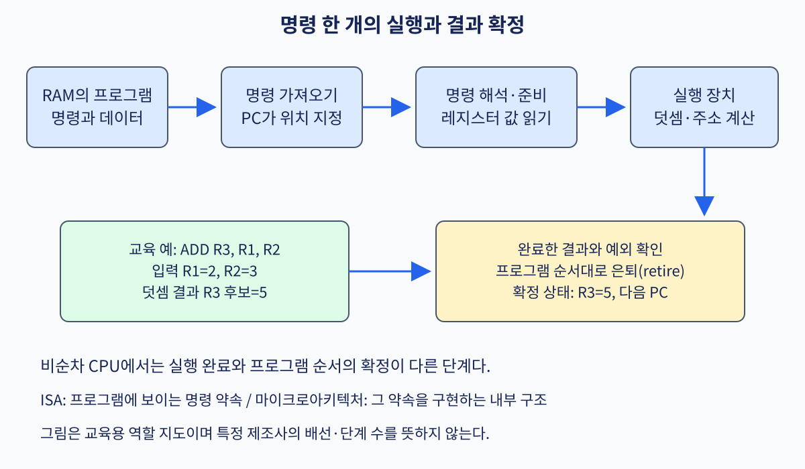

# 00. 구조와 실행 지도

[← 목차](README.md) · [다음 →](01-digital-logic-and-clock.md)

컴퓨터 구조를 처음 배울 때 가장 위험한 습관은 CPU 부품 이름부터 외우는 것이다. ALU, cache, pipeline이라는 단어를 기억해도, 소스 코드 한 줄이 언제 어떤 바이트가 되고 어느 장치가 그 바이트를 읽어 어떤 상태를 바꾸는지 설명하지 못하면 실제 프로그램의 성능과 오류를 분석하기 어렵다. 이 장은 뒤의 세부 장들을 읽기 위한 **실행 지도**를 만든다. 각 용어를 “무엇인가”로 끝내지 않고, 어디에 존재하는지, 누가 만들고 소비하는지, 입력과 출력은 무엇인지, 얼마나 오래 살아 있는지, 왜 필요한지를 연결한다.

그림의 화살표를 왼쪽에서 오른쪽으로 읽자. 사람이 작성한 소스 코드는 컴파일러의 입력이 되고, 컴파일 결과인 목적 파일은 링커의 입력이 된다. 링커가 만든 실행 파일은 저장장치에 놓인 바이트 집합이다. 운영체제의 로더가 실행 파일의 내용을 새 프로세스의 가상주소 공간에 대응시키면 CPU가 읽을 명령과 데이터가 준비된다. CPU는 프로그램 카운터가 가리키는 주소에서 명령 바이트를 가져와 해독하고 실행한다. 실행이 끝났다는 말은 단순히 ALU에서 숫자가 나왔다는 뜻이 아니다. 예외가 없고 앞선 명령과의 순서를 만족하며 결과가 프로그램에 보이는 상태로 확정되어야 한다.

## 1. 프로그램, 파일, 실행 상태를 구분한다

**프로그램(program)**은 입력을 정해진 규칙에 따라 처리해 출력과 상태 변화를 만드는 명령과 데이터의 집합이다. 문맥에 따라 소스 파일, 실행 파일, 실행 중인 계산을 모두 프로그램이라 부르기도 한다. 정확한 분석에서는 어느 상태를 가리키는지 밝혀야 한다.

**소스 코드(source code)**는 사람이 읽고 수정하기 쉽게 프로그래밍 언어의 문법으로 적은 프로그램 표현이다. <code>result = left + right;</code>라는 C 문장은 특정 CPU가 직접 실행할 명령이 아니다. 변수 이름과 자료형, C 언어가 정한 덧셈 의미가 들어 있다. 소스 파일은 저장장치에 오래 남을 수 있고 서로 다른 ISA를 목표로 여러 번 컴파일될 수 있다.

**실행 파일(executable file)**은 로더가 읽을 형식으로 정리한 명령 바이트, 초기 데이터, 주소 배치 정보, 동적 라이브러리 정보를 담은 파일이다. Linux에서 흔히 사용하는 ELF가 한 예다. 실행 파일은 현재 실행 중인 상태가 아니라 프로세스를 만들 재료다. 같은 파일에서 여러 프로세스를 시작할 수 있으며 각각 다른 주소 공간과 레지스터 상태를 가진다.

**프로세스(process)**는 운영체제가 한 실행을 관리하려고 만든 자원과 상태의 묶음이다. 가상주소 공간, 열린 파일, 보안 자격, 하나 이상의 스레드가 속한다. CPU 레지스터 값은 실제로 스레드마다 다를 수 있다. 운영체제가 스레드를 잠시 멈출 때에는 PC와 일반 레지스터를 저장하고 다시 실행할 때 복원한다. “프로그램은 디스크에 있고 프로세스는 메모리에 있다”라는 문장은 입문용 근사다. 실행 파일의 페이지는 파일과 연결된 채 필요할 때 메모리에 들어올 수 있고, 프로세스 상태는 커널 자료구조와 CPU 레지스터에 나뉘어 존재한다.

### 1.1 컴파일러, 링커, 로더의 입력과 출력

**컴파일러(compiler)**는 한 표현을 다른 표현으로 바꾸는 프로그램이다. 여기서는 C 소스, 목표 ISA, 컴파일 옵션을 입력받아 목적 코드와 부가 정보를 만든다. 자료형을 검사하고 연산을 중간 표현으로 바꾸며, 불필요한 계산을 없애고 변수 값을 어느 레지스터나 스택 위치에 둘지 정한 뒤 목표 ISA의 명령을 고른다. 출력은 보통 아직 모든 주소가 결정되지 않은 목적 파일이다.

**링커(linker)**는 여러 목적 파일과 라이브러리 조각을 하나의 실행 이미지로 결합한다. 한 파일이 add_two 함수를 정의하고 다른 파일이 그 이름을 호출하면 정의와 참조를 연결한다. 코드와 데이터 구역을 배치하고 위치가 달라질 때 고쳐야 할 주소인 재배치 정보를 처리한다. 컴파일러가 언어 의미를 목표 ISA 쪽으로 내린다면 링커는 따로 만든 조각의 이름과 주소를 결합한다.

**로더(loader)**는 실행 파일을 읽어 새 프로세스의 실행 환경을 준비하는 운영체제 기능이다. Linux에서는 커널과 사용자 공간 동적 링커가 역할을 나누기도 한다. 로더는 파일 구역을 가상주소 범위에 대응시키고, 스택과 초기 인자를 준비하며, 처음 실행할 PC를 진입점으로 정한다. 파일 전체를 시작 전에 DRAM으로 복사한다고 생각하면 안 된다. 주소 매핑을 먼저 준비하고 실제 페이지는 첫 접근 때 가져오는 demand paging을 사용할 수 있다.

~~~mermaid
flowchart TB
  SRC["소스 코드: 언어 의미와 이름"] --> COMP["컴파일러: 목표 ISA 명령 선택"]
  COMP --> OBJ["목적 파일: 코드·기호·재배치"]
  OBJ --> LINK["링커: 기호 연결·구역 배치"]
  LINK --> EXE["실행 파일: 명령 바이트·초기 데이터"]
  EXE --> LOAD["로더: 가상주소 공간·스택·시작 PC"]
  LOAD --> EXEC["CPU: fetch·decode·execute"]
  EXEC --> ARCH["retire된 레지스터·메모리·예외"]
~~~

이 도식의 각 화살표는 의미 보존 경계다. 마지막에 확정된 상태가 위쪽 프로그램의 의미와 일치해야 한다. 컴파일러가 잘못된 명령을 골랐다면 변환 단계의 오류이고, CPU가 명령의 계약과 다른 결과를 냈다면 구현 오류다. 어느 층에서 처음 값이 달라졌는지 찾는 것이 구조 디버깅의 출발점이다.

## 2. ISA와 마이크로아키텍처

**ISA(Instruction Set Architecture, 명령어 집합 구조)**는 소프트웨어가 관찰할 수 있는 하드웨어 계약이다. 명령 인코딩, 공개 레지스터의 수와 폭, 정수 연산 결과, 주소 계산, 특권 수준, 예외와 메모리 순서를 정의한다. 컴파일러는 이 계약을 목표로 코드를 만들고 CPU는 계약을 만족하도록 실행한다.

**명령(instruction)**은 ISA가 정의한 한 상태 전이 요청이며 기계어에서는 비트 패턴이다. 교육용 ADD r3, r1, r2는 레지스터 1과 2의 값을 더해 레지스터 3에 기록하라는 뜻이다. 실제 RISC-V, Arm, x86의 이름, 비트 배치, 예외 규칙은 각 명세를 따라야 한다.

명령 비트 중 **opcode(operation code)**는 동작 종류를 식별한다. **operand(피연산자)**는 그 동작이 사용할 대상이다. 피연산자는 값 자체인 즉시값, 레지스터 번호, 메모리 주소를 만드는 기준 레지스터와 변위일 수 있다. opcode가 ADD라고 해서 입력값 7과 5가 명령 바이트에 항상 들어 있는 것은 아니다. 명령에는 원천 레지스터 번호만 있고 실제 7과 5는 실행 시 레지스터 파일에서 읽을 수 있다.

**마이크로아키텍처(microarchitecture)**는 ISA 계약을 실제 회로에서 구현하는 조직이다. 파이프라인 단계 수, 동시에 해독하는 명령 수, 분기 예측기, 실행 장치 수, 캐시의 크기와 교체 정책, 비순차 실행 창 크기는 구현 선택이다. 같은 ISA를 구현한 두 CPU는 같은 입력에 같은 건축적 결과를 내면서도 실행 시간과 전력이 다를 수 있다.

명령을 더 작은 내부 연산으로 쪼개거나 추측 실행하는 방식은 제품마다 다르고 공개되지 않을 수 있다. 이 교재의 파이프라인 단계는 개념 설명을 위한 교육 모델이다. 특정 상용 CPU가 정확히 같은 단계를 쓴다는 보장이 아니다. ISA 명세에서 정한 결과와 한 제품에서 측정한 성능을 같은 종류의 사실로 취급하지 않아야 한다.

## 3. CPU 안에서 값을 운반하는 상태와 장치

**PC(program counter, 프로그램 카운터)**는 다음에 가져올 명령 주소와 관련된 건축적 상태다. 순차 실행에서는 현재 명령 길이만큼 증가하지만 분기, 함수 호출, 복귀, 예외에서는 다른 주소가 선택된다. 구현 내부에는 동시에 처리 중인 여러 명령 주소와 예측한 다음 주소가 있을 수 있다. 그러므로 “PC라는 물리 레지스터 하나가 현재 명령 하나만 가리킨다”는 그림은 단순화다.

**레지스터(register)**는 CPU가 피연산자와 상태를 빠르게 보관하는 이름 붙은 저장 위치다. ISA가 공개하는 일반 레지스터, PC, 상태 레지스터가 있고 구현만 사용하는 물리 레지스터도 있다. **레지스터 파일(register file)**은 번호로 여러 레지스터를 선택해 읽고 쓰는 구조다. decoder가 원천 번호 1과 2를 만들면 값 7과 5를 출력할 수 있다. 비순차 CPU는 하나의 건축적 레지스터 이름을 시점별 물리 레지스터에 대응시키는 register renaming을 사용해 거짓 이름 의존성을 없앨 수 있다.

**ALU(Arithmetic Logic Unit, 산술논리장치)**는 정수 덧셈, 뺄셈, 비교, 비트 논리를 수행하는 회로다. 입력은 레지스터 값이나 즉시값이고 출력은 결과와 조건 정보다. 곱셈기, 부동소수점 장치, 벡터 장치, 주소 생성 장치는 별도 실행 장치일 수 있다. “CPU의 모든 계산은 ALU 하나가 한다”는 설명은 부정확하다.

**메모리(memory)**는 문맥에 따라 주소로 읽고 쓰는 전체 저장 모델 또는 실제 DRAM을 뜻한다. CPU의 load와 store는 가상주소를 사용하고, 주소 변환과 권한 검사를 거쳐 cache 계층이나 메모리 컨트롤러에서 데이터를 얻는다. 저장장치 파일을 매 load마다 직접 읽는 것은 아니다.

**캐시(cache)**는 느리거나 먼 계층의 일부 데이터를 가까운 곳에 두어 평균 접근 시간을 줄이는 구조다. CPU cache는 보통 고정 크기의 cache line 단위로 데이터를 관리한다. 요청한 line과 올바른 권한 상태가 있으면 cache hit이고 없으면 cache miss다. miss는 아래 cache나 DRAM에 요청하므로 더 오래 걸린다. cache는 주소 변환 결과를 저장하는 TLB와 다르다. 데이터 cache hit라도 TLB 항목이 없으면 page table walk가 먼저 필요할 수 있다.

**주소(address)**는 저장 위치를 식별하는 숫자다. 주소 자체도 값으로 저장할 수 있지만 주소와 그 주소가 가리키는 저장값은 다르다. r5=0x1000이고 위치 0x1000에 정수 99가 있다면 r5의 값은 주소이고 LOAD 결과는 99다. 포인터를 출력했을 때 보이는 0x1000과 역참조 결과 99를 섞지 않아야 한다.

**가상주소(virtual address)**는 프로세스의 명령이 사용한다. **물리주소(physical address)**는 메모리 시스템의 실제 위치를 고르는 데 쓰인다. MMU가 페이지 테이블로 둘을 변환하고 접근 권한을 검사한다. 64비트 ISA라고 해서 모든 구현이 64비트 전체 가상주소 공간을 지원하거나 장착 메모리가 그만큼 크다는 뜻은 아니다. 주소 폭, 레지스터 폭, 연산 데이터 폭, 물리 메모리 용량은 서로 다른 항목이다.

## 4. 파이프라인, ROB, retire, 예외

**파이프라인(pipeline)**은 명령 처리를 fetch, decode, execute 같은 단계로 나누고 서로 다른 명령의 단계를 겹쳐 수행하는 조직이다. 한 명령의 지연시간을 반드시 줄이지는 않지만 단위 시간에 완료하는 명령 수인 처리량을 높일 수 있다.

**ROB(Reorder Buffer, 재정렬 버퍼)**는 비순차 실행 CPU가 진행 중인 명령을 프로그램 순서로 추적하고 결과, 예외, 완료 여부를 보관하는 대표 구조다. 뒤 명령이 먼저 실행을 끝내더라도 앞 명령보다 먼저 프로그램에 보이는 상태를 바꾸지 않도록 돕는다. 실제 제품은 ROB, 물리 레지스터 파일, store buffer 등을 함께 사용하며 구체 구현은 다르다.

**retire 또는 commit(은퇴·확정)**은 실행 결과가 프로그램 순서상 안전하게 건축적 상태로 인정되는 단계다. ALU가 결과를 계산한 execute completion과 다르다. 앞선 명령과 현재 명령에 예외가 없고 필요한 순서 조건을 만족해야 retire할 수 있다.

**예외(exception)**는 현재 명령의 정상 결과 대신 정해진 처리 경로로 제어를 넘겨야 하는 사건이다. 잘못된 명령, 권한 위반, page fault, 0으로 나누기가 예다. 명령과 동기적으로 연결된 예외는 외부 장치의 비동기 interrupt와 구분한다. precise exception에서는 예외가 난 명령보다 앞선 명령은 반영되고 그 명령과 뒤 명령은 반영되지 않은 것처럼 보인다.

~~~mermaid
sequenceDiagram
  participant F as Fetch·예측
  participant D as Decode·Rename
  participant E as 실행 장치
  participant R as ROB
  participant A as 건축적 상태
  F->>D: PC와 명령 바이트
  D->>R: 프로그램 순서 항목 배정
  D->>E: 준비된 피연산자와 연산
  E-->>R: 결과 또는 예외 보고
  Note over E,R: 뒤 명령이 먼저 완료할 수 있음
  R->>A: 맨 앞의 정상 명령부터 retire
  Note over R,A: 예외 뒤의 추측 결과는 폐기
~~~

이 도식에서 실행 장치에서 ROB로 가는 화살표와 ROB에서 건축적 상태로 가는 화살표를 구분한다. 실행 장치가 12를 계산했다는 사실만으로 프로그램이 r3=12를 관찰하는 것은 아니다. 해당 명령이 ROB의 머리까지 와서 정상 retire해야 한다.

## 5. 비트, 주소, 시간의 단위

한 비트는 0 또는 1이다. 8비트는 256개의 패턴을 만든다. 같은 11111111도 부호 없는 8비트 정수로 해석하면 255이고, 2의 보수 부호 있는 정수로 해석하면 -1이다. 하드웨어 덧셈기의 비트 동작은 같아도 signed overflow 판단과 비교 의미는 해석에 따라 달라진다.

8비트에서 127+1을 계산하면 비트 패턴은 10000000이 된다. 부호 있는 2의 보수로는 -128이므로 수학적 128을 표현하지 못한 overflow다. C 언어와 목표 ISA가 overflow를 어떻게 다루는지는 따로 확인해야 한다.

byte-addressed 시스템에서 주소가 1 증가하면 다음 바이트를 가리킨다. PC가 0x400100이고 고정 길이 4바이트 교육용 명령을 순차 실행한다면 다음 후보 주소는 0x400104다. 16진수 0xC는 10진수 12이므로 0x2000+12=0x200C다.

64비트 주소를 변수에 저장한다고 그 주소가 가리키는 데이터도 64비트인 것은 아니다. 64비트 포인터가 32비트 정수를 가리킬 수 있다. 하나의 64바이트 cache line에는 여러 4바이트 정수가 들어갈 수 있다. 주소의 단위, 자료형 크기, 전송 단위를 분리해야 계산이 맞는다.

**클록(clock)**은 동기 회로가 상태 갱신 시점을 맞추는 주기 신호다. 3 GHz라면 이상화한 한 주기는 약 0.333 ns다. 주파수가 높아도 cache miss로 기다리거나 한 명령이 여러 주기를 사용하면 프로그램이 같은 비율로 빨라지지 않는다.

**지연시간(latency)**은 하나의 작업이 시작해 결과를 얻기까지 걸린 시간이다. **처리량(throughput)**은 단위 시간에 완료하는 작업 수다. 5단계가 각각 한 주기인 파이프라인에서 한 명령의 지연시간은 5주기지만 파이프라인이 채워진 뒤에는 이상적으로 매 주기 한 명령을 끝낼 수 있다.

**CPI(cycles per instruction)**는 실행 주기 수를 완료 명령 수로 나눈 값이다. 1,000개 명령에 1,500주기가 걸리면 CPI는 1.5 cycle/instruction이다. 단순 모델에서 실행시간은 명령 수 × CPI × 클록 주기다. 컴파일 옵션은 명령 수와 cache 행동을 함께 바꿀 수 있으므로 세 항목이 현실에서 완전히 독립이라는 뜻은 아니다.

## 6. C 식 하나가 결과로 확정될 때까지

~~~c
int add_loaded(const int *p, int bias) {
    return *p + bias;
}
~~~

교육용 목표 ISA가 고정 4바이트 명령을 사용하며 호출 규약이 p를 r1, bias를 r2, 반환값을 r3에 둔다고 가정한다. 실제 명령 인코딩과 ABI가 아니라 흐름을 설명하기 위한 가정이다.

~~~text
LOAD r4, 0(r1)
ADD  r3, r4, r2
~~~

링커가 첫 명령을 가상주소 0x400100에 배치했다고 하자. 교육용 LOAD의 네 바이트를 93 20 01 00, ADD를 B3 81 22 00이라고 임의로 둔다. 호출 시 r1=0x7fff1000, r2=5이고 그 가상주소에 저장된 32비트 정수는 7이다.

| 시점 | 주체 | 입력 | 중간 상태 | 프로그램에 보이는 결과 |
|---:|---|---|---|---|
| 0 | 로더·운영체제 | 실행 파일 | 코드 매핑, 스택·인자 준비 | 실행 가능한 프로세스 |
| 1 | fetch 장치 | PC=0x400100 | 주소 번역 후 네 바이트 요청 | 없음 |
| 2 | decoder | 93 20 01 00 | opcode=LOAD, base=r1, dst=r4 | 없음 |
| 3 | 레지스터·주소 장치 | r1=0x7fff1000, 변위 0 | 유효 가상주소 계산 | 없음 |
| 4 | MMU·TLB·페이지 테이블 | 가상주소와 read 요청 | 물리주소 번역, 권한 확인 | fault면 LOAD 미확정 |
| 5 | cache·메모리 계층 | 물리주소 | line에서 네 바이트 선택, 값 7 | 내부 LOAD 결과 7 |
| 6 | ROB | LOAD 완료, 예외 없음 | LOAD가 맨 앞이 되기를 대기 | retire 뒤 r4=7 |
| 7 | fetch·decode | PC=0x400104, ADD 바이트 | src=r4·r2, dst=r3 | 없음 |
| 8 | scheduler·레지스터 경로 | 전달된 7, r2=5 | 두 피연산자 준비, ADD 발행 | 없음 |
| 9 | 정수 실행 장치 | 7과 5 | 이진 덧셈 결과 12 | 내부 결과 12 |
| 10 | ROB·retire | 앞선 LOAD 정상 | 순서와 예외 검사 | r3=12, 반환값 12 |

PC 증가는 fetch와 함께 추측적으로 일어날 수 있다. r4가 건축적으로 보이는 시점과 ADD가 전달 경로로 값 7을 받는 시점도 다를 수 있다. CPU는 LOAD가 retire하기 전에 ADD를 실행할 수 있지만 LOAD가 뒤늦게 fault로 판명되면 ADD의 12는 폐기한다.

소스의 포인터 p가 가진 주소값 0x7fff1000, 그 가상주소가 번역된 물리주소, 그 위치에서 읽은 정수 7은 서로 다른 값이다. 분석 기록에는 세 값을 따로 적어야 한다.

## 7. 조건을 바꾼 세 가지 추적

### 7.1 cache hit, TLB miss, page fault

첫 실행에서 TLB 항목과 data cache line이 모두 있으면 TLB가 빠르게 번역하고 L1 cache가 값 7을 돌려준다. 둘째 실행에서 TLB 항목만 없다면 곧 page fault라는 뜻이 아니다. page table walk가 유효 PTE를 찾고 TLB를 채운 뒤 LOAD를 계속할 수 있다. 데이터 line은 이미 cache에 있을 수도 있고 없을 수도 있다.

셋째 실행에서 PTE가 현재 접근 불가라면 CPU가 page fault 예외를 보고한다. 커널은 원인을 검사한다. 합법적인 파일 페이지가 아직 메모리에 없다면 내용을 가져와 매핑을 고치고 명령을 재시작할 수 있다. 권한 없는 주소라면 결과를 기록하지 않고 오류를 알린다. page fault가 항상 프로세스 종료나 디스크 I/O를 뜻하는 것은 아니다.

| 조건 | 주소 변환 | 데이터 획득 | LOAD의 retire |
|---|---|---|---|
| TLB hit + cache hit | 즉시 매핑 | 가까운 line에서 선택 | 정상 확정 |
| TLB miss + 유효 PTE | page walk 후 TLB 채움 | cache 또는 아래 계층 | 늦지만 정상 가능 |
| 부재 PTE + 합법 매핑 | 커널 fault 처리 | 페이지 준비 후 재시작 | 성공 뒤 확정 |
| 권한 위반 | 커널 진입 | 읽기 금지 | LOAD 결과 미확정 |

### 7.2 분기 오예측과 예외

분기 예측기는 결과가 계산되기 전에 다음 PC를 추측한다. 틀리면 잘못된 경로의 명령을 폐기하고 올바른 PC에서 다시 시작한다. 오예측 경로의 명령은 retire하지 않아 건축적 결과를 남기지 않아야 한다.

예외는 현재 명령이 정상 의미를 완료할 수 없거나 특별 처리가 필요한 사건이다. LOAD 권한 위반이 발생하면 그 뒤 ADD가 이미 값을 계산했더라도 폐기한다. 분기 오예측은 예측한 제어 경로가 틀린 것이고 분기 자체는 정상일 수 있다. page fault는 메모리 명령의 처리 조건에서 난 예외다. 둘 다 내부 작업 폐기와 fetch 방향 변경을 만들 수 있지만 원인은 다르다.

### 7.3 내부 실행은 앞질러도 보이는 순서는 보존한다

~~~text
I1: LOAD r4, 0(r1)      # cache miss, 오래 기다림
I2: ADD  r8, r6, r7     # I1과 데이터 의존성이 없음
I3: ADD  r3, r4, r2     # I1 결과가 필요함
~~~

비순차 CPU는 I1을 기다리며 I2를 먼저 실행할 수 있다. I2 결과가 먼저 ROB에 도착해도 I1보다 먼저 retire하지 않게 관리할 수 있다. I3은 r4를 기다린다. I1이 정상 완료하면 I1, I2, I3가 프로그램 순서로 확정된다. I1이 권한 fault를 일으키면 I2가 내부적으로 완료됐어도 건축적 결과는 폐기된다.

다중 코어가 공유 메모리를 관찰하는 순서에는 별도의 **메모리 모델** 규칙도 적용된다. 단일 스레드 retire 순서만으로 모든 동시성 결과를 설명할 수는 없다. atomic과 fence가 필요한 이유는 뒤 장에서 이 경계를 확장해 배운다.

## 8. 운영체제와 GPU로 지도를 확장한다

운영체제는 실행 지도 바깥의 관리자가 아니다. 로더, 가상주소, 페이지 테이블, 예외 처리가 실행 경로에 직접 들어온다. 시스템 콜 명령은 사용자 모드에서 커널 모드로 제어를 넘기고 스케줄러는 스레드의 레지스터를 저장·복원한다. page fault 처리기는 페이지를 준비한 뒤 명령을 재시작할 수 있다. 응용 성능도 CPU 명령 수만 보지 않고 스케줄링, 페이지 배치, I/O 대기를 함께 봐야 한다.

CUDA C++ 같은 GPU 소스도 중간 표현과 GPU ISA를 목표로 컴파일된다. GPU에서 **kernel**은 운영체제 kernel이 아니라 GPU에서 병렬 실행하도록 시작한 함수다. GPU ISA 계약과 특정 제품의 warp scheduler, 실행 유닛 수, cache 크기는 구분한다. CPU가 GPU 작업을 제출한 뒤에도 메모리 복사, 동기화, 주소 변환, 드라이버가 전체 시간에 영향을 준다.

CPU와 GPU 모두 “정답을 내는 계약”과 “그 정답에 도달하는 구현”을 나눠야 한다. 같은 수치 결과를 내더라도 메모리 접근 패턴이 나쁘면 실행 시간이 달라진다. 빠른 내부 실행이 언어와 ISA의 순서 계약을 어기면 올바른 구현이 아니다.

## 9. 최신 연구 연결: CXL 메모리와 Memstrata

OSDI 2024 논문 **Managing Memory Tiers with CXL in Virtualized Environments**는 ISA 정답이 같아도 실행 시간이 달라지는 사례를 보여 준다. CXL 메모리는 CPU가 cacheable load와 store로 접근할 수 있는 용량 계층이다. 프로그램과 ISA 관점에서 LOAD가 같은 값을 반환하더라도 데이터가 로컬 DRAM에 있는지 CXL 연결 메모리에 있는지에 따라 지연시간이 달라진다.

논문이 사용한 사전 양산 Xeon 6 기반 prototype 조건에서 CXL 메모리의 load-to-use 지연은 로컬 DDR5의 2.02배로 측정되었다. 이 숫자는 모든 CXL 장치의 보편 상수가 아니다. 해당 프로세서, 메모리 컨트롤러, 연결 구성에서 얻은 값이다. 구조 연구의 숫자를 읽을 때에는 장치 세대, 용량 비율, workload, 비교 기준을 함께 기록해야 한다.

기존 software-managed tiering은 운영체제나 hypervisor가 page 접근을 추적하고 hot page를 빠른 계층으로 옮긴다. 가상화 환경에서는 접근 비트 스캔이나 명령 sampling이 host CPU 비용과 개인정보 문제를 만들 수 있다. 2 MiB나 1 GiB 같은 큰 page 안에 hot cache line과 cold line이 섞이면 page 전체를 옮기는 결정도 거칠어진다.

논문의 **Intel Flat Memory Mode**는 메모리 컨트롤러가 64바이트 cache line 단위로 로컬 DRAM과 CXL 메모리의 배치를 관리한다. 두 계층의 용량을 합쳐 소프트웨어에 보여 주고, 한 line은 둘 중 한 곳에만 두는 exclusive placement를 사용한다. 최근 접근한 line을 로컬 DRAM으로 교환한다. 일반 load와 store의 ISA 의미를 바꾸지 않으면서 아래의 물리 배치가 지연시간을 바꾸는 예다.

하지만 하드웨어는 각 VM이 얼마나 느려졌는지 같은 응용 목표를 모른다. 여러 VM의 주소가 direct-mapped 로컬 위치에 충돌하면 한 VM이 다른 VM의 line을 밀어낼 수 있고, 한 VM 내부에서도 충돌 패턴이 반복될 수 있다. 논문은 단독 workload 115개를 평가했을 때 mixed mode에서 82%가 로컬 DRAM 대비 5% 이하의 slowdown을 보였지만 일부 outlier는 최대 34%였다고 보고한다. 이 비율도 해당 prototype과 workload 집합에 한정된다.

저자들은 **Memstrata**를 제안한다. 첫째, page coloring으로 충돌하는 cache line을 포함한 page를 VM별로 격리해 VM 사이 간섭을 막는다. page coloring은 물리주소의 특정 비트가 하드웨어 위치에 대응되는 관계를 이용해 충돌 집합을 나누는 기법이다. 둘째, online slowdown estimator로 각 VM이 tier miss에 얼마나 민감한지 추정한다. 셋째, mixed mode가 제공하는 전용 local DRAM page를 민감한 VM에 동적으로 더 배분한다. hardware는 cache-line 이동을 맡고 software는 tenant별 성능 격리를 맡는 구성이다.

realistic multi-VM 실험에서는 최악 slowdown을 35%에서 6% 미만으로 낮췄고 Memstrata의 최대 CPU overhead는 단일 코어의 4%, VM당으로는 단일 코어의 1% 미만이었다고 보고한다. 이를 “어떤 환경에서도 6% 미만”이라고 일반화하면 안 된다. 사용한 prototype, VM 조합, 메모리 비율, workload 조건 안의 결과다.

후속 실험은 같은 바이너리와 입력으로 ISA 수준 작업량을 맞추고 local DRAM:CXL 용량 비율과 전용 local page 크기를 기록한다. 단독 VM과 다중 VM을 나누고 VM 배치 순서를 무작위화한다. 중앙값과 tail, working-set 크기, read/write 비율, tier miss, 메모리 대역폭, host CPU overhead를 함께 측정한다. hardware tiering만 적용한 경우, coloring을 추가한 경우, estimator와 local page 배분까지 추가한 경우를 나눈 ablation으로 기여를 확인한다.

검증 가능한 질문은 “Memstrata가 항상 빠른가”가 아니다. “동일한 1:1 계층 용량과 동일 VM 조합에서 page coloring이 inter-VM direct-map 충돌로 생긴 tail slowdown을 줄이는가”처럼 메커니즘과 측정값을 연결한다.

## 10. 문제와 전체 풀이

### 문제 1. 주소와 저장값

r1=0x2000이고 교육용 LOAD r2, 12(r1)을 실행한다. 가상주소 0x200C에는 32비트 정수 30이 있고 주소 번역과 권한 검사는 성공한다. 유효주소와 결과를 구하고 0x200C와 30의 차이를 설명하라.

**풀이:** 변위 12는 0xC이므로 유효 가상주소는 0x2000+0xC=0x200C다. MMU가 이를 물리주소로 번역하고 메모리 계층이 네 바이트를 정수 30으로 조립하면 r2=30이다. 0x200C는 위치를 고르는 주소이고 30은 그 위치의 데이터다. r1에는 주소, r2에는 LOAD 결과가 있다.

### 문제 2. 지연시간과 처리량

다섯 단계가 각각 한 주기이고 stall이 없는 교육용 파이프라인이 있다. 클록은 2 GHz다. 첫 명령의 지연시간과 충분히 긴 명령 흐름의 이상적 처리량을 구하라.

**풀이:** 한 주기는 1/2 GHz=0.5 ns다. 첫 명령은 다섯 단계를 지나므로 5주기, 2.5 ns가 걸린다. 파이프라인이 채워진 뒤에는 서로 다른 명령이 각 단계에 있어 매 주기 한 명령을 끝낼 수 있다. 이상적 처리량은 초당 20억 명령이다. 의존성, 오예측, cache miss가 실제 처리량을 낮춘다. 2.5 ns 지연과 초당 20억 처리량은 모순이 아니다.

### 문제 3. TLB miss와 page fault

LOAD의 가상주소에 대한 TLB 항목이 없다. 이것만으로 page fault라고 결론 내릴 수 있는가?

**풀이:** 결론 내릴 수 없다. page table에 유효하고 권한이 맞는 PTE가 있으면 page walk가 이를 찾아 TLB를 채운 뒤 LOAD를 계속한다. PTE가 부재하거나 권한 위반이면 page fault로 커널이 처리한다. 합법적 demand paging이면 페이지 준비 후 재시작하고, 불법 접근이면 결과 없이 오류를 알린다. data cache hit와 miss는 이 주소 번역 문제와 별도 축이다.

### 문제 4. 실행 완료와 retire

느린 LOAD I1 뒤의 독립 ADD I2가 먼저 계산을 끝냈다. 이어 I1에서 권한 fault가 확인됐다. I2 결과가 프로그램에 남아도 되는가?

**풀이:** precise exception 모델에서는 남지 않는다. I2는 ROB나 물리 레지스터에 임시 결과를 둘 수 있지만 앞선 I1이 정상 retire하기 전에 확정하지 않는다. I1의 fault가 ROB 머리에 오면 I1과 뒤 추측 결과를 폐기하고 예외 처리기로 이동한다. “실행됐다”와 “retire했다”를 구분해야 답할 수 있다.

### 문제 5. 연구 결과의 조건

Memstrata 논문에서 realistic multi-VM 실험의 최악 slowdown이 35%에서 6% 미만으로 줄었다. 새 서버도 6% 미만이라고 예측해도 되는가? 재검증 계획을 세워라.

**풀이:** 그렇게 일반화하면 안 된다. 수치는 사전 양산 Xeon 6 prototype, Flat Memory Mode 구성, 선택한 VM과 workload, 메모리 비율에서 나온 결과다. 새 서버에서는 CXL 세대, 포트, mapping, 대역폭, working set이 다를 수 있다.

동일 바이너리와 입력으로 local DRAM 기준을 먼저 얻는다. 그다음 hardware tiering만, page coloring 추가, estimator와 전용 local page 배분 추가를 각각 반복한다. 단독 VM과 다중 VM을 나누고 배치를 바꾸며 중앙값, p95, 최악 slowdown을 기록한다. host CPU overhead, tier miss, 대역폭도 함께 측정해 논문의 메커니즘이 새 환경에서도 작동하는지 검증한다.

## 11. 분석 체크리스트

1. 프로그램이 요구하는 관찰 가능한 정답은 무엇인가?
2. 언어, ABI, ISA 중 어느 계약이 그 정답을 규정하는가?
3. 명령 바이트와 주소는 누가 만들고 어디에 놓는가?
4. 현재 값은 레지스터, cache, DRAM, 저장장치 중 어디에 있는가?
5. 주소 변환, 데이터 획득, 실행, retire 중 어느 단계가 지연되는가?
6. 추측 내부 상태와 프로그램에 보이는 상태를 구분했는가?
7. 측정값의 단위, 기준점, 장치, workload 조건은 무엇인가?
8. 특정 제품의 관찰을 ISA 전체의 보장으로 일반화하지 않았는가?

이 질문에 답하면 “CPU가 느리다”를 “TLB miss 뒤 page walk는 성공했지만 CXL tier에서 가져온 cache line의 load-to-use 지연이 길고 co-tenant가 direct-map 위치를 충돌시킨다”처럼 검증 가능한 설명으로 바꿀 수 있다.

## 공식 자료와 연구 자료

- [RISC-V ratified specifications](https://docs.riscv.org/): ISA의 명령, 레지스터, 예외 계약을 확인한다.
- [Linux kernel ELF documentation](https://docs.kernel.org/core-api/elf.html): Linux가 ELF 실행 이미지를 다루는 구현 맥락을 확인한다.
- [Managing Memory Tiers with CXL in Virtualized Environments, OSDI 2024](https://www.usenix.org/conference/osdi24/presentation/zhong-yuhong): Flat Memory Mode와 Memstrata의 설계, prototype 조건, 평가 수치의 출처다.

[← 목차](README.md) · [다음 →](01-digital-logic-and-clock.md)
