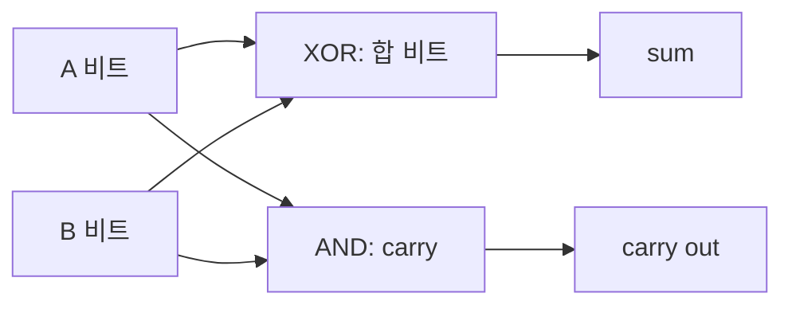

# 01. 디지털 논리와 클록

[← 이전](00-architecture-and-execution-map.md) · [목차](README.md) · [다음 →](02-instructions-registers-and-isa.md)

**디지털 논리(digital logic)**는 전기적 상태를 0과 1로 해석해 계산하는 규칙이다. **논리 게이트(logic gate)**는 AND·OR·NOT 같은 규칙을 회로로 구현한다. **클록(clock)**은 상태를 받아들이는 시점을 맞추는 반복 신호이며, **주기(cycle)**는 한 번 반복하는 시간이다. 전압 자체와 비트의 뜻을 구별한 뒤 덧셈과 기억을 연결한다.

## 전압에서 비트, 덧셈, 저장 상태까지

비트 0과 1은 자연에 따로 떠 있는 숫자가 아니라 회로가 전압 범위를 두 상태로 해석한 결과다.
예를 들어 교육용 규칙이 0~0.8V를 0, 2~3.3V를 1로 본다고 하자.
1.4V처럼 중간 범위는 “항상 0.5”가 아니라 입력 규격이 보장하지 않는 영역이다.
실제 임계값은 회로 규격에 따라 달라지므로 이 수치를 모든 제품에 적용하면 안 된다.

트랜지스터를 조합한 논리 게이트는 입력 전압 상태를 논리 규칙으로 바꾼다.

| A | B | AND | OR |
|---:|---:|---:|---:|
| 0 | 0 | 0 | 0 |
| 0 | 1 | 0 | 1 |
| 1 | 0 | 0 | 1 |
| 1 | 1 | 1 | 1 |

| A | NOT A |
|---:|---:|
| 0 | 1 |
| 1 | 0 |

AND는 두 조건이 모두 참인지 검사하고, OR은 하나 이상이 참인지 검사한다.
NOT은 한 입력의 논리 상태를 뒤집는다.
게이트 출력은 즉시 바뀌지 않고 작은 전파 지연 뒤 안정된다.

## 반가산기와 전가산기

반가산기는 두 1비트 A와 B를 더한다.
sum은 `A XOR B`, carry는 `A AND B`다.
`1+1`에서는 sum=0, carry=1이므로 이진 결과는 `10₂`다.

전가산기는 A, B뿐 아니라 아래 자리에서 온 carry-in도 더한다.
예를 들어 `A=1,B=0,Cin=1`이면 합은 2다.
따라서 sum=0, carry-out=1이다.

4비트 `0111₂(7)`과 `0011₂(3)`을 오른쪽부터 더해 보자.

| 자리 | A | B | Cin | Sum | Cout |
|---:|---:|---:|---:|---:|---:|
| 0 | 1 | 1 | 0 | 0 | 1 |
| 1 | 1 | 1 | 1 | 1 | 1 |
| 2 | 1 | 0 | 1 | 0 | 1 |
| 3 | 0 | 0 | 1 | 1 | 0 |

결과는 `1010₂=10`이다.
아래 자리 carry가 위 자리 계산 입력이 되므로 단순 ripple-carry는 폭이 커질수록 최악 지연이 늘어난다.
실제 가산기는 더 빠른 carry 구조를 사용할 수 있다.

## 조합 논리와 저장 소자

조합 논리는 현재 입력이 같으면 같은 출력을 낸다.
반면 프로그램 실행에는 “지난 주기의 PC”처럼 이전 값을 기억하는 상태가 필요하다.
래치는 enable 상태 동안 입력 변화가 통과할 수 있는 저장 소자다.
플립플롭은 보통 클록 edge 같은 특정 시점에 입력을 받아 다음 상태로 보관하는 모형으로 설명한다.

클록은 계산을 만드는 마법 신호가 아니다.
한 상태 소자의 출력이 조합 논리를 지나 다음 상태 소자 입력에 안정될 시간을 정하는 기준이다.
주기는 초 단위 시간이고 주파수는 초당 반복 횟수인 Hz다.

1 GHz는 초당 `10^9`주기이므로 한 주기는 `1/10^9 s=1 ns`다.
2.5 GHz라면 한 주기는 `1/2.5×10^9 s=0.4 ns`다.
조합 논리 지연과 setup 시간 등이 0.45 ns라면 0.4 ns 주기에 단순히 맞출 수 없다.
주파수를 높인다고 모든 회로가 자동으로 올바르게 동작하지 않는다.

| 시점 | D 입력 | 클록 edge | Q 저장값 |
|---:|---:|---|---:|
| 0.1 ns | 0 | 없음 | 이전값 0 |
| 0.3 ns | 1 | 없음 | 여전히 0 |
| 0.4 ns | 1 | 상승 edge | 1을 받아들임 |
| 0.6 ns | 0 | 없음 | 여전히 1 |
| 0.8 ns | 0 | 상승 edge | 0을 받아들임 |

이 표는 edge-triggered 교육 모형이다.
실제 회로에는 setup, hold, clock skew, metastability 조건이 있다.
비동기 입력을 edge 바로 근처에서 바꾸면 안정된 0/1 도달 시간이 길어질 수 있어 동기화 회로가 필요하다.

## 문제와 풀이

### 문제 1
AND(1,0), OR(1,0), NOT(1)은?

**풀이:** AND는 둘 모두 1이어야 하므로 0이다.
OR은 하나가 1이므로 1이고, NOT은 1을 뒤집어 0이다.

### 문제 2
전가산기에 A=1, B=1, Cin=1을 넣으면?

**풀이:** 합은 3, 이진수 `11₂`다.
현재 자리 sum=1이고 다음 자리로 carry-out=1을 보낸다.

### 문제 3
4 GHz 클록의 한 주기는 몇 ns인가?

**풀이:** `1/(4×10^9)s=0.25 ns`다.
이는 상태 갱신 간격이며 명령 하나가 반드시 0.25 ns에 완료된다는 뜻은 아니다.

## 공식 자료

[RISC-V ISA manual](https://riscv.github.io/riscv-isa-manual/snapshot/unprivileged/)

[← 이전](00-architecture-and-execution-map.md) · [목차](README.md) · [다음 →](02-instructions-registers-and-isa.md)
