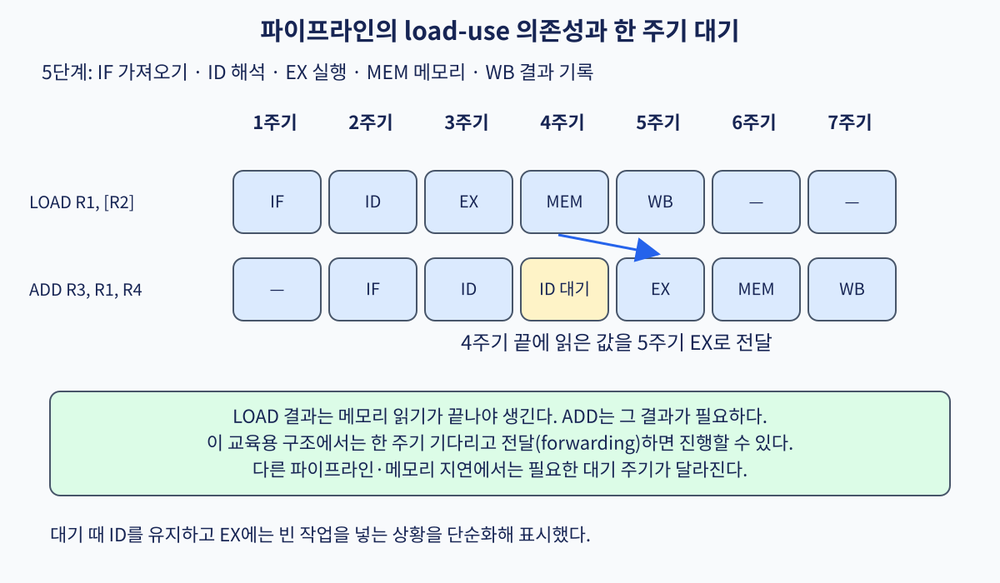

# 04. 파이프라인·의존성·결과 전달

[← 이전](03-functions-abi-and-program-loading.md) · [목차](README.md) · [다음 →](05-branches-out-of-order-and-retirement.md)

**파이프라인(pipeline)**은 명령 처리를 여러 단계로 나누어 서로 겹치는 구조다. **의존성(dependency)**은 뒤 명령이 앞 명령의 결과를 필요로 하는 관계다. 그대로 진행하면 준비되지 않은 값을 읽는 **위험 조건(hazard)**이 생길 수 있다. **결과 전달(forwarding)**은 최종 레지스터 기록 전에 결과를 필요한 단계로 보내는 방법이다.



## 손으로 추적하는 5단계 파이프라인

이 장의 핵심 질문은 “명령어 하나가 얼마나 빨리 끝나는가”보다 “서로 다른 명령어의 일을 어떻게 겹쳐도 결과가 순차 실행과 같게 남는가”이다.

파이프라인은 한 명령어를 여러 조각으로 나누고, 서로 다른 명령어의 조각을 같은 클록 주기에 병렬로 처리하는 구조다.
여기서 **클록 주기**는 상태 저장 소자가 다음 값을 받아들이는 두 시점 사이의 시간이다.
한 주기 안에서 조합 논리가 계산하고, 주기 경계에서 파이프라인 래치가 결과를 붙잡는다.

교육용 5단계는 다음과 같다.

| 단계 | 이름 | 입력 | 하는 일 | 다음 래치에 남기는 값 |
|---|---|---|---|---|
| IF | instruction fetch | PC | 명령어 메모리에서 명령어를 읽음 | 명령어와 다음 PC |
| ID | decode/register read | 명령어 | 연산 종류와 레지스터 번호를 해석 | 피연산자와 제어 정보 |
| EX | execute | 피연산자 | ALU 계산 또는 주소 계산 | 산술 결과 또는 주소 |
| MEM | memory | 주소·저장 값 | load/store라면 데이터 캐시 접근 | 읽은 값 또는 ALU 결과 |
| WB | write back | 결과 | 목적 레지스터에 값을 기록 | 프로그램에 보이는 상태가 갱신됨 |

**프로그램에 보이는 상태**는 ISA가 프로그램에 보인다고 약속한 레지스터, 메모리, PC 같은 상태다.
파이프라인 래치 안의 중간값은 마이크로아키텍처 상태이며, 프로그램이 직접 이름 붙여 읽을 수 없다.


## 의존성이 없을 때의 겹침

다음 세 명령어는 서로 다른 레지스터를 사용한다고 하자.

```text
I1: add x1, x2, x3
I2: sub x4, x5, x6
I3: and x7, x8, x9
```

| 주기 | I1 | I2 | I3 |
|---:|---|---|---|
| 1 | IF |  |  |
| 2 | ID | IF |  |
| 3 | EX | ID | IF |
| 4 | MEM | EX | ID |
| 5 | WB | MEM | EX |
| 6 |  | WB | MEM |
| 7 |  |  | WB |

첫 결과의 지연 시간은 5주기다.
그러나 파이프라인이 찬 뒤에는 매 주기 한 명령어가 WB에 도착한다.
이 차이가 지연 시간과 처리량의 차이다.
파이프라인이 단일 명령어의 논리량을 없애지는 않는다.
여러 명령어의 서로 다른 단계를 겹쳐 전체 처리량을 높인다.

## RAW 데이터 위험과 forwarding

다음 명령어에서 I2는 I1이 만드는 `x5`를 읽는다.

```text
I1: add x5, x1, x2
I2: sub x6, x5, x3
```

이를 **RAW(Read After Write) 의존성**이라고 한다.
읽기가 앞선 쓰기의 결과보다 뒤에 있어야 한다는 뜻이다.
레지스터 파일만 본다면 I1의 값은 5주기 WB에서 기록되고, I2는 3주기 EX에서 이미 그 값이 필요하다.
그대로 실행하면 I2가 오래된 `x5`를 사용할 수 있다.

ALU의 덧셈 결과는 실제로 3주기 I1의 EX 끝에서 이미 만들어져 EX/MEM 래치에 있다.
**forwarding** 또는 bypass는 그 중간 결과를 WB까지 기다리지 않고 다음 명령어의 ALU 입력으로 우회 전달한다.

| 주기 | I1 | I2 | 필요한 값의 위치 |
|---:|---|---|---|
| 1 | IF |  |  |
| 2 | ID | IF |  |
| 3 | EX | ID | I1 결과가 주기 끝에 EX/MEM에 생김 |
| 4 | MEM | EX | EX/MEM 경로에서 I2 ALU 입력으로 전달 |
| 5 | WB | MEM |  |
| 6 |  | WB |  |

forwarding 제어기는 I2의 원본 레지스터 번호와 앞선 명령의 목적 레지스터 번호를 비교한다.
번호가 같고 앞선 명령이 실제로 레지스터를 쓴다면 멀티플렉서가 우회 값을 고른다.
`x0`처럼 쓰기가 무시되는 ISA 레지스터는 비교가 같아도 전달 대상이 아니다.

forwarding은 의존성을 없애지 않는다.
결과가 생기는 위치와 소비 위치 사이에 더 짧은 데이터 경로를 제공할 뿐이다.

## load-use 위험에는 왜 한 칸이 필요한가

다음에는 ALU 결과가 아니라 메모리에서 읽은 값이 필요하다.

```text
I1: load x5, 0(x1)
I2: add  x6, x5, x3
```

교육용 파이프라인에서 load 데이터는 I1의 MEM 단계가 끝나는 4주기 말에 생긴다.
하지만 정지하지 않은 I2는 같은 4주기의 EX 시작부터 `x5`가 필요하다.
같은 주기의 끝에 생길 값을 그 주기의 시작 입력으로 보낼 수는 없다.
시간 순서를 거꾸로 만들 수 없기 때문이다.

위험 검출기는 ID/EX의 load 목적 레지스터와 IF/ID의 원본 레지스터를 비교한다.
일치하면 PC와 IF/ID 래치의 갱신을 한 주기 멈추고, ID/EX에는 아무 효과가 없는 bubble을 넣는다.

| 주기 | load I1 | add I2 | bubble | 값의 위치 |
|---:|---|---|---|---|
| 1 | IF |  |  |  |
| 2 | ID | IF |  |  |
| 3 | EX | ID 정지 | 생성 | 주소만 계산됨 |
| 4 | MEM | ID/EX 대기 | EX | 주기 말 load 값 생성 |
| 5 | WB | EX | MEM | MEM/WB에서 add 입력으로 전달 |
| 6 |  | MEM | WB |  |
| 7 |  | WB |  |  |

bubble은 유효한 명령어가 아니다.
제어 신호를 “레지스터 쓰기 없음, 메모리 쓰기 없음”으로 만들어 한 슬롯이 아무 프로그램에 보이는 상태도 바꾸지 않게 한다.
이를 stall과 구분해야 한다.
stall은 어떤 래치의 기존 내용을 유지하는 동작이고, bubble은 다음 단계로 보내는 무효 작업이다.

일부 구현은 더 이른 메모리 데이터 경로나 다른 파이프라인 단계를 사용해 이 지연을 다르게 만들 수 있다.
따라서 “모든 CPU의 load-use는 정확히 한 주기”라는 결론은 틀리다.
여기서 한 주기는 제시한 5단계 모형의 결과다.

## 구조 위험과 제어 위험

**구조 위험**은 같은 주기에 두 단계가 하나뿐인 자원을 동시에 요구할 때 생긴다.
명령어와 데이터가 같은 단일 포트 메모리를 쓴다면 IF와 MEM이 충돌할 수 있다.
명령어 캐시와 데이터 캐시를 분리하거나 다중 포트를 제공하면 이 특정 충돌을 줄일 수 있다.
그 대신 면적, 전력, 일관성 관리 비용이 늘 수 있다.

**제어 위험**은 branch의 다음 PC가 확정되기 전에 뒤 명령을 가져왔을 때 생긴다.
예측이 맞으면 겹침을 유지한다.
예측이 틀리면 잘못된 경로의 유효 비트를 지우고 올바른 PC부터 다시 가져온다.
잘못 가져온 명령이 메모리나 레지스터를 바꾸지 않도록 커밋 경계를 지켜야 한다.

## CPI를 손으로 계산하기

명령어 100개를 이상적으로 실행하면, 파이프라인 채우기 비용을 무시할 때 약 100주기가 필요해 CPI는 1에 가깝다.
그중 20개가 바로 다음 명령과 load-use 쌍이고 각 쌍이 1주기 멈춘다면 20주기가 추가된다.
분기 10개 중 2개가 틀리고 한 번에 3주기를 버린다면 6주기가 더 추가된다.

```text
총 주기 = 100 + 20 + 2×3 = 126
CPI = 126 / 100 = 1.26
```

이 계산은 캐시 미스, 인터럽트, 앞뒤 채우기 비용을 제외한 모형이다.
실제 PMU에서 CPI 1.26이 보였다고 load-use가 20번이었다고 역추론할 수는 없다.
같은 CPI를 만드는 원인이 여러 개이기 때문이다.

## 문제와 완전한 풀이

### 문제 1

`add x4,x1,x2` 다음에 `xor x5,x4,x3`가 온다.
5단계 파이프라인에 EX/MEM→EX forwarding이 있다면 정지가 필요한가?

**풀이:** 첫 명령의 `x4`는 첫 명령 EX 끝에 생성된다.
둘째 명령은 다음 주기의 EX에서 그 값을 필요로 한다.
EX/MEM 래치의 값을 둘째 명령 ALU 입력으로 선택할 수 있으므로 정지는 필요 없다.
레지스터 파일에는 아직 기록되지 않았지만, forwarding 경로가 더 최신 값을 선택한다.

### 문제 2

`load x4,0(x1)` 뒤에 `add x5,x4,x2`가 온다.
MEM 끝에서만 load 값이 생기는 모형에서 왜 EX/MEM forwarding만으로 해결되지 않는가?

**풀이:** 정지하지 않으면 둘째 명령 EX와 첫 명령 MEM이 같은 주기에 있다.
둘째 명령은 주기 시작에 입력이 필요하지만 load 값은 주기 끝에 생긴다.
따라서 시간상 전달할 수 없고 한 bubble이 필요하다.
한 주기 뒤에는 값이 MEM/WB 래치에 있으므로 MEM/WB→EX forwarding으로 사용할 수 있다.

### 문제 3

200개 명령에 load-use 정지 15회, 분기 오예측 5회가 있고 오예측 비용이 2주기라고 하자.
다른 비용을 무시할 때 CPI는 얼마인가?

**풀이:** 추가 주기는 `15 + 5×2 = 25`다.
총 주기는 `200+25=225`, 따라서 `CPI=225/200=1.125`다.
이 값은 교육 모형의 예측값이며 실제 측정에는 캐시와 운영체제 활동 등이 더해진다.

## 공식 자료

[RISC-V specifications](https://docs.riscv.org/)

[← 이전](03-functions-abi-and-program-loading.md) · [목차](README.md) · [다음 →](05-branches-out-of-order-and-retirement.md)
