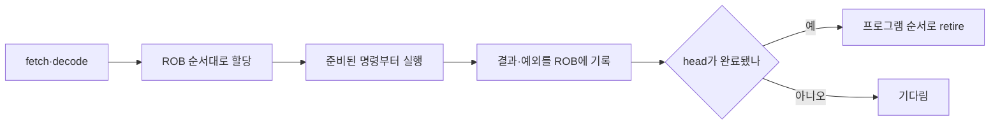

# 05. 분기·비순차 실행·결과 확정

[← 이전](04-pipelines-hazards-and-forwarding.md) · [목차](README.md) · [다음 →](06-cache-addresses-and-locality.md)

**분기(branch)**는 조건에 따라 다음 명령 주소를 바꾸는 작업이다. **비순차 실행(out-of-order execution)**은 입력이 준비된 명령을 먼저 계산하는 방식이다. **ROB(Reorder Buffer, 재정렬 버퍼)**은 진행 중인 명령의 결과와 예외를 추적한다. **은퇴(retire)**는 완료 결과를 프로그램 순서대로 확정하는 단계이며, 실행 완료와 구별한다.

## ROB로 추측 결과를 순서대로 확정하기

비순차 실행은 뒤 명령의 입력이 먼저 준비되면 실행 장치를 놀리지 않고 먼저 계산하는 기법이다.
그러나 프로그램에 보이는 결과까지 제멋대로 확정하면 예외와 분기 실패 뒤의 상태를 복구할 수 없다.
그래서 많은 교육 모형은 계산 완료와 retirement를 구분한다.

**ROB(reorder buffer)**는 프로그램 순서대로 항목을 배치하는 원형 대기열이다.
각 항목에는 명령의 순서, 목적 레지스터, 계산값, 완료 비트, 예외 정보가 들어간다.
실제 제품의 자료구조와 필드 구성은 제조사마다 다르므로 이 표는 공통 원리를 위한 모형이다.



다음 세 명령을 보자.

```text
I1: load x1, [A]   # cache miss, 8주기
I2: add  x2, x3,x4 # 1주기, I1과 독립
I3: div  x5, x6,x0 # 0으로 나누기 예외
```

| 시점 | I1 ROB | I2 ROB | I3 ROB | 프로그램에 보이는 상태 |
|---:|---|---|---|---|
| 1 | 할당·미완료 | 할당·미완료 | 할당·미완료 | 변화 없음 |
| 2 | 메모리 대기 | 실행 완료, 값 17 | 실행 중 | `x2`는 아직 옛값 |
| 3 | 메모리 대기 | 완료 | 예외 기록·완료 | 예외 아직 전달 안 함 |
| 8 | load 값 9 완료 | 완료 | 예외 있음 | 변화 없음 |
| 9 | retire, `x1=9` | 완료 | 예외 있음 | I1만 확정 |
| 10 | 비로소 retire, `x2=17` | 제거 | 예외 있음 | I2 확정 |
| 11 | head에서 예외 전달 | 제거 | flush | I3 이후 효과 없음 |

I2는 I1보다 먼저 **완료**했지만 먼저 **retire**하지 않았다.
완료는 실행 장치가 결과를 ROB나 물리 레지스터에 만들었다는 뜻이다.
retire는 그 결과를 프로그램이 약속받은 프로그램에 보이는 상태로 되돌릴 수 없게 확정하는 뜻이다.

예외도 발견 즉시 프로그램에 전달하지 않는다.
I3의 0 나누기를 3시점에 즉시 전달하면, 더 오래된 I1과 I2가 끝났는지 모호해진다.
I3가 ROB head가 될 때까지 기다리면 I3보다 오래된 명령은 모두 확정됐고 젊은 명령은 모두 폐기할 수 있다.
이를 **정확한 예외**라고 부른다.
예외 처리기가 보는 상태는 “문제 명령 직전까지 실행된 순차 프로그램”과 같아진다.

분기 예측 실패도 비슷하다.
분기 뒤의 예측 경로 명령은 실행되어 캐시 같은 미세 상태에 흔적을 남길 수 있지만, ROB에서 retire하기 전에 실패가 발견되면 레지스터·메모리의 프로그램에 보이는 변경 효과는 폐기한다.
이 경계는 기능적 정확성에 관한 설명이다.
추측이 미세 상태에 남기는 보안 부채널까지 자동으로 제거한다는 뜻은 아니다.

## 문제와 풀이

### 문제 1
I1이 6주기, 독립인 I2가 1주기에 완료되면 I2가 먼저 retire할 수 있는가?

**풀이:** 프로그램 순서 retirement 모형에서는 없다.
I2 결과는 준비됐지만 ROB head인 I1이 완료·retire할 때까지 기다린다.
이 기다림 덕분에 I1에서 예외가 나면 I2의 프로그램에 보이는 변경 효과를 버릴 수 있다.

### 문제 2
젊은 load가 잘못 예측한 분기 뒤에서 값을 읽었다. 예측 실패 시 무엇을 버리는가?

**풀이:** 그 load와 뒤 명령의 ROB 항목, 미확정 목적 매핑, store queue의 미확정 쓰기를 무효화한다.
정확한 내부 구조는 구현마다 다르지만 프로그램에 보이는 상태에는 그 경로의 효과가 남지 않아야 한다.
캐시 같은 미세 상태 흔적은 별도 보안 문제다.

### 문제 3
ROB head에 미완료 cache miss가 있고 뒤 20개 명령이 완료됐다. 왜 retirement 처리량은 0일 수 있는가?

**풀이:** retire는 head부터 순서를 지켜야 한다.
head가 준비되지 않았으므로 뒤의 완료 항목을 건너뛸 수 없다.
이를 head-of-line blocking으로 볼 수 있으며, “실행 장치가 바쁘다”와 “프로그램 진행이 확정된다”가 다른 이유다.

## 공식 자료

[RISC-V ISA](https://riscv.github.io/riscv-isa-manual/snapshot/unprivileged/)

[← 이전](04-pipelines-hazards-and-forwarding.md) · [목차](README.md) · [다음 →](06-cache-addresses-and-locality.md)
