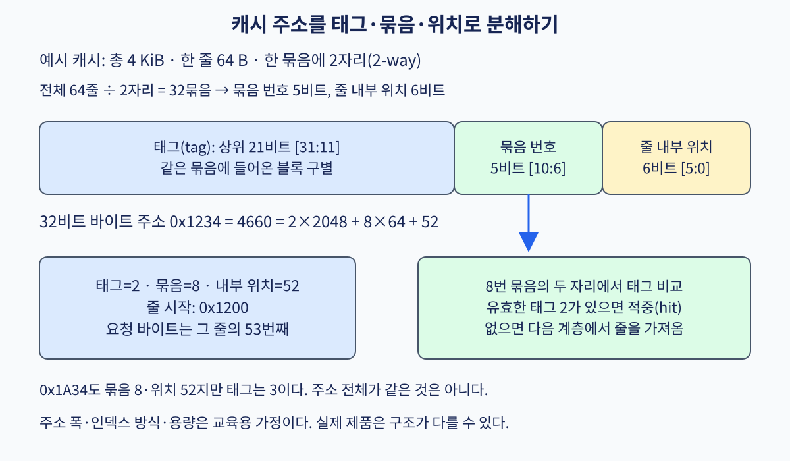

# 06. 캐시 주소와 지역성

[← 이전](05-branches-out-of-order-and-retirement.md) · [목차](README.md) · [다음 →](07-coherence-and-false-sharing.md)

프로그램은 주소를 주고 그 위치의 값을 읽거나 쓴다. 이 주소로 접근할 수 있는 저장 공간과 그 동작 규칙을 이 장에서는 **memory(메모리)**라고 부른다. 실제 장치는 register, 여러 단계 cache, DRAM으로 나뉘지만 프로그램은 ISA와 운영체제가 허용한 범위에서 하나의 주소 공간처럼 사용한다.

DRAM까지 매번 기다리면 CPU 계산 장치가 오래 논다. 그래서 최근에 사용했거나 곧 사용할 가능성이 높은 data 일부를 CPU 가까운 작은 저장소에 복사한다. 이 저장소가 **cache(캐시)**다. cache는 byte 하나씩 가져오지 않고 서로 이웃한 고정 크기 묶음을 함께 옮긴다. 이 묶음을 **block 또는 cache line(캐시 줄)**이라고 한다. 이 장의 모형에서는 한 line이 64byte다.

cache가 있어도 프로그램이 읽는 값과 쓰기 결과는 cache가 없는 것처럼 같은 memory 규칙을 따라야 한다. 여기서 **프로그램의 올바른 결과(correctness)**란 성능이 빠르다는 뜻이 아니라, ISA와 동기화 규칙이 약속한 값이 나온다는 뜻이다. cache는 결과를 바꾸기 위한 저장소가 아니라 그 결과에 더 빨리 도달하려는 내부 장치다.

프로그램에 주소와 load/store 결과를 약속하는 층을 **추상화(abstraction)**라고 한다. 복잡한 DRAM timing과 cache message를 숨기고 “이 주소를 읽는다”라는 단순한 사용법을 제공한다. 그 약속을 tag 비교기, SRAM, replacement 회로로 실제 구현한 CPU 내부 조직을 **마이크로아키텍처(microarchitecture)**라고 한다. ISA는 특정 cache 크기와 교체 정책을 강제하지 않는다.

이 장은 4KiB, 64B line, 2-way cache 주소를 끝까지 나누고 hit와 miss, 교체, 쓰기 정책, 평균 접근시간을 계산한다. 각 영어 용어는 실제 어느 표와 회로를 가리키는지 처음 등장할 때 설명한다.

## 1. locality가 cache를 가능하게 한다

**temporal locality(시간 지역성)**는 최근 사용한 data를 곧 다시 사용할 가능성이다. loop counter, stack local, 반복 lookup이 예다. **spatial locality(공간 지역성)**는 한 주소를 사용하면 가까운 주소도 곧 사용할 가능성이다. array 순차 순회가 예다.

cache는 요청 byte 하나가 아니라 **cache line 또는 block** 단위로 가져온다. 64B line에서 4B integer 하나를 요청해도 이웃 60B가 함께 올 수 있다. 이웃을 곧 쓰면 이득이고 random pointer chasing이면 bandwidth만 소비할 수 있다.

working set이 cache에 맞는지, access order가 reuse 전에 line을 쫓아내는지에 따라 성능이 달라진다. algorithm의 big-O가 같아도 memory layout과 traversal이 실행시간을 크게 바꾼다.

## 2. capacity, line, set, way

교육용 cache 조건은 다음과 같다.

- data capacity: 4KiB=4096B
- line size: 64B
- associativity: 2-way
- address width: 32bit

line 수는 4096/64=64개다. 한 set에 way 두 개가 있으므로 set 수는 64/2=32개다.

- 64B 안의 byte 위치: 6bit offset, 2⁶=64
- 32 set 선택: 5bit index, 2⁵=32
- 나머지: 32-6-5=21bit tag

~~~text
31                    11 10         6 5          0
+-----------------------+-------------+------------+
| tag 21bit             | index 5bit  | offset 6bit|
+-----------------------+-------------+------------+
~~~

**offset**은 line 안의 byte를 고른다. **index**는 set 하나를 고른다. **tag**는 그 set의 way에 들어 있는 line이 요청한 memory block인지 확인한다. 각 way에는 data뿐 아니라 valid, tag, dirty, coherence state와 replacement metadata가 있을 수 있다.

~~~mermaid
flowchart LR
  A[32bit 주소] --> O[아래 6bit offset]
  A --> S[다음 5bit set index]
  A --> T[위 21bit tag]
  S --> W[set의 두 way 읽기]
  T --> C[tag·valid 병렬 비교]
  W --> C
  C --> H{일치 way?}
  H -->|예| D[offset byte 선택]
  H -->|아니오| M[miss·victim·line fill]
~~~

## 3. full hex trace 1: 0x00001234

수식과 bit field를 모두 계산한다.

- offset = address & 0x3f = 0x1234 & 0x3f = 0x34 = 52
- block number = address >> 6 = 0x48 = 72
- set = block number & 0x1f = 0x48 & 0x1f = 8
- tag = address >> 11 = 0x2

따라서 (tag,set,offset)=(0x2,8,52)다. line 시작 주소는 아래 6bit를 0으로 만든 0x00001200이고 범위는 0x1200~0x123f다.

set 8의 way0 valid=1, tag=0x2라면 hit다. 요청이 4B load이고 주소 0x1234라면 line offset 52~55의 byte를 endian 규칙으로 조립한다. tag가 맞아도 valid=0이면 hit가 아니다.

## 4. full hex trace 2: 충돌하는 세 주소

0x1234, 0x1a34, 0x2234를 계산한다.

| 주소 | block | set | tag | offset |
|---|---:|---:|---:|---:|
| 0x1234 | 0x48=72 | 8 | 2 | 52 |
| 0x1a34 | 0x68=104 | 8 | 3 | 52 |
| 0x2234 | 0x88=136 | 8 | 4 | 52 |

주소 차이 0x800=2048B는 32set×64B라서 같은 set으로 돌아오고 tag만 증가한다. 2-way set 8에는 두 line만 동시에 있다.

초기 empty에서 access sequence A=0x1234, B=0x1a34, A, C=0x2234, B를 LRU로 추적한다.

| access | 결과 | way 상태 후 | LRU victim 설명 |
|---:|---|---|---|
| A | compulsory miss | A, empty | A fill |
| B | compulsory miss | A, B | B가 최신, A가 오래됨 |
| A | hit | A, B | A 최신, B 오래됨 |
| C | conflict miss | A, C | B를 victim으로 교체 |
| B | conflict miss | B, C | A가 더 오래되어 교체 |

전체 cache의 다른 set이 비어 있어도 set 8 경쟁으로 miss가 난다. 이를 **conflict miss**라고 한다.

## 5. direct-mapped, set-associative, fully associative

**direct-mapped**는 set당 way 하나다. lookup과 replacement가 단순하지만 같은 index 주소가 서로 계속 쫓아낼 수 있다. **set-associative**는 set 안 여러 way 중 하나에 들어간다. conflict를 줄이지만 tag 비교와 MUX가 늘어난다. **fully associative**는 어느 line에도 들어갈 수 있어 conflict는 최소지만 모든 tag와 비교해야 해 큰 data cache에는 비싸다.

capacity 숫자가 같아도 associativity가 높으면 hit time, 전력, replacement metadata가 달라진다. “8-way가 2-way보다 언제나 빠르다”가 아니다. workload miss 감소가 lookup 비용을 이기는지 측정해야 한다.

## 6. replacement: LRU는 이름보다 구현이 어렵다

**LRU(Least Recently Used)**는 가장 오래 사용하지 않은 line을 victim으로 고른다. 2-way에서는 최근 쓴 way 한 bit로 비교적 쉽게 나타낼 수 있다. 16-way에서 정확한 전체 순서를 매 access 갱신하면 metadata와 timing 비용이 크다.

실제 CPU는 pseudo-LRU, random, re-reference prediction 같은 근사 정책을 사용할 수 있다. ISA는 replacement policy를 정하지 않는다. software가 정확한 LRU를 가정해 correctness를 만들면 안 된다.

**compulsory miss**는 line을 처음 접근해 생긴다. **capacity miss**는 working set이 전체 cache보다 커서 생긴다. **conflict miss**는 mapping 제약으로 같은 set에서 경쟁해 생긴다. coherence invalidation이나 permission 변화로 생긴 miss는 고전 3C만으로 충분히 설명되지 않아 coherence miss를 따로 볼 수 있다.

## 7. read와 write 정책

read miss에서는 아래 계층에서 line을 fill하고 필요한 byte를 CPU에 준다. critical word first처럼 요청 word를 먼저 줄 수도 있다. fill 중 같은 line의 다른 request를 합치는 miss status 구조도 필요하다.

**write-through**는 cache write와 함께 아래 계층에도 write를 전달한다. dirty eviction이 단순하지만 write traffic이 많다. write buffer로 CPU 대기를 줄일 수 있으나 buffer가 차면 stall한다.

**write-back**은 cache line만 수정하고 dirty bit를 세운다. victim이 될 때 아래 계층에 line을 write back한다. traffic을 합칠 수 있지만 eviction과 coherence가 복잡하다.

write miss에서 **write-allocate**는 line을 먼저 가져와 cache에서 수정한다. **no-write-allocate**는 cache에 넣지 않고 아래 계층으로 보낼 수 있다. 흔한 조합이 존재하지만 제품과 memory type마다 확인해야 한다.

dirty B line이 victim인데 C를 fill해야 한다면 먼저 또는 병렬로 B의 64B를 writeback buffer에 보내고 C를 읽는다. miss penalty는 단순 DRAM read 시간만이 아니다.

## 8. multi-level cache

L1은 작고 빠르며 instruction과 data로 나뉠 수 있다. L2, LLC는 더 크고 느리며 core 사이 공유될 수 있다. inclusive, exclusive, non-inclusive 정책은 어떤 line이 여러 level에 존재해야 하는지 다르게 정한다. 이 말은 write-back과 같은 개념이 아니다.

L1 miss가 곧 DRAM access는 아니다. L2나 LLC hit일 수 있다. page fault는 cache miss와도 다르다. cache는 physical memory data의 가까운 copy를 관리하고 page fault는 virtual mapping·permission·residency 문제를 OS에 알린다.

**MSHR(Miss Status Holding Register)** 같은 구조는 outstanding miss 주소와 waiting operation을 추적한다. 여러 독립 miss를 겹치면 한 miss latency가 길어도 memory-level parallelism으로 throughput을 높일 수 있다.

## 9. AMAT 계산

**AMAT(Average Memory Access Time)**의 단순 1-level 식은 다음이다.

~~~text
AMAT = hit time + miss rate × miss penalty
~~~

L1 hit 1ns, miss rate 5%, L1 miss 뒤 추가 penalty 20ns라면 AMAT=1+0.05×20=2ns다. miss access가 총 21ns인지 “추가 20ns”인지 정의를 명확히 한다.

2-level 예를 보자.

- L1 hit time 1ns, local miss rate 8%
- L2 lookup 5ns, L2 local miss rate 25%
- memory 추가 penalty 80ns

L1 miss 후 기대 추가 시간은 5+0.25×80=25ns다. 전체 AMAT=1+0.08×25=3ns다. L2 global miss rate는 0.08×0.25=2%다.

miss가 겹치거나 out-of-order core가 다른 일을 하면 AMAT가 곧 program stall time은 아니다. bandwidth saturation, dependency, queueing을 별도로 본다.

## 10. code와 data layout

row-major 1024×1024 integer array를 행 순서로 읽으면 연속 address를 사용해 한 64B line의 16개 4B integer를 활용한다. 열 순서로 읽으면 stride 4096B라 매 access마다 다른 line과 page를 만질 수 있다. 계산 수는 같아도 miss와 TLB behavior가 다르다.

**blocking 또는 tiling**은 큰 matrix를 cache에 맞는 tile로 나눠 data reuse 전에 eviction되는 것을 줄인다. tile이 너무 크면 working set이 넘고, 너무 작으면 loop overhead와 vector 효율이 나빠질 수 있다. cache capacity만이 아니라 associativity와 동시에 필요한 array 수를 고려한다.

structure array에서 자주 쓰는 field와 드물게 쓰는 field가 한 line에 섞이면 bandwidth를 낭비할 수 있다. array of structures와 structure of arrays 선택은 access pattern, vectorization, ABI layout에 따라 평가한다.

## 11. prefetch와 최신 연구 경계

**hardware prefetcher**는 stride와 stream을 감지해 demand 전에 line을 가져온다. 맞으면 latency를 숨기지만 틀리면 bandwidth와 cache capacity를 소비하고 다른 유용한 line을 쫓아낸다. software prefetch도 너무 이르거나 늦으면 이득이 없다.

cache compression, victim cache, near-memory cache, CXL tiering은 effective capacity와 latency를 바꾸려는 연구 주제다. 00장의 Memstrata처럼 hardware line placement와 software tenant isolation을 결합하기도 한다. 연구 결과는 cache size, mapping, memory device, workload와 co-tenant 조건의 측정이지 ISA 보장이 아니다.

cache timing은 side channel이 될 수 있다. secret-dependent address가 cache set을 바꾸면 공격자가 hit/miss 시간을 통해 정보를 추론할 수 있다. constant-time programming은 secret에 따라 memory access와 branch가 달라지지 않도록 설계하지만 compiler와 microarchitecture까지 검토해야 한다.

## 12. virtual address와 physical tag

CPU instruction은 virtual address를 만든다. cache가 physical address tag를 사용한다면 TLB translation이 끝날 때까지 기다리면 L1 hit latency가 길어질 수 있다. **VIPT(Virtually Indexed, Physically Tagged)** cache는 page offset 안의 bit로 set을 먼저 고르는 작업과 TLB translation을 병렬로 진행하고, translation된 physical tag로 최종 hit를 확인한다.

4KiB page는 offset 12bit를 가진다. 64B line이 아래 6bit를 쓰므로 page offset 안에서 set index로 안전하게 쓸 수 있는 bit는 보통 다음 6bit 범위다. set 수와 associativity가 커져 index가 page offset을 넘어가면 서로 다른 virtual address가 같은 physical page를 가리키는 synonym 문제를 관리해야 한다.

VIPT는 모든 CPU가 같은 방식이라는 보장이 아니다. L1 size, associativity, page size, TLB 구조가 설계를 제약한다. TLB에 translation이 없으면 page table의 여러 단계 entry를 읽어 physical page 번호와 권한을 찾는 page walk가 필요하다. virtual index로 set을 먼저 읽더라도 physical tag 비교는 이 번역 결과와 맞아야 한다.

## 13. non-blocking cache와 queueing

blocking cache는 한 miss가 끝날 때까지 다음 access를 막는 단순 모형이다. **non-blocking cache**는 hit-under-miss 또는 miss-under-miss를 허용해 다른 독립 access를 진행한다. MSHR는 miss line 주소, fill 상태, 그 값을 기다리는 load 목록을 기록한다.

같은 line에 load 세 개가 거의 동시에 miss하면 아래 memory request를 세 번 보내지 않고 하나의 MSHR에 합칠 수 있다. 이를 miss merging이라고 한다. MSHR가 모두 차면 새 miss는 cache capacity가 남아도 기다려야 한다. bandwidth와 queue entry도 성능 자원이다.

평균 latency가 같아도 request가 몰리면 memory controller와 interconnect queue에서 기다리는 시간이 늘어난다. AMAT의 고정 miss penalty 모형은 saturation을 표현하지 못한다. 연구 실험에서는 outstanding request 수와 bandwidth curve를 함께 측정한다.

## 14. prefetch 반례 trace

stride prefetcher가 0x1000, 0x1040, 0x1080 access를 보고 다음 0x10c0을 미리 요청했다고 하자. program이 실제로 0x10c0을 읽으면 demand miss를 hit로 바꿀 수 있다.

하지만 branch 뒤 다른 list로 이동해 0x8000을 읽으면 0x10c0 fill은 쓸모없다. 더 나쁘게는 set의 유용한 line을 쫓아내거나 DRAM bandwidth를 점유할 수 있다. prefetch accuracy는 가져온 line 중 실제 사용 비율, coverage는 demand miss 중 미리 해결한 비율이다. accuracy만 높고 coverage가 낮거나 반대일 수 있다.

prefetch distance도 중요하다. 너무 가까우면 demand보다 늦고, 너무 멀면 cache에서 사용 전에 eviction된다. workload phase와 memory latency에 맞춘 적응형 정책이 연구되는 이유다.

## 15. 전체 문제 풀이

### 문제 1
8KiB, 64B line, 4-way, 32bit address cache의 offset, index, tag bit는?

**풀이:** line 8192/64=128개, set 128/4=32개다. offset 6bit, index 5bit, tag 32-11=21bit다.

### 문제 2
이 장의 4KiB 2-way cache에서 0x00002abc의 set, tag, offset은?

**풀이:** offset=0x2abc&0x3f=0x3c=60. block=0x2abc>>6=0xaa=170. set=170 mod32=10. tag=170//32=5다.

### 문제 3
set에 A,B가 있고 B가 최근 사용됐다. 정확한 2-way LRU에서 C miss의 victim은?

**풀이:** A가 더 오래 사용되지 않았으므로 A를 교체한다. A가 dirty이면 write-back 정책에서는 아래 계층에 먼저 또는 buffer로 내보낸다.

### 문제 4
L1 1ns, miss 10%, L2 lookup 6ns, L2 local miss 20%, memory 추가 100ns의 AMAT는?

**풀이:** L1 miss 추가 기대시간=6+0.2×100=26ns. AMAT=1+0.1×26=3.6ns다. 겹친 miss와 OOO latency hiding은 반영하지 않은 식이다.

### 문제 5
write-back과 write-through의 핵심 차이는?

**풀이:** write-through는 cache 수정과 함께 아래 계층에 write를 전달해 traffic이 많지만 dirty eviction이 단순하다. write-back은 line을 dirty로 두고 eviction 때 내려보내 여러 write를 합칠 수 있지만 replacement·coherence가 복잡하다.

## 공식 자료

- [RISC-V Unprivileged ISA Manual](https://riscv.github.io/riscv-isa-manual/snapshot/unprivileged/)
- [Memstrata, OSDI 2024](https://www.usenix.org/conference/osdi24/presentation/zhong-yuhong)

[← 이전](05-branches-out-of-order-and-retirement.md) · [목차](README.md) · [다음 →](07-coherence-and-false-sharing.md)
