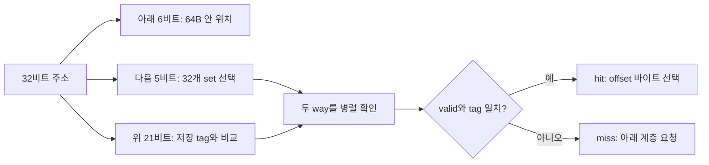

# 06. 캐시 주소와 지역성

[← 이전](05-branches-out-of-order-and-retirement.md) · [목차](README.md) · [다음 →](07-coherence-and-false-sharing.md)

**캐시(cache)**는 메모리 데이터 일부의 가까운 복사본을 두는 구조다. **캐시 줄(cache line)**은 함께 가져오고 관리하는 묶음, **묶음(set)**은 주소가 들어갈 후보 자리의 집합, **자리(way)**는 그 안의 한 항목이다. **태그(tag)**로 원하는 블록인지 확인하고 **줄 내부 위치(offset)**로 필요한 바이트를 고른다.


## 4 KiB, 64 B, 2-way 캐시의 주소를 끝까지 나누기

캐시는 최근 사용할 가능성이 높은 메모리 블록의 복사본을 CPU 가까이에 둔다.
주소 전체를 비교하면 느리고 비싸므로, 주소를 block offset, set index, tag로 나눠 후보를 좁힌다.

용량 4 KiB는 데이터 4096바이트를 뜻한다고 하자.
블록 하나가 64바이트이므로 블록 수는 `4096/64=64`개다.
2-way set associative는 한 set에 블록 두 개가 들어간다는 뜻이다.
따라서 set 수는 `64/2=32`개다.

64바이트 안의 위치에는 6비트가 필요하다. `2^6=64`이므로 offset은 주소의 아래 6비트다.
32개 set 중 하나를 고르려면 5비트가 필요하다. `2^5=32`이므로 그 위 5비트가 index다.
32비트 주소라면 남은 `32-6-5=21`비트가 tag다.

```text
31                    11 10         6 5          0
+-----------------------+-------------+------------+
| tag 21비트            | index 5비트 | offset 6비트|
+-----------------------+-------------+------------+
```

주소 `0x00001234`를 계산하자.
offset은 `0x1234 mod 64 = 0x34 = 52`다.
블록 번호는 `0x1234 // 64 = 0x48 = 72`다.
set은 `72 mod 32 = 8`이다.
tag는 `72 // 32 = 2`다.
따라서 `(tag,set,offset)=(2,8,52)`다.

두 번째 주소 `0x00001A34`도 offset은 52다.
블록 번호는 `0x1A34 // 64 = 0x68 = 104`, set은 `104 mod 32 = 8`, tag는 `104//32=3`이다.
두 주소는 같은 set 8에 들어가지만 tag가 2와 3으로 다르다.
2-way이므로 비어 있다면 두 블록을 동시에 담을 수 있다.

세 번째 주소 `0x00002234`는 블록 번호 136, set 8, tag 4다.
set 8에 이미 앞의 두 블록이 있다면 셋 중 하나를 교체해야 한다.
이것이 capacity 전체가 남아 보이더라도 같은 set 경쟁으로 생기는 conflict miss다.
교체 대상은 LRU 같은 교육 정책으로 정할 수 있지만 실제 CPU 정책을 단정해서는 안 된다.



공간 지역성은 한 바이트를 쓴 뒤 가까운 주소를 곧 쓸 가능성이다.
64바이트 블록은 그 가능성을 이용해 주변 데이터를 함께 가져온다.
시간 지역성은 같은 블록을 가까운 시간 안에 다시 쓸 가능성이다.
하지만 64바이트마다 한 번만 접근하는 큰 배열 순회처럼 재사용이 없다면 캐시가 모든 데이터를 영구히 빠르게 만들 수 없다.

### 문제 1
위 캐시에서 set 수와 주소 비트 분해를 구하라.

**풀이:** 4096/64=64블록, 64/2=32set이다.
offset 6비트, index 5비트, 32비트 주소의 tag 21비트다.

### 문제 2
`0x1234`와 `0x1A34`는 같은 블록인가?

**풀이:** 둘 다 set 8, offset 52지만 tag가 각각 2와 3이다.
따라서 같은 set의 서로 다른 블록이며 2-way에는 함께 존재할 수 있다.

### 문제 3
블록 크기를 128B로 바꾸고 총용량·2-way를 유지하면 어떻게 되는가?

**풀이:** 블록은 4096/128=32개, set은 16개다.
offset은 7비트, index는 4비트, tag는 여전히 21비트다.
공간 지역성 기회는 커지지만 한 miss가 더 많은 바이트를 옮기고 같은 용량에 블록 수는 줄어든다.

## 공식 자료

[RISC-V ISA](https://docs.riscv.org/)

[← 이전](05-branches-out-of-order-and-retirement.md) · [목차](README.md) · [다음 →](07-coherence-and-false-sharing.md)
