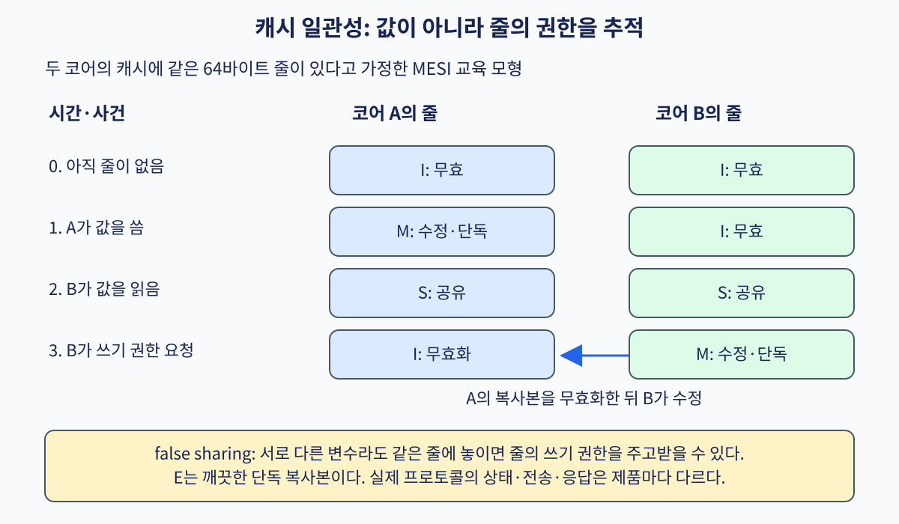
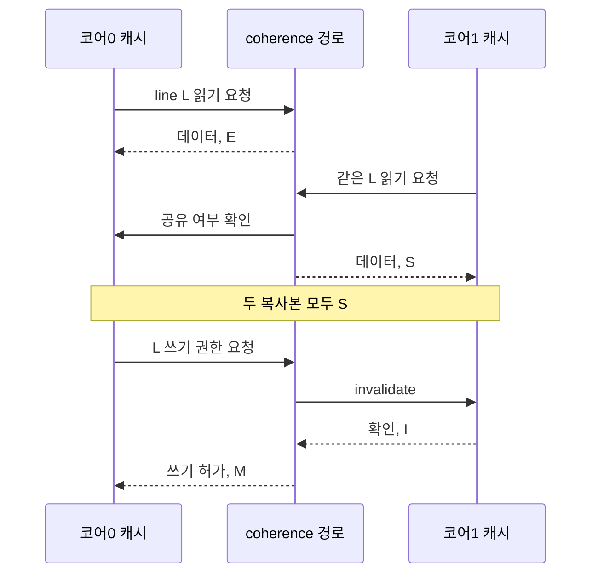

# 07. 캐시 일관성과 false sharing

[← 이전](06-cache-addresses-and-locality.md) · [목차](README.md) · [다음 →](08-memory-ordering-and-atomics.md)

**캐시 일관성(cache coherence)**은 여러 코어가 가진 같은 주소의 복사본과 쓰기 권한을 조정하는 규칙이다. **MESI**의 M·E·S·I는 각각 수정·단독·공유·무효 상태를 나타내는 교육용 상태 이름이다. **false sharing**은 다른 변수를 쓰는데 같은 캐시 줄의 권한을 주고받아 비용이 생기는 현상이다.

## 두 코어가 같은 cache line을 쓰는 과정

cache coherence는 여러 캐시에 같은 물리 블록의 복사본이 있을 때, 쓰기 권한과 관찰 순서를 조정하는 규칙이다.
이 장의 MESI는 네 상태로 원리를 보여 주는 교육 모형이다.
실제 제조사 프로토콜은 상태와 메시지가 더 많거나 이름과 전이 조건이 다를 수 있다.

`M`은 modified로, 이 캐시가 최신 수정본과 쓰기 권한을 가진 상태다.
`E`는 exclusive로, 메모리와 같은 깨끗한 복사본을 이 캐시만 가진 상태다.
`S`는 shared로, 여러 캐시가 읽기 가능한 깨끗한 복사본을 가진 상태다.
`I`는 invalid로, 그 캐시 칸의 데이터가 프로그램에서 사용할 수 없는 상태다.

초기에는 두 캐시 모두 line L이 I라고 하자.
코어0이 L을 읽으면 아래 계층에서 64바이트를 받아 E가 될 수 있다.
코어1이 같은 L을 읽으면 코어0의 유일 복사본 조건이 깨져 두 캐시는 S가 된다.
이후 코어0이 한 바이트를 쓰려면 다른 공유 복사본을 무효화해야 한다.
코어1이 invalidate를 처리해 I가 된 뒤 코어0은 M 권한으로 값을 바꾼다.

중요한 단위는 소스 코드 변수 하나가 아니라 cache line이다.
64바이트 line에 서로 다른 두 8바이트 카운터 A와 B가 있다고 하자.
코어0은 A만 증가시키고 코어1은 B만 증가시켜도 물리적으로 같은 line의 쓰기 권한을 경쟁한다.

| 단계 | 코어0 행동·상태 | 코어1 행동·상태 | 메시지 이유 |
|---:|---|---|---|
| 0 | L=I | L=I | 복사본 없음 |
| 1 | A 읽기, L=E | L=I | 코어0이 유일한 깨끗한 복사본 |
| 2 | A 쓰기, L=M | L=I | E에서 조용히 쓰기 가능 |
| 3 | L=I | B 쓰기 요청 | 코어1이 소유권 요구 |
| 4 | 수정 데이터 제공 후 I | L=M | line 전체 권한 이동 |
| 5 | A 쓰기 요청 | L=M | 다시 소유권 경쟁 |
| 6 | L=M | 데이터 제공 후 I | 반대 방향으로 이동 |

이를 **false sharing**이라고 한다.
논리적으로 같은 변수를 공유하지 않아도 coherence 단위가 같아서 실제 공유처럼 트래픽이 생긴다는 뜻이다.
“false”는 결과가 틀렸다는 뜻이 아니다.
원자 연산이나 lock을 올바르게 썼다면 값은 맞을 수 있지만 권한 왕복 때문에 느려진다.

예를 들어 두 카운터 주소가 `0x1000`과 `0x1008`이면 모두 `0x1000~0x103f` line 안에 있다.
둘째 카운터를 padding으로 `0x1040`에 배치하면 다른 64바이트 line으로 갈 수 있다.
하지만 실제 line 크기, 정렬, allocator 배치가 전제와 같아야 한다.
구조체 크기를 무작정 키우면 메모리 사용량과 cache locality가 나빠질 수 있으므로 측정 없이 항상 padding하라는 규칙은 아니다.

coherence는 값 복사본의 일관성을 다루지만 고수준 동기화를 대신하지 않는다.
두 코어가 같은 정수를 일반 load, add, store로 증가시키면 각 load와 store가 coherence되어도 두 증가가 하나로 합쳐지지 않는다.
둘 다 10을 읽고 11을 쓰면 최종값은 11이다.
atomic read-modify-write나 lock이 필요하다.

coherence와 consistency도 구분한다.
coherence는 주로 한 주소에 대한 쓰기 직렬화와 복사본 관리다.
memory consistency는 서로 다른 주소의 읽기·쓰기가 어떤 순서로 관찰될 수 있는지를 규정한다.
한 주소의 cache line이 coherence하다고 release/acquire 관계가 자동 생기는 것은 아니다.

## 문제와 완전한 풀이

### 문제 1
코어0과 코어1이 공유 상태 S인 line에 대해 코어0이 쓰려 한다. 필요한 핵심 동작은 무엇인가?

**풀이:** 코어0은 독점 쓰기 권한을 요청하고 코어1의 공유 복사본을 I로 만들어야 한다.
그 확인 뒤 코어0이 M 상태에서 수정할 수 있다.
메시지 이름과 중간 상태는 구현마다 다르지만 다른 유효 쓰기 복사본을 동시에 허용하지 않는 불변식이 핵심이다.

### 문제 2
주소 `0x2000`과 `0x2038`의 8바이트 값은 64바이트 line에서 false sharing할 수 있는가?

**풀이:** `0x2000` line 범위는 `0x2000~0x203f`다.
`0x2038~0x203f`의 8바이트 값도 같은 line에 완전히 들어간다.
서로 다른 코어가 각각을 자주 쓰면 line 권한이 왕복할 수 있다.

### 문제 3
각 카운터를 다른 line에 두면 성능이 반드시 좋아지는가?

**풀이:** 반드시 그렇지 않다.
false sharing이 실제 병목일 때는 도움이 될 수 있다.
읽기 위주이거나 같은 코어가 둘 다 쓰거나 작업량이 작다면 이득이 없고, padding으로 footprint가 커져 오히려 cache miss가 늘 수 있다.
프로파일과 반복 실험으로 조건을 확인해야 한다.

## 공식 자료

[Linux memory barriers](https://docs.kernel.org/core-api/wrappers/memory-barriers.html)

[← 이전](06-cache-addresses-and-locality.md) · [목차](README.md) · [다음 →](08-memory-ordering-and-atomics.md)
