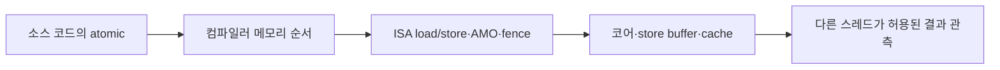

# 08. 메모리 순서와 원자 연산

[← 이전](07-coherence-and-false-sharing.md) · [목차](README.md) · [다음 →](09-mmu-tlb-and-page-walks.md)

**메모리 순서(memory ordering)**는 여러 읽기·쓰기의 결과를 다른 실행 주체가 어떻게 관찰할 수 있는지 정하는 규칙이다. **원자 연산(atomic operation)**은 중간 상태가 드러나지 않는 한 단위의 연산이다. 원자성만으로 모든 주소의 전역 순서가 생기지는 않는다. **release**와 **acquire**가 동기화하는 조건을 실제 읽은 값과 함께 살핀다.

## 메모리 순서는 “원자적”이라는 말 하나로 끝나지 않는다

여러 코어가 같은 메모리를 읽고 쓸 때는 세 질문을 따로 해야 한다.
첫째, 한 번의 읽기나 쓰기가 찢어지지 않는가.
둘째, 여러 메모리 사건이 다른 코어에 어떤 순서로 보이는가.
셋째, 두 스레드가 어느 사건을 경계로 앞선 데이터를 전달하기로 합의했는가.

**원자성**은 어떤 연산이 관찰 가능한 중간 상태 없이 하나의 단위로 일어나는 성질이다.
정렬된 기계어 크기 load/store가 원자적인지는 ISA와 주소 조건에 달려 있다.
원자적 읽기라는 사실만으로 앞뒤의 다른 읽기와 쓰기 순서까지 고정되지는 않는다.

**메모리 순서**는 한 스레드가 낸 load/store가 다른 스레드에 관찰되는 순서에 관한 규칙이다.
컴파일러는 언어 규칙 안에서 명령을 재배치할 수 있다.
CPU도 store buffer, cache, out-of-order 실행 때문에 내부 완료 순서를 바꿀 수 있다.
메모리 모형은 프로그램이 관찰할 수 있는 결과 중 무엇이 허용되는지를 정의한다.

RISC-V의 기본 메모리 모형인 RVWMO는 약한 순서를 허용한다.
Ztso 확장은 더 강한 TSO 성질을 선택적으로 제공한다.
“RISC-V CPU이면 항상 TSO”라고 가정하면 안 된다.
ISA 확장 지원 여부와 컴파일러가 생성한 fence·atomic 명령을 함께 확인해야 한다.



## store buffering: release/acquire도 자동 만능은 아니다

초기 상태가 `x=0, y=0`이고 두 스레드가 다음을 실행한다고 하자.

```text
스레드 0: x.store(1, ?); r1 = y.load(?)
스레드 1: y.store(1, ?); r2 = x.load(?)
```

`seq_cst`는 모든 순차 일관 원자 연산이 하나의 전역 순서에 놓인 것처럼 보이게 한다.
그 전역 순서는 각 스레드의 프로그램 순서 `Sx<Ly`, `Sy<Lx`도 지켜야 한다.
결과 `(r1,r2)=(0,0)`을 만들려면 `Ly<Sy`이고 동시에 `Lx<Sx`여야 한다.
이를 프로그램 순서와 연결하면 `Sx<Ly<Sy<Lx<Sx`라는 순환이 생긴다.
엄격한 전역 순서에는 순환이 있을 수 없으므로 seq_cst에서는 `(0,0)`이 금지된다.

| 가능한 seq_cst 전역 순서의 예 | r1 | r2 |
|---|---:|---:|
| Sx, Ly, Sy, Lx | 0 | 1 |
| Sy, Lx, Sx, Ly | 1 | 0 |
| Sx, Sy, Ly, Lx | 1 | 1 |

relaxed 모형에서는 각 store가 자기 코어의 store buffer에 잠시 남을 수 있다.
두 코어가 buffer의 store를 공유 계층에 내보내기 전에 상대 주소를 load하면 둘 다 초기 0을 볼 수 있다.
이는 “캐시가 고장났다”는 뜻이 아니라, 약한 모형이 그 관측을 허용한다는 뜻이다.

두 store를 release, 두 load를 acquire로 바꾸어도 중요한 조건이 남는다.
acquire load가 상대 release store의 값 1을 읽을 때에만 그 두 사건 사이에 synchronizes-with 관계가 생긴다.
두 load가 모두 초기값 0을 읽었다면 어느 load도 상대 release store에서 읽지 않았다.
따라서 release/acquire 관계만으로 store-buffering의 `(0,0)`을 일반적으로 금지했다고 말할 수 없다.

release/acquire가 seq_cst와 같은 전역 단일 순서를 제공한다고 설명하면 틀린다.
어떤 값을 누가 읽었는지를 포함해 동기화 관계가 실제로 만들어졌는지 확인해야 한다.

## message passing: release/acquire가 잘 맞는 경우

다음은 데이터와 준비 플래그를 전달하는 패턴이다.

```text
초기: data=0, flag=0
생산자: data=42; flag.store(1, release)
소비자: if flag.load(acquire)==1: assert data==42
```

생산자의 일반 쓰기 `data=42`는 release store보다 앞에 있다.
소비자의 acquire load가 바로 그 release store가 쓴 1을 읽으면 두 원자 사건이 synchronizes-with 관계를 만든다.
그 결과 생산자의 `data=42`가 소비자의 뒤쪽 `data` 읽기보다 happens-before에 놓인다.
그래서 조건문 안에서는 42를 관찰해야 한다.

| 순서 | 주체 | 사건 | 중간 상태 또는 관계 |
|---:|---|---|---|
| 1 | 생산자 | `data=42` | 아직 플래그는 0 |
| 2 | 생산자 | `flag.store(1, release)` | 앞선 data 쓰기를 publish |
| 3 | 소비자 | `flag.load(acquire)`가 1을 읽음 | release와 동기화 |
| 4 | 소비자 | `data` 읽음 | 42가 보여야 함 |

반례는 소비자가 flag에서 0을 읽는 경우다.
그 load는 생산자의 release store에서 값을 읽은 것이 아니다.
따라서 이 시도에서는 데이터 전달이 완료됐다는 보장이 없다.
소비자는 data를 사용하지 않고 재시도하거나 기다려야 한다.

또 다른 반례는 flag만 atomic이고 data에 생산자와 소비자가 동기화 없이 동시에 접근하는 언어 프로그램이다.
C/C++ 같은 언어에서는 data race 자체가 정의되지 않은 동작이 될 수 있다.
하드웨어 설명 전에 사용하는 언어의 메모리 모형도 지켜야 한다.

## relaxed, acquire, release, seq_cst의 역할

`relaxed` 원자는 해당 객체의 원자성 및 수정 순서는 제공하지만 다른 객체의 데이터 전달 순서를 만들 목적으로 쓰지 않는다.
카운터 통계처럼 값 손실만 막고 다른 데이터 공개가 필요 없을 때 후보가 된다.

`release` store는 그보다 앞선 동작이 이 공개 사건 뒤로 넘어가 관찰되는 것을 제한한다.
`acquire` load는 동기화된 공개를 읽었을 때 그 뒤 동작이 공개 이전 데이터를 올바르게 보도록 연결한다.

`seq_cst`는 acquire/release 성질에 더해 seq_cst 연산 사이의 단일 전역 순서 제약을 제공한다.
강한 순서는 이해하기 쉽지만 구현에 따라 더 비싼 fence나 명령이 필요할 수 있다.
성능을 이유로 약화하려면 먼저 허용 실행을 적고 불변식이 모든 실행에서 유지되는지 증명해야 한다.

## atomic과 volatile을 구분한다

`volatile`은 언어와 환경에 따라 “이 접근을 임의로 없애거나 합치지 말라”는 장치 접근 성질 등에 쓰인다.
일반적으로 스레드 간 원자성, 상호 배제, happens-before를 제공하는 동기화 도구가 아니다.
두 스레드가 volatile 정수를 `counter++`하면 읽기-더하기-쓰기가 서로 끼어들어 증가를 잃을 수 있다.

원자적 read-modify-write는 읽기와 쓰기 사이에 다른 스레드가 같은 객체를 바꾸지 못하도록 하나의 원자 사건으로 만든다.
그러나 여러 객체를 함께 지켜야 하는 불변식은 원자 변수 하나만으로 해결되지 않을 수 있다.
예를 들어 `balance`와 `transaction_count`가 항상 함께 갱신되어야 한다면 lock이나 검증 가능한 프로토콜이 필요하다.

## 문제와 완전한 풀이

### 문제 1

store-buffering에서 네 연산을 모두 release/acquire로 표기하면 `(0,0)`이 반드시 사라지는가?

**풀이:** 아니다.
두 acquire load가 모두 초기 0을 읽으면 상대 release store에서 읽은 것이 아니다.
synchronizes-with가 만들어지지 않으므로 release/acquire만으로 전역 순환을 금지하는 seq_cst 효과가 생기지 않는다.
이를 금지하려면 해당 언어·ISA가 제공하는 더 강한 순서나 적절한 fence 및 프로토콜이 필요하다.

### 문제 2

message-passing 소비자가 acquire load로 flag의 1을 읽었다.
왜 data 42를 기대할 수 있는가?

**풀이:** 생산자의 data 쓰기는 release store보다 프로그램 순서상 앞선다.
소비자의 acquire load가 그 release가 쓴 1을 읽어 synchronizes-with가 생긴다.
두 관계를 이어 data 쓰기가 소비자의 data 읽기보다 happens-before가 된다.
따라서 규칙을 지킨 프로그램은 42를 관찰한다.

### 문제 3

두 스레드가 `volatile int counter`에 각각 100번 `counter++`를 실행하면 200이 보장되는가?

**풀이:** 보장되지 않는다.
두 스레드가 같은 이전 값 17을 읽고 각각 18을 계산한 뒤 둘 다 18을 쓰면 증가 하나가 사라진다.
volatile은 이 읽기-수정-쓰기를 하나의 원자 사건으로 합치지 않는다.
원자적 fetch-add 또는 lock으로 갱신을 보호해야 한다.

## 공식 자료

[RISC-V memory models](https://riscv.github.io/riscv-isa-manual/snapshot/unprivileged/#memory-models)

[← 이전](07-coherence-and-false-sharing.md) · [목차](README.md) · [다음 →](09-mmu-tlb-and-page-walks.md)
