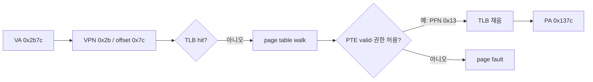

# 09. 주소 변환·TLB·페이지 탐색

[← 이전](08-memory-ordering-and-atomics.md) · [목차](README.md) · [다음 →](10-simd-vectors-and-roofline.md)

**가상 주소(virtual address)**는 프로세스가 사용하는 주소이며 **물리 주소(physical address)**로 번역된다. **MMU(Memory Management Unit)**가 번역과 보호를 담당하고, **TLB(Translation Lookaside Buffer)**는 최근 번역을 캐시한다. **페이지 테이블 항목(PTE)**에는 페이지의 위치와 권한 등이 기록된다.

## 주소 번역을 실제 숫자로 추적하기

MMU는 CPU가 낸 가상 주소를 물리 주소로 번역하고 접근 권한을 검사하는 하드웨어다.
TLB는 최근 번역을 저장하는 캐시이며, page table은 운영체제가 메모리에 만든 번역 자료구조다.
세 객체를 하나로 부르면 TLB miss와 page fault를 혼동하게 된다.

16비트 가상 주소와 256바이트 페이지를 가정하자.
256은 `2^8`이므로 아래 8비트가 page offset이고 위 8비트가 VPN이다.
물리 메모리가 64 frame이면 PFN은 6비트이고 물리 주소는 `6+8=14`비트다.

가상 주소 `0x2b7c`는 VPN `0x2b`, offset `0x7c`다.
TLB에 VPN 0x2b가 없다면 TLB miss다.
하드웨어 또는 OS가 page table에서 PTE 0x2b를 찾는다.
PTE가 valid이고 PFN이 0x13이면 물리 주소는 `(0x13<<8)|0x7c=0x137c`다.
offset은 번역 전후 바뀌지 않는다.

valid PTE를 page walk로 찾았다면 TLB miss는 fault 없이 끝난다.
반대로 PTE가 present가 아니거나 load인데 read 권한이 없거나 user 접근인데 supervisor 전용이면 fault가 난다.
OS fault handler는 요구 페이지를 준비해 PTE를 갱신할 수도 있고, 잘못된 접근으로 프로세스에 신호를 보낼 수도 있다.

다단계 page table은 VPN을 여러 인덱스로 나눈다.
상위 항목이 다음 단계 표의 주소를 주고, 마지막 leaf PTE가 PFN과 권한을 준다.
단계 수와 비트 배치는 ISA의 주소 변환 모드에 달려 있으므로 위 단일 단계 예를 실제 RISC-V Sv39 구조라고 오해하면 안 된다.

권한 검사도 번역 뒤의 부가 기능이 아니다.
TLB 항목에는 PFN뿐 아니라 read/write/execute, user/supervisor 같은 권한 정보가 함께 캐시된다.
같은 VPN이 TLB hit여도 store인데 write 권한이 없으면 permission fault가 발생한다.

주소 공간을 바꾸면 같은 VPN이 다른 PFN을 뜻할 수 있다.
구현은 TLB를 비우거나 ASID 같은 주소 공간 식별자를 tag에 포함한다.
페이지 테이블을 바꾼 뒤 오래된 TLB 항목을 적절히 무효화하지 않으면 취소한 권한이나 이전 frame을 계속 사용할 수 있다.

### 문제 1
16비트 VA와 256B page에서 `0xabcd`의 VPN과 offset은?

**풀이:** offset은 아래 8비트 `0xcd`, VPN은 위 8비트 `0xab`다.
page 크기가 2의 거듭제곱이므로 비트 경계로 바로 나뉜다.

### 문제 2
TLB miss 뒤 valid PTE를 찾으면 page fault인가?

**풀이:** 아니다.
TLB miss는 번역 캐시에 항목이 없다는 뜻일 뿐이다.
page walk가 valid하고 권한이 맞는 PTE를 찾으면 TLB를 채우고 원래 접근을 계속한다.

### 문제 3
PTE가 PFN 0x13을 가리키지만 write=0이다. VA 0x2b7c에 store하면?

**풀이:** 주소 결합 자체는 PA 0x137c가 되지만 store 권한 검사가 실패한다.
CPU는 그 물리 메모리에 쓰지 않고 permission fault를 보고한다.
OS가 허용된 copy-on-write 상황으로 처리할지 오류로 전달할지는 OS 상태에 달려 있다.

## 공식 자료

[RISC-V privileged architecture](https://docs.riscv.org/)

[← 이전](08-memory-ordering-and-atomics.md) · [목차](README.md) · [다음 →](10-simd-vectors-and-roofline.md)
