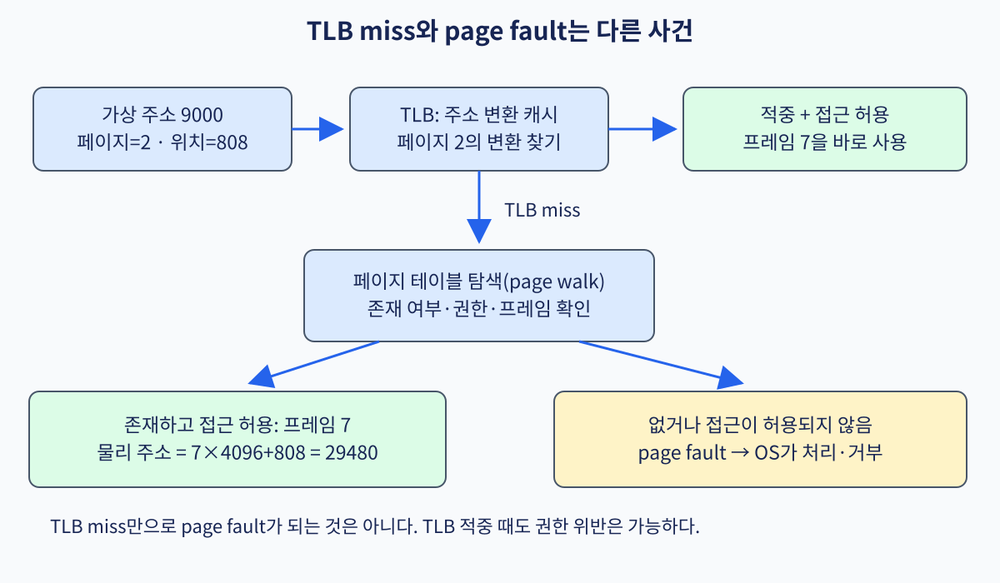

# 09. 주소 변환·TLB·페이지 탐색

[← 이전](08-memory-ordering-and-atomics.md) · [목차](README.md) · [다음 →](10-simd-vectors-and-roofline.md)

프로그램이 데이터의 위치를 가리키는 값을 **포인터(pointer)**라고 한다. 포인터에는 주소를 나타내는 숫자가 들어 있지만 그 숫자를 메모리 칩의 직접 위치로 쓰지는 않는다. 실행 중인 프로그램인 **프로세스(process)**는 자신에게 허용된 주소의 집합인 **주소 공간**을 사용한다. 운영체제는 이 공간을 고정 크기 묶음으로 나누어 실제 메모리와 연결한다. CPU는 값을 읽거나 쓸 때 주소를 번역하고 접근 권한도 검사한다. 이 연결 과정을 하나의 주소로 끝까지 따라가 보자.

## 1. 바이트 address와 bit를 읽는 법

**주소(address)**는 memory에서 위치를 식별하는 정수다. 바이트-addressed system에서는 주소가 1 증가하면 다음 1byte를 가리킨다. 0x1000에 4byte integer가 있으면 바이트 위치는 0x1000, 0x1001, 0x1002, 0x1003이다. **endianness(바이트 순서)**는 여러 바이트를 하나의 수로 조립하는 규칙이다. 0x01020304를 주소가 증가하는 방향으로 01,02,03,04로 저장하면 big-endian, 04,03,02,01로 저장하면 little-endian이다. 이 순서는 숫자의 표현 문제이고 어느 메모리 위치로 연결되는지를 정하는 주소 번역과는 다르다.

**가상 주소(VA, 가상주소)**는 프로세스 instruction이 사용하는 주소다. 프로세스 A와 B가 모두 VA 0x400000을 써도 서로 다른 data를 가리킬 수 있다. **물리 주소(PA, 물리주소)**는 메모리 controller와 캐시 hierarchy가 실제 물리 메모리 위치를 식별하는 주소다.

**페이지(page)**는 주소 공간을 고정 크기 묶음으로 나누는 단위다. 4KiB page는 4096=2¹²byte이므로 주소 아래 12bit가 페이지 안 위치인 **페이지 offset**이다. 나머지 위 bit는 어느 가상 page인지 나타내는 **VPN(Virtual Page Number)**이다.

물리 memory도 같은 페이지 크기의 **프레임**으로 나눈다. 프레임 번호를 **PFN(Physical Frame Number)** 또는 물리 페이지 number라고 한다. 번역은 VPN을 PFN으로 바꾸고 offset은 그대로 붙인다.

~~~text
Virtual address = VPN | page offset
                       번역
Physical address = PFN | 같은 page offset
~~~

## 2. 작은 16bit 예제로 전체 번역

16bit VA, 페이지 256B=2⁸, 물리 프레임 64개라고 하자.

- VA 아래 8bit: offset
- VA 위 8bit: VPN
- 64 프레임: PFN 6bit
- PA 폭: PFN 6+offset 8=14bit

VA 0x2b7c를 나눈다.

- VPN = 0x2b7c >> 8 = 0x2b
- offset = 0x2b7c & 0xff = 0x7c
- 페이지 table이 VPN 0x2b→PFN 0x13으로 연결
- PA=(0x13<<8)|0x7c=0x137c

가상 페이지 시작 0x2b00은 물리 프레임 시작 0x1300에 대응하고, 그 안 0x7c 위치는 유지된다. 페이지 size가 2의 거듭제곱이어서 나눗셈 대신 비트 분리로 계산할 수 있다.

## 3. 페이지 테이블, PTE, MMU

운영체제는 각 프로세스 주소 공간에 대해 VPN→PFN과 권한을 기록한 **페이지 테이블(페이지 표)**을 memory에 만든다. 표의 한 항목이 **PTE(Page Table Entry, 페이지 표 항목)**다.

PTE에는 PFN뿐 아니라 다음 정보가 들어갈 수 있다.

- valid 또는 present: 번역이 현재 유효한가
- R/W/X: read, write, execute를 허용하는가
- U: user mode에서 접근 가능한가
- accessed: 최근 접근했는가
- dirty: write가 있었는가
- leaf인지 다음 단계 테이블 pointer인지

**MMU(Memory Management Unit, 메모리 관리 장치)**는 CPU 안에서 VA를 PA로 번역하고 현재 privilege와 access 종류를 PTE 권한과 비교하는 hardware다. load면 read, store면 write, 명령 fetch면 execute 권한을 본다. 주소 숫자만 변환한 뒤 별도로 보호하는 것이 아니라 번역 과정에 권한 검사가 포함된다.

PTE가 PFN 0x13이어도 W=0인데 store하면 PA 0x137c에 쓰지 않고 권한 fault를 보고한다. OS는 copy-on-write처럼 의도한 fault인지 잘못된 pointer인지 프로세스 상태를 보고 처리한다.

~~~mermaid
flowchart LR
  V[VA] --> S[VPN과 offset 분리]
  S --> T{TLB hit?}
  T -->|예| Q[PFN·권한 사용]
  T -->|아니오| W[hardware page-table walk]
  W --> P{leaf PTE valid·권한?}
  P -->|예| F[TLB fill]
  F --> Q
  Q --> A[PFN+offset=PA]
  P -->|아니오| X[page fault exception]
~~~

## 4. TLB는 번역 결과의 cache다

매 메모리 access마다 페이지 테이블 PTE를 여러 번 DRAM에서 읽으면 data를 읽기 전부터 비용이 크다. **TLB(Translation Lookaside Buffer)**는 최근 VPN→PFN과 권한 결과를 CPU 가까이에 보관하는 번역 cache다.

TLB entry는 VPN tag, PFN, 페이지 size, R/W/X/U, global, ASID 같은 정보를 가진다. VA의 VPN과 현재 주소-space identity가 entry와 맞고 권한도 허용하면 TLB hit다. MMU는 PFN과 offset을 합쳐 캐시 access를 진행한다.

**TLB miss**는 원하는 번역이 TLB에 없다는 뜻이다. PTE가 invalid라는 뜻이 아니다. 하드웨어 페이지-테이블 walker가 valid PTE를 찾으면 TLB를 채우고 원래 access를 계속한다. **페이지 fault**는 PTE가 없거나 권한·형식 조건이 맞지 않아 OS의 판단이 필요한 exception이다.

데이터 캐시 miss도 다르다. TLB hit 뒤 PA를 알았지만 데이터 line이 L1에 없으면 캐시 miss다. 한 load에 TLB miss와 데이터 캐시 miss가 모두 발생할 수 있다.

## 5. ASID가 필요한 이유

같은 VPN 0x400가 프로세스 A에서는 PFN 0x20, 프로세스 B에서는 PFN 0x91일 수 있다. context switch 뒤 TLB에 A entry가 남아 있는데 B가 이를 쓰면 격리와 correctness가 깨진다.

**ASID(Address Space Identifier)**는 TLB tag에 주소 space 번호를 포함해 같은 VPN의 다른 프로세스 entry를 구분한다. context switch 때 모든 TLB를 비우지 않고 여러 프로세스 번역을 함께 유지할 수 있다.

ASID 수가 제한되어 재사용하면 이전 owner의 entry를 적절히 invalidate해야 한다. kernel mapping처럼 여러 주소 space에서 같은 global entry를 쓸 수 있는 규칙도 있다. exact ASID width와 global behavior는 architecture와 implementation을 확인한다.

## 6. 다단계 페이지 테이블

가상주소 모든 VPN에 PTE 배열을 미리 만들면 sparse 주소 space에서 memory를 낭비한다. 다단계 페이지 table은 VPN을 여러 index로 나누고 필요한 아래 table만 만든다.

RISC-V Sv39의 교육적 구조는 39bit 가상 address를 사용하고 4KiB page에서 VPN을 9bit씩 세 단계로 나눈다.

~~~text
VA[38:30]=VPN[2] | VA[29:21]=VPN[1] | VA[20:12]=VPN[0] | VA[11:0]=offset
~~~

각 페이지 테이블 page는 4KiB이고 PTE가 8byte이므로 512=2⁹개 entry를 담는다. root 테이블 물리 페이지 number는 privileged control register가 제공한다. walker는 각 index×8로 PTE 주소를 계산한다.

### 6.1 Sv39 숫자 추적

VA=0x0000000123456789를 4KiB 페이지 기준으로 나눈다고 하자.

- offset = VA & 0xfff = 0x789
- VPN[0] = (VA>>12)&0x1ff = 0x056
- VPN[1] = (VA>>21)&0x1ff = 0x11a
- VPN[2] = (VA>>30)&0x1ff = 0x004

root 테이블 물리 base가 0x00100000이라고 하자.

1. level 2 PTE 주소=0x00100000+0x004×8=0x00100020
2. 이 non-leaf PTE가 다음 테이블 base 0x00200000을 가리킴
3. level 1 PTE 주소=0x00200000+0x11a×8=0x002008d0
4. 이 PTE가 다음 테이블 base 0x00300000을 가리킴
5. level 0 PTE 주소=0x00300000+0x056×8=0x003002b0
6. leaf PTE의 PFN이 0xabcde라고 가정
7. PA=(0xabcde<<12)|0x789=0xabcde789

숫자는 페이지-walk 계산을 위한 교육 값이다. 실제 Sv39는 canonical 주소 조건, PTE 비트, superpage 정렬, privilege와 A/D 규칙을 모두 검사한다.

## 7. 페이지 walk도 메모리 access다

walker가 PTE를 읽는 일 자체가 캐시 hierarchy를 사용한다. PTE가 L1/L2에 있으면 빠르고 DRAM까지 가면 느리다. 3단계 walk라고 고정 3×DRAM latency인 것은 아니다. 페이지-walk cache가 중간 PTE를 기억하거나 여러 access가 겹칠 수 있다.

load가 data를 얻기 전에 TLB lookup, 필요하면 PTE read 여러 번, 최종 데이터 캐시 access를 수행한다. 가상 메모리 workload에서는 데이터 locality뿐 아니라 주소 변환 locality가 중요하다.

large page는 offset bit를 늘려 한 TLB entry가 더 넓은 범위를 cover한다. 2MiB page는 4KiB 페이지 512개 영역을 한 entry로 표현해 TLB reach를 늘린다. 그러나 allocation과 compaction이 어렵고 내부 fragmentation과 메모리 tiering의 거친 배치 문제가 생긴다.

## 8. 페이지 fault의 종류와 OS 처리

CPU가 valid leaf PTE를 얻지 못하거나 권한이 맞지 않으면 현재 instruction을 정상 완료하지 않고 페이지-fault exception을 kernel에 전달한다. fault 정보에는 access 주소, load/store/fetch 종류, privilege와 원인 정보가 포함될 수 있다.

**demand paging**에서는 process가 합법적으로 mapping한 file 또는 anonymous page가 아직 물리 memory에 없다. OS는 free frame을 확보하고 data를 읽거나 0으로 채우며 PTE를 valid로 만든 뒤 TLB를 정리하고 faulting instruction을 재시작한다.

**copy-on-write(COW)**에서는 parent와 child가 read-only로 같은 frame을 공유한다. 한쪽 store가 write fault를 내면 OS가 새 frame을 할당해 data를 복사하고 faulting 프로세스 PTE를 writable new PFN으로 바꾼다. 처음부터 전체 memory를 복사하지 않아 fork를 싸게 만든다.

illegal 주소, stack guard 페이지, user mode의 kernel 페이지 접근은 복구하지 않고 process에 signal 또는 exception을 전달할 수 있다. 페이지 fault가 항상 disk I/O도, 항상 프로그램 error도 아니다.

## 9. PTE 변경과 TLB shootdown

OS가 PTE를 바꾸어도 다른 core의 TLB에 old translation이 남을 수 있다. **TLB invalidation**은 해당 entry를 더 이상 사용하지 않게 한다. 다른 core에서 같은 주소 space가 실행 중이면 interrupt 또는 inter-processor message로 invalidation을 요청하고 완료를 기다리는 **TLB shootdown**이 필요할 수 있다.

순서를 잘못 잡으면 page를 다른 owner에게 재사용한 뒤 old TLB를 가진 core가 계속 접근해 보안 문제가 생긴다. 일반적인 안전 흐름은 PTE에서 접근을 제거하고, 필요한 메모리 ordering을 적용하고, 관련 TLB invalidation 완료를 확인한 뒤 frame을 재사용하는 것이다. exact sequence는 OS와 ISA가 정한다.

shootdown은 코어 수가 많을수록 비용이 커질 수 있다. batching, ASID, range invalidation, per-코어 페이지 테이블 같은 연구가 이 traffic을 줄인다.

## 10. virtualization과 두 단계 번역

가상 machine의 guest OS도 guest 가상 address를 guest 물리 address로 번역한다. hypervisor는 guest physical을 host physical로 다시 연결한다. 하드웨어 nested translation은 두 페이지-테이블 walk를 결합할 수 있지만 TLB miss 비용이 커질 수 있다.

guest 페이지 테이블 entry와 host second-stage entry 양쪽의 권한을 만족해야 한다. device DMA에는 CPU 페이지 테이블 대신 IOMMU table이 관련될 수 있다. “물리 주소”가 guest가 보는 주소인지 machine 메모리 주소인지 층을 밝혀야 한다.

## 11. protection과 security

W^X는 같은 page를 writable과 executable로 동시에 두지 않으려는 정책이다. NX/X permission은 데이터 page에서 명령 fetch를 막는다. user/supervisor bit는 privilege isolation을 돕는다.

페이지 table은 security-critical data라 user가 임의로 수정하지 못하게 보호한다. speculative execution이 권한 check를 무시해 프로그램에 값을 주어서는 안 되고, timing side channel은 별도 mitigation이 필요할 수 있다.

ASLR은 mapping 가상 address를 실행마다 바꾸어 공격자가 address를 예측하기 어렵게 한다. VA를 randomize해도 물리 메모리 confidentiality를 자동 제공하지 않으며 information leak가 있으면 우회될 수 있다.

## 12. 문제와 전체 풀이

### 문제 1
16bit VA, 256B page에서 VA 0xabcd의 VPN과 offset은?

**풀이:** 256=2⁸이므로 아래 8bit offset=0xcd, 위 8bit VPN=0xab다.

### 문제 2
VPN 0x2b가 PFN 0x13이고 offset 0x7c일 때 PA는?

**풀이:** 페이지 size 256B이므로 PFN을 8bit 이동해 0x1300을 만들고 offset을 OR한다. PA=0x137c다.

### 문제 3
TLB miss 뒤 valid하고 read 가능한 PTE를 찾았다. 페이지 fault인가?

**풀이:** 아니다. TLB는 번역 cache다. walker가 valid PTE를 찾으면 TLB를 채우고 원래 load를 계속한다. PTE 부재나 권한 실패가 fault 조건이다.

### 문제 4
PTE PFN은 맞지만 W=0인 page에 store하면?

**풀이:** 물리 주소 숫자를 계산할 수 있어도 write permission이 없으므로 store를 완료하지 않고 fault를 낸다. OS가 COW인지 illegal인지 판단한다.

### 문제 5
4KiB page에서 VA 0x12345678의 offset과 VPN은?

**풀이:** offset=0x678, VPN=0x12345다. 4KiB=0x1000이므로 아래 12bit가 offset이다.

### 문제 6
ASID 없이 context switch 때 TLB를 유지하면 어떤 문제가 생기는가?

**풀이:** 새 process의 같은 VPN이 이전 프로세스 PFN으로 번역되어 데이터 누출과 corruption이 생긴다. TLB를 flush하거나 주소-space tag로 구분해야 한다.

## 공식 자료

- [RISC-V Privileged Architecture](https://docs.riscv.org/)
- [RISC-V Ratified Specifications](https://docs.riscv.org/)

[← 이전](08-memory-ordering-and-atomics.md) · [목차](README.md) · [다음 →](10-simd-vectors-and-roofline.md)
