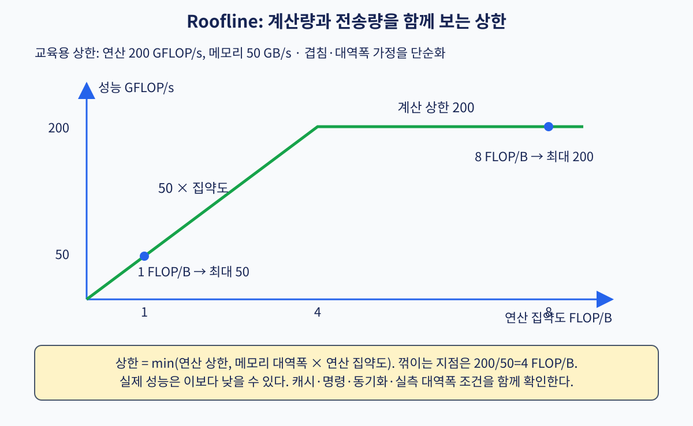

# 10. SIMD·벡터·Roofline

[← 이전](09-mmu-tlb-and-page-walks.md) · [목차](README.md) · [다음 →](11-numa-interconnects-dma-and-iommu.md)

**SIMD(Single Instruction, Multiple Data)**는 한 명령으로 여러 데이터에 같은 연산을 하는 방식이다. **레인(lane)**은 그 데이터 자리이며 **마스크(mask)**는 어느 자리를 계산할지 표시한다. **연산 집약도(arithmetic intensity)**는 옮긴 바이트당 계산 수다. Roofline은 계산 상한과 메모리 전송 상한을 함께 놓는 모델이다.

## 여러 값을 한 명령으로 처리하기

SIMD는 한 명령이 여러 데이터 원소에 같은 연산을 적용하는 방식이다.
vector는 그 원소 묶음이고 lane은 한 시점에 원소 하나를 처리하는 논리 통로다.
mask는 각 lane의 연산을 적용할지 나타내는 참·거짓 비트다.
tail은 배열 길이가 lane 수의 배수가 아닐 때 마지막에 남는 원소다.

길이 10 배열에 모두 1을 더하고 4 lane을 쓴다고 하자.

| 실행 | 활성 인덱스 | 입력 | mask | 출력 |
|---:|---|---|---|---|
| 1 | 0~3 | 10,20,30,40 | 1111 | 11,21,31,41 |
| 2 | 4~7 | 50,60,70,80 | 1111 | 51,61,71,81 |
| 3 | 8~9 | 90,100,없음,없음 | 1100 | 91,101,미기록,미기록 |

마지막 mask가 없는데 네 lane 모두 저장하면 배열 밖 메모리를 덮을 수 있다.
일부 ISA는 vector length로 tail을 제어하고, 다른 코드는 scalar 반복으로 나머지를 처리한다.
“4 lane이면 항상 4배”도 틀리다. load 대역폭, 의존성, mask, 정렬과 tail 비용이 제한한다.

reduction은 여러 원소를 하나의 합이나 최댓값으로 줄이는 연산이다.
`[1,2,3,4]` 합은 lane별 독립 출력이 끝이 아니라 부분합을 다시 합쳐 10을 만든다.
부동소수점 덧셈은 결합법칙이 정확하지 않아 reduction 순서가 바뀌면 마지막 비트가 달라질 수 있다.

roofline은 peak 계산률과 메모리 대역폭으로 가능한 성능의 위쪽 경계를 그린다.
연산 집약도의 단위는 FLOP/B, 대역폭은 GB/s, 성능은 GFLOP/s다.
그림의 값 50 GB/s와 200 GFLOP/s에서 경계는 `200/50=4 FLOP/B`다.
집약도 2라면 `50×2=100 GFLOP/s`, 집약도 8이라면 계산 천장 200 GFLOP/s가 더 낮다.
기존의 100 GB/s 예시는 별도 가상 기계 예이며 이 그림의 수치와 섞으면 안 된다.

### 문제 1
길이 14, 4 lane이면 full 실행과 tail은?
**풀이:** `14//4=3`번 full 실행으로 12개, tail 2개가 남는다. 마지막 mask는 두 lane만 활성화한다.

### 문제 2
50 GB/s, 집약도 3 FLOP/B의 대역폭 천장은?
**풀이:** `50×3=150 GFLOP/s`다. peak 200보다 낮아 모형상 memory-bound다.

### 문제 3
4 lane reduction이 언제 scalar와 다른 부동소수점 결과를 낼 수 있는가?
**풀이:** 부분합 순서가 달라 반올림 지점이 바뀔 때다. 정수 overflow가 없는 정확 산술과 구분한다.

## 공식 자료

[RISC-V Vector Extension](https://docs.riscv.org/)

[← 이전](09-mmu-tlb-and-page-walks.md) · [목차](README.md) · [다음 →](11-numa-interconnects-dma-and-iommu.md)
