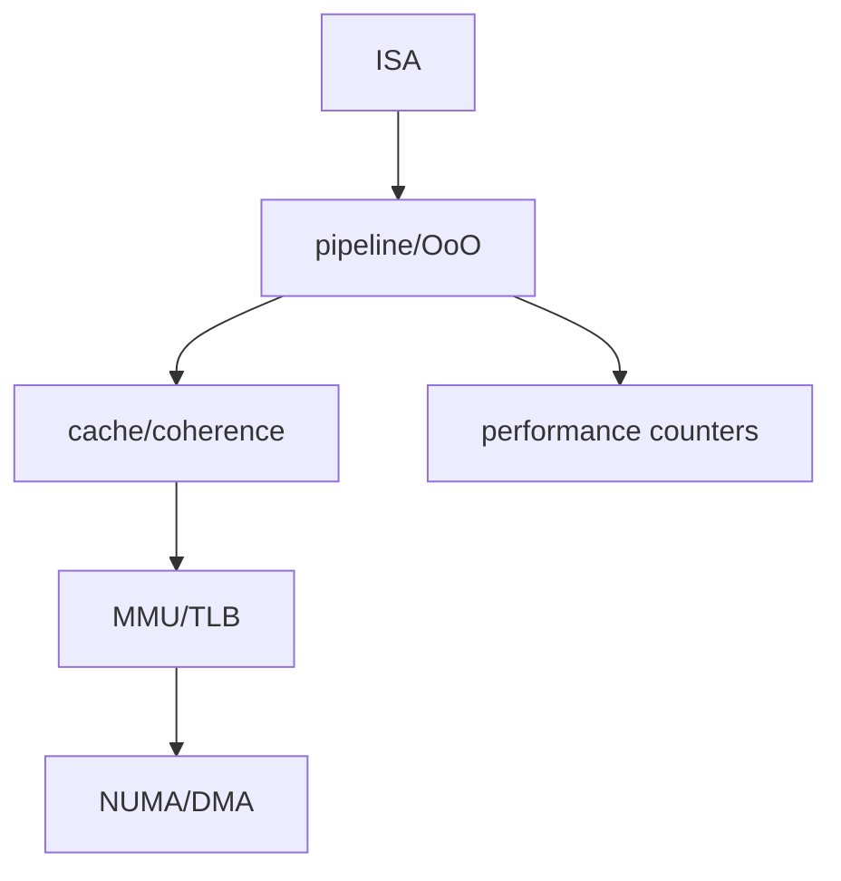

# 15. 종합 문제·용어·출처

[← 이전](14-experiments-and-research.md) · [목차](README.md)

각 문제는 가정과 단위를 적고 중간 상태를 계산한 뒤 답을 낸다. 용어사전은 뜻을 다시 찾기 위한 것이며, 각 단어가 쓰이는 과정은 해당 장의 예제로 돌아가 확인한다.

## 종합 문제 12개와 풀이

## 1. 클록과 처리 시간
2 GHz 클록에서 6000주기는 몇 초인가?
2 GHz는 초당 20억 주기이므로 한 주기는 0.5 ns다.
`6000×0.5 ns=3000 ns=3 μs`다.
클록만으로 프로그램 시간을 알 수 없고 실제 주기 수도 필요하다.

## 2. 8비트 덧셈
부호 없는 250과 10을 8비트로 더하면 저장 비트는 무엇인가?
합 260은 8비트 범위 0~255를 넘는다.
하위 8비트는 `260 mod 256=4`이고 carry가 생긴다.
같은 비트를 signed로 해석하는 문제와 구분해야 한다.

## 3. 함수 호출 스택
호출 직전 SP가 `0x8000`이고 32바이트 프레임을 아래 방향으로 잡으면 새 SP는?
`0x8000-0x20=0x7fe0`이다.
반환 전 ABI 규칙대로 저장 레지스터를 복구하고 SP를 `0x8000`으로 되돌린다.
정렬 요구가 16바이트라면 두 주소 모두 정렬되어 있다.

## 4. 파이프라인 의존성
ALU 명령의 결과를 바로 다음 ALU 명령이 쓰고 EX/MEM forwarding이 있다.
앞 명령 EX 끝의 값을 다음 주기 뒤 명령 EX 입력으로 보낼 수 있으므로 stall은 없다.
load-use는 값이 MEM 끝에 생겨 같은 방식으로는 늦으므로 교육용 5단계에서는 한 bubble이 필요하다.

## 5. ROB와 예외
젊은 divide가 먼저 0 나누기를 발견했지만 오래된 load가 미완료다.
예외 정보는 ROB에 기록하되 즉시 프로그램에 보이는 상태를 넘기지 않는다.
load와 그 사이 명령이 순서대로 retire한 뒤 divide가 head가 되면 예외를 전달한다.
이때 더 젊은 명령을 버리면 예외 지점 직전 상태가 정확하다.

## 6. 캐시 주소
4 KiB, 64 B block, 2-way 캐시의 set 수는 `4096/64/2=32`다.
32비트 주소는 offset 6비트, index 5비트, tag 21비트다.
`0x1234`는 offset 52, block 72, set 8, tag 2다.
같은 set이라도 tag가 다르면 다른 블록이다.

## 7. false sharing
64바이트 line에서 `0x1000`의 A와 `0x1008`의 B를 두 코어가 각각 쓴다.
변수는 다르지만 둘 다 `0x1000~0x103f`에 있어 line 쓰기 권한이 왕복한다.
결과는 올바를 수 있어도 coherence 트래픽으로 느려진다.
분리 배치는 측정과 실제 정렬을 확인한 뒤 적용한다.

## 8. release/acquire
생산자가 `data=42` 뒤 flag를 release 1로 쓰고 소비자 acquire가 그 1을 읽는다.
synchronizes-with를 통해 data 쓰기가 소비자의 data 읽기보다 happens-before가 된다.
따라서 소비자는 42를 봐야 한다.
flag가 초기 0을 읽었다면 이 동기화는 생기지 않는다.

## 9. TLB와 page fault
16비트 VA, 256 B page에서 VA `0x2b7c`의 VPN은 `0x2b`, offset은 `0x7c`다.
PTE가 valid이고 PFN `0x13`이면 PA는 `0x137c`다.
TLB miss는 번역 캐시 부재라 page walk로 해결될 수 있다.
PTE invalid나 권한 위반일 때만 fault 처리 경로로 간다.

## 10. roofline
peak 200 GFLOP/s, bandwidth 50 GB/s, 연산 집약도 2 FLOP/B라면 대역폭 천장은 100 GFLOP/s다.
`min(200,50×2)=100 GFLOP/s`이므로 모형상 memory-bound다.
실제 성능은 명령 혼합과 지연 때문에 천장보다 낮을 수 있다.
단위의 GB와 FLOP 정의도 측정 도구와 맞춰야 한다.

## 11. DMA와 IOMMU
드라이버가 장치에 가상주소만 주면 장치가 임의로 프로세스 페이지 테이블을 따라갈 수 없다.
OS가 DMA 버퍼를 준비하고 IOMMU에 device-visible 주소 범위와 권한을 매핑한다.
장치 완료 전에 unmap하거나 페이지를 재사용하면 이전 DMA가 새 데이터를 망가뜨릴 수 있다.
완료 확인, 동기화, unmap, 재사용의 수명을 지켜야 한다.

## 12. CPI 해석
1억 명령이 2억5천만 cycle이면 CPI는 2.5다.
그러나 이 값만으로 cache miss가 원인이라고 결론낼 수 없다.
분기, frontend, 실행 포트, 주파수 변화, 스케줄 이동을 함께 통제하고 관련 PMU 사건을 비교한다.
카운터 자체도 multiplexing과 skid 같은 한계가 있어 반복 측정이 필요하다.

## 쉬운 용어 60개

1. **비트(bit)**: 0 또는 1 한 값을 담는 정보 단위다.
2. **바이트(byte)**: 보통 8비트를 묶은 주소 지정 단위다.
3. **전압(voltage)**: 회로가 논리 상태를 표현할 때 쓰는 전기적 차이다.
4. **논리 게이트**: 입력 비트를 AND·OR·NOT 같은 규칙으로 바꾸는 회로다.
5. **조합 논리**: 현재 입력만으로 현재 출력이 정해지는 회로다.
6. **상태 소자**: 이전 값을 저장해 다음 시점 계산에 제공하는 회로다.
7. **클록(clock)**: 상태를 받아들이는 시점을 맞추는 주기 신호다.
8. **주파수**: 1초 동안 클록이 반복되는 횟수이며 단위는 Hz다.
9. **지연 시간**: 한 작업이 시작해 끝날 때까지 걸린 시간이다.
10. **처리량**: 일정 시간에 끝낸 작업 수다.
11. **ISA**: 명령어와 레지스터 등 소프트웨어가 보는 기계 계약이다.
12. **마이크로아키텍처**: 같은 ISA를 실제 회로로 구현하는 내부 방식이다.
13. **명령어**: CPU가 해독해 실행하는 인코딩된 작업이다.
14. **opcode**: 명령이 할 연산 종류를 나타내는 비트다.
15. **레지스터**: CPU 가까이에 있는 이름 붙은 작은 저장 공간이다.
16. **PC**: 다음에 가져올 명령어 주소를 나타내는 상태다.
17. **ABI**: 함수 호출과 바이너리 연결 때 소프트웨어가 지키는 규약이다.
18. **스택**: 함수의 지역 상태와 복귀 정보를 쌓는 메모리 영역이다.
19. **SP**: 현재 스택 경계를 가리키는 레지스터다.
20. **링커**: 여러 목적 파일의 심볼과 주소를 결합하는 도구다.
21. **로더**: 실행 파일을 주소 공간에 배치하고 실행을 시작하는 주체다.
22. **파이프라인**: 명령 처리를 단계로 나누어 서로 겹치는 구조다.
23. **래치**: 단계 경계에서 중간값을 보관하는 상태 소자다.
24. **hazard**: 그대로 겹쳐 실행하면 잘못된 값이나 자원 충돌이 생기는 조건이다.
25. **forwarding**: 아직 WB하지 않은 결과를 소비 단계로 직접 보내는 경로다.
26. **stall**: 준비될 때까지 파이프라인 상태 갱신을 멈추는 동작이다.
27. **bubble**: 프로그램에 보이는 변경 효과가 없는 빈 파이프라인 슬롯이다.
28. **분기 예측**: 분기 결과 전 다음 PC를 추측하는 기법이다.
29. **비순차 실행**: 입력이 준비된 뒤 명령을 먼저 계산하는 방식이다.
30. **ROB**: 결과를 프로그램 순서로 확정하도록 명령을 보관하는 구조다.
31. **retire**: 계산 결과를 프로그램에 보이는 상태로 순서대로 확정하는 단계다.
32. **정확한 예외**: 예외 명령 이전만 완료된 상태를 보이는 성질이다.
33. **캐시**: 아래 계층 데이터 일부의 가까운 복사본을 두는 저장 구조다.
34. **cache line**: 캐시와 아래 계층 사이에서 옮기고 관리하는 블록이다.
35. **tag**: 선택한 set의 항목이 원하는 주소 블록인지 구별하는 주소 부분이다.
36. **set**: 한 주소가 들어갈 수 있는 way들의 묶음이다.
37. **offset**: 한 cache line 안의 바이트 위치다.
38. **hit**: 원하는 유효 tag가 캐시에 있는 경우다.
39. **miss**: 원하는 블록이 없어 아래 계층에서 가져와야 하는 경우다.
40. **지역성**: 가까운 시간이나 주소의 데이터를 다시 쓸 가능성이다.
41. **coherence**: 여러 캐시의 같은 주소 복사본과 쓰기 권한을 조정하는 규칙이다.
42. **false sharing**: 다른 변수의 쓰기가 같은 line 때문에 권한 경쟁을 하는 현상이다.
43. **원자 연산**: 관찰 가능한 중간 상태 없이 한 단위로 일어나는 연산이다.
44. **memory ordering**: 여러 메모리 사건의 허용 가능한 관찰 순서 규칙이다.
45. **release**: 앞선 데이터를 공개 사건보다 앞에 묶는 순서 성질이다.
46. **acquire**: 읽은 공개 사건 뒤에서 앞선 데이터를 보게 하는 순서 성질이다.
47. **가상 주소**: 프로세스가 사용하는 주소 공간의 주소다.
48. **물리 주소**: 메모리 시스템이 실제 frame을 선택하는 주소다.
49. **페이지**: 가상 메모리가 번역과 보호에 쓰는 고정 크기 블록이다.
50. **page frame**: 물리 메모리에서 페이지를 담는 같은 크기 블록이다.
51. **PTE**: 한 가상 페이지의 frame과 권한을 기록한 페이지 테이블 항목이다.
52. **TLB**: 최근 주소 번역을 저장하는 캐시다.
53. **page walk**: 페이지 테이블 단계를 읽어 PTE를 찾는 과정이다.
54. **page fault**: 번역 부재나 권한 위반을 OS가 처리하도록 넘기는 사건이다.
55. **SIMD**: 한 명령으로 여러 데이터 lane에 같은 연산을 적용하는 방식이다.
56. **연산 집약도**: 옮긴 바이트당 수행한 연산 수다.
57. **NUMA**: 접근하는 메모리 위치에 따라 지연·대역폭이 달라지는 구조다.
58. **DMA**: 장치가 CPU의 개별 복사 명령 없이 메모리와 데이터를 옮기는 기능이다.
59. **IOMMU**: 장치가 낸 주소를 번역하고 접근 범위를 제한하는 장치다.
60. **PMU**: cycle, instruction 같은 하드웨어 사건을 세는 성능 관측 장치다.

## 관계 지도

## 공식 자료

- [RISC-V specifications](https://docs.riscv.org/)
- [RISC-V memory models](https://riscv.github.io/riscv-isa-manual/snapshot/unprivileged/#memory-models)
- [Linux kernel documentation](https://docs.kernel.org/)

[← 이전](14-experiments-and-research.md) · [목차](README.md)
