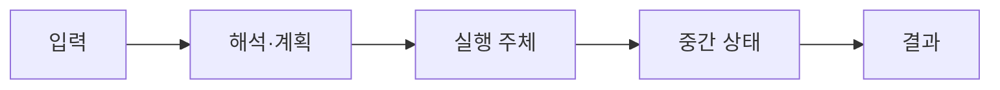

# 00. 데이터베이스와 쿼리 전체 지도

[이 책 목차](README.md) · [다음: 관계, SQL과 NULL](01-relations-sql-and-null.md)

데이터베이스는 표 파일 하나가 아니라 query를 받아 논리 의미를 해석하고, 물리 plan을 실행하고, page·log·lock·version을 관리하는 system이다. 이 장은 뒤의 세부 개념이 어디에 놓이는지 한 요청으로 연결한다.

이 장의 SQL, page 수와 출력은 교육용 단순화이며 실제 PostgreSQL에서 실행한 결과가 아니다.

## 1. 먼저 알아야 할 단어

| 용어 | 뜻과 실제 위치 |
| --- | --- |
| Database | 지속 data와 metadata를 관리하며 query·transaction·recovery 계약을 제공하는 system |
| DBMS | Database Management System의 약자이며 parser, optimizer, executor, storage, recovery component의 집합 |
| Query | 읽거나 바꿀 data를 선언하는 요청 |
| SQL | Structured Query Language의 약자이며 관계형 data 정의·질의 언어 |
| Schema | table, column, type, constraint 같은 논리 구조 |
| Catalog | schema와 통계, 권한을 저장하는 database 내부 metadata |
| Planner | 여러 실행 방법 중 cost가 낮다고 추정한 plan을 선택하는 주체 |
| Executor | 선택된 plan node를 실행해 row 또는 batch를 만드는 주체 |
| Storage engine | page, record, index, buffer, log와 device I/O를 관리하는 부분 |
| Transaction | 여러 read/write를 하나의 성공 또는 실패 단위로 묶는 경계 |

용어는 이름만 외우지 않고 어느 memory·file·catalog object에 존재하는지 연결한다.

## 2. 실제로 존재하는 객체

- Client process의 SQL text

- Server memory의 parse tree와 plan tree

- Catalog table의 schema와 statistics

- Buffer pool의 cached page

- Storage의 table/index data file

- WAL 또는 transaction log

- Client로 돌아가는 result rows

객체마다 owner와 lifetime이 다르므로 SQL text와 storage byte를 같은 대상으로 보지 않는다.

## 3. 입력에서 결과까지

1. Client가 SQL text와 parameter를 server connection으로 보낸다.

2. Parser가 token과 grammar를 검사해 syntax tree를 만든다.

3. Binder가 이름을 catalog object와 연결하고 type을 확인한다.

4. Rewriter가 view·rule 같은 논리 변환을 적용할 수 있다.

5. Optimizer가 scan·join order·algorithm 후보를 만든다.

6. Cost model이 row 수와 I/O·CPU 비용을 추정한다.

7. Executor가 root plan node에서 child node를 호출한다.

8. Storage engine이 buffer pool에서 page를 찾거나 device read를 요청한다.

9. Visibility와 predicate를 통과한 row가 operator 사이를 흐른다.

10. Result serializer가 row를 protocol message로 client에 보낸다.

## 4. 연결되는 숫자 예제

- orders 1,000,000 rows

- customer_id 조건 selectivity 0.1%

- 예상 결과 1,000 rows

- 한 page에 100 row라면 full scan 약 10,000 pages

- clustered index가 관련 20 pages를 찾는 교육 모형

숫자는 단위를 맞추고 어느 층의 추정값인지 표시해야 한다.

## 5. 왜 이 구조가 필요한가

논리 query와 물리 실행 방법은 다르다. 같은 SQL도 통계와 parameter에 따라 다른 plan을 얻을 수 있다.

Database file을 직접 읽으면 MVCC visibility, compression, checksum과 recovery 계약을 우회할 수 있다.

Memory cache hit는 storage I/O를 줄이지만 transaction correctness를 대신하지 않는다.

Replication은 backup과 다르다. 잘못된 DELETE도 replica에 복제될 수 있다.

Distributed query가 빨라지려면 network shuffle과 partition skew 비용을 포함해야 한다.

OLTP는 짧은 transaction과 point lookup이 많고 OLAP은 큰 scan·aggregation이 많지만 실제 workload는 섞일 수 있다.

## 6. 실행 중 관찰 질문

- 입력 row 수와 출력 row 수는 각각 얼마인가?

- Memory object와 durable file object는 무엇인가?

- 어느 component가 다음 상태를 만들었는가?

- 추정치와 실제 측정치를 섞지 않았는가?

- Failure 뒤 재시도하면 side effect가 중복되는가?

- Cache가 차가울 때와 따뜻할 때 결과가 달라지는가?

## 7. 흔한 오해와 반례

- 오해: SQL이 declarative이므로 실행 비용은 항상 같다.

- 오해: Index가 있으면 optimizer는 반드시 사용한다.

- 오해: COMMIT은 모든 table page를 즉시 disk에 쓴다.

- 오해: Replica가 있으면 point-in-time restore가 필요 없다.

- 오해: EXPLAIN ANALYZE는 data를 바꾸지 않는 관찰 명령이다.

반례는 구현이 틀렸다는 뜻보다 적용 조건이 빠졌음을 보여 준다.

## 8. 작은 설계 점검

1. Logical object와 physical object를 각각 적는다.

2. Read path와 write path를 따로 그린다.

3. Memory에서만 끝난 상태와 durable 상태를 구분한다.

4. Concurrent transaction 또는 worker가 끼어드는 지점을 찾는다.

5. Cost를 row, page, byte, network 단위로 손계산한다.

6. 공식 문서의 보장과 교육용 가정을 구분한다.

## 9. 문제

1. SQL에서 physical scan을 직접 지정하지 않아도 되는 이유는?

2. Result가 1,000 row이면 storage도 정확히 1,000 row만 읽는가?

3. COMMIT 성공 뒤 data page가 아직 dirty여도 가능한가?

## 10. 해설

1. Optimizer가 logical 요구를 여러 physical plan 후보로 바꾸고 cost를 비교하기 때문이다.

2. 아니다. Full scan은 1,000,000 row를 검사할 수 있고 index도 internal page와 false candidate를 읽을 수 있다.

3. 가능하다. WAL-first recovery system은 필요한 log durability로 commit을 보장하고 data page는 나중에 flush할 수 있다.

## 11. 공식 자료

- [PostgreSQL current documentation](https://www.postgresql.org/docs/current/)

- [CMU 15-445/645 Fall 2024](https://15445.courses.cs.cmu.edu/fall2024/syllabus.html)

다음 장에서는 이 장의 logical object가 더 구체적인 storage 또는 execution state로 바뀌는 과정을 이어서 본다.

## 보강: 한 SELECT가 지나가는 실제 객체

DBMS(Database Management System)는 SQL 문자열, 카탈로그 행, 실행 계획, 버퍼 프레임, 데이터 페이지, WAL 레코드를 서로 연결하는 서버 프로그램이다. `SELECT amount FROM orders WHERE id=42`를 받으면 parser가 문자열을 구문 트리로 만들고 binder가 카탈로그에서 `orders.id`의 타입과 이름을 확인한다. planner는 `orders_pkey` Index Scan 같은 연산자 트리를 만들며 executor가 그 트리를 실행한다. 버퍼 관리자는 인덱스와 heap page를 프레임에 올리고, 실행기는 가시성·필터를 통과한 `amount`를 결과 행으로 만든다. 이 구체적인 중간 객체가 없으면 “DB가 SQL을 처리한다”는 문장만으로 실패 위치를 찾을 수 없다.
