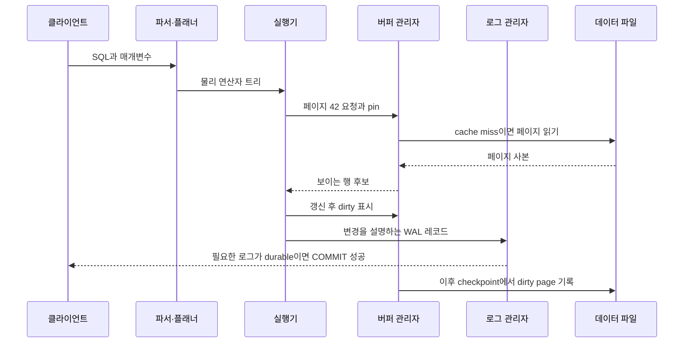
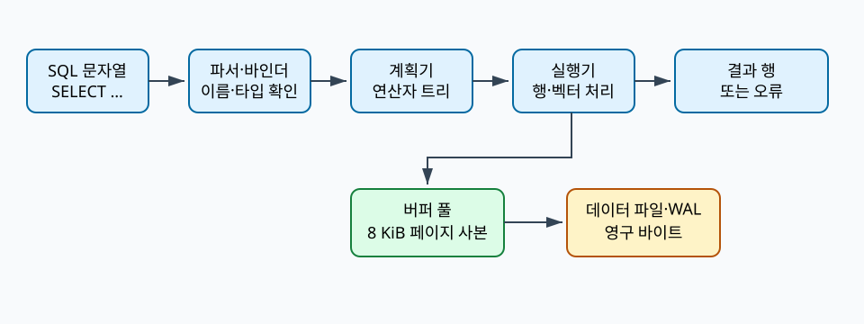

# 00. 데이터베이스와 쿼리 전체 지도

[이 책 목차](README.md) · [다음: 관계, SQL과 NULL](01-relations-sql-and-null.md)

데이터베이스는 표 파일 하나가 아니라 query를 받아 논리 의미를 해석하고, 물리 plan을 실행하고, page·log·lock·version을 관리하는 system이다. 이 장은 뒤의 세부 개념이 어디에 놓이는지 한 요청으로 연결한다.

이 장의 SQL, page 수와 출력은 교육용 단순화이며 실제 PostgreSQL에서 실행한 결과가 아니다.

## 한 요청을 여러 층으로 나누어 보는 이유

데이터베이스를 처음 배우면 SQL 문장과 디스크 파일을 곧바로 연결하기 쉽다. 그러나 둘 사이에는 여러 번역 단계가 있다. 사용자가 보내는 것은 문자열이고, 파서는 그 문자열을 문법 구조로 바꾼다. 바인더는 문자열 속 이름을 카탈로그의 실제 객체와 연결한다. 최적화기는 같은 논리 의미를 내는 여러 물리 연산자 조합을 비교한다. 실행기는 선택된 연산자를 열고 다음 행을 요구하며, 저장 엔진은 필요한 페이지를 메모리에 올린다. 마지막으로 동시 실행 제어가 지금 트랜잭션에 보이는 행 버전만 남긴다. 어느 단계가 잘못되었는지 알려면 각 단계의 입력과 출력을 따로 볼 수 있어야 한다.

**질의(query)**는 사용자가 원하는 결과를 표현한 요청이다. 질의 자체는 아직 어느 인덱스를 읽을지, 몇 개 스레드를 쓸지 정하지 않는다. **계획(plan)**은 이 논리 요청을 실제 연산자의 트리로 바꾼 메모리 객체다. 트리의 잎에는 테이블 스캔이나 인덱스 스캔이 있고, 그 위에는 필터·조인·집계·정렬이 놓인다. **연산자(operator)**는 입력 행을 받아 출력 행을 만드는 실행 단위다. `Filter`는 조건을 통과한 행만 내보내고, `Hash Join`은 한 입력으로 해시 테이블을 만든 뒤 다른 입력을 탐색한다. 실행기가 부모 연산자에서 자식 연산자로 `다음 행`을 요구하는 방식도 있고, 자식이 행 묶음을 부모에게 밀어 올리는 방식도 있다. 구현 방식이 달라도 연산자 사이의 행 수와 바이트 수를 추적한다는 원리는 같다.

**스키마(schema)**는 데이터가 따라야 할 논리 구조다. 테이블 이름, 열 이름, 자료형, 키와 제약 조건이 카탈로그에 기록된다. **자료형(type)**은 값의 가능한 표현과 허용 연산을 정한다. 정수 `42`와 문자열 `'42'`는 화면에 비슷하게 보여도 비교·정렬·저장 표현이 다르다. **키(key)**는 행을 식별하거나 다른 행과의 관계를 표현하는 논리 규칙이다. 키는 페이지의 바이트 오프셋이 아니므로 페이지 재배치 뒤에도 같은 업무 객체를 가리킨다.

## 객체의 위치와 생명주기

한 SELECT가 지나가는 동안 같은 정보를 서로 다른 형태로 여러 번 만든다.

| 시점 | 객체 | 위치 | 만드는 주체 | 언제 사라지는가 |
|---|---|---|---|---|
| 요청 수신 | SQL 문자열과 매개변수 | 클라이언트·서버 연결 버퍼 | 클라이언트와 프로토콜 계층 | 요청 처리가 끝날 때 |
| 구문 분석 | 구문 트리 | 서버 프로세스 메모리 | 파서 | 계획이 끝나거나 오류가 날 때 |
| 이름 결합 | 카탈로그 객체 식별자와 형 정보 | 구문 트리·카탈로그 캐시 | 바인더 | 문장 또는 준비된 계획 수명까지 |
| 최적화 | 논리·물리 계획 후보 | 최적화기 메모리 | 플래너와 비용 모형 | 후보 탈락 또는 계획 폐기 때 |
| 실행 | 연산자 상태, 해시 테이블, 정렬 run | 실행기 작업 메모리·임시 저장소 | 실행기 | 질의 종료 때 |
| 저장 접근 | 페이지 사본과 프레임 메타데이터 | 버퍼 풀 | 버퍼 관리자 | 교체될 때까지 |
| 복구 | 로그 레코드 | WAL 버퍼와 로그 파일 | 트랜잭션·로그 관리자 | 보존 정책이 허용할 때 |

카탈로그도 일반 데이터처럼 저장되지만 역할은 다르다. 바인더는 `orders`라는 글자를 보고 카탈로그에서 객체 식별자, 열 목록, 소유자와 권한을 찾는다. 최적화기는 카탈로그 통계에서 행 수와 값 분포를 읽는다. 통계는 실제 테이블의 축약된 관측치이므로 오래되면 결과의 의미는 맞아도 계획 선택이 나빠질 수 있다.

## 수치 예제 1: 점 조회가 결과 한 행을 만드는 과정

다음 질의를 보자.

```sql
SELECT amount
FROM orders
WHERE order_id = 42017 AND status = 'paid';
```

가정은 명시적으로 제한한다. `orders`에는 1,000,000개 행이 있고, 한 힙 페이지에 평균 100개 행이 있다. `order_id`는 고유 키이고 B-tree 인덱스 높이는 3이다. 루트 인덱스 페이지는 이미 버퍼 풀에 있고, 아래 인덱스 페이지 두 개와 힙 페이지 하나는 메모리에 없다고 하자.

1. 파서는 `SELECT`, 열 참조, 두 비교식, `AND`를 가진 구문 트리를 만든다.
2. 바인더는 `amount`, `order_id`, `status`가 `orders`의 열임을 찾고, `42017`을 정수형으로, `'paid'`를 상태 열과 비교 가능한 문자열로 확인한다.
3. 최적화기는 약 10,000개 힙 페이지를 읽는 순차 스캔과 인덱스 경로를 비교한다. 고유 키 동등 조건의 예상 결과는 한 행 이하이므로 인덱스 경로를 선택한다고 가정한다.
4. 실행기는 버퍼에 있는 루트에서 키 범위를 고른다. 이어지는 내부 페이지와 잎 페이지가 각각 cache miss라면 두 번 읽는다.
5. 잎 엔트리는 대상 힙 페이지와 슬롯을 가리킨다. 그 힙 페이지가 miss이므로 한 번 더 읽는다. 이 교육 모형의 저장소 읽기는 총 세 페이지다.
6. 슬롯이 가리킨 행 버전이 현재 트랜잭션 스냅샷에 보이는지 검사한다. 보이지 않는 예전 버전이면 같은 논리 행의 다른 버전을 따라갈 수 있다.
7. 보이는 행의 `status`가 `'paid'`인지 확인한다. TRUE이면 `amount` 한 값을 직렬화해 반환한다. 키가 존재해도 status가 다르면 결과는 0행이다.

“인덱스가 있으므로 한 행만 읽는다”는 설명은 부정확하다. 결과는 한 행이어도 인덱스 내부 페이지와 힙 페이지를 읽고, 가시성과 잔여 조건을 평가한다. 반대로 세 페이지가 모두 버퍼에 있으면 저장 장치 읽기는 0회지만 비교와 페이지 pin, 행 해석 비용은 남는다.

## 수치 예제 2: 집계가 페이지에서 결과로 줄어드는 과정

```sql
SELECT customer_id, SUM(amount) AS total
FROM orders
WHERE created_at >= DATE '2026-10-01'
GROUP BY customer_id
HAVING SUM(amount) >= 1000;
```

전체 1,000,000행 중 날짜 조건을 만족하는 행이 50,000개라고 가정한다. 날짜 인덱스가 관련 힙 페이지 800개를 가리키고, 가시성 검사 뒤 48,000개 행이 남는다. 취소된 예전 버전 2,000개는 인덱스 후보였지만 현재 스냅샷에는 보이지 않는다. `Filter` 출력 48,000행을 `Hash Aggregate`가 고객 4,000개의 그룹 상태로 줄인다. 각 그룹 상태가 키와 합계를 포함해 64바이트라면 핵심 상태만 약 `4,000 × 64 = 256,000바이트`다. 해시 테이블의 빈 슬롯과 관리 정보는 이 계산에 포함하지 않았다.

집계 뒤 `HAVING`을 통과한 고객이 320명이라면 최종 결과는 320행이다. 저장 엔진 후보 50,000행, 가시성 통과 48,000행, 집계 상태 4,000개, 최종 320행은 서로 다른 층의 수치다. 실행 계획의 어느 연산자에서 예상치와 실제치가 갈라졌는지 보려면 이 경계를 기록해야 한다. 작업 메모리가 부족해 그룹 상태가 임시 파일로 흘러가면 결과는 같아도 I/O 경로와 시간이 달라진다.

## 읽기, 쓰기, 커밋을 한 그림으로 연결하기



쓰기에서는 메모리의 페이지 사본이 데이터 파일보다 먼저 바뀔 수 있다. **dirty**는 이 차이가 존재한다는 표지다. WAL을 쓰는 시스템은 복구에 필요한 로그가 먼저 안전한 저장소에 도달하도록 순서를 지킨다. 그래서 COMMIT 성공과 모든 데이터 페이지의 즉시 기록은 같은 사건이 아니다. 장애 뒤에는 로그를 재생해 아직 데이터 파일에 반영되지 않은 변경을 복원할 수 있다. 구체적인 flush와 동기화 보장은 엔진 설정과 공식 문서에서 확인해야 한다.

## 관측값을 해석할 때 생기는 함정

- 계획의 `rows=1000`이 추정치인지 실제 출력인지 구분한다. 추정치는 통계와 비용 모형의 입력이고 실제치는 실행 뒤 관측이다.
- 버퍼 hit 비율이 높아도 느릴 수 있다. 잘못된 조인 순서로 너무 많은 행을 CPU에서 비교하거나, latch 경합과 잠금 대기가 클 수 있다.
- 저장 장치 읽기 수가 적어도 결과 전송량이 크면 네트워크와 직렬화가 병목이 된다.
- 준비된 계획은 매개변수 분포가 달라질 때 한쪽 값에 불리할 수 있다. 같은 SQL 문자라는 사실만으로 같은 최적 계획을 보장하지 않는다.
- `EXPLAIN ANALYZE`처럼 실제 실행을 동반하는 관찰은 쓰기 문장의 부작용을 일으킬 수 있다. 도구 이름이 아니라 실행 여부를 확인한다.

## 유도 문제 5개와 해설

### 문제 1

100만 행, 페이지당 100행인 테이블에서 결과가 10행이면 순차 스캔은 몇 페이지를 살필 수 있는가? 결과 행 수만으로 읽은 페이지 수를 알 수 있는가?

**해설:** 교육 모형의 전체 페이지는 `1,000,000 / 100 = 10,000`이다. 조건 열에 쓸 인덱스가 없거나 최적화기가 순차 스캔을 고르면 결과가 10행이어도 10,000페이지를 살필 수 있다. 결과 행 수는 마지막 연산자의 출력이며 저장 접근량이 아니다.

### 문제 2

인덱스 계획이 내부 페이지 2개, 잎 페이지 1개, 힙 페이지 10개를 요구한다. 모두 cache miss라면 최소 몇 페이지 읽기인가? 힙 페이지 10개만 세면 무엇을 빠뜨리는가?

**해설:** 단순 합은 `2 + 1 + 10 = 13페이지`다. 힙 페이지만 세면 키를 힙 위치로 바꾸기 위해 읽은 인덱스 구조를 빠뜨린다. 루트 캐시, read-ahead, 캐시 계층 때문에 실제 장치 요청 수는 달라질 수 있으므로 이 값은 논리 페이지 요구량이다.

### 문제 3

최적화기는 100행을 예상했지만 필터가 실제 100,000행을 냈다. 어떤 다음 연산자가 특히 위험하며 왜 그런가?

**해설:** 작은 입력을 가정해 선택한 중첩 반복 조인은 안쪽 탐색을 예상보다 훨씬 많이 반복할 수 있다. 정렬이나 해시 집계도 작업 메모리 예상을 넘겨 임시 저장소로 spill할 수 있다. 먼저 통계, 상관관계, 매개변수 분포와 연산자별 실제 행 수를 확인한다.

### 문제 4

COMMIT은 성공했지만 갱신한 데이터 페이지가 dirty 상태다. 모순인가?

**해설:** WAL 기반 설계에서는 모순이 아닐 수 있다. 커밋 판정에 필요한 로그가 durable하고 로그가 데이터 페이지보다 먼저 기록되었다면, 데이터 페이지는 나중에 flush해도 장애 복구 시 로그로 다시 적용할 수 있다. 엔진별 동기 커밋 설정은 별도로 확인한다.

### 문제 5

복제본 두 개가 모두 정상인데 사용자의 실수로 실행한 DELETE도 복제되었다. 왜 복제가 백업을 대신하지 못하는가?

**해설:** 복제는 현재 변경을 다른 노드에 전달해 가용성과 읽기 확장을 돕는다. 올바르지 않은 논리 변경도 정상 변경으로 전파된다. 과거 시점의 별도 보존본과 복구 절차가 있어야 삭제 전 상태로 돌아갈 수 있다.



## 1. 먼저 알아야 할 단어

| 용어 | 뜻과 실제 위치 |
| --- | --- |
| Database | 지속 data와 metadata를 관리하며 query·transaction·recovery 계약을 제공하는 system |
| DBMS | Database Management System의 약자이며 parser, optimizer, executor, storage, recovery component의 집합 |
| Query | 읽거나 바꿀 data를 선언하는 요청 |
| SQL | Structured Query Language의 약자이며 관계형 data 정의·질의 언어 |
| Schema | table, column, type, constraint 같은 논리 구조 |
| Catalog | schema와 통계, 권한을 저장하는 database 내부 metadata |
| Planner | 여러 실행 방법 중 cost가 낮다고 추정한 plan을 선택하는 주체 |
| Executor | 선택된 plan node를 실행해 row 또는 batch를 만드는 주체 |
| Storage engine | page, record, index, buffer, log와 device I/O를 관리하는 부분 |
| Transaction | 여러 read/write를 하나의 성공 또는 실패 단위로 묶는 경계 |

용어는 이름만 외우지 않고 어느 memory·file·catalog object에 존재하는지 연결한다.

## 2. 실제로 존재하는 객체

- Client process의 SQL text

- Server memory의 parse tree와 plan tree

- Catalog table의 schema와 statistics

- Buffer pool의 cached page

- Storage의 table/index data file

- WAL 또는 transaction log

- Client로 돌아가는 result rows

객체마다 owner와 lifetime이 다르므로 SQL text와 storage byte를 같은 대상으로 보지 않는다.

## 3. 입력에서 결과까지


1. Client가 SQL text와 parameter를 server connection으로 보낸다.

2. Parser가 token과 grammar를 검사해 syntax tree를 만든다.

3. Binder가 이름을 catalog object와 연결하고 type을 확인한다.

4. Rewriter가 view·rule 같은 논리 변환을 적용할 수 있다.

5. Optimizer가 scan·join order·algorithm 후보를 만든다.

6. Cost model이 row 수와 I/O·CPU 비용을 추정한다.

7. Executor가 root plan node에서 child node를 호출한다.

8. Storage engine이 buffer pool에서 page를 찾거나 device read를 요청한다.

9. Visibility와 predicate를 통과한 row가 operator 사이를 흐른다.

10. Result serializer가 row를 protocol message로 client에 보낸다.

## 4. 연결되는 숫자 예제

- orders 1,000,000 rows

- customer_id 조건 selectivity 0.1%

- 예상 결과 1,000 rows

- 한 page에 100 row라면 full scan 약 10,000 pages

- clustered index가 관련 20 pages를 찾는 교육 모형

숫자는 단위를 맞추고 어느 층의 추정값인지 표시해야 한다.

## 5. 왜 이 구조가 필요한가

논리 query와 물리 실행 방법은 다르다. 같은 SQL도 통계와 parameter에 따라 다른 plan을 얻을 수 있다.

Database file을 직접 읽으면 MVCC visibility, compression, checksum과 recovery 계약을 우회할 수 있다.

Memory cache hit는 storage I/O를 줄이지만 transaction correctness를 대신하지 않는다.

Replication은 backup과 다르다. 잘못된 DELETE도 replica에 복제될 수 있다.

Distributed query가 빨라지려면 network shuffle과 partition skew 비용을 포함해야 한다.

OLTP는 짧은 transaction과 point lookup이 많고 OLAP은 큰 scan·aggregation이 많지만 실제 workload는 섞일 수 있다.

## 6. 실행 중 관찰 질문

- 입력 row 수와 출력 row 수는 각각 얼마인가?

- Memory object와 durable file object는 무엇인가?

- 어느 component가 다음 상태를 만들었는가?

- 추정치와 실제 측정치를 섞지 않았는가?

- Failure 뒤 재시도하면 side effect가 중복되는가?

- Cache가 차가울 때와 따뜻할 때 결과가 달라지는가?

## 7. 흔한 오해와 반례

- 오해: SQL이 declarative이므로 실행 비용은 항상 같다.

- 오해: Index가 있으면 optimizer는 반드시 사용한다.

- 오해: COMMIT은 모든 table page를 즉시 disk에 쓴다.

- 오해: Replica가 있으면 point-in-time restore가 필요 없다.

- 오해: EXPLAIN ANALYZE는 data를 바꾸지 않는 관찰 명령이다.

반례는 구현이 틀렸다는 뜻보다 적용 조건이 빠졌음을 보여 준다.

## 8. 작은 설계 점검

1. Logical object와 physical object를 각각 적는다.

2. Read path와 write path를 따로 그린다.

3. Memory에서만 끝난 상태와 durable 상태를 구분한다.

4. Concurrent transaction 또는 worker가 끼어드는 지점을 찾는다.

5. Cost를 row, page, byte, network 단위로 손계산한다.

6. 공식 문서의 보장과 교육용 가정을 구분한다.

## 9. 문제

1. SQL에서 physical scan을 직접 지정하지 않아도 되는 이유는?

2. Result가 1,000 row이면 storage도 정확히 1,000 row만 읽는가?

3. COMMIT 성공 뒤 data page가 아직 dirty여도 가능한가?

## 10. 해설

1. Optimizer가 logical 요구를 여러 physical plan 후보로 바꾸고 cost를 비교하기 때문이다.

2. 아니다. Full scan은 1,000,000 row를 검사할 수 있고 index도 internal page와 false candidate를 읽을 수 있다.

3. 가능하다. WAL-first recovery system은 필요한 log durability로 commit을 보장하고 data page는 나중에 flush할 수 있다.

## 11. 공식 자료

- [PostgreSQL current documentation](https://www.postgresql.org/docs/current/)

- [CMU 15-445/645 Fall 2024](https://15445.courses.cs.cmu.edu/fall2024/syllabus.html)

다음 장에서는 이 장의 logical object가 더 구체적인 storage 또는 execution state로 바뀌는 과정을 이어서 본다.


## 보강: 한 SELECT가 지나가는 실제 객체


DBMS(Database Management System)는 SQL 문자열, 카탈로그 행, 실행 계획, 버퍼 프레임, 데이터 페이지, WAL 레코드를 서로 연결하는 서버 프로그램이다. `SELECT amount FROM orders WHERE id=42`를 받으면 parser가 문자열을 구문 트리로 만들고 binder가 카탈로그에서 `orders.id`의 타입과 이름을 확인한다. planner는 `orders_pkey` Index Scan 같은 연산자 트리를 만들며 executor가 그 트리를 실행한다. 버퍼 관리자는 인덱스와 heap page를 프레임에 올리고, 실행기는 가시성·필터를 통과한 `amount`를 결과 행으로 만든다. 이 구체적인 중간 객체가 없으면 “DB가 SQL을 처리한다”는 문장만으로 실패 위치를 찾을 수 없다.
