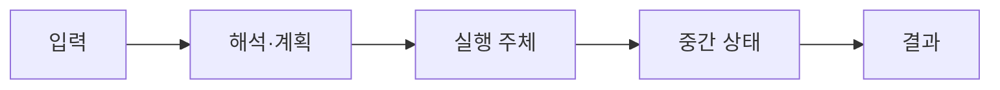

# 01. 관계, SQL과 NULL

[이 책 목차](README.md) · [이전: 전체 지도](00-database-and-query-map.md) · [다음: Page, record와 buffer pool](02-pages-records-and-buffer-pools.md)

관계형 model은 row를 단순 spreadsheet 줄로만 보지 않는다. Attribute domain, key, predicate와 set/bag semantics를 구분해야 SQL의 NULL, join, aggregate 결과를 예측할 수 있다.

이 장의 SQL, page 수와 출력은 교육용 단순화이며 실제 PostgreSQL에서 실행한 결과가 아니다.

## 관계, 테이블, 행을 같은 말처럼 쓰면 생기는 문제

**관계(relation)**는 이름 붙은 속성들로 이루어진 튜플의 집합이라는 논리 개념이다. 관계의 의미는 튜플이 어느 페이지에 놓였는지나 먼저 삽입되었는지에 의존하지 않는다. **테이블(table)**은 DBMS가 이 관계형 생각을 SQL 객체로 구현한 것이다. SQL 테이블은 같은 값을 가진 행을 여러 개 허용하는 bag 성질이 있고 NULL도 가지므로 순수한 수학적 관계와 완전히 같지는 않다. **행(row)**은 SQL 입력과 결과에서 보이는 한 값 묶음이고, 저장 장의 **레코드(record)**는 그 행 버전을 페이지에 인코딩한 바이트다. 한 행이 갱신되면 저장 엔진에는 여러 레코드 버전이 생길 수 있지만 질의는 스냅샷에 보이는 논리 행 하나를 반환할 수 있다.

**스키마(schema)**는 테이블, 열, 자료형, 키, 제약 조건의 정의다. 카탈로그에 저장되고 DDL을 처리하는 데이터베이스 엔진이 바꾼다. **자료형(type)**은 허용 값, 내부 표현, 비교와 연산 규칙을 묶는다. `INTEGER`의 덧셈과 `TEXT`의 이어 붙이기는 같은 바이트에 적용하는 임의 동작이 아니다. 바인더는 식의 입력형을 확인하고 필요한 형 변환 후보를 정한다. 변환이 암묵적이면 편리하지만 인덱스 열 쪽에 변환을 적용해 탐색 범위를 만들기 어려워지는 경우도 있으므로 실행 계획을 확인한다.

**키(key)**는 한 관계 안에서 튜플을 식별하는 속성 집합이다. 후보 키가 여러 개일 수 있고 그중 하나를 기본 키로 선택한다. 기본 키는 UNIQUE와 NOT NULL이라는 논리 계약을 갖지만 물리 주소가 아니다. DBMS는 보통 고유 인덱스로 검사를 돕지만 “키”와 “인덱스”는 다른 범주다. 외래 키는 자식 행의 값이 부모의 후보 키 값과 대응하도록 검사하는 제약이다. 외래 키가 있다고 조인이 자동으로 실행되거나 빨라지는 것은 아니다.

## NULL은 값이 아니라 부재를 표시하는 표지다

**NULL**은 정수 0, 빈 문자열, 문자열 `'NULL'`이 아니다. 열의 값이 알려지지 않았거나 적용되지 않음을 나타내는 SQL 표지다. SQL 비교는 두 값을 알아야 TRUE나 FALSE를 결정할 수 있다. 한쪽이 NULL이면 대부분의 일반 비교 결과는 **UNKNOWN**이 된다. UNKNOWN은 오류도 FALSE도 아닌 세 번째 논리 결과다. WHERE는 TRUE인 행만 통과시키므로 FALSE와 UNKNOWN은 둘 다 결과에서 제외되지만, `NOT`, `AND`, `OR` 안에서는 서로 다르게 전파된다.

### NOT 전체 표

| p | NOT p |
|---|---|
| TRUE | FALSE |
| FALSE | TRUE |
| UNKNOWN | UNKNOWN |

### AND 전체 표

| p AND q | TRUE | FALSE | UNKNOWN |
|---|---|---|---|
| TRUE | TRUE | FALSE | UNKNOWN |
| FALSE | FALSE | FALSE | FALSE |
| UNKNOWN | UNKNOWN | FALSE | UNKNOWN |

FALSE와 무엇을 AND해도 전체가 FALSE인 이유는 한 조건이 이미 전체 실패를 결정했기 때문이다. 반면 TRUE AND UNKNOWN은 나머지 값을 알 수 없어 UNKNOWN이다.

### OR 전체 표

| p OR q | TRUE | FALSE | UNKNOWN |
|---|---|---|---|
| TRUE | TRUE | TRUE | TRUE |
| FALSE | TRUE | FALSE | UNKNOWN |
| UNKNOWN | TRUE | UNKNOWN | UNKNOWN |

TRUE와 무엇을 OR해도 TRUE다. FALSE OR UNKNOWN은 알려지지 않은 쪽이 TRUE일 가능성이 남아 UNKNOWN이다. 이 표는 평가 순서나 단락 평가를 약속하는 표가 아니라 논리 결과 표다. 오류 가능 식의 실행 순서를 논리식 모양에만 의존해서는 안 된다.

## 수치 예제 1: NULL 조건을 행마다 끝까지 계산하기

다음 다섯 행을 사용한다.

| id | salary | bonus |
|---:|---:|---:|
| 1 | 100 | 10 |
| 2 | 120 | NULL |
| 3 | NULL | 20 |
| 4 | 80 | 0 |
| 5 | NULL | NULL |

질의가 다음과 같다고 하자.

```sql
SELECT id
FROM employees
WHERE salary >= 100 AND bonus <> 0;
```

| id | `salary >= 100` | `bonus <> 0` | AND 결과 | 반환 여부 |
|---:|---|---|---|---|
| 1 | TRUE | TRUE | TRUE | 반환 |
| 2 | TRUE | UNKNOWN | UNKNOWN | 제외 |
| 3 | UNKNOWN | TRUE | UNKNOWN | 제외 |
| 4 | FALSE | FALSE | FALSE | 제외 |
| 5 | UNKNOWN | UNKNOWN | UNKNOWN | 제외 |

`NOT (salary >= 100 AND bonus <> 0)`으로 바꾸면 id 4만 TRUE가 된다. UNKNOWN을 NOT해도 UNKNOWN이므로 2, 3, 5는 자동으로 포함되지 않는다. NULL 행까지 포함해 “조건을 만족하지 않는 모든 행”을 업무적으로 원한다면 어떤 NULL을 포함할지 `salary IS NULL OR bonus IS NULL OR NOT (...)`처럼 명시해야 한다.

집계도 NULL을 같은 방식으로 다루지 않는다. 위 표에서 `COUNT(*)=5`, `COUNT(salary)=3`, `COUNT(bonus)=3`이다. `SUM(salary)=300`, `AVG(salary)=300/3=100`이다. AVG의 분모는 전체 행 5가 아니라 NULL이 아닌 입력 3이다. 모든 입력이 NULL인 그룹에서 SUM과 AVG가 무엇을 반환하는지는 0으로 임의 치환하지 말고 SQL 엔진의 의미를 확인해 후속 `COALESCE` 여부를 정한다.

## 수치 예제 2: JOIN에서 NULL과 중복이 행 수를 바꾸는 과정

고객 테이블과 주문 테이블이 다음과 같다고 하자.

| customers.id | name |
|---:|---|
| 1 | 가람 |
| 2 | 누리 |
| 3 | 다온 |

| orders.id | customer_id | amount |
|---:|---:|---:|
| 10 | 1 | 50 |
| 11 | 1 | 70 |
| 12 | NULL | 40 |
| 13 | 4 | 90 |

```sql
SELECT c.id, o.id
FROM customers AS c
LEFT JOIN orders AS o ON c.id = o.customer_id;
```

`c.id=1`은 주문 두 행과 각각 일치해 두 결과 `(1,10)`, `(1,11)`을 만든다. 조인은 고객 한 행을 보존하는 단순 lookup이 아니라 일치 쌍을 모두 만든다. `c.id=2,3`은 일치가 없어 LEFT JOIN이 오른쪽 열을 NULL로 채운 `(2,NULL)`, `(3,NULL)`을 만든다. 주문 12의 비교 `c.id = NULL`은 UNKNOWN이므로 어느 고객과도 일치하지 않는다. 주문 13의 고객 4는 왼쪽에 없으므로 이 LEFT JOIN 결과에 나오지 않는다. 최종 결과는 네 행이다.

여기에 `WHERE o.amount >= 60`을 JOIN 뒤 적용하면 `(1,11)`만 남는다. 일치하지 않아 만든 오른쪽 NULL 행은 비교가 UNKNOWN이라 제거된다. 그래서 LEFT JOIN이 결과상 INNER JOIN처럼 보인다. 오른쪽 행을 거르는 동시에 왼쪽 미일치 행을 보존하려면 조건을 `ON c.id=o.customer_id AND o.amount>=60`에 둘 때의 의미를 검토해야 한다. ON과 WHERE의 위치는 문법 꾸밈이 아니라 행 생성 전후의 서로 다른 단계다.

## NOT IN의 NULL 반례를 전개하기

`blocked_ids`가 `{2, NULL}`일 때 `id NOT IN (2, NULL)`은 `NOT (id=2 OR id=NULL)`과 같은 논리로 이해할 수 있다. `id=1`이면 `FALSE OR UNKNOWN = UNKNOWN`, 여기에 NOT을 적용해도 UNKNOWN이어서 WHERE를 통과하지 못한다. `id=2`이면 `TRUE OR UNKNOWN = TRUE`, NOT은 FALSE다. 결국 어떤 id도 반환되지 않을 수 있다.

NULL을 제외한 목록이라는 계약이 확실하지 않다면 상관 `NOT EXISTS`로 존재 여부를 표현하거나 하위 질의에서 NULL을 명시적으로 제거한다. 다만 둘의 의미가 항상 자동으로 같다고 치환하지 말고 중복, 상관 조건, NULL 가능성을 함께 검토한다.

## 선언한 제약이 쓰기 생명주기를 바꾸는 방식

INSERT를 받으면 파서는 값 목록을 만들고 바인더는 대상 열과 자료형을 맞춘다. 기본값과 생성 열을 계산한 뒤 NOT NULL, CHECK, 고유성과 외래 키를 검사한다. 고유 키 검사는 현재 트랜잭션만의 메모리 집합을 보는 일이 아니다. 다른 트랜잭션이 삽입 중인 키와 충돌할 수 있어 인덱스와 동시 실행 규칙이 개입한다. 외래 키 검사도 부모 행의 존재와 동시 삭제를 함께 다뤄야 한다. 검사가 끝난 행 버전은 페이지에 기록되고 변경은 WAL에 설명된다. 트랜잭션이 중단되면 논리적으로 보이지 않게 되어야 한다.

CHECK에서 식 결과가 UNKNOWN일 때의 허용 규칙은 WHERE가 UNKNOWN을 제거하는 규칙과 같다고 추측하면 안 된다. 제약 종류마다 SQL 표준과 제품 의미를 확인한다. `CHECK (salary > 0)`만 두고 NULL도 금지하려 했다면 NOT NULL을 별도로 선언하는 이유가 여기에 있다.

## 유도 문제 5개와 해설

### 문제 1

`WHERE x <> 5 OR x = 5`는 모든 행을 반환하는가?

**해설:** x가 일반 값이면 둘 중 하나가 TRUE다. x가 NULL이면 두 비교가 모두 UNKNOWN이고 `UNKNOWN OR UNKNOWN = UNKNOWN`이다. WHERE는 그 행을 제외한다. NULL까지 포함하려면 업무 의미에 맞춰 `x IS NULL`을 더한다.

### 문제 2

값이 `{10, 20, NULL, 30, NULL}`일 때 `COUNT(*)`, `COUNT(x)`, `SUM(x)`, `AVG(x)`를 구하라.

**해설:** 행은 5개이므로 COUNT(*)는 5다. 값이 있는 행은 3개라 COUNT(x)는 3이다. SUM은 60이고 AVG는 `60/3=20`이다. NULL을 0으로 넣어 `60/5`를 계산하는 것은 다른 업무 규칙이다.

### 문제 3

기본 키가 있으면 테이블이 언제나 키 순서로 저장되는가?

**해설:** 아니다. 기본 키는 식별과 유일성의 논리 제약이다. 이를 돕는 인덱스가 별도 구조로 존재할 수 있지만 힙의 레코드 배치는 삽입, 갱신, 정리로 달라진다. 결과 순서가 필요하면 ORDER BY를 선언한다.

### 문제 4

왼쪽 행 3개 중 첫 행이 오른쪽 두 행과 일치하고 나머지는 일치하지 않는다. LEFT JOIN 결과는 몇 행인가?

**해설:** 첫 행에서 일치 쌍 두 개가 나오고, 미일치 왼쪽 행마다 NULL 확장 행 하나씩 나온다. 따라서 `2+1+1=4행`이다. 조인 결과 수를 왼쪽 행 수와 같다고 가정하면 중복 일치를 놓친다.

### 문제 5

`CHECK (price > 0)`만으로 NULL price를 금지했다고 결론 내릴 수 있는가?

**해설:** 그렇게 결론 내리면 안 된다. 비교 결과가 UNKNOWN인 경우의 CHECK 허용 의미를 확인해야 하고, 값 부재 자체를 금지하려면 NOT NULL을 명시한다. WHERE의 UNKNOWN 제거 규칙을 모든 SQL 문맥에 그대로 복사하지 않는다.

## 1. 먼저 알아야 할 단어

| 용어 | 뜻과 실제 위치 |
| --- | --- |
| Relation | 같은 attribute 구조를 가진 tuple 집합이라는 수학적 개념 |
| Table | DBMS가 relation을 구현하는 SQL object이며 duplicate row를 허용할 수 있음 |
| Tuple | Relation의 한 값 묶음이며 SQL에서는 row라고 부름 |
| Attribute | Tuple의 이름 있는 성분이며 SQL column에 대응 |
| Domain | Attribute가 가질 수 있는 값의 종류와 제약 |
| Primary key | Row identity를 나타내도록 선택한 unique·not-null key |
| Foreign key | 다른 table key를 참조하는 integrity constraint |
| NULL | 값이 없거나 알려지지 않았음을 나타내는 SQL marker |
| Predicate | Row가 조건을 만족하는지 계산하는 식 |
| Three-valued logic | SQL 조건 결과가 TRUE, FALSE, UNKNOWN인 논리 |

용어는 이름만 외우지 않고 어느 memory·file·catalog object에 존재하는지 연결한다.

## 2. 실제로 존재하는 객체

- Catalog의 table/column/type definition

- Table storage의 row version

- Unique index와 constraint metadata

- Query parse tree의 expression

- Executor filter node의 TRUE/FALSE/UNKNOWN 결과

객체마다 owner와 lifetime이 다르므로 SQL text와 storage byte를 같은 대상으로 보지 않는다.

## 3. 입력에서 결과까지



1. DDL이 table 이름, column type와 constraint를 catalog에 만든다.

2. INSERT input이 type conversion과 constraint 검사를 받는다.

3. Row가 storage record로 encode된다.

4. SELECT parser가 column reference와 predicate를 만든다.

5. Binder가 column을 table attribute에 연결한다.

6. Executor가 row마다 predicate를 평가한다.

7. WHERE는 TRUE인 row만 통과시킨다.

8. ORDER BY가 필요하면 정렬 순서를 만든다.

9. Projection이 요청 column을 result row로 만든다.

10. Protocol serializer가 NULL marker와 값을 client로 보낸다.

## 4. 연결되는 숫자 예제

- employees 5 rows

- salary values: 100, 120, NULL, 80, NULL

- COUNT(*) = 5

- COUNT(salary) = 3

- AVG(salary) = (100+120+80)/3 = 100

숫자는 단위를 맞추고 어느 층의 추정값인지 표시해야 한다.

## 5. 왜 이 구조가 필요한가

SQL table은 duplicate row를 허용하는 bag semantics가 기본인 경우가 많다. DISTINCT가 중복 제거 작업을 추가한다.

NULL은 0이나 빈 문자열이 아니다. `salary = NULL`은 TRUE가 아니라 UNKNOWN이므로 `IS NULL`을 사용한다.

`NOT IN` subquery에 NULL이 있으면 비교가 UNKNOWN이 되어 예상과 다른 빈 결과가 나올 수 있다.

Primary key는 logical identity이고 physical row address가 아니다. Update·vacuum·rewrite로 위치가 바뀔 수 있다.

Foreign key는 참조 무결성을 돕지만 distributed service 사이 business consistency를 자동 해결하지 않는다.

Collation은 text 비교·정렬 규칙이며 byte order와 같지 않을 수 있다.

## 6. 실행 중 관찰 질문

- 입력 row 수와 출력 row 수는 각각 얼마인가?

- Memory object와 durable file object는 무엇인가?

- 어느 component가 다음 상태를 만들었는가?

- 추정치와 실제 측정치를 섞지 않았는가?

- Failure 뒤 재시도하면 side effect가 중복되는가?

- Cache가 차가울 때와 따뜻할 때 결과가 달라지는가?

## 7. 흔한 오해와 반례

- 오해: Relation과 physical file은 같은 object다.

- 오해: NULL은 모든 비교에서 다른 값보다 작다.

- 오해: COUNT(column)은 row 수와 항상 같다.

- 오해: Primary key 순서대로 table file이 저장된다.

- 오해: Foreign key가 있으면 join이 자동으로 빠르다.

반례는 구현이 틀렸다는 뜻보다 적용 조건이 빠졌음을 보여 준다.

## 8. 작은 설계 점검

1. Logical object와 physical object를 각각 적는다.

2. Read path와 write path를 따로 그린다.

3. Memory에서만 끝난 상태와 durable 상태를 구분한다.

4. Concurrent transaction 또는 worker가 끼어드는 지점을 찾는다.

5. Cost를 row, page, byte, network 단위로 손계산한다.

6. 공식 문서의 보장과 교육용 가정을 구분한다.

## 9. 문제

1. `WHERE x <> 5`가 NULL row를 반환하는가?

2. 5개 row 중 column 값 두 개가 NULL이면 COUNT(*)와 COUNT(column)은?

3. Primary key와 index는 같은 개념인가?

## 10. 해설

1. 아니다. NULL과 5의 비교는 UNKNOWN이며 WHERE는 TRUE만 통과시킨다.

2. 각각 5와 3이다.

3. 아니다. Key는 logical constraint이고 index는 이를 구현하거나 query를 빠르게 할 수 있는 physical structure다.

## 11. 공식 자료

- [PostgreSQL current documentation](https://www.postgresql.org/docs/current/)

- [CMU 15-445/645 Fall 2024](https://15445.courses.cs.cmu.edu/fall2024/syllabus.html)

다음 장에서는 이 장의 logical object가 더 구체적인 storage 또는 execution state로 바뀌는 과정을 이어서 본다.


## 보강: 논리 행과 저장 레코드를 구별하기

Relation은 같은 속성 구조를 가진 tuple의 집합이라는 논리 모델이다. SQL table은 이름, column type, constraint를 가진 데이터베이스 객체이며 내부 저장 순서 자체가 관계의 의미는 아니다. Row는 질의 결과의 논리 행이고 record는 페이지 안의 바이트 표현이다. `ORDER BY`가 없다면 물리 레코드 순서가 결과 순서를 보장하지 않는다.

NULL은 0이나 빈 문자열이 아니라 “알 수 없거나 적용되지 않는 값” 표지다. `NULL = NULL`은 TRUE가 아니라 UNKNOWN이고 WHERE는 TRUE인 행만 남긴다. 따라서 `discount <> 0`도 NULL discount 행을 남기지 않는다. 포함하려면 `discount IS NULL OR discount <> 0`처럼 업무 의미를 명시해야 한다.
