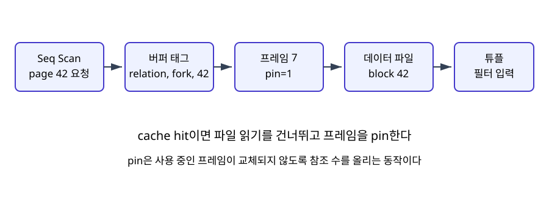

# 02. Page, record와 buffer pool

[이 책 목차](README.md) · [이전: 관계, SQL과 NULL](01-relations-sql-and-null.md) · [다음: B-tree와 LSM index](03-btree-and-lsm-indexes.md)

DBMS는 row마다 device I/O를 요청하지 않고 고정 크기 page를 읽고 쓴다. Record layout, page header, free space, buffer frame과 dirty state를 알면 scan 비용과 WAL·checkpoint를 연결할 수 있다.

이 장의 SQL, page 수와 출력은 교육용 단순화이며 실제 PostgreSQL에서 실행한 결과가 아니다.

## 1. 먼저 알아야 할 단어

| 용어 | 뜻과 실제 위치 |
| --- | --- |
| Page | Storage와 memory 사이 I/O·관리의 고정 크기 block |
| Record | 한 row version을 byte로 encode한 저장 단위 |
| Slot | Page 안 record 위치를 간접 참조하는 entry |
| Slotted page | Header와 slot array로 variable-length record를 관리하는 page 형식 |
| Buffer pool | Disk page를 memory frame에 cache하는 DBMS 영역 |
| Frame | Buffer pool에서 page 하나가 들어가는 memory slot |
| Page ID | Database file과 page number를 식별하는 logical address |
| Pin count | Executor가 frame을 사용 중이어서 eviction하면 안 되는 횟수 |
| Dirty | Memory page가 storage copy보다 새로워 flush가 필요함 |
| Eviction | 새 page 공간을 위해 victim frame을 재사용하는 과정 |

용어는 이름만 외우지 않고 어느 memory·file·catalog object에 존재하는지 연결한다.

## 2. 실제로 존재하는 객체

- Data file의 page 42

- Page header의 slot count와 free-space pointer

- Slot 7이 가리키는 record offset

- Buffer table의 pageID→frame mapping

- Frame metadata의 pin/dirty/reference bit

- Storage device의 durable page image

객체마다 owner와 lifetime이 다르므로 SQL text와 storage byte를 같은 대상으로 보지 않는다.

## 3. 입력에서 결과까지

1. Executor가 page ID 42의 record를 요청한다.

2. Buffer manager가 page table에서 42를 찾는다.

3. Hit이면 frame pin count를 올린다.

4. Miss이면 free frame 또는 victim을 고른다.

5. Dirty victim이면 WAL rule과 flush 상태를 확인하고 page write를 수행한다.

6. Storage manager가 page 42를 frame에 읽는다.

7. Checksum과 page header를 검증할 수 있다.

8. Executor가 slot array로 record offset을 찾는다.

9. Update는 record와 page를 바꾸고 frame을 dirty로 표시한다.

10. 사용이 끝나면 unpin하고 나중에 checkpoint/background writer가 flush할 수 있다.

## 4. 연결되는 숫자 예제

- page size 8KiB = 8192 bytes

- header 128 bytes

- slot entry 4 bytes × 100 = 400 bytes

- record 평균 72 bytes × 100 = 7200 bytes

- 남는 공간 = 8192-128-400-7200 = 464 bytes

숫자는 단위를 맞추고 어느 층의 추정값인지 표시해야 한다.

## 5. 왜 이 구조가 필요한가

Page size는 DBMS·table space에 따라 다르므로 8KiB는 이 장의 교육 모형이다.

Variable-length record는 page 안에서 이동해도 slot number를 유지할 수 있어 indirect reference가 유용하다.

Buffer pool hit는 storage read를 피하지만 CPU filter와 visibility 검사는 남는다.

Pin과 lock은 다르다. Pin은 frame lifetime, lock은 concurrency 의미를 다룬다.

OS page cache와 DBMS buffer pool이 동시에 존재하면 double caching을 고려해야 한다.

Dirty page를 flush했다고 transaction commit이 되는 것이 아니며 WAL durability와 transaction state가 별도다.

## 6. 실행 중 관찰 질문

- 입력 row 수와 출력 row 수는 각각 얼마인가?

- Memory object와 durable file object는 무엇인가?

- 어느 component가 다음 상태를 만들었는가?

- 추정치와 실제 측정치를 섞지 않았는가?

- Failure 뒤 재시도하면 side effect가 중복되는가?

- Cache가 차가울 때와 따뜻할 때 결과가 달라지는가?

## 7. 흔한 오해와 반례

- 오해: Page는 SQL row 하나와 같다.

- 오해: Buffer hit이면 query cost가 0이다.

- 오해: Dirty frame은 즉시 device에 기록된다.

- 오해: Pin count가 0이면 반드시 eviction된다.

- 오해: Record address는 영구 business key다.

반례는 구현이 틀렸다는 뜻보다 적용 조건이 빠졌음을 보여 준다.

## 8. 작은 설계 점검

1. Logical object와 physical object를 각각 적는다.

2. Read path와 write path를 따로 그린다.

3. Memory에서만 끝난 상태와 durable 상태를 구분한다.

4. Concurrent transaction 또는 worker가 끼어드는 지점을 찾는다.

5. Cost를 row, page, byte, network 단위로 손계산한다.

6. 공식 문서의 보장과 교육용 가정을 구분한다.

## 9. 문제

1. 8KiB page에 header 128B, slot 4B, record 72B라면 100개 뒤 여유는?

2. Pin count와 row lock의 차이는?

3. Commit 때 모든 dirty page를 flush해야 하는가?

## 10. 해설

1. 8192-128-400-7200=464B다.

2. Pin은 memory frame 재사용 방지이고 row lock은 concurrent transaction 충돌을 제어한다.

3. WAL 기반 system에서는 관련 WAL durability가 먼저 보장되면 data page는 이후 flush할 수 있다.

## 11. 공식 자료

- [PostgreSQL current documentation](https://www.postgresql.org/docs/current/)

- [CMU 15-445/645 Fall 2024](https://15445.courses.cs.cmu.edu/fall2024/syllabus.html)

다음 장에서는 이 장의 logical object가 더 구체적인 storage 또는 execution state로 바뀌는 과정을 이어서 본다.

## 보강: page 42 cache miss의 실제 경로

Page는 저장 엔진이 파일과 메모리 사이에서 옮기는 고정 크기 블록이고 record는 그 안의 행 표현이다. executor가 page 42를 요구하면 buffer manager는 `(relation file, fork, block 42)` 같은 buffer tag로 hash table을 조회한다. miss이면 교체 가능한 frame 7을 고르고 파일 block 42를 읽는다. frame을 pin한다는 말은 “이 요청이 사용하는 동안 교체하지 말라”는 참조를 잡는다는 뜻이다. 필터가 레코드를 처리한 뒤 pin을 놓지만, page 사본은 재사용을 위해 버퍼 풀에 남을 수 있다.
