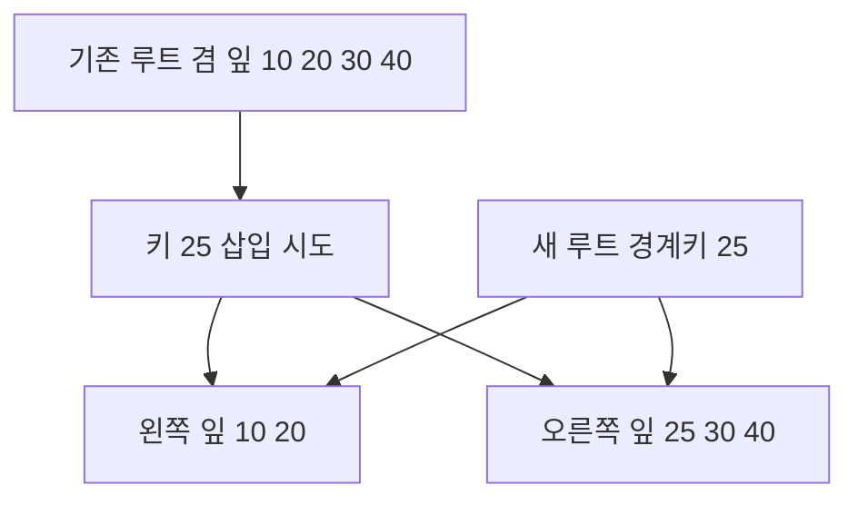

# 03. B-tree와 LSM index

[이 책 목차](README.md) · [이전: Page, record와 buffer pool](02-pages-records-and-buffer-pools.md) · [다음: Scan, filter와 join](04-scans-filters-and-joins.md)

Index는 table의 모든 row를 읽지 않고 candidate를 찾는 physical structure다. B-tree는 정렬된 page tree를, LSM(Log-Structured Merge) tree는 memory write와 immutable run·compaction을 사용한다.

이 장의 SQL, page 수와 출력은 교육용 단순화이며 실제 PostgreSQL에서 실행한 결과가 아니다.

## B-tree의 객체와 한 키 탐색

**키(key)**는 정렬과 비교에 쓰는 값이고, **포인터(pointer)**는 다음 페이지나 테이블 레코드 위치를 가리키는 식별자다. 루트·내부·잎 노드는 버퍼 풀에 올라올 때는 프레임 속 페이지이고, 저장될 때는 인덱스 파일의 페이지다. 실행기가 검색 키를 만들고 버퍼 관리자가 페이지를 가져오며, B-tree 접근 메서드가 페이지 안 separator key를 비교한다. **fan-out**은 내부 페이지 한 개가 가리킬 수 있는 자식 수다. 이진 트리처럼 두 자식만 두지 않고 한 페이지에 많은 키와 포인터를 넣어 저장 장치 접근 단계 수를 낮춘다.

fan-out 200, 잎 엔트리 1,000,000개, 잎당 200개라면 잎은 5,000페이지다. 그 위 내부 페이지는 `ceil(5000/200)=25`, 루트는 25개 자식을 한 페이지에서 가리킬 수 있다. 키 42017 검색은 `루트 1 → 내부 1 → 잎 1`의 세 페이지 경로다. 잎 엔트리가 `(heap page 812, slot 4)`를 가리키면 힙 페이지를 추가로 읽고 MVCC 가시성을 검사한다. covering index가 필요한 값을 모두 담고 가시성 조건까지 만족할 때만 힙 접근을 줄일 수 있다.

## 삽입, split, 새 루트

잎 한 페이지가 키 `[10,20,30,40]` 네 개로 가득 찼고 최대 네 엔트리라고 하자. 25를 넣으면 정렬 상태 `[10,20,25,30,40]`를 임시로 만든 뒤 `[10,20]`과 `[25,30,40]` 두 잎으로 나눈다. 부모에는 새 오른쪽 잎의 경계 키 25와 포인터를 삽입한다. 부모도 가득 차면 부모 split이 위로 전파된다. 기존 루트까지 갈라지면 새 루트가 두 자식을 가리키며 높이가 1 증가한다. split 도중 다른 검색이 절반만 갱신된 구조를 보지 않도록 latch, 로그, 페이지 상태 전이가 함께 필요하다.

## LSM 쓰기와 읽기의 전 상태

LSM의 **memtable**은 메모리의 변경 가능한 정렬 구조이고 **SSTable**은 한 번 완성되면 제자리 수정하지 않는 정렬 파일이다. 쓰기 `k=7,v=A`는 먼저 WAL에 복구 정보를 남기고 memtable에 들어간다. memtable이 한도에 도달하면 immutable memtable로 전환되어 새 쓰기를 받지 않고, 백그라운드 작업이 이를 SSTable F3로 순차 기록한다. flush가 안전하게 끝나면 해당 memtable과 불필요해진 WAL 범위를 회수할 수 있다.

조회 시점에 memtable에 `k=7,v=C`, L0 F5에 `k=7,v=B`, L1 F2에 `k=7,v=A`가 있으면 최신 순서와 sequence 정보를 비교해 C를 반환한다. 삭제는 곧바로 옛 파일의 A와 B를 지우지 않고 tombstone을 새 run에 기록할 수 있다. compaction은 겹치는 F5와 F2를 읽어 새 파일을 만들고, 더 오래된 버전이 어떤 스냅샷에도 필요 없을 때 제거한다.

**쓰기 증폭**은 사용자 1바이트를 쓰기 위해 WAL·flush·compaction으로 실제 더 많은 바이트를 쓰는 비율이다. 100MB 입력이 WAL 100MB, flush 100MB, 두 번의 compaction에서 200MB와 300MB를 쓰면 단순 쓰기량은 700MB, 증폭은 7배다. **읽기 증폭**은 한 조회가 확인해야 하는 memtable·run·data block 수이고, **공간 증폭**은 최신 논리 데이터보다 실제 파일이 더 차지하는 비율이다. compaction을 세게 하면 읽기와 공간은 줄 수 있지만 백그라운드 I/O와 tail latency가 늘어난다.

### 반례와 문제 5개

1. fan-out 200, 잎 40,000페이지면 내부 페이지는 최소 몇 개인가? **해설:** `ceil(40000/200)=200`, 루트 한 페이지가 이를 가리킬 수 있어 루트→내부→잎 세 단계 모형이다.
2. Bloom filter가 positive면 키가 존재하는가? **해설:** false positive가 있어 후보 SSTable의 인덱스와 block을 확인해야 한다. negative만 “이 파일에는 없음”으로 건너뛰는 데 쓴다.
3. 잎 split 뒤 부모 갱신이 필요한 이유는? **해설:** 새 오른쪽 페이지로 갈 검색 경계를 부모가 알아야 한다. 그렇지 않으면 페이지는 존재해도 탐색 경로가 없다.
4. LSM write가 항상 한 번의 순차 쓰기인가? **해설:** WAL, flush, 반복 compaction이 같은 논리 값을 여러 번 기록할 수 있다.
5. 인덱스가 늘면 읽기만 좋아지는가? **해설:** 각 INSERT·키 UPDATE가 모든 관련 인덱스의 페이지나 run, WAL을 갱신하므로 쓰기·공간·복구 비용도 증가한다.

## 1. 먼저 알아야 할 단어

| 용어 | 뜻과 실제 위치 |
| --- | --- |
| Index | Search key에서 row location 또는 value로 가는 보조 structure |
| B-tree | 높이가 균형인 multi-way search tree |
| Root page | B-tree 탐색이 시작되는 최상위 page |
| Internal page | Key range와 child pointer를 저장하는 page |
| Leaf page | 정렬된 key와 row reference/value를 저장하는 page |
| Fan-out | Internal node 하나가 가리킬 수 있는 child 수 |
| LSM tree | Write를 memory와 sequential file로 모아 나중에 merge하는 structure |
| Memtable | LSM의 mutable in-memory sorted structure |
| SSTable | Sorted String Table의 약자로 immutable sorted file |
| Compaction | 여러 sorted run을 merge하며 오래된 version을 정리하는 작업 |

용어는 이름만 외우지 않고 어느 memory·file·catalog object에 존재하는지 연결한다.

## 2. 실제로 존재하는 객체

- Catalog의 index definition

- B-tree root/internal/leaf pages

- Leaf entry의 key와 row identifier

- LSM memtable와 WAL

- Level별 SSTable files

- Bloom filter와 sparse index metadata

- Compaction output file와 obsolete input

객체마다 owner와 lifetime이 다르므로 SQL text와 storage byte를 같은 대상으로 보지 않는다.

## 3. 입력에서 결과까지

1. Query predicate에서 searchable key를 만든다.

2. Planner가 index condition과 expected selectivity를 계산한다.

3. B-tree는 root에서 key range를 비교한다.

4. Internal child pointer를 따라 leaf에 도달한다.

5. Leaf에서 matching entry range를 순회한다.

6. Row reference로 table page를 읽거나 covering value를 사용한다.

7. LSM write는 WAL 뒤 memtable에 들어간다.

8. Memtable이 차면 immutable 상태를 거쳐 SSTable로 flush된다.

9. Read는 memtable과 후보 SSTable을 확인한다.

10. Compaction이 overlapping run을 merge하고 obsolete version을 제거한다.

## 4. 연결되는 숫자 예제

- B-tree fan-out 200

- 1,000,000 leaf entries

- leaf pages 5,000이라고 가정

- level 1 internal pages 25

- root 1 page이면 root→internal→leaf 약 3 page path

숫자는 단위를 맞추고 어느 층의 추정값인지 표시해야 한다.

## 5. 왜 이 구조가 필요한가

B-tree의 B는 binary가 아니다. 한 page에 많은 key와 child를 담아 fan-out을 높인다.

Range scan은 leaf 정렬과 sibling traversal을 이용하지만 random table lookup이 많으면 heap access가 비쌀 수 있다.

LSM은 write amplification, read amplification, space amplification 사이 trade-off가 있다.

Bloom filter는 key가 없을 가능성을 빠르게 알려 주지만 false positive가 있어 실제 file 확인이 남는다.

Compaction은 background 작업이지만 CPU·I/O와 tail latency를 사용한다.

Index가 많으면 read 후보는 늘지만 INSERT/UPDATE와 storage 비용도 늘어난다.

## 6. 실행 중 관찰 질문

- 입력 row 수와 출력 row 수는 각각 얼마인가?

- Memory object와 durable file object는 무엇인가?

- 어느 component가 다음 상태를 만들었는가?

- 추정치와 실제 측정치를 섞지 않았는가?

- Failure 뒤 재시도하면 side effect가 중복되는가?

- Cache가 차가울 때와 따뜻할 때 결과가 달라지는가?

## 7. 흔한 오해와 반례

- 오해: B-tree는 항상 세 level이다.

- 오해: Index lookup은 table page를 절대 읽지 않는다.

- 오해: LSM은 write가 항상 한 번만 device에 기록된다.

- 오해: Bloom filter가 true면 key가 반드시 있다.

- 오해: Index column 순서는 WHERE에 적은 순서와 무관하다.

반례는 구현이 틀렸다는 뜻보다 적용 조건이 빠졌음을 보여 준다.

## 8. 작은 설계 점검

1. Logical object와 physical object를 각각 적는다.

2. Read path와 write path를 따로 그린다.

3. Memory에서만 끝난 상태와 durable 상태를 구분한다.

4. Concurrent transaction 또는 worker가 끼어드는 지점을 찾는다.

5. Cost를 row, page, byte, network 단위로 손계산한다.

6. 공식 문서의 보장과 교육용 가정을 구분한다.

## 9. 문제

1. Fan-out 200인 B-tree가 낮은 높이를 갖는 이유는?

2. Bloom filter가 positive면 key 존재를 확정하는가?

3. Index를 추가하면 write가 느려질 수 있는 이유는?

## 10. 해설

1. 한 internal page가 많은 child를 가리켜 entry 수가 커져도 level 증가가 느리기 때문이다.

2. 아니다. False positive가 가능해 SSTable index/data 확인이 필요하다.

3. Table 변경마다 index entry와 WAL·page 또는 LSM run도 갱신해야 하기 때문이다.

## 11. 공식 자료

- [PostgreSQL current documentation](https://www.postgresql.org/docs/current/)

- [CMU 15-445/645 Fall 2024](https://15445.courses.cs.cmu.edu/fall2024/syllabus.html)

다음 장에서는 이 장의 logical object가 더 구체적인 storage 또는 execution state로 바뀌는 과정을 이어서 본다.

## 보강: 같은 키 조회가 만드는 서로 다른 중간 상태

B-tree 조회는 root page의 separator key를 비교해 child page 번호를 고르고 leaf page에서 key와 row pointer를 찾는다. LSM-tree 조회는 먼저 mutable memtable, immutable memtable, 여러 SSTable의 key range와 Bloom filter를 확인한다. SSTable은 정렬되어 한번 기록된 뒤 제자리 변경하지 않는 파일이다. Bloom filter의 “없음”은 파일 읽기를 건너뛸 수 있는 강한 답이지만 “있을 수 있음”은 실제 key 존재를 보장하지 않는다. Compaction은 겹치는 SSTable을 읽어 새 정렬 파일로 병합하므로 읽기 증폭을 줄이는 대신 배경 I/O와 쓰기 증폭을 만든다.
