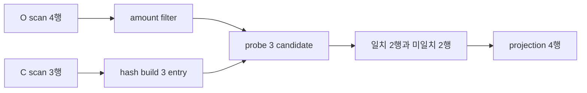

# 04. Scan, filter와 join

[이 책 목차](README.md) · [이전: B-tree와 LSM index](03-btree-and-lsm-indexes.md) · [다음: Query planning과 cost](05-query-planning-and-costs.md)

Executor는 plan node를 iterator 또는 batch pipeline으로 실행한다. Scan은 input row를 만들고 filter는 predicate를 적용하며 join은 두 input의 관련 row를 결합한다.

이 장의 숫자와 출력은 교육용이며 실제 PostgreSQL 실행 결과가 아니다.

## 연산자는 행을 어디서 받아 어디에 두는가

**scan**은 저장 페이지나 인덱스에서 현재 스냅샷에 보이는 행 후보를 생산한다. **filter**는 각 행의 조건식을 TRUE/FALSE/UNKNOWN으로 계산해 TRUE만 통과시킨다. **projection**은 필요한 열이나 계산식만 출력한다. projection을 일찍 하면 넓은 payload를 버려 메모리와 복사량을 줄일 수 있지만, 나중 연산자에 필요한 열까지 제거하면 안 된다. 연산자의 상태는 실행기 메모리에 있고, scan cursor·hash table·sort run은 질의가 끝나면 해제된다. spill 파일은 메모리 예산을 넘을 때 만든 임시 저장 객체다.

고객 C가 `(1,가람),(2,누리),(3,다온)`이고 주문 O가 `(10,1,50),(11,1,70),(12,2,40),(13,NULL,90)`이라고 하자. 질의는 `C LEFT JOIN O ON C.id=O.customer_id AND O.amount>=50`다. scan은 C 3행과 O 4행을 만든다. O 쪽 filter 결과는 주문 10 TRUE, 11 TRUE, 12 FALSE, 13은 amount만 보면 TRUE지만 join key 비교가 UNKNOWN이다. 최종 쌍은 `(1,10),(1,11),(2,NULL),(3,NULL)` 네 행이다. 같은 `O.amount>=50`을 WHERE에 두면 NULL 확장 행의 비교가 UNKNOWN이 되어 `(1,10),(1,11)`만 남는다.

## 세 조인의 실제 중간 상태

Nested loop는 바깥 C의 각 행마다 안쪽 O를 탐색한다. 인덱스가 없으면 `3×4=12` key 비교 후 네 결과를 만든다. O.customer_id 인덱스 탐색이 평균 세 페이지면 후보 접근은 약 `3×3=9페이지`지만 캐시와 힙 접근은 별도다.

Hash join은 작은 C를 build side로 골라 bucket을 만든다. 단순 `hash(id) mod 4`라면 bucket 1에 C1, bucket 2에 C2, bucket 3에 C3가 놓인다. O10 key1과 O11 key1은 같은 C1을 각각 찾아 두 결과를 만든다. O12 key2는 ON의 amount 조건 때문에 버리고, O13의 NULL은 일반 등가 조인에서 match하지 않는다. probe가 끝난 뒤 미일치 C2,C3를 NULL 확장한다. 메모리가 두 고객만 담을 수 있으면 partition을 임시 파일에 쓰고 다시 읽는 spill이 필요하다.

Sort-merge join은 두 입력을 join key로 정렬한 뒤 포인터를 전진한다. C의 key1 한 행과 O의 key1 두 행을 만나면 중복 그룹의 곱 `1×2=2`를 출력해야 한다. 양쪽에 key1이 각각 3행과 4행이면 그 키 하나에서 12행이 나온다. “조인 출력은 큰 입력 이하”라는 주장은 중복 때문에 깨진다. NULL의 정렬 위치가 정해져 있어도 `NULL=NULL`이 TRUE가 되는 것은 아니다.

### 반례와 문제 5개

1. 1,000×100 full nested loop 비교 수는? **해설:** 안쪽 전체를 매번 보면 100,000쌍이다. 결과 수와 비교 수는 다르다.
2. filter가 1,000행을 100행으로 줄이면 join 전에 적용할 이점은? **해설:** 의미가 보존되는 위치라면 probe나 비교 입력이 10분의 1이 된다. outer join에서는 위치 이동이 NULL 확장 의미를 바꿀 수 있다.
3. build 10만행, 행당 64B면 payload만 얼마인가? **해설:** 6.4MB이며 bucket·포인터·정렬 오버헤드는 별도라 실제 메모리는 더 크다.
4. hash join이 equality가 아닌 `a.x < b.x`에 그대로 적합한가? **해설:** 등가 key bucket 조회가 핵심이므로 일반 부등 조건에는 다른 알고리즘이나 잔여 필터가 필요하다.
5. spill은 틀린 결과인가? **해설:** 올바른 partition과 재읽기를 하면 결과는 같지만 임시 쓰기·읽기와 지연이 추가된다.

## 1. 단어와 실제 위치

| 용어 | 뜻 |
| --- | --- |
| Sequential scan | Table page 전체를 순서대로 읽는 operator |
| Index scan | Index condition으로 row candidate를 찾는 operator |
| Predicate pushdown | Filter를 data source 가까이 이동하는 최적화 |
| Projection | 필요 column만 선택하는 operation |
| Nested-loop join | Outer row마다 inner input을 탐색하는 join |
| Hash join | 한 input으로 hash table을 만들고 다른 input을 probe하는 join |
| Merge join | 두 정렬 input을 key 순서로 함께 전진하는 join |
| Build side | Hash table을 만드는 join input |
| Probe side | Hash key로 build table을 조회하는 input |
| Spill | Memory가 부족해 temporary storage를 사용하는 상태 |

## 2. 관련 객체

- Plan tree의 scan/filter/join node

- Table·index page와 visible row version

- Executor memory의 hash table

- Sort run과 temporary file

- Join key expression과 NULL semantics

## 3. 입력→주체→중간 상태→결과

1. Root node가 child에 다음 row 또는 batch를 요청한다.

2. Scan node가 page를 buffer pool에서 얻는다.

3. Visibility check가 현재 snapshot에 보이는 version을 고른다.

4. Filter가 predicate TRUE인 row만 통과시킨다.

5. Projection이 사용하지 않는 column을 제거할 수 있다.

6. Join build input이 hash table 또는 sorted stream을 만든다.

7. Probe input row가 matching key를 찾는다.

8. Join type에 따라 unmatched row를 보존하거나 버린다.

9. Aggregation·sort 같은 parent가 joined row를 소비한다.

10. Root가 result를 client format으로 직렬화한다.

## 4. 숫자로 연결하기

- orders 1,000 rows, customers 100 rows

- nested loop full comparison = 100,000 pairs

- hash build 100 + probe 1,000 ≈ 1,100 row operations

- selectivity 10% filter 뒤 orders 100 rows

- pushdown 뒤 join candidate가 100×100으로 감소 가능

## 5. 왜 필요한가와 조건

Sequential scan은 모든 page가 필요하거나 table이 작으면 index보다 효율적일 수 있다.

Hash join은 equality join에 적합하지만 build side가 memory를 넘으면 partition과 spill 비용이 생긴다.

Merge join은 정렬 input이면 유리하지만 sort 비용을 포함해야 한다.

Outer join에서 filter를 잘못 push하면 NULL-extended row를 제거해 의미가 바뀔 수 있다.

Join order는 intermediate row 수를 크게 바꾼다.

Vectorized engine은 row 하나 대신 batch를 전달해 function call과 branch 비용을 줄인다.

## 6. 실행 계획 또는 상태를 읽는 질문

- Input과 output cardinality는 얼마인가?

- Memory budget을 넘으면 spill·wait·abort 중 무엇이 일어나는가?

- Snapshot 또는 transaction 경계는 어디인가?

- Cache와 storage 상태가 달라도 correctness가 유지되는가?

- Error가 client까지 전달되는가?

## 7. 오해와 반례

- Sequential scan은 언제나 느리다.

- Hash join은 index가 있으면 사용되지 않는다.

- WHERE filter는 어느 위치로 옮겨도 의미가 같다.

- Join output row 수는 두 input 중 큰 쪽 이하이다.

- Spill은 query correctness 실패다.

## 8. 교육용 실험 설계

1. 고정된 작은 input을 적는다.

2. 예상 intermediate state를 표로 만든다.

3. 한 조건만 바꾼다.

4. 추정과 실제 관찰을 분리한다.

5. Side effect가 있는 명령은 실행 여부를 명시한다.

6. Version과 configuration을 기록한다.

## 9. 문제

1. 1000×100 nested loop 비교 수는?

2. Left outer join 뒤 right column filter를 WHERE로 옮길 때 위험은?

3. Hash join build side를 작게 고르는 이유는?

## 10. 해설

1. Inner를 매번 전부 보면 100,000 pair다.

2. NULL-extended unmatched row가 제거되어 inner join처럼 바뀔 수 있다.

3. Hash table memory와 spill 가능성을 줄이기 위해서다.

## 11. 공식 자료

- [공식 문서](https://www.postgresql.org/docs/current/using-explain.html)

- [CMU 15-445/645 Fall 2024](https://15445.courses.cs.cmu.edu/fall2024/syllabus.html)

다음 장에서는 이 상태가 concurrency, recovery 또는 analytical execution과 만나는 경계를 이어서 본다.

## 보강: 연산자마다 소유하는 상태

Scan은 페이지나 인덱스에서 행을 생산하는 연산자이고 Filter는 각 입력 행의 조건식을 계산한다. Hash Join의 build operator는 작은 입력의 key와 payload를 메모리 hash table에 넣고, probe operator는 다른 입력 key의 bucket을 찾는다. 메모리 한도를 넘으면 partition을 임시 파일로 내리는 spill이 생겨 추가 쓰기와 다시 읽기가 필요하다. Nested Loop가 `outer 100 × inner index lookup 3 page`라면 약 300 page 접근 후보이지만, 인덱스 없는 `100 × 100,000` 비교라면 1천만 비교다. 이름이 아니라 입력 크기, 인덱스, 메모리로 비용이 달라진다.
