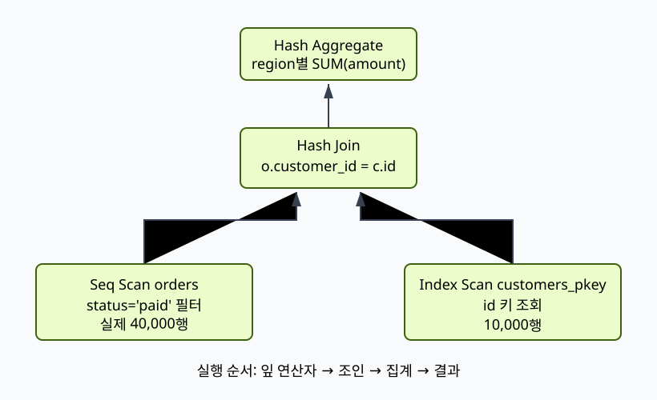

# 05. Query planning과 cost

[이 책 목차](README.md) · [이전: Scan, filter와 join](04-scans-filters-and-joins.md) · [다음: Transaction과 ACID](06-transactions-and-acid.md)

Planner는 SQL 결과가 같은 여러 physical plan을 열거하고 통계와 cost parameter로 비교한다. Cost는 wall-clock millisecond가 아니라 plan을 상대 비교하기 위한 추정 단위다.

이 장의 숫자와 출력은 교육용이며 실제 PostgreSQL 실행 결과가 아니다.

## 1. 단어와 실제 위치

| 용어 | 뜻 |
| --- | --- |
| Parse tree | SQL grammar 구조를 표현한 tree |
| Logical plan | 무엇을 계산할지 표현한 relational operator tree |
| Physical plan | 구체 scan·join·sort algorithm을 고른 tree |
| Cardinality | Operator가 만들 것으로 예상한 row 수 |
| Selectivity | Input 중 predicate를 통과할 비율 |
| Statistics | Row 수, distinct count, 분포를 요약한 catalog data |
| Startup cost | 첫 row 전까지 드는 추정 비용 |
| Total cost | 모든 row를 만들 때의 추정 비용 |
| Plan node | Executor가 수행할 한 physical operation |
| EXPLAIN | Planner가 만든 plan과 추정치를 보여 주는 PostgreSQL command |

## 2. 관련 객체

- SQL text와 bound expression

- Catalog statistics

- Candidate join order와 access path

- Chosen plan tree

- EXPLAIN estimated rows/cost/width

- ANALYZE 실행 시 actual rows/loops/time

## 3. 입력→주체→중간 상태→결과

1. Parser와 binder가 valid query tree를 만든다.

2. Rewrite가 view 등을 base relation으로 바꿀 수 있다.

3. Planner가 가능한 scan path를 만든다.

4. Join graph에서 허용 join order를 탐색한다.

5. 각 path의 cardinality를 통계로 추정한다.

6. I/O·CPU·startup·total cost를 계산한다.

7. Required ordering과 LIMIT을 반영한다.

8. 가장 낮다고 추정한 plan을 선택한다.

9. Executor가 plan node를 실제 수행한다.

10. EXPLAIN ANALYZE이면 실제 실행 통계를 plan에 붙인다.

## 4. 숫자로 연결하기

- table rows 1,000,000

- predicate true rows 실제 100,000 = 10%

- 통계 추정 1,000 = 0.1%

- nested loop inner lookup 100,000회 가능

- estimate error 100배가 join 선택을 바꿀 수 있음

## 5. 왜 필요한가와 조건

Cost 100은 100ms라는 뜻이 아니다.

Estimated rows가 틀리면 좋은 algorithm도 잘못된 input 크기에서 느려질 수 있다.

Multi-column correlation을 독립으로 가정하면 selectivity를 크게 틀릴 수 있다.

LIMIT은 total cost보다 startup cost가 작은 plan을 선호하게 할 수 있다.

Prepared statement는 parameter별 custom plan과 generic plan trade-off가 있다.

EXPLAIN ANALYZE는 statement를 실제 실행하므로 write statement의 side effect가 발생한다.

## 6. 실행 계획 또는 상태를 읽는 질문

- Input과 output cardinality는 얼마인가?

- Memory budget을 넘으면 spill·wait·abort 중 무엇이 일어나는가?

- Snapshot 또는 transaction 경계는 어디인가?

- Cache와 storage 상태가 달라도 correctness가 유지되는가?

- Error가 client까지 전달되는가?

## 7. 오해와 반례

- EXPLAIN은 query를 실행해 실제 시간을 보여 준다.

- EXPLAIN ANALYZE는 SELECT 외 statement도 안전한 read-only다.

- Actual time은 network 전송까지 모두 포함한다.

- Cost가 낮은 plan은 모든 cache 상태에서 빠르다.

- Index 존재만으로 index scan cost가 낮다.

## 8. 교육용 실험 설계

1. 고정된 작은 input을 적는다.

2. 예상 intermediate state를 표로 만든다.

3. 한 조건만 바꾼다.

4. 추정과 실제 관찰을 분리한다.

5. Side effect가 있는 명령은 실행 여부를 명시한다.

6. Version과 configuration을 기록한다.

## 9. 문제

1. Estimate 1,000, actual 100,000이면 몇 배 error인가?

2. EXPLAIN과 EXPLAIN ANALYZE 차이는?

3. ANALYZE write statement를 다룰 때 주의점은?

## 10. 해설

1. Actual/estimate=100으로 100배 underestimate다.

2. 전자는 plan 추정, 후자는 statement를 실제 실행해 actual 통계를 더한다.

3. 실제 side effect가 일어나므로 격리·transaction rollback 가능성과 sequence 등 비transactional 효과를 검토한다.

## 11. 공식 자료

- [공식 문서](https://www.postgresql.org/docs/current/sql-explain.html)

- [CMU 15-445/645 Fall 2024](https://15445.courses.cs.cmu.edu/fall2024/syllabus.html)

다음 장에서는 이 상태가 concurrency, recovery 또는 analytical execution과 만나는 경계를 이어서 본다.

## 보강: 계획 트리를 아래에서 위로 읽기

Planner는 SQL과 catalog statistics를 입력으로 여러 operator tree를 만들고 cost model로 후보를 비교한다. Cardinality는 여기서 연산자가 낼 행 수이며 selectivity는 입력 중 통과 비율이다. 100만 행에 선택도 0.01이면 예상 출력은 10,000행이다. 실제가 400,000행이면 40배 오차이며 그 뒤 Hash Join의 build side와 메모리 예상도 틀어진다. EXPLAIN의 cost와 rows는 추정이고, EXPLAIN ANALYZE는 쿼리를 실제 실행해 actual rows와 loops를 더한다. 쓰기 SQL의 부작용도 실제 발생할 수 있다.
