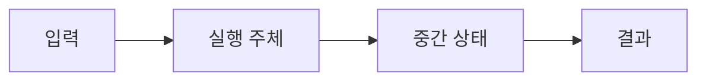

# 06. Transaction과 ACID

[이 책 목차](README.md) · [이전: Query planning과 cost](05-query-planning-and-costs.md) · [다음: MVCC와 snapshot visibility](07-mvcc-and-snapshot-visibility.md)

Transaction은 여러 operation을 하나의 논리 단위로 묶는다. ACID는 구현 component 이름이 아니라 failure와 concurrency 속에서 application이 기대하는 네 성질을 설명하는 약어다.

이 장의 숫자와 출력은 교육용이며 실제 PostgreSQL 실행 결과가 아니다.

## ACID가 보호하는 범위

**원자성(atomicity)**은 한 트랜잭션의 데이터베이스 변경이 모두 커밋되거나 모두 중단되는 성질이다. 이메일·결제 API·일반 파일까지 자동으로 되돌리는 뜻은 아니다. **일관성(consistency)**은 선언한 제약과 업무 불변식을 유효한 상태 사이에서 유지하는 목표다. DBMS가 아는 UNIQUE·CHECK와 애플리케이션만 아는 “일일 한도”를 구분한다. **격리성(isolation)**은 동시 트랜잭션이 중간 상태를 관찰하고 서로 영향을 주는 범위를 제한한다. **지속성(durability)**은 성공 응답 뒤 어떤 장애까지 결과가 남는지에 대한 계약이며 로컬 WAL, 동기 replica, 백업 완료는 서로 다른 범위다.

autocommit에서는 SQL 문장 하나가 암묵적 트랜잭션 경계가 된다. `UPDATE A`와 `UPDATE B`를 두 번 보내면 각각 따로 커밋될 수 있어 송금 원자 단위가 아니다. 명시적 `BEGIN` 뒤 두 UPDATE와 검증을 수행하고 COMMIT해야 하나의 경계가 된다. savepoint는 같은 트랜잭션 안의 되돌림 지점이며 독립적으로 durable한 하위 커밋이 아니다.

초기 A=500, B=300에서 100을 옮기자. t1에 BEGIN, t2에 A의 보이는 버전을 400으로 만들고 WAL LSN 51, t3에 B를 400으로 만들고 LSN 52, t4에 합계 800을 검증, t5에 commit record LSN 53을 만든다. LSN 53까지 요구 수준으로 durable해진 뒤 성공 응답을 보낸다. t3 전에 오류면 두 변경을 모두 보이지 않게 중단한다. t5 뒤 데이터 페이지가 아직 옛 값이어도 WAL로 redo할 수 있다.

| 시점 | A/B 논리 상태 | WAL | 클라이언트 판단 |
|---|---|---|---|
| 시작 | 500/300 | 없음 | 미결정 |
| A 차감 | 400/300 미커밋 | 51 | 성공 아님 |
| B 입금 | 400/400 미커밋 | 52 | 성공 아님 |
| commit durable | 400/400 커밋 | 53 durable | 성공 가능 |

비동기 커밋 옵션은 응답 지연을 줄이는 대신 어떤 전원·프로세스 장애에서 최근 성공 응답을 잃을 수 있는지 계약을 바꿀 수 있다. 이름만 보고 지속성이 없다고 단정하거나 완전하다고 단정하지 말고 공식 설정의 flush 범위를 확인한다. 동기 replica ACK도 “어느 replica가 receive/write/flush/replay 중 어디까지 했는가”에 따라 의미가 다르다.

DB 트랜잭션 안에서 주문 행을 넣고 곧바로 이메일 API를 호출한 뒤 DB가 abort하면 이메일은 이미 나갔다. 반대로 commit 후 프로세스가 죽어 이메일 호출을 못 할 수도 있다. outbox는 보낼 사건을 주문과 같은 DB 트랜잭션에 기록하고 별도 전달자가 재시도한다. 전달은 중복될 수 있으므로 소비자는 idempotency key로 같은 사건을 한 번의 업무 효과로 처리해야 한다.

### 문제 5개

1. 두 autocommit UPDATE가 송금 원자성을 주는가? **해설:** 각 문장이 별도 커밋이면 첫 성공 뒤 둘째 실패가 가능하므로 아니다.
2. CHECK가 모든 consistency를 보장하는가? **해설:** 선언한 행·참조 규칙만 검사한다. 여러 서비스의 업무 규칙은 별도 경계가 필요하다.
3. COMMIT ACK 뒤 dirty page가 가능한가? **해설:** WAL 기반이면 필요한 로그가 먼저 durable할 때 데이터 페이지는 나중에 flush할 수 있다.
4. async commit의 대가는? **해설:** 응답 지연과 특정 장애에서의 최근 트랜잭션 손실 가능성을 교환한다. 범위는 설정 계약을 확인한다.
5. serialization error 뒤 COMMIT만 다시 보내는가? **해설:** 이전 읽기와 판단이 무효일 수 있어 전체 트랜잭션을 새 snapshot에서 재시도한다.

## 1. 단어와 실제 위치

| 용어 | 뜻 |
| --- | --- |
| Atomicity | Transaction change가 전부 commit되거나 전부 abort되는 성질 |
| Consistency | 정의한 invariant를 한 valid state에서 다른 valid state로 유지하는 목표 |
| Isolation | Concurrent transaction의 중간 간섭을 제한하는 성질 |
| Durability | Commit 성공을 알린 결과가 정해진 failure 뒤에도 남는 성질 |
| BEGIN | Transaction 경계를 시작하는 SQL command |
| COMMIT | Transaction 성공을 요청하고 결과를 확정하는 command |
| ROLLBACK | Transaction 변경을 취소하는 command |
| Constraint | DBMS가 검사하는 key, check, reference 규칙 |
| Invariant | Application이 항상 참이어야 한다고 정의한 business rule |
| Savepoint | Transaction 일부까지 되돌릴 수 있는 내부 지점 |

## 2. 관련 객체

- Session의 current transaction state

- Transaction ID와 snapshot

- Modified row version

- Lock와 predicate dependency

- WAL records와 commit record

- Client에게 보낸 commit acknowledgment

## 3. 입력→주체→중간 상태→결과

1. Client가 BEGIN으로 transaction context를 만든다.

2. 첫 query가 snapshot 또는 command snapshot을 얻는다.

3. Read가 visible row version을 선택한다.

4. Write가 새 version과 WAL record를 만든다.

5. Constraint와 lock이 conflict를 검사한다.

6. Error가 나면 transaction은 abort-only 상태가 될 수 있다.

7. COMMIT이 필요한 WAL durability를 기다린다.

8. Commit state가 다른 transaction에 visible해진다.

9. Dirty data page는 background flush될 수 있다.

10. Client는 commit success 뒤 external side effect를 조정한다.

## 4. 숫자로 연결하기

- account A=500, B=300

- transfer 100이면 A=400, B=400

- A 차감 뒤 crash하더라도 recovery는 둘 다 commit 또는 둘 다 abort

- total invariant 800

- external email은 DB rollback으로 취소되지 않음

## 5. 왜 필요한가와 조건

Atomicity는 external API와 file write를 자동 묶지 않는다.

Consistency의 business rule은 schema constraint나 application transaction으로 명시해야 한다.

Isolation level이 낮으면 각 statement는 valid해도 transaction 사이 anomaly가 생길 수 있다.

Durability 범위는 single node disk, synchronous replica 등 system contract에 따라 다르다.

COMMIT이 모든 data page flush를 뜻하지 않는 WAL system이 흔하다.

Long transaction은 old version 정리와 lock lifetime에 비용을 준다.

## 6. 실행 계획 또는 상태를 읽는 질문

- Input과 output cardinality는 얼마인가?

- Memory budget을 넘으면 spill·wait·abort 중 무엇이 일어나는가?

- Snapshot 또는 transaction 경계는 어디인가?

- Cache와 storage 상태가 달라도 correctness가 유지되는가?

- Error가 client까지 전달되는가?

## 7. 오해와 반례

- ACID의 consistency가 replica consistency와 같은 말이다.

- ROLLBACK은 이미 보낸 email도 취소한다.

- COMMIT은 모든 replica와 backup 완료를 뜻한다.

- Savepoint는 별도 durable transaction이다.

- Constraint가 있으면 모든 business invariant가 자동 표현된다.

## 8. 교육용 실험 설계

1. 고정된 작은 input을 적는다.

2. 예상 intermediate state를 표로 만든다.

3. 한 조건만 바꾼다.

4. 추정과 실제 관찰을 분리한다.

5. Side effect가 있는 명령은 실행 여부를 명시한다.

6. Version과 configuration을 기록한다.

## 9. 문제

1. A에서 B로 100을 옮길 때 atomicity가 필요한 이유는?

2. Database rollback이 HTTP side effect를 취소하는가?

3. Commit과 page flush가 분리될 수 있는 이유는?

## 10. 해설

1. 차감과 입금 중 하나만 남아 total invariant가 깨지는 것을 막기 위해서다.

2. 아니다. Outbox, idempotency 또는 distributed protocol이 필요하다.

3. WAL을 먼저 durable하게 해 recovery가 data page를 재구성할 수 있기 때문이다.

## 11. 공식 자료

- [공식 문서](https://www.postgresql.org/docs/current/tutorial-transactions.html)

- [CMU 15-445/645 Fall 2024](https://15445.courses.cs.cmu.edu/fall2024/syllabus.html)

다음 장에서는 이 상태가 concurrency, recovery 또는 analytical execution과 만나는 경계를 이어서 본다.

## 보강: ACID를 상태 전이로 읽기

Transaction은 함께 확정하거나 함께 취소할 읽기·쓰기 묶음이다. 송금에서 backend가 A의 row version을 100→70으로 만들고 B를 50→80으로 만든 뒤 commit record를 WAL에 내구화한다. Atomicity는 둘 중 하나만 최종 상태에 남지 않게 하고, Consistency는 잔액 합계·제약 같은 업무 불변식을 유효한 상태 사이에서 지키게 한다. Isolation은 겹친 트랜잭션이 허용된 중간 상태만 보게 하고, Durability는 성공 응답 뒤 crash가 나도 복구 가능한 기록을 남긴다. ACID는 “오류가 절대 없다”는 마법이 아니라 애플리케이션 규칙, 동시성 제어, WAL 복구가 나누어 제공하는 계약이다.
