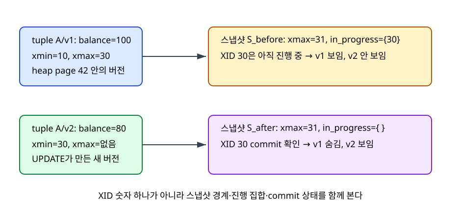
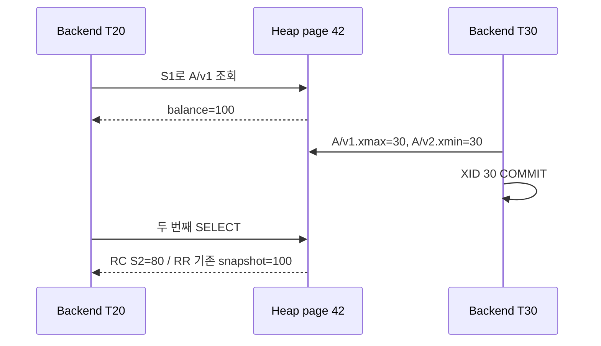

# 07. MVCC와 snapshot visibility

[이 책 목차](README.md) · [이전: Transaction과 ACID](06-transactions-and-acid.md) · [다음: Isolation과 concurrency](08-isolation-and-concurrency.md)

MVCC(Multi-Version Concurrency Control)는 row의 여러 version과 snapshot을 사용해 reader와 writer의 불필요한 blocking을 줄인다. Snapshot은 table 복사본이 아니라 어느 transaction version이 보이는지 판단하는 기준이다.

이 장의 숫자와 출력은 교육용이며 실제 PostgreSQL 실행 결과가 아니다.

## 1. 단어와 실제 위치

| 용어 | 뜻 |
| --- | --- |
| MVCC | Multi-Version Concurrency Control, 여러 row version으로 동시성을 제어하는 방식 |
| Row version | 한 logical row의 특정 transaction 시점 값 |
| Transaction ID | Transaction을 식별하고 visibility 순서를 판단하는 값 |
| Snapshot | 보이는 committed transaction 범위를 표현한 metadata |
| Visible | 현재 snapshot 규칙에서 읽을 수 있는 version |
| Dead tuple | 더 이상 어떤 필요한 snapshot에도 보이지 않아 정리 가능한 version |
| Vacuum | 오래된 version과 관련 space를 정리·재사용 가능하게 하는 작업 |
| HOT update | 일부 PostgreSQL update에서 index 갱신을 줄이는 최적화 |
| xmin/xmax | PostgreSQL tuple 생성·삭제 transaction 정보를 설명할 때 쓰는 개념 |
| Visibility check | Snapshot과 version metadata로 row를 반환할지 결정하는 검사 |

## 2. 관련 객체

- Heap page의 old/new tuple version

- Tuple header의 transaction metadata

- Backend memory의 snapshot

- Index entry가 가리키는 heap tuple

- Vacuum이 계산한 cleanup horizon

## 3. 입력→주체→중간 상태→결과

1. T1 snapshot이 현재 committed 범위를 기록한다.

2. T1이 logical row의 old version을 읽는다.

3. T2가 같은 row를 update해 new version을 만든다.

4. T2 commit record가 durable해진다.

5. T1은 isolation snapshot에 따라 old version을 계속 볼 수 있다.

6. 새 command 또는 transaction T3는 new version을 볼 수 있다.

7. Index는 candidate tuple을 찾아도 visibility를 heap에서 확인할 수 있다.

8. 오래된 snapshot이 사라지면 old version이 dead가 된다.

9. Vacuum이 dead space를 재사용 가능하게 한다.

10. Long snapshot은 cleanup horizon을 오래 붙잡을 수 있다.

## 4. 숫자로 연결하기

- v1 balance=100 created by T10

- T20 snapshot sees committed through T15

- T30 creates v2 balance=80 and commits

- T20 still sees v1 in transaction snapshot model

- new T40 sees v2

## 5. 왜 필요한가와 조건

Snapshot은 모든 page byte를 복사하지 않는다.

MVCC가 writer-writer conflict를 없애지는 않는다.

Index-only scan도 visibility map 등 추가 조건이 필요할 수 있다.

Long-running reader는 storage bloat와 vacuum 지연을 만들 수 있다.

Transaction ID wraparound와 freeze는 implementation maintenance 문제다.

교육 모델은 PostgreSQL tuple header의 모든 bit와 subtransaction detail을 생략한다.

## 6. 실행 계획 또는 상태를 읽는 질문

- Input과 output cardinality는 얼마인가?

- Memory budget을 넘으면 spill·wait·abort 중 무엇이 일어나는가?

- Snapshot 또는 transaction 경계는 어디인가?

- Cache와 storage 상태가 달라도 correctness가 유지되는가?

- Error가 client까지 전달되는가?

## 7. 오해와 반례

- Update는 old row byte를 항상 제자리 덮어쓴다.

- Snapshot은 database 전체 file copy다.

- MVCC이면 lock이 전혀 없다.

- Commit된 old version은 즉시 삭제된다.

- Index entry 하나는 항상 visible row 하나다.

## 8. 교육용 실험 설계

1. 고정된 작은 input을 적는다.

2. 예상 intermediate state를 표로 만든다.

3. 한 조건만 바꾼다.

4. 추정과 실제 관찰을 분리한다.

5. Side effect가 있는 명령은 실행 여부를 명시한다.

6. Version과 configuration을 기록한다.

## 9. 문제

1. T1 snapshot 뒤 T2가 update·commit하면 T1이 무엇을 보는가?

2. Old version을 즉시 지우지 않는 이유는?

3. MVCC 모델 script가 실제 PostgreSQL을 검증하는가?

## 10. 해설

1. Isolation과 snapshot scope에 따라 old version을 계속 볼 수 있다.

2. 기존 snapshot이 아직 그 version을 볼 수 있기 때문이다.

3. 아니다. Visibility 핵심을 재현한 교육 모델이며 실제 engine test가 아니다.

## 11. 공식 자료

- [공식 문서](https://www.postgresql.org/docs/current/mvcc-intro.html)

- [CMU 15-445/645 Fall 2024](https://15445.courses.cs.cmu.edu/fall2024/syllabus.html)

다음 장에서는 이 상태가 concurrency, recovery 또는 analytical execution과 만나는 경계를 이어서 본다.

## 보강: 실제 튜플 버전과 두 번의 SELECT

MVCC(Multi-Version Concurrency Control)는 여러 물리 튜플 버전으로 동시 읽기와 쓰기를 조정하는 방식이다. **heap**은 키 순서를 보장하지 않는 테이블 저장 영역이고, **backend**는 클라이언트 SQL을 처리하는 PostgreSQL 서버 프로세스다. backend는 버퍼 풀의 heap page에서 튜플 헤더를 읽고 현재 스냅샷에 보이는 버전을 고른다.

| 논리 행 | 물리 버전 | balance | xmin | xmax | 의미 |
|---|---|---:|---:|---:|---|
| account A | A/v1 | 100 | 10 | 30 | XID 10이 만들고 XID 30이 대체한 버전 |
| account A | A/v2 | 80 | 30 | 없음 | XID 30이 만든 새 버전 |

`xmin`은 버전을 만든 XID이고 `xmax`는 그 버전을 삭제하거나 대체하려 한 XID다. **스냅샷**은 사진 파일이 아니라 읽기가 완료로 인정할 XID와 아직 진행 중으로 볼 XID를 담은 메모리 상태다.

| 시각 | 읽기 트랜잭션 T20 | 쓰기 트랜잭션 T30 | 중간 상태 |
|---:|---|---|---|
| t0 | BEGIN | | A/v1=`100,xmin=10,xmax=없음` |
| t1 | 첫 SELECT, S1 → 100 | | T30 없음 |
| t2 | | BEGIN, XID 30 할당 | XID 30 진행 중 |
| t3 | | UPDATE 100→80 | A/v1.xmax=30, A/v2.xmin=30 |
| t4 | | COMMIT | XID 30 committed |
| t5 | 두 번째 SELECT | | RC는 새 S2, RR은 기존 snapshot |

Read Committed는 문장 시작마다 새 스냅샷을 얻으므로 결과가 `100 → 80`일 수 있다. Repeatable Read는 트랜잭션 스냅샷을 유지하므로 `100 → 100`이다. PostgreSQL Repeatable Read는 phantom도 막지만 Serializable과 같지는 않다.

XID 30이 20보다 크다는 사실만으로 commit 순서를 알 수 없다. T20이 오래 실행되는 동안 T30이 먼저 commit하거나 abort할 수 있다. `xmax=31, in_progress={30}`인 스냅샷에서는 30이 경계보다 작아도 아직 진행 중이라 A/v2가 보이지 않는다. 가시성은 번호, 진행 집합, commit/abort 상태를 함께 판정한다.

HOT(Heap-Only Tuple)는 특정 UPDATE에서 같은 heap page에 새 버전을 두고 변경되지 않은 인덱스 키의 새 항목 생성을 피할 수 있는 PostgreSQL 최적화다. 제자리 덮어쓰기가 아니다. **cleanup horizon**은 활성 스냅샷이 더는 필요로 하지 않는 옛 버전을 안전하게 정리할 수 있는 경계다. 긴 트랜잭션은 이 경계를 붙잡아 vacuum의 공간 재사용을 늦춘다.

**오해: xmin이 작으면 항상 보인다.** 만든 트랜잭션이 abort했거나 스냅샷 당시 진행 중이면 보이지 않는다. **오해: UPDATE는 옛 행을 덮어쓴다.** 새 버전을 만들기 때문에 서로 다른 스냅샷이 동시에 100과 80을 볼 수 있다. **오해: 읽기 전용 장기 트랜잭션은 공간에 영향이 없다.** 오래된 스냅샷이 cleanup horizon을 붙잡을 수 있다.
