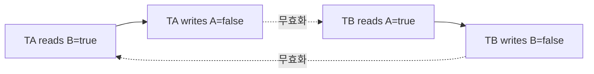
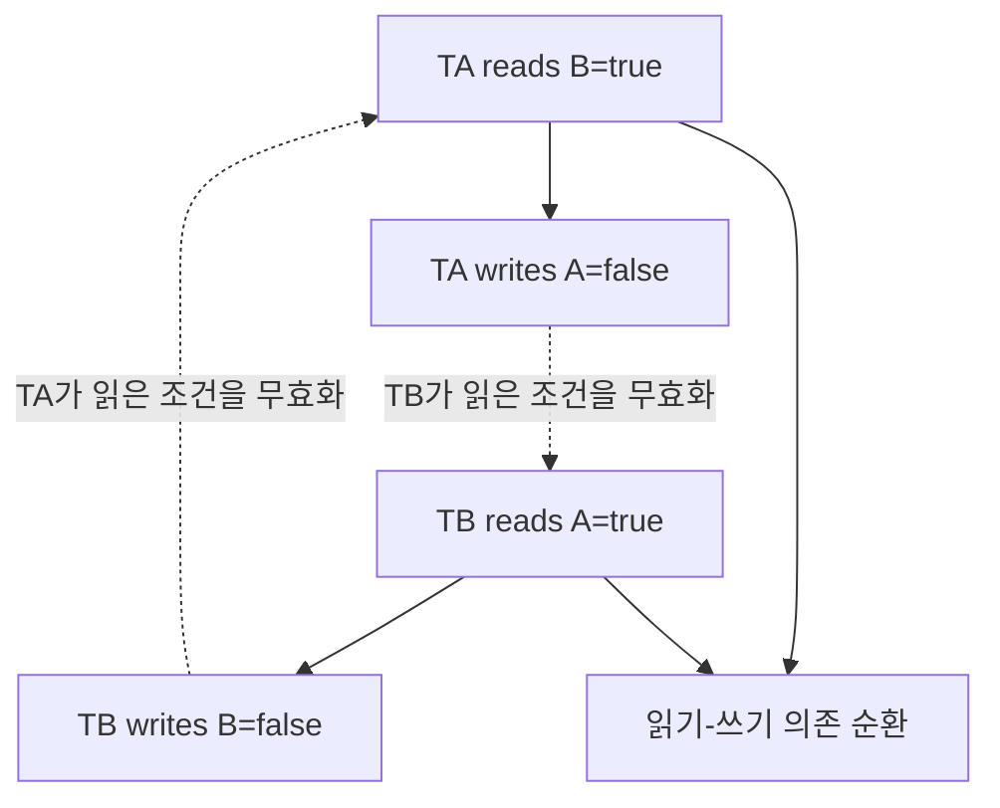

# 08. Isolation과 concurrency

[이 책 목차](README.md) · [이전: MVCC와 snapshot visibility](07-mvcc-and-snapshot-visibility.md) · [다음: WAL, checkpoint와 recovery](09-wal-checkpoints-and-recovery.md)

Isolation level은 concurrent transaction이 관찰할 수 있는 현상을 제한한다. PostgreSQL 18의 Read Committed는 statement 시작 snapshot, Repeatable Read는 transaction snapshot이며 phantom도 막지만 Serializable과 같지 않다.

모든 출력과 수치는 교육용이며 실제 PostgreSQL·Spark·Iceberg 실행 결과가 아니다.

## write skew가 직렬 순서로 설명되지 않는 이유

초기 A와 B가 모두 당직이고 규칙은 “적어도 한 명은 당직”이다. TA는 B=true를 읽고 A=false를 쓰며, TB는 A=true를 읽고 B=false를 쓴다. 서로 다른 행을 써서 단순 행 쓰기 충돌이 없을 수 있다. 둘 다 commit하면 A=false,B=false다. TA→TB 직렬 순서라면 TB는 A=false를 읽어 B를 내려서는 안 되고, TB→TA라면 TA가 B=false를 보아야 한다. 가능한 두 직렬 순서 어느 것도 실제 결과를 설명하지 못한다.

명시적 잠금으로 보호하려면 판단에 참여하는 행 또는 더 넓은 조건을 일관된 순서로 잠근다. TA가 A,B를 모두 잠그고 TB도 A,B 순으로 요청하면 TB가 기다린 뒤 새 상태를 읽는다. 반대로 TA가 A→B, TB가 B→A 순으로 잡으면 서로 상대 잠금을 기다리는 deadlock cycle이 생긴다. deadlock detector가 한쪽을 abort해 cycle을 끊어도 애플리케이션은 전체 작업을 재시도해야 한다.

SSI(Serializable Snapshot Isolation)는 모든 읽기를 배타 잠금으로 직렬화하지 않고 snapshot 실행의 read-write dependency를 추적한다. TA가 읽은 B를 TB가 쓰고, TB가 읽은 A를 TA가 쓰면 위험한 순환이 생긴다. 엔진은 commit을 모두 허용하는 대신 하나를 serialization failure로 중단할 수 있다. 따라서 Serializable은 “절대 실패하지 않는 모드”가 아니라 성공한 트랜잭션들을 직렬 순서로 설명할 수 있게 일부를 abort하는 계약이다.

재시도 단위는 `BEGIN→읽기→업무 판단→쓰기→COMMIT` 전체다. 이전 snapshot에서 계산한 “당직 해제 가능”을 보관해 UPDATE만 다시 보내면 검사를 우회한다. 재시도 전에 외부 메시지를 보냈다면 중복될 수 있으므로 commit 뒤 outbox 전달과 idempotency를 사용한다.

### 문제 5개

1. 서로 다른 행을 쓰는데도 anomaly가 생기는가? **해설:** 여러 행을 함께 본 predicate가 서로의 쓰기로 무효화되어 write skew가 생긴다.
2. lock 순서가 왜 중요한가? **해설:** 서로 반대 순서로 보유·대기하면 wait-for graph cycle이 생긴다.
3. deadlock과 serialization failure는 같은가? **해설:** 전자는 잠금 대기 순환, 후자는 직렬화 불가능한 의존 위험이다.
4. 실패한 UPDATE만 재시도해도 되는가? **해설:** 읽기와 판단을 새 snapshot에서 다시 해야 하므로 전체 트랜잭션을 재시도한다.
5. RR이 같은 행을 반복해 보이면 업무 규칙도 안전한가? **해설:** 아니다. 여러 행 조건은 write skew로 깨질 수 있다.

## 1. 단어와 위치

| 용어 | 뜻 |
| --- | --- |
| Dirty read | 다른 transaction의 uncommitted data를 읽는 현상 |
| Nonrepeatable read | 같은 row를 다시 읽을 때 committed 값이 달라지는 현상 |
| Phantom | 같은 predicate query의 row 집합이 달라지는 현상 |
| Serialization anomaly | 어떤 serial 순서로도 설명할 수 없는 committed 결과 |
| Read Committed | PostgreSQL에서 각 command가 시작할 때 새 snapshot을 얻는 level |
| Repeatable Read | 첫 non-control statement 기준 transaction snapshot을 유지하는 level |
| Serializable | Committed 결과가 어떤 serial 실행과 동등하도록 검사하는 level |
| Lock | Concurrent operation의 충돌을 대기·거부하도록 표현한 state |
| Deadlock | Transaction들이 서로 가진 lock을 기다리는 cycle |
| Retry | Abort된 transaction의 모든 logic과 input 판단을 처음부터 다시 수행 |

## 2. 실제 객체

- Backend transaction snapshot

- Tuple version와 row/table lock

- Wait queue와 deadlock graph

- Serializable read/write dependency

- SQLSTATE 40001 error

- Application transaction retry loop

## 3. 입력에서 결과까지

1. T1이 isolation level로 BEGIN한다.

2. Read Committed SELECT는 command 시작 snapshot을 만든다.

3. T2가 관련 row를 update하고 commit한다.

4. T1의 다음 SELECT는 새 snapshot에서 T2를 볼 수 있다.

5. Repeatable Read T3는 같은 transaction snapshot을 유지한다.

6. Concurrent update conflict면 T3가 serialization error로 abort될 수 있다.

7. Serializable은 read/write dependency graph를 감시한다.

8. Cycle 위험이 있으면 transaction 하나를 abort한다.

9. Application이 전체 transaction을 새 snapshot으로 재시도한다.

10. 성공 commit 뒤에만 읽은 결과와 side effect를 확정한다.

## 4. 숫자 시간표

- x=0, y=0 invariant: 적어도 하나는 0

- T1은 y=0을 읽고 x=1 write

- T2는 x=0을 읽고 y=1 write

- snapshot isolation이면 둘 다 commit해 x=1,y=1 가능

- Serializable은 serial 순서 불가능을 감지해 하나를 abort 가능

## 5. 조건과 경계

Read Committed의 두 SELECT는 같은 transaction 안에서도 다른 committed state를 볼 수 있다.

PostgreSQL Repeatable Read는 phantom을 막지만 serialization anomaly는 가능하다.

Serializable failure에서는 마지막 statement만이 아니라 전체 transaction을 retry한다.

Retry 전에 external email을 보내면 중복될 수 있어 outbox/idempotency가 필요하다.

Deadlock victim abort와 serialization failure는 원인·SQLSTATE가 다를 수 있다.

Sequence 변경처럼 rollback되지 않는 object도 공식 문서를 확인한다.

## 6. 실패를 읽는 순서

1. 어느 transaction·snapshot·LSN·stage인지 identity를 적는다.

2. Client 성공과 storage·replica 완료를 구분한다.

3. Estimate와 actual을 분리한다.

4. Retry가 전체 operation인지 일부 request인지 확인한다.

5. External side effect와 orphan object를 찾는다.

6. Version별 공식 보장을 확인한다.

## 7. 오해와 반례

- Repeatable Read는 Serializable과 같다.

- Read Committed transaction은 snapshot 하나만 쓴다.

- Serialization failure는 COMMIT만 다시 보내면 된다.

- Lock을 많이 잡으면 deadlock이 사라진다.

- Read-only result는 abort 뒤에도 항상 사용해도 된다.

## 8. 문제

1. Read Committed에서 연속 SELECT가 다른 값을 볼 수 있는 이유는?

2. PostgreSQL Repeatable Read가 phantom을 막으면 Serializable인가?

3. SQLSTATE 40001 뒤 무엇을 retry하는가?

## 9. 해설

1. 각 command 시작에 새 snapshot을 얻어 사이에 commit된 변경을 볼 수 있기 때문이다.

2. 아니다. Serialization anomaly가 가능하다.

3. Business input을 다시 검증하며 전체 transaction을 처음부터 retry한다.

## 10. 공식 자료

- [공식 문서](https://www.postgresql.org/docs/current/transaction-iso.html)

- [CMU 15-445/645 Fall 2024](https://15445.courses.cs.cmu.edu/fall2024/syllabus.html)

다음 장에서는 이 계약을 더 큰 execution 또는 재현 모델에 연결한다.

## 보강: write skew를 실제 스케줄로 판정하기

격리 수준은 여러 트랜잭션이 겹칠 때 볼 수 있는 중간 상태를 정한다. PostgreSQL Read Committed는 문장 시작 스냅샷, Repeatable Read는 트랜잭션 스냅샷을 사용한다. PostgreSQL Repeatable Read는 phantom도 막지만 Serializable과 같지 않다. Serializable에서 serialization failure가 나면 읽기와 판단을 포함한 전체 트랜잭션을 재시도해야 한다.

당직 규칙이 “의사 A나 B 중 적어도 한 명은 `on_call=true`”이고 초기에는 둘 다 true라고 하자.

| 시각 | 트랜잭션 TA | 트랜잭션 TB | 커밋된 상태 |
|---:|---|---|---|
| t0 | BEGIN, snapshot SA | BEGIN, snapshot SB | A=true, B=true |
| t1 | B를 읽음 → true | | 동일 |
| t2 | | A를 읽음 → true | 동일 |
| t3 | A=false 쓰기 | | 아직 미커밋 |
| t4 | | B=false 쓰기 | 아직 미커밋 |
| t5 | COMMIT | COMMIT | 둘 다 성공하면 A=false, B=false |

TA를 먼저 직렬 실행하면 그 뒤 TB는 A=false를 읽으므로 B를 해제해서는 안 된다. TB를 먼저 두어도 반대 이유로 TA가 A를 해제해서는 안 된다. 어느 직렬 순서에서도 둘 다 false가 나오지 않으므로 이 결과는 직렬화할 수 없다. 서로 다른 행을 썼기 때문에 단순 행 잠금 충돌만으로는 막히지 않을 수 있다.

Serializable은 이런 위험 의존성을 발견하면 한 트랜잭션을 실패시킬 수 있다. 실패한 쪽은 `BEGIN → 읽기 → 업무 판단 → 쓰기 → COMMIT` 전체를 새 snapshot으로 재실행한다. 마지막 UPDATE만 반복하면 이전 snapshot에서 내린 판단을 재사용하므로 올바르지 않다.

**오해: Repeatable Read면 모든 업무 규칙이 안전하다.** 한 행을 반복해 같은 값으로 보아도 여러 행의 조건은 write skew로 깨질 수 있다. **오해: Serializable은 트랜잭션을 한 번에 하나씩만 실행한다.** 동시 실행을 허용하며 위험한 실행 일부를 중단할 수 있다. **오해: 교착 상태와 serialization failure는 같다.** 전자는 잠금 대기 순환이고 후자는 직렬 순서로 설명할 수 없는 의존 관계다.
